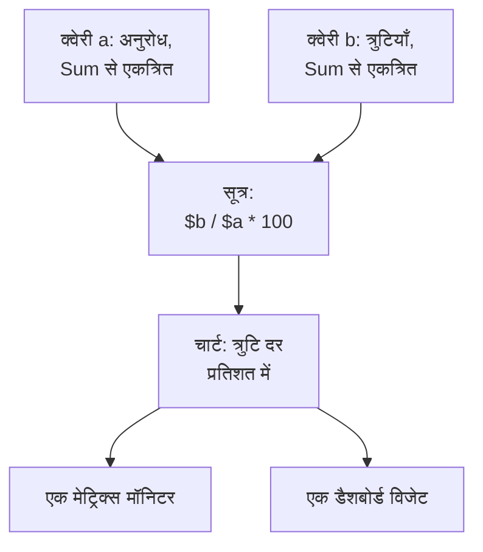

# मेट्रिक्स एक्सप्लोरर

मेट्रिक्स वे संख्याएँ हैं जो आपकी सेवाएं और इन्फ़्रास्ट्रक्चर समय के साथ रिपोर्ट करते हैं: अनुरोधों की गिनती, लेटेंसी, CPU, कतार की गहराई। मेट्रिक्स एक्सप्लोरर आपके प्रोजेक्ट को मिलने वाले हर मेट्रिक की सूची दिखाता है, उनमें से किसी का भी चार्ट बनाता है, उन्हें सूत्रों से जोड़ता है, और किसी चार्ट को मॉनिटर या डैशबोर्ड विजेट में बदल देता है।

:::cards
- [मेट्रिक ढूँढना](#मेट्रिक-ढूँढना): मेट्रिक नामों की सूची में खोजें।
- [मेट्रिक का चार्ट बनाना](#मेट्रिक-का-चार्ट-बनाना): किसी क्वेरी को एकत्रित, फ़िल्टर और समूहित करें।
- [सूत्र से क्वेरी जोड़ना](#सूत्र-से-क्वेरी-जोड़ना): त्रुटि दर और दूसरे अनुपात।
- [बनाए गए चार्ट का इस्तेमाल](#बनाए-गए-चार्ट-का-इस्तेमाल): एक मॉनिटर, एक डैशबोर्ड विजेट या एक लिंक।
- [AI से मेट्रिक्स सुधारें और छूटे हुए जोड़ें](#ai-से-मेट्रिक्स-सुधारें-और-छूटे-हुए-जोड़ें): पुल रिक्वेस्ट जो आपके मेट्रिक्स ठीक करती हैं, और किसी सेवा में छूटे मेट्रिक्स जोड़ती हैं।
:::

## एक्सप्लोरर कैसे काम करता है

एक्सप्लोरर के दो स्तर हैं। **दर्शक** टैब उन मेट्रिक्स की सूची दिखाता है जो आपके प्रोजेक्ट को मिलते हैं। किसी एक पर क्लिक करें, और मेट्रिक एक्सप्लोरर उसके लिए एक क्वेरी के साथ खुलता है: एक मेट्रिक, उसे कैसे एकत्रित करना है, और उसे कैसे फ़िल्टर और समूहित करना है। हर क्वेरी एक वेरिएबल है, `a`, `b` और इसी तरह, जिसे कोई सूत्र इस्तेमाल कर सकता है।

एक्सप्लोरर में पाँच टैब हैं:

| टैब | यह किसलिए है |
| --- | --- |
| **दर्शक** | मेट्रिक्स की सूची, हर एक के साथ एक छोटा चार्ट और उसका नवीनतम मान। यह पिछले एक घंटे पर खुलता है। |
| **इनसाइट्स** | कौन-सी सेवाएं मेट्रिक्स रिपोर्ट करती हैं, और कितने। |
| **एआई** | OneUptime को आपके मेट्रिक्स में मिलने वाली समस्याएँ (बहुत अधिक मान, फिट न होने वाले हिस्टोग्राम बकेट, छूटे हुए मेट्रिक्स), और OneUptime AI ने उनके बारे में क्या किया। देखें [AI से मेट्रिक्स सुधारें और छूटे हुए जोड़ें](#ai-से-मेट्रिक्स-सुधारें-और-छूटे-हुए-जोड़ें)। |
| **सेटअप गाइड** | अपनी किसी इंजेशन कुंजी से OpenTelemetry के ज़रिए मेट्रिक्स कैसे भेजें। |
| **सेटिंग्स** | **पाइपलाइन नियम** और **रिकॉर्डिंग नियम**: मेट्रिक्स आने पर उनके साथ क्या होता है। |

## शुरू करने से पहले

- **आते हुए मेट्रिक्स।** उन्हें [OpenTelemetry](/docs/telemetry/open-telemetry) से भेजें, या किसी एजेंट से, जैसे [होस्ट OpenTelemetry Collector](/docs/telemetry/host-otel-collector) या [Kubernetes एजेंट](/docs/telemetry/kubernetes-agent)।
- **टेलीमेट्री पढ़ सकने वाली भूमिका।** Project Owner, Project Admin, Project Member, Viewer, Telemetry Admin, Telemetry Member या Telemetry Viewer, या Read Telemetry Service Metrics अनुमति वाली कस्टम भूमिका। वह कौन-से मेट्रिक्स पढ़ती है, इसके लिए देखें [टेलीमेट्री](/docs/permissions/index#टेलीमेट्री)।

## मेट्रिक ढूँढना

**उत्पाद → अवलोकनीयता → मेट्रिक्स** पर जाएँ। **दर्शक** आपके प्रोजेक्ट को मिला हर मेट्रिक नाम से दिखाता है, हर एक के साथ समय सीमा का एक छोटा चार्ट और उसका नवीनतम मान।

- अकेले शब्दों या `name:` से नाम खोजें, जैसे `name:http.server` से `http.server.request.duration` मिलता है। देखें [खोज सिंटैक्स](/docs/telemetry/search-syntax#मेट्रिक्स)।
- सिर्फ़ एक सेवा के रिपोर्ट किए मेट्रिक्स देखने के लिए साइडबार में **सेवा** से फ़िल्टर करें।
- किसी मेट्रिक का मेट्रिक एक्सप्लोरर में चार्ट बनाने के लिए उस पर क्लिक करें।

## मेट्रिक का चार्ट बनाना

:::steps
### मेट्रिक खोलें

**दर्शक** में मेट्रिक पर क्लिक करें। एक्सप्लोरर सूची की समय सीमा और फ़िल्टर के लिए एक क्वेरी, `a`, के साथ खुलता है।

### एकत्रित करने का तरीक़ा चुनें

**Aggregate by** के तहत चुनें कि चार्ट के हर बिंदु के मान कैसे जोड़े जाएँ: Avg, जो डिफ़ॉल्ट है, Sum, Min, Max, Count, या कोई पर्सेंटाइल, P50, P75, P90, P95 या P99। किसी हिस्टोग्राम मेट्रिक का पर्सेंटाइल, जैसे अनुरोध की अवधि, उसकी बकेट से निकाला जाता है।

### फ़िल्टर और समूहित करें

**Filters & grouping** खोलें। **Filter by attributes** उन डेटा पॉइंट को रखता है जिनकी विशेषताएं मेल खाती हैं, जैसे कोई एक `http.route`, और **Group by** आपकी चुनी विशेषताओं के हर मान के लिए एक रेखा बनाता है, जैसे हर होस्ट के लिए एक रेखा।

### चार्ट समायोजित करें

**Display Settings** खोलकर **Chart type** (लाइन, एरिया या बार) चुनें, चार्ट पर बनाने के लिए **Warning Threshold** और **Critical Threshold** सेट करें, या **Convert to per-second rate** चालू करें।
:::

> [!TIP]
> सिर्फ़ बढ़ने वाला काउंटर, जैसे `system.disk.io`, दर के रूप में सबसे अच्छा पढ़ा जाता है। उसके चलते हुए कुल के बजाय वह कितनी तेज़ी से बदलता है यह दिखाने के लिए **Convert to per-second rate** चालू करें; एक्सप्लोरर ऐसा काउंटर देखने पर यही सुझाता है।

हर क्वेरी अपना चार्ट बनाती है। किसी क्वेरी को उससे पहले वाली क्वेरी के चार्ट पर ही बनाने के लिए उसकी **Display Settings** में **Overlay with previous query** चालू करें।

## सूत्र से क्वेरी जोड़ना

:::steps
### क्वेरी जोड़ें

हर ज़रूरी मेट्रिक के लिए **मीट्रिक जोड़ें** पर क्लिक करें। नई क्वेरी `b`, `c` और इसी तरह होती हैं।

### सूत्र जोड़ें

**सूत्र जोड़ें** पर क्लिक करें और क्वेरी के वेरिएबल, ऑपरेटर `+`, `-`, `*`, `/`, `%` और `^`, और कोष्ठकों से **सूत्र** लिखें। प्रतिशत में त्रुटि दर के लिए `$b / $a * 100` लिखें।
:::

वेरिएबल को उसके `$` के साथ या बिना, किसी भी केस में लिखा जा सकता है। जो सूत्र किसी ऐसी क्वेरी का नाम लेता है जिसे आपने परिभाषित नहीं किया, वह चार्ट बनाने के बजाय यही बताता है।

## किसी चार्ट के आसपास खोजबीन

चार्ट के ऊपर वाले बटन उस समय सीमा पर काम करते हैं जिसे आप देख रहे हैं:

| बटन | यह क्या करता है |
| --- | --- |
| **लॉग** | इस समय सीमा और आपके फ़िल्टर के लिए [लॉग एक्सप्लोरर](/docs/telemetry/logs-explorer) खोलता है। |
| **ट्रेस** | इस समय सीमा और आपके फ़िल्टर के लिए [ट्रेस एक्सप्लोरर](/docs/telemetry/traces-explorer) खोलता है। |
| **जांच करें** | इस समय सीमा के लॉग, ट्रेस और अपवाद के साथ एक साइड पैनल खोलता है। |
| **इवेंट** | इस समय सीमा की घटनाओं और अलर्ट को चार्ट पर चिह्नित करता है। |
| **Compare** | हर चार्ट पर पिछली अवधि को डैश वाली रेखा से बनाता है, ताकि आप देख सकें कि क्या बदला। |

किसी पल पर ज़ूम इन करने के लिए चार्ट पर खींचें, और वापस ज़ूम आउट करने के लिए डबल-क्लिक करें: देखें [समय सीमा पर ज़ूम इन करना](/docs/telemetry/charts-and-time-ranges)।

## बनाए गए चार्ट का इस्तेमाल

- **क्रियाएँ → इस व्यू से मॉनिटर बनाएँ** इन क्वेरी और सूत्रों के साथ पहले से भरा एक नया मेट्रिक्स मॉनिटर खोलता है। देखें [मेट्रिक्स मॉनिटर](/docs/monitor/metrics-monitor)।
- **क्रियाएँ → Add to dashboard** चार्ट को आपके चुने डैशबोर्ड में जोड़ता है। उस डैशबोर्ड को संपादित करने की अनुमति ज़रूरी है।
- **लिंक कॉपी करें** ठीक इसी व्यू का लिंक कॉपी करता है: क्वेरी, सूत्र और समय सीमा।
- **Saved Views** व्यू को एक नाम के तहत प्रोजेक्ट में सबके लिए रखता है। **दर्शक** के अपने सहेजे गए व्यू हैं, उसकी खोज और फ़िल्टर के लिए। सहेजे गए व्यू वैसे ही काम करते हैं जैसे [लॉग एक्सप्लोरर](/docs/telemetry/logs-explorer#व्यू-सहेजना) में।

## मेट्रिक्स इनसाइट्स

**इनसाइट्स** टैब किसी समय सीमा के मेट्रिक्स गिनता है: **सक्रिय मेट्रिक्स**, **रिपोर्टिंग सेवाएं** और प्रति सेवा औसत। यह मेट्रिक्स को श्रेणियों में बाँटता है, और उन्हें रिपोर्ट करने वाली सेवाओं की सूची दिखाता है।

## AI से मेट्रिक्स सुधारें और छूटे हुए जोड़ें

OneUptime हर घंटे पिछले एक घंटे में आपकी सेवाओं के भेजे मेट्रिक्स में ऐसे मेट्रिक्स खोजता है जो बहुत अधिक मान दर्ज करते हैं, ऐसे हिस्टोग्राम जिनके बकेट फिट नहीं होते, और ऐसी व्यस्त सेवाएँ जो कोई मेट्रिक नहीं भेजतीं। जो मिलता है, उसे वह सबूत के साथ AI इनसाइट्स के रूप में दर्ज करता है। फिर OneUptime AI हर एक की जाँच करता है और उसे ठीक करने वाली पुल रिक्वेस्ट खोलता है। कुछ भी कभी मर्ज नहीं होता: आपकी टीम हर पुल रिक्वेस्ट की समीक्षा करती है।

OneUptime उन 10 मेट्रिक्स को ध्यान से पढ़ता है जिनके लिए आपकी सेवाओं ने उस घंटे में सबसे ज़्यादा डेटा पॉइंट भेजे, हर एक के कम से कम 1,000 डेटा पॉइंट के साथ, और तीन तरह की खोजें दर्ज करता है:

| खोज | OneUptime इसे कब दर्ज करता है | पुल रिक्वेस्ट |
| --- | --- | --- |
| **उच्च कार्डिनैलिटी** | कोड इनमें से किसी मेट्रिक पर जो विशेषता लगाता है, उसने उस घंटे में 1,000 या अधिक मान लिए, जैसे यूज़र ID या पूरे URL, इसलिए हर मान अपनी एक अलग सीरीज़ बन जाता है। या किसी सेवा के 50 या अधिक मेट्रिक नाम एक ही नाम हैं जिनमें अलग-अलग ID है। | मेट्रिक पर वह मान दर्ज करना बंद करता है, या उसके नामों से ID हटाता है। |
| **गलत हिस्टोग्राम बकेट** | इनमें से कोई मेट्रिक एक हिस्टोग्राम है जिसने 1,000 या अधिक मान दर्ज किए, और उनमें से 90% या अधिक उसके सबसे छोटे बकेट में या सबसे बड़े बकेट से ऊपर गिरे, या उसमें कोई बकेट नहीं है, इसलिए उसके पर्सेंटाइल एक-दूसरे से अलग नहीं पहचाने जा सकते। | हिस्टोग्राम को उसके मानों के अनुकूल बकेट देता है, या उसकी इकाई ठीक करता है। |
| **छूटे हुए मेट्रिक्स** | किसी सेवा ने उस घंटे में 1,000 या अधिक स्पैन भेजे और कभी कोई मेट्रिक नहीं भेजा। | उसके सबसे व्यस्त ऑपरेशनों के अनुरोधों की संख्या, त्रुटियाँ और अवधि मेट्रिक्स के रूप में जोड़ता है। |

कोई खोज कभी किसी विशेषता के मान सहेजती नहीं: केवल विशेषता का नाम, उसने कितने मान लिए और वे कैसे दिखते हैं।

### इसे चालू करें

**मेट्रिक्स → एआई → सेटिंग्स** में **मेट्रिक्स सुधारें और छूटे हुए जोड़ें** स्विच है, जो नए प्रोजेक्ट के लिए चालू रहता है। **AI सक्षम करें** बंद होने पर आपके मेट्रिक्स की समस्याएँ अब भी मिलती हैं, पर OneUptime AI उनके साथ कुछ नहीं करता। पुल रिक्वेस्ट खोलने के लिए OneUptime AI को [कोड](/docs/ai/ai-agent) में कनेक्ट की गई रिपॉजिटरी चाहिए: पेज पहले बताता है कि क्या कमी है। हर रिपॉजिटरी का कोड उस Runner पर बदला जाता है जिसे रिपॉजिटरी कोड में चुनती है।

OneUptime AI हर दिन (UTC) खुद से अधिकतम 5 पुल रिक्वेस्ट खोलता है, हर खोज के लिए एक, और कभी भी किसी रिपॉजिटरी की खुली AI पुल रिक्वेस्ट की सीमा से ज़्यादा नहीं।

### AI नियम

कोई नियम न होने पर OneUptime AI आपके मेट्रिक्स में मिलने वाली हर समस्या की तुरंत जाँच करता है और जिसे वह ठीक कर सकता है उसके लिए पुल रिक्वेस्ट खोलता है। **और सेटिंग्स** के अंतर्गत **AI नियम** इसे तीन चरणों में सीमित करते हैं:

| चरण | यह क्या तय करता है |
| --- | --- |
| **मिलान** | कौन सी सेवाएँ: चुनी गई, कुछ खास लेबल वाली, या जिनका नाम किसी पैटर्न से मेल खाता हो। |
| **जांच करें** | **तुरंत**, या **केवल तभी जब प्रतीक्षा के बाद भी मिले**: प्रतीक्षा के दौरान गायब हो जाने वाली समस्या की जाँच नहीं होती। |
| **सुधार** | **ठीक न करें**, **ठीक करने से पहले पूछें** या **बिना पूछे ठीक करें**। पहले पूछने पर पुल रिक्वेस्ट किसी व्यक्ति पर छोड़ी जाती है: खोज **AI से ठीक करें** देती है। |

**और फ़ील्ड** में कोई नियम वे कोड रिपॉजिटरी, MCP सर्वर और LLM प्रदाता चुनता है जिन्हें OneUptime AI उसके लिए इस्तेमाल कर सकता है। कुछ न चुनने पर वह कोई भी इस्तेमाल कर सकता है, और प्रोजेक्ट का डिफ़ॉल्ट LLM प्रदाता।

### देखें कि इसने क्या किया

- **मेट्रिक्स → एआई → इनसाइट्स** वह सब दिखाता है जो OneUptime को मिला, हर खोज अपने सबूत और **मेट्रिक्स में खोलें** के साथ, जो उस घंटे के लिए उसकी सेवा का उसका मेट्रिक खोलता है जिसमें खोज मिली थी। बिना मेट्रिक्स वाली सेवा इसकी जगह **ट्रेस में खोलें** देती है: वे स्पैन जिन्हें उसके मेट्रिक्स मापते।
- **मेट्रिक्स → एआई → लॉग** हर जाँच और हर पुल रिक्वेस्ट को, सबसे नया पहले, हर एक की स्थिति के साथ दिखाता है।
- कोड में, कार्य बताता है कि उसे OneUptime ने शुरू किया, उसकी खोज के लिंक के साथ, और पुल रिक्वेस्ट बताती है कि उसे क्यों खोला गया।

## मेट्रिक्स आने पर उनके साथ क्या होता है

**मेट्रिक्स → सेटिंग्स → पाइपलाइन नियम** मेट्रिक्स को उनके आते समय, सहेजे जाने से पहले बदलता है। नियम सूची के क्रम में चलते हैं, जिसे आप खींचकर बदलते हैं; किसी एक सेवा का नियम सभी सेवाओं के नियमों से पहले चलता है।

| नियम प्रकार | यह क्या करता है |
| --- | --- |
| फ़िल्टर (allowlist) | सिर्फ़ मेल खाने वाले डेटा पॉइंट रखता है, और बाक़ी छोड़ देता है। |
| ड्रॉप करें | मेल खाने वाले डेटा पॉइंट छोड़ देता है। |
| मेट्रिक का नाम बदलें | मेट्रिक का नाम बदलता है। |
| विशेषता का नाम बदलें | मेल खाने वाले डेटा पॉइंट पर किसी विशेषता की कुंजी का नाम बदलता है। |
| विशेषता जोड़ें | मेल खाने वाले डेटा पॉइंट में एक विशेषता जोड़ता है। |
| विशेषता हटाएं | कोई विशेषता हटाता है, जैसे वह जिसके इतने ज़्यादा मान हों कि वह काम की न रहे। |
| विशेषता संपादित करें | किसी विशेषता के मान को एक प्लेसहोल्डर से बदलता है। |
| नमूना | मेल खाने वाले डेटा पॉइंट का एक प्रतिशत रखता है। |

**मेट्रिक्स → सेटिंग्स → रिकॉर्डिंग नियम** हर मिनट दूसरे मेट्रिक्स से नए मेट्रिक्स निकालता है। रिकॉर्डिंग नियम कैसे काम करते हैं, इसके लिए देखें [लॉग रिकॉर्डिंग नियम](/docs/telemetry/log-recording-rules)।

## समस्या निवारण

:::details किसी काउंटर का चार्ट सिर्फ़ ऊपर जाता है
यह एक संचयी काउंटर है। क्वेरी की **Display Settings** में **Convert to per-second rate** चालू करें।
:::

:::details सूची कहती है कि कोई मेट्रिक नहीं मिला
पहले अपनी खोज और फ़िल्टर चिप साफ़ करें। अगर सूची फिर भी खाली है, तो अभी तक कोई मेट्रिक OneUptime तक नहीं पहुँचा: अपने सेटअप की तुलना **सेटअप गाइड** से करें।
:::

:::details किसी सेवा के मेट्रिक्स ग़ायब हैं
**दर्शक** को उस **सेवा** से फ़िल्टर करें और समय सीमा बढ़ाएँ। अगर वे फिर भी ग़ायब हैं, तो हो सकता है आपकी भूमिका का दायरा उस सेवा को शामिल न करता हो: देखें [टेलीमेट्री](/docs/permissions/index#टेलीमेट्री)।
:::

## अगले कदम

:::cards
- [मेट्रिक्स मॉनिटर](/docs/monitor/metrics-monitor): जब कोई मेट्रिक किसी सीमा को पार करे तो अलर्ट पाएँ।
- [डैशबोर्ड बनाना](/docs/dashboards/authoring): अपने चार्ट अगल-बगल रखें।
- [खोज सिंटैक्स](/docs/telemetry/search-syntax): वे सभी फ़िल्टर जो खोज बॉक्स समझता है।
:::
