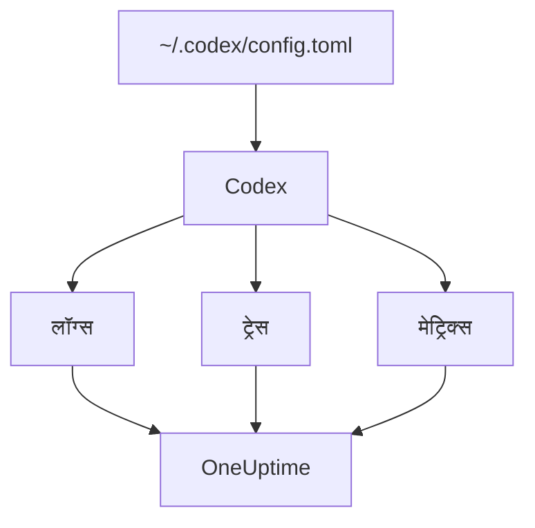

# OpenAI Codex

Codex CLI में तीन OpenTelemetry एक्सपोर्टर पहले से हैं, लॉग, ट्रेस और मेट्रिक्स के लिए एक-एक। `~/.codex/config.toml` में उन्हें OneUptime की ओर करें, और Codex की हर टर्न अपने टोकन और लागत के साथ आती है, बीच में किसी रैपर या प्रॉक्सी के बिना।

:::cards
- [Codex कॉन्फ़िगर करें](#codex-कॉन्फ़िगर-करें): एक `[otel]` ब्लॉक, हर सिग्नल के लिए पूरे URL के साथ।
- [उपयोग को किसी व्यक्ति से जोड़ें](#codex-के-उपयोग-को-किसी-व्यक्ति-से-जोड़ें): Codex स्पैन या मेट्रिक्स पर किसी का नाम नहीं बताता, इसलिए यह आप करते हैं।
- [टोकन और लागत](#टोकन-और-लागत): OneUptime कौन-सा सिग्नल पढ़ता है, और उससे क्या दिखता है।
- [समस्या निवारण](#समस्या-निवारण): कुछ न आए तो क्या जांचें।
:::

## यह कैसे काम करता है

हर एक्सपोर्टर एक सिग्नल अपने URL पर भेजता है। ट्रेस और लॉग तब तक बंद रहते हैं जब तक आप उन्हें कॉन्फ़िगर न करें; मेट्रिक्स ऐसे नहीं हैं।



> [!WARNING]
> जब तक आप इसे नहीं बदलते, Codex अपने मेट्रिक्स OpenAI को भेजता है। रिलीज़ बिल्ड में `metrics_exporter` डिफ़ॉल्ट रूप से `statsig` है, जो उन्हें `https://ab.chatgpt.com/otlp/v1/metrics` पर भेजता है। `metrics_exporter` को नीचे की तरह किसी OTLP एक्सपोर्टर पर, या `none` पर सेट करने से यह रुक जाता है। `[analytics]` में `enabled = false` भी Statsig डिफ़ॉल्ट को रोकता है, लेकिन आपके सेट किए गए OTLP मेट्रिक्स एक्सपोर्टर को काम करता रहने देता है।

## शुरू करने से पहले

1. **प्रोजेक्ट सेटिंग्स → टेलीमेट्री और APM → इंजेशन कुंजियाँ** में एक टेलीमेट्री इंजेशन कुंजी बनाएँ।
2. आपका OTLP एंडपॉइंट `https://oneuptime.com/otlp` है, या अगर आप OneUptime खुद होस्ट करते हैं तो `https://YOUR-ONEUPTIME-HOST/otlp`।
3. हर एक्सपोर्ट कुंजी को `x-oneuptime-token` हेडर में भेजता है।

## Codex कॉन्फ़िगर करें

:::steps
### otel ब्लॉक जोड़ें

इसे `~/.codex/config.toml` में डालें। यह तीनों सिग्नल चालू करता है, और साथ ही Statsig डिफ़ॉल्ट को बदल देता है:

```toml title="~/.codex/config.toml"
[otel]
environment = "prod"
log_user_prompt = false

[otel.exporter.otlp-http]
endpoint = "https://oneuptime.com/otlp/v1/logs"
protocol = "binary"
headers = { "x-oneuptime-token" = "YOUR_INGESTION_TOKEN" }

[otel.trace_exporter.otlp-http]
endpoint = "https://oneuptime.com/otlp/v1/traces"
protocol = "binary"
headers = { "x-oneuptime-token" = "YOUR_INGESTION_TOKEN" }

[otel.metrics_exporter.otlp-http]
endpoint = "https://oneuptime.com/otlp/v1/metrics"
protocol = "binary"
headers = { "x-oneuptime-token" = "YOUR_INGESTION_TOKEN" }

[otel.span_attributes]
"user.id" = "dev@example.com"
"user.email" = "dev@example.com"
"team" = "platform"
```

### हर एक्सपोर्टर को उसका पूरा URL दें

Codex हर `endpoint` को ठीक वैसे ही इस्तेमाल करता है जैसा लिखा है: यह ज़्यादातर SDK की तरह `/v1/logs`, `/v1/traces` या `/v1/metrics` नहीं जोड़ता। सिर्फ़ `https://oneuptime.com/otlp` पर सेट किए गए तीन एक्सपोर्टर कहीं कुछ नहीं भेजते, और कोई त्रुटि भी नहीं देते।

### एक टर्न चलाएँ

एक इंटरैक्टिव `codex` सेशन शुरू करें, कुछ छोटा पूछें और टर्न पूरी होने दें। फिर OneUptime में **लॉग्स** खोलें: Codex के इवेंट, जैसे `codex.conversation_starts`, `codex.api_request` और `codex.turn_cost`, वहाँ दिखते हैं।
:::

> [!IMPORTANT]
> Codex `[otel]` के नीचे उन कुंजियों को बिना चेतावनी के अनदेखा करता है जिन्हें वह नहीं जानता। इसकी कुंजियाँ snake_case में हैं (`trace_exporter`, `metrics_exporter`, `span_attributes`), लेकिन इसके एक्सपोर्टर नाम और TLS फ़ील्ड kebab-case में हैं (`otlp-http`, `ca-certificate`)। `trace-exporter` लिखने से ट्रेस बिना किसी त्रुटि के बंद हो जाते हैं।

## कॉन्फ़िगरेशन कुंजियाँ

| कुंजी | डिफ़ॉल्ट | यह क्या करती है |
| --- | --- | --- |
| `environment` | `"dev"` | `env` रिसोर्स विशेषता सेट करती है |
| `log_user_prompt` | `false` | `codex.user_prompt` पर प्रॉम्प्ट का टेक्स्ट भेजती है; वरना वहाँ `[REDACTED]` लिखा होता है |
| `log_agent_responses` | `false` | एजेंट के अंतिम जवाब लॉग एक्सपोर्टर को भेजती है |
| `exporter` | `none` | लॉग एक्सपोर्टर |
| `trace_exporter` | `none` | ट्रेस एक्सपोर्टर |
| `metrics_exporter` | `statsig` | मेट्रिक्स एक्सपोर्टर: इसे सेट करें |
| `span_attributes` | — | हर एक्सपोर्ट किए गए स्पैन में जोड़ी जाने वाली विशेषताएँ |
| `tracestate` | — | W3C `tracestate` सदस्य |
| `tool_result` | `{ max_bytes = 2048 }` | लॉग रिकॉर्ड किसी टूल के नतीजे का कितना हिस्सा रखता है, UTF-8 बाइट में |

एक्सपोर्टर `none`, `statsig`, `otlp-http` या `otlp-grpc` होता है। `otlp-http` `endpoint`, `headers`, `protocol` (`"binary"` या `"json"`, OneUptime दोनों स्वीकार करता है) और `tls` (`ca-certificate`, `client-certificate`, `client-private-key`) लेता है; `otlp-grpc` यही सब लेता है, `protocol` के बिना।

## Codex के उपयोग को किसी व्यक्ति से जोड़ें

Codex डेवलपर का नाम सिर्फ़ एक जगह बताता है:

- **लॉग रिकॉर्ड** में `user.account_id` और `user.email` होते हैं।
- **स्पैन** में नहीं: Codex दोनों को जानबूझकर अपने ट्रेस से बाहर रखता है।
- **मेट्रिक्स** में भी नहीं: उनमें `auth_mode`, `session_source`, `originator`, `service_name`, `model` और `app.version` होते हैं, और कोई व्यक्ति नहीं।

OneUptime लोगों को स्पैन और मेट्रिक डेटा पॉइंट से पढ़ता है, लॉग रिकॉर्ड से कभी नहीं। इसलिए पहचान खुद हर स्पैन पर `[otel.span_attributes]` में लगाएँ:

```toml title="~/.codex/config.toml"
[otel.span_attributes]
"user.id" = "dev@example.com"
"user.email" = "dev@example.com"
"team" = "platform"
"cost_center" = "eng-123"
```

`user.id` वह कुंजी है जिसे OneUptime पसंद करता है, और `user.email` ईमेल कॉलम भरता है। Codex में रिसोर्स विशेषताएँ नहीं होतीं, इसलिए टीम कुंजियाँ (`team.id`, `team`, `cost_center`, `department`) भी यहीं सेट करें। यह ब्लॉक हर डेवलपर की अपनी कॉन्फ़िग फ़ाइल में रहता है: इसे हर डेवलपर के लिए अलग से भेजें, अपने dotfiles या किसी MDM प्रोफ़ाइल के ज़रिए। एक पहचान वाली एक साझा फ़ाइल सबका खर्च एक ही व्यक्ति के नाम कर देगी।

## टोकन और लागत

| सिग्नल | Codex क्या भेजता है | OneUptime उसके साथ क्या करता है |
| --- | --- | --- |
| ट्रेस | `gen_ai.usage.input_tokens`, `gen_ai.usage.output_tokens` और कैश टोकन, लेकिन कोई मॉडल नहीं | प्रति व्यक्ति टोकन गिनता है; उनकी कीमत नहीं लगा सकता |
| मेट्रिक्स | `token_type` के हिसाब से `codex.turn.token_usage`, और `codex.turn.cost_microusd`, USD के दस-लाखवें हिस्सों में | लागत को USD में बदलता है; मेट्रिक्स सिर्फ़ वहीं पढ़ता है जहाँ स्पैन कुछ नहीं बताते |
| लॉग | `codex.turn_cost`, `usage.estimated_usd` और व्यक्ति के साथ | इसे **लॉग्स** एक्सप्लोरर में सहेजता है; खर्च से नहीं जोड़ता |

ऊपर के कॉन्फ़िगरेशन के साथ **उपयोग** टैब पर यह नतीजा होता है:

- टोकन स्पैन से आते हैं, प्रति व्यक्ति, और `codex.turn.token_usage` उनके ऊपर नहीं जोड़ा जाता: दोनों को कभी जोड़ा नहीं जाता ([क्यों](/docs/telemetry/ai-llm-observability#स्पैन-पहले-मेट्रिक्स-कमी-पूरी-करते-हैं))।
- Codex के स्पैन किसी मॉडल का नाम नहीं बताते, इसलिए OneUptime उनकी कीमत नहीं लगा सकता, और उनकी लागत 0 होती है। तब लागत के कुल Codex की लागत `codex.turn.cost_microusd` से लेते हैं, आपके लिए USD में बदलकर।
- **कर्मचारी** , **टीम** और **मॉडल** तालिकाएँ स्पैन की पंक्तियाँ दिखाती हैं: प्रति व्यक्ति टोकन, लेकिन प्रति व्यक्ति कोई लागत नहीं।
- ट्रेस के बिना, मेट्रिक्स उन तालिकाओं को भरते हैं, सिर्फ़ लागत के साथ, सब **बिना एट्रिब्यूशन** के नीचे, क्योंकि Codex के मेट्रिक्स किसी का नाम नहीं बताते।

व्यक्ति के साथ हर टर्न की सबसे सटीक लागत `codex.turn_cost` लॉग रिकॉर्ड है। OneUptime अभी लॉग रिकॉर्ड को खर्च से नहीं जोड़ता, लेकिन लॉग एक्सपोर्टर चालू रखें: जब यह जुड़ेगा, तब इतिहास मौजूद होगा।

## CI में और MCP सर्वर के रूप में Codex

`codex`, `codex exec` और `codex mcp-server` सभी अपनी टेलीमेट्री एक ही `[otel]` ब्लॉक से बनाते हैं, तीनों एक्सपोर्टर के साथ। `codex exec` रन में `originator` `codex_exec` होता है, और `codex mcp-server` `codex_mcp_server` के रूप में एक्सपोर्ट करता है, इसलिए आप इन मानों से CI और MCP रन को इंटरैक्टिव सेशन से अलग पहचान सकते हैं।

## गोपनीयता

`log_user_prompt` और `log_agent_responses` डिफ़ॉल्ट रूप से `false` हैं: इन्हें बंद ही रहने दें। `codex.user_prompt` इवेंट फिर भी आता है, प्रॉम्प्ट की जगह `[REDACTED]` के साथ, इसलिए आपके पास टर्न, उसके टोकन और उसकी लागत रहती है, प्रॉम्प्ट के टेक्स्ट के बिना। व्यक्ति (`user.email`, `user.account_id`) लॉग रिकॉर्ड पर होता है, ये स्विच चाहे कुछ भी कहें।

अगर आप किसी जांच के लिए सामग्री चालू करते हैं, तो **ट्रेस → सेटिंग्स** में ट्रेस के **स्क्रब नियम** और **ड्रॉप फ़िल्टर** उसे सहेजे जाने से पहले मास्क करते या हटा देते हैं।

## Codex के बजाय OpenAI API का इस्तेमाल

OpenAI का प्लेटफ़ॉर्म API खुद कोई OpenTelemetry नहीं भेजता: हर स्पैन आपके अपने क्लाइंट को इंस्ट्रुमेंट करने से आता है। तीन इंस्ट्रुमेंटेशन OneUptime के साथ काम करते हैं:

- **OpenTelemetry**: Python के लिए `opentelemetry-instrumentation-genai-openai`, जो `opentelemetry-instrumentation-openai-v2` की जगह लेता है। संदेश रिकॉर्ड होंगे या नहीं, यह `OTEL_INSTRUMENTATION_GENAI_CAPTURE_MESSAGE_CONTENT` तय करता है।
- **OpenLLMetry** (Traceloop): `opentelemetry-instrumentation-openai`।
- **OpenInference** (Arize): `openinference-instrumentation-openai`।

इनमें से किसी को भी OneUptime की ओर वैसे ही करें जैसा [AI / LLM ऑब्ज़र्वेबिलिटी](/docs/telemetry/ai-llm-observability) दिखाता है। इनमें से कोई नहीं जानता कि आपका कर्मचारी कौन है: `user.id` खुद सेट करें।

**OpenAI Agents SDK** ट्रेस OpenAI के अपने एंडपॉइंट पर भेजता है, OTLP पर नहीं। इसे `opentelemetry-instrumentation-openai-agents-v2` या `openinference-instrumentation-openai-agents` से जोड़ें, जो SDK के स्पैन किसी OTLP एक्सपोर्टर को सौंपते हैं।

## समस्या निवारण

:::details कुछ नहीं आता
पहले तीनों `endpoint` मान जांचें: हर एक `/v1/logs`, `/v1/traces` या `/v1/metrics` पर खत्म होना चाहिए। फिर `x-oneuptime-token` हेडर जांचें: OneUptime गलत कुंजी अस्वीकार करता है।
:::

:::details ट्रेस कभी नहीं आते, लेकिन लॉग आते हैं
`[otel]` के नीचे गलत लिखी कुंजी ढूंढें: Codex उसे चुपचाप अनदेखा करता है। आम गलती `trace_exporter` की जगह `trace-exporter` है।
:::

:::details Codex की लागत कुल में दिखती है, लेकिन हर व्यक्ति $0 दिखाता है
यह अपेक्षित है: Codex के स्पैन में टोकन होते हैं लेकिन कोई मॉडल नहीं, इसलिए उनकी कीमत नहीं लग सकती, और लागत मेट्रिक किसी का नाम नहीं बताता। [टोकन और लागत](#टोकन-और-लागत) देखें।
:::

:::details सबका खर्च एक ही व्यक्ति के नीचे दिखता है
हर मशीन पर `[otel.span_attributes]` में एक ही पहचान है। हर डेवलपर को उसकी अपनी पहचान दें।
:::

## अगले कदम

:::cards
- [AI कोडिंग असिस्टेंट](/docs/telemetry/ai-coding-assistants): हर कोडिंग असिस्टेंट में खर्च कैसे जोड़ा जाता है।
- [AI / LLM ऑब्ज़र्वेबिलिटी](/docs/telemetry/ai-llm-observability): आपकी अपनी AI कॉल के लिए बातचीत, अलर्ट, लागत और बजट।
- [AI गेटवे](/docs/telemetry/ai-gateways): एक गेटवे जो हर मॉडल कॉल को ट्रेस करता है और उसकी कीमत लगाता है।
:::
