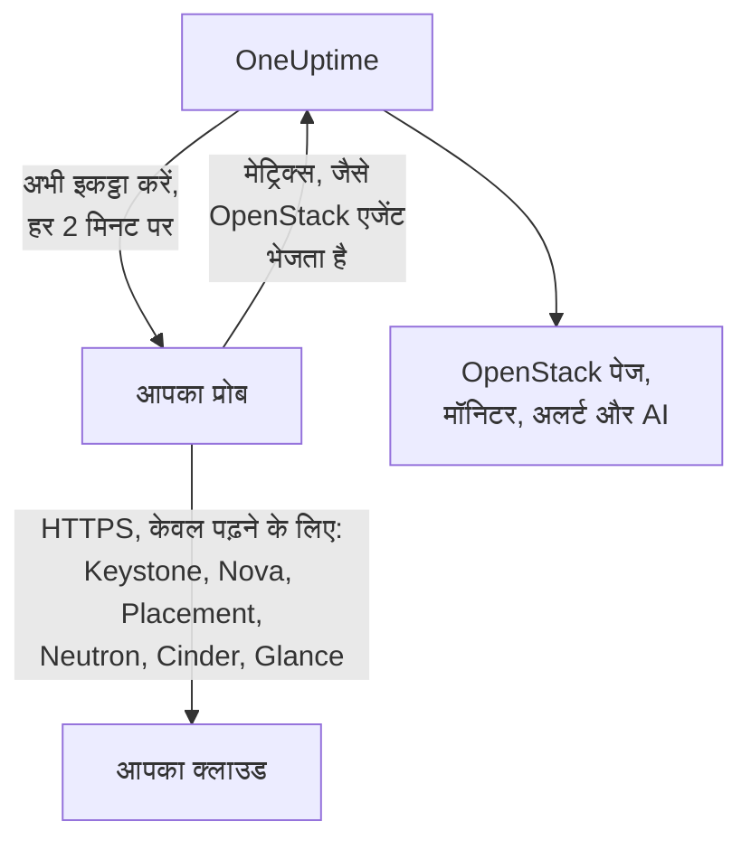

# एजेंट के बिना OpenStack

कुछ भी इंस्टॉल किए बिना OpenStack क्लाउड की निगरानी करें: OneUptime में Keystone का पता और एक एप्लिकेशन क्रेडेंशियल दर्ज करें, वह प्रोब चुनें जो क्लाउड तक पहुँच सकता है, और प्रोब वही डेटा इकट्ठा करता है जो [OpenStack एजेंट](/docs/telemetry/openstack) करता। न कोई एजेंट इंस्टॉल करना है, न अपग्रेड करना या चालू रखना, और न ही उसके लिए अलग मशीन तैयार करनी है।

> [!IMPORTANT]
> प्रोब क्लाउड से केवल HTTPS में बात करता है। कोई क्रेडेंशियल या उसका टोकन कभी सादे HTTP पर नहीं भेजा जाता, जबकि DevStack और Kolla-Ansible अपने API डिफ़ॉल्ट रूप से सादे HTTP पर चलाते हैं। ऐसे क्लाउड के लिए उसके API पर TLS चालू करें, या उसके पास चलने वाले [OpenStack एजेंट](/docs/telemetry/openstack) का उपयोग करें। सादा HTTP पता मिलने पर कनेक्शन परीक्षण यही बताता है।

:::cards
- [शुरू करने से पहले](#शुरू-करने-से-पहले): ऐसा प्रोब जो API तक पहुँचे, और एक क्रेडेंशियल।
- [क्लाउड कनेक्ट करें](#क्लाउड-कनेक्ट-करें): पता, क्रेडेंशियल, एक परीक्षण और एक नाम।
- [समस्या निवारण](#समस्या-निवारण): हर संदेश का मतलब और उसका समाधान।
:::

## यह कैसे काम करता है



हर दो मिनट में प्रोब आपके चुने हर रीजन की हर सेवा को पढ़ता है और जो मिला उसे OneUptime को भेज देता है। यह ठीक उसी रूप में पहुँचता है जैसा OpenStack एजेंट का पहुँचता है, इसलिए हर OpenStack पेज, [OpenStack मॉनिटर](/docs/monitor/openstack-monitor) और अलर्ट टेम्पलेट उसे एक ही तरह पढ़ता है।

हर सेवा अलग से और बाकी सेवाओं के साथ-साथ पढ़ी जाती है। जो Neutron विफल हो या अटक जाए, उसका नुकसान सिर्फ Neutron की सीरीज़ का होता है और Nova का डेटा सामान्य रूप से पहुँचता है, बस एक शर्त के साथ जो Nova खुद लगाता है: वह अपनी सूची के हर इंस्टेंस के बारे में Neutron से पूछता है। इसलिए Neutron के बंद रहने पर प्रोब वे इंस्टेंस रखता है जो उसने आखिरी बार पढ़े थे और केवल वही पूछता है जो बदला है। अगर कोई इंस्टेंस बदल गया है, या प्रोब अभी-अभी शुरू हुआ है, तो Nova उस सूची का भी जवाब नहीं दे पाता: Nova विफल दिखता है, उसकी बाकी सीरीज़ फिर भी पहुँचती हैं, और Neutron के लौटने तक हर इंस्टेंस अपने पेज पर वैसा ही रहता है जैसा वह आखिरी बार था।

Heat, Magnum, Manila, Trove, Gnocchi, Designate, Swift और Barbican वहीं पढ़े जाते हैं जहाँ Keystone का कैटलॉग उनका नाम देता है। जिस क्लाउड में ये नहीं चलते, उसके लिए इनकी कोई लागत नहीं, कनेक्शन परीक्षण इनके बारे में कुछ नहीं कहता, और [इनका कोई निशान नहीं दिखता](/docs/telemetry/openstack#heat-और-magnum)।

जिस क्लाउड के कैटलॉग में Octavia है, वहाँ प्रोब उसके लोड बैलेंसर, पूल, लिसनर और amphorae को एक-एक सूची से पढ़ता है, फिर हर पूल के सदस्य और हर `ACTIVE` लोड बैलेंसर व लिसनर के ट्रैफ़िक काउंटर, हर एक के लिए एक अनुरोध से। 3 लोड बैलेंसर, 1 पूल और 1 लिसनर वाले क्लाउड में हर संग्रह पर 9 अनुरोध लगते हैं; रिग ने जो असली DevStack रिकॉर्ड किया उसमें ठीक इतने ही लगे। एक संग्रह में अधिकतम 25 पूल के सदस्य और 50 काउंटर पढ़े जाते हैं, जो सबसे ज़्यादा समय से नहीं पढ़े गए वे पहले, और बाकी वही कहते रहते हैं जो उन्होंने आखिरी बार पढ़े जाने पर कहा था। Octavia के काउंटर संचयी होते हैं, इसलिए प्रोब हर एक की आखिरी रीडिंग रखता है और दो रीडिंग के बीच प्रति सेकंड अंतर का चार्ट बनाता है: चार्ट दूसरे संग्रह से शुरू होता है, और जो काउंटर घट जाए (लिसनर दोबारा बना) उस अंतराल के लिए कुछ नहीं बनाता। OVN प्रदाता हर काउंटर के लिए 0 बताता है, जो एक सपाट रेखा है, कोई खराबी नहीं।

Amphorae की हर रीड के लिए Octavia का admin नियम चाहिए। admin से नीचे का क्रेडेंशियल अपने ही प्रोजेक्ट के लोड बैलेंसर, पूल, लिसनर और सदस्य, और अपने ही काउंटर देखता है, amphorae नहीं: लोड बैलेंसर पेज यह बताता है, और कोई चेतावनी नहीं आती। जिस प्रोजेक्ट में कोई लोड बैलेंसर नहीं, उस पर मॉनिटरिंग भूमिका को कुछ नहीं दिखता। `load-balancer_global_observer` को इस रिलीज़ में हर चीज़ से मना किया जाता है।

बंद पड़ा Octavia API प्रोब को `up 0` दिखता है, जो एजेंट का एक्सपोर्टर नहीं बता सकता।

## प्रोब या एजेंट?

| | प्रोब (यह पेज) | OpenStack एजेंट |
|---|---|---|
| आप क्या चलाते हैं | कोई प्रोब जो आप पहले से चलाते हैं, या नया | एजेंट, अपनी अलग मशीन पर |
| क्रेडेंशियल कहाँ रखा जाता है | OneUptime में एन्क्रिप्टेड, केवल प्रोब को भेजा जाता है | एजेंट की `clouds.yaml` फ़ाइल में |
| किस तक पहुँचना ज़रूरी है | Keystone और हर सेवा का API, HTTPS पर | Keystone और हर सेवा का API |
| सादे HTTP वाले API | इकट्ठा नहीं होते: टोकन कभी बिना एन्क्रिप्शन के नहीं भेजा जाता | इकट्ठा होते हैं |
| सबसे बड़ा क्लाउड | [200,000 इंस्टेंस](/docs/telemetry/openstack-very-large-clouds) पर परखा गया, असली नहीं बल्कि सिम्युलेटेड क्लाउड के विरुद्ध, 48 MiB के अधिकतम दस अपलोड में | अभी किसी पर नहीं परखा गया: [इसका स्क्रेप](/docs/telemetry/openstack-very-large-clouds#एजेंट-के-ज़रिए) उससे बहुत पहले समय सीमा पार कर जाता है |
| सेवा लॉग और AI एजेंट | शामिल नहीं | शामिल |
| क्लाउड जिन पर टिका है: RabbitMQ, MariaDB, Memcached, HAProxy, OVN, libvirt | शामिल नहीं: प्रोब क्लाउड के API पढ़ता है | शामिल, उनके टारगेट के नाम के साथ |
| हर इंस्टेंस का असली CPU, मेमोरी और डिस्क, libvirt या Ceilometer से | शामिल नहीं | शामिल, उनके एक्सपोर्टर के नाम के साथ |
| Keystone में लॉगिन | एक टोकन के जीवनकाल भर में एक, आमतौर पर एक घंटा | हर स्क्रेप पर एक |
| एक प्रोजेक्ट पर सादा `reader` | उस प्रोजेक्ट के इंस्टेंस, वॉल्यूम और नेटवर्क | उस प्रोजेक्ट के वॉल्यूम और नेटवर्क, इंस्टेंस नहीं |

दोनों एक ही सीरीज़ भेजते हैं, इसलिए पेज और मॉनिटर दोनों के साथ काम करते हैं। प्रोब वह भी भेजता है जो केवल नेटिव क्लाइंट पढ़ सकता है: इंस्टेंस के पते, टास्क स्टेट और फ़ॉल्ट संदेश, जिस इमेज से वह बूट हुआ, क्या किसी ऑपरेटर ने Nova सेवा को जबरन डाउन किया, कौन सा DHCP एजेंट किन नेटवर्क को सेवा देता है, किस पूल में कोई वॉल्यूम है, इंस्टेंस, वॉल्यूम या इमेज में आखिरी बदलाव कब हुआ, और हर वॉल्यूम स्नैपशॉट और बैकअप की स्थिति। Cinder किसी वॉल्यूम का पूल केवल उसी क्रेडेंशियल को बताता है जिसे वह admin मानता है। जिस क्लाउड पर [Heat या Magnum](/docs/telemetry/openstack#heat-और-magnum) चलता है, वहाँ यह भी भेजता है कि कोई स्टैक या क्लस्टर क्यों विफल हुआ, कौन से इंस्टेंस और वॉल्यूम किसी स्टैक के हैं, हर क्लस्टर का प्रोजेक्ट, टेम्पलेट और Kubernetes संस्करण, और Heat के हर इंजन व Magnum के हर कंडक्टर के चालू होने की स्थिति।

एजेंट तब चुनें जब आपको सेवा लॉग चाहिए, AI एजेंट चाहिए, यह चाहिए कि क्लाउड किन पर टिका है और हर इंस्टेंस का असली उपयोग, जब क्लाउड के API केवल सादे HTTP बोलते हों, जैसा DevStack और Kolla-Ansible डिफ़ॉल्ट रूप से करते हैं, या जब क्लाउड इतना बड़ा हो कि उसे [उसके डेटाबेस से पढ़ना](/docs/telemetry/openstack-very-large-clouds#डेटाबेस-का-रास्ता) पड़े। बाकी सबके लिए प्रोब चुनें: कुछ इंस्टॉल नहीं करना पड़ता, और वह Nova और Cinder जो बताते हैं उसमें से ज़्यादा पढ़ता है। किसी भी आकार पर दोनों की लागत [बहुत बड़े OpenStack क्लाउड](/docs/telemetry/openstack-very-large-clouds) में बताई गई है।

आप किसी भी समय क्लाउड को उसके **सेटिंग्स** पेज पर एक से दूसरे में बदल सकते हैं।

## शुरू करने से पहले

- **ऐसा प्रोब जो Keystone और हर सेवा के API तक HTTPS पर पहुँच सके।** यह आमतौर पर क्लाउड के नेटवर्क में एक [कस्टम प्रोब](/docs/probe/custom-probe) होता है। Keystone का कैटलॉग बताता है कि हर सेवा कहाँ जवाब देती है, और प्रोब उन्हीं पतों से जुड़ता है, इसलिए हर पता प्रोब से पहुँच योग्य होना चाहिए, और हर एक HTTPS होना चाहिए। OneUptime Cloud पर साझा प्रोब को OpenStack क्रेडेंशियल कभी नहीं मिलता, इसलिए अपना प्रोब जोड़ें। सेल्फ़-होस्टेड इंस्टेंस पर इंस्टेंस के अपने प्रोब भी इकट्ठा कर सकते हैं।
- **एक क्रेडेंशियल।** एप्लिकेशन क्रेडेंशियल सबसे अच्छा है, क्योंकि उसे केवल पढ़ने तक सीमित किया जा सकता है और वह समाप्त हो सकता है। यूज़र नाम और पासवर्ड भी चलते हैं, और वे वह सब कर सकते हैं जो उनका खाता कर सकता है।

OpenStack में कोई वैश्विक केवल-पढ़ने वाली भूमिका नहीं है, इसलिए प्रोब कितना देखता है यह क्रेडेंशियल पर निर्भर है:

| स्तर | क्या चाहिए | प्रोब क्या पढ़ता है |
|---|---|---|
| पूरा दृश्य | ऐसे खाते का एप्लिकेशन क्रेडेंशियल जिसके पास अपने ही प्रोजेक्ट पर `admin` हो, और जिसे एक्सेस नियमों से केवल पढ़ने तक सीमित किया गया हो | सब कुछ, सिवाय Keystone के यूज़र और ग्रुप के, जिन्हें नियम जानबूझकर छोड़ देते हैं |
| केवल इंफ्रास्ट्रक्चर | अपने ही ऐसे प्रोजेक्ट पर `oneuptime_monitoring` और `reader` भूमिकाएँ जिसमें कुछ नहीं है और क्वोटा शून्य है, और OpenStack एजेंट के साथ आने वाली पॉलिसी फ़ाइलें | हाइपरवाइज़र, Nova की सेवाएँ, Neutron के एजेंट, एड्रेस पूल, Placement, प्रोजेक्ट सूची और हर प्रोजेक्ट के इंस्टेंस। वॉल्यूम, नेटवर्क और राउटर केवल वहाँ जहाँ भूमिका दी गई हो। `cinder-volume` और `cinder-scheduler` की स्थिति या स्टोरेज पूल नहीं: Cinder का अपना कोड admin माँगता है |
| प्रोजेक्ट दृश्य | एक प्रोजेक्ट पर सादा `reader` | उस प्रोजेक्ट के इंस्टेंस, वॉल्यूम और नेटवर्क, इंफ्रास्ट्रक्चर नहीं |

कनेक्शन परीक्षण बताता है कि क्रेडेंशियल इनमें से किस स्तर का बैठता है, और तब चेतावनी देता है जब उसके अपने प्रोजेक्ट में कुछ रखा हो: जहाँ Cinder में `enforce_new_defaults` बंद है, जो उसका अपना डिफ़ॉल्ट है, वहाँ प्रोजेक्ट की कोई भी भूमिका उस प्रोजेक्ट के वॉल्यूम बना सकती है, `reader` भी।

> [!IMPORTANT]
> एक्सेस नियमों से सीमित एप्लिकेशन क्रेडेंशियल को हर वह सेवा `401` के साथ मना कर देती है जिसके `keystonemiddleware` में `service_type` सेट नहीं है। कनेक्शन परीक्षण हर रीड के लिए यह बताता है। इसे हर सेवा के कॉन्फ़िगरेशन में सेट करें, फिर उसे रीस्टार्ट करें। [क्रेडेंशियल बनाएँ](/docs/telemetry/openstack#क्रेडेंशियल-बनाएँ) में नियम, पॉलिसी फ़ाइलें और हर सेवा की सेटिंग हैं, और [हर स्तर क्या पढ़ता है](/docs/telemetry/openstack#हर-स्तर-क्या-पढ़ता-है) में वह है जो असली क्लाउड ने जवाब दिया।

## क्लाउड कनेक्ट करें

:::steps
### अपने क्लाउड खोलें
OneUptime में **OpenStack → सभी क्लाउड** खोलें और **क्लाउड कनेक्ट करें** पर क्लिक करें।

### पता और क्रेडेंशियल दर्ज करें
अपनी `clouds.yaml` या `openrc` फ़ाइल से `auth_url` दर्ज करें, जैसे `https://keystone.example.com:5000/v3`, और एप्लिकेशन क्रेडेंशियल की ID व सीक्रेट। वह प्रोब चुनें जो क्लाउड तक पहुँचता है।

### कनेक्शन का परीक्षण करें
**कनेक्शन का परीक्षण करें** पर क्लिक करें। प्रोब लॉगिन करता है, हर रीजन में वे सभी रीड आज़माता है जो एक संग्रह करता है, और लॉगआउट कर देता है। वह बताता है कि कैटलॉग किन रीजन के नाम देता है, क्रेडेंशियल क्या पढ़ सकता है, किससे मना किया जाता है, कौन से पेज उसके बिना रह जाएँगे, और वह पंक्ति जो उसे खोलती है। कोई रीड विफल हो तो परीक्षण नहीं रुकता।

### क्लाउड के प्रमाणपत्र पर भरोसा करें
अपनी प्रमाणपत्र प्राधिकरण वाला क्लाउड ऐसा प्रमाणपत्र पेश करता है जिस पर प्रोब भरोसा नहीं करता। तब परीक्षण वह प्रमाणपत्र और उसे पेश करने वाला होस्ट दिखाता है। उसका फ़िंगरप्रिंट API के अपने फ़िंगरप्रिंट से मिलाएँ, फिर **इस प्रमाणपत्र पर भरोसा करें** पर क्लिक करें। जिस क्लाउड में हर सेवा का अपना होस्ट है, उसमें हर सेवा का अपना प्रमाणपत्र हो सकता है, और आप 32 तक पर भरोसा कर सकते हैं।

### रीजन चुनें और कनेक्ट करें
पढ़ने के लिए रीजन चुनें, क्लाउड को नाम दें, और **क्लाउड कनेक्ट करें** पर क्लिक करें। क्लाउड का पेज खुल जाता है।
:::

क्लाउड के **अवलोकन** में एक **डेटा संग्रह** कार्ड दिखता है। पहले संग्रह तक, जो एक मिनट के भीतर शुरू होता है, उस पर **जाँच हो रही है** लिखा रहता है, फिर **इकट्ठा हो रहा है**, और पेज भरने लगते हैं। जब कुछ सेवाएँ पढ़ी गईं और कोई एक नहीं, तो वह बताता है कौन सी। अगर 15 मिनट तक क्लाउड के लिए कोई प्रोब नहीं आता, क्योंकि वह ऑफ़लाइन है या बहुत पुराना है, तो उस पर **इकट्ठा नहीं हो रहा** लिखा आता है और वह यही बताता है, चाहे आखिरी संग्रह में कुछ भी मिला हो।

क्लाउड के **सेटिंग्स** पेज का **डेटा संग्रह** कार्ड वह रखता है जिससे आपने उसे कनेक्ट किया था:


## API या Terraform से क्लाउड कनेक्ट करें

क्लाउड की कनेक्शन सेटिंग API में [OpenStack Cloud रिसोर्स](/reference/open-stack-cloud) के सामान्य फ़ील्ड हैं, `/api/openstack-cloud` पर, इसलिए क्लाउड को बिना डैशबोर्ड के भी कनेक्ट किया जा सकता है। Terraform के साथ यह `oneuptime_openstack_cloud` है:

```hcl
resource "oneuptime_openstack_cloud" "prod_eu" {
  name                      = "prod-eu"
  collection_method         = "Probe"
  auth_url                  = "https://keystone.example.com:5000/v3"
  credential_kind           = "applicationCredential"
  application_credential_id = var.openstack_application_credential_id
  credential_secret         = var.openstack_application_credential_secret
  collection_probe_id       = oneuptime_probe.eu_west.id
  collection_regions        = jsonencode(["RegionOne"])

  # A cloud with its own certificate authority: the fingerprints it presents.
  trusted_certificate_fingerprints = jsonencode(["AB:CD:EF:..."])
}
```

यूज़र नाम और पासवर्ड के लिए `credential_kind` को `password` पर सेट करें, साथ में `keystone_username`, `project_name` और, जब वे `Default` न हों, `user_domain_name` और `project_domain_name`। `endpoint_interface`, `collection_interval_in_minutes` और `collection_options` वे हैं जिन्हें फ़ॉर्म **और फ़ील्ड** के नीचे समेट देता है। केवल `name` ज़रूरी है, क्योंकि जिस क्लाउड को एजेंट भेजता है उसमें इनमें से कुछ नहीं होता।

`credential_secret` केवल लिखने योग्य है, इसलिए कोई रीड उसे नहीं लौटाती और Terraform उसे प्लान और आउटपुट से बाहर रखता है। [सहेजे गए क्रेडेंशियल के नियम](#सहेजा-गया-क्रेडेंशियल) यहाँ भी लागू हैं: पता, प्रोब या भरोसेमंद प्रमाणपत्र बदलने के लिए उसी अनुरोध में सीक्रेट चाहिए। प्रोब जो रिपोर्ट करता है, जैसे `collection_status`, `collection_error` और `presented_certificate`, पढ़े जा सकते हैं, सेट नहीं।

## यह आपके क्लाउड पर कितना भार डालता है

मॉनिटरिंग कभी ऐसी चीज़ नहीं होनी चाहिए जो क्लाउड को गिरा दे, इसलिए संग्रह को बनावट से ही हल्का रखा गया है:

- **एक लॉगिन, जो बना रहता है।** टोकन उसकी समाप्ति से पाँच मिनट पहले तक इस्तेमाल होता है। परेशानी में पड़ा Keystone लॉगिन का बोझ सबसे कम उठा सकता है।
- **पेज में सूचियाँ।** हर सूची `limit` और `marker` के साथ एक बार में हज़ार पंक्तियाँ पढ़ी जाती है।
- **इंस्टेंस, जो बदला उसके आधार पर।** पूर्ण रीड के बीच, हर आधे घंटे पर, प्रोब Nova से केवल वह पूछता है जो पिछली रीड के बाद बदला, `changes-since` के साथ।
- **हाइपरवाइज़र की इन्वेंटरी एक बार।** जब भी इन्वेंटरी बदलती है Placement प्रोवाइडर की जनरेशन आगे बढ़ा देता है, जो एक सूची कॉल सबके लिए बता देती है, इसलिए वे तभी दोबारा पढ़ी जाती हैं।
- **निर्धारित भार।** जहाँ हर चीज़ के लिए एक कॉल लगती है, वह एक संग्रह में 2,000 के बाद, और सीमाओं के लिए 250 प्रोजेक्ट के बाद, बारी-बारी से होता है। जो इस बार नहीं पढ़ा गया वह आखिरी बार जैसा था वैसा भेजा जाता है, इसलिए किसी सीरीज़ में अंतराल नहीं आता, और क्लाउड के साथ भार बढ़ना बंद हो जाता है।
- **केवल वे फ़ील्ड जो वह पढ़ता है।** Neutron की सूचियाँ अपने फ़ील्ड के नाम बताती हैं, और सिक्योरिटी ग्रुप के लिए केवल उनकी ID माँगी जाती है।
- **कभी जमा नहीं होता।** जो संग्रह अपने अंतराल से ज़्यादा समय लेता है उसे छोड़ दिया जाता है, अगले के साथ नहीं चलाया जाता।
- **समय का बजट।** संग्रह को उसके अंतराल का नौ-दसवाँ हिस्सा मिलता है, और अधिकतम दस मिनट। तब तक जो पढ़ा गया वह भेज दिया जाता है, और जिस सेवा का समय खत्म हुआ वह यह बता देती है।
- **पीछे हटना।** `429` या `Retry-After` के साथ रुकने को कहे जाने पर प्रोब रुकता है। जो सेवा `429`, `503` या कुछ नहीं लौटाती उसे एक मिनट, फिर दो, फिर चार, आधे घंटे तक अकेला छोड़ा जाता है, और रुकने के दौरान उसकी सीरीज़ यही कहती रहती हैं कि वह डाउन है।
- **धीमा होना।** जो जवाब उस सेवा के सामान्य जवाब से तीन गुना धीमा हो, और कम से कम एक सेकंड का, या सामान्य जो भी हो उसमें पाँच सेकंड का, उस सेवा का अगला अनुरोध उतनी ही देर रोक देता है। **डेटा संग्रह** कार्ड बताता है कि ऐसा कब हुआ।
- **नामंज़ूर क्रेडेंशियल सबसे लंबा इंतज़ार करता है।** उसे दोहराना ही खाता लॉक करवाता है, इसलिए वह पाँच मिनट, फिर दस, एक घंटे तक इंतज़ार करता है। जो क्रेडेंशियल आपने सुधारा उसे तुरंत आज़माया जाता है।

- **बड़े क्लाउड का कम।** 5,000 इंस्टेंस के बाद क्लाउड गिनतियाँ और उसके हिस्से रखता है, और प्रति इंस्टेंस या प्रति वॉल्यूम कोई सीरीज़ नहीं, जब तक आप उसके **सेटिंग्स** पेज पर **प्रति इंस्टेंस असली उपयोग** के अंतर्गत कुछ और न चुनें। जो बदला, जो आपने रखना चुना और जिस पर कोई अलर्ट नज़र रखे है वह हर संग्रह पर जाता रहता है। बाकी बारी-बारी से जाता है, और **डेटा संग्रह** कार्ड बताता है कि एक बारी में कितना समय लगता है।

हर संग्रह पर, डिफ़ॉल्ट सेटिंग के साथ, एक रीजन में Nova को 7 कॉल, Neutron को 7 और Cinder को 5, Placement को एक और हर हाइपरवाइज़र पर दो और, [हर फ़्लेवर के कितने फ़िट होंगे](/docs/telemetry/openstack#क्षमता) यह Placement से पूछने के लिए अधिकतम 4 और, और लगभग हर पाँच मिनट पर Keystone को 5 और Glance को 1 लगते हैं। हाइपरवाइज़र की इन्वेंटरी एक बार पढ़ी जाती है, और दोबारा तभी जब Placement कहे कि वह बदली। हज़ार पंक्तियों से लंबी सूची में हर हज़ार पर एक कॉल लगती है। जो इंस्टेंस बदला उसके लिए Nova को एक और कॉल लगती है, यह पढ़ने के लिए कि उस पर क्या बीता, और एक संग्रह में अधिकतम 25 पढ़े जाते हैं: शांत क्लाउड में एक भी नहीं। ML2/OVS पर Neutron को हर राउटर के लिए एक और कॉल लगती है, यह पूछने के लिए कि उसे कौन से L3 एजेंट रखते हैं, और हर दस मिनट पर हर DHCP एजेंट के लिए एक कॉल, अधिकतम 20, यह पूछने के लिए कि वह कौन से नेटवर्क सेवा देता है। जिस क्लाउड में इससे ज़्यादा DHCP एजेंट हों वह उन्हें बारी-बारी से देखता है, सारांश आकार से बड़ा क्लाउड इसे छोड़ देता है, और धीमे Neutron से यह पूछा ही नहीं जाता। OVN वाले क्लाउड में पूछने को कुछ नहीं होता। हर आकार पर यह प्रति मिनट कितने अनुरोध बनता है, यह [बहुत बड़े OpenStack क्लाउड](/docs/telemetry/openstack-very-large-clouds#आपके-कंट्रोल-प्लेन-पर-भार) में है।

जिस क्लाउड पर Manila चलता है वह लगभग हर पाँच मिनट पर उसे 2 कॉल देता है, Trove वाला 1, Gnocchi 1 और Barbican 3। Designate 2 लेता है, और हर उस ज़ोन के लिए एक और जो `ACTIVE` नहीं है, एक संग्रह में अधिकतम 50। Swift क्रेडेंशियल के अपने प्रोजेक्ट के लिए 1 लेता है, और `ResellerAdmin` के साथ हर दूसरे प्रोजेक्ट के लिए एक और, एक संग्रह में अधिकतम 200। जिस क्लाउड पर Heat या Magnum चलता है वह लगभग हर पाँच मिनट पर Heat को 2 और Magnum को 3 कॉल देता है। कोई भी सूची सब कुछ नहीं बताती: Magnum की सूची नहीं बताती कि क्लस्टर किसका है या क्यों विफल हुआ, और Heat की नहीं बताती कि स्टैक के पास क्या है। इसलिए जब किसी क्लस्टर या स्टैक की स्थिति बदलती है तो प्रोब उसे अलग से भी पढ़ता है, एक संग्रह में दोनों में से अधिकतम 25। इससे ज़्यादा वाला क्लाउड अगले संग्रहों में भरता रहता है, और जो स्थिर बैठा है वह दो बार नहीं पढ़ा जाता।

तीन चीज़ें तब तक बंद रहती हैं जब तक आप उन्हें चालू न करें, क्लाउड के **सेटिंग्स** पेज पर **डेटा संग्रह** कार्ड में **डिफ़ॉल्ट से आगे यह क्या पढ़ता है** के अंतर्गत, या कनेक्ट करते समय **और फ़ील्ड** के अंतर्गत, क्योंकि हर एक आपके क्लाउड पर ज़्यादा भार डालती है:

| विकल्प | आपको क्या मिलता है | इसकी क्या कीमत है |
|---|---|---|
| पोर्ट | हर पोर्ट की एक सीरीज़, और कितनों के पास कोई पता नहीं है या कोई लोड बैलेंसर डाउन है | आपके बताए हर नेटवर्क या प्रोजेक्ट की एक पेज्ड सूची, या कुछ न बताने पर हर पोर्ट की। पोर्ट की बिना दायरे वाली सूची बड़े क्लाउड पर Neutron को संतृप्त कर सकती है |
| प्रोजेक्ट की सीमाएँ | प्रति प्रोजेक्ट क्वोटा और सीमाएँ | प्रति प्रोजेक्ट चार कॉल, एक संग्रह में अधिकतम 250 प्रोजेक्ट |
| Swift के स्टोरेज सर्वर | क्या हर एक जवाब देता है, उसकी रेप्लिकेशन और क्या सबकी रिंग एक सी हैं, जहाँ आप हर सर्वर का `/recon` पोर्ट `host:port` के रूप में बताते हैं। केवल Swift चलाने वाला क्लाउड इसे देता है, उसके **सेटिंग्स** पेज पर, जब पहला संग्रह Swift को पढ़ ले | हर संग्रह पर प्रति सर्वर 5 कॉल। उन्हें कोई क्रेडेंशियल नहीं जाता |

## प्रमाणपत्र

प्रोब प्रमाणपत्र सत्यापन कभी नहीं छोड़ता। हर कनेक्शन पूरा TLS हैंडशेक करता है, और फिर:

- जब किसी प्रमाणपत्र पर भरोसा न किया गया हो, तब API का प्रमाणपत्र ऐसी प्राधिकरण से आया होना चाहिए जिस पर प्रोब की मशीन भरोसा करती है, उसी पते के लिए जिस पर वह जवाब देता है;
- जब प्रमाणपत्रों पर भरोसा किया गया हो, तब API को ठीक उन्हीं में से एक पेश करना होगा, जिन्हें उनके SHA-256 फ़िंगरप्रिंट से पहचाना जाता है। और कुछ स्वीकार नहीं किया जाता, सार्वजनिक रूप से भरोसेमंद भी नहीं।

फ़िंगरप्रिंट जाँचने के लिए प्रोब की मशीन से यह चलाएँ:

```bash
openssl s_client -connect keystone.example.com:5000 </dev/null | openssl x509 -noout -fingerprint -sha256
```

जब कोई प्रमाणपत्र नवीनीकृत होता है, तो संग्रह **API का प्रमाणपत्र बदल गया** के साथ रुक जाता है और नया प्रमाणपत्र दिखाया जाता है। जब तक आप उस पर भरोसा नहीं करते, कुछ नहीं भेजा जाता, क्लाउड के **अवलोकन** या **सेटिंग्स** पेज पर।

## सहेजा गया क्रेडेंशियल

सीक्रेट एन्क्रिप्टेड और केवल लिखने योग्य है: कोई उसे वापस नहीं पढ़ सकता, और API उसे कभी नहीं लौटाता। वह केवल उस प्रोब को भेजा जाता है जो क्लाउड से इकट्ठा करता है, और वह उसे मेमोरी में रखता है।

सहेजा गया क्रेडेंशियल केवल उसी पते पर, उसी प्रोब के ज़रिए और उन्हीं प्रमाणपत्रों के साथ भेजा जाता है जिनके लिए उसे दर्ज किया गया था। पता, प्रोब या भरोसेमंद प्रमाणपत्र बदलने पर सीक्रेट फिर माँगा जाता है, ताकि क्लाउड को संपादित कर सकने वाला कोई भी उसे कहीं और न भेज सके। जो प्रमाणपत्र प्रोब को सहेजे गए पते पर मिला उस पर भरोसा करने से वह बना रहता है, और कम पर भरोसा करने से भी।

कैटलॉग पर वही नियम लागू होते हैं जो आपके दर्ज किए पते पर, क्योंकि टोकन वहीं जाता है जहाँ वह कहता है। प्रोब लूपबैक, लिंक-लोकल या क्लाउड मेटाडेटा पते से नहीं जुड़ता, चाहे कैटलॉग उसका नाम ले या कोई होस्ट नाम उस पर रिज़ॉल्व हो, और वह उन पतों से जुड़ता है जिन्हें उसने जाँचा, उनसे नहीं जो DNS एक पल बाद बताए। वह रीडायरेक्ट का पीछा नहीं करता।

## एजेंट और प्रोब के बीच बदलें

क्लाउड का **सेटिंग्स** पेज खोलें। उसका **डेटा संग्रह** कार्ड उस क्लाउड के लिए जिसे एजेंट भेजता है **प्रोब से इकट्ठा करें** देता है, और जिसे प्रोब इकट्ठा करता है उसके लिए **OpenStack एजेंट उपयोग करें**। एजेंट पर लौटने से सहेजा गया क्रेडेंशियल भुला दिया जाता है।

> [!WARNING]
> पहला प्रोब संग्रह सफल होते ही OpenStack एजेंट को रोक दें। दोनों के चलते रहने पर हर मेट्रिक दो बार पहुँचता है।

[5,000 इंस्टेंस](/docs/telemetry/openstack-very-large-clouds#सारांश-मोड) से ऊपर, प्रोब का पहला संग्रह पूरे क्लाउड को जानता है और उसका एक हिस्सा भेजता है, इसलिए नए क्लाउड की सूचियाँ उसके पहले चक्र में भरती हैं, और **डेटा संग्रह** कार्ड बताता है कि वे कब तक सब आ जाएँगी।

## बेयर मेटल

जिस क्लाउड के कैटलॉग में Ironic है, वहाँ प्रोब उसके नोड पढ़ता है, और हर फ़ील्ड नाम लेकर माँगता है, इसलिए नोड का `driver_info` किसी संग्रह में कभी नहीं पढ़ा जाता। वह वह जोड़ता है जो एजेंट के एक्सपोर्टर के पास नहीं है: नोड का ड्राइवर, उसका कंडक्टर, उसका फ़ॉल्ट और वह क्यों विफल हुआ। Ironic लगभग एक मिनट में `last_error` खाली कर सकता है, इसलिए पेज वह आखिरी रखता है जो किसी संग्रह ने देखा, और बताता है कब।

प्रोब पहले कैटलॉग पढ़ता है, इसलिए वह बता सकता है कि Ironic का API डाउन है, जो एजेंट का एक्सपोर्टर नहीं बता सकता। Ironic के बिना क्लाउड से उसके बारे में कुछ नहीं पूछा जाता।

Ironic किसी प्रोजेक्ट को केवल वे नोड दिखाता है जिनका वह मालिक है, और उसे कंडक्टर की सूची देने से मना करता है। Ironic की डिफ़ॉल्ट पॉलिसी के अनुसार इन्हें केवल सिस्टम-स्कोप वाला क्रेडेंशियल पढ़ता है, और प्रोब का क्रेडेंशियल सिस्टम-स्कोप वाला नहीं हो सकता, क्योंकि वह Nova की सूचियाँ उसी से पढ़ता है। इसलिए जब तक क्लाउड की पॉलिसी उसकी भूमिका को `baremetal:node:list_all` और `baremetal:conductor:get` न दे, प्रोब को वे नोड दिखते हैं जिनका उसका प्रोजेक्ट मालिक है और कोई कंडक्टर नहीं, और पेज यही बताते हैं। बाकी [बेयर मेटल](/docs/telemetry/openstack#बेयर-मेटल) में है।

## संदर्भ

| सेटिंग | डिफ़ॉल्ट | टिप्पणी |
|---|---|---|
| हर इतने पर इकट्ठा करें | 2 मिनट | 1 से 60 मिनट तक। बड़े क्लाउड पर बोझ कम रखने के लिए उसे कम बार इकट्ठा करें। Keystone और Glance लगभग हर पाँच मिनट पर पढ़े जाते हैं, बाकी जितनी भी बार पढ़े जाएँ। |
| एंडपॉइंट इंटरफ़ेस | public | कैटलॉग के कौन से URL इस्तेमाल करने हैं: public, internal या admin। |
| एक साथ संग्रह | प्रति प्रोब 4 | जो संग्रह अपने अंतराल से धीमा हो उसे छोड़ दिया जाता है, कभी जमा नहीं किया जाता। |
| अपलोड का अधिकतम आकार | 48 MiB | संग्रह उतने हिस्सों में जाता है जितने लगें, दस तक। [5,000 इंस्टेंस](/docs/telemetry/openstack-very-large-clouds#सारांश-मोड) से ऊपर, जो बदला नहीं वह बारी-बारी से जाता है। |
| हर सेवा को अनुरोध | एक बार में एक | Placement के प्रति-प्रोवाइडर कॉल चार-चार करके चलते हैं। |
| एक जवाब का इंतज़ार | 60 सेकंड | `429` या सर्वर त्रुटि होने पर कुल तीन बार आज़माया जाता है। |
| कनेक्शन परीक्षण | शुरू होने में 90 सेकंड | जिस परीक्षण को कोई प्रोब समय पर न उठाए, या जो 3 मिनट से ज़्यादा चले, उसका जवाब विफल के रूप में दिया जाता है। एक प्रोजेक्ट में पाँच एक साथ इंतज़ार या चल सकते हैं। |

## समस्या निवारण

:::details API का प्रमाणपत्र भरोसेमंद नहीं है
क्लाउड अपनी प्राधिकरण का प्रमाणपत्र पेश करता है। दिखाया गया फ़िंगरप्रिंट API के प्रमाणपत्र से मिलाएँ, फिर **इस प्रमाणपत्र पर भरोसा करें** पर क्लिक करें।
:::

:::details API का प्रमाणपत्र बदल गया
प्रमाणपत्र नवीनीकृत हुआ, या कोई बीच में है। जब तक आप नए पर भरोसा नहीं करते, कुछ नहीं भेजा जाता। उसका फ़िंगरप्रिंट जाँचें, फिर उस पर भरोसा करें।
:::

:::details ऑथ URL मान्य नहीं है
Keystone का पता HTTPS पर दर्ज करें, जैसे `https://keystone.example.com:5000/v3`। सादे HTTP का पता कुछ भी भेजे जाने से पहले ही नामंज़ूर कर दिया जाता है। जिस क्लाउड के API केवल सादे HTTP बोलते हैं उसके लिए TLS चालू करें, या [OpenStack एजेंट](/docs/telemetry/openstack) का उपयोग करें।
:::

:::details कैटलॉग में सादे HTTP का एंडपॉइंट है
क्रेडेंशियल का टोकन कभी बिना एन्क्रिप्शन के नहीं भेजा जाता। उस API पर TLS चालू करें, कोई दूसरा एंडपॉइंट इंटरफ़ेस चुनें, या इस क्लाउड के लिए [OpenStack एजेंट](/docs/telemetry/openstack) का उपयोग करें। जब तक वह हर API HTTPS पर नहीं है जिसे वह पढ़ता है, कनेक्शन परीक्षण विफल रहता है। संग्रह में केवल वही सेवा छूटती है जिसका वह एंडपॉइंट है: बाकी सामान्य रूप से पढ़ी जाती हैं।
:::

:::details Keystone ने क्रेडेंशियल नामंज़ूर किया
ID, सीक्रेट या पासवर्ड गलत है, वह समाप्त हो गया है या हटा दिया गया है, या उसके खाते की उस प्रोजेक्ट पर भूमिका चली गई है। नया बनाएँ और उसे क्लाउड के **सेटिंग्स** पेज पर **कनेक्शन संपादित करें** से दर्ज करें।
:::

:::details खाते की उस प्रोजेक्ट पर कोई भूमिका नहीं है
यूज़र नाम और पासवर्ड से लॉगिन हुआ, पर उस प्रोजेक्ट पर नहीं। प्रोजेक्ट का नाम और दोनों डोमेन जाँचें। एप्लिकेशन क्रेडेंशियल इससे बचाता है: वह बनते समय ही स्कोप हो जाता है।
:::

:::details क्रेडेंशियल वह नहीं पढ़ सकता जो मॉनिटरिंग को चाहिए
परीक्षण हर उस रीड को सूचीबद्ध करता है जिससे मना किया गया, उसके बिना क्या छूटता है, और वह पंक्ति जो उसे खोलती है। एक्सेस नियमों वाले क्रेडेंशियल पर `401` का मतलब है कि वे उस पाथ को सूचीबद्ध नहीं करते, या उस सेवा के `keystonemiddleware` में `service_type` सेट नहीं है और उसे रीस्टार्ट नहीं किया गया।
:::

:::details प्रोब को क्लाउड से कोई जवाब नहीं मिलता
प्रोब का नेटवर्क उस API तक नहीं पहुँच सकता। उसे फ़ायरवॉल से होकर जाने दें, या क्लाउड के नेटवर्क में कोई प्रोब चुनें। हर सेवा का पता अपना है: संदेश उसका नाम बताता है जिसने जवाब नहीं दिया।
:::

:::details उस पोर्ट पर कुछ जवाब नहीं देता
पता और पोर्ट जाँचें। Keystone आमतौर पर 5000 पर चलता है, या 443 पर किसी पाथ जैसे `/identity` के पीछे।
:::

:::details सुरक्षित कनेक्शन विफल रहा
पता शायद ऐसे पोर्ट की ओर इशारा करता है जो HTTPS नहीं बोलता। उसे जाँचें। अगर क्लाउड के API केवल सादे HTTP बोलते हैं, तो TLS चालू करें, या OpenStack एजेंट का उपयोग करें।
:::

:::details OneUptime इस पते से नहीं जुड़ता
पता, या कैटलॉग जिसका नाम लेता है, कोई लूपबैक, लिंक-लोकल या क्लाउड मेटाडेटा पता है या उस पर रिज़ॉल्व होता है। वह पता इस्तेमाल करें जिस पर API आपके नेटवर्क में जवाब देता है।
:::

:::details यह पता Keystone का नहीं है
अपनी `clouds.yaml` या `openrc` फ़ाइल से Identity एंडपॉइंट दर्ज करें: उसका `auth_url`।
:::

:::details रीजन कैटलॉग में नहीं है
उन रीजन में से चुनें जिनके नाम कैटलॉग देता है। कनेक्शन परीक्षण उन्हें सूचीबद्ध करता है।
:::

:::details Keystone विफल हो रहा है
Keystone ने सर्वर त्रुटि के साथ जवाब दिया। उसके ठीक होने तक प्रोब लॉगिन के बीच ज़्यादा इंतज़ार करता है, और लॉगिन के बिना और कुछ नहीं पढ़ा जा सकता। Keystone की सेवा और उसके पीछे का डेटाबेस जाँचें।
:::

:::details कोई सेवा बंद है या जवाब देने के लिए बहुत व्यस्त है
वह `429` या सर्वर त्रुटि लौटाती रही, इसलिए उसके ठीक होने तक प्रोब संग्रहों के बीच ज़्यादा इंतज़ार करता है। जाँचें कि वह चल रही है, फिर उसका लोड। कम बार इकट्ठा करना व्यस्त सेवा की मदद करता है।
:::

:::details इकट्ठा करने में बहुत देर लगी
क्लाउड ने इस अंतराल के लिए बहुत धीमा जवाब दिया। कम बार इकट्ठा करें, या उसका लोड जाँचें।
:::

:::details प्रोब ने इसे नहीं उठाया
प्रोब ऑफ़लाइन है, या OpenStack संग्रह से पुराने OneUptime संस्करण पर चल रहा है। **प्रोब** पेज पर जाँचें कि वह कनेक्टेड है, और उसे अपडेट करें। क्लाउड का कार्ड भी तब यही बताता है जब संग्रह 15 मिनट देर से हो, चाहे आखिरी संग्रह कैसा भी रहा हो, और प्रोब के लौटने पर यह अपने आप हट जाता है।
:::

:::details यह क्लाउड प्रोब से इकट्ठा करने के लिए बहुत बड़ा है
इसके मेट्रिक्स एक संग्रह के भेज सकने से ज़्यादा हैं, और यह क्लाउड हर इंस्टेंस की सीरीज़ रखने के लिए सेट है। इसके **सेटिंग्स** पेज पर **प्रति इंस्टेंस असली उपयोग** के अंतर्गत इसे गिनतियाँ रखने दें, या [OpenStack एजेंट](/docs/telemetry/openstack) का उपयोग करें। [सारांश मोड](/docs/telemetry/openstack-very-large-clouds#सारांश-मोड) बताता है कि इससे क्या छूटता है।
:::

## अगले चरण

:::cards
- [OpenStack मॉनिटर](/docs/monitor/openstack-monitor): सेवाओं, हाइपरवाइज़र, इंस्टेंस, नेटवर्क और वॉल्यूम पर अलर्ट करें।
- [कस्टम प्रोब](/docs/probe/custom-probe): क्लाउड के नेटवर्क में प्रोब चलाएँ।
- [OpenStack एजेंट](/docs/telemetry/openstack): इसके बजाय एजेंट से क्लाउड इकट्ठा करें।
:::
