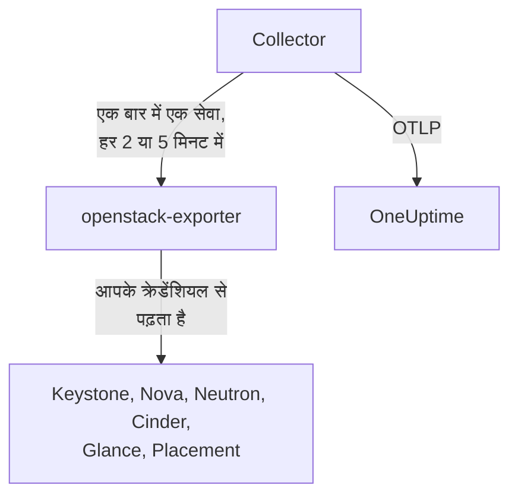

# OpenStack एजेंट

OneUptime OpenStack एजेंट एक OpenStack क्लाउड की निगरानी करता है: उसकी सेवाएँ और एजेंट, हाइपरवाइज़र, इंस्टेंस, नेटवर्क, राउटर, वॉल्यूम, स्टोरेज पूल, इमेज और प्रोजेक्ट, हर क्षेत्र में। यह आपके चुने हुए क्रेडेंशियल से क्लाउड के API पढ़ता है और जो मिलता है उसे OneUptime को भेजता है, जहाँ क्लाउड अपने क्षेत्रों, हाइपरवाइज़र और प्रोजेक्ट के साथ दिखता है। [OpenStack मॉनिटर](/docs/monitor/openstack-monitor) जो कुछ आता है उस पर अलर्ट देते हैं, और एक [प्रोब](/docs/telemetry/openstack-agentless) बिना कुछ इंस्टॉल किए क्लाउड से डेटा इकट्ठा कर सकता है।

:::cards
- [प्रोब या एजेंट?](/docs/telemetry/openstack-agentless#प्रोब-या-एजेंट): ऐसे क्लाउड के लिए कौन-सा चुनें जो दोनों में से कोई भी इस्तेमाल कर सकता है।
- [चुनें कि यह कितना देखे](#चुनें-कि-एजेंट-कितना-देखे): OpenStack में कोई ग्लोबल रीड-ओनली रोल नहीं है, इसलिए तीन स्तर हैं।
- [एजेंट इंस्टॉल करें](#एजेंट-इंस्टॉल-करें): एक क्रेडेंशियल, फिर इंस्टॉल स्क्रिप्ट, Docker Compose या बिल्कुल Docker के बिना।
- [यह आपके क्लाउड पर क्या खर्च डालता है](#यह-आपके-क्लाउड-पर-क्या-खर्च-डालता-है): हर सेटिंग क्या पढ़ती है, और उसे कैसे बदलें।
- [क्षमता](#क्षमता): हर फ़्लेवर के और कितने समा सकते हैं, और हर चीज़ के भरने में कितने दिन बचे हैं।
- [खर्च](#खर्च): कौन क्या इस्तेमाल कर रहा है, आपकी कीमतों पर या CloudKitty की रेटिंग के अनुसार वह कितना बनता है, और क्या वापस लिया जा सकता है।
- [स्थिति पृष्ठ और प्रोजेक्ट को सूचित करना](#स्थिति-पृष्ठ-और-प्रोजेक्ट-को-सूचित-करना): एक ही चरण में हर क्षेत्र का एक पेज, और केवल उन प्रोजेक्ट को सूचित करना जिन तक विफलता पहुँचती है।
- [सेवा लॉग](#सेवा-लॉग): पार्स किए हुए, और सेवाओं के पार एक अनुरोध का पीछा।
- [लाइफ़साइकल इवेंट](#लाइफ़साइकल-इवेंट): इंस्टेंस की कार्रवाइयाँ फ़ीड और चार्ट पर, नोटिफ़िकेशन या प्रोब से।
- [किसने क्या किया](#किसने-क्या-किया): ऑडिट ट्रेल सुरक्षा इवेंट में।
- [अनुरोध ट्रेस करें](#कंट्रोल-प्लेन-के-पार-अनुरोध-ट्रेस-करें): एक हस्ताक्षरित अनुरोध, कंट्रोल प्लेन के पार पीछा किया हुआ।
- [बाहर से क्लाउड जाँचें](#बाहर-से-क्लाउड-जाँचें): क्या कोई सच में इंस्टेंस बूट कर सकता है, क्लाउड के बाहर के प्रोब से।
- [इंटरनेट के बिना](#इंटरनेट-के-बिना): एजेंट की चार इमेज, और उन्हें अपनी रजिस्ट्री में कैसे कॉपी करें।
- [डिप्लॉयमेंट टूल के अनुसार](/docs/telemetry/openstack-deployment-tools): Kolla-Ansible, OpenStack-Ansible, OpenStack-Helm, Atmosphere, Sunbeam, Red Hat और Mirantis।
- [समस्या निवारण](#समस्या-निवारण): एक डायग्नोस्टिक स्क्रिप्ट, और आम समस्याएँ।
:::

## यह कैसे काम करता है

एजेंट एक ही मशीन पर दो पिन किए गए अपस्ट्रीम प्रोग्राम और उनका कॉन्फ़िगरेशन है: [openstack-exporter](https://github.com/openstack-exporter/openstack-exporter) क्लाउड के API पढ़कर उन्हें `openstack_*` सीरीज़ में बदलता है, और एक OpenTelemetry Collector उससे एक बार में एक OpenStack सेवा माँगता है, हर सीरीज़ पर उस क्लाउड और क्षेत्र की मुहर लगाता है जहाँ से वह आई, और उन्हें OneUptime को भेजता है। आपके कंट्रोलर या कंप्यूट नोड पर कुछ नहीं चलता, जब तक आप वैकल्पिक [लॉग प्रोफ़ाइल](#सेवा-लॉग) न जोड़ें, जो उनके लॉग पढ़ती है।



क्लाउड अपने पहले डेटा के साथ खुद को पंजीकृत करता है, उस नाम से जो एजेंट हर मेट्रिक पर `openstack.cloud.name` के रूप में लगाता है। एक एजेंट एक क्लाउड को देखता है: एक Keystone, एक या कई क्षेत्रों के साथ।

## शुरू करने से पहले

- Docker Engine 20.10 या बाद का, Docker Compose v2 प्लगइन के साथ, या Docker के बिना चलाने के लिए, systemd 235 या बाद के, glibc 2.34 या बाद के (RHEL 9, Ubuntu 22.04, Debian 12) और root वाली Linux मशीन (x86_64 या arm64)।
- उस मशीन से Keystone और हर सेवा के सार्वजनिक एंडपॉइंट तक रास्ता।
- `openstack` कमांड लाइन, ऐसे व्यक्ति के रूप में जो नीचे का क्रेडेंशियल बना सकता हो।
- एक इन्जेशन कुंजी। इसे **प्रोजेक्ट सेटिंग्स → टेलीमेट्री और APM → इंजेशन कुंजियाँ** के अंतर्गत बनाएँ और इसका मान कॉपी करें।
- उस मशीन से आपके OneUptime URL तक आउटबाउंड HTTPS।

### एजेंट कहाँ चलाएँ

एजेंट को उस क्लाउड के बाहर चलाएँ जिसे वह देखता है: अलग हार्डवेयर पर एक छोटा VM, एक मैनेजमेंट होस्ट, कोई दूसरा क्लाउड। जो एजेंट विफल हुए क्लाउड के अंदर है वह उसके साथ चुप हो जाता है, और चुप्पी ऐसे स्वस्थ क्लाउड जैसी दिखती है जिसने रिपोर्ट करना बंद कर दिया।

## चुनें कि एजेंट कितना देखे

OpenStack में कोई ग्लोबल रीड-ओनली रोल नहीं है, और इसकी निगरानी में यही सबसे कठिन बात है:

- `reader` Keystone और Ironic को छोड़कर हर जगह एक प्रोजेक्ट तक सीमित है।
- हाइपरवाइज़र, सेवाएँ, एजेंट, पूल और Placement डिफ़ॉल्ट रूप से admin के लिए हैं।
- कोई पॉलिसी ओवरराइड Neutron या Cinder में सभी प्रोजेक्ट की सूचियाँ नहीं खोल सकता, क्योंकि वे उन्हें अपने ही कोड में admin संदर्भ से सीमित करते हैं।
- Cinder की सेवाएँ और स्टोरेज पूल, admin के अलावा किसी को भी `403` से जवाब देते हैं, Cinder के अपने कोड से, पॉलिसी के पास हो जाने के बाद। कोई ओवरराइड इन्हें भी नहीं खोलता।
- Neutron और Cinder एक सामान्य reader को `200` से जवाब देते हैं और केवल उसी reader का अपना प्रोजेक्ट दिखाते हैं। यह ऐसे दिखता है जैसे काम कर गया, और किया नहीं।
- जहाँ Cinder में `enforce_new_defaults` बंद है, जो Cinder का अपना डिफ़ॉल्ट है, वहाँ किसी प्रोजेक्ट पर कोई भी रोल उस प्रोजेक्ट के वॉल्यूम बना सकता है, `reader` और `oneuptime_monitoring` समेत। Epoxy, Flamingo और Gazpacho पर एक सामान्य reader और असली प्रोजेक्ट पर रोल, दोनों ने वॉल्यूम बनाया (`202`)। Hibiscus पर दोनों को मना किया गया (`403`), क्योंकि DevStack `enforce_new_defaults` को केवल वहीं चालू करता है। असली प्रोजेक्ट पर रीड-ओनली रोल रीड-ओनली नहीं होता।

इसलिए तीन स्तर हैं, और हर एक की कुछ कीमत है। हो सके तो पहले से शुरू करें।

| स्तर | इसके लिए क्या चाहिए | यह क्या देखता है | किसके बिना रहना पड़ता है |
| --- | --- | --- | --- |
| **1. पूरा दृश्य** | अपने ही प्रोजेक्ट पर `admin` वाले खाते का एक एप्लिकेशन क्रेडेंशियल, जो एक्सेस नियमों से केवल पढ़ने तक सीमित हो, और हर सेवा पर `service_type` सेट हो | एजेंट की हर रीड, और `cinder-volume` व `cinder-scheduler` की स्थिति और स्टोरेज पूल, जो केवल यही स्तर देखता है | Keystone के उपयोगकर्ता और समूह, जानबूझकर। यह लिख नहीं सकता: हर लिखाई का जवाब `401` आया |
| **2. केवल इन्फ्रास्ट्रक्चर** | `oneuptime_monitoring` और `reader` रोल एक ऐसे अपने प्रोजेक्ट पर जिसमें कुछ नहीं है और जिसका कोटा शून्य है, और एजेंट के साथ आने वाले पॉलिसी ओवरराइड | Keystone के सभी प्रोजेक्ट, डोमेन, सेवाएँ और एंडपॉइंट, Nova का सब कुछ जिसमें हर प्रोजेक्ट के सर्वर शामिल हैं, पूरा Placement, और Neutron के एजेंट और IP उपलब्धताएँ | Neutron के नेटवर्क, सबनेट, राउटर, फ़्लोटिंग IP और पोर्ट, और Cinder के वॉल्यूम और स्नैपशॉट केवल उसके अपने प्रोजेक्ट के होते हैं, इसलिए खाली प्रोजेक्ट पर बस साझा और बाहरी वाले। `cinder-volume` या `cinder-scheduler` की स्थिति या स्टोरेज पूल नहीं। यह लिख नहीं सकता: हर लिखाई का जवाब `403` आया, या कोटा से `409` और `413` |
| **3. प्रोजेक्ट दृश्य** | किसी असली प्रोजेक्ट पर सामान्य `reader`, उस टीम के लिए जो किसी और के चलाए क्लाउड के अपने हिस्से को देख रही है | उस प्रोजेक्ट के वॉल्यूम, नेटवर्क और राउटर, Cinder और Neutron से | सारा इन्फ्रास्ट्रक्चर: कोई हाइपरवाइज़र, सेवा, एजेंट, पूल या क्षमता नहीं। एजेंट के ज़रिए कोई इंस्टेंस भी नहीं, क्योंकि एक्सपोर्टर की सभी-प्रोजेक्ट वाली रीड मना कर दी जाती है। और कई क्लाउड पर `reader` वहाँ लिख सकता है |

**Block Storage Service Down**, **Storage Pool Warning** और **Storage Pool Critical** टेम्पलेट को स्तर 1 चाहिए। **Compute Service Down**, **Network Agent Down** और Placement व हाइपरवाइज़र टेम्पलेट को स्तर 1 या 2 चाहिए, और स्तर 3 पर कुछ भी इंस्टेंस नहीं पढ़ता।

### हर स्तर क्या पढ़ता है

यह वह है जो पाँच असली क्लाउड ने जवाब दिया, Epoxy, Flamingo, Gazpacho (OVN और OVS) और Hibiscus पर। हर सेल उन्हीं रिकॉर्डिंग से लिखा गया है।

| रीड | स्तर 1: पूरा दृश्य | स्तर 2: केवल इन्फ्रास्ट्रक्चर | स्तर 3: प्रोजेक्ट दृश्य |
| --- | --- | --- | --- |
| Keystone: प्रोजेक्ट | सभी | सभी | मना |
| Keystone: डोमेन | सभी | सभी | मना |
| Keystone: क्षेत्र | सभी | जो कोई भी देखता है | जो कोई भी देखता है |
| Keystone: सेवाएँ | सभी | सभी | मना |
| Keystone: एंडपॉइंट | सभी | सभी | मना |
| Nova: सर्वर, सभी प्रोजेक्ट | सभी | सभी | मना |
| Nova: सेवाएँ | सभी | सभी | मना |
| Nova: हाइपरवाइज़र | सभी | सभी | मना |
| Nova: एग्रीगेट | सभी | सभी | मना |
| Nova: उपलब्धता ज़ोन, विवरण | सभी | सभी | मना |
| Nova: फ़्लेवर | सभी | जो कोई भी देखता है | जो कोई भी देखता है |
| Nova: प्रति प्रोजेक्ट उपयोग | सभी | सभी | मना |
| Placement: रिसोर्स प्रोवाइडर | सभी | सभी | मना |
| Neutron: एजेंट | सभी | सभी | कुछ नहीं |
| Neutron: नेटवर्क | सभी | केवल अपना प्रोजेक्ट | केवल अपना प्रोजेक्ट |
| Neutron: सबनेट | सभी | केवल अपना प्रोजेक्ट | केवल अपना प्रोजेक्ट |
| Neutron: राउटर | सभी | केवल अपना प्रोजेक्ट | केवल अपना प्रोजेक्ट |
| Neutron: फ़्लोटिंग IP | सभी | केवल अपना प्रोजेक्ट | केवल अपना प्रोजेक्ट |
| Neutron: IP उपलब्धताएँ | सभी | सभी | कुछ नहीं |
| Neutron: सिक्योरिटी ग्रुप | सभी | 409, अपेक्षित | केवल अपना प्रोजेक्ट |
| Neutron: पोर्ट | सभी | केवल अपना प्रोजेक्ट | केवल अपना प्रोजेक्ट |
| Neutron: कोटा | सभी | मना | मना |
| Cinder: वॉल्यूम, सभी प्रोजेक्ट | सभी | केवल अपना प्रोजेक्ट | केवल अपना प्रोजेक्ट |
| Cinder: सेवाएँ | सभी | मना | मना |
| Cinder: पूल | सभी | मना | मना |
| Cinder: स्नैपशॉट, सभी प्रोजेक्ट | सभी | केवल अपना प्रोजेक्ट | केवल अपना प्रोजेक्ट |
| Cinder: बैकअप, सभी प्रोजेक्ट | सभी | कोई दर्ज नहीं | कोई दर्ज नहीं |
| Cinder: वॉल्यूम टाइप | सभी | जो कोई भी देखता है | जो कोई भी देखता है |
| Glance: इमेज | सभी | जो कोई भी देखता है | जो कोई भी देखता है |

- **सभी**: वही पंक्तियाँ जो admin ने देखीं।
- **केवल अपना प्रोजेक्ट**: उस प्रोजेक्ट की पंक्तियाँ, और जो भी साझा या बाहरी हो। जिस प्रोजेक्ट में कुछ नहीं है, वहाँ बस साझा और बाहरी वाली।
- **मना**: `401` या `403`।
- **जो कोई भी देखता है**: हर क्रेडेंशियल ने हर पंक्ति देखी, उन क्लाउड पर जिनमें केवल सार्वजनिक फ़्लेवर, वॉल्यूम टाइप और इमेज हैं। दूसरे प्रोजेक्ट का निजी वाला देखने के लिए स्तर 1 चाहिए।
- **कुछ नहीं**: बिना पंक्तियों वाला `200`, उस प्रोजेक्ट पर भी जिसमें नेटवर्क हैं। यह ऐसे दिखता है जैसे काम कर गया, और किया नहीं।
- **कोई दर्ज नहीं**: बिना पंक्तियों वाला `200` जहाँ admin ने भी कोई नहीं देखा, इसलिए फ़र्क़ बताने को कुछ नहीं था।
- **409, अपेक्षित**: Neutron सूची बनाते समय प्रोजेक्ट का डिफ़ॉल्ट सिक्योरिटी ग्रुप बनाने की कोशिश करता है, और शून्य कोटा इसकी अनुमति नहीं देता, इसलिए वह `409 Quota exceeded` से जवाब देता है। यह हानिरहित है, और ठीक करने को कुछ नहीं है।

Octavia, Ironic, Heat, Magnum, Manila, Designate, Barbican, Swift, Trove और Gnocchi यहाँ नहीं हैं क्योंकि वे क्लाउड इन्हें नहीं चलाते। [डायग्नोस्टिक स्क्रिप्ट](#समस्या-निवारण) इनसे भी पूछती है, जहाँ कोई क्लाउड इन्हें चलाता है, और वह हर पथ को आपके असली क्रेडेंशियल से पढ़ती है और बताती है कि वह क्रेडेंशियल क्या देख सकता है।

हर एक के साथ एजेंट के एक्सपोर्टर को क्या मिला, प्रति सेवा सीरीज़ में। गिनतियाँ इस पर निर्भर करती हैं कि पूछे जाने पर क्लाउड में क्या है, इसलिए उनकी तुलना आपस में करें, अपनी से नहीं:

| एक्सपोर्टर सेवा | Admin | स्तर 1: पूरा दृश्य | स्तर 2: केवल इन्फ्रास्ट्रक्चर | स्तर 3: प्रोजेक्ट दृश्य |
| --- | --- | --- | --- | --- |
| identity | 14 | 13 | 13 | 4 |
| compute | 33 | 33 | 33 | 15 |
| placement | 25 | 25 | 25 | 1 |
| network | 36 से 40 | 36 से 40 | 24 से 26 | 14 |
| volume | 33 | 33 से 41 | 23 | 29 से 37 |
| image | 4 | 4 | 4 | 4 |

## एजेंट इंस्टॉल करें

हर OneUptime अपने रिलीज़ के लिए एजेंट की इंस्टॉल स्क्रिप्ट और फ़ाइलें परोसता है: नीचे के कमांड उन्हें `https://oneuptime.com` से डाउनलोड करते हैं, इसलिए सेल्फ़-होस्टेड OneUptime पर उसे अपने URL से बदलें। इंस्टॉल स्क्रिप्ट पहले `install.sh` के रूप में सहेजी जाती है, ताकि आप उसे चलाने से पहले पढ़ सकें।

:::steps
### क्रेडेंशियल बनाएँ

अपना चुना हुआ स्तर चुनें। हर एक एक एप्लिकेशन क्रेडेंशियल बनाता है, जो एक `id` और एक `secret` प्रिंट करता है: secret केवल एक बार दिखता है। इसे एक्सपायरी दें और कभी `--unrestricted` नहीं, जिससे यह और क्रेडेंशियल बना सकेगा।

:::tabs
@tab Level 1: Full view
admin के रूप में, एजेंट के लिए एक प्रोजेक्ट और एक खाता बनाएँ:

```bash
openstack project create --domain default oneuptime-monitoring
openstack user create --domain default --password-prompt oneuptime-monitoring
openstack role add --project oneuptime-monitoring --user oneuptime-monitoring admin
```

फिर, उस खाते के रूप में उस प्रोजेक्ट पर लॉग इन होकर, क्रेडेंशियल बनाएँ। नियम वे सटीक `GET` पथ हैं जो एजेंट इस्तेमाल करता है, आपके क्लाउड के अनुसार ढाले हुए:

```bash
curl -fsSLO https://oneuptime.com/install/openstack-agent/access/application-credential-access-rules.json
curl -fsSLO https://oneuptime.com/install/openstack-agent/access/access-rules-for-cloud.py
openstack catalog list -f json | python3 access-rules-for-cloud.py \
  application-credential-access-rules.json > access-rules-for-this-cloud.json
openstack application credential create oneuptime-agent \
  --role admin \
  --access-rules "$(cat access-rules-for-this-cloud.json)" \
  --expiration 2027-11-01T00:00:00
```

एक्सेस नियम का मिलान उस पथ से होता है जो सेवा देखती है। पथ उपसर्ग के पीछे की सेवा, जैसे `https://cloud.example/compute/v2.1`, `/compute/v2.1/servers` देखती है, और `/v2.1/servers` के शिप किए गए नियम को `401` से मना कर देती है। `access-rules-for-cloud.py` हर नियम को उसकी सेवा के उपसर्ग के तहत फिर से जोड़ता है, जो आपके कैटलॉग से पढ़ा जाता है।

एक्सपोर्टर की दो रीड ऐसे नियम लेती हैं जिन्हें हाथ से चूकना आसान है। यह किसी भी चीज़ से पहले Octavia का रूट पढ़ता है, और Apache के पीछे सेवा उसे `/load-balancer//` के रूप में देखती है, दो स्लैश के साथ। मना किए जाने पर एक्सपोर्टर खाली `200` से जवाब देता है, इसलिए क्लाउड ऐसा दिखता है जैसे वह Octavia नहीं चलाता। और यह Swift के खाते को अंत में स्लैश के साथ सूचीबद्ध करता है, जिससे `/v1/*` मेल नहीं खाता। मना किए जाने पर `openstack_object_store_up` `0` पढ़ता है। ढाले हुए नियमों में दोनों होते हैं। क्रेडेंशियल के नियम बदले नहीं जा सकते, इसलिए अगर आपका उनकी किसी पुरानी कॉपी से बना था, तो नया बनाएँ।

एक्सेस नियमों को हर सेवा पर keystonemiddleware के लिए `service_type` सेट भी चाहिए, और उस सेवा का रीस्टार्ट। इसके बिना सेवा क्रेडेंशियल को `401` से मना कर देती है:

```ini title="nova.conf"
[keystone_authtoken]
service_type = compute
```

| कॉन्फ़िग फ़ाइल | `service_type` |
| --- | --- |
| `nova.conf` | `compute` |
| `neutron.conf` | `network` |
| `cinder.conf` | `block-storage`। नियमों में `volume` और `volumev3` भी हैं, उस Cinder के लिए जो इस तरह कॉन्फ़िगर हो |
| `glance-api.conf` | `image` |
| `placement.conf` | `placement` |
| `octavia.conf` | `load-balancer` |
| `ironic.conf` | `baremetal` |
| `heat.conf` | `orchestration` |
| `magnum.conf` | `container-infra` |
| `manila.conf` | `sharev2`। नियमों में `shared-file-system` भी है, उस Manila के लिए जो इस तरह कॉन्फ़िगर हो |
| `designate.conf` | `dns` |
| `barbican.conf` | `key-manager` |
| `trove.conf` | `database` |
| `gnocchi.conf` | `metric` |
| `cloudkitty.conf` | `rating` |
| `proxy-server.conf`, `[filter:authtoken]` के अंतर्गत | `object-store`, और उसके बगल में `include_service_catalog = True`। keystonemiddleware नियमों को टोकन के कैटलॉग से जाँचता है, इसलिए `False` के साथ, जो DevStack सेट करता है, Swift क्रेडेंशियल को `500` से जवाब देता है |

केवल उन सेवाओं को एक पंक्ति चाहिए जो आपका क्लाउड चलाता है।

जो सेवाएँ क्लाउड शायद न चलाए, उन पर असली क्लाउड में हर स्तर को जो मिला वह ऊपर की तालिकाओं से चार तरह से अलग है:

- **Ironic** किसी प्रोजेक्ट के क्रेडेंशियल को, admin के भी, केवल वे नोड देकर जवाब देता है जो उस प्रोजेक्ट के हैं, और उसके कंडक्टर मना कर देता है। केवल सिस्टम स्कोप हर नोड और कंडक्टर पढ़ता है, और एजेंट का क्रेडेंशियल एक प्रोजेक्ट पर है। इससे कोई नोड पढ़ने के लिए, उसके प्रोजेक्ट को मालिक बनाएँ: `openstack baremetal node set --owner`।
- **Swift** क्रेडेंशियल के अपने प्रोजेक्ट के कंटेनर सूचीबद्ध करता है, किसी और के नहीं। दूसरे प्रोजेक्ट का खाता `403` से जवाब देता है, जब तक क्रेडेंशियल के पास `ResellerAdmin` न हो।
- **Barbican** क्रेडेंशियल को केवल उसके अपने प्रोजेक्ट के बारे में जवाब देता है, और सामान्य reader को मना कर देता है। OneUptime कोई secret नहीं पढ़ता।
- **Gnocchi** किसी प्रोजेक्ट पर किसी भी रोल को मेट्रिक बनाने देता है, इसलिए जो क्लाउड इसे चलाता है उस पर स्तर 2 और स्तर 3 वहाँ लिख सकते हैं।

Keystone को कुछ नहीं चाहिए। नियम ढाले जाने, `service_type` सेट होने और API रीस्टार्ट होने पर, हर रीड का जवाब `200` और हर लिखाई का `401` रहा, हमारे दर्ज किए हर रिलीज़ पर। एक्सपोर्टर को वही मिलता है जो admin को मिलता है, सिवाय Keystone के उपयोगकर्ताओं और समूहों के, जानबूझकर। यह उन सेवाओं पर भी लागू है जो क्लाउड शायद न चलाए: DevStack पर दर्ज किया गया कि स्तर 1 को एक्सपोर्टर द्वारा पढ़ी जाने वाली हर एक से वही सीरीज़ मिली जो admin के क्रेडेंशियल को मिली, और हर लिखाई का जवाब `401` रहा।

अगर आप वह बदलाव नहीं करेंगे, तो वही क्रेडेंशियल `--access-rules` के बिना बनाएँ: एक सामान्य admin एप्लिकेशन क्रेडेंशियल। यह काम करता है, और यह लिख सकता है, इसलिए डायग्नोस्टिक स्क्रिप्ट इसे वैसा ही लेबल करती है।
@tab Level 2: Infrastructure only
admin के रूप में, रोल, एक ऐसा प्रोजेक्ट जिसमें कुछ नहीं है और जिसका कोटा शून्य है, और एक खाता बनाएँ:

```bash
openstack role create oneuptime_monitoring
openstack project create --domain default --description "OneUptime monitoring: holds nothing" oneuptime-monitoring
openstack quota set --instances 0 --cores 0 --ram 0 --key-pairs 0 oneuptime-monitoring
openstack quota set --volumes 0 --gigabytes 0 --snapshots 0 --backups 0 --backup-gigabytes 0 oneuptime-monitoring
openstack quota set --networks 0 --subnets 0 --ports 0 --routers 0 --floating-ips 0 --secgroups 0 --secgroup-rules 0 oneuptime-monitoring
openstack user create --domain default --password-prompt oneuptime-monitoring
openstack role add --project oneuptime-monitoring --user oneuptime-monitoring oneuptime_monitoring
openstack role add --project oneuptime-monitoring --user oneuptime-monitoring reader
```

प्रोजेक्ट में जानबूझकर कुछ नहीं है और कोटा शून्य है। जहाँ Cinder में `enforce_new_defaults` बंद है, वहाँ किसी प्रोजेक्ट पर कोई भी रोल उस प्रोजेक्ट के वॉल्यूम बना सकता है। छूने को कुछ नहीं और कुछ बनाने का कोटा नहीं होने से, लिखने को कुछ नहीं बचता: हमारे दर्ज किए हर रिलीज़ पर हर लिखाई का जवाब `403` रहा, या कोटा से `409` और `413`।

पॉलिसी ओवरराइड डाउनलोड करें, और हर कंट्रोलर पर हर फ़ाइल को उस सेवा के कॉन्फ़िग में `[oslo_policy] policy_file` द्वारा नामित फ़ाइल में मर्ज करें (`nova.conf`, `neutron.conf` और इसी तरह)। वह `/etc/nova/policy.yaml` है, और इसी तरह, जब तक आपका डिप्लॉयमेंट कुछ और न कहे: DevStack `policy.json` कहता है। हर नियम सेवा का डिफ़ॉल्ट रखता है और रोल जोड़ता है, और oslo.policy बदली हुई फ़ाइल को अपने आप पहचान लेता है, इसलिए रीस्टार्ट की ज़रूरत नहीं।

```bash
curl -fsSLO https://oneuptime.com/install/openstack-agent/access/policy/nova.yaml
curl -fsSLO https://oneuptime.com/install/openstack-agent/access/policy/neutron.yaml
curl -fsSLO https://oneuptime.com/install/openstack-agent/access/policy/keystone.yaml
curl -fsSLO https://oneuptime.com/install/openstack-agent/access/policy/placement.yaml
```

Cinder के लिए कोई फ़ाइल नहीं है। इसके `os-services` और `scheduler-stats/get_pools` रोल को `403 User does not have admin privileges` से जवाब देते हैं, हमारे दर्ज किए सभी पाँच क्लाउड पर। यह Cinder के अपने कोड से आता है जो admin संदर्भ माँगता है, पॉलिसी के पास हो जाने के बाद, इसलिए कोई ओवरराइड इन्हें नहीं खोल सकता।

**ओवरराइड फिर से हटाने के लिए, फ़ाइल को खाली करें (`{}`) और उसे कभी न मिटाएँ।** Flamingo (2025.2) और Epoxy (2025.1) पर, जब oslo.policy की पढ़ी हुई पॉलिसी फ़ाइल गायब हो जाती है तो वह हर जाँच पर त्रुटि देता है, इसलिए वह सेवा हर अनुरोध में विफल हो जाती है। जब वह सेवा Keystone हो, तो वह टोकन मान्य करना बंद कर देती है और पूरा क्लाउड `503` से जवाब देता है। अगर ऐसा हो चुका है, तो सेवा रीस्टार्ट करें।

फिर, उस खाते के रूप में उस प्रोजेक्ट पर लॉग इन होकर, क्रेडेंशियल बनाएँ:

```bash
openstack application credential create oneuptime-agent --expiration 2027-11-01T00:00:00
```

किसी असली प्रोजेक्ट के वॉल्यूम और राउटर देखने के लिए उस पर रोल रखने से खाता वहाँ लिख भी सकता है, उस क्लाउड पर जहाँ Cinder में `enforce_new_defaults` बंद है। जब क्रेडेंशियल के प्रोजेक्ट में कुछ हो, तो डायग्नोस्टिक स्क्रिप्ट चेतावनी देती है।
@tab Level 3: Project view
किसी खाते को प्रोजेक्ट पर सामान्य `reader` रोल दें, फिर उस खाते के रूप में उस प्रोजेक्ट पर लॉग इन होकर, क्रेडेंशियल बनाएँ:

```bash
openstack role add --project my-team --user my-monitoring-account reader
openstack application credential create oneuptime-agent --expiration 2027-11-01T00:00:00
```

एजेंट Cinder और Neutron से उस प्रोजेक्ट की पंक्तियाँ देखता है, कोई इन्फ्रास्ट्रक्चर नहीं। इसे चुनने से पहले तीन बातें जान लें:

- **एजेंट के ज़रिए यह कोई इंस्टेंस नहीं दिखाता।** एक्सपोर्टर Nova से सभी प्रोजेक्ट के सर्वर माँगता है, Nova सामान्य reader को मना कर देता है, और वह रीड पूरी की पूरी विफल हो जाती है। केवल OneUptime प्रोब, इस एजेंट के बिना इकट्ठा करते हुए, एक प्रोजेक्ट के इंस्टेंस सूचीबद्ध कर सकता है।
- **यह लिख सकता है।** जिस क्लाउड पर Cinder में `enforce_new_defaults` बंद है, वहाँ सामान्य `reader` अपने प्रोजेक्ट में भी वॉल्यूम बना सकता है। Epoxy, Flamingo और Gazpacho पर बना सका (`202`), और Hibiscus पर मना किया गया (`403`), क्योंकि DevStack `enforce_new_defaults` को केवल वहीं चालू करता है। Cinder का अपना डिफ़ॉल्ट बंद है।
- **Placement जवाब न देता हुआ दिखता है।** इसकी हर कॉल मना कर दी जाती है, और एक्सपोर्टर इसे वैसे ही रिपोर्ट करता है जैसे रुके हुए Placement को: `openstack_placement_up 0`, हमारे दर्ज किए सभी पाँच क्लाउड पर। पेज बता सकते हैं, इस क्रेडेंशियल के लिए और क्या बंद है इससे, और वैसा कहते हैं। [Placement API Down](/docs/monitor/openstack-monitor#पहले-से-बने-अलर्ट-टेम्पलेट) टेम्पलेट नहीं बता सकता, इसलिए इस स्तर पर उसे छोड़ दें।
:::

### एजेंट इंस्टॉल करें और शुरू करें

:::tabs
@tab install.sh
इंस्टॉल स्क्रिप्ट डाउनलोड करें और उसे उस मशीन पर चलाएँ जो एजेंट को होस्ट करेगी:

```bash
curl -fsSL https://oneuptime.com/install/openstack-agent -o install.sh
bash install.sh
```

स्क्रिप्ट आपसे आपका OneUptime URL, इन्जेशन कुंजी, क्लाउड का एक स्थिर नाम, Keystone auth URL, क्षेत्रों के नाम, एप्लिकेशन क्रेडेंशियल (अगर आप उसके लिए मना करें तो यूज़रनेम और पासवर्ड), और अगर क्लाउड की अपनी सर्टिफ़िकेट अथॉरिटी है तो एक निजी CA फ़ाइल पूछती है। कोई गोपनीय चीज़ इको नहीं होती और न किसी कमांड लाइन पर जाती है। यह कुछ भी लिखने या शुरू करने से पहले क्रेडेंशियल को Keystone से जाँचती है, `/opt/oneuptime-openstack-agent` में इंस्टॉल करती है, या अगर आपके पास `/opt` पर अधिकार नहीं हैं तो आपके होम फ़ोल्डर में `oneuptime-openstack-agent` में (इसे केवल `docker` समूह चाहिए), `.env` और `clouds.yaml` को मोड `0600` के साथ लिखती है, और एजेंट को Docker Compose से शुरू करती है। हर जवाब एनवायरनमेंट वेरिएबल के रूप में भी काम करता है, और स्क्रिप्ट को फिर से चलाने पर वह उन्हें दोबारा पूछने के बजाय दोबारा इस्तेमाल करती है, इसी तरह आप [एजेंट को अपग्रेड](#एजेंट-को-अपग्रेड-करना) करते हैं।
@tab Docker Compose
अपने OneUptime से `docker-compose.yml` और `otel-collector-config.yaml` को एक नए फ़ोल्डर में डाउनलोड करें:

```bash
mkdir oneuptime-openstack-agent && cd oneuptime-openstack-agent
curl -fsSLO https://oneuptime.com/install/openstack-agent/docker-compose.yml
curl -fsSLO https://oneuptime.com/install/openstack-agent/otel-collector-config.yaml
```

उनके बगल में एक `clouds.yaml` बनाएँ, हर क्षेत्र के लिए एक प्रविष्टि के साथ, **क्षेत्र के नाम पर नामित**, क्योंकि एक्सपोर्टर की सीरीज़ यह नहीं बतातीं कि वे किस क्षेत्र की हैं और कलेक्टर उन पर प्रविष्टि का नाम `openstack.region.name` के रूप में लगाता है:

```yaml title="clouds.yaml"
clouds:
  RegionOne:
    region_name: RegionOne
    identity_api_version: 3
    auth_type: v3applicationcredential
    auth:
      auth_url: https://keystone.example.com:5000/v3
      application_credential_id: your-credential-id
      application_credential_secret: your-credential-secret
```

फिर एक `.env` फ़ाइल:

```bash title=".env"
ONEUPTIME_URL=YOUR_ONEUPTIME_URL
ONEUPTIME_TELEMETRY_INGESTION_KEY=YOUR_TELEMETRY_INGESTION_TOKEN
OPENSTACK_CLOUD_NAME=my-cloud
OPENSTACK_EXPORTER_CLOUDS=[RegionOne,RegionTwo]
COMPOSE_PROFILES=openstack-exporter,openstack-ai-agent
```

`OPENSTACK_EXPORTER_CLOUDS` हर क्षेत्र को वर्गाकार कोष्ठकों में सूचीबद्ध करता है, और `COMPOSE_PROFILES` साथ आने वाला एक्सपोर्टर और [AI एजेंट](#ai-एजेंट) शुरू करता है। दोनों फ़ाइलों में गोपनीय जानकारी है। एक्सपोर्टर uid 65532 के रूप में चलता है, और `clouds.yaml` पढ़ सकने वाला वही एकमात्र खाता होना चाहिए। एजेंट शुरू करें:

```bash
chmod 600 .env
sudo chown 65532:65532 clouds.yaml
sudo chmod 600 clouds.yaml
docker compose up -d
```
@tab Without Docker
systemd 235 या बाद के और glibc 2.34 या बाद के वाले Linux (x86_64 या arm64) पर, इंस्टॉल स्क्रिप्ट उन्हीं दो प्रोग्रामों के अपस्ट्रीम रिलीज़ को systemd सेवाओं के रूप में चलाती है। RHEL 8 और उसके संबंधियों में पुराना glibc है, जिस पर एक्सपोर्टर का रिलीज़ नहीं चल सकता: स्क्रिप्ट यही कहती है और कुछ नहीं बदलती, इसलिए वहाँ Docker इस्तेमाल करें।

```bash
curl -fsSL https://oneuptime.com/install/openstack-agent -o install.sh
sudo bash install.sh --without-docker
```

वही सवाल, Keystone से वही जाँच और वही फ़ाइलें। हर रिलीज़ आर्काइव `install.sh` में पिन किए sha256 से बँधा है, और मेल न खाने वाला डाउनलोड कुछ भी बदलने से पहले इंस्टॉल रोक देता है। कलेक्टर एक अस्थायी अप्रिविलेज्ड उपयोगकर्ता के रूप में चलता है जो OpenStack क्रेडेंशियल कभी नहीं देखता, और एक्सपोर्टर `oneuptime-openstack` सिस्टम उपयोगकर्ता के रूप में, जो `clouds.yaml` पढ़ सकने वाला एकमात्र खाता है, और केवल `127.0.0.1:9180` पर सुनता है।

हर क्लाउड के लिए एक एजेंट चलाएँ: Docker इंस्टॉल से हटते समय पहले `docker compose down` चलाएँ, वरना हर मेट्रिक दो बार आती है।
:::

पहले से `--multi-cloud` के साथ openstack-exporter चलाते हैं? एजेंट को उसकी ओर इंगित करें, और साथ वाला कभी शुरू नहीं होता: `OPENSTACK_EXPORTER_ADDRESS=10.0.0.5:9180 bash install.sh`, या `.env` से `COMPOSE_PROFILES` हटा दें और वहाँ `OPENSTACK_EXPORTER_ADDRESS` सेट करें। उसके `clouds.yaml` में हर क्षेत्र के नाम की एक प्रविष्टि चाहिए, और उसे वह बंद करना चाहिए जो साथ वाला बंद करता है: [यह आपके क्लाउड पर क्या खर्च डालता है](#यह-आपके-क्लाउड-पर-क्या-खर्च-डालता-है) देखें। ऐसा पता इस्तेमाल करें जहाँ एजेंट का कंटेनर पहुँच सके: `localhost` कंटेनर खुद है।

Kolla-Ansible का एक्सपोर्टर `--multi-cloud` के बिना चलता है, इसलिए उसमें `/probe` नहीं है, और वह कम बताने वाले रिलीज़ पर पिन है। [जो एक्सपोर्टर आप पहले से चलाते हैं उसका उपयोग करें](/docs/telemetry/openstack-deployment-tools#जो-एक्सपोर्टर-आप-पहले-से-चलाते-हैं-उसी-का-उपयोग-करें) बताता है कि उसे कैसे पढ़ें, और पेज ठीक किसके बिना रहते हैं। [डिप्लॉयमेंट टूल के अनुसार OpenStack](/docs/telemetry/openstack-deployment-tools) में हर टूल के बाकी चरण हैं।

### जाँचें कि एजेंट चल रहा है

```bash
cd /opt/oneuptime-openstack-agent    # or the folder the script said it installed to
docker compose ps
docker logs oneuptime-openstack-agent
```

`docker compose ps` कलेक्टर (`oneuptime-openstack-agent`), साथ वाला एक्सपोर्टर (`oneuptime-openstack-exporter`) और [AI एजेंट](#ai-एजेंट) (`oneuptime-openstack-ai-agent`) सूचीबद्ध करता है। शुरू होने के बाद कलेक्टर के लॉग में यह पंक्ति दिखनी चाहिए:

```text
Everything is ready. Begin running and processing data.
```

Docker के बिना, `systemctl status oneuptime-openstack-agent oneuptime-openstack-exporter` और `journalctl -u oneuptime-openstack-agent` से पूछें।

### OneUptime में क्लाउड ढूँढें

**उत्पाद → बुनियादी ढांचा → OpenStack** खोलें। क्लाउड अपने पहले संग्रह के बाद, कुछ ही मिनटों में, अपने `OPENSTACK_CLOUD_NAME` के नीचे दिखता है। Compute, network, volume और Placement हर 2 मिनट में पढ़े जाते हैं, identity और इमेज हर 5 में।
:::

क्लाउड का **अवलोकन** बताता है कि उसका डेटा OneUptime तक पहुँच रहा है या नहीं, पहले किस पर ध्यान चाहिए, और हर सेवा कैसा कर रही है:


**हाइपरवाइज़र** बताता है कि Nova और Placement ने हर कंप्यूट होस्ट पर क्या वादा किया है:


**इंस्टेंस** हर इंस्टेंस को Nova के अपने शब्दों में उसकी स्थिति, उसके प्रोजेक्ट, फ़्लेवर और हाइपरवाइज़र के साथ सूचीबद्ध करता है:


## एनवायरनमेंट वेरिएबल

इंस्टॉल स्क्रिप्ट इन्हें `/opt/oneuptime-openstack-agent/.env` में लिखती है; Docker Compose इंस्टॉल इन्हें `docker-compose.yml` के बगल के `.env` से पढ़ता है। एक को बदलने के बाद उस फ़ोल्डर में `docker compose up -d` चलाएँ, या Docker के बिना `sudo systemctl restart oneuptime-openstack-agent` चलाएँ। केवल `clouds.yaml` में क्रेडेंशियल है।

| वेरिएबल | ज़रूरी | विवरण |
| --- | --- | --- |
| `ONEUPTIME_URL` | हाँ | आपका OneUptime URL, जैसे `https://oneuptime.com` या आपका सेल्फ़-होस्टेड इंस्टेंस। |
| `ONEUPTIME_TELEMETRY_INGESTION_KEY` | हाँ | **प्रोजेक्ट सेटिंग्स → टेलीमेट्री और APM → इंजेशन कुंजियाँ** से इन्जेशन कुंजी। |
| `OPENSTACK_CLOUD_NAME` | हाँ | OneUptime में क्लाउड का नाम, हर मेट्रिक पर `openstack.cloud.name` रिसोर्स एट्रिब्यूट के रूप में लगा। इसे स्थिर रखें: इसे बदलने से नया क्लाउड पंजीकृत होता है। डिफ़ॉल्ट `openstack` है। |
| `OPENSTACK_AUTH_URL` | साथ वाला एक्सपोर्टर | इंस्टॉल स्क्रिप्ट का एक जवाब: Keystone auth URL। अगर `/v3` नहीं है तो जोड़ दिया जाता है। |
| `OPENSTACK_EXPORTER_CLOUDS` | हाँ | क्षेत्र, वर्गाकार कोष्ठकों में, जैसे `[RegionOne,RegionTwo]`, हर एक `clouds.yaml` प्रविष्टि का नाम। डिफ़ॉल्ट `[RegionOne]` है। |
| `OPENSTACK_EXPORTER_ADDRESS` | नहीं | आपके अपने एक्सपोर्टर का `host:port`, बिना scheme के। साथ वाले के लिए इसे छोड़ दें। |
| `OPENSTACK_CA_FILE` | नहीं | ऐसे क्लाउड की सर्टिफ़िकेट अथॉरिटी वाली PEM फ़ाइल जिसकी अपनी है। इंस्टॉल स्क्रिप्ट `clouds.yaml` के बगल में उसकी एक कॉपी `ca.pem` के रूप में रखती है। |
| `OPENSTACK_EXPORTER_USER` | नहीं | वह `uid:gid` जिसके रूप में एक्सपोर्टर का कंटेनर चलता है, जो `clouds.yaml` का मालिक होना चाहिए। डिफ़ॉल्ट `65532:65532` है। |
| `COMPOSE_PROFILES` | साथ वाला एक्सपोर्टर | `openstack-exporter` साथ वाला एक्सपोर्टर शुरू करता है, और `openstack-ai-agent` [AI एजेंट](#ai-एजेंट)। |
| `OPENSTACK_LIBVIRT_EXPORTER_TARGETS` | नहीं | वे कंप्यूट नोड जिनसे `prometheus-libvirt-exporter` के ज़रिए [असली उपयोग](#असली-उपयोग) पढ़ा जाए, वर्गाकार कोष्ठकों में, जैसे `[compute-01:9177,compute-02:9177]`। डिफ़ॉल्ट कोई नहीं। |
| `OPENSTACK_CEILOMETER_EXPORTER_TARGETS` | नहीं | वही Ceilometer के अपने एक्सपोर्टर के ज़रिए, जैसे `[compute-01:9101]`। डिफ़ॉल्ट कोई नहीं। |
| `OPENSTACK_SINGLE_CLOUD_EXPORTER_TARGETS` | नहीं | `--multi-cloud` के बिना पहले से चल रहा एक्सपोर्टर, जैसे Kolla-Ansible का: `[10.0.0.254:9198]`। [जो एक्सपोर्टर आप पहले से चलाते हैं उसका उपयोग करें](/docs/telemetry/openstack-deployment-tools#जो-एक्सपोर्टर-आप-पहले-से-चलाते-हैं-उसी-का-उपयोग-करें) देखें। |
| `OPENSTACK_RABBITMQ_TARGETS` | नहीं | हर नोड पर RabbitMQ का Prometheus प्लगइन, [क्लाउड किस पर खड़ा है](#क्लाउड-किस-पर-खड़ा-है) के लिए: `[10.0.0.11:15692,10.0.0.12:15692]`। डिफ़ॉल्ट कोई नहीं। |
| `OPENSTACK_MARIADB_TARGETS` | नहीं | हर MariaDB नोड के बगल में mysqld_exporter, आमतौर पर `9104` पर। डिफ़ॉल्ट कोई नहीं। |
| `OPENSTACK_MEMCACHED_TARGETS` | नहीं | हर Memcached के बगल में memcached_exporter, आमतौर पर `9150` पर। डिफ़ॉल्ट कोई नहीं। |
| `OPENSTACK_HAPROXY_TARGETS` | नहीं | HAProxy का अपना Prometheus एक्सपोर्टर। डिफ़ॉल्ट कोई नहीं। |
| `OPENSTACK_NETWORK_EXPORTER_TARGETS` | नहीं | OVN और Open vSwitch के लिए हर नोड पर openstack-network-exporter, आमतौर पर `1981` पर। डिफ़ॉल्ट कोई नहीं। |
| `OPENSTACK_LIBVIRT_HEALTH_TARGETS` | नहीं | हर कंप्यूट नोड पर prometheus-libvirt-exporter, आमतौर पर `9177` पर, इसके लिए कि libvirt जवाब देता है या नहीं, और प्रति इंस्टेंस कुछ नहीं। डिफ़ॉल्ट कोई नहीं। |
| `OPENSTACK_CONTROL_PLANE_REGION` | नहीं | ऊपर के किसी टारगेट का क्षेत्र जो अपना क्षेत्र नहीं बताता। टारगेट बता सकता है: `RegionTwo@10.1.0.11:15692`। डिफ़ॉल्ट पहला क्षेत्र है। |
| `OPENSTACK_AGENT_SERVICES` | नहीं | यह एजेंट कौन-सी सेवाएँ पढ़ता है, [एजेंटों के बीच क्लाउड साझा करने](/docs/telemetry/openstack-very-large-clouds#कलेक्टरों-के-बीच-क्लाउड-बाँटना) के लिए, जैसे `compute\|placement`। डिफ़ॉल्ट सभी हैं। |
| `OPENSTACK_AGENT_MEMORY_LIMIT_MIB` | नहीं | कलेक्टर मेमोरी में कितना रख सकता है। बहुत बड़े क्लाउड के स्क्रेप को `512` के डिफ़ॉल्ट से ज़्यादा चाहिए। |
| `OPENSTACK_DATABASE_EXPORTER_TARGETS` | नहीं | `openstack_database_exporter`, [डेटाबेस पथ](/docs/telemetry/openstack-very-large-clouds#डेटाबेस-का-रास्ता) के लिए: `[openstack-database-exporter:9180]`। डिफ़ॉल्ट कोई नहीं। उस पथ की बाकी सेटिंग वहीं सूचीबद्ध हैं। |

इंस्टॉल स्क्रिप्ट अपने सवाल छोड़ने के लिए क्रेडेंशियल एनवायरनमेंट से भी पढ़ती है: `OPENSTACK_APPLICATION_CREDENTIAL_ID` और `OPENSTACK_APPLICATION_CREDENTIAL_SECRET`, या `OPENSTACK_USERNAME`, `OPENSTACK_PASSWORD`, `OPENSTACK_PROJECT_NAME`, `OPENSTACK_USER_DOMAIN_NAME` और `OPENSTACK_PROJECT_DOMAIN_NAME`। इनके अपने नाम हैं, उन `OS_*` वाले नहीं जो openrc फ़ाइल सेट करती है, ताकि किसी admin की source की हुई openrc बिना किसी से पूछे कभी एजेंट का क्रेडेंशियल न बन जाए। यूज़रनेम और पासवर्ड से बेहतर एप्लिकेशन क्रेडेंशियल है: उसे केवल पढ़ने तक सीमित किया जा सकता है और वह एक्सपायर हो सकता है।

## क्लाउड किस पर खड़ा है

OpenStack के ज़्यादातर आउटेज उसके नीचे से शुरू होते हैं: RabbitMQ का चले जाना, Galera का कोरम से बाहर होना, किसी OVN डेटाबेस का लीडर न होना। एजेंट उन एक्सपोर्टर को हर मिनट पढ़ सकता है जो इनके पास पहले से हैं, और जब तक आप उनके नाम न दें यह बंद रहता है। यहाँ कुछ भी इनमें से किसी में नहीं लिखता, और हर एक की केवल कुछ सीरीज़ रखी जाती हैं।

हर एक का नाम एजेंट के `.env` में दें, क्लस्टर का हर सदस्य, फिर `docker compose up -d` चलाएँ:

```bash
OPENSTACK_RABBITMQ_TARGETS=[10.0.0.11:15692,10.0.0.12:15692,10.0.0.13:15692]
OPENSTACK_MARIADB_TARGETS=[10.0.0.11:9104,10.0.0.12:9104,10.0.0.13:9104]
OPENSTACK_MEMCACHED_TARGETS=[10.0.0.11:9150,10.0.0.12:9150]
OPENSTACK_HAPROXY_TARGETS=[10.0.0.11:9101,10.0.0.12:9101]
OPENSTACK_NETWORK_EXPORTER_TARGETS=[10.0.0.21:1981,10.0.0.22:1981,RegionTwo@10.1.0.21:1981]
OPENSTACK_LIBVIRT_HEALTH_TARGETS=[10.0.0.21:9177,10.0.0.22:9177]
OPENSTACK_CONTROL_PLANE_REGION=RegionOne
```

टारगेट बता सकता है कि वह किस क्षेत्र में है, जैसा उस सूची का आखिरी करता है। जो नहीं बताता वह `OPENSTACK_CONTROL_PLANE_REGION` में है। Kolla-Ansible पर, जिसका Prometheus इन सबको पहले से जानता है, `control-plane-targets.py` ये पंक्तियाँ आपके लिए प्रिंट करता है, और [डिप्लॉयमेंट टूल के अनुसार OpenStack](/docs/telemetry/openstack-deployment-tools) बताता है कि बाकी टूल पर हर एक्सपोर्टर कहाँ है।

हर एक क्या पढ़ता है, और एजेंट को उससे क्या चाहिए:

| सेटिंग | क्या पढ़ता है | इसे कैसे चालू करें |
| --- | --- | --- |
| `OPENSTACK_RABBITMQ_TARGETS` | RabbitMQ का अपना प्लगइन, `/metrics` और `/metrics/detailed` से हर क्यू | हर नोड पर `rabbitmq-plugins enable rabbitmq_prometheus` |
| `OPENSTACK_MARIADB_TARGETS` | हर नोड के बगल में mysqld_exporter। इसके डिफ़ॉल्ट पहले से Galera रिपोर्ट करते हैं | एक्सपोर्टर के अलावा कुछ नहीं |
| `OPENSTACK_MEMCACHED_TARGETS` | हर Memcached के बगल में memcached_exporter | एक्सपोर्टर के अलावा कुछ नहीं |
| `OPENSTACK_HAPROXY_TARGETS` | HAProxy का अपना एक्सपोर्टर | अपने ही `frontend` पर `http-request use-service prometheus-exporter` |
| `OPENSTACK_NETWORK_EXPORTER_TARGETS` | Open vSwitch या OVN के डेटाबेस वाली हर मशीन पर openstack-network-exporter | इसके डिफ़ॉल्ट कलेक्टर। मशीन वही रिपोर्ट करती है जो वह चलाती है |
| `OPENSTACK_LIBVIRT_HEALTH_TARGETS` | हर कंप्यूट नोड पर prometheus-libvirt-exporter, और केवल यह कि libvirt जवाब देता है या नहीं | एक्सपोर्टर के अलावा कुछ नहीं |

फिर क्लाउड के **कंट्रोल प्लेन** कार्ड में हर एक के लिए एक पंक्ति होती है, और हर निर्भरता का एक पेज जिसमें प्रति मशीन एक पंक्ति होती है। उस कार्ड पर **देखी नहीं जा रही** का मतलब है कि आपने उसका नाम नहीं दिया: वह कभी स्वस्थ नहीं पढ़ी जाती। वहाँ की गड़बड़ी क्लाउड के **ध्यान देने की ज़रूरत** में जाती है। क्लाउड का **सुझाव** पेज [अलर्ट टेम्पलेट](/docs/monitor/openstack-monitor#क्लाउड-किस-पर-खड़ा-है) देता है, और `troubleshoot.sh` जाँचता है कि हर टारगेट जवाब देता है और वही है जो आपने कहा।

RabbitMQ या डेटाबेस के बारे में क्लाउड के स्वास्थ्य से ज़्यादा जानने के लिए, [Queues](/docs/telemetry/queues) और [Databases](/docs/telemetry/databases) उत्पाद उन्हें अपने एजेंटों के ज़रिए पढ़ते हैं, जो इससे ज़्यादा डेटा है और अपनी शर्तों पर। कंट्रोल प्लेन के पेज उनसे लिंक करते हैं। उन्हें इंस्टॉल करना अलग है, क्योंकि वे उत्पाद उन एजेंटों की सीरीज़ पढ़ते हैं, इनकी नहीं।

openstack-network-exporter 0.3.0 के बारे में दो बातें, वह संस्करण जिससे ये दर्ज किए गए:

- **यह Open vSwitch के डेटाबेस से एक ही बार जुड़ता है।** Open vSwitch के रीस्टार्ट होने के बाद, `ovs_build_info`, उसके ब्रिज, उसके इंटरफ़ेस और ovn-controller की सारी सीरीज़ तब तक गायब रहती हैं जब तक एक्सपोर्टर भी रीस्टार्ट न हो, जबकि Open vSwitch की अपनी सीरीज़ सीधे वापस आ जाती हैं। **Exporter Lost Open vSwitch's Database** बताता है कि ऐसा कब हुआ।
- **यह एक मशीन पर एक OVN डेटाबेस की क्लस्टर स्थिति पढ़ता है।** जहाँ मशीन में दोनों सॉकेट हैं, जैसे Kolla-Ansible की, वहाँ वह Southbound है। इसलिए Northbound का लीडर केवल वहीं दिखता है जहाँ मशीन में पढ़ने को कोई Southbound नहीं है।

## एजेंट क्या इकट्ठा करता है

कलेक्टर हर OpenStack सेवा के लिए एक स्क्रेप जॉब बनाता है, एक्सपोर्टर के `/probe?cloud=<region>&include_services=<service>` के ज़रिए, इसलिए विफल होता Nova केवल Nova की सीरीज़ गायब छोड़ता है:

| स्क्रेप जॉब | कितनी बार | टाइमआउट | सीरीज़ |
| --- | --- | --- | --- |
| `oneuptime-openstack-compute` | 2 मिनट | 110 s | `openstack_nova_agent_state`, `openstack_nova_running_vms`, `openstack_nova_vcpus_used`, `openstack_nova_memory_used_bytes`, `openstack_nova_local_storage_used_bytes`, `openstack_nova_total_vms`, `openstack_nova_server_status`, `openstack_nova_flavors`, `openstack_nova_availability_zones` |
| `oneuptime-openstack-network` | 2 मिनट | 110 s | `openstack_neutron_agent_state`, `openstack_neutron_networks`, `openstack_neutron_subnets`, `openstack_neutron_routers`, `openstack_neutron_router`, `openstack_neutron_l3_agent_of_router`, `openstack_neutron_floating_ips`, `openstack_neutron_security_groups`, `openstack_neutron_network_ip_availabilities_total`, `openstack_neutron_network_ip_availabilities_used` |
| `oneuptime-openstack-volume` | 2 मिनट | 110 s | `openstack_cinder_agent_state`, `openstack_cinder_volumes`, `openstack_cinder_volume_gb`, `openstack_cinder_snapshots`, `openstack_cinder_pool_capacity_free_gb`, `openstack_cinder_pool_capacity_total_gb` |
| `oneuptime-openstack-placement` | 2 मिनट | 110 s | `openstack_placement_resource_total`, `openstack_placement_resource_usage`, `openstack_placement_resource_allocation_ratio`, `openstack_placement_resource_reserved` |
| `oneuptime-openstack-identity` | 5 मिनट | 120 s | `openstack_identity_projects`, `openstack_identity_project_info`, `openstack_identity_domains`, `openstack_identity_regions` |
| `oneuptime-openstack-image` | 5 मिनट | 120 s | `openstack_glance_images`, `openstack_glance_image_bytes`, `openstack_glance_image_created_at` |
| `oneuptime-openstack-load-balancer` | 5 मिनट | 120 s | `openstack_loadbalancer_total_loadbalancers`, `openstack_loadbalancer_loadbalancer_status`, `openstack_loadbalancer_total_amphorae`, `openstack_loadbalancer_amphora_status`, `openstack_loadbalancer_total_pools`, `openstack_loadbalancer_pool_status` |
| `oneuptime-openstack-baremetal` | 5 मिनट | 120 s | `openstack_ironic_node`, `openstack_ironic_node_updated_at`, `openstack_ironic_node_provision_updated_at` |
| `oneuptime-openstack-orchestration` | 5 मिनट | 120 s | `openstack_heat_stack_status`, `openstack_heat_stack_status_counter` |
| `oneuptime-openstack-container-infra` | 5 मिनट | 120 s | `openstack_container_infra_total_clusters`, `openstack_container_infra_cluster_masters`, `openstack_container_infra_cluster_nodes`, `openstack_container_infra_cluster_status` |
| `oneuptime-openstack-sharev2` | 5 मिनट | 120 s | `openstack_sharev2_shares_counter`, `openstack_sharev2_share_gb`, `openstack_sharev2_share_status`, `openstack_sharev2_share_status_counter` |
| `oneuptime-openstack-dns` | 5 मिनट | 120 s | `openstack_designate_zones`, `openstack_designate_zone_status`, `openstack_designate_recordsets`, `openstack_designate_recordsets_status` |
| `oneuptime-openstack-object-store` | 5 मिनट | 120 s | `openstack_object_store_objects`, `openstack_object_store_bytes` |
| `oneuptime-openstack-database` | 5 मिनट | 120 s | `openstack_trove_total_instances`, `openstack_trove_instance_status`, `openstack_trove_instance_volume_size_gb`, `openstack_trove_instance_volume_used_gb` |
| `oneuptime-openstack-gnocchi` | 5 मिनट | 120 s | `openstack_gnocchi_status_metricd_processors`, `openstack_gnocchi_status_metric_having_measures_to_process`, `openstack_gnocchi_status_measures_to_process` |

आखिरी नौ वे सेवाएँ हैं जिन्हें क्लाउड शायद न चलाए। जो अपने कैटलॉग में नहीं है उसके बारे में पूछे जाने पर, एक्सपोर्टर Keystone में लॉग इन करता है, एक पंक्ति लॉग करता है (`No suitable endpoint could be found in the service catalog`) और खाली जवाब देता है, और उस क्लाउड में उस सेवा का कोई निशान नहीं दिखता। यह प्रति सेवा और क्षेत्र हर 5 मिनट में एक लॉगिन है, इसीलिए ये सब 5 मिनट के हैं। केवल उन सेवाओं के बारे में पूछने के लिए जो आप चलाते हैं, `OPENSTACK_AGENT_SERVICES` सेट करें, जैसे `identity|compute|placement|network|volume|image`।

हर सेवा `openstack_<service>_up` भी रिपोर्ट करती है, जैसे `openstack_nova_up`। [OpenStack मॉनिटर](/docs/monitor/openstack-monitor#इकट्ठा-किए-गए-मेट्रिक्स) हर सीरीज़ को उसके अर्थ के साथ सूचीबद्ध करता है। हर सीरीज़ में ये होते हैं:

| एट्रिब्यूट | यह क्या बताता है |
| --- | --- |
| `openstack.cloud.name` | क्लाउड का नाम, एक रिसोर्स एट्रिब्यूट |
| `oneuptime.agent.version` | एजेंट की फ़ाइलों का संस्करण, एक रिसोर्स एट्रिब्यूट: वे जो कलेक्टर संस्करण पिन करती हैं, और उस कलेक्टर पर हर बार फ़ाइलें बदलने पर आख़िरी संख्या बढ़ा दी जाती है |
| `openstack.region.name` | क्षेत्र, `clouds.yaml` प्रविष्टि के नाम से, हर डेटापॉइंट पर |
| `openstack_service` | जॉब की OpenStack सेवा (`compute`, `network`, ...), हर डेटापॉइंट पर |

मॉनिटर फ़िल्टर समानता पर मिलान करते हैं, इसलिए अगर आप कॉन्फ़िग को कस्टमाइज़ करें तो `transform/openstack-identity` प्रोसेसर रखें, और `resource` प्रोसेसर में `service.name` और `service.instance.id` के दोनों डिलीट भी: डिलीट के बिना डेटा क्लाउड तक पहुँचने के बजाय एक भूतिया सेवा इंस्टेंस पंजीकृत करता है।

## यह आपके क्लाउड पर क्या खर्च डालता है

निगरानी कभी वह नहीं होनी चाहिए जो क्लाउड को गिरा दे, इसलिए डिफ़ॉल्ट हल्के हैं। हर स्क्रेप Keystone में फिर से लॉग इन करता है और असली API कॉल करता है। [बहुत बड़े OpenStack क्लाउड](/docs/telemetry/openstack-very-large-clouds) में बताया है कि हर आकार पर यह कितना बनता है, अनुरोध प्रति मिनट और गीगाबाइट प्रति दिन में।

| सेटिंग | डिफ़ॉल्ट | इसे चालू करने या बदलने से आपको क्या मिलता है | इसकी लागत क्या है |
| --- | --- | --- | --- |
| प्रोजेक्ट कोटा | बंद | किसी प्रोजेक्ट ने हर कोटा का कितना इस्तेमाल किया है, उसके पेज पर और **ध्यान देने की ज़रूरत** के अंतर्गत, और Project Quota Nearly Reached अलर्ट | प्रति प्रोजेक्ट, प्रति क्षेत्र, घंटे में एक बार चार API कॉल (Nova की एक, Cinder की दो, Neutron की एक), उनके अपने एक्सपोर्टर से |
| धीमी मेट्रिक | बंद | Nova की अपनी कोटा सूचियाँ और प्रति सर्वर उपयोग | प्रति स्क्रेप प्रति प्रोजेक्ट एक कॉल, इसलिए यह प्रोजेक्ट की संख्या के साथ बढ़ती है |
| प्रति-पोर्ट सीरीज़ | बंद | `openstack_neutron_port`, `openstack_neutron_ports`, `openstack_neutron_ports_no_ips`, `openstack_neutron_ports_lb_not_active` | हर पोर्ट की बिना दायरे वाली सूची। बड़े क्लाउड पर यह [Neutron को संतृप्त कर सकती है और क्रमिक विफलताएँ पैदा कर सकती है](https://github.com/openstack-exporter/openstack-exporter/issues/540), इसलिए इसे बंद रखें जब तक आप न जानते हों कि आपके पोर्ट कम हैं |
| वे सेवाएँ जो क्लाउड शायद न चलाए | चालू | लोड बैलेंसर, बेयर मेटल, स्टैक, क्लस्टर, शेयर, DNS, ऑब्जेक्ट स्टोरेज, डेटाबेस और Gnocchi, जहाँ क्लाउड में वे हों | जिस क्लाउड में कोई नहीं है उसे हर 5 मिनट में एक लॉगिन देना पड़ता है। Designate प्रति स्क्रेप प्रति ज़ोन एक कॉल का खर्च लेता है, इसलिए यह ज़ोन की संख्या के साथ बढ़ता है |
| स्क्रेप अंतराल | 2 और 5 मिनट | ताज़ा डेटा, या कम भार | दोगुनी बार का मतलब दोगुने API कॉल। हर `scrape_timeout` को अपने `scrape_interval` से कम रखें, ताकि धीमा स्क्रेप पिछले वाले पर कभी न चढ़े |

**प्रोजेक्ट कोटा:** `install.sh` को `OPENSTACK_COLLECT_QUOTAS=true` के साथ फिर से चलाएँ। Docker Compose इंस्टॉल पर `.env` में `COMPOSE_PROFILES` में `openstack-quotas` जोड़ें, और `OPENSTACK_QUOTA_CLOUDS` को वही रखें जो `OPENSTACK_EXPORTER_CLOUDS` कहता है। दोनों में से कोई भी दूसरा एक्सपोर्टर, `openstack-quota-exporter`, शुरू करता है जो और कुछ नहीं पढ़ता, और कलेक्टर उससे घंटे में एक बार `openstack_nova_limits_*`, `openstack_neutron_quota_*`, `openstack_cinder_limits_*` और `openstack_cinder_volume_type_quota_gigabytes` माँगता है। ये धीरे बदलते हैं, और एक एक्सपोर्टर वही चीज़ें पढ़ता है चाहे कोई भी जॉब माँगे, इसलिए इन्हें कम बार पढ़ने के लिए उनका अपना एक्सपोर्टर चाहिए। आपके अपने एक्सपोर्टर में ऐसा कुछ नहीं है: एजेंट वही पढ़ता है जो वह कहता है, हर स्क्रेप पर।

**धीमी मेट्रिक:** जो चाहिए उसकी `--disable-metric` पंक्ति हटाएँ, `docker-compose.yml` में एक्सपोर्टर के `command` से, या Docker के बिना `oneuptime-openstack-exporter.service` के `ExecStart` से। लागत प्रति स्क्रेप प्रति प्रोजेक्ट एक कॉल है।

| हटाएँ | इकट्ठा करने के लिए |
| --- | --- |
| `--disable-metric=nova-quota_cores` | `openstack_nova_quota_*` |
| `--disable-metric=nova-server_local_gb` | `openstack_nova_server_local_gb`, प्रति सर्वर उपयोग। यह एक ही उपयोग रिपोर्ट है जो हर सर्वर पर चलती है, प्रति प्रोजेक्ट कॉल की तरह नहीं, और बड़े क्लाउड पर फिर भी धीमी है |

वे तीन पंक्तियाँ जो प्रोजेक्ट कोटा को इस एक्सपोर्टर से बाहर रखती हैं (`--disable-metric=nova-limits_vcpus_max`, `--disable-metric=neutron-quota_network`, `--disable-metric=cinder-limits_volume_max_gb`) बनी रहती हैं। उन्हें हटाने पर वे भी हर दो मिनट में पढ़ी जाती हैं।

हर फ़्लैग उस सीरीज़ का नाम लेता है जो अपनी पंक्ति की बाकी सीरीज़ पढ़ती है, इसीलिए एक पंक्ति उन सबको बंद कर देती है। इसके बजाय एक्सपोर्टर का अपना `--disable-slow-metrics` इस्तेमाल न करें: वह `openstack_glance_image_*` भी ले जाता है, वह इमेज सूची जिसे इमेज पेज एक कॉल से पढ़ता है। Neutron की कोटा सूची स्तर 1 को छोड़कर हर स्तर पर केवल admin की है, इसलिए `openstack_neutron_quota_*` को वही स्तर चाहिए।

**प्रति-पोर्ट सीरीज़:** उसी जगह से चारों `--disable-metric=neutron-port*` पंक्तियाँ हटाएँ।

**अंतराल:** `otel-collector-config.yaml` में किसी जॉब के नीचे `scrape_interval` और `scrape_timeout` बदलें।

फिर `docker compose up -d --force-recreate` चलाएँ, या Docker के बिना `sudo systemctl daemon-reload` और दोनों सेवाएँ रीस्टार्ट करें। अपग्रेड इन फ़ाइलों को बदल देता है और आपकी कॉपी `<file>.bak.<timestamp>` के रूप में रखता है, इसलिए बाद में अपना संपादन फिर से करें।

तीन और पंक्तियाँ बनी रहती हैं, क्योंकि आप उन्हें चूकेंगे नहीं। `--disable-metric=neutron-subnets_total` बहुत-सी ऐसी सीरीज़ छोड़ देता है जो वही कहती हैं जो एड्रेस पूल पहले से कहते हैं (`openstack_neutron_subnets_total`, `openstack_neutron_subnets_used`, `openstack_neutron_subnets_free`)। `--disable-metric=nova-security_groups` उस रूट की रीड छोड़ देता है जो Nova में अब नहीं है, जो केवल एक्सपोर्टर का लॉग भरती। `--disable-metric=gnocchi-total_metrics` एक गिनती (`openstack_gnocchi_total_metrics`) के लिए Gnocchi की हर मेट्रिक की, पेज दर पेज, रीड छोड़ देता है: Gnocchi में लाखों हो सकती हैं।

सार्वजनिक एंडपॉइंट की जगह आंतरिक एंडपॉइंट पढ़ने के लिए, उसी जगह `--endpoint-type=internal` जोड़ें।

तीन खुले अपस्ट्रीम इश्यू यह सब आकार देते हैं, और प्रोजेक्ट ने [मेंटेनर भी माँगे हैं](https://github.com/openstack-exporter/openstack-exporter/issues/443):

- [Issue 660](https://github.com/openstack-exporter/openstack-exporter/issues/660): एक विफल सेवा पूरे स्क्रेप को खाली कर देती है। इसलिए प्रति सेवा एक स्क्रेप जॉब है। उन्हें मिलाएँ नहीं।
- [Issue 540](https://github.com/openstack-exporter/openstack-exporter/issues/540): बिना दायरे वाली पोर्ट सूची Neutron को संतृप्त कर सकती है। इसलिए प्रति-पोर्ट सीरीज़ बंद हैं, और डायग्नोस्टिक स्क्रिप्ट पोर्ट का एक छोटा पेज माँगती है।
- [Issue 244](https://github.com/openstack-exporter/openstack-exporter/issues/244): बड़े क्लाउड पर स्क्रेप टाइमआउट हो जाते हैं। इसलिए अंतराल सेकंड के बजाय मिनट हैं, हर एक के नीचे एक टाइमआउट के साथ। अगर बड़े क्लाउड पर किसी एक सेवा के लिए `openstack_*_up` गायब हो जाए, तो किसी और चीज़ से पहले उस जॉब का अंतराल और टाइमआउट बढ़ाएँ।

## बेयर मेटल

अगर आपका क्लाउड Ironic चलाता है, तो उसमें एक **बेयर मेटल** अनुभाग होता है जिसमें वह हर नोड होता है जो Ironic क्रेडेंशियल को दिखाता है: वह Ironic की स्टेट मशीन में कहाँ है, उसकी पावर, क्या किसी ने उसे मेंटेनेंस में रखा और क्यों, उसकी रिसोर्स क्लास, और Ironic ने उसे आखिरी बार कब हिलते देखा। Ironic के बिना क्लाउड में ऐसा कोई अनुभाग, उसके बारे में कोई अलर्ट और किसी पेज पर कोई पंक्ति नहीं होती।

नोड हाइपरवाइज़र नहीं है, भले ही Nova और Placement दोनों उसे उसके UUID के तहत एक के रूप में सूचीबद्ध करते हों, इसलिए उसे वर्चुअल मशीन चलाने की जगह नहीं गिना जाता। हर रिसोर्स क्लास के कितने नोड इंस्टेंस ले सकते हैं, यह बेयर मेटल पेज पर है, उन नोड के लिए जो Ironic इस क्रेडेंशियल को दिखाता है, और [क्षमता](#क्षमता) पेज पर, Placement में मौजूद हर नोड के लिए।

किसे किसी की ज़रूरत है, [अलर्ट टेम्पलेट](/docs/monitor/openstack-monitor#पहले-से-बने-अलर्ट-टेम्पलेट) वाली ही पंक्तियों पर:

| पढ़ने पर | मतलब |
| --- | --- |
| विफल स्थिति, जैसे `clean failed` या `deploy failed`, या `error` | यह तब तक विफल रहता है जब तक कोई कार्रवाई न करे: Ironic इनमें से किसी को दोबारा नहीं आज़माता, और हमेशा नोड को मेंटेनेंस में नहीं रखता |
| वही अस्थायी स्थिति, जैसे `wait call-back`, 2 घंटे तक | Ironic डिफ़ॉल्ट रूप से 30 मिनट बाद इंतज़ार छोड़ देता है, इसलिए कुछ और इसे रोके हुए है। लंबा डिस्क इरेज़ सचमुच इतना समय ले सकता है: पेज Ironic का अपना समय पढ़ता है, जिसे इरेज़ के हार्टबीट चलाते रहते हैं, और अलर्ट केवल शब्द पढ़ता है |
| 7 दिन से मेंटेनेंस में | तब तक नियोजित, जैसे किसी की बंद की हुई सेवा, इसलिए उससे पहले कुछ नहीं कहता कि इस पर ध्यान चाहिए |
| `active` और पावर बंद | इस पर जो चलता है वह रुक गया है। अगर इसके मालिक ने उस पर इंस्टेंस रोका, तो नोड का पेज कहता है कि यह नियोजित है। अलर्ट एक सीरीज़ पढ़ता है और बता नहीं सकता |

### यह क्या नहीं देख सकता

इनमें से हर एक असली DevStack पर दर्ज किया गया, और हर पेज जहाँ मायने रखता है वहाँ यह कहता है:

- **Ironic किसी प्रोजेक्ट को केवल वे नोड दिखाता है जो उसके हैं।** Placement सबको जवाब देता है, इसलिए जहाँ उसके पास ऐसा नोड है जो Ironic ने सूचीबद्ध नहीं किया, पेज कहता है कि सूची पूरे क्लाउड की नहीं है। Ironic की डिफ़ॉल्ट पॉलिसी में केवल सिस्टम-स्कोप वाला क्रेडेंशियल हर नोड पढ़ता है, या वह जिसके रोल में `baremetal:node:list_all` है।
- **एक्सपोर्टर यह नहीं बताता कि नोड क्यों विफल हुआ।** उसमें मेंटेनेंस कारण है और `last_error` नहीं, और Ironic वैसे भी लगभग एक मिनट के भीतर `last_error` खाली कर सकता है, जबकि नोड विफल ही रहता है: उसने विफल clean के लिए ऐसा किया, और विफल deploy का छोड़ दिया। इसलिए तुरंत `openstack baremetal node show <node> -c last_error` से देखें, या कंडक्टर के लॉग में। [प्रोब](/docs/telemetry/openstack-agentless) `last_error` पढ़ता है और जो आखिरी देखा उसे रखता है।
- **एक्सपोर्टर में कंडक्टर नहीं हैं।** केवल प्रोब उन्हें पढ़ता है, और Ironic किसी प्रोजेक्ट के क्रेडेंशियल को सूची से मना कर देता है जब तक उसकी पॉलिसी कुछ और न कहे (`baremetal:conductor:get`)।
- **रुका हुआ Ironic बिना Ironic जैसा ही पढ़ा जाता है।** जो रुका है उसके बारे में पूछे जाने पर, एक्सपोर्टर खाली 200 से जवाब देता है, जैसे उस क्लाउड के लिए जिसमें वह कभी था ही नहीं। इसलिए पेज केवल यह कहता है कि उसे Ironic से कुछ नहीं सुनाई दिया, और नोड वैसे ही हैं जैसे आखिरी बार पढ़े गए। वह कभी बंद नहीं कहता। क्लाउड के बाकी हिस्से के उसके बिना आखिरी बार रिपोर्ट करने के दो हफ़्ते बाद, वे पंक्तियाँ चली जाती हैं, और अगर वह लौटे तो वापस आ जाती हैं।

## क्षमता

"क्या यह समाएगा?" वह सवाल है जो OpenStack ऑपरेटर से सबसे ज़्यादा पूछा जाता है, और Nova की खाली गिनतियाँ इसका जवाब नहीं देतीं: आवंटन अनुपात, रिज़र्वेशन और फ़्रैगमेंटेशन सब मायने रखते हैं, इसलिए क्लाउड में हज़ारों vCPU खाली हो सकते हैं और एक बड़े इंस्टेंस की जगह नहीं। क्लाउड का **क्षमता** पेज बताता है कि हर फ़्लेवर के और कितने समाते हैं, और क्या कम पड़ रहा है, जो सबसे पहले हो वह पहले। यह एक सारांश पढ़ता है, जो हर दो मिनट में निकाला जाता है, इसलिए यह जो लोड करता है वह होस्ट की संख्या के साथ नहीं बढ़ता। इसकी फ़्लेवर तालिका पर **CSV निर्यात करें** पेज की हर चीज़ डाउनलोड करता है।

इस पर सब कुछ आवंटन है: क्या वादा किया गया है, क्या व्यस्त है यह नहीं। निष्क्रिय इंस्टेंस भी सब कुछ थामे रखता है।

**क्षमता क्या है।** हर रिसोर्स प्रोवाइडर और रिसोर्स क्लास के लिए, क्षमता `(total - reserved) x allocation_ratio` है, और आवंटित वह है जिसका Placement ने वादा किया है। यह ज़ोन, एग्रीगेट, क्षेत्र और क्लाउड के अनुसार जुड़ता है। जिस होस्ट का `nova-compute` बंद है वह अपनी आखिरी संख्याएँ रिपोर्ट करता रहता है, और अक्षम किया हुआ कुछ नहीं लेता, इसलिए दोनों में से कोई जगह नहीं गिना जाता। जो उनमें है वह अभी भी वहीं है, और पूर्वानुमान उसे गिनता है।

**बेयर मेटल।** एक नोड पूरा एक इंस्टेंस लेता है, इसलिए Ironic वाले क्लाउड को रिसोर्स क्लास के अनुसार अपनी तालिका मिलती है: कितने नोड, कितने इंस्टेंस ले सकते थे, कितने उपयोग में हैं, और कितने रोके हुए हैं, क्योंकि Nova का Ironic ड्राइवर अभी उन्हें इस्तेमाल नहीं कर सकता। ये Placement की अपनी संख्याएँ हैं, इसलिए ये पूरे क्लाउड की हैं, वहाँ भी जहाँ Ironic किसी प्रोजेक्ट को केवल वही दिखाता है जो उसका है, और ये ऊपर के vCPU और मेमोरी में नहीं हैं। प्रोब पढ़ता है कि फ़्लेवर कौन-सी क्लास माँगता है और उसे इनके विरुद्ध गिनता है। एजेंट का एक्सपोर्टर यह नहीं बताता, इसलिए एजेंट पर बेयर मेटल फ़्लेवर होस्टों पर उसके vCPU, मेमोरी और डिस्क के रूप में गिना जाता है।

**और कितने समाते हैं।** हर फ़्लेवर होस्ट दर होस्ट गिना जाता है, क्योंकि इंस्टेंस को जो वह माँगता है वह सब एक ही होस्ट पर चाहिए। गिनती के बगल में वह है जो वह होती अगर सब खाली एक ही होस्ट पर होता, जिससे भरे हुए क्लाउड और फ़्रैगमेंटेड क्लाउड में फ़र्क़ किया जाता है। जिस फ़्लेवर को कोई होस्ट खाली होने पर भी न रख सके, उस पर **हर होस्ट के लिए बहुत बड़ा** लिखा होता है, और उस पर कभी अलर्ट नहीं होता। गिनतियाँ इमेज से बूट किए इंस्टेंस के लिए हैं: वॉल्यूम से बूट किया इंस्टेंस रूट डिस्क नहीं माँगता।

पेज बताता है कि हर गिनती कहाँ से आई:

| | प्रोब के ज़रिए | एजेंट के ज़रिए |
| --- | --- | --- |
| **इससे गिना गया** | `GET /allocation_candidates`, जो Nova का शेड्यूलर माँगता है, जैसे [StackHPC का os-capacity](https://github.com/stackhpc/os-capacity) करता है। इन्वेंटरी तब तक भरती रहती हैं जब तक फ़्लेवर की बारी नहीं आती | Placement सीरीज़ जो एक्सपोर्टर पहले से भेजता है: `openstack_placement_resource_{total,reserved,allocation_ratio,usage}` |
| **ट्रेट और नेस्टेड प्रोवाइडर देखता है** | हाँ। फ़्लेवर के एक्स्ट्रा स्पेक भी माँगे जाते हैं, इसलिए `trait:` और `resources:` गिने जाते हैं | नहीं: एक्सपोर्टर की फ़्लेवर सीरीज़ में एक्स्ट्रा स्पेक नहीं हैं, इसलिए जिस फ़्लेवर को ट्रेट चाहिए वह हर होस्ट गिनता है, और पेज यह कहता है |
| **होस्ट का `max_unit`** | Placement का अपना | होस्ट का कुल माना जाता है, जो Nova सेट करता है |

प्रोब धीरे से माँगता है, क्योंकि यही एक रीड है जो Placement से काम करवाती है। यह एक बार में फ़्लेवर के एक आकार के बारे में पूछता है, इसलिए जो फ़्लेवर एक ही चीज़ माँगते हैं वे एक सवाल हैं, और प्रति संग्रह ज़्यादा से ज़्यादा 4, बारी-बारी, चाहे कितने भी फ़्लेवर हों। इसलिए हर 2 मिनट में इकट्ठा होने वाले 40 फ़्लेवर के क्लाउड की लागत प्रति मिनट 2 कॉल है और वह 20 मिनट में पूरा चक्कर लगाता है। हर जवाब 1,000 होस्ट तक सीमित है, जो Nova का अपना `max_placement_results` है: एक बूट के बराबर काम। इतने लंबे जवाब से आई गिनती एक न्यूनतम होती है, और पेज **कम से कम** कहता है। यह अपने पहले संग्रह पर कुछ नहीं माँगता, उस संग्रह पर कुछ नहीं जब Placement धीमा रहा हो, और क्रेडेंशियल के मना किए जाने के बाद एक घंटे तक कुछ नहीं, क्योंकि इन्वेंटरी से गिनती वैसे भी मौजूद है। एप्लिकेशन क्रेडेंशियल या `oneuptime_monitoring` रोल के लिए `/allocation_candidates` की अनुमति चाहिए: यह `access/application-credential-access-rules.json` और `access/policy/placement.yaml` में है।

**होस्ट असल में जो इस्तेमाल करते हैं उसके बगल में।** जहाँ [असली उपयोग](#असली-उपयोग) OneUptime तक पहुँचता है, पेज आपके सेट किए अनुपात को उसके बगल में रखता है जो होस्ट दिन भर में अपने चरम पर असल में इस्तेमाल करते हैं, और वह अनुपात जिस पर वे 90% की उस रेखा तक पहुँचेंगे जो **Hypervisor CPU Saturated** और **Hypervisor Memory Pressure** खींचते हैं। यह एक कार्यभार के एक दिन से खींची सीधी रेखा है, इसलिए यह बताती है कि अनुपात कितना हिल सकता था, यह नहीं कि आपको हिलाना चाहिए। जब तक किसी ज़ोन के आधे से ज़्यादा होस्ट रिपोर्ट नहीं करते, यह कुछ नहीं कहता।

**चीज़ें कब भरती हैं।** हर ज़ोन की रिसोर्स क्लास, हर बाहरी नेटवर्क के IPv4 पते और हर स्टोरेज पूल का एक पूर्वानुमान होता है: पिछले हफ़्ते में जो आवंटित हुआ उससे गुज़रती सीधी रेखा, उसके विरुद्ध जो आज है। नया क्लाउड तब तक **पर्याप्त इतिहास नहीं** कहता है जब तक उसके पास उसका एक दिन न हो जाए।

**क्या ज़ोन एक होस्ट खो सकता है।** ज़ोन में जो आवंटित है, खोए होस्ट पर भी, उसके विरुद्ध जो उसके दूसरे होस्ट सबसे बड़े के जाने पर वादा कर सकते हैं, जैसा VMware का Host failure क्लस्टर से पूछता है। यह मात्राओं की तुलना करता है, इसकी नहीं कि हर इंस्टेंस कहाँ उतरेगा, इसलिए जो ज़ोन पास होता है उसमें इवैक्युएशन की जगह है, यह वादा नहीं कि हर इंस्टेंस को होस्ट मिलेगा: फ़्लेवर तालिका दिखाती है कि क्या फ़्रैगमेंटेड है। एक होस्ट वाले ज़ोन के पास कहने को कुछ नहीं है, और उसके पास भी नहीं जिसमें किसी का अक्षम किया होस्ट है, क्योंकि वह नियोजित काम है।

**वे आवंटन जिन्हें कोई इंस्टेंस नहीं समझाता।** जब Placement किसी होस्ट पर उसके इंस्टेंस के फ़्लेवर के जोड़ से ज़्यादा थामे रखता है, आधे घंटे से ज़्यादा, तो पेज होस्ट का नाम बताता है। यह आमतौर पर [अनाथ आवंटन](https://docs.openstack.org/nova/latest/admin/troubleshooting/orphaned-allocations.html) होता है, जो किसी डिलीट या मूव के बीच में विफल होने से बचा रह जाता है, और चुपचाप क्षमता खा जाता है। यह vCPU और मेमोरी की तुलना करता है, क्योंकि वॉल्यूम से बूट किया इंस्टेंस अपने फ़्लेवर की डिस्क नहीं थामता। यह उस होस्ट के बारे में कुछ नहीं कहता जिस पर कुछ हिल रहा हो, या ऐसे फ़्लेवर के इंस्टेंस के बारे में जिसे क्लाउड अब सूचीबद्ध नहीं करता। यह देखने के लिए कि वे क्या हैं, और जाँचने के बाद कि हर एक सच में किसी इंस्टेंस या माइग्रेशन का नहीं है, उन्हें हटाने के लिए:

```bash
nova-manage placement audit --verbose
nova-manage placement audit --verbose --delete
```

**अलर्ट।** **Flavor Can No Longer Be Placed**, **Capacity Forecast Under 14 Days** और **Reserved Headroom Gone** वे सीरीज़ पढ़ते हैं जो OneUptime उसी सारांश से लिखता है। वे [मॉनिटर के टेम्पलेट](/docs/monitor/openstack-monitor#पहले-से-बने-अलर्ट-टेम्पलेट) में और क्लाउड के **सुझाव** पेज पर हैं।

**इसकी लागत क्या है।** एजेंट पर कुछ नहीं। प्रोब ऊपर के कॉल जोड़ता है। OneUptime हर ज़ोन की रिसोर्स क्लास, बाहरी नेटवर्क और स्टोरेज पूल के लिए लगभग 2 सीरीज़ लिखता है, और हर उस फ़्लेवर के लिए एक जो लोग माँग सकते हैं, हर दो मिनट में, किसी भी दूसरी मेट्रिक की तरह बिल किया जाता है।

## खर्च

निजी क्लाउड में भी पैसा लगता है, और जो उसे चलाता है उससे पूछा जाता है कि कौन क्या इस्तेमाल कर रहा है और क्या वापस लिया जा सकता है। क्लाउड का **खर्च** पेज दोनों का जवाब देता है, और बिना किसी सेटअप के काम करता है। यह उपयोग और योजना बनाने लायक अनुमान दिखाता है। OneUptime किसी को इनवॉइस नहीं करता, और यहाँ कोई राशि ऐसी नहीं जो किसी टेनेंट पर बकाया हो।

सबसे ऊपर **इस महीने की पिछले से तुलना** है, फिर कौन बढ़ रहा है, फिर हर प्रोजेक्ट, सबसे बड़ा पहले, **CSV निर्यात करें** के साथ। उसके नीचे डोमेन, और किस फ़्लेवर और वॉल्यूम टाइप पर क्या इस्तेमाल हुआ। किसी प्रोजेक्ट के अपने पेज पर उसका महीना पंक्ति दर पंक्ति और उससे पहले के महीने हैं।

### उपयोग कैसे निकाला जाता है

हर 15 मिनट में, एक वर्कर क्लाउड की इन्वेंटरी में पढ़ता है कि हर प्रोजेक्ट के पास क्या है, और पिछली रीडिंग के बाद के समय के लिए उसे जोड़ देता है: फ़्लेवर के अनुसार vCPU-घंटे और मेमोरी-घंटे, टाइप के अनुसार वॉल्यूम GB-घंटे, फ़्लोटिंग IP-घंटे, और इमेज और स्नैपशॉट स्टोरेज। कोई प्रति-इंस्टेंस सीरीज़ न पढ़ी जाती है न लिखी जाती है, इसलिए यह मेट्रिक स्टोर और टेलीमेट्री बिल का कुछ नहीं लेता, और [सारांश मोड](/docs/telemetry/openstack-very-large-clouds#सारांश-मोड) वाले क्लाउड पर भी यह उसी तरह काम करता है।

संख्याओं के लिए इसका मतलब:

- **रीसाइज़ घंटे एक फ़्लेवर से दूसरे में ले जाता है**, और डिलीट उन्हें रोक देता है। बदलाव उस पहली रीडिंग से गिना जाता है जो उसे दिखाती है, इसलिए हर एक 15 मिनट तक ग़लत हो सकता है। जो इंस्टेंस उससे कम जिया वह कभी देखा ही न जाए।
- **कोई हिस्सा तब तक गिना जाता है जब तक इन्वेंटरी उसे छोड़ नहीं देती,** जो उसके जाने के बाद 15 मिनट तक हो सकता है। बारी-बारी पढ़े जाने वाले बड़े क्लाउड पर बदलाव को आने में उतना ही समय लगता है जितनी उसकी बारी।
- **इंस्टेंस अपना फ़्लेवर तब से थामे रखता है जब वह रखा जाता है जब तक वह डिलीट नहीं होता।** बंद किया हुआ भी गिना जाता है, अपनी पंक्ति पर, क्योंकि Nova उसके vCPU और मेमोरी उसके होस्ट पर अलग रखे रहता है। जो कभी किसी होस्ट तक नहीं पहुँचा वह नहीं गिना जाता, और न वह जो होस्ट से हटाकर शेल्व किया गया।
- **त्रुटि में या अभी बन रहा वॉल्यूम या स्नैपशॉट नहीं गिना जाता,** क्योंकि कुल मिलाकर उसके पीछे कोई जगह नहीं है।
- **जिन घंटों OneUptime नहीं पढ़ रहा था उनका अंदाज़ा नहीं लगाया जाता।** एक घंटे से लंबा अंतराल अपना आखिरी घंटा गिनता है, और पेज बताता है कि कितने घंटे नहीं गिने गए।
- **एजेंट का एक्सपोर्टर बताता है कि कितने स्नैपशॉट हैं, कौन-से नहीं,** इसलिए स्नैपशॉट स्टोरेज केवल उस क्लाउड पर गिना जाता है जो [एजेंट के बिना जुड़ा](/docs/telemetry/openstack-agentless) है।

### कीमतें

कीमतें आपकी हैं और वैकल्पिक हैं। उनके बिना पेज उपयोग दिखाता है। **कीमतें** के अंतर्गत, एक मुद्रा और एक vCPU, एक GB मेमोरी, एक GB वॉल्यूम, एक फ़्लोटिंग IP, एक GB इमेज और एक GB स्नैपशॉट की प्रति घंटा कीमत सेट करें। **उन्नत** में फ़्लेवर के अनुसार प्रति इंस्टेंस-घंटा कीमत है, जो फिर उस फ़्लेवर की पूरी कीमत होती है, वॉल्यूम टाइप के अनुसार कीमत, और बंद इंस्टेंस को छोड़ने का स्विच। एक महीना लगभग 730 घंटे का है।

शून्य कीमत का मतलब कीमत नहीं है, मुफ़्त क्लाउड नहीं। जिसकी कीमत नहीं है उसके बारे में कहा जाता है कि उसकी कोई नहीं है, और जिस प्रोजेक्ट ने कुछ बिना कीमत का इस्तेमाल किया उसे पेज पर गिना जाता है, इसलिए जिसकी कीमत है उसका कुल कभी सब कुछ बनाकर पेश नहीं किया जाता। आज की कीमतें दिखाई गई हर अवधि पर लागू होती हैं, पिछले महीने की पर भी, इसलिए कीमत बदलने से ऐसा नहीं लगता कि प्रोजेक्ट का उपयोग हिल गया। अभी बदली गई कीमत 15 मिनट में दिखती है।

### CloudKitty

अगर क्लाउड [CloudKitty](https://github.com/openstack/cloudkitty) चलाता है, तो उसकी रेटिंग गणना की जगह ले लेती है, प्रोजेक्ट दर प्रोजेक्ट, और पेज बताता है कि उसने कौन-सा इस्तेमाल किया। प्रोब घंटे में एक बार पूछता है, इस महीने और पिछले के लिए, और यह `GET /v2/summary` से पूछा जाता है, या उस CloudKitty पर `GET /v1/report/summary` से जो उसके लिए बहुत पुराना है। यह प्रति घंटा प्रति 1,000 प्रोजेक्ट अधिकतम दो अनुरोध हैं, साथ में हर बार पढ़े जाने पर उसके संस्करण का एक अनुरोध।

- **इसे केवल [प्रोब](/docs/telemetry/openstack-agentless) पढ़ सकता है।** एजेंट के एक्सपोर्टर में CloudKitty के लिए कोई सीरीज़ नहीं है, इसलिए एजेंट से जुड़ा क्लाउड गणना करता है, और यही कहता है।
- **यह वही देखता है जो क्रेडेंशियल देख सकता है।** CloudKitty की अपनी पॉलिसी admin के क्रेडेंशियल को हर प्रोजेक्ट दिखाती है, एक्सेस नियमों के साथ या बिना, और इससे कम को केवल उसका अपना। जिन प्रोजेक्ट को यह रेट नहीं करता उन्हें आपकी कीमतों से निकालना जारी रहता है।
- **हर क्षेत्र का CloudKitty जुड़ता है।** हर एक अपने समय में पढ़ा जाता है, और प्रोजेक्ट का आँकड़ा वह है जो उन्होंने मिलकर रेट किया। जिस एक CloudKitty को कैटलॉग कई क्षेत्रों के लिए सूचीबद्ध करता है उससे एक बार पूछा जाता है।
- **इसके आँकड़े इसका वह एकमात्र हिस्सा हैं जो टेलीमेट्री है।** वे OneUptime तक `openstack_cloudkitty_rated` के रूप में पहुँचते हैं, प्रति प्रोजेक्ट और महीने एक डेटापॉइंट, घंटे में एक बार: 10,000 प्रोजेक्ट पर प्रति घंटा 20,000, जो उस आकार के क्लाउड के बाकी हिस्से के बगल में लगभग कुछ नहीं है।
- **यह मुद्रा नहीं बताता।** दर आपकी कीमत सूची की मुद्रा में दिखती है अगर आपने सेट की हो, और नहीं तो केवल संख्या के रूप में।
- **अगर यह जवाब देना बंद कर दे,** तो हर प्रोजेक्ट की जो रेटिंग हुई थी वह वहीं रहती है, और पेज बताता है कि इसे आखिरी बार कब पढ़ा गया। **Rating API Down** उस पर अलर्ट करता है।
- **असली CloudKitty ने इसका जवाब दिया है,** `stable/2026.1` पर, पीछे InfluxDB के साथ, उसे रेट करते हुए जो Ceilometer ने Gnocchi में लिखा। यही एकमात्र सेटअप है जिस पर इसे पढ़ा गया है। कोई नियम चालू न होने पर यह हर प्रोजेक्ट को `0` रेट करता है, और अभी कुछ रेट न हुआ हो तो बिना पंक्तियों के जवाब देता है। दोनों में, उन प्रोजेक्ट को आपकी कीमतों से निकालना जारी रहता है।

### बजट

बजट बताता है कि कोई प्रोजेक्ट, या पूरा क्लाउड, एक महीने में कितना बन सकता है, आपकी कीमतों की मुद्रा में। जैसे [जुड़े क्लाउड के बजट](/docs/telemetry/cloud-costs) में, यह एक महीने में पहली बार अलर्ट देता है जब अनुमान उसके हर हिस्से को पार करता है (80% और 100% जब तक आप कुछ और न कहें), और एक तब जब अब जो थामा है उसे थामे रखना महीना खत्म होने से पहले उसे पार कर देगा। नया महीना शून्य से शुरू होता है, और पिछले महीने के अलर्ट हल हो जाते हैं। बजट केवल अलर्ट करता है: यह कुछ रोकता नहीं। कीमतों या CloudKitty के बिना तुलना करने को कुछ नहीं होता, इसलिए यह चुप रहता है और इसकी पंक्ति कहती है कि इसे जाँचा नहीं गया।

### क्या वापस लिया जा सकता है

क्लाउड का **सुझाव** पेज सूचीबद्ध करता है कि क्या अनुपयोगी छोड़ा गया है, हर एक क्या मुक्त करेगा, और उसे सूचीबद्ध करने वाला कमांड, घंटे में एक बार। OneUptime कभी कुछ नहीं हटाता, और इनमें से हर एक उसके मालिक के लिए एक सवाल है।

| क्या | कब नाम लिया जाता है | यह क्या मुक्त करता है | इन्हें सूचीबद्ध करने वाला कमांड |
|---|---|---|---|
| हाइपरवाइज़र जो खाली किए जा सकते हैं | इसके 20% या कम vCPU और मेमोरी आवंटित हैं, इस पर सब कुछ इसके ज़ोन और एग्रीगेट के दूसरे होस्ट पर समा जाता है, और ज़ोन उसके बाद भी एक होस्ट खो सकता है | पूरा होस्ट | `openstack hypervisor list --long` |
| लंबे समय से बंद इंस्टेंस | 30 दिन से बंद | उनके vCPU, मेमोरी और लोकल डिस्क | `openstack server list --all-projects --status SHUTOFF --long` |
| वॉल्यूम जो किसी से जुड़े नहीं हैं | 30 दिन से उपलब्ध, किसी से जुड़े नहीं, और Cinder के अपने `image-<id>` वॉल्यूम में से कोई नहीं, जिन्हें कमांड भी सूचीबद्ध करता है | उनका स्टोरेज | `openstack volume list --all-projects --status available --long` |
| पुराने वॉल्यूम स्नैपशॉट | 90 दिन पहले बने। केवल प्रोब | उनका स्टोरेज | `openstack volume snapshot list --all-projects --long` |
| इमेज जिनसे कुछ बूट नहीं हुआ | निजी या साझा, 30 दिन पुरानी, सुरक्षित नहीं, और कोई इंस्टेंस या वॉल्यूम इससे नहीं आया। केवल प्रोब | उनका स्टोरेज | `openstack image list --long` |
| फ़्लोटिंग IP जिन्हें कोई इस्तेमाल नहीं कर रहा | 7 दिन से असंबद्ध | एक पता | `openstack floating ip list --status DOWN --long` |

जो उपयोग में है उसका कभी नाम नहीं लिया जाता। कोई चीज़ कितने समय से वैसी है यह क्लाउड की अपनी घड़ी से आता है जहाँ प्रोब एक रिपोर्ट करता है। एजेंट के ज़रिए यह है कि OneUptime ने उसे कितने समय से वैसा देखा, इसलिए जिस दिन आप क्लाउड जोड़ते हैं उस दिन कुछ पुराना नहीं होता। जो नियम निश्चित नहीं हो सकता वह अंदाज़ा लगाने के बजाय यही कहता है: एजेंट नहीं बता सकता कि इंस्टेंस किस इमेज से बूट हुआ, इसलिए उपयोग में आ रही इमेज अनुपयोगी दिखेगी, और वह स्नैपशॉट सूचीबद्ध नहीं कर सकता, इसलिए वे दो नियम प्रोब का इंतज़ार करते हैं। होस्ट का नाम इससे लिया जाता है कि क्या आवंटित है, इससे नहीं कि कितना व्यस्त है, उसका नाम उस ज़ोन में कभी नहीं लिया जाता जिसमें होस्ट खोया या अक्षम हो, और होस्ट सबसे खाली पहले लिए जाते हैं ताकि जिनका नाम लिया गया वे सब किए जा सकें। यह ट्रेट या वह कुछ नहीं देख सकता जो इंस्टेंस को होस्ट से चाहिए।

### हर आकार पर

एक रीडिंग की लागत उतनी ही रहती है चाहे इंस्टेंस कितनी भी बार बदलें, और उसकी लागत उससे बढ़ती है जिसका यहाँ नाम है। ये Postgres पर परखे गए हैं, स्टेटमेंट ठीक-ठीक गिने गए हैं और सबसे बड़े आकार का समय एक बजट में रखा गया है।

| हाइपरवाइज़र | इंस्टेंस | प्रोजेक्ट | प्रति रीडिंग स्टेटमेंट | रखी गई पंक्तियाँ | पेज क्या पढ़ता है |
|---|---|---|---|---|---|
| 10 | 100 | 10 | 13 | 750 | क्लाउड की एक पंक्ति, प्रोजेक्ट का एक पेज |
| 500 | 20,000 | 1,000 | 14 | 75,000 | क्लाउड की एक पंक्ति, प्रोजेक्ट का एक पेज |
| 5,000 | 200,000 | 10,000 | 37 | 750,000 | क्लाउड की एक पंक्ति, प्रोजेक्ट का एक पेज |

जब क्लाउड का पिछला महीना हो जाता है, तो रीडिंग उसे भी पढ़ती है, प्रति 2,000 प्रोजेक्ट एक स्टेटमेंट। प्रति घंटा नियम अधिकतम 5,000 पंक्तियों की पाँच सूचियाँ पढ़ते हैं, और यह देखने के लिए हर इंस्टेंस की पंक्ति से एक बार गुज़रते हैं कि क्या उपयोग में है।

सबसे बड़े आकार पर, हर प्रोजेक्ट के पास क्या है यह 5 सेकंड से कम में पढ़ा जाता है, पूरी रीडिंग 30 से कम में होती है, और पेज जो पंक्ति पढ़ता है वह 2 MB से कम रहती है। रखी गई पंक्तियाँ 13 महीनों में से हर एक के लिए प्रति प्रोजेक्ट एक हैं, और पिछले 62 दिनों में से हर एक के लिए प्रति प्रोजेक्ट एक। वे इस पर निर्भर नहीं करतीं कि कितने इंस्टेंस हैं, और इनमें से कुछ भी टेलीमेट्री में नहीं गिना जाता।

## असली उपयोग

Nova और Placement बताते हैं कि हाइपरवाइज़र पर क्या वादा किया गया है, क्या व्यस्त है यह नहीं: निष्क्रिय इंस्टेंस अपने सारे vCPU थामे रखता है। इसलिए OneUptime में कुछ भी उन संख्याओं को उपयोग नहीं कहता। जो असल में व्यस्त है उसे देखने के लिए, एजेंट को इनमें से उस ओर इंगित करें जो आपका क्लाउड पहले से चलाता है। OpenTelemetry Collector में अपना कोई libvirt रिसीवर नहीं है।

| स्रोत | कहाँ चलता है | इसे चालू करें |
| --- | --- | --- |
| [`prometheus-libvirt-exporter`](https://github.com/inovex/prometheus-libvirt-exporter) | हर कंप्यूट नोड पर पोर्ट 9177। Prometheus और KVM चालू होने पर Kolla-Ansible इसे चलाता है। | `OPENSTACK_LIBVIRT_EXPORTER_TARGETS=[compute-01:9177,compute-02:9177]` सेट करें |
| Ceilometer का अपना एक्सपोर्टर, 2025.1 से | हर कंप्यूट नोड पर पोर्ट 9101, उसके पोलिंग एजेंट के बगल में। | `ceilometer.conf` में, `[polling]` के अंतर्गत, `enable_prometheus_exporter = true` सेट करें, `prometheus_listen_addresses` को ऐसे पते पर जिस तक एजेंट पहुँच सके, और `batch_size` को एक नोड पर सबसे ज़्यादा इंस्टेंस से ऊँचा। फिर `OPENSTACK_CEILOMETER_EXPORTER_TARGETS=[compute-01:9101]` सेट करें |

किसी को भी बदलने के बाद `docker compose up -d` चलाएँ। हर एक्सपोर्टर एक कंप्यूट नोड की ओर से बोलता है, इसलिए हर वह नोड नामित करें जिसे आप पढ़वाना चाहते हैं।

Ceilometer केवल वही बताता है जो उसकी `polling.yaml` माँगती है, और जो फ़ाइल वह साथ भेजता है उसमें इसमें से कुछ छूटा होता है। पूरी तस्वीर के लिए इसमें ये मीटर जोड़ें:

| मीटर | इसके बिना |
| --- | --- |
| `vcpus` | इंस्टेंस का CPU इसके बजाय उसके विरुद्ध नापा जाता है जो उसका फ़्लेवर कहता है। Epoxy में ऐसा कोई मीटर नहीं है। |
| `memory.resident` | कुछ नहीं बताता कि इंस्टेंस अपने हाइपरवाइज़र पर क्या थामे हैं, इसलिए **Hypervisor Memory Pressure** नहीं |
| `disk.device.read.latency`, `disk.device.write.latency` | कोई डिस्क लेटेंसी नहीं, इसलिए **Instance Disk Latency High** नहीं |

OneUptime दोनों को आते ही सीरीज़ के एक सेट में बदल देता है, मूल के बगल में: हर इंस्टेंस के लिए `openstack.instance.*`, उसके UUID से, और हाइपरवाइज़र के इंस्टेंस का जोड़ बताने के लिए `openstack.hypervisor.instances.*`। [OpenStack मॉनिटर](/docs/monitor/openstack-monitor#इकट्ठा-किए-गए-मेट्रिक्स) इन्हें सूचीबद्ध करता है। इसलिए क्लाउड का स्रोत चाहे जो हो, पेज और अलर्ट का मतलब एक ही रहता है:

| यह क्या पढ़ता है | libvirt | Ceilometer |
| --- | --- | --- |
| उपयोग में CPU | कितना CPU समय बीता, दो रीडिंग के बीच के समय पर | वही, नैनोसेकंड की संचयी संख्या से |
| CPU इंतज़ार में, जिसे गेस्ट steal कहता है | `libvirt_domain_vcpu_delay_seconds_total` | `ceilometer_cpu_delay`, जब किसी रिलीज़ में हो। Epoxy से Hibiscus तक कोई जारी Ceilometer में अभी नहीं है, इसलिए ये कोई रीडिंग नहीं दिखाते |
| उपयोग में मेमोरी | गेस्ट का बैलून ड्राइवर जो कहता है: उपलब्ध घटा उपयोग योग्य | `ceilometer_memory_usage`, जो वही जोड़ है। बैलून ड्राइवर के बिना किसी में यह नहीं होता, और इसे अंदाज़ा लगाने के बजाय छोड़ दिया जाता है |
| हाइपरवाइज़र पर मेमोरी | `libvirt_domain_memory_stats_rss_bytes` | `ceilometer_memory_resident`। इसमें फ़्लेवर के आकार से ज़्यादा होता है, क्योंकि QEMU खुद उसमें है |
| डिस्क और नेटवर्क | प्रति डिस्क और इंटरफ़ेस दरें, और लेटेंसी जैसे अनुरोधों ने जितना समय लिया उसे उनकी संख्या से भाग देकर | वही |

Ceilometer की रीडिंग केवल पोलिंग चक्र में एक बार बदलती हैं, डिफ़ॉल्ट रूप से पाँच मिनट, चाहे उन्हें कितनी भी बार पढ़ा जाए। दर उन क्षणों के बीच निकाली जाती है जब रीडिंग बदली, ताकि वह 0, 0, फिर सच की पाँच गुना न पढ़े, और जो रीडिंग नहीं बदली वह कोई डेटा नहीं जोड़ती। देखा गया पहला मान नहीं बताता कि उसे कब पोल किया गया था, इसलिए पहली दर को दो पोल लगते हैं। जब पोल इंस्टेंस के बारे में कुछ हिला देता है, तो उसने जो जैसा था छोड़ा वह 0 पढ़ता है, और जिस इंस्टेंस पर कुछ नहीं हिलता उस पर रीडिंग 11 मिनट बाद 0 पढ़ती है। जो काउंटर पीछे जाता है वह रीस्टार्ट हुआ है, इंस्टेंस के रीबूट या मूव होने के बाद, और शून्य से गिनता है। `libvirt_domain_info_memory_usage_bytes` उपयोग के रूप में नहीं पढ़ा जाता: यह बैलून का आकार है, जो निष्क्रिय इंस्टेंस पर उसके फ़्लेवर की मेमोरी होती है।

बंद इंस्टेंस की किसी स्रोत से कोई रीडिंग नहीं होती: libvirt 0 का CPU समय रिपोर्ट करता है और Ceilometer कुछ नहीं कहता, और दोनों में से कोई यह नहीं कि इंस्टेंस कुछ नहीं कर रहा। config drive एक CD-ROM है, जिसे libvirt का एक्सपोर्टर छोड़ देता है और Ceilometer नहीं छोड़ता, इसलिए Ceilometer के साथ जिस इंस्टेंस में एक है वह एक और डिस्क दिखाता है, आमतौर पर `hda`, जो कुछ नहीं पढ़ती।

इंस्टेंस का पेज CPU, मेमोरी, डिस्क और नेटवर्क उसके फ़्लेवर के आकार के बगल में दिखाता है, उनके चार्ट **उपयोग** के अंतर्गत। हाइपरवाइज़र का पेज दिखाता है कि उसके इंस्टेंस क्या इस्तेमाल करते हैं, उसके विरुद्ध नापा जो उसके पास किसी आवंटन अनुपात से पहले है, और सबसे व्यस्त का नाम बताता है, हर एक को जो दिया गया उसके बगल में, उनके चार्ट **मेट्रिक्स** के अंतर्गत। किसी रेखा के पार होने पर यह बताता है कि कौन-से इंस्टेंस ज़िम्मेदार हैं, और किन्हें इंतज़ार करवाया जा रहा है। स्रोत के बिना हर पेज यही कहता है, और क्या जोड़ना है। जहाँ OneUptime का [होस्ट एजेंट](/docs/telemetry/hosts) किसी हाइपरवाइज़र पर चलता है, उसका पेज उस मशीन के अपने CPU, मेमोरी, डिस्क और नेटवर्क को वहीं से पढ़ता है, जिसमें होस्ट की अपनी प्रोसेस शामिल हैं, इसलिए वह रेखा के पार हो सकता है जबकि उसके इंस्टेंस नहीं हैं।

एजेंट की समस्या निवारण स्क्रिप्ट आपके नामित हर एक्सपोर्टर को पढ़ती है, बताती है कि वह कितने इंस्टेंस जानता है और Ceilometer कौन-से मीटर पोल नहीं कर रहा, और हर एक की आपको क्या कीमत देनी पड़ती है।

चार [अलर्ट टेम्पलेट](/docs/monitor/openstack-monitor#पहले-से-बने-अलर्ट-टेम्पलेट) इन्हें पढ़ते हैं: **Hypervisor CPU Saturated**, **Hypervisor Memory Pressure**, **Instance CPU Saturated** और **Instance Disk Latency High**। स्रोत के बिना वे चुप रहते हैं।

### इसकी लागत क्या है

प्रति-इंस्टेंस सीरीज़ तेज़ी से गुणा होती हैं, इसलिए उन्हें रखना एक चुनाव है, क्लाउड की **सेटिंग्स** के अंतर्गत, **प्रति इंस्टेंस असली उपयोग** में:

| चुनाव | यह क्या रखता है |
| --- | --- |
| स्वचालित, डिफ़ॉल्ट | हर इंस्टेंस जब तक क्लाउड में 500 या कम हों, और उसके पार कोई नहीं |
| हर इंस्टेंस | हर इंस्टेंस, किसी भी आकार पर |
| केवल वे प्रोजेक्ट और एग्रीगेट जो मैं चुनूँ | उन प्रोजेक्ट के इंस्टेंस, और उन एग्रीगेट के हाइपरवाइज़र पर वाले |
| कोई नहीं | किसी इंस्टेंस की सीरीज़ नहीं |

जो इंस्टेंस नहीं रखा जाता वह अपनी मूल सीरीज़ भी खो देता है, इसलिए चुनाव पूरी लागत रोक देता है, और वह फिर भी अपने हाइपरवाइज़र के कुल में गिना जाता है, जो प्रति हाइपरवाइज़र पाँच सीरीज़ हैं चाहे आप जो चुनें। एजेंट के स्क्रेप जॉब हर एक्सपोर्टर का केवल वही रखते हैं जो OneUptime पढ़ता है। 5,000 इंस्टेंस के पार वही चुनाव यह भी तय करता है कि उनकी [स्थिति की सीरीज़](/docs/telemetry/openstack-very-large-clouds#सारांश-मोड) कौन रखता है।

एक इंस्टेंस की क्या लागत है, दो vCPU, एक डिस्क और एक नेटवर्क इंटरफ़ेस के साथ:

| स्रोत | प्रति इंस्टेंस सीरीज़ | प्रति घंटा पंक्तियाँ | प्रति माह पंक्तियाँ, 100 इंस्टेंस | प्रति माह पंक्तियाँ, 1,000 इंस्टेंस |
| --- | --- | --- | --- | --- |
| `prometheus-libvirt-exporter`, हर मिनट पढ़ा गया | 30 | 1,800 | 131,400,000 | 1,314,000,000 |
| Ceilometer का एक्सपोर्टर, हर मिनट पढ़ा गया और हर 5 में पोल किया गया | 24 | 864 | 63,072,000 | 630,720,000 |

हर अतिरिक्त डिस्क दोनों में 12 सीरीज़ जोड़ती है, और हर अतिरिक्त इंटरफ़ेस 4। हर अतिरिक्त vCPU libvirt से 1 जोड़ता है। एजेंट का कलेक्टर इन्हें बाहर जाते समय मेमोरी में रखता है, इसलिए बड़े क्लाउड को अपने डिफ़ॉल्ट 512 MiB से ज़्यादा चाहिए हो सकता है। गाइड का कैलकुलेटर, **OpenStack → दस्तावेज़ीकरण** के अंतर्गत, आपके आकार के क्लाउड के लिए इनकी कीमत बताता है।

## प्रोजेक्ट और डोमेन

एक क्लाउड में कई टेनेंट होते हैं, इसलिए OneUptime हिसाब रखता है कि हर चीज़ किसकी है।

- **परियोजनाएँ** हर प्रोजेक्ट को उसके डोमेन, उसमें जो चलता है, उसमें क्या ध्यान माँगता है, और उसके हिस्सों पर खुली घटनाओं और अलर्ट के साथ सूचीबद्ध करता है। प्रोजेक्ट का पेज यही पूरे विस्तार से कहता है, और उसके नीचे जो भी होस्ट बंद है उसका नाम बताता है।
- **डोमेन** बताता है कि हर डोमेन में कितने प्रोजेक्ट हैं।
- **प्रोजेक्ट जिसके मालिक की हर सूची** को एक प्रोजेक्ट तक सीमित किया जा सकता है, और एक से ज़्यादा डोमेन वाले क्लाउड पर एक डोमेन तक। दोनों ID से चलते हैं, इसलिए प्रोजेक्ट या डोमेन का नाम बदलने से कुछ नहीं टूटता।

### प्रोजेक्ट के अलर्ट उसकी टीम को भेजें

प्रोजेक्ट के पेज पर, **इसके बारे में किसे बताया जाता है** या **इस बारे में जो खुलता है उस पर लेबल** के अंतर्गत एक नियम जोड़ें। **डोमेन** में पूरे डोमेन के लिए यही दो हैं। उसके बाद, उस प्रोजेक्ट या डोमेन तक पहुँचने वाले हर अलर्ट और घटना को वे मालिक या लेबल मिलते हैं।

यहाँ का नियम प्रोजेक्ट या डोमेन की ID के साथ एक **OpenStack क्लाउड मालिक नियम** या **OpenStack क्लाउड लेबल नियम** है, इसलिए वह क्लाउड की **स्वामी नियम** या **लेबल नियम** सेटिंग में भी दिखता है, जहाँ आप **एक प्रोजेक्ट या डोमेन** के अंतर्गत हाथ से एक लिख सकते हैं। दोनों में से किसी ID वाला नियम क्लाउड में खुद कुछ नहीं जोड़ता। क्लाउड की शर्तें अब भी लागू रहती हैं, और **डोमेन** से बना नियम अपने क्लाउड का नाम लेता है, क्योंकि हर क्लाउड में `default` नाम का एक डोमेन होता है। अगर आप उस क्लाउड का नाम बदलें, तो नियम की नाम वाली शर्त अपडेट करें।

क्लाउड के किसी हिस्से पर अलर्ट या घटना हर उस प्रोजेक्ट तक पहुँचती है जिसका उस हिस्से पर कुछ है, चाहे कितने भी हों। केवल मॉनिटर बता सकता है कि वह किस तक पहुँचता है, इसलिए इस तरह का नियम उस घटना तक नहीं पहुँचता जो कोई हाथ से घोषित करे। लेबल अलर्ट खुलते ही लग जाते हैं, और मालिक उसके तुरंत बाद।

पहले अलर्ट और घटना नियमों की जोड़ी के रूप में लिखे गए नियम, जो विवरण में ``OpenStack project `<id>` `` or ``OpenStack domain `<id>` `` से मेल खाते हैं, काम करते रहते हैं और यहाँ भी सूचीबद्ध हैं। विवरण जिन प्रोजेक्ट तक पहुँचता है उनमें से अधिकतम 50 का नाम लेता है, इसलिए ऐसी जोड़ी वहीं रुक जाती है। उस सीमा को हटाने के लिए इसे हटाएँ और नियम फिर से जोड़ें।

### कोटा

कोटा चालू होने पर, प्रोजेक्ट का पेज दिखाता है कि उसने हर एक का कितना इस्तेमाल किया है: इंस्टेंस, कोर, RAM, वॉल्यूम के गीगाबाइट, नेटवर्क, पोर्ट और फ़्लोटिंग IP। किसी एक के 90% पर या उसके पार प्रोजेक्ट **ध्यान देने की ज़रूरत** के अंतर्गत दिखता है। -1 की सीमा का मतलब कोई सीमा नहीं, इसलिए वह कभी किसी चीज़ पर नहीं होता। इन्हें घंटे में एक बार पढ़ा जाता है। तीन घंटे से पुरानी रीडिंग दिखाई जाती है पर उसका आकलन नहीं होता, क्योंकि हो सकता है कोटा बंद कर दिए गए हों।

ये अपनी लागत के कारण डिफ़ॉल्ट रूप से बंद हैं: [यह आपके क्लाउड पर क्या खर्च डालता है](#यह-आपके-क्लाउड-पर-क्या-खर्च-डालता-है) देखें। OpenStack का वह कोटा कि प्रोजेक्ट कितने वॉल्यूम रख सकता है दिखाया नहीं जाता, क्योंकि एक्सपोर्टर केवल उसके गीगाबाइट पढ़ता है।

### Nova मेटाडेटा से लेबल

Nova मेटाडेटा की कुंजी को लेबल के रूप में देखने के लिए, एक्सपोर्टर के कमांड में `--nova.metadata-extra-labels=team` जोड़ें, और ज़्यादा कुंजियाँ हों तो कॉमा के बाद। प्रोजेक्ट का पेज वे मान दिखाता है जो उसके इंस्टेंस रखते हैं।

## टोपोलॉजी और ब्लास्ट रेडियस

क्लाउड का **टोपोलॉजी** पेज उसे क्षेत्र दर क्षेत्र खींचता है: उपलब्धता ज़ोन, हाइपरवाइज़र और उन पर इंस्टेंस, स्टोरेज पूल और वॉल्यूम, नेटवर्क, राउटर और फ़्लोटिंग IP, और API और सेवाएँ। हर हिस्से को **ध्यान देने की ज़रूरत** वाले ही नियमों से रंगा जाता है, इसलिए जिस हाइपरवाइज़र का `nova-compute` रुक गया है वह लाल है, उसके नीचे उसके इंस्टेंस के साथ।

5,000 हिस्सों के पार, नक़्शा सब कुछ के बजाय यह पढ़ता है कि क्या विफल हुआ और वह अपने साथ क्या ले जाता है, उन होस्ट पर खुलता है जो विफल हुए और बताता है कि उसने क्या छोड़ा। **ध्यान देने की ज़रूरत** उसे बाकी सब तक सीमित करता है। [इन्फ्रास्ट्रक्चर](/docs/telemetry/topology) क्लाउड को आपके होस्ट और क्लस्टर के बगल में खींचता है।

किसी होस्ट पर `nova-compute` रुकने पर, होस्ट लाल हो जाता है और उसके नीचे उसके इंस्टेंस होते हैं, और पेज खुली घटनाएं और अलर्ट गिनता है:


किसी हिस्से का ब्लास्ट रेडियस वह है जो वह अपने साथ ले जाता है, संख्या और प्रोजेक्ट के अनुसार:

| जब यह विफल होता है | यह किस तक पहुँचता है |
| --- | --- |
| हाइपरवाइज़र, या उसका `nova-compute` | उसके इंस्टेंस |
| स्टोरेज पूल | उसके वॉल्यूम, और वे इंस्टेंस जिनसे वे जुड़े हैं |
| L3 एजेंट | वे राउटर जिन्हें कोई और एजेंट नहीं ले सकता, और उनके फ़्लोटिंग IP |
| क्षेत्र का API | वह सब जो वह API उस क्षेत्र में परोसता है, हर प्रोजेक्ट में |

हिस्से का पेज इसे दिखाता है। हिस्से पर अलर्ट या घटना अपने विवरण में यह कहती है, जैसे "2 प्रोजेक्ट में 3 इंस्टेंस", उनके नामों के साथ।

एक्सपोर्टर नहीं बताता कि इंस्टेंस किस नेटवर्क पर है, या वॉल्यूम किस पूल में है, इसलिए एजेंट के इकट्ठा किए क्लाउड के लिए दोनों नहीं खींचे जाते। नक़्शा यही कहता है, और स्टोरेज पूल का ब्लास्ट रेडियस कोई नहीं कहने के बजाय कहता है कि वह बता नहीं सकता। [प्रोब](/docs/telemetry/openstack-agentless) दोनों बताता है। तब नक़्शा वॉल्यूम को उसके पूल से जोड़ता है, जब Cinder क्रेडेंशियल को admin मानता है, और पूल का ब्लास्ट रेडियस उसके वॉल्यूम और वे इंस्टेंस गिनता है जिनसे वे जुड़े हैं। यह इंस्टेंस को हर उस नेटवर्क से भी जोड़ता है जिस पर उसका पता है। Nova उन नेटवर्क को केवल नाम से बताता है, और Neutron एक नाम के दो की अनुमति देता है, इसलिए नक़्शा इंस्टेंस के प्रोजेक्ट में एक ढूँढता है, फिर उसके साथ साझा किया हुआ, फिर उस नाम का कोई भी, और जब दो बराबर संभावित हों तो कोई जोड़ नहीं खींचता। जो अब भी अज्ञात है वह नक़्शे की सूचना में रहता है।

## स्थिति पृष्ठ और प्रोजेक्ट को सूचित करना

कई क्लाउड दूसरों के लिए चलाए जाते हैं। जब कोई होस्ट विफल होता है, तो वे ठीक उन्हीं प्रोजेक्ट को बताना चाहते हैं जो प्रभावित होते हैं, और यह प्रकाशित करना चाहते हैं कि हर क्षेत्र कैसा कर रहा है। यहाँ सब कुछ उससे बना है जो OneUptime के पास पहले से है, और जो भी वह बनाता है वह वहीं संपादन योग्य रहता है जहाँ हमेशा रहा है। शुरू करने के लिए क्लाउड का **स्थिति पृष्ठ** पेज खोलें।

### एक चरण में स्थिति पृष्ठ

**स्थिति पृष्ठ बनाएं** पहले दिखाता है कि वह क्या बनाएगा, मॉनिटर दर मॉनिटर, और जब तक आप न कहें कुछ नहीं बनाता। हर क्षेत्र एक समूह है, और क्षेत्र जो हर सेवा चलाता है वह एक पंक्ति है: Compute, Networking, Block Storage, Images, Identity और Load Balancing, हर एक उन मॉनिटर द्वारा समर्थित जो बताते हैं कि वह काम करता है या नहीं। जो सेवा आपका क्लाउड नहीं चलाता उसकी कोई पंक्ति नहीं होती।

जो मॉनिटर पहले से किसी पंक्ति को देखता है उसे जैसा है वैसा इस्तेमाल किया जाता है, इसलिए एक विफलता अब भी एक घटना खोलती है। कई क्षेत्रों वाले क्लाउड पर, पूरे क्लाउड के लिए आपका बनाया मॉनिटर किसी एक क्षेत्र की पंक्ति नहीं हो सकता, क्योंकि कहीं और की विफलता उसे लाल कर देगी। उस पंक्ति को अपना मॉनिटर मिलता है, जो केवल बताता है कि पंक्ति कैसी पढ़ती है, और आपका मॉनिटर घटना खोलता रहता है।

पेज तब तक निजी है जब तक आप कुछ और न कहें। यह एक सामान्य स्थिति पृष्ठ है: इसके समूह, पंक्तियाँ और इसे कौन पढ़ सकता है, सब इसके अपने पेजों पर हैं।

**उद्देश्य बनाएँ** प्रति पंक्ति एक उद्देश्य बनाता है, [सर्विस लेवल ऑब्जेक्टिव](/docs/slo/introduction) में: पिछले 30 दिनों का 99.9%, उसके मॉनिटरों के अपटाइम से और, जहाँ [बाहर से जाँच](#बाहर-से-क्लाउड-जाँचें) चालू है, उस जाँच के मॉनिटर से भी। इसे फिर से चलाएँ और यह उन्हें अकेला छोड़ देता है जो पहले बना चुका है।

### घटना किसका नाम लेती है

क्लाउड के किसी हिस्से पर घटना अपना [ब्लास्ट रेडियस](#टोपोलॉजी-और-ब्लास्ट-रेडियस) लेती है और, [प्रोजेक्ट पर मालिक नियमों](#प्रोजेक्ट-के-अलर्ट-उसकी-टीम-को-भेजें) के ज़रिए, प्रभावित प्रोजेक्ट के मालिक टीमों को जोड़ती है। विफल हाइपरवाइज़र कहता है "7 प्रोजेक्ट में 42 इंस्टेंस", और उनके नाम बताता है।

वह सब घटना के विवरण में **इस क्लाउड में** पंक्ति के नीचे है, और केवल आपकी टीम के लिए है। स्थिति पृष्ठ और उसके सब्सक्राइबर विवरण को उस पंक्ति तक पढ़ते हैं, इसलिए एक ग्राहक का नाम कभी दूसरे के पेज तक नहीं पहुँचता।

### प्रोजेक्ट को सूचित करना

**प्रोजेक्ट सूचना** एक ईमेल पता या वेबहुक है जो तब सुनता है जब उस प्रोजेक्ट को प्रभावित करने वाले हिस्से पर कोई घटना या नियोजित मेंटेनेंस हो। इसे क्लाउड के **स्थिति पृष्ठ** पेज पर या प्रोजेक्ट के अपने पेज पर जोड़ें।

सूचना बंद शुरू होती है। इसे चालू करना हमेशा इसके प्रीव्यू से होता है, जो दिखाता है कि यह किसे बताती है, किस प्रोजेक्ट के बारे में है और विफलता क्या कहेगी। पता बदलें और यह फिर बंद हो जाती है, क्योंकि अब यह वह नहीं है जिसे आपने देखा था।

जो बताया जाता है वह केवल उस प्रोजेक्ट के बारे में है: हिस्से पर उसके पास क्या है, हमारे शब्दों में। सूचना कभी होस्ट का नाम नहीं बताती, जिसे OpenStack खुद प्रोजेक्ट से छिपाकर रखता है, और कभी किसी और प्रोजेक्ट के बारे में कुछ नहीं कहती। आपके क्लाउड का हर शब्द टेक्स्ट माना जाता है, इसलिए अजीब नाम वाला प्रोजेक्ट मेल क्लाइंट में या वेबहुक पढ़ने वाली किसी चीज़ पर कुछ नहीं करता, और ईमेल बाहर से कुछ लोड नहीं करता।

| पंक्ति | किसे बताया जाता है |
| --- | --- |
| एक होस्ट पर तीन प्रोजेक्ट, एक चालू | उसी को, उसके वहाँ जो है उसके साथ |
| सूचना बंद वाला प्रोजेक्ट | किसी को नहीं, और घटना की फ़ीड यही कहती है |
| ऐसा हिस्सा जो 500 प्रोजेक्ट तक पहुँचता है | चालू वाले हर एक को, घटना के विवरण में नामित 50 से आगे |
| बिना प्रोजेक्ट का इंस्टेंस | किसी को नहीं। यह कुल में गिना जाता है, और प्रीव्यू यही कहता है |
| डिलीट हुआ प्रोजेक्ट, जिसका इंस्टेंस पीछे रह गया | किसी को नहीं, उसकी सूचना कैसी भी सेट हो |
| ऐसे हिस्से पर दूसरी घटना जिसके बारे में पहले बताया जा चुका है | किसी को नहीं, जब तक दोनों खत्म न हों। फिर इसे एक बार बताया जाता है कि यह खत्म हो गया |
| जाने से एक मिनट पहले बंद की गई सूचना | किसी को नहीं, और **क्या भेजा गया** कारण बताता है |
| किसी का अक्षम किया होस्ट, बिना मेंटेनेंस इवेंट के | किसी को नहीं। यह आपकी टीम को पेज करता है, और वहाँ प्रोजेक्ट का जो चलता है वह जारी रहता है |

हर सूचना अधिकतम एक बार जाती है। अगर कोई वर्कर भेजने के बीच में रुक जाए, तो वह सूचना फिर नहीं भेजी जाती, और **क्या भेजा गया** कहता है कि वह गई हो भी सकती है और नहीं भी। वेबहुक JSON का POST है जिसमें `id` बदलती नहीं, और केवल वह जवाब जो कहे कि इसे नहीं लिया गया (`429` या `5xx`) दोबारा आज़माया जाता है।

### प्रोजेक्ट का अपना निजी पेज

प्रोजेक्ट के पेज पर **निजी पेज बनाएँ**, उस प्रोजेक्ट का उपयोग करने वाले लोगों के लिए एक निजी स्थिति पृष्ठ बनाता है: जिस हर सेवा का यह इस्तेमाल करता है उसकी एक पंक्ति, हर उस क्षेत्र में जिसमें यह है। पंक्ति तभी लाल होती है जब विफलता उस प्रोजेक्ट तक पहुँचे, और घोषणा बताती है कि क्या हुआ, उन्हीं शब्दों में जो सूचना इस्तेमाल करती है।

कोई इसे तब तक नहीं पढ़ सकता जब तक आप उसे इसके **निजी उपयोगकर्ता** के अंतर्गत न जोड़ें, और एक प्रोजेक्ट के पेज पर का सेशन किसी और का नहीं पढ़ता। पेज केवल अपने मॉनिटर सूचीबद्ध करता है, जिन पर कभी कोई घटना नहीं होती, इसलिए इसके ज़रिए किसी और प्रोजेक्ट के बारे में कुछ नहीं पढ़ा जा सकता, न पेज पर न इसके API से।

### होस्ट या ज़ोन पर नियोजित काम

**रखरखाव शेड्यूल करें**, हाइपरवाइज़र या उपलब्धता ज़ोन के पेज पर, केवल उसी पर मेंटेनेंस इवेंट बनाता है। यह पहले दिखाता है कि वह किसे बताएगा। जब यह बनता है, तो इसकी फ़ीड उन प्रोजेक्ट का नाम लेती है जिन तक यह पहुँचता है, और जिसने उन प्रोजेक्ट के बारे में सुनना चाहा था उसे बताया जाता है। जब तक यह चालू है, उस होस्ट या उस ज़ोन के होस्ट जो कहते हैं वह चुप रहता है, स्थिति पृष्ठ की पंक्ति पर भी, और बाकी हर हिस्सा पेज करता रहता है।

क्लाउड से जुड़ा इवेंट जिसमें कोई होस्ट या ज़ोन नामित नहीं, पूरे क्लाउड के बारे में है।

उस होस्ट पर इवेंट के दौरान `openstack compute service set --disable` अपेक्षित है, और हाइपरवाइज़र का पेज यही कहता है। उसके बाहर, किसी ने नहीं बताया क्यों, इसलिए **Compute Service Disabled** टेम्पलेट इसके बारे में पेज करता है। अगर हाथ से अक्षम किया होस्ट कुछ ऐसा है जिसके बारे में आप सुनना चाहते हैं, तो वह मॉनिटर जोड़ें। यह आपको पेज करता है और किसी प्रोजेक्ट को नहीं बताता, क्योंकि प्रोजेक्ट का वहाँ जो पहले से चलता है वह जारी रहता है। जो `nova-compute` इसलिए खुद अक्षम हो गया कि libvirt चला गया, वह एक विफलता और एक घटना है: **libvirt Service Down** यही कहता है, और जब तक वह खुला है यह चुप रहता है।

## OneUptime के बाकी हिस्सों से जुड़ा

घटना शायद ही कभी OpenStack में रहती है। पॉड इसलिए धीमा है कि उसके नोड का इंस्टेंस एक भरे हाइपरवाइज़र पर है जिसके वॉल्यूम एक बिगड़े Ceph पूल पर हैं। इनमें से हर एक OneUptime को अपने आप रिपोर्ट करता है, और ये वे जोड़ हैं।

कोई लिंक अंदाज़े पर नहीं बनता। जो नाम दो हिस्सों से मेल खाता है वह किसी से लिंक नहीं होता, आप उसे जिस भी सिरे से पढ़ें: `compute-01.east.example` और `compute-01.west.example` नाम के दो हाइपरवाइज़र के बगल में `compute-01` नाम का होस्ट दोनों में से किसी पर नहीं है, और जो हाइपरवाइज़र दो होस्ट हो सकते हैं उसका कोई होस्ट नहीं। दो क्लाउड में वही UUID, जैसे रीस्टोर की हुई कॉपी, किसी से लिंक नहीं होता, जब तक उनमें से एक आर्काइव न हो।

| क्या | किससे लिंक होता है | कैसे |
| --- | --- | --- |
| कंप्यूट नोड पर OneUptime का एजेंट चलाने वाला [होस्ट](/docs/telemetry/hosts) | उसका हाइपरवाइज़र | नाम से, जहाँ ठीक एक होस्ट और एक हाइपरवाइज़र मेल खाते हों। छोटा नाम पूरे नाम से मेल खाता है, और अलग-अलग डोमेन में दो पूरे नाम दो मशीनें हैं |
| गेस्ट के अंदर का होस्ट | उसका इंस्टेंस | उसका `host.id` इंस्टेंस का UUID है, जो कलेक्टर का `nova` रिसोर्स डिटेक्टर रिपोर्ट करता है। इसे पहले रखें, ताकि यह `system` पर जीते: `detectors: [nova, system, env]`। `host.name` को `system` पर छोड़ें `nova: { resource_attributes: { host.name: { enabled: false } } }` से, वरना होस्ट का नाम इंस्टेंस का नाम बन जाता है |
| Kubernetes नोड | उसका इंस्टेंस | उसका `spec.providerID`, `openstack:///<uuid>` या `openstack://<region>/<uuid>`, जो `openstack-cloud-controller-manager` सेट करता है |
| सेवा | वह इंस्टेंस या हाइपरवाइज़र जिस पर वह चलती है | वह होस्ट जिसका नाम उसकी टेलीमेट्री बताती है, या वह Kubernetes नोड जिस पर उसके पॉड हैं |
| Cinder स्टोरेज पूल | उसका Ceph क्लस्टर | नीचे देखें |

हर पेज अगले से लिंक करता है: होस्ट, Kubernetes नोड और सेवा बताते हैं कि वे कहाँ चलते हैं, इंस्टेंस बताता है कि वह और क्या है, और [इन्फ्रास्ट्रक्चर](/docs/telemetry/topology) लिंक किए होस्ट की सेवाओं को उनके इंस्टेंस के नीचे खींचता है। होस्ट का लिंक एक बार बनता है और अकेला छोड़ दिया जाता है। जब तक वह बन न सके, हर पाँच मिनट में जाँचा जाता है, और कभी ऊपर से नहीं लिखा जाता। जब एक से ज़्यादा क्लाउड वह हो सकते हों, तो होस्ट के सेटिंग्स पेज पर **OpenStack क्लाउड** के अंतर्गत एक चुनें।

**यह किस पर खड़ा है** के अंतर्गत RabbitMQ और MariaDB के पेज [Queues](/docs/telemetry/queues) और [Databases](/docs/telemetry/databases) तक ले जाते हैं, जो उनके अपने एजेंट के पढ़ने के बाद और गहराई तक जाते हैं।

जब हाइपरवाइज़र विफल होता है, तो उसका ब्लास्ट रेडियस क्लाउड के पार चला जाता है, और अलर्ट का विवरण और OneUptime AI वही जवाब पढ़ते हैं: उसके इंस्टेंस, मशीन खुद, वे होस्ट और Kubernetes नोड जो उसके इंस्टेंस हैं, वे क्लस्टर जिनमें वे हैं, और उन होस्ट और नोड पर सेवाएँ। धीमी सेवा से शुरू होने वाली जाँच नीचे उसके हाइपरवाइज़र तक चल सकती है।

### स्टोरेज पूल और Ceph

हर स्रोत पूल के बारे में जो कहता है वह तय करता है कि वह कैसे लिंक होता है:

| स्रोत | यह क्या कहता है | क्या होता है |
| --- | --- | --- |
| पूरा दृश्य स्तर पर [प्रोब](/docs/telemetry/openstack-agentless) | Cinder का RBD ड्राइवर `location_info` में Ceph क्लस्टर का fsid और पूल बताता है | यह अपने आप लिंक होता है, जब यहाँ का एक [Ceph क्लस्टर](/docs/telemetry/ceph) वह fsid रिपोर्ट करता है। Ceph क्लस्टर इसे तभी रिपोर्ट करता है जब उसके एजेंट के कॉन्फ़िग में `ceph.cluster.fsid` सेट हो |
| एजेंट का एक्सपोर्टर | पूल का नाम, उसके बैकएंड का नाम और उसका वेंडर, जो LVM और RBD दोनों के लिए `Open Source` पढ़ता है | कुछ नहीं कहता कि वह Ceph पर है। ठीक एक क्लस्टर में उसी नाम का Ceph पूल सुझाया जाता है, किसी के पूल के पेज पर एक बार पुष्टि करने के लिए, जब तक उस नाम का कोई और Cinder पूल भी न हो। ऐसे मेल के बिना वे क्लस्टर चुन सकते हैं, या कह सकते हैं कि वह Ceph पर नहीं है |

लिंक होने के बाद, पूल का पेज बताता है कि उसका क्लस्टर कैसा पढ़ता है, और `HEALTH_WARN` या `HEALTH_ERR` क्लाउड के **ध्यान देने की ज़रूरत** में दिखता है। जिस सुझाव की किसी ने पुष्टि नहीं की वह कुछ नहीं उठाता। किसी का दिया जवाब पूल के पेज पर बदला जा सकता है। केवल पूरा दृश्य क्रेडेंशियल पूल देख सकता है: [चुनें कि एजेंट कितना देखे](#चुनें-कि-एजेंट-कितना-देखे) देखें।

## Heat और Magnum

अगर आपका क्लाउड Heat या Magnum चलाता है, तो वे अपने आप दिखते हैं: चालू करने को कुछ नहीं है। जो क्लाउड दोनों में से कोई नहीं चलाता उसमें उनका कोई निशान नहीं दिखता, न मेन्यू प्रविष्टि, न **सेवाएं** पर कार्ड, न चुनने को अलर्ट। जो यह कहता है वह क्लाउड का अपना जवाब है, कभी कोई सेटिंग नहीं: एजेंट हर संग्रह पर हर एक के बारे में पूछता है, और जिस सेवा का नाम Keystone का कैटलॉग नहीं लेता वह खाली जवाब देती है।

Heat वाले क्लाउड को **ऑर्केस्ट्रेशन** के अंतर्गत **स्टैक** मिलता है, और Magnum वाले को **Kubernetes क्लस्टर**। हर एक हर स्टैक या क्लस्टर को सेवा के अपने शब्द में उसकी स्थिति के साथ सूचीबद्ध करता है, और हर एक का एक पेज है। विफल स्थिति में स्टैक या क्लस्टर नाम से **ध्यान देने की ज़रूरत** तक पहुँचता है, और वह भी जो दो घंटे बाद भी प्रगति में है, जो दोनों सेवाओं के अपनी मर्ज़ी से किसी को देने के समय का दोगुना है। Magnum क्लस्टर को Heat स्टैक से बनाता है, इसलिए विफल क्लस्टर और उसका विफल स्टैक क्लस्टर के नाम से एक पंक्ति के रूप में पढ़े जाते हैं, और हर पेज दूसरे से लिंक करता है।

### इकट्ठा करने का हर तरीका क्या देखता है

एक्सपोर्टर इन सेवाओं के बारे में उनके API पढ़ने से कम बताता है, और कोई भी सेवा admin के अलावा किसी को पूरा क्लाउड नहीं दिखाती। इसलिए हर पेज बताता है कि आपके क्लाउड का कलेक्टर क्या नहीं देख सकता।

| क्या | एजेंट, पूरा दृश्य | प्रोब, पूरा दृश्य | इससे कम कुछ भी |
| --- | --- | --- | --- |
| हर प्रोजेक्ट के स्टैक और उनकी स्थिति | हाँ | हाँ | ज़्यादा से ज़्यादा उसके अपने प्रोजेक्ट के, उन पर प्रोजेक्ट के बिना, और कोई त्रुटि यह नहीं कहती |
| स्टैक किसका है | हाँ | हाँ | नहीं |
| स्टैक क्यों विफल हुआ | नहीं। `openstack stack failures list` चलाएँ | हाँ | नहीं |
| हर प्रोजेक्ट के Kubernetes क्लस्टर और उनकी स्थिति | हाँ | हाँ | किसी और प्रोजेक्ट का कोई नहीं, और कोई त्रुटि यह नहीं कहती |
| क्लस्टर किसका है | उसके Heat स्टैक से | Magnum से | नहीं |
| क्लस्टर क्यों विफल हुआ, उसका टेम्पलेट और उसका Kubernetes संस्करण | नहीं। `openstack coe cluster show` चलाएँ | हाँ | नहीं |
| **सेवाएं** पर Heat के इंजन और Magnum के कंडक्टर | नहीं | हाँ | नहीं |
| स्टैक किन इंस्टेंस और वॉल्यूम का मालिक है | नहीं | हाँ | ज़्यादा से ज़्यादा उसके अपने प्रोजेक्ट के |

दो विफलताएँ अलग पढ़ी जाती हैं, और दोनों वही हैं जो असली क्लाउड करता है:

- **रुका हुआ `heat-engine`** किसी भी कलेक्टर पर **Orchestration API Down** पढ़ा जाता है। Heat का API अपनी सूचियों के लिए इंजन से पूछता है, इसलिए कोई न बचने पर वह उनका जवाब नहीं दे सकता, RPC टाइमआउट के लिए एक मिनट इंतज़ार के बाद। इंजन ने जो स्टैक प्रगति में छोड़ा वह इंजन के लौटने के बाद भी प्रगति में रह सकता है, और दो घंटे बीतने पर **Stack Stuck In Progress** पढ़ा जाता है।
- **रुका हुआ `magnum-conductor`** एजेंट के इकट्ठा किए क्लाउड पर कहीं नहीं दिखता, क्योंकि Magnum का API उसके बिना भी जवाब देता रहता है और एक्सपोर्टर कंडक्टर नहीं पढ़ता। उसके क्लस्टर बस हिलना बंद कर देते हैं। पूरा दृश्य क्रेडेंशियल वाला प्रोब उन्हें पढ़ता है, जो इसे देखने का एकमात्र तरीका है, या `openstack coe service list` चलाएँ।

स्टैक किन इंस्टेंस और वॉल्यूम का मालिक है यह उस स्टैक की एक और रीड पर है, जो एजेंट का एक्सपोर्टर नहीं करता। प्रोब द्वारा इकट्ठा किए क्लाउड पर, स्टैक का पेज उन्हें सूचीबद्ध करता है, और इंस्टेंस या वॉल्यूम का पेज और अलर्ट स्टैक का नाम लेते हैं। पूरा दृश्य क्रेडेंशियल को हर प्रोजेक्ट के स्टैक के बारे में जवाब मिलता है। इससे कम को किसी और प्रोजेक्ट का मना किया जाता है, और स्टैक का पेज बताता है कि जब किसी ने उसे नहीं पढ़ा। एजेंट के इकट्ठा किए क्लाउड पर `openstack stack resource list` चलाएँ।

### Kubernetes एजेंट वाला क्लस्टर

Magnum के बनाए क्लस्टर पर [Kubernetes एजेंट](/docs/telemetry/kubernetes-agent) इंस्टॉल करें और दोनों दोनों तरफ़ लिंक हो जाते हैं, बिना कुछ सेट किए: Magnum क्लस्टर का पेज Kubernetes क्लस्टर का नाम लेता है, और Kubernetes क्लस्टर का पेज Magnum क्लस्टर और जिस क्लाउड में वह है उसका नाम लेता है। हर नोड का पेज पहले से बताता है कि वह कौन-सा इंस्टेंस और हाइपरवाइज़र है।

जो इसे लिंक बनाता है वह यह है कि नोड का `spec.providerID` इंस्टेंस का नाम लेता है, और उन इंस्टेंस के नाम वही हैं जो Magnum का Heat ड्राइवर उस क्लस्टर के स्टैक के सर्वरों को देता है: `<stack>-master-0`, `<stack>-node-0`। इसलिए इसमें तीन चीज़ें लगती हैं, और किसी के भी बिना न लिंक होता है न त्रुटि आती है:

- क्लस्टर पर OpenStack क्लाउड प्रोवाइडर, जो `spec.providerID` सेट करता है, और जिसे Magnum डिफ़ॉल्ट रूप से चालू करता है।
- ऐसा क्रेडेंशियल जो Heat पढ़ सके, क्योंकि स्टैक का नाम वहीं से आता है।
- Heat ड्राइवर से बना क्लस्टर। जो ड्राइवर कोई Heat स्टैक नहीं बनाता उसके पास जोड़ने को कुछ नहीं होता।

लिंक कभी अंदाज़ा नहीं होता। दो नामों से दो बार इंस्टॉल किया एजेंट, या एक क्लस्टर जिसमें दो Magnum क्लस्टर के सर्वर हैं, किसी से लिंक नहीं होता। जिस मशीन को आपने हाथ से क्लस्टर में जोड़ा, या जिस नोड ग्रुप का अपना स्टैक है, वह भी किसी तरफ़ कुछ नहीं कहता।

Magnum क्लस्टर का सर्वर अपने पेज पर और उसके बारे में किसी भी अलर्ट में अपने क्लस्टर का नाम लेता है, और हाइपरवाइज़र का **यह अपने साथ क्या ले जाता है** हर उस Magnum क्लस्टर का नाम लेता है जिसका सर्वर उस पर है।

अगर कोई सेवा Keystone के कैटलॉग से चली जाती है, तो एक्सपोर्टर के उसके बारे में कुछ न बताने के लगभग 15 मिनट बाद उसकी पंक्तियाँ चली जाती हैं, बशर्ते क्लाउड का बाकी हिस्सा अब भी जवाब दे रहा हो। विफल संग्रह, या ऐसा Keystone जिसमें कोई लॉग इन नहीं कर सकता, कुछ नहीं हटाता। जिस घटना को मॉनिटर ने उस पर खोल रखा था वह तब तक खुली रहती है जब तक कोई उसे हल न करे, क्योंकि चुप्पी कभी घटना बंद नहीं करती।

## Manila

अगर आपका क्लाउड Manila चलाता है, तो क्लाउड को अपने आप **स्टोरेज** के अंतर्गत **शेयर** मिलता है, और जो नहीं चलाता उसमें इसका कोई निशान नहीं दिखता। हर शेयर की स्थिति Manila के अपने शब्द में होती है, वह कितनी जगह रखता है, उसका प्रोटोकॉल और वह किसका है, और उसका अपना पेज। त्रुटि स्थिति में शेयर नाम से **ध्यान देने की ज़रूरत** तक पहुँचता है, और वह भी जो एक घंटे बाद भी रास्ते में है: धीमे बैकएंड के लिए Manila का अपना कोई टाइमआउट नहीं है, इसलिए तब तक अटका हुआ और धीमा एक जैसे पढ़े जाते हैं। माइग्रेट होते या बैकअप होते शेयर को अकेला छोड़ा जाता है, क्योंकि वे उतने समय तक चलते हैं जितना उसका डेटा कॉपी होने में लगता है।

| क्या | एजेंट, पूरा दृश्य | प्रोब, पूरा दृश्य | इससे कम कुछ भी |
| --- | --- | --- | --- |
| हर प्रोजेक्ट के शेयर और उनकी स्थिति | हाँ | हाँ | ज़्यादा से ज़्यादा उसके अपने प्रोजेक्ट के, और मॉनिटरिंग रोल को कोई नहीं, और कोई त्रुटि यह नहीं कहती |
| शेयर किस बैकएंड में है, और क्या उसके एक्सेस नियम लागू हैं | नहीं। `openstack share show` चलाएँ | हाँ | नहीं |
| शेयर क्यों विफल हुआ | नहीं। `openstack share message list` चलाएँ | नहीं। वही चलाएँ | नहीं |
| शेयर का कितना उपयोग हुआ है | नहीं: केवल उसका बैकएंड जानता है | नहीं | नहीं |
| **सेवाएं** पर `manila-share`, `manila-scheduler` और `manila-data` | नहीं। `openstack share service list` चलाएँ | हाँ | नहीं |

Manila का API अपनी दूसरी सेवाओं के बिना भी जवाब देता रहता है, इसलिए एजेंट के इकट्ठा किए क्लाउड पर रुका हुआ `manila-share` कहीं नहीं दिखता: उसके शेयर बस बदलना बंद कर देते हैं, और **Share Stuck** अंत में यही कहता है। पूरा दृश्य क्रेडेंशियल वाला प्रोब उन्हें पढ़ता है, और तब **Manila Service Down** यह कहता है। Manila उस सेवा के लिए `stopped` कहता है जो साफ़-सुथरे बंद हुई, और `down` केवल उसके लिए जो मरी, उसकी हार्टबीट पुरानी होने के बाद।

Manila के बिना क्लाउड के लिए इसकी कोई लागत नहीं: एक्सपोर्टर खाली जवाब देता है, और उससे कोई पंक्ति नहीं बनती। अगर Manila Keystone के कैटलॉग से चला जाए, तो उसकी पंक्तियाँ उसके शुरू होने के लगभग 15 मिनट बाद चली जाती हैं, जैसे [Heat और Magnum की](#heat-और-magnum) जाती हैं।

## Octavia

अगर आपका क्लाउड Octavia चलाता है, तो क्लाउड को अपने आप **नेटवर्क** के अंतर्गत **लोड बैलेंसर** मिलता है, और जो नहीं चलाता उसमें इसका कोई निशान नहीं दिखता। हर लोड बैलेंसर की प्रोविज़निंग स्थिति और ऑपरेटिंग स्थिति Octavia के अपने शब्दों में होती है, उसका प्रोवाइडर (`amphora` या `ovn`), उसका वर्चुअल IP और वह किसका है। पूल और amphora के अपने पेज हैं, और amphora उस इंस्टेंस से लिंक करता है जिसमें वह चलता है।

`ERROR` में लोड बैलेंसर, एक घंटे से `PENDING_UPDATE` या `PENDING_CREATE` में अटका, ऐसा पूल जिसका हर सदस्य स्वास्थ्य जाँच में विफल है, `ERROR` में amphora, दो मास्टर वाली एक्टिव-स्टैंडबाय जोड़ी, और ऐसा amphora जिसके सर्टिफ़िकेट में 14 दिन से कम बचे हैं, सब नाम से **ध्यान देने की ज़रूरत** तक पहुँचते हैं। amphora का सर्टिफ़िकेट बनने के दिन से ठीक 30 दिन चलता है (दर्ज), और Octavia की हाउसकीपिंग डिफ़ॉल्ट रूप से 14 दिन बचे होने पर उसे नवीनीकृत करती है, इसलिए 30 दिन पर रेखा हर amphora पर उसके पूरे जीवन भर बजती रहती।

| क्या | एजेंट, पूरा दृश्य | इससे कम कुछ भी |
| --- | --- | --- |
| हर प्रोजेक्ट के लोड बैलेंसर और पूल, दोनों स्थितियों के साथ | हाँ | ज़्यादा से ज़्यादा उसके अपने प्रोजेक्ट के, और मॉनिटरिंग रोल को कोई नहीं |
| amphora, उनकी भूमिका, उनका इंस्टेंस और उनका सर्टिफ़िकेट | हाँ | नहीं: Octavia केवल admin को उन्हें सूचीबद्ध करने देता है |
| लिस्नर और सदस्य | नहीं: एक्सपोर्टर के पास उनके लिए कोई सीरीज़ नहीं है। [प्रोब](/docs/telemetry/openstack-agentless) उन्हें पढ़ता है | प्रोब: उसके अपने प्रोजेक्ट के |
| ट्रैफ़िक: कनेक्शन, बाइट, अनुरोध त्रुटियाँ | नहीं: एक्सपोर्टर के पास कोई `stats_*` सीरीज़ नहीं है, और Octavia का API ही इसे बताने की एकमात्र जगह है। प्रोब इसे पढ़ता है और दो रीडिंग के बीच की दर का चार्ट बनाता है | प्रोब: उसके अपने प्रोजेक्ट के |
| **सेवाएं** पर Octavia के अपने वर्कर | नहीं: एजेंट जो पढ़ता है उसमें कुछ उन्हें सूचीबद्ध नहीं करता | नहीं |

जिस पूल के सदस्य सब स्वास्थ्य जाँच में विफल होते हैं वह ऑपरेटिंग स्थिति में `ERROR` है जबकि वह और उसका लोड बैलेंसर प्रोविज़निंग में `ACTIVE` रहते हैं, दर्ज, इसलिए जो पेज केवल प्रोविज़निंग पढ़ता वह कुछ गड़बड़ नहीं दिखाता। प्रोविज़निंग `ERROR` में लोड बैलेंसर ऑपरेटिंग `OFFLINE` पढ़ता है। OVN प्रोवाइडर हर ट्रैफ़िक काउंटर के लिए 0 रिपोर्ट करता है, जो कोई गड़बड़ी नहीं है।

रुका हुआ Octavia API एक्सपोर्टर को `openstack_loadbalancer_up 0` के बजाय खाली जवाब देता है, जैसे Octavia के बिना क्लाउड। इसलिए एजेंट के इकट्ठा किए क्लाउड पर, Load Balancers API Down टेम्पलेट चुप रहता है और पेज बताते हैं कि Octavia से आखिरी बार कब सुना गया। अगर Octavia Keystone के कैटलॉग से चला जाए, तो उसकी पंक्तियाँ Heat की तुलना में बहुत लंबे समय के बाद जाती हैं, क्योंकि खाली जवाब यह नहीं बता सकता कि सेवा चली गई या रुक गई।

## Designate

जो क्लाउड Designate चलाता है उसे अपने आप **नेटवर्क** के अंतर्गत **DNS ज़ोन** मिलता है, और जो नहीं चलाता उसमें इसका कोई निशान नहीं दिखता। हर ज़ोन की स्थिति Designate के अपने शब्द में होती है, वह कितने रिकॉर्डसेट रखता है और वह किसका है, और उसका अपना पेज, जो उसके उन रिकॉर्डसेट को सूचीबद्ध करता है जो `ACTIVE` नहीं हैं। केवल उन्हीं की पंक्तियाँ होती हैं: ज़ोन कितने भी रिकॉर्डसेट रख सकता है, और सवाल यह है कि उनमें से कौन-से गड़बड़ हुए। एक सूची से तब जाता है जब वह फिर से `ACTIVE` पढ़ता है, इन्वेंटरी के अगले स्वीप पर।

`ERROR` में ज़ोन नाम से **ध्यान देने की ज़रूरत** तक पहुँचता है, और वह भी जो आधे घंटे बाद `PENDING` है। Designate का वर्कर उससे काफ़ी पहले खुद हार मान लेता है, इसलिए जो `PENDING` रहता है उस पर कुछ काम नहीं कर रहा। ज़ोन के अपने `SOA` और `NS` उसके साथ `ERROR` पढ़ते हैं, इसलिए यह एक बार कहा जाता है, ज़ोन द्वारा।

| क्या | एजेंट, पूरा दृश्य | प्रोब, पूरा दृश्य | इससे कम कुछ भी |
| --- | --- | --- | --- |
| हर प्रोजेक्ट के ज़ोन और उनकी स्थिति | हाँ | हाँ | कुछ नहीं: नीचे देखें |
| रिकॉर्डसेट जो `ACTIVE` नहीं हैं | हाँ | हाँ, प्रति संग्रह 50 ज़ोन तक के | नहीं |
| हर ज़ोन कितने रिकॉर्डसेट रखता है | हाँ | केवल उस ज़ोन के जो `ACTIVE` नहीं है | नहीं |
| ज़ोन क्यों विफल हुआ | नहीं: `designate-worker` का लॉग देखें | नहीं | नहीं |
| Designate की सेवाएँ | नहीं। `openstack dns service list` चलाएँ | हाँ | नहीं |

यहाँ की हर दूसरी सेवा से दो बातें अलग पढ़ी जाती हैं, दोनों दर्ज:

- **रुका हुआ Designate API कुछ भी नहीं कहता।** एक्सपोर्टर पहले उसके संस्करण पढ़ता है, कोई जवाब नहीं पाता, और खाली `200` से जवाब देता है, ठीक वैसे जैसे Designate के बिना क्लाउड के लिए। इसलिए एक्सपोर्टर से कुछ भी दोनों में फ़र्क़ नहीं बता सकता, और OneUptime ऐसा दावा नहीं करता। जिस क्लाउड में Designate था वह 20 मिनट बाद **सेवाएं** पर और **ध्यान देने की ज़रूरत** में चुप हो गया पढ़ा जाता है। उसकी पंक्तियाँ उसके दो हफ़्ते बाद जाती हैं, और अगर वह लौटे तो वापस आ जाती हैं। एजेंट के इकट्ठा किए क्लाउड पर कोई अलर्ट यह नहीं कह सकता। प्रोब Keystone का कैटलॉग खुद पढ़ता है, इसलिए **DNS API Down** कह सकता है।
- **`openstack_designate_up` का 0 पढ़ना इनकार का मतलब है।** एक्सपोर्टर हर प्रोजेक्ट के ज़ोन माँगता है, जो केवल admin कर सकता है। इसलिए जिस क्रेडेंशियल ने उन्हें कभी नहीं पढ़ा उसे यह बताया जाता है, यह नहीं कि Designate बंद है, और उसे Designate के अलर्ट नहीं सुझाए जाते।

रुका हुआ `designate-worker` Designate के API को जवाब देता और उसकी अपनी सूची को कुछ देर `UP` पढ़ता छोड़ देता है, क्योंकि वह हार्टबीट से चलता है। बदलाव स्वीकार किए जाते हैं और किए नहीं जाते, और **DNS Zone Stuck Pending** यही कहता है।

## Trove

जो क्लाउड Trove चलाता है उसे अपने आप **डेटाबेस** मिलता है, और जो नहीं चलाता उसमें इसका कोई निशान नहीं दिखता। हर डेटाबेस की स्थिति Trove के अपने शब्द में होती है, वह क्या चलाता है, उसका वॉल्यूम और वह किसका है, और उसका अपना पेज। त्रुटि स्थिति में एक नाम से **ध्यान देने की ज़रूरत** तक पहुँचता है, और वह भी जो एक घंटे बाद भी रास्ते में है, या जो अपने वॉल्यूम के 85% के पार है।

| क्या | एजेंट, पूरा दृश्य | प्रोब, पूरा दृश्य | इससे कम कुछ भी |
| --- | --- | --- | --- |
| हर प्रोजेक्ट के डेटाबेस और उनकी स्थिति | हाँ | हाँ | बिल्कुल कुछ नहीं: नीचे देखें |
| चल रहे डेटाबेस का वॉल्यूम कितना भरा है | हाँ | हाँ | नहीं |
| डेटाबेस क्यों विफल हुआ, और वह क्या कर रहा था | नहीं। `openstack database instance show` चलाएँ | हाँ | नहीं |
| `trove-taskmanager` और `trove-conductor` | नहीं: Trove के पास उनकी कोई सूची नहीं है | नहीं | नहीं |

एक्सपोर्टर Trove का mgmt API पढ़ता है, जिसे केवल admin कर सकता है। Trove इससे कम को मना कर देता है, और एक्सपोर्टर इनकार को वैसे ही पढ़ता है जैसे रुके हुए Trove को: `openstack_trove_up` 0 पढ़ता है और कुछ और नहीं कहा जाता। इसलिए जिस क्रेडेंशियल ने Trove को कभी एक बार भी नहीं पढ़ा उसे यह बताया जाता है, यह नहीं कि Trove बंद है, और उसे Trove के अलर्ट नहीं सुझाए जाते। प्रोब वही सूची पढ़ता है और दोनों में फ़र्क़ करता है: Trove ने जवाब दिया, इसलिए उसका API चालू पढ़ता है, और कनेक्शन परीक्षण कहता है कि मना किया गया। एक बार Trove को पढ़ने के बाद, 0 बंद पढ़ा जाता है, जो उस क्रेडेंशियल के लिए भी वही पढ़ता है जिसने बाद में अपनी पहुँच खो दी।

रुका हुआ `trove-taskmanager` कहीं नहीं दिखता, क्योंकि Trove की सूचियाँ उसके बिना जवाब देती हैं और उसके पास वर्कर की कोई सूची नहीं है: वह जिस पर काम कर रहा था वह बस हिलना बंद कर देता है, और **Database Instance Stuck** यही कहता है। Trove उस घंटे से काफ़ी पहले खुद गेस्ट पर हार मान लेता है।

कभी किसी डेटाबेस के `ACTIVE` तक पहुँचने का कुछ दर्ज नहीं हुआ, क्योंकि Nova ने हर परीक्षण रन पर गेस्ट को मना कर दिया, इसलिए वॉल्यूम कितना भरा पढ़ता है यह केवल बनाई हुई संख्याओं पर जाँचा गया है। जो इंस्टेंस चल नहीं रहा वह 0 उपयोग पढ़ता है, और वह खाली के रूप में नहीं बल्कि कुछ नहीं के रूप में पढ़ा जाता है।

## Gnocchi

जो क्लाउड Gnocchi चलाता है उसे अपने आप **सेवाएं** पर उसका API मिलता है, और जो नहीं चलाता उसमें इसका कोई निशान नहीं दिखता। Gnocchi के कोई हिस्से नहीं हैं जिन्हें कोई एक-एक करके खोले, इसलिए वह जो कहता है वह उस API के अपने पेज पर जाता है: कितने मेज़र और मेट्रिक प्रतीक्षा में हैं, और उसके कितने प्रोसेसर हैं।

कोई प्रोसेसर नहीं होना **ध्यान देने की ज़रूरत** तक पहुँचता है, और 10,000 मेज़र के पार का बैकलॉग भी। `gnocchi-metricd` रुका होने पर Gnocchi का API जवाब देता और मेज़र लेता रहता है, दर्ज, इसलिए उसके प्रोसेसर ही एकमात्र जगह हैं जहाँ यह दिखता है। जब तक वह चलता है कुछ खोता नहीं, पर कुछ नया पढ़ा नहीं जा सकता।

| क्या | एजेंट, पूरा दृश्य | प्रोब, पूरा दृश्य | इससे कम कुछ भी |
| --- | --- | --- | --- |
| क्या उसका API जवाब देता है | हाँ | हाँ | कुछ नहीं: नीचे देखें |
| कितने मेज़र और मेट्रिक प्रतीक्षा में हैं, और उसके कितने प्रोसेसर हैं | हाँ | हाँ | नहीं |

एक्सपोर्टर Gnocchi की स्थिति पढ़ता है, जिसे केवल admin कर सकता है। Gnocchi इससे कम को मना कर देता है, और एक्सपोर्टर इनकार को वैसे ही पढ़ता है जैसे रुके हुए Gnocchi को: `openstack_gnocchi_up` 0 पढ़ता है। इसलिए जिस क्रेडेंशियल ने Gnocchi को कभी एक बार भी नहीं पढ़ा उसे यह बताया जाता है, यह नहीं कि Gnocchi बंद है, और उसे उसके अलर्ट नहीं सुझाए जाते। प्रोब दोनों में फ़र्क़ करता है: Gnocchi ने जवाब दिया, इसलिए उसका API चालू पढ़ता है, और कनेक्शन परीक्षण कहता है कि मना किया गया।

**Gnocchi Backlog Growing** पिछले दो घंटों के बीच से एक रेखा पढ़ता है। व्यस्त क्लाउड का बैकलॉग कभी 0 नहीं पढ़ता, इसलिए गिरता हुआ बड़ा बैकलॉग ठीक है, और जो नहीं गिर रहा वही यह कहता है। हमारे टेस्ट क्लाउड कभी केवल 10 मेज़र के बैकलॉग तक पहुँचे, इसलिए इसकी रेखा केवल बनाई हुई संख्याओं पर जाँची गई है।

## Swift

जो क्लाउड Swift चलाता है उसे अपने आप **स्टोरेज** के अंतर्गत **ऑब्जेक्ट स्टोरेज** मिलता है, और जो नहीं चलाता उसमें इसका कोई निशान नहीं दिखता। यह क्रेडेंशियल के अपने प्रोजेक्ट के कंटेनर सूचीबद्ध करता है, हर एक कितना रखता है और कितने ऑब्जेक्ट, और हर एक का अपना पेज है।

| क्या | एजेंट, पूरा दृश्य | प्रोब, पूरा दृश्य | प्रोब, `ResellerAdmin` के साथ | इससे कम कुछ भी |
| --- | --- | --- | --- | --- |
| इस क्रेडेंशियल के अपने प्रोजेक्ट के कंटेनर, और हर एक कितना रखता है | हाँ, बिना प्रोजेक्ट के | हाँ | हाँ | कुछ नहीं: नीचे देखें |
| क्या उसका प्रॉक्सी जवाब देता है | हाँ | हाँ | हाँ | नहीं |
| किसी और प्रोजेक्ट के कंटेनर | नहीं | नहीं | हाँ, प्रति संग्रह 200 प्रोजेक्ट तक | नहीं |
| रुका हुआ ऑब्जेक्ट, कंटेनर या अकाउंट सर्वर | नहीं | नहीं | नहीं | नहीं |

Swift हर प्रोजेक्ट का अकाउंट हर दूसरे प्रोजेक्ट के क्रेडेंशियल से दूर रखता है, दर्ज, इसलिए `ResellerAdmin` के बिना यह सूची कभी पूरे क्लाउड की नहीं होती। एक्सपोर्टर दोनों तरह केवल अपना अकाउंट माँगता है। जिस प्रोब के क्रेडेंशियल के पास वह रोल है वह हर प्रोजेक्ट का बारी-बारी पढ़ता है, प्रति अकाउंट एक रीड, और बताता है कि हर कंटेनर किसका है।

जिस क्रेडेंशियल को Swift मना करता है वह `openstack_object_store_up` 0 पढ़ता है, जैसे रुका हुआ प्रॉक्सी। इसलिए जिस क्रेडेंशियल ने Swift को कभी एक बार भी नहीं पढ़ा उसे यह बताया जाता है, यह नहीं कि Swift बंद है, और उसे उसके अलर्ट नहीं सुझाए जाते। प्रोब दोनों में फ़र्क़ करता है: Swift ने जवाब दिया, इसलिए उसका API चालू पढ़ता है, और कनेक्शन परीक्षण कहता है कि मना किया गया। एक्सेस नियमों वाले एप्लिकेशन क्रेडेंशियल को `proxy-server.conf` में `include_service_catalog = True` भी चाहिए।

रुका हुआ ऑब्जेक्ट सर्वर एक्सपोर्टर जो कहता है उसमें कुछ नहीं बदलता, दर्ज: Swift की सूचियाँ उसके अकाउंट और कंटेनर सर्वर से आती हैं, और उसका प्रॉक्सी जवाब देता रहता है। केवल वह जो हर स्टोरेज सर्वर अपने `/recon` से कहता है यह कहता है, और वह Keystone के कैटलॉग में नहीं है।

इसलिए प्रोब उसे वहाँ पढ़ता है जहाँ आप उनका नाम दें: **डेटा संग्रह** कार्ड में **डिफ़ॉल्ट से आगे यह क्या पढ़ता है** के अंतर्गत, हर स्टोरेज सर्वर का `/recon` पोर्ट `host:port` के रूप में सूचीबद्ध करें। यह हर संग्रह पर प्रति सर्वर 5 कॉल लेता है, और उन तक कोई क्रेडेंशियल नहीं जाता। फिर आपको **Swift Storage Server Not Answering**, **Swift Rings Differ** और **Swift Replication Stale** मिलते हैं, और वे जो जोड़ते हैं वह Swift के अपने पेज पर। रिकॉर्डिंग में पढ़ने को केवल एक सर्वर था, इसलिए अलग रिंग केवल बनाई हुई संख्याओं पर जाँचे गए हैं। रेप्लिकेशन के पुराना होने का भी यही हाल है, जो टेस्ट क्लाउड पर हर कुछ मिनट में खत्म हो जाता है।

**Object Container Growth Forecast** हर कंटेनर के पिछले हफ़्ते के बीच से एक रेखा पढ़ता है, और एक हफ़्ता आगे देखता है। Swift यहाँ यह कुछ नहीं कहता कि क्लाउड के पास कितनी जगह है, इसलिए उसकी 1 TiB की रेखा सुनने लायक है, ऐसी नहीं जिस पर कुछ टूटता हो। इसे अपने क्लाउड के अनुसार बदलें। कोई टेस्ट क्लाउड एक हफ़्ते की बढ़त नहीं रखता, इसलिए यह केवल बनाई हुई संख्याओं पर जाँचा गया है।

## Barbican

एक्सपोर्टर के पास Barbican के लिए कोई रीडर नहीं है: उससे `key-manager` माँगना `400` है, दर्ज। इसलिए एजेंट के इकट्ठा किए क्लाउड पर इसका कोई निशान नहीं दिखता, चाहे वह इसे चलाता हो या नहीं, और केवल [प्रोब](/docs/telemetry/openstack-agentless) कुछ कहता है।

प्रोब Barbican को वहाँ पढ़ता है जहाँ Keystone का कैटलॉग उसका नाम लेता है, और उसे **सेवाएं** पर रखता है: क्या उसका API जवाब देता है, और इस क्रेडेंशियल के अपने प्रोजेक्ट में कितने secret, ऑर्डर और कंटेनर हैं। Barbican एक बार में एक प्रोजेक्ट के बारे में जवाब देता है, admin को भी, इसलिए वे कभी क्लाउड के नहीं होते। OneUptime कोई secret नहीं पढ़ता: सूची केवल इतना कहती है कि वह मौजूद है, और कुल पाने के लिए जो एक पंक्ति चाहिए उतनी ही माँगी जाती है।

Barbican सामान्य reader को मना कर देता है, और वह वैसा ही पढ़ा जाता है जैसा वह है: उसके API ने जवाब दिया, इसलिए वह चालू पढ़ता है, और गिनतियाँ कुछ नहीं कहतीं।

## सेवा लॉग

ऊपर का एजेंट क्लाउड के API बाहर से पढ़ता है। इंस्टेंस बनने में क्यों विफल हुआ यह कहीं और है: `nova-api`, `nova-conductor`, `nova-scheduler`, `nova-compute`, Neutron और Cinder में, कई मशीनों पर। वैकल्पिक लॉग प्रोफ़ाइल उन पंक्तियों को पार्स करके OneUptime भेजती है, स्टैक ट्रेस एक रिकॉर्ड के रूप में। एजेंट के उलट, यह क्लाउड के अपने कंट्रोलर और कंप्यूट नोड पर चलती है, और केवल पढ़ती है।

:::cards
- [लॉग प्रोफ़ाइल इंस्टॉल करें](#लॉग-प्रोफ़ाइल-इंस्टॉल-करें): प्रति मशीन एक कमांड, या एक चार्ट मान।
- [अनुरोध का पीछा करें](#अनुरोध-का-पीछा-करें): इंस्टेंस के पेज से उसकी शेड्यूलर पंक्ति तक दो क्लिक में।
- [लॉग अलर्ट](#लॉग-अलर्ट): वे विफलताएँ जिन्हें हर ऑपरेटर अपने शब्दों से जानता है।
- [यह क्या रखता है और इसकी क्या लागत है](#यह-क्या-रखता-है-और-इसकी-क्या-लागत-है): जिन फ़िल्टर से यह शुरू होता है, और वे क्या बचाते हैं।
- [लॉग में secret](#लॉग-में-secret): क्या कभी संग्रहीत नहीं होता, और यह कैसे किया जाता है।
:::

### लॉग प्रोफ़ाइल इंस्टॉल करें

क्लाउड की सेवाएँ कहाँ लॉग करती हैं यह इस पर निर्भर करता है कि उसे किसने डिप्लॉय किया:

| इससे डिप्लॉय किया | इसकी सेवाएँ कहाँ लॉग करती हैं | क्या चलाएँ |
| --- | --- | --- |
| Kolla-Ansible | `/var/log/kolla` में फ़ाइलें, `kolla_logs` Docker वॉल्यूम में | हर नोड पर `install-logs.sh files`। एक कंटेनर जो वे फ़ाइलें पढ़ सकता है और कुछ नहीं |
| OpenStack-Ansible | जर्नल, उसके कंटेनरों का होस्ट तक पहुँचाया गया | हर होस्ट पर `install-logs.sh journald`। `systemd-journal` समूह में एक systemd सेवा |
| DevStack | जर्नल, `devstack@*` यूनिट के अंतर्गत | `install-logs.sh journald` |
| OpenStack-Helm, Atmosphere, Red Hat का डिस्ट्रीब्यूशन | पॉड | [Kubernetes एजेंट](/docs/telemetry/kubernetes-agent), नीचे के चार्ट मानों के साथ |

```bash
curl -fsSLO https://oneuptime.com/install/openstack-agent/install-logs.sh
sudo bash install-logs.sh
```

बिना आर्गुमेंट के स्क्रिप्ट मशीन को देखती है, और बता न पाने पर पूछती है। यह आपका OneUptime URL, इन्जेशन कुंजी, क्लाउड का नाम, जो वही होना चाहिए जो क्लाउड का OneUptime में है, और यह मशीन किस क्षेत्र की सेवा करती है, पूछती है। हर जवाब एनवायरनमेंट वेरिएबल के रूप में भी काम करता है, इसलिए पूरे बेड़े पर रन कुछ नहीं पूछता: `ONEUPTIME_URL`, `ONEUPTIME_TELEMETRY_INGESTION_KEY`, `OPENSTACK_CLOUD_NAME`, `OPENSTACK_REGION_NAME`, `OPENSTACK_NODE_NAME` और `OPENSTACK_LOGS_PROFILE`। इसे फिर से चलाना अपग्रेड है, और हर जवाब रखता है।

| वेरिएबल | यह किसलिए है |
| --- | --- |
| `OPENSTACK_REGION_NAME` | वह क्षेत्र जिसकी यह मशीन सेवा करती है, जिससे क्लाउड का लॉग पेज सीमित करता है। डिफ़ॉल्ट `RegionOne` है। इससे पहले सेट की गई मशीन कोई क्षेत्र नहीं कहती, इसलिए उसके लॉग केवल **सभी क्षेत्र** के अंतर्गत दिखते हैं जब तक आप स्क्रिप्ट फिर से न चलाएँ |
| `OPENSTACK_NODE_NAME` | इस मशीन का नाम, जिससे हाइपरवाइज़र और सेवा के पेज लॉग पढ़ते हैं। डिफ़ॉल्ट मशीन का अपना है |
| `OPENSTACK_LOGS_DIRECTORY` | Kolla-Ansible के लॉग कहाँ हैं, अगर उसके सामान्य Docker वॉल्यूम में नहीं |
| `OPENSTACK_LOGS_TIMEZONE` | वह ज़ोन जिसमें oslo.log अपने समय लिखता है। डिफ़ॉल्ट `UTC` है |
| `OPENSTACK_LOGS_UNITS` | पढ़ने के लिए जर्नल की यूनिट, वर्गाकार कोष्ठकों में। डिफ़ॉल्ट हर OpenStack सेवा की हैं |

फ़ाइल प्रोफ़ाइल OpenStack की सेवाओं को नाम से पढ़ती है, इसलिए उसी फ़ोल्डर में RabbitMQ, MariaDB, HAProxy और libvirt अकेले छोड़ दिए जाते हैं। बाद में रीस्टार्ट हुआ कलेक्टर उस पंक्ति से आगे चलता है जहाँ वह पहुँचा था।

क्लस्टर पर, Kubernetes एजेंट के मानों में क्लाउड का नाम दें, उन नेमस्पेस के साथ जिनमें उसकी सेवाएँ चलती हैं। उन नेमस्पेस के पॉड के स्टैक ट्रेस जोड़ दिए जाते हैं, और उनके लॉग क्लस्टर के साथ क्लाउड के अंतर्गत भी जाते हैं। इसे एजेंट का DaemonSet लॉग मोड चाहिए: प्रतिबंधित प्रीसेट जो लॉग टेलर इस्तेमाल करते हैं वह इसे नहीं पढ़ता।

```yaml title="values.yaml"
logs:
  openStack:
    cloudName: my-cloud
    namespaces:
      - openstack
```

### अनुरोध का पीछा करें

OneUptime जो हर पंक्ति पढ़ता है उसके लेवल, सेवा, मशीन, अनुरोध, उपयोगकर्ता, प्रोजेक्ट और इंस्टेंस एट्रिब्यूट के रूप में होते हैं, सेवा कैसे भी कॉन्फ़िगर हो: oslo.log का डिफ़ॉल्ट फ़ॉर्मैट, DevStack का जर्नल फ़ॉर्मैट, `use_json`, और `use_journal` सब एक जैसे पढ़े जाते हैं। इसलिए:

- इंस्टेंस का **लॉग** टैब वह दिखाता है जो उसके UUID का नाम लेता है, उन अनुरोधों से शुरू करके जिनसे वे पंक्तियाँ जुड़ी हैं, विफल वाले पहले। हाइपरवाइज़र का वह दिखाता है जो उस मशीन से आया, और सेवा का अपना।
- कोई भी पंक्ति जिसमें अनुरोध ID है, **अनुरोध का पीछा करें** कहती है, जो उस अनुरोध को क्लाउड के लॉग पेज पर खोलती है: हर वह पंक्ति जिसमें उसकी ID या उसकी ग्लोबल ID है, हर सेवा के पार, समय क्रम में।

सेवाएँ तब जुड़ती हैं जब उन्हें कॉल करने वाली सेवा ग्लोबल अनुरोध ID भेजती है। Nova इसे Neutron, Cinder और Glance को भेजता है, और आपकी लिखी कोई चीज़ शायद न भेजे। इसलिए पेज बताता है कि कौन-सी सेवाएँ जुड़ीं, और उनका नाम लेता है जिन्होंने उन्हीं क्षणों में दूसरे अनुरोधों की पंक्तियाँ लिखीं, जिनके बारे में OneUptime नहीं बता सकता कि वे शामिल थे या नहीं।

### लॉग अलर्ट

क्लाउड का **सुझाव** पेज इन्हें दूसरे [अलर्ट टेम्पलेट](/docs/monitor/openstack-monitor#सेवाएं-क्या-कहती-हैं) के बगल में देता है:

| अलर्ट | किस पर बजता है |
| --- | --- |
| **No Valid Host** | `No valid host was found` |
| **RabbitMQ Connection Lost** | `AMQP server on <host> is unreachable`, या `MessagingTimeout` |
| **Database Connection Lost** | `DBConnectionError`, या MySQL का `Lost connection` और `Can't connect` |
| **Too Many Errors from a Service** | एक मशीन पर एक सेवा का कई `ERROR` पंक्तियाँ लिखना |
| **Token Validation Failing** | कोई सेवा `Authorization failed for token` कह रही है, या Keystone `not a recognized Fernet token`: वह जैसा उस कंट्रोलर का हाल दिखता है जिसकी Fernet कुंजियाँ दूसरों से अलग हैं |

### यह क्या रखता है और इसकी क्या लागत है

क्लाउड बहुत कुछ लिखता है जिसे कोई नहीं पढ़ता। जब किसी प्रोजेक्ट के OpenStack लॉग पहली बार आते हैं, तो उसे ये [ड्रॉप फ़िल्टर](/docs/telemetry/drop-filters-and-scrub-rules) के रूप में मिलते हैं, जहाँ उन्हें गिना, बदला या बंद किया जा सकता है। बंद किए जाने पर वे बंद रहते हैं, और वह भी जिसे आप तब हटाएँ जब बाकी दो में से कोई बचा हो। तीनों हटाएँ तो अगले लॉग तीनों वापस ले आते हैं, इसलिए जो नहीं चाहिए उसे बंद करें।

| फ़िल्टर | यह क्या ड्रॉप करता है | यह क्या बचाता है | आपको क्या खर्च पड़ता है |
| --- | --- | --- | --- |
| **OpenStack: DEBUG lines** | हर `DEBUG` पंक्ति। यहीं क्लाउड के secret लीक हुए हैं | `debug = True` के साथ, क्लाउड जो ज़्यादातर लिखता है: हमारे परीक्षण क्लाउड पर तीन रिलीज़ में 85 से 87% पंक्तियाँ और 70 से 76% बाइट। `debug = False` के साथ कुछ नहीं | वह विवरण जिसे पढ़ने के लिए आप `debug` चालू करते हैं। किसी सेवा को डीबग करते समय इसे बंद करें |
| **OpenStack: health checks** | लोड बैलेंसर का हर API से `/` या `/healthcheck` माँगना: हर कुछ सेकंड में एक पंक्ति, प्रति API, प्रति कंट्रोलर | हर 2 सेकंड में एक जाँच पर, प्रति कंट्रोलर हर API के लिए एक दिन में 43,200 पंक्तियाँ। हमारे परीक्षण क्लाउड पर इन पंक्तियों के 220 से 490 बाइट पर, यह एक दिन में 10 से 21 MB है। यह पंक्ति के आकार से निकाला गणित है: हमारे परीक्षण क्लाउड में लोड बैलेंसर नहीं है | कुछ ऐसा नहीं जो कोई व्यक्ति पढ़ता हो। किसी व्यक्ति की वही पंक्ति वैसी ही दिखती है |
| **OpenStack: routine notifications** | `metrics.update`, और हर `*.exists` और `*.usage`। [लाइफ़साइकल इवेंट](#लाइफ़साइकल-इवेंट) देखें | मापा नहीं गया: हमारी रिकॉर्डिंग इतनी छोटी हैं कि बहुत नहीं रख पातीं। यह इंस्टेंस की संख्या के साथ बढ़ता है | कुछ ऐसा नहीं जो कहे कि कुछ बदला। हर नोटिफ़िकेशन रखने के लिए इसे बंद करें |

ये फ़िल्टर केवल उसी से मेल खाते हैं जो OneUptime ने क्लाउड के लॉग से पढ़ा, इसलिए प्रोजेक्ट में और कुछ नहीं छुआ जाता।

### लॉग में secret

OpenStack के डीबग लॉग ने टोकन और पासवर्ड लीक किए हैं, और लॉग में Fernet टोकन एक लॉगिन है। क्लाउड की पंक्ति संग्रहीत होने से पहले, प्रोजेक्ट ने जो भी नियम सेट किए हों, OneUptime Fernet, JWS और PKI टोकन को उनके आकार से, secret के रूप में नामित किसी भी चीज़ का मान (`password`, `token`, `X-Auth-Token`, `adminPass`, और इसी तरह), `transport_url` जैसे URL में पासवर्ड, और निजी कुंजियाँ निकाल देता है। जो पंक्ति पूरी रखने के लिए बहुत लंबी है उसे पहले काटा जाता है, और जिस secret के भीतर कटाव पड़ा वह भी चला जाता है। इसे कुछ बंद नहीं करता। चार [स्क्रब नियम](/docs/telemetry/drop-filters-and-scrub-rules) प्रोजेक्ट के दूसरे लॉग पर यही आकार कवर करते हैं, जैसे किसी पॉड के, जिसमें कोई क्लाउड नामित नहीं। वे आपके बदलने के लिए हैं।

oslo.log खुद काफ़ी कुछ मास्क करता है, पर सब कुछ नहीं: हमारे परीक्षण क्लाउड के Cinder ने `connection_info` खुला लिखा, CHAP पासवर्ड समेत। OneUptime उसे भी निकाल देता है, हालाँकि सेवा का अपना लॉग पढ़ सकने वाला कोई भी उसे वहाँ अब भी पढ़ सकता है।

## लाइफ़साइकल इवेंट

"इससे ठीक पहले क्या बदला?" किसी भी घटना का पहला सवाल है, और OpenStack अपने नोटिफ़िकेशन के ज़रिए यही कहता है: माइग्रेट हुए इंस्टेंस, अक्षम किया हाइपरवाइज़र, अलग हुआ वॉल्यूम। वे ऐसी मैसेज बस पर जाते हैं जिसे कोई नहीं पढ़ता, और प्रोडक्शन RabbitMQ से कंज़्यूमर जोड़ना ऐसा जोखिम है जिसे ऑपरेटर ठीक ही मना करते हैं। इसलिए OneUptime कोई कंज़्यूमर नहीं माँगता। oslo.messaging का `log` ड्राइवर हर नोटिफ़िकेशन को JSON के रूप में, पासवर्ड मास्क करके, सेवा के अपने लॉग में लिखता है, और [लॉग प्रोफ़ाइल](#लॉग-प्रोफ़ाइल-इंस्टॉल-करें) उसे ले जाती है।

हर एक बन जाता है:

- हिस्से की **फ़ीड** पर, और क्लाउड की पर, एक पंक्ति।
- हिस्से के चार्ट पर एक मार्कर, और संदिग्ध जब OneUptime AI उस पर घटना की जाँच करता है।
- हिस्से की स्थिति बदलने का असली समय, न कि जब अगले संग्रह ने ध्यान दिया।
- जो विफल हुआ उसके लिए, **Instance Action Failed** और **Scheduling Failed** अलर्ट, हर एक अपने बताए कारण के साथ।

### नोटिफ़िकेशन चालू करें

हर सेवा वही सेटिंग लेती है, और Nova एक और, क्योंकि उसका डिफ़ॉल्ट `unversioned` है:

```ini title="nova.conf"
[oslo_messaging_notifications]
driver = log

[notifications]
notification_format = versioned
```

`neutron.conf`, `cinder.conf` और `glance-api.conf` में भी `driver = log` सेट करें। हर सेवा को इसे पढ़ने के लिए रीस्टार्ट चाहिए, और उसमें क्या लगता है यह इस पर निर्भर करता है कि उसे किसने डिप्लॉय किया:

| इससे डिप्लॉय किया | यह कहाँ जाता है | इसे क्या रीस्टार्ट करता है |
| --- | --- | --- |
| Kolla-Ansible | हर सेवा के लिए `/etc/kolla/config/global.conf`, और Nova के अपने लिए `/etc/kolla/config/nova.conf` | `kolla-ansible reconfigure -i <inventory> -t nova,neutron,cinder,glance` |
| OpenStack-Ansible | `user_variables.yml` में `nova_nova_conf_overrides`, `neutron_neutron_conf_overrides`, `cinder_cinder_conf_overrides` और `glance_glance_api_conf_overrides` | `openstack-ansible openstack.osa.nova`, और हर सेवा के लिए वही। पुराना रिलीज़ अपने प्लेबुक को `os-nova-install.yml` नाम देता है |
| OpenStack-Helm | चार्ट के मानों में `conf.nova.oslo_messaging_notifications.driver` और `conf.nova.notifications.notification_format`, और हर सेवा के चार्ट के लिए वही | `helm upgrade`, जो उन पॉड को रीस्टार्ट करता है जिनका कॉन्फ़िगरेशन बदला |
| Red Hat का डिस्ट्रीब्यूशन | `OpenStackControlPlane` रिसोर्स में हर सेवा के लिए `customServiceConfig`। यह Red Hat के दस्तावेज़ीकरण से है: हमने इसे चलाया नहीं है | इसके ऑपरेटर, जब रिसोर्स बदलता है |
| DevStack | `/etc` में हर सेवा की फ़ाइल। `iniset` यह करता है | `sudo systemctl restart "devstack@n-*" "devstack@q-*" "devstack@c-*" "devstack@g-*"` |

जो क्लाउड इन्हें Ceilometer को भी भेजता है वह दो नामित कर सकता है: `driver` एक से ज़्यादा बार सेट किया जा सकता है। अगर वह Ceilometer Nova का पुराना रूप पढ़ता है, तो `notification_format = both` इस्तेमाल करें। OneUptime हर जोड़ी का versioned वाला पढ़ता है, इसलिए कुछ दो बार नहीं दिखता।

`notify_on_state_change` को वैसा ही रहने दें। यह केवल `instance.update` पंक्तियाँ जोड़ता है, जो [रास्ते के चरण](#क्या-रखा-जाता-है) हैं, और Nova के बाकी इवेंट पहले से बताते हैं कि हिस्से की स्थिति कब बदली।

### नोटिफ़िकेशन के बिना

जिस क्लाउड का कॉन्फ़िगरेशन बदलना आपके हाथ में नहीं, उस पर भी विफल कार्रवाइयाँ मिल सकती हैं। [प्रोब](/docs/telemetry/openstack-agentless) उन इंस्टेंस के लिए `os-instance-actions` पढ़ता है जो उसके पिछली बार देखने के बाद बदले, और हर चीज़ उस नोटिफ़िकेशन के रूप में कहता है जो Nova भेजता, Nova के बताए कारण के साथ। इसकी लागत हर बदले इंस्टेंस पर एक कॉल है, प्रति संग्रह ज़्यादा से ज़्यादा कुछ, और शांत क्लाउड पर बिल्कुल नहीं। क्लाउड के अपने नोटिफ़िकेशन आने पर यह चुप हो जाता है, इसलिए कुछ दो बार नहीं कहा जाता।

Nova इन्हें केवल प्रति इंस्टेंस रखता है, और जिस रिकॉर्ड में कुछ नहीं बदला उसे कुछ सामने नहीं लाता। विफल वॉल्यूम अटैच अपने इंस्टेंस को वैसा ही छोड़ सकता है जैसा वह था, इसलिए प्रोब उसे नहीं देख सकता। नोटिफ़िकेशन देख सकते हैं।

Nova किसी बिल्ड को उसकी कार्रवाई पर कुछ लिखे बिना भी बट्टे खाते डाल सकता है: हमारे परीक्षण क्लाउड पर, अपने कंप्यूट होस्ट पर विफल हुए बिल्ड ने कार्रवाई को ठीक दिखता छोड़ा और कारण इंस्टेंस के फ़ॉल्ट में रहा। इसलिए `ERROR` में इंस्टेंस की सबसे नई कार्रवाई विफल गिनी जाती है, उस फ़ॉल्ट को कारण मानकर।

### क्या रखा जाता है

इवेंट के तीन स्तर, जैसे [ड्रॉप फ़िल्टर](#यह-क्या-रखता-है-और-इसकी-क्या-लागत-है) उन्हें पढ़ता है:

| स्तर | क्या | यह कहाँ जाता है |
| --- | --- | --- |
| रूटीन | `metrics.update`, `*.exists` और `*.usage`, जो कहते हैं कि कुछ नहीं हुआ | ड्रॉप, रखे जाने से एक सेटिंग दूर। रखे जाने पर वे लॉग हैं और कहीं और नहीं जाते |
| ट्रेल | रास्ते के चरण: `*.start`, इंस्टेंस बूट होते समय अपडेट हुआ पोर्ट, `instance.update` | लॉग, अनुरोध का पीछा करने के लिए |
| बदलाव | कुछ हुआ | लॉग, फ़ीड, चार्ट मार्कर और OneUptime AI |

## किसने क्या किया

सुरक्षा टीमों को जानना होता है कि क्लाउड में किसने क्या बदला: रोल ग्रांट, विफल लॉगिन और admin कार्रवाइयाँ। OpenStack यह सब लिख सकता है, और यह ऊपर की हर चीज़ की तरह उसी रास्ते जाता है: लॉग में, बिना बस के। OneUptime इसे [Security Events](/docs/telemetry/security-events) के स्रोत के रूप में पढ़ता है।

आप जो भी चालू करें, OneUptime इसे तब पढ़ता है जब **सुरक्षा इवेंट → कनेक्शन** के अंतर्गत **अपने लॉग में सुरक्षा इवेंट खोजें** चालू हो। [हर टूल की गाइड](/docs/telemetry/openstack-deployment-tools) बताती है कि ये सेटिंग उस पर कहाँ जाती हैं।

### Keystone का ऑडिट ट्रेल चालू करें

```ini title="keystone.conf"
[DEFAULT]
notification_format = cadf
notification_opt_out = identity.authenticate.pending

[oslo_messaging_notifications]
driver = log
```

`notification_opt_out` का नाम खुद दें। Keystone का दस्तावेज़ीकरण कहता है कि हर लॉगिन डिफ़ॉल्ट रूप से छोड़ा जाता है। Epoxy, Flamingo और Hibiscus पर उसका अपना डिफ़ॉल्ट विफल लॉगिन भेजता है और जो सफल हुए उन्हें छोड़ता है: 24 ग़लत लॉगिन ने 24 नोटिफ़िकेशन भेजे, उपयोगकर्ता मौजूद था या नहीं, और अच्छे लॉगिन ने कोई नहीं। केवल `pending` का नाम देने पर हर लॉगिन के लिए एक पंक्ति जाती है, विफल हो या नहीं। **OpenStack admin credential used from a new address** उन्हें पढ़ता है जो सफल हुए। केवल विफल लॉगिन भेजने के लिए, `identity.authenticate.success` जोड़ें, और तब वह डिटेक्शन वह पढ़ता है जो ऑडिट फ़िल्टर ने देखा।

### ऑडिट फ़िल्टर चालू करें

Keystone के नोटिफ़िकेशन पहचान को कवर करते हैं। Nova, Neutron, Cinder और Glance के ज़रिए किसने क्या किया इसके लिए, keystonemiddleware का ऑडिट फ़िल्टर हर कॉल दर्ज करता है। यह सेवा की paste फ़ाइल में जाता है, pyCADF के मैप फ़ाइल के साथ, उस Python एनवायरनमेंट के `etc/pycadf` में जिसमें सेवा चलती है:

```ini title="api-paste.ini"
[filter:audit]
paste.filter_factory = keystonemiddleware.audit:filter_factory
audit_map_file = /path/to/venv/etc/pycadf/nova_api_audit_map.conf
```

```ini title="nova.conf"
[audit_middleware_notifications]
driver = log
```

हर पाइपलाइन में, `audit` `authtoken` और उसके बाद आने वाले कॉन्टेक्स्ट फ़िल्टर के ठीक बाद जाता है। अंत में नहीं: Neutron का `extensions` फ़िल्टर अपने राउटर और सिक्योरिटी ग्रुप का जवाब देता है, और उसके बाद का फ़िल्टर उन्हें कभी नहीं देखता।

फ़िल्टर प्रति कॉल दो पंक्तियाँ लिखता है, और ज़्यादातर कॉल रीड होते हैं। रीड कुछ नहीं कहता जब तक मना न किया गया हो, इसलिए OneUptime वह रखता है जिसने कुछ बदला, और जो मना किया गया, जो क्लाउड को टटोलने वाले जैसा दिखता है। फ़िल्टर के सेक्शन में `ignore_req_list = GET, HEAD` रीड को लॉग से भी बाहर रखता है, और मना किए रीड के साथ।

### Security Events तक क्या पहुँचता है

| क्या | कौन, क्या, और किस पर |
| --- | --- |
| लॉगिन, विफल या नहीं | कौन, किस पते से, Keystone के विरुद्ध |
| रोल दिया या लिया गया | कौन, कौन-सा रोल, किसे, किस प्रोजेक्ट या डोमेन पर |
| Keystone के रिकॉर्ड में बदलाव | कौन, कौन-सा बदलाव, और कौन-सा प्रोजेक्ट, उपयोगकर्ता या एप्लिकेशन क्रेडेंशियल |
| ऑडिट फ़िल्टर के ज़रिए कॉल | कौन, कौन-सी कार्रवाई, किस हिस्से पर, और क्या उसे मना किया गया |
| दुनिया के लिए खोला गया सिक्योरिटी ग्रुप | कौन, कौन-सा ग्रुप, कौन-सा प्रोजेक्ट, और उसने कौन-सा संवेदनशील पोर्ट खोला |
| सार्वजनिक की गई इमेज | कौन, कौन-सी इमेज, और वह किसकी थी |

Keystone सिस्टम पर दिए रोल के लिए कुछ नहीं भेजता, इसलिए यहाँ कुछ उसे नहीं देखता। जब उपयोगकर्ता समूह में जुड़ता है तो वह केवल कहता है कि समूह बदला, यह नहीं कि कौन जुड़ा। जो उपयोगकर्ता मौजूद नहीं उसका लॉगिन वह नाम बताता है जो टाइप किया गया, जिसमें कोई पासवर्ड ग़लती से टाइप कर सकता है। इसे बाहर रखने के लिए, उन पंक्तियों में `user_name` के लिए [स्क्रब नियम](/docs/telemetry/drop-filters-and-scrub-rules) जोड़ें।

प्रोजेक्ट और हिस्से का नाम क्लाउड की इन्वेंटरी से लिया जाता है जहाँ OneUptime उन्हें जानता है, इसलिए केस `project payments` और `instance web-1` पढ़ता है, उनकी ID नहीं। हिस्से का प्रोजेक्ट वह है जो उसकी पंक्ति कहती है, उसे छूने वाला टोकन जिस भी प्रोजेक्ट का था। Keystone के उपयोगकर्ता इन्वेंटरी में नहीं हैं, क्योंकि एजेंट जो एक्सेस माँगता है वह उन्हें जानबूझकर छोड़ता है। उपयोगकर्ता का नाम तब लिया जाता है जब क्लाउड के किसी इवेंट ने उनका नाम कहा हो, और तब तक ID से। रोल का नाम ID से लिया जाता है, क्योंकि कोई इवेंट उसका नाम नहीं कहता।

क्लाउड का पेज बताता है कि Security Events ने उसके बारे में क्या पाया, केस क्लाउड का नाम लेता है, और हर हिस्से के पेज पर **इसे किसने बदला** है: उसकी स्थिति आखिरी बार बदलने के क्षण के आसपास किसने क्या किया। यह ऑडिट ट्रेल पढ़ता है, और उसके बिना नोटिफ़िकेशन का अपना एक्टर, और जब दोनों कुछ नहीं कहते तो यह वहाँ नहीं होता।

ये छह [डिटेक्शन](/docs/telemetry/security-events) नियम लाइब्रेरी से आते हैं:

| डिटेक्शन | यह क्या कहता है |
| --- | --- |
| **OpenStack failed logins burst** | एक पते से पाँच मिनट में दस या अधिक विफल साइन-इन |
| **OpenStack role granted on a protected project** | `admin` या `service` पर दिया गया रोल। नियम की सूची में अपने प्रोजेक्ट जोड़ें। यह प्रोजेक्ट का नाम पढ़ता है, इसलिए इसे क्लाउड की इन्वेंटरी चाहिए |
| **OpenStack admin credential used from a new address** | `admin` खाते का ऐसे पते से उपयोग जिसे उसने तीस दिनों में इस्तेमाल नहीं किया: साइन-इन, बदलाव या ऑडिट फ़िल्टर के ज़रिए कॉल। लोड बैलेंसर के पीछे जो क्लाइंट का पता आगे नहीं भेजता, हर पता लोड बैलेंसर का है |
| **OpenStack application credential created** | एक बनाया गया। अप्रतिबंधित के लिए Keystone का नोटिफ़िकेशन वैसा ही पढ़ता है, इसलिए यह हर एक पर बजता है और यही कहता है। `openstack application credential show` बताता है कि वह कौन-सा था |
| **OpenStack security group opened to the world** | `0.0.0.0/0`, `::/0` या कोई पता नहीं, इनबाउंड, संवेदनशील पोर्ट या हर पोर्ट पर |
| **OpenStack public image published** | ऐसी इमेज जो तीस दिनों में पहली बार सार्वजनिक देखी गई। पहले से ज्ञात इमेज का संपादन चुप रहता है, क्योंकि Glance बताता है कि इमेज क्या है, यह नहीं कि वह क्या थी। इसलिए उन तीस दिनों में निजी और फिर सार्वजनिक की गई इमेज दो बार नहीं कही जाती |

### जो कभी संग्रहीत नहीं होता

CADF इवेंट में वह हो सकता है जो रखा नहीं जाना चाहिए: उसके इनिशिएटर के क्रेडेंशियल में टोकन का हिस्सा होता है, अमान्य पासवर्ड के अटैचमेंट में उसके हैश का हिस्सा होता है, और API अनुरोध में कुछ भी हो सकता है। OneUptime नामित फ़ील्ड की सूची रखता है, और इवेंट का और कुछ नहीं, इसलिए नए रिलीज़ में जो जुड़ता है वह तब तक बाहर रहता है जब तक कोई उसे पढ़कर जोड़ न दे। अनुरोध पथ कोई क्वेरी स्ट्रिंग नहीं रखता। अनुरोध और जवाब की बॉडी बंद रहती है: ऑडिट फ़िल्टर उन्हें नहीं लिखता, और लिखता तो वे रखी नहीं जातीं। ऑडिट रिकॉर्ड [Security Events](/docs/telemetry/security-events) का अपना रिटेंशन रखते हैं, और पंक्ति पढ़े जाने से पहले प्रोजेक्ट के लॉग स्क्रब नियमों से गुज़रती है।

## कंट्रोल प्लेन के पार अनुरोध ट्रेस करें

"इंस्टेंस बूट करने में चार मिनट क्यों लगते हैं?" Nova, Neutron, Keystone और Glance के पार जाता है, और लॉग केवल टुकड़े दिखाते हैं। ट्रेस दिखाता है कि समय कहाँ गया। OpenStack इसे [OSProfiler](https://docs.openstack.org/osprofiler/latest/) से बनाता है, और OneUptime जो यह भेजता है उसे [ट्रेस](/docs/telemetry/traces-explorer) में दिखाता है, क्लाउड के हिस्सों और उसके लॉग से जुड़ा हुआ। 2026.2 पर [OpenStack की अपनी ट्रेसिंग](#openstack-की-अपनी-ट्रेसिंग) भी है, जिसे कुछ हस्ताक्षरित नहीं चाहिए।

साफ़ रहें कि आप क्या चालू कर रहे हैं:

- **यह तब तक बंद है जब तक आप न माँगें, और यह प्रति अनुरोध है।** स्पैन केवल उस अनुरोध के लिए बनता है जो आपकी सेवाओं की रखी [HMAC कुंजी से हस्ताक्षरित](https://docs.openstack.org/osprofiler/latest/user/integration.html) हो। बिना हस्ताक्षर के कुछ नहीं भेजा जाता, इसलिए यह कभी हमेशा चालू फ़ीड नहीं होता।
- **इसके [OTLP ड्राइवर](https://github.com/openstack/osprofiler/blob/master/osprofiler/drivers/otlp.py)** को OpenStack ने प्रायोगिक चिह्नित किया है, इसलिए पहले उस क्लाउड पर आज़माएँ जो इसे झेल सके।
- **यह केवल सादा HTTP पोस्ट कर सकता है**, इसीलिए हर मशीन पर कलेक्टर उसके स्पैन लेता है और TLS पर OneUptime को आगे भेजता है।
- **इसे हर सेवा में `opentelemetry-sdk` और `opentelemetry-exporter-otlp` चाहिए**, जो किसी डिप्लॉयमेंट टूल की इमेज में नहीं होते।

> [!WARNING]
> OpenTelemetry के SDK का संस्करण 1.44 से नीचे रहें। वह संस्करण सेवा को हैंग कर देता है जब वह सबप्रोसेस शुरू करती है ([उसका बग](https://github.com/open-telemetry/opentelemetry-python/issues/5789))। हमारे 2026.2 परीक्षण क्लाउड पर, जिसके पिन 1.44.0 नाम देते हैं, उसने Neutron के API को कभी जवाब न देता छोड़ा, और cinder-volume ने काम करना बंद कर दिया। यहाँ के कमांड 1.44 से कम माँगते हैं, और वह उसी क्लाउड पर टिका: 1.43.0 के साथ ड्राइवर चालू होने पर हर सेवा वापस आई, और Neutron ट्रेस में है। 2026.2 की constraints फ़ाइल 1.44.0 नाम देती है, इसलिए वह इन्हें मना कर देती है: इस एक इंस्टॉल के लिए उसे छोड़ दें।

:::cards
- [ट्रेस क्या दिखाता है](#ट्रेस-क्या-दिखाता-है): स्टॉक क्लाउड पर क्या ट्रेस होता है, और क्या नहीं।
- [ट्रेस चालू करें](#ट्रेस-चालू-करें): कलेक्टर, लाइब्रेरी और कॉन्फ़िग।
- [अनुरोध ट्रेस करें](#अनुरोध-ट्रेस-करें): आपके क्लाउड का कमांड, और उसका ट्रेस कहाँ है।
- [ट्रेसिंग की क्या लागत है](#ट्रेसिंग-की-क्या-लागत-है): क्या गिना गया, और क्या किसी ने नहीं मापा।
- [OpenStack की अपनी ट्रेसिंग](#openstack-की-अपनी-ट्रेसिंग): हर API अनुरोध, बिना कुछ हस्ताक्षरित हुए, 2026.2 पर।
:::

### ट्रेस क्या दिखाता है

यहाँ सब कुछ उससे पढ़ा गया है जो ड्राइवर ने DevStack पर OpenStack 2025.2 और 2026.2 पर हस्ताक्षरित बूट के लिए असल में भेजा, उसके दस्तावेज़ीकरण से नहीं। एक अनुरोध एक ट्रेस है, चाहे वह जिन भी सेवाओं के पार जाए, और उसकी Trace ID वही है जो क्लाइंट प्रिंट करता है। हर सेवा का नाम वैसा है जैसा आप जानते हैं, और उसके पेज से जुड़ा है। ट्रेस उससे भी बंधा है जो उसके अनुरोधों ने नामित किया: बूट उस इंस्टेंस से जो उसने बनाया, उसकी इमेज और उसका नेटवर्क।

| सेवा | स्टॉक क्लाउड पर | आप क्या कर सकते हैं |
| --- | --- | --- |
| `nova-api`, `nova-compute`, `neutron-server`, `keystone`, `glance-api`, `cinder-api`, `cinder-scheduler` | ट्रेस में | |
| Placement | कुछ नहीं भेजता। इसका अपना कॉन्फ़िग है जिसमें `[profiler_otlp]` नहीं, इसलिए ड्राइवर शुरू होते ही रुक जाता है, इसके लॉग में `no such option profiler_otlp` के साथ | इसके कोड की [एक पंक्ति](#placement-एक-पंक्ति)। `trace_requests` चालू होने पर, `nova-compute` Placement के अपने कॉल इसके बिना दिखाता है |
| `nova-conductor`, `nova-scheduler` | 2025.2 पर वे एक से ज़्यादा वर्कर चलाते समय कुछ नहीं भेजते: वे ड्राइवर बनाते हैं और फिर eventlet पर फ़ोर्क करते हैं, और फ़ोर्क किए वर्कर ने जो बनाया वह नहीं पहुँचा। 2026.2 पर वे थ्रेड पर चलते हैं और ट्रेस में हैं | 2025.2 पर, [प्रत्येक एक वर्कर](#nova-का-कंडक्टर-और-शेड्यूलर-प्रत्येक-एक-वर्कर) |
| `cinder-volume` | कुछ नहीं भेजता: यह हमेशा हर बैकएंड को फ़ोर्क किए वर्कर में चलाता है, 2026.2 पर भी | सेट करने को कुछ नहीं |
| Neutron का RPC सर्वर | कुछ नहीं भेजता। वह कभी नहीं कहता कि उसने OSProfiler शुरू किया, और Neutron का API कहता है | सेट करने को कुछ नहीं |

इसलिए स्टॉक 2025.2 क्लाउड पर, जिस स्पैन को उनमें से किसी ने कॉल किया वह ऐसे पैरेंट के साथ आता है जो कभी नहीं आता। `nova-compute` का `build_and_run_instance` `nova-conductor` द्वारा कॉल किया जाता है, इसलिए बूट के लिए `nova-compute` ने जो किया वह सब ऐसे स्पैन के नीचे है जिसका पैरेंट गायब है। ट्रेस बाकी रूप से पूरा है, वह वाटरफ़ॉल के ऊपर **इस ट्रेस में नहीं** कहता है, और उन सेवाओं की पंक्तियाँ अब भी [उस अनुरोध के लॉग](#ट्रेस-से-उसके-लॉग-तक) में हैं।

2026.2 पर ट्रेस में वह भी हो सकता है जो उसके अनुरोध का नहीं, और वह छूट सकता है जो है। वहाँ Nova के वर्कर हस्ताक्षरित अनुरोध का संदर्भ अपने थ्रेड पर रखते हैं, इसलिए वॉल्यूम अटैच करने का `nova-compute` वाला हिस्सा उससे पहले के बूट के नीचे आया, उस बूट के एक मिनट से ज़्यादा बाद, और अटैच के नीचे नहीं। विफल बूट के कंडक्टर स्पैन ने भी यही किया। ट्रेस की सेवाओं के साथ उसके समय भी पढ़ें।

### ट्रेस चालू करें

अपने क्लाउड का **ट्रेस** पेज खोलें। उसमें ये चरण हैं, उस टूल के लिए जिसने आपका क्लाउड डिप्लॉय किया, उसके पथ और वेरिएबल के साथ। उन टूल की किसी गाइड को उस टूल के असली डिप्लॉयमेंट पर फ़ॉलो नहीं किया गया है: जो चलाया गया है वह DevStack पर वही कॉन्फ़िग है, और हर गाइड यही कहती है।

:::steps
#### हर मशीन पर कलेक्टर चलाएँ

हर उस कंट्रोलर और कंप्यूट नोड पर जिसकी सेवाओं को आप ट्रेस करवाना चाहते हैं। यह केवल इसी मशीन पर सुनता है, कॉल को जो सौंपा गया था उसे हटाता है, बताता है कि स्पैन किस क्लाउड और मशीन से है, और बाकी TLS पर आगे भेजता है।

```bash
curl -fsSLO https://oneuptime.com/install/openstack-agent/install-traces.sh
sudo -E bash install-traces.sh
```

#### हर सेवा को लाइब्रेरी दें

उस एनवायरनमेंट में जिससे हर सेवा चलती है। उनके बिना सेवा अपने लॉग में यही कहती है और बिना ट्रेस के चलती रहती है। 2026.2 पर, इस एक इंस्टॉल के लिए उसकी constraints फ़ाइल छोड़ दें, क्योंकि वह 1.44.0 नाम देती है।

```bash
pip install 'opentelemetry-sdk<1.44' 'opentelemetry-exporter-otlp<1.44'
```

#### OSProfiler चालू करें

`openssl rand -hex 32` से एक कुंजी बनाएँ, और हर सेवा को वही कुंजी दें। इसे रखने वाला कोई भी किसी भी अनुरोध को ट्रेस करवा सकता है, इसलिए इसे वैसे रखें जैसे पासवर्ड रखते हैं। `hmac_keys` को अनसेट छोड़ने पर OSProfiler शाब्दिक मान `SECRET_KEY` इस्तेमाल करता है। इसे `nova.conf`, `neutron.conf`, `cinder.conf`, `glance-api.conf` और `keystone.conf` में जोड़ें, और उन्हें रीस्टार्ट करें।

```ini
[profiler]
enabled = True
hmac_keys = <your key>
connection_string = otlp://127.0.0.1:4318
trace_sqlalchemy = False
```

#### जाँचें कि हर सेवा ने इसे शुरू किया

हर सेवा के अपने लॉग में शुरू होते समय यह पंक्ति होनी चाहिए, और कोई `Could not initialize driver` नहीं:

```text
osprofiler is enabled with connection string: otlp://127.0.0.1:4318
```
:::

### Placement, एक पंक्ति

इसके बिना, हस्ताक्षरित अनुरोध अब भी Placement तक पहुँचता है और काम करता है, और उसका Placement वाला हिस्सा ट्रेस में नहीं होता। इसके साथ, बूट Placement के पार जाता है, `allocation_candidates` और इंस्टेंस के आवंटन समेत: यह 2025.2 और 2026.2 पर चलाया गया। यह आपकी मशीनों पर OpenStack के कोड में बदलाव है, इसलिए अपग्रेड के पार इसे बनाए रखना आपका काम है। इसे Placement के एनवायरनमेंट के Python से चलाएँ, `placement.conf` में वही `[profiler]` सेक्शन जोड़ें, और उसे रीस्टार्ट करें:

```bash
sed -i '/profiler\.set_defaults(config)/a\        config.register_opts(profiler._OTLP_OPTS, group="profiler_otlp")' "$(python3 -c 'import placement.wsgi as module; print(module.__file__)')"
```

### Nova का कंडक्टर और शेड्यूलर, प्रत्येक एक वर्कर

2026.2 पर ये थ्रेड पर चलते हैं, और स्पैन जैसे हैं वैसे भेजते हैं, इसलिए यह 2025.2 के लिए है। प्रत्येक एक वर्कर के साथ वे उस प्रोसेस में चलते हैं जिसने ड्राइवर बनाया। यह 2025.2 पर चलाया गया: Placement की पंक्ति के साथ, बूट के ट्रेस में कोई स्पैन अपना पैरेंट खोता नहीं था, `nova-api` से दोनों के पार `nova-compute` तक, और विफल शेड्यूलिंग विफल स्पैन के रूप में दिखी, `No valid host was found`। उन प्रोसेस के पास तब एक वर्कर ही पूरी क्षमता है, इसलिए यह परीक्षण क्लाउड के लिए है, या किसी चीज़ की जाँच करते एक शांत घंटे के लिए, व्यस्त क्लाउड के चलने के लिए नहीं।

```ini title="nova.conf"
[conductor]
workers = 1

[scheduler]
workers = 1
```

OpenStack-Helm का Nova चार्ट दोनों को पहले से 1 पर सेट करता है और पॉड से स्केल करता है।

### अनुरोध ट्रेस करें


आपके क्लाउड के **ट्रेस** पेज पर **अनुरोध ट्रेस करें** में इस क्लाउड के कमांड हैं। वे आपकी कुंजी बिना इको किए माँगते हैं, जो इसे आपके शेल के इतिहास और मशीन की प्रोसेस सूची से बाहर रखता है:

```bash
read -rs OS_PROFILE && export OS_PROFILE
openstack server list
openstack server create --wait --flavor <flavor> --image <image> --network <network> oneuptime-trace-test
openstack server delete --wait oneuptime-trace-test
unset OS_PROFILE
```

`openstack --os-profile <key> server create ...` वही करता है, कुंजी आपके इतिहास में रहते हुए। हर कमांड `Trace ID: ...` प्रिंट करता है, चाहे कुछ ट्रेस हुआ हो या नहीं, इसलिए उस ट्रेस को खोलने के लिए इसे पेज में पेस्ट करें। इसे कुछ सेकंड दें, क्योंकि स्पैन बैच में भेजे जाते हैं। 2025.2 पर API के स्पैन उस वर्कर के अगले अनुरोध का इंतज़ार कर सकते हैं: हस्ताक्षरित `server list` के 15 सेकंड बाद, हमारे परीक्षण क्लाउड पर `nova-api` के स्पैन नहीं पहुँचे थे, और वे अगले अनुरोध के साथ आए।

हस्ताक्षरित `server list` `nova-api`, `keystone`, `neutron-server` और `glance-api` के पार जाता है। हस्ताक्षरित बूट `nova-compute` जोड़ता है, जो उस इंस्टेंस से बंधा है जो उसने बनाया। अगर वे वहाँ हैं, तो यह काम करता है।

| आप क्या देखते हैं | इसका मतलब क्या है |
| --- | --- |
| कोई `Trace ID` पंक्ति नहीं | क्लाइंट में OSProfiler नहीं है, और उसके बिना आपकी कुंजी को अनदेखा करता है। जहाँ आप `openstack` चलाते हैं वहाँ `pip install osprofiler` |
| `Trace ID`, और कोई ट्रेस नहीं | ग़लत कुंजी त्रुटि नहीं है: अनुरोध बस बिना ट्रेस के जाता है। कुंजी जाँचें, कि सेवा रीस्टार्ट हुई, उसका लॉग, और कि कलेक्टर `curl -i -X POST http://127.0.0.1:4318/v1/traces` का जवाब देता है |
| स्पैन जिसका पैरेंट गायब है | उसे ऐसी सेवा ने कॉल किया जो कुछ नहीं भेजती। [ट्रेस क्या दिखाता है](#ट्रेस-क्या-दिखाता-है) देखें |
| रीस्टार्ट के बाद सेवा हैंग होती है या जवाब नहीं देती | जहाँ वह चलती है वहाँ `pip list \| grep opentelemetry-sdk`। संस्करण 1.44 उसे कमांड चलाते ही हैंग कर देता है। उससे नीचे का इंस्टॉल करें, या उस सेवा से `[profiler]` हटा दें। `py-spy dump --pid <worker>` उसे `TracerProvider._handle_fork` में अटका दिखाता है। अगर वह पहले ही हैंग हो चुकी थी, तो उससे नीचे का इंस्टॉल करने के बाद फिर रीस्टार्ट करें: हमारे परीक्षण क्लाउड पर पहले रीस्टार्ट ने फिर भी जवाब नहीं दिया, क्योंकि Nova का API Neutron के हैंग वर्कर की प्रतीक्षा में था, और अगले ने दिया। जो हैंग हुआ वह रीस्टार्ट के बाद भी रह सकता है, इसलिए जो बचा है उसे मार दें |

आपके ट्रेस क्लाउड के **ट्रेस** पेज पर हैं, इंस्टेंस, वॉल्यूम और नेटवर्क के उनके **ट्रेस** टैब पर, और सेवा और API के उनके पर। अनुरोध ने जो इंस्टेंस बनाया वह उन अनुरोधों से मिलता है जिन्होंने उसका नाम लिया: बूट का अपना `POST` उसका नाम नहीं ले सकता, और जो उसके बाद आता है वह लेता है।

### कंट्रोल प्लेन

क्लाउड का **ट्रेस** पेज आपके सबसे नए ट्रेस से कंट्रोल प्लेन खींचता है: किस सेवा ने किसे कॉल किया, कितनी बार और कितना समय लगा। यह वही है जिसके पार वे अनुरोध गए और इससे ज़्यादा नहीं, इसलिए जिस सेवा तक कोई ट्रेस किया अनुरोध नहीं पहुँचा वह उस पर नहीं है, और कुछ न भेजने वाली सेवा से कॉल नहीं खींचा जाता।

### ट्रेस से उसके लॉग तक

कोई स्पैन अनुरोध ID नहीं रखता, और कोई लॉग पंक्ति ट्रेस की नहीं रखती, क्योंकि OSProfiler और oslo.log एक-दूसरे को नहीं जानते। [लॉग प्रोफ़ाइल](#सेवा-लॉग) चालू होने पर, ट्रेस के ऊपर का कार्ड उसके अनुरोधों को उससे ढूँढता है जो दोनों में समान है, और बताता है कि हर एक कितना पक्का है:

| यह क्या कहता है | जिसका मतलब है |
| --- | --- |
| इसकी पंक्तियाँ ऐसे इंस्टेंस का नाम लेती हैं जिसे इस ट्रेस ने छुआ | ID जितना अच्छा: असली बूट पर, यह वही अनुरोध ID देता है जो Nova की अपनी इंस्टेंस कार्रवाइयाँ देती हैं |
| API ने उसी क्षण वही कॉल लॉग किया | पक्का, जब तक किसी और ने उसी क्षण वही कॉल न किया हो |
| केवल उसी क्षण वही सेवाएँ | शांत क्लाउड पर वही अनुरोध है, और व्यस्त पर शायद न हो |

हर एक [उस अनुरोध](#अनुरोध-का-पीछा-करें) को खोलता है, हर सेवा के पार, जिसमें वे भी शामिल हैं जो कोई स्पैन नहीं भेजतीं।

### ट्रेसिंग की क्या लागत है

केवल OSProfiler के साथ, जब तक अनुरोध पर हस्ताक्षर न हो, कुछ नहीं। OSProfiler चालू और कुछ भी हस्ताक्षरित न होने पर, अनुरोध की लागत हेडर की एक विफल जाँच है। OpenStack हस्ताक्षरित अनुरोध की लागत का [कोई आँकड़ा नहीं देता](https://docs.openstack.org/osprofiler/latest/user/integration.html), और हम भी नहीं, क्योंकि किसी ने इसे मापा नहीं है। हस्ताक्षरित अनुरोध जिस हर सेवा के पार जाता है उसमें ज़्यादा काम करता है, उनमें से हर एक से हर स्पैन HTTP पर भेजता है, और आपकी कुंजी को अपने संदर्भ में मैसेज बस के पार ले जाता है। उस पर हस्ताक्षर करें जिसकी आप जाँच कर रहे हैं, ट्रैफ़िक पर नहीं।

जो गिना गया है वह है हस्ताक्षरित बूट क्या भेजता है, एक मशीन के DevStack पर:

| सेटिंग | 2025.2 पर: स्पैन, और कलेक्टर आगे क्या भेजता है | 2026.2 पर: स्पैन, और कलेक्टर आगे क्या भेजता है |
| --- | --- | --- |
| ऊपर के डिफ़ॉल्ट | लगभग 100, 50 KB | लगभग 180, 80 KB |
| `trace_requests = True` | लगभग 150, 90 KB | लगभग 320, 170 KB |
| `trace_sqlalchemy = True` | लगभग 900, 1 MB | लगभग 1,000, 1 MB |

2026.2 पर `nova-conductor` भी भेजता है, और बाद का काम ट्रेस में आता है, इसलिए उन 180 में से लगभग 130 बूट के 15 सेकंड बाद तक आ चुके थे।

कलेक्टर रुका होने पर भी, हस्ताक्षरित बूट काम किया और उसके स्पैन खो गए, इसलिए ट्रेसिंग अनुरोध के रास्ते में नहीं आई।

2026.2 पर `cinder-volume`, जो अब भी eventlet पर चलता है, रीस्टार्ट के बाद कभी-कभी पूरा कोर घुमाता रहा, ज़्यादातर OSProfiler का ड्राइवर चालू होने पर और एक बार बंद होने पर। दूसरे रीस्टार्ट ने इसे ठीक कर दिया। हम नहीं जानते क्यों, इसलिए कोई मशीन गर्म चले तो पहले वहीं देखें।

### स्पैन में क्या होता है

OSProfiler का ड्राइवर ट्रेस किए कॉल को जो सौंपा गया था उसे अपने स्पैन में कॉपी करता है, जैसे Python उसे प्रिंट करता: इंस्टेंस का admin पासवर्ड और user data, और वॉल्यूम की कनेक्शन जानकारी। कलेक्टर `args`, `kwargs`, `result` और `db.params` को मशीन से निकलने से पहले हटा देता है, और OneUptime उन्हें उस स्पैन के लिए आने पर हटा देता है जो किसी और रास्ते से आया। इसे कुछ बंद नहीं करता। `trace_sqlalchemy` का स्टेटमेंट अपने प्लेसहोल्डर के साथ रखा जाता है, और उसके मान नहीं।

आपकी कुंजी दोनों में नहीं है। यह सेवा के अपने हिस्सों के बीच यात्रा करती है, आपकी मैसेज बस पर हर संदेश के संदर्भ में, जब तक हस्ताक्षरित अनुरोध चलता है।

### शेड्यूल पर ट्रेस

केवल OSProfiler के साथ, ट्रेस तभी होता है जब अनुरोध पर हस्ताक्षर हो, इसलिए यहाँ कुछ क्लाउड को अपने आप ट्रेस नहीं करता। [लाइफ़साइकल जाँच](#लाइफ़साइकल-जाँच) कुंजी दिए जाने पर अपनी लिखाइयों पर हस्ताक्षर करती है, हर चरण अपने ट्रेस में, इसलिए जो धीमा बूट वह देखती है उसका ट्रेस होता है। कुंजी वह एकमात्र जगह है जहाँ OneUptime एक रखता है: एन्क्रिप्टेड, केवल-लिखने योग्य, और केवल उसी जाँच के लिए।

### OpenStack की अपनी ट्रेसिंग

2026.2 पर oslo.messaging 18.3.1 और oslo.middleware 8.2.0 बिना कुछ हस्ताक्षरित हुए हर API अनुरोध को ट्रेस करते हैं। पहले के रिलीज़ में ये नहीं हैं। [ऊपर के चरण](#ट्रेस-चालू-करें) बनाए रखें: OSProfiler का ड्राइवर ही हर सेवा को भेजने के लिए ट्रेसर देता है, और उसके बिना oslo.messaging हर कॉल पर `has no attribute 'trace_exporter'` के साथ विफल होता है।

इसे हर सेवा के कॉन्फ़िग में `[profiler]` के बगल में जोड़ें:

```ini
[oslo_messaging_tracing]
tracing_enabled = True
```

इसे `nova.conf`, `neutron.conf`, `cinder.conf` और `glance-api.conf` में जोड़ें, `service_name` उस API का अपना नाम और `otlp_endpoint` वह कलेक्टर जिसे `connection_string` नाम देता है:

```ini
[oslo_middleware_tracing]
enabled = True
otlp_endpoint = http://127.0.0.1:4318
service_name = nova-api
```

इस फ़िल्टर को उन हर API की paste फ़ाइल में जोड़ें, और `otel_tracing` को हर पाइपलाइन में `osprofiler` से ठीक पहले। फिर उन्हें रीस्टार्ट करें:

```ini
[filter:otel_tracing]
paste.filter_factory = oslo_middleware:TracingMiddleware.factory
```

अब ट्रेस RPC पर अनुरोध का पीछा करता है: बूट `nova-api` से `nova-conductor` और `nova-scheduler` होते हुए `nova-compute` तक एक ही ट्रेस है, और उन स्पैन में वही अनुरोध ID है जो उसके लॉग में है, इसलिए उसके [लॉग](#ट्रेस-से-उसके-लॉग-तक) के लिए अनुमान नहीं लगाना पड़ता। यह HTTP कॉल के पार नहीं जाता, इसलिए Nova का Neutron से पूछना अपना ही ट्रेस है। `keystone` और Placement के पास फ़िल्टर जोड़ने के लिए पाइपलाइन नहीं है, `cinder-volume` भी यहाँ कुछ नहीं भेजता, और **ट्रेस** पेज बताता है कि क्लाउड इन दोनों में से क्या भेज रहा है।

ट्रेस को HTTP कॉल के पार ले जाने के लिए, जहाँ हर सेवा चलती है वहाँ keystoneauth में एक पंक्ति जोड़ें। यह आपकी मशीनों पर OpenStack के कोड में बदलाव है, इसलिए अपग्रेड के पार इसे बनाए रखना आपका काम है:

```bash
sed -i '/headers\.update(osprofiler_web\.get_trace_id_headers())/a\        if "opentelemetry.propagate" in sys.modules: sys.modules["opentelemetry.propagate"].inject(headers)' "$(python3 -c 'import keystoneauth1.session as module; print(module.__file__)')"
```

तब बूट का ट्रेस Neutron और Glance को भी पार करता है, उसके लिए जो `nova-api` उनसे पूछता है। `nova-compute` इंस्टेंस अपने ही थ्रेड पर बनाता है, जो उसी अनुरोध ID के तहत नए ट्रेस शुरू करता है, इसलिए वह Neutron से जो पूछता है वह बूट के ट्रेस से बाहर रहता है।

एक मशीन के DevStack पर इसकी क्या लागत थी, एक कंप्यूट नोड और एक पाठक के साथ। यह कोई व्यस्त क्लाउड नहीं है, और तीन API शोर से अलग पहचाने जा सकने लायक धीमे नहीं हुए:

| 40 बार पढ़ा गया, या मापा गया | बंद | चालू |
| --- | --- | --- |
| `GET /servers`, आधे इतने समय में जवाब दिए गए | 48 ms | 32 ms |
| `GET /v2.0/networks`, आधे इतने समय में जवाब दिए गए | 16 ms | 18 ms |
| `GET /v2/images`, आधे इतने समय में जवाब दिए गए | 5 ms | 8 ms |
| दो शांत मिनट में CPU, सभी सेवाएँ मिलाकर | 3.0 s | 3.9 s |

एक बूट लगभग 220 स्पैन बनाता है, और कलेक्टर उनमें से लगभग 110 आगे भेजता है, लगभग 75 KB। निष्क्रिय मिनट लगभग 33 बनाता है, और वह लगभग 2 आगे भेजता है, क्योंकि जब तक कोई विफल न हो वह `nova-compute` का अपने कंडक्टर से ऑब्जेक्ट पढ़ने या सहेजने को कहना हटा देता है। ये बूट के अधिकांश RPC स्पैन हैं और निष्क्रिय क्लाउड के लगभग सभी। इन्हें रखने के लिए कलेक्टर की पाइपलाइन से `filter/nova-object-calls` हटा दें।

यह 2026.2 पर DevStack में चलाया गया, असली बूट से लेकर चलते OneUptime तक, और कहीं और नहीं।

## बाहर से क्लाउड जाँचें

हर सेवा स्वस्थ रिपोर्ट कर सकती है जबकि कोई इंस्टेंस बूट नहीं कर सकता, इसलिए सबसे सच्चा परीक्षण वही करना है जो उपयोगकर्ता करते हैं, जहाँ वे हैं वहाँ से। प्रोब यह क्लाउड के बाहर से करता है, क्योंकि विफल क्लाउड के अंदर की जाँच कुछ नहीं कहती। इन्हें [अपने प्रोब](/docs/probe/custom-probe) पर चलाएँ, कहीं ऐसी जगह जो क्लाउड के सार्वजनिक एंडपॉइंट तक वैसे पहुँचे जैसे आपके उपयोगकर्ता पहुँचते हैं। OneUptime Cloud पर, साझा प्रोब को OpenStack क्रेडेंशियल कभी नहीं मिलते।

दोनों क्लाउड के **जाँचें** पेज पर हैं। [OpenStack मॉनिटर के टेम्पलेट](/docs/monitor/openstack-monitor#बाहर-से-जाँच) जो वे पाते हैं उसे घटनाओं में बदलते हैं।

### API जाँचें

डिफ़ॉल्ट रूप से हर मिनट, और केवल-पढ़ने के लिए। Keystone टोकन जारी करता है, कैटलॉग की हर सेवा प्रमाणित एक-पंक्ति रीड का जवाब देती है, और हर एंडपॉइंट का सर्टिफ़िकेट पढ़ा जाता है कि वह कब एक्सपायर होता है। कैटलॉग जिसका नाम लेता है वही पूछा जाता है, इसलिए रखने को कोई सूची नहीं है।

जिस क्लाउड को प्रोब पहले से इकट्ठा करता है उसे एक क्लिक चाहिए: **API जाँचें चालू करें** वही प्रोब, पता और क्रेडेंशियल इस्तेमाल करता है। एजेंट के इकट्ठा किए क्लाउड पर प्रोब में इनमें से कुछ नहीं होता, इसलिए वह उन्हें माँगता है। लॉग इन कर सकने वाला कोई भी क्रेडेंशियल चलेगा, क्योंकि जो सेवा उसे मना करती है उसने भी जवाब दिया है।

इसकी लागत प्रति सेवा प्रति क्षेत्र हर मिनट एक लॉगिन और एक छोटी रीड है, बिना रीट्राई के। जिस क्रेडेंशियल को Keystone मना करता है उसे हर मिनट के बजाय बाद में फिर पूछा जाता है, क्योंकि उसे दोहराना ही खाते को लॉक करता है।

### लाइफ़साइकल जाँच

डिफ़ॉल्ट रूप से हर 30 मिनट, और केवल अगर आप चुनें। ऐसे प्रोजेक्ट में जो पूरी तरह उसका अपना है, अपने क्रेडेंशियल के साथ, यह एक सर्वर बनाता है, `ACTIVE` की प्रतीक्षा करता है, वैकल्पिक रूप से फ़्लोटिंग IP जोड़कर उसे पिंग करता है, वैकल्पिक रूप से वॉल्यूम बनाकर जोड़ता है, फिर सब कुछ डिलीट कर देता है। हर चरण की अवधि एक सीरीज़ है, और विफल रन अपने चरण और Nova या Cinder के दिए फ़ॉल्ट का नाम लेता है।

:::warning
यह जाँच आपके क्लाउड में लिखती है। नीचे सब कुछ वह है जो इसे एक प्रोजेक्ट तक रखता है, और यह हर रन से पहले जाँचा जाता है।
:::

प्रोजेक्ट बनाएँ, एक साथ तीन रन के लिए जगह के साथ, क्योंकि मरे हुए रन ने जो पीछे छोड़ा वह कोटा के विरुद्ध गिना जाता है जब तक janitor उसे हटा न दे:

```bash
openstack project create --domain default --description "OneUptime lifecycle check" oneuptime-checks
openstack quota set --instances 3 --cores 3 --ram 2048 --volumes 3 --gigabytes 3 \
  --floating-ips 3 --secgroups 6 --secgroup-rules 20 --ports 8 oneuptime-checks
openstack user create --domain default --password-prompt oneuptime-check
openstack role add --project oneuptime-checks --user oneuptime-check member
```

प्रोजेक्ट को बूट करने के लिए एक नेटवर्क दें, उस उपयोगकर्ता के रूप में उस प्रोजेक्ट पर। राउटर केवल फ़्लोटिंग IP वाले हिस्से के लिए है:

```bash
openstack network create oneuptime-check-net
openstack subnet create --network oneuptime-check-net --subnet-range 192.168.250.0/24 oneuptime-check-subnet
openstack router create oneuptime-check-router
openstack router set --external-gateway public oneuptime-check-router
openstack router add subnet oneuptime-check-router oneuptime-check-subnet
```

फिर उसका क्रेडेंशियल बनाएँ, अब भी उसी उपयोगकर्ता के रूप में:

```bash
openstack application credential create --role member oneuptime-check
```

**जाँचें** पेज पर, **लाइफ़साइकल जाँच चालू करें** चुनें, प्रोजेक्ट का नाम दें, और क्रेडेंशियल की ID और secret पेस्ट करें। फ़्लेवर, इमेज और नेटवर्क खाली छोड़ें और हर रन उन्हें चुनता है: छोटी परीक्षण इमेज अगर हो, उसमें समाने वाला सबसे छोटा फ़्लेवर, और प्रोजेक्ट का एकमात्र नेटवर्क। अगर वह नहीं बता पाता कि आपका मतलब कौन-सा है तो अंदाज़ा लगाने के बजाय यही कहता है।

#### यह क्या बनाता है

हर चीज़ का नाम ठीक इसी रूप का होता है, जाँच के प्रोजेक्ट में, और इसके अलावा कुछ और कभी नहीं बनाया जाता:

```text
oneuptime-check-<key>-<when>-<random>-<part>
```

`<key>` इस जाँच के हैश के बारह हेक्स अक्षर हैं, इसलिए एक प्रोजेक्ट साझा करने वाली दो जाँचें एक-दूसरे को कभी नहीं छूतीं। `<when>` वह है जब रन शुरू हुआ, UTC में। `<part>` बताता है कि वह क्या है:

| हिस्सा | यह क्या है | कब |
| --- | --- | --- |
| `server` | एक सर्वर, समाने वाले सबसे छोटे फ़्लेवर का | हर रन |
| `sg` | एक सिक्योरिटी ग्रुप, जो कहीं से भी ICMP आने देता है | फ़्लोटिंग IP वाले हिस्से के साथ |
| `fip` | एक फ़्लोटिंग IP। फ़्लोटिंग IP का नाम नहीं होता, इसलिए यह उसका विवरण है | फ़्लोटिंग IP वाले हिस्से के साथ |
| `volume` | एक वॉल्यूम, 1 GiB जब तक आप कुछ और न कहें | वॉल्यूम वाले हिस्से के साथ |

Nova सर्वर का पोर्ट भी बनाता है, और सर्वर के साथ उसे डिलीट करता है।

#### यह क्या छू सकता है

यह वह डिलीट करता है जो रन ने अभी बनाया, और जो janitor को मिलता है। janitor कुछ तभी डिलीट करता है जब यह सब सच हो, और जो बस मिलता-जुलता दिखता है वह कुछ नहीं:

- उसका नाम ठीक ऊपर के रूप का है, इस जाँच की कुंजी के लिए, और जो वह है उसके लिए: `oneuptime-check-web`, `...-server-old` नाम की कॉपी या सर्वर के नाम वाला वॉल्यूम, सब अकेले छोड़े जाते हैं।
- वह किसी और प्रोजेक्ट का नाम नहीं लेता।
- वह दो अंतरालों से पुराना है, दोनों से जो उसका नाम कहता है और जो सेवा कहती है। अभी चल रहा रन एक से छोटा होता है।
- वॉल्यूम के लिए, वह ऐसी किसी चीज़ से नहीं जुड़ा जो इस जाँच ने नहीं बनाई।

हर रन janitor से शुरू होता है, इसलिए क्रैश ने जो पीछे छोड़ा वह दो अंतरालों और एक रन के भीतर चला जाता है। तब तक रन अपने आप को छोड़ देता है अगर जाँच के नाम की कोई चीज़ इतनी नई है जितनी रन ले सकता है, क्योंकि रन अभी चल रहा हो सकता है, और रन कभी तब शुरू नहीं होता जब एक चल रहा हो।

#### यह क्या मना करता है

हर रन से पहले, और हर लिखाई से पहले फिर से, यह ऐसे क्रेडेंशियल के साथ आगे बढ़ने से मना करता है जो अपने दिए गए प्रोजेक्ट से आगे पहुँच सकता हो। मना किया गया रन कुछ नहीं लिखता, और पेज बताता है क्यों।

- उसका टोकन प्रोजेक्ट तक सीमित नहीं है, या किसी दूसरे तक सीमित है। पहले रन के बाद प्रोजेक्ट की ID पिन हो जाती है, इसलिए उसी नाम का नया प्रोजेक्ट भी मना किया जाता है।
- उसके किसी भी रोल के नाम में `admin` या `service` है, या Keystone इसे अपना admin प्रोजेक्ट कहता है।
- यह `--unrestricted` बनाया गया एप्लिकेशन क्रेडेंशियल है, जो और क्रेडेंशियल बना सकता है।
- यह वह पढ़ सकता है जो केवल admin पढ़ सकता है: हर प्रोजेक्ट, हर हाइपरवाइज़र या हर नेटवर्क एजेंट। रोल कुछ भी कहलाया जा सकता है, इसलिए यह नामों के साथ-साथ पूछा जाता है।

यहाँ पासवर्ड से एप्लिकेशन क्रेडेंशियल बेहतर है, क्योंकि उसे किसी और प्रोजेक्ट तक सीमित नहीं किया जा सकता।

#### धीमे बूट को ट्रेस करें

अपनी [OSProfiler](#कंट्रोल-प्लेन-के-पार-अनुरोध-ट्रेस-करें) कुंजी **जाँचें** पेज पर सहेजें और हर चरण की लिखाइयों पर हस्ताक्षर होते हैं, हर चरण अपना ट्रेस, इसलिए धीमे बूट का ट्रेस होता है जिसमें बूट है और कुछ और नहीं। प्रतीक्षाओं पर हस्ताक्षर नहीं होते, क्योंकि हस्ताक्षरित अनुरोध जिस हर सेवा के पार जाता है उसमें ज़्यादा काम करता है। कुंजी क्रेडेंशियल की तरह एन्क्रिप्टेड और केवल-लिखने योग्य है: यह इस प्रोब को और हर हस्ताक्षर में जाती है, और कहीं से वापस नहीं आती।

#### इसे बंद करना

जाँच बंद करें और कोई और रन शुरू नहीं होता। जब तक इसके नाम की कुछ बची है, प्रोब अकेले janitor चलाता रहता है, इसीलिए क्रेडेंशियल इतने समय रखा जाता है। फिर OneUptime क्रेडेंशियल और कुंजी भूल जाता है, और आप प्रोजेक्ट डिलीट कर सकते हैं। OneUptime में क्लाउड डिलीट करना उन्हें तुरंत भूल जाता है और कुछ साफ़ नहीं करता, इसलिए पहले जाँच बंद करें और तब तक प्रतीक्षा करें जब तक पेज यह कहना बंद न कर दे कि वह सफ़ाई कर रहा है। अगर क्रेडेंशियल पहले चला गया, तो जो बचा है उसे नाम से ढूँढें:

```bash
openstack server list --name '^oneuptime-check-'
openstack volume list --name 'oneuptime-check-'
```

## AI एजेंट

एजेंट का `docker-compose.yml` **OpenStack एआई एजेंट**, `oneuptime-openstack-ai-agent` (इमेज `oneuptime/resource-ai-agent:release`) भी चलाता है। जब OneUptime AI इस क्लाउड पर किसी घटना या अलर्ट की जाँच करता है तो वह इसके ज़रिए केवल-पढ़ने वाले `openstack` कमांड चलाता है — `openstack compute service list --host compute-01`, `openstack server list --all-projects --limit 50 --host compute-01`, `openstack server event list ID`, `openstack network agent list`, `openstack volume service list` — और बताता है कि उसने क्या चलाया। एजेंट में कोई `openstack` बाइनरी नहीं है और कोई शेल नहीं: हर कमांड उस सेवा को एक `GET` बन जाता है जो उसका जवाब देती है, एजेंट के अपने क्रेडेंशियल से। एजेंट उसी `OPENSTACK_CLOUD_NAME` से पंजीकृत होता है जो कलेक्टर रिपोर्ट करता है, इसलिए वह इसी क्लाउड की सेवा करता है।

- **AI जाँच डिफ़ॉल्ट रूप से चालू हैं।** एजेंट के जुड़ते ही, OneUptime AI इसके साथ इस क्लाउड की घटनाओं और अलर्ट की जाँच करता है, और क्लाउड का **अवलोकन** एजेंट की स्थिति दिखाता है। रोकने के लिए, जहाँ एजेंट चलता है वहाँ `ONEUPTIME_AI_INVESTIGATION=false` सेट करें। **एआई → AI एजेंट** में एजेंट की स्थिति, **कनेक्शन का परीक्षण करें**, **एजेंट रीसेट करें** और इंस्टॉल निर्देश हैं, **एआई → इनसाइट्स** में उसने क्या किया, और **एआई → लॉग** में उसके चलाए कमांड।
- **यह पढ़ता है, जब तक आप कुछ और न कहें।** फ़िक्स तब तक बंद हैं जब तक आप दो बार न चुनें, और अपना क्रेडेंशियल इस्तेमाल करते हैं: [फ़िक्स](#फ़िक्स) देखें। Keystone के उपयोगकर्ता, क्रेडेंशियल और रोल असाइनमेंट, कंसोल, गेस्ट ने जो प्रिंट किया और Barbican के secret उसके लिए वर्जित हैं, पढ़ने या बदलने के लिए।
- **क्रेडेंशियल कठोर सीमा है।** यह `clouds.yaml` का वही क्रेडेंशियल इस्तेमाल करता है जो एक्सपोर्टर पढ़ता है, इसलिए यह वह देखता है जो [चुनें कि एजेंट कितना देखे](#चुनें-कि-एजेंट-कितना-देखे) में आपका चुना स्तर उसे देखने देता है। अगर आपने वह क्रेडेंशियल एक्सेस नियमों से बनाया था, तो वर्तमान [नियमों](https://oneuptime.com/install/openstack-agent/access/application-credential-access-rules.json) से नया बनाएँ: उन्होंने एजेंट के लिए कुछ `GET` पथ पाए हैं (इंस्टेंस की कार्रवाइयाँ, एक नेटवर्क, सबनेट, राउटर, फ़्लोटिंग IP, पोर्ट या इमेज), और पुराने बाकी सब के लिए अब भी चलते हैं। अपना क्रेडेंशियल इस्तेमाल करने के लिए, `ONEUPTIME_AI_OPENSTACK_APPLICATION_CREDENTIAL_ID`, `ONEUPTIME_AI_OPENSTACK_APPLICATION_CREDENTIAL_SECRET` और `OPENSTACK_AUTH_URL` सेट करें, और अगर एजेंट के बगल में `clouds.yaml` नहीं है तो `OPENSTACK_AI_CLOUDS_FILE=/dev/null`, जैसे आपके अपने एक्सपोर्टर के साथ।
- **Secret बाहर रहते हैं।** इंस्टेंस का `user_data`, उसका admin पासवर्ड, इमेज का `direct_url` और वॉल्यूम का `provider_auth`, और वे सामान्य secret जो हर AI एजेंट मास्क करता है, आउटपुट से मॉडल या लॉग तक पहुँचने से पहले हटा दिए जाते हैं।
- `install.sh` इसे अपने साथ आने वाले एक्सपोर्टर के साथ शुरू करता है (`openstack-ai-agent` Compose प्रोफ़ाइल)। आपके अपने एक्सपोर्टर के साथ उसके बगल में कोई `clouds.yaml` नहीं है, इसलिए इसे अपना क्रेडेंशियल चाहिए और यह तब शुरू होता है जब आप `.env` में `COMPOSE_PROFILES` में वह प्रोफ़ाइल जोड़ें। `install.sh --without-docker` इसे नहीं चलाता: अगर आप चाहते हैं कि OneUptime AI इस क्लाउड को पढ़े तो Docker इंस्टॉल इस्तेमाल करें।
- यह `clouds.yaml` के मालिक के रूप में, बिना किसी capability और केवल-पढ़ने वाले रूट फ़ाइलसिस्टम के साथ चलता है। अगर आप OneUptime AI इस्तेमाल नहीं करते तो `docker-compose.yml` से `oneuptime-openstack-ai-agent` सेवा हटा दें। `install.sh` को फिर चलाने पर यह वापस आ जाती है और आपकी संपादित फ़ाइल `docker-compose.yml.bak.<timestamp>` के रूप में रहती है, इसलिए [अपग्रेड](#एजेंट-को-अपग्रेड-करना) के बाद इसे फिर हटाएँ।

यह क्या चला सकता है और उसकी समस्या कैसे निवारित करें: [इन्फ्रास्ट्रक्चर AI एजेंट](/docs/ai/infrastructure-ai-agents#openstack-क्लाउड)। OneUptime AI की जाँच इस क्लाउड का ध्यान देने की ज़रूरत, ब्लास्ट रेडियस, सेवा लॉग और लाइफ़साइकल इवेंट भी पढ़ती हैं, जहाँ आपने उन्हें चालू किया है।

### फ़िक्स

OneUptime AI क्लाउड पर दस बदलाव कर सकता है, और केवल दस। यह कभी कुछ डिलीट नहीं करता, और कभी Keystone, कोटा या सिक्योरिटी ग्रुप को नहीं छूता।

| टियर | बदलाव |
| --- | --- |
| सुरक्षित | `openstack server start SERVER-ID`, `openstack server reboot --soft SERVER-ID`, `openstack compute service set --enable HOST nova-compute`, `openstack network agent set --enable AGENT-ID` |
| ज़्यादा जोखिम वाले | `openstack server reboot --hard SERVER-ID`, `openstack server migrate SERVER-ID [--host HOST]`, `openstack server migrate live SERVER-ID [--host HOST]`, `openstack compute service set --disable --disable-reason "REASON" HOST nova-compute`, `openstack network agent set --disable AGENT-ID` |
| हमेशा व्यक्ति से पूछता है | `openstack server evacuate SERVER-ID... [--host HOST]`, हर मोड में, अलाउलिस्ट कुछ भी कहे। इवैक्युएशन बिना पूछे कितने इंस्टेंस छू सकता है उसकी संख्या शून्य है: Nova एक तभी लेता है जब होस्ट बंद हो, इसलिए जो भी इवैक्युएशन चल सकता है वह मृत हाइपरवाइज़र का है |
| अस्वीकृत, चाहे कोई भी मंज़ूर करे | कुछ भी जो डिलीट करे (`server delete`, `volume delete`, `project delete`...), Keystone में कुछ भी, कोटा, सिक्योरिटी ग्रुप, `--state` और `--down`, और हर कमांड जो इस तालिका में नहीं है |

हर बदलाव की एक वर्तनी है, उसी क्रम में: दूसरा फ़्लैग क्रम, संक्षिप्त रूप या वह फ़्लैग जो असली क्लाइंट भी लेता है, मना किया जाता है। इसलिए जो व्यक्ति मंज़ूर करता है, जो अलाउलिस्ट प्रविष्टि नामित करती है और जो चलता है वे वही शब्द हैं। कोल्ड `server migrate` इंस्टेंस को `VERIFY_RESIZE` में छोड़ता है जब तक कोई व्यक्ति पुष्टि न करे, जो OneUptime AI कभी नहीं करता।

**फ़िक्स तब तक बंद हैं जब तक आप दो बार न चुनें।** एजेंट पर, `ONEUPTIME_AI_ALLOW_WRITES=true` और बदलावों के लिए एक क्रेडेंशियल। क्लाउड पर, **AI क्या कर सकता है** में बंद के अलावा कुछ, या एजेंट पर `ONEUPTIME_AI_FIXES`। पहला कनेक्शन उन्हें बंद छोड़ता है, दूसरे प्रकार के रिसोर्स के उलट।

**किसी व्यक्ति के बदलाव मंज़ूर करने से पहले,** एजेंट पढ़ता है कि वह क्या छूता है, और कार्ड बताता है कि कितने इंस्टेंस और प्रोजेक्ट, और कौन-से। इवैक्युएशन का कार्ड यह भी बताता है कि होस्ट किस स्थिति में है, और उसमें और क्या है जिसका योजना नाम नहीं लेती। जिस इवैक्युएशन को एजेंट पूरा नहीं पढ़ सकता उसे प्रस्तावित नहीं किया जाता। हर फ़िक्स जिस भी हिस्से को छूता है उसकी फ़ीड पर और क्लाउड की फ़ीड पर बदलाव इवेंट है, यह बताते हुए कि किसने मंज़ूर किया।

**बदलाव कहाँ उतर सकता है।** दोनों सेटिंग `project:ID`, `host:NAME` और `instance:ID` लेती हैं, कॉमा से अलग, जिनमें से हर एक में `*` हो सकता है। प्रोजेक्ट और इंस्टेंस अपनी ID से चलते हैं, क्योंकि नाम दोबारा इस्तेमाल हो सकता है: जो प्रविष्टि किसी को और तरह से नामित करे वह एजेंट को तब तक केवल-पढ़ने वाला रखती है जब तक वह ठीक न हो।

- `ONEUPTIME_AI_PROTECTED_TARGETS` वह है जिसे कभी नहीं छुआ जाता। यह हर दूसरी सेटिंग पर जीतता है, उसी चीज़ का नाम लेने वाले लिखने के टारगेट और व्यक्ति की मंज़ूरी समेत। जिस इंस्टेंस पर यह एजेंट चलता है उसे यहाँ रखें, अगर वह इसी क्लाउड पर चलता है।
- `ONEUPTIME_AI_WRITE_TARGETS` सीमित करता है कि बदलाव कहाँ उतर सकते हैं। जिस मूव में कोई `--host` नाम नहीं है वह मना किया जाता है जब दोनों में से किसी में होस्ट सूचीबद्ध हो: शेड्यूलर उसे कहीं भी रख सकता है।

एजेंट पढ़ता है कि इंस्टेंस किस प्रोजेक्ट और होस्ट में है, उसे बदलने से ठीक पहले, अपने पढ़ने के क्रेडेंशियल से। जो वह पढ़ नहीं सकता, वह बदलता नहीं।

#### बदलावों के लिए क्रेडेंशियल

बदलाव अपना क्रेडेंशियल इस्तेमाल करते हैं, और कभी वह नहीं जिससे एजेंट पढ़ता है: एजेंट दोनों जगह एक ही के साथ चलने से मना करता है।

Nova दूसरे प्रोजेक्ट का इंस्टेंस केवल admin संदर्भ को सौंपता है, अपने कोड में पॉलिसी के पास होने के बाद, इसलिए कोई संकरा रोल किसी और के प्रोजेक्ट में इंस्टेंस रीस्टार्ट नहीं कर सकता। इसलिए इस क्रेडेंशियल का रोल `admin` है, और जो इसे सीमित करता है वह उस रोल के आसपास सब कुछ है:

1. **इसका अपना खाता, बिना कोटा के खाली प्रोजेक्ट पर।** वहाँ छूने को कुछ नहीं है, और कुछ बनाने का कोटा नहीं।

   ```bash
   openstack role create oneuptime_remediation
   openstack project create --domain default --description "OneUptime fixes: holds nothing" oneuptime-remediation
   openstack quota set --instances 0 --cores 0 --ram 0 --key-pairs 0 oneuptime-remediation
   openstack quota set --volumes 0 --gigabytes 0 --snapshots 0 --backups 0 --backup-gigabytes 0 oneuptime-remediation
   openstack quota set --networks 0 --subnets 0 --ports 0 --routers 0 --floating-ips 0 --secgroups 0 --secgroup-rules 0 oneuptime-remediation
   openstack user create --domain default --password-prompt oneuptime-remediation
   openstack role add --project oneuptime-remediation --user oneuptime-remediation admin
   openstack role add --project oneuptime-remediation --user oneuptime-remediation oneuptime_remediation
   ```

2. **एक्सेस नियम: चार पथ, और कुछ और नहीं।** उस खाते के रूप में उस प्रोजेक्ट पर लॉग इन होकर, आपके क्लाउड के अनुसार ढाले हुए:

   ```bash
   curl -fsSLO https://oneuptime.com/install/openstack-agent/access/write-application-credential-access-rules.json
   curl -fsSLO https://oneuptime.com/install/openstack-agent/access/access-rules-for-cloud.py
   openstack catalog list -f json | python3 access-rules-for-cloud.py \
     write-application-credential-access-rules.json > write-access-rules-for-this-cloud.json
   openstack application credential create oneuptime-agent-fixes \
     --role admin --role oneuptime_remediation \
     --access-rules "$(cat write-access-rules-for-this-cloud.json)" \
     --expiration 2027-11-01T00:00:00
   ```

   एक्सेस नियमों को Nova (`compute`) और Neutron (`network`) पर keystonemiddleware के लिए `service_type` सेट चाहिए, और हर एक का रीस्टार्ट।

3. **पॉलिसी फ़ाइल, उसके लिए जो एक्सेस नियम नहीं देख सकते।** `POST /servers/{id}/action` स्टार्ट और फ़ोर्स्ड डिलीट के लिए एक ही पथ है। `https://oneuptime.com/install/openstack-agent/access/policy/write-nova.yaml` `oneuptime_remediation` रोल से उस पथ की हर वह कार्रवाई हटा देती है जो एजेंट कभी नहीं करता, और बाकी सबके डिफ़ॉल्ट वैसे ही रहने देती है। चुराया हुआ क्रेडेंशियल तब स्टार्ट, रीबूट, मूव और इवैक्युएट करता है, और कुछ और नहीं।

फिर उसकी ID और secret एजेंट के `.env` में रखें, और `docker compose up -d` चलाएँ:

```bash
ONEUPTIME_AI_ALLOW_WRITES=true
ONEUPTIME_AI_OPENSTACK_WRITE_APPLICATION_CREDENTIAL_ID=...
ONEUPTIME_AI_OPENSTACK_WRITE_APPLICATION_CREDENTIAL_SECRET=...
```

क्लाउड डिप्लॉय करने का हर तरीका वे दो सेटिंग कहाँ रखता है। केवल पहली पंक्ति चलाई गई है, असली DevStack पर, जहाँ इस क्रेडेंशियल ने असली `nova-compute` फिर से चालू किया और Nova ने मृत होस्ट के इंस्टेंस का इवैक्युएशन लिया, और बाकी जो इसने आज़माया वह मना हुआ: रीड और दूसरी सेवाएँ 401 से, और सर्वर पर दूसरी कार्रवाइयाँ 403 से। बाकी वह कहती हैं जो हर टूल का अपना दस्तावेज़ीकरण कहता है, और असली डिप्लॉयमेंट पर फ़ॉलो नहीं की गई हैं:

| डिप्लॉयमेंट | `service_type` | पॉलिसी फ़ाइल |
| --- | --- | --- |
| हाथ से, पैकेज, या DevStack | `/etc/nova/nova.conf` और `/etc/neutron/neutron.conf` में `[keystone_authtoken] service_type`, फिर उनके API रीस्टार्ट करें | `/etc/nova/policy.yaml` में मर्ज करें |
| Kolla-Ansible | `/etc/kolla/config/nova.conf` और `/etc/kolla/config/neutron.conf` में वही सेक्शन, फिर `kolla-ansible reconfigure -t nova,neutron` | `/etc/kolla/config/nova/policy.yaml`, उसी `reconfigure` के साथ |
| OpenStack-Ansible | `user_variables.yml` में `nova_nova_conf_overrides` और `neutron_neutron_conf_overrides`, फिर हर सेवा का प्लेबुक चलाएँ | `user_variables.yml` में `nova_policy_overrides` |
| OpenStack-Helm | हर चार्ट के मानों में `conf.nova.keystone_authtoken.service_type` और `conf.neutron.keystone_authtoken.service_type`, फिर `helm upgrade` | Nova के मानों में `conf.policy` |
| Atmosphere | वही मान, `openstack_helm_nova_values` और `openstack_helm_neutron_values` के ज़रिए | `conf.policy`, `openstack_helm_nova_values` के ज़रिए |
| Canonical Sunbeam | चार्म द्वारा नहीं दिया जाता, इसलिए एक्सेस नियम भी नहीं: यह नीचे का सामान्य क्रेडेंशियल है | चार्म द्वारा नहीं दिया जाता |
| Red Hat OpenStack on OpenShift | `OpenStackControlPlane` में Nova और Neutron के API टेम्पलेट का `customServiceConfig` | Nova के API टेम्पलेट का `defaultConfigOverwrite`, `policy.yaml` के रूप में |
| Mirantis MOSK | `OpenStackDeployment` में Nova और Neutron के लिए `services` मान | `OpenStackDeployment` में `features.policies` |

जिस क्लाउड पर आप इनमें से कोई बदलाव नहीं करते वह फिर भी उस खाते पर `--access-rules` के बिना एप्लिकेशन क्रेडेंशियल इस्तेमाल कर सकता है। यह काम करता है, और यह वह सब कर सकता है जो admin कर सकता है, उसके और उसके बीच एजेंट की अपनी पॉलिसी के सिवा कुछ नहीं। जब आप तय करें कि एजेंट का `.env` कौन पढ़ सकता है तो इसे ध्यान में रखें।

### आम विफलताओं के रनबुक

क्लाउड का **AI एजेंट** पेज इनमें से हर एक के लिए रनबुक देता है, जिसे आप जोड़कर अपनी टीम का बना सकते हैं: क्या जाँचना है, उसे जाँचने की रीड के साथ, और कौन-सा फ़िक्स उस तक आ सकता है और वह फ़िक्स किस टियर का है। हर एक मैनुअल चरणों की शृंखला है, जिन्हें व्यक्ति टिक करता है। इनमें से कुछ अपने आप नहीं चलता, क्योंकि क्लाउड में बदलाव फ़िक्स और उसकी पॉलिसी से होकर जाता है।

| विफलता | वह फ़िक्स जिस तक यह आ सकता है |
| --- | --- |
| Compute सेवा बंद | सुरक्षित: इसे चालू करें। ज़्यादा जोखिम वाला: इसे अक्षम करें। हमेशा व्यक्ति से पूछता है: जो इसमें था उसे इवैक्युएट करें |
| इंस्टेंस अटका | सुरक्षित: इसे शुरू करें, या सॉफ़्ट रीबूट करें। ज़्यादा जोखिम वाला: हार्ड रीबूट करें, या इसे मूव करें |
| वॉल्यूम अटका | हाथ से: यहाँ कुछ वॉल्यूम नहीं बदलता, और उसकी स्थिति रीसेट करना उस व्यक्ति के लिए है जिसने लॉग पढ़े हैं |
| बिना एजेंट वाला राउटर | सुरक्षित: एजेंट को चालू करें। ज़्यादा जोखिम वाला: इसे अक्षम करें |
| RabbitMQ पार्टीशन | हाथ से, मशीनों पर: RabbitMQ OpenStack के नीचे है, और OneUptime AI के किसी कमांड की उस तक पहुँच नहीं है |
| Galera ने कोरम खोया | हाथ से, मशीनों पर, सबसे ऊँचे `wsrep_last_committed` वाले नोड से |

### वर्कफ़्लो से फ़िक्स

वर्कफ़्लो OpenStack अलर्ट से शुरू होकर फ़िक्स प्रस्तावित कर सकता है: **Propose an OpenStack fix** चरण अलर्ट या घटना और कमांड लेता है। यह वही पॉलिसी, वही लिखने का दायरा और बदलाव जो छूता है उसकी वही रीड से गुज़रता है जो OneUptime AI के प्रस्तावित फ़िक्स से, इसे किसी AI मॉडल की ज़रूरत नहीं, और व्यक्ति इसे अलर्ट पर मंज़ूर करता है। वर्कफ़्लो खुद बदलाव नहीं कर सकता या जो वह प्रस्तावित करे उसे मंज़ूर नहीं कर सकता, क्लाउड का फ़िक्स मोड कुछ भी हो। **Propose taking a failing OpenStack compute service out of scheduling** टेम्पलेट शुरू करने की जगह है।

## systemd सेवा के रूप में चलाएँ

एजेंट को मशीन के साथ शुरू करने और विफल होने पर रीस्टार्ट करने के लिए, उसकी systemd यूनिट इंस्टॉल करें। यह मानती है कि एजेंट `/opt/oneuptime-openstack-agent` में है, जहाँ इंस्टॉल स्क्रिप्ट उसे रखती है। Docker के बिना इंस्टॉल पहले से systemd सेवा है।

```bash
sudo curl -fsSL https://oneuptime.com/install/openstack-agent/systemd/oneuptime-openstack-agent.service -o /etc/systemd/system/oneuptime-openstack-agent.service
sudo systemctl daemon-reload
sudo systemctl enable --now oneuptime-openstack-agent
```

## एजेंट को अपग्रेड करना

एजेंट अपनी फ़ाइलों का संस्करण अपने **एजेंट संस्करण** के रूप में रिपोर्ट करता है: वे जो कलेक्टर संस्करण पिन करती हैं, और उस कलेक्टर पर हर बार फ़ाइलें बदलने पर आख़िरी संख्या बढ़ा दी जाती है। जब यह उस संस्करण से पुराना होता है जिसे यह OneUptime रिलीज़ पिन करता है, तो उसके बगल में चेतावनी का चिह्न दिखता है। ये कमांड देखने के लिए उसे चुनें।

कलेक्टर इमेज `docker-compose.yml` में पिन है और उसका कॉन्फ़िग उसके बगल की फ़ाइल है, इसलिए केवल pull करने से एजेंट आगे नहीं बढ़ता। `install.sh` फिर चलाएँ, अगर आपने Docker के बिना इंस्टॉल किया तो `sudo` के साथ: यह आपके मौजूदा `.env` का हर मान और `clouds.yaml` का क्रेडेंशियल दोबारा इस्तेमाल करता है (कुछ फिर नहीं पूछा जाता), क्रेडेंशियल को Keystone से जाँचता है, एजेंट की फ़ाइलें ताज़ा करता है (जो फ़ाइल आपने संपादित की वह `<file>.bak.<timestamp>` के रूप में रहती है), इमेज pull करता है और एजेंट को फिर बनाता है ताकि कलेक्टर अपना नया कॉन्फ़िग पढ़े।

```bash
curl -fsSL https://oneuptime.com/install/openstack-agent -o install.sh
bash install.sh
```

इसके बजाय Docker Compose से इंस्टॉल किया? एजेंट के फ़ोल्डर में, दोनों फ़ाइलें फिर डाउनलोड करें (और उनमें किया कोई भी बदलाव फिर करें), फिर इमेज pull करें और एजेंट को फिर बनाएँ:

```bash
curl -fsSLO https://oneuptime.com/install/openstack-agent/docker-compose.yml
curl -fsSLO https://oneuptime.com/install/openstack-agent/otel-collector-config.yaml
docker compose pull
docker compose up -d --force-recreate
```

`clouds.yaml` में जो है उसे बदलने के लिए, फ़ाइल को हटाकर किनारे रखें और स्क्रिप्ट फिर चलाएँ, जो केवल क्रेडेंशियल पूछती है। या जो बदलता है उसे एक्सपोर्ट करें, जैसे क्षेत्र जोड़ने के लिए `OPENSTACK_EXPORTER_CLOUDS=RegionOne,RegionTwo`। पुरानी फ़ाइल `clouds.yaml.bak.<timestamp>` के रूप में रहती है, उतनी ही निजी जितनी थी। इसमें पुराना क्रेडेंशियल है, इसलिए एजेंट के नए क्रेडेंशियल से रिपोर्ट करने के बाद इसे डिलीट करें। क्रेडेंशियल बदलने के लिए, पहले को डिलीट करने से पहले दूसरा बनाएँ, ताकि एजेंट कभी बिना क्रेडेंशियल के न रहे।

## एजेंट को अनइंस्टॉल करना

```bash
cd /opt/oneuptime-openstack-agent
docker compose down
cd /
sudo rm -r /opt/oneuptime-openstack-agent
```

अगर यह आपके होम फ़ोल्डर में इंस्टॉल हुआ, तो उन कमांड में `sudo` के बिना `~/oneuptime-openstack-agent` इस्तेमाल करें। अगर आप [इसे systemd सेवा के रूप में चलाते हैं](#systemd-सेवा-के-रूप-में-चलाएँ), तो पहले यूनिट हटाएँ:

```bash
sudo systemctl disable --now oneuptime-openstack-agent
sudo rm -f /etc/systemd/system/oneuptime-openstack-agent.service
sudo systemctl daemon-reload
```

Docker के बिना:

```bash
sudo systemctl disable --now oneuptime-openstack-agent oneuptime-openstack-exporter
sudo rm -f /etc/systemd/system/oneuptime-openstack-agent.service /etc/systemd/system/oneuptime-openstack-exporter.service
sudo systemctl daemon-reload
sudo rm -r /opt/oneuptime-openstack-agent
sudo userdel oneuptime-openstack
```

फिर क्रेडेंशियल डिलीट करें: `openstack application credential delete oneuptime-agent`। अगर आपने पॉलिसी ओवरराइड इस्तेमाल किए, तो उन्हें हर सेवा की फ़ाइल से हटाएँ, या फ़ाइल खाली करें (`{}`)। फ़ाइल कभी डिलीट न करें।

## इंटरनेट के बिना

एयर गैप के पीछे एजेंट को उसके बाहर से दो चीज़ें चाहिए: इंस्टॉल स्क्रिप्ट और उसकी फ़ाइलें, जो आपका अपना OneUptime परोसता है, और वे इमेज जो उसका `docker-compose.yml` चलाता है, जिन्हें आप अपनी तरफ़ की रजिस्ट्री में कॉपी करते हैं। एजेंट केवल आपके OneUptime URL को भेजता है और आपका क्लाउड पढ़ता है।

इमेज `docker-compose.yml` में पिन हैं, इसलिए आप जो मिरर करते हैं वही ठीक वही है जो एजेंट चलाता है:

| इमेज | यह कहाँ से आती है | किसलिए |
| --- | --- | --- |
| `otel/opentelemetry-collector-contrib:0.161.0` | Docker Hub | कलेक्टर। हमेशा, और [लॉग](#सेवा-लॉग) और [ट्रेस](#कंट्रोल-प्लेन-के-पार-अनुरोध-ट्रेस-करें) प्रोफ़ाइल वही चलाती हैं |
| `ghcr.io/openstack-exporter/openstack-exporter:2.0.0-alpha@sha256:2a864f41db28a1656a5034e8a17831fb37986e8856fd3f5361586a05f928950a` | GitHub Container Registry | साथ आने वाला एक्सपोर्टर, और वह जो प्रोजेक्ट कोटा पढ़ता है। अगर आप [अपना एक्सपोर्टर चलाते हैं](#एजेंट-इंस्टॉल-करें-और-शुरू-करें) तो ज़रूरी नहीं |
| `oneuptime/resource-ai-agent:release` | Docker Hub | [AI एजेंट](#ai-एजेंट)। अगर आप उसकी सेवा `docker-compose.yml` से हटा दें तो ज़रूरी नहीं। `release` टैग हर OneUptime रिलीज़ के साथ हिलता है, इसलिए अपग्रेड करते समय फिर कॉपी करें |
| `ghcr.io/vexxhost/openstack-database-exporter:v1.2.0@sha256:cae2c794f14f84f697d802a60b866ce69a99ebcffade7dd5e6e0e46f44457508` | GitHub Container Registry | केवल [डेटाबेस पथ](/docs/telemetry/openstack-very-large-clouds#डेटाबेस-का-रास्ता) |

जो दो डाइजेस्ट का नाम लेती हैं वे डाइजेस्ट से कॉपी की जाती हैं, इसलिए डाइजेस्ट रखने वाला मिरर वही बाइट रखता है। इंटरनेट और आपकी रजिस्ट्री तक पहुँचने वाली मशीन पर, `crane copy` इसे रखता है (`skopeo copy --all --preserve-digests` भी)। या उन्हें `docker save` से फ़ाइल में सहेजें, पार ले जाएँ, और एजेंट की मशीन पर `docker load` करें।

```bash
crane copy otel/opentelemetry-collector-contrib:0.161.0 registry.example.com/otel/opentelemetry-collector-contrib:0.161.0
crane copy ghcr.io/openstack-exporter/openstack-exporter:2.0.0-alpha@sha256:2a864f41db28a1656a5034e8a17831fb37986e8856fd3f5361586a05f928950a registry.example.com/openstack-exporter/openstack-exporter:2.0.0-alpha
crane copy oneuptime/resource-ai-agent:release registry.example.com/oneuptime/resource-ai-agent:release
```

फिर, एजेंट की मशीन पर, [इंस्टॉल स्क्रिप्ट](#एजेंट-इंस्टॉल-करें-और-शुरू-करें) हमेशा की तरह चलाएँ, अपने ही OneUptime से। यह इमेज pull करने की कोशिश करती है, न कर पाने पर यही कहती है, और उनके साथ शुरू होती है जो मशीन के पास हैं। रजिस्ट्री के साथ, `docker-compose.yml` में हर `image:` को अपनी कॉपी में बदलें और `docker compose up -d` चलाएँ। `install.sh` हर बार चलने पर `docker-compose.yml` बदल देता है और आपकी संपादित फ़ाइल `docker-compose.yml.bak.<timestamp>` के रूप में रखता है, इसलिए [अपग्रेड](#एजेंट-को-अपग्रेड-करना) के बाद संपादन फिर करें।

गैप के पीछे `--without-docker` इस्तेमाल न करें। यह कलेक्टर और एक्सपोर्टर के रिलीज़ आर्काइव GitHub से डाउनलोड करता है, मिरर से डाउनलोड करने का कोई विकल्प नहीं।

OneUptime की अपनी इमेज गैप को दूसरे तरीके से पार करती हैं: [एयर-गैप्ड इंस्टॉलेशन](/docs/installation/air-gapped) प्लेटफ़ॉर्म की इमेज कवर करता है, एजेंट की नहीं। एजेंट की इमेज उस बंडल में नहीं हैं।

## समस्या निवारण

:::details पहले डायग्नोस्टिक स्क्रिप्ट चलाएँ
एजेंट के साथ एक स्क्रिप्ट आती है, [`troubleshoot.sh`](https://oneuptime.com/install/openstack-agent/troubleshoot.sh), जो एजेंट के इस्तेमाल किए नेटवर्क पथ पर पूरी शृंखला जाँचती है: कंटेनर या सेवाएँ, `clouds.yaml`, एक्सपोर्टर, DNS, TLS, Keystone, कैटलॉग की हर सेवा, क्लाउड का नाम, और क्या OneUptime इन्जेशन कुंजी स्वीकार करता है। OneUptime ख़राब कुंजी को `401` से मना करता है (अक्षम कुंजी या ब्राउज़र कुंजी के लिए `422`), और कलेक्टर हर मना किया बैच एक `Exporting failed` लॉग पंक्ति के साथ छोड़ देता है जिसे चूकना आसान है।

```bash
curl -fsSL https://oneuptime.com/install/openstack-agent/troubleshoot.sh -o troubleshoot.sh
sudo bash troubleshoot.sh    # add -d <dir> if you installed outside /opt/oneuptime-openstack-agent
```

यह एजेंट को चाहिए हर पथ असली क्रेडेंशियल से पढ़ती है, एक बार में एक छोटा पेज, और हर एक को **सब कुछ पढ़ता है**, **शायद केवल अपना प्रोजेक्ट**, **मना** या **डिप्लॉय नहीं** के रूप में रिपोर्ट करती है, यह बताते हुए कि उसके बिना कौन-से पेज और अलर्ट रह जाते हैं और क्या करना है। फिर बताती है कि जवाब किस स्तर तक जुड़ते हैं, चेतावनी देती है जब क्रेडेंशियल के अपने प्रोजेक्ट में कुछ हो, और सबसे संभावित कारण बताने वाले निष्कर्ष के साथ खत्म होती है।
:::

:::details OneUptime में कोई क्लाउड नहीं दिखता
1. कलेक्टर के लॉग पढ़ें: `docker logs oneuptime-openstack-agent`, या Docker के बिना `journalctl -u oneuptime-openstack-agent`। एक्सपोर्ट पर `401` का मतलब ख़राब इन्जेशन कुंजी है; connection refused का मतलब ग़लत `ONEUPTIME_URL` है।
2. जाँचें कि एक्सपोर्टर जवाब देता है। साथ आने वाला एक्सपोर्टर अपना पोर्ट होस्ट पर प्रकाशित नहीं करता, इसलिए उसके नेटवर्क के अंदर से पूछें: `docker run --rm --network container:oneuptime-openstack-exporter curlimages/curl -s "http://localhost:9180/probe?cloud=RegionOne&include_services=identity" | head` को `openstack_identity_*` पंक्तियाँ प्रिंट करनी चाहिए।
3. इसे एक स्क्रेप अंतराल दें: compute के लिए 2 मिनट, identity के लिए 5।
:::

:::details एक्सपोर्टर बार-बार रीस्टार्ट होता है, या कहता है कि अपना कॉन्फ़िग नहीं पढ़ सकता
एक्सपोर्टर को `clouds.yaml` का मालिक होना चाहिए। उसकी इमेज uid 65532 के रूप में चलती है। root के रूप में चलाने पर, `install.sh` फ़ाइल उस उपयोगकर्ता को दे देता है; किसी और के रूप में चलाने पर, वह इसके बजाय एक्सपोर्टर को उसी उपयोगकर्ता के रूप में चलाता है, और `OPENSTACK_EXPORTER_USER` में यही कहता है। इसे ठीक करने के लिए `install.sh` फिर चलाएँ, या जब वेरिएबल अनसेट हो तो `sudo chown 65532:65532 clouds.yaml`।
:::

:::details Keystone से x509 या TLS त्रुटियाँ
एक्सपोर्टर की इमेज सार्वजनिक सर्टिफ़िकेट अथॉरिटी पर भरोसा करती है, आपकी मशीन की पर नहीं। उसे क्लाउड की अपनी दें: `OPENSTACK_CA_FILE=/path/to/ca.pem bash install.sh`।
:::

:::details एक्सेस-नियम क्रेडेंशियल के साथ हर रीड का जवाब 401 है
पथ उपसर्ग के पीछे की सेवा शिप किए नियम मना कर देती है: उन्हें `access-rules-for-cloud.py` से अपने क्लाउड के अनुसार ढालें। हर सेवा को keystonemiddleware के लिए `service_type` सेट भी चाहिए, और रीस्टार्ट। दोनों [क्रेडेंशियल बनाएँ](#एजेंट-इंस्टॉल-करें) के अंतर्गत हैं, स्तर 1 पर।
:::

:::details हाइपरवाइज़र या सेवाएँ खाली हैं
स्तर 3 का क्रेडेंशियल उन्हें नहीं पढ़ सकता, और पॉलिसी ओवरराइड के बिना रोल भी नहीं। स्तर 1 इस्तेमाल करें, या स्तर 2 पॉलिसी फ़ाइलों को उस फ़ाइल में मर्ज करके जिसका नाम `[oslo_policy] policy_file` देता है। जो फ़ाइल सेवा नहीं पढ़ती वह कुछ नहीं बदलती: डायग्नोस्टिक स्क्रिप्ट बताती है कि कौन-सी रीड मना हुईं।
:::

:::details Cinder की सेवाएँ या स्टोरेज पूल खाली हैं
केवल स्तर 1 `cinder-volume` और `cinder-scheduler` की स्थिति और स्टोरेज पूल देखता है। Cinder का अपना कोड बाकी सबको `403 User does not have admin privileges` से जवाब देता है, पॉलिसी के पास हो जाने के बाद, इसलिए कोई ओवरराइड उन्हें नहीं खोलता।
:::

:::details सिक्योरिटी ग्रुप 409 Quota exceeded का जवाब देते हैं
स्तर 2 पर यह अपेक्षित है, और हानिरहित है। Neutron सूची बनाते समय प्रोजेक्ट का डिफ़ॉल्ट सिक्योरिटी ग्रुप बनाने की कोशिश करता है, और शून्य कोटा वाला प्रोजेक्ट एक नहीं रख सकता। ठीक करने को कुछ नहीं है।
:::

:::details वॉल्यूम और राउटर केवल एक प्रोजेक्ट दिखाते हैं
Neutron और Cinder admin के अलावा किसी को `200` से जवाब देते हैं और केवल उसके अपने प्रोजेक्ट के साथ, जो ऐसा दिखता है जैसे काम कर गया। हर प्रोजेक्ट देखने के लिए स्तर 1 चाहिए। असली प्रोजेक्ट पर रोल वह प्रोजेक्ट दिखाता है, और कई क्लाउड पर खाते को वहाँ लिखने देता है।
:::

:::details स्तर 3 पर कोई इंस्टेंस नहीं
एक्सपोर्टर Nova से सभी प्रोजेक्ट के सर्वर माँगता है, Nova सामान्य reader को मना कर देता है, और वह रीड पूरी की पूरी विफल हो जाती है। स्तर 1 या 2 इस्तेमाल करें, या [प्रोब](/docs/telemetry/openstack-agentless), जो एक प्रोजेक्ट के इंस्टेंस सूचीबद्ध कर सकता है।
:::

:::details एक सेवा का डेटा गायब है
यह डिज़ाइन का काम करना है: बाकी रिपोर्ट करते रहते हैं। डायग्नोस्टिक स्क्रिप्ट बताती है कि सेवा जवाब देती है या नहीं। फिर एक्सपोर्टर का लॉग पढ़ें: `docker logs oneuptime-openstack-exporter`, या Docker के बिना `journalctl -u oneuptime-openstack-exporter`। नियमों की पुरानी कॉपी से बना एक्सेस-नियम क्रेडेंशियल Swift पर, और पथ के पीछे Octavia पर, यह करता है, भले ही स्क्रिप्ट की अपनी रीड पास हों: नया बनाएँ।
:::

:::details पॉलिसी फ़ाइल हटाने के बाद हर OpenStack सेवा विफल होती है
Flamingo और Epoxy पर, जब oslo.policy की पढ़ी पॉलिसी फ़ाइल गायब हो जाती है तो वह हर जाँच पर त्रुटि देता है, और जब सेवा Keystone हो तो पूरा क्लाउड `503` से जवाब देता है। सेवा रीस्टार्ट करें। ओवरराइड हटाने के लिए, फ़ाइल खाली करें (`{}`) और उसे कभी डिलीट न करें।
:::

:::details क्लाउड की सेवा लॉग नहीं आते
कलेक्टर का लॉग पढ़ें: फ़ाइल प्रोफ़ाइल के लिए `docker logs oneuptime-openstack-logs`, या जर्नल वाली के लिए `journalctl -u oneuptime-openstack-logs`। `401` का मतलब ख़राब इन्जेशन कुंजी है। अगर पंक्तियाँ किसी क्लाउड के बिना आती हैं, तो `OPENSTACK_CLOUD_NAME` वह नाम नहीं है जो क्लाउड का OneUptime में है: सही नाम के साथ `install-logs.sh` फिर चलाएँ।
:::

:::details पंक्तियाँ बिना लेवल, अनुरोध या सेवा के आती हैं
OneUptime oslo.log के अपने फ़ॉर्मैट पढ़ता है। जिस क्लाउड ने `logging_context_format_string` या `logging_default_format_string` बदला वह कुछ और लिखता है, और वे पंक्तियाँ जैसी हैं वैसी रखी जाती हैं, उनसे कुछ पढ़ा नहीं जाता। फ़ॉर्मैट वापस रखें, या `use_json` चालू करें, जो फ़ॉर्मैट कुछ भी कहे एक जैसा पढ़ता है।
:::

:::details फ़ीड खाली रहती है
हर सेवा को `driver = log` और रीस्टार्ट चाहिए, और Nova को `notification_format = versioned` भी: [नोटिफ़िकेशन चालू करें](#नोटिफ़िकेशन-चालू-करें) देखें। सेवा जाँचने के लिए, उसके लॉग में `oslo.messaging.notification` grep करें। अगर कुछ नहीं है, तो `default_log_levels` देखें: `oslo.messaging` के लिए `INFO` से ऊपर का लेवल ज़्यादातर को चुप कर देता है। जिस क्लाउड का कॉन्फ़िगरेशन बदलना आपके हाथ में नहीं, वह [प्रोब](#नोटिफ़िकेशन-के-बिना) इस्तेमाल कर सकता है।
:::

## अगले चरण

:::cards
- [OpenStack मॉनिटर](/docs/monitor/openstack-monitor): सेवाओं, हाइपरवाइज़र, इंस्टेंस, नेटवर्क और स्टोरेज पूल पर अलर्ट करें।
- [एजेंट के बिना OpenStack](/docs/telemetry/openstack-agentless): प्रोब से क्लाउड इकट्ठा करें, बिना कुछ इंस्टॉल किए।
- [होस्ट OpenTelemetry Collector](/docs/telemetry/host-otel-collector): हर कंट्रोलर और हाइपरवाइज़र का OS-स्तर का दृश्य।
:::
