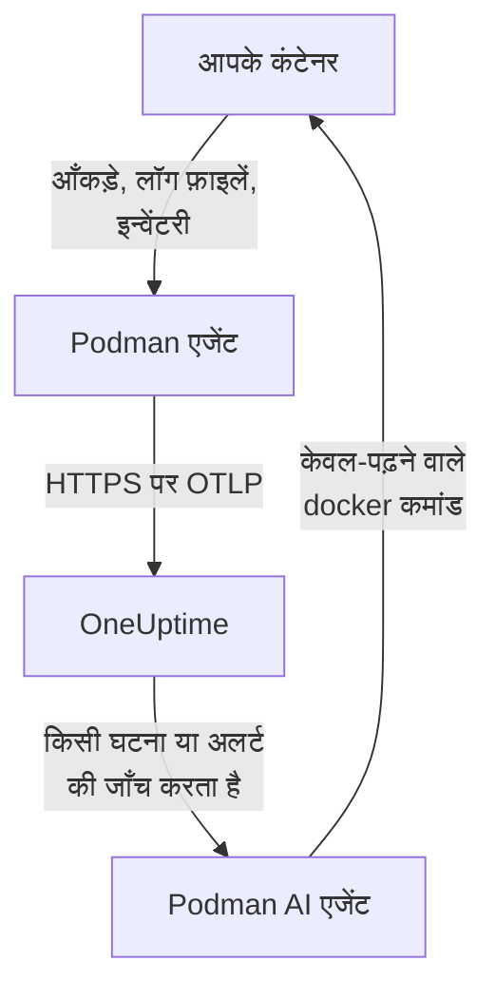

# Podman एजेंट

OneUptime Podman एजेंट एक कंटेनर है जिसे आप Podman होस्ट पर चलाते हैं। यह होस्ट के हर कंटेनर के आँकड़े और लॉग फ़ाइलें पढ़ता है और उन्हें OneUptime को भेजता है, जहाँ होस्ट अपने कंटेनर, मेट्रिक्स और लॉग के साथ दिखता है। एक दूसरा कंटेनर, Podman AI एजेंट, OneUptime AI को होस्ट की जाँच करने देता है। [Podman मॉनिटर](/docs/monitor/podman-monitor) एजेंट के भेजे डेटा पर अलर्ट करते हैं।

:::cards
- [एजेंट इंस्टॉल करें](#एजेंट-इंस्टॉल-करें): दो कंटेनर, `podman run` या Podman Compose से।
- [एजेंट क्या इकट्ठा करता है](#एजेंट-क्या-इकट्ठा-करता-है): हर कंटेनर के मेट्रिक्स, लॉग और इन्वेंटरी।
- [कंटेनर लॉग को k8s-file चाहिए](#कंटेनर-लॉग-को-k8s-file-लॉग-ड्राइवर-चाहिए): जब तक आप न बदलें, Podman journald में लॉग करता है।
- [समस्या निवारण](#समस्या-निवारण): रीस्टार्ट लूप, गायब मेट्रिक्स, गायब लॉग।
:::

## यह कैसे काम करता है

एजेंट एक OpenTelemetry Collector है जिसमें OneUptime का कॉन्फ़िगरेशन पहले से बना हुआ है। Podman के Docker-संगत API सॉकेट के ज़रिए यह हर 30 सेकंड में हर कंटेनर के आँकड़े पढ़ता है और हर 5 मिनट में हर कंटेनर, इमेज, नेटवर्क और वॉल्यूम की सूची बनाता है। यह कंटेनरों की लॉग फ़ाइलें फ़ॉलो करता है और सब कुछ आपकी दी गई इंजेशन कुंजी के साथ OTLP पर आपके OneUptime URL को भेजता है।



होस्ट अपने पहले डेटा के साथ, `PODMAN_HOST_NAME` में आपके दिए नाम के अंतर्गत, खुद को रजिस्टर करता है। AI एजेंट वैकल्पिक है: उसे छोड़ दें, और कलेक्टर वैसे ही काम करता है।

## शुरू करने से पहले

- Podman 4.0 या उसके बाद का संस्करण, और होस्ट पर root पहुँच।
- `/run/podman/podman.sock` पर Podman का API सॉकेट। इसे `sudo systemctl enable --now podman.socket` से चालू करें।
- एक इंजेशन कुंजी। **प्रोजेक्ट सेटिंग्स → टेलीमेट्री और APM → इंजेशन कुंजियाँ** के अंतर्गत एक बनाएँ और उसका मान कॉपी करें।
- होस्ट से आपके OneUptime URL तक आउटबाउंड HTTPS।
- कंटेनर लॉग के लिए, ऐसे कंटेनर जो `k8s-file` लॉग ड्राइवर उपयोग करते हैं। rootful Podman डिफ़ॉल्ट रूप से `journald` में लॉग करता है, जिसे एजेंट नहीं पढ़ सकता। [कंटेनर लॉग को k8s-file लॉग ड्राइवर चाहिए](#कंटेनर-लॉग-को-k8s-file-लॉग-ड्राइवर-चाहिए) देखें।

## एजेंट इंस्टॉल करें

:::steps
### एजेंट शुरू करें

`YOUR_ONEUPTIME_URL` को अपने OneUptime URL से, `YOUR_TELEMETRY_INGESTION_TOKEN` को इंजेशन कुंजी से, और `my-podman-host` को इस होस्ट के किसी नाम से बदलें, जैसे `prod-podman-01`। होस्ट OneUptime में इसी नाम से दिखता है, इसलिए इसे स्थिर रखें: नया नाम एक नया होस्ट रजिस्टर करता है।

:::tabs
@tab Podman CLI
```bash
podman run -d \
  --name oneuptime-podman-agent \
  --user 0:0 \
  --restart unless-stopped \
  -v /run/podman/podman.sock:/run/podman/podman.sock:ro \
  -v /var/lib/containers/storage:/var/lib/containers/storage:ro \
  -e ONEUPTIME_URL="YOUR_ONEUPTIME_URL" \
  -e ONEUPTIME_SERVICE_TOKEN="YOUR_TELEMETRY_INGESTION_TOKEN" \
  -e PODMAN_HOST_NAME="my-podman-host" \
  oneuptime/podman-agent:release
```

फिर उसी मानों के साथ उसके बगल में [AI एजेंट](#ai-एजेंट) शुरू करें। **AI जाँच डिफ़ॉल्ट रूप से चालू है**: जब OneUptime AI इस होस्ट पर किसी घटना या अलर्ट की जाँच करता है, तो वह AI एजेंट के ज़रिए, Podman के Docker-संगत API के विरुद्ध, केवल-पढ़ने वाले `docker` कमांड चलाता है, और जब तक आप सुधारों की अनुमति न दें, कुछ नहीं बदलता। AI जाँच के बिना इंस्टॉल करने के लिए यह कमांड छोड़ दें।

```bash
podman run -d \
  --name oneuptime-podman-ai-agent \
  --user 0:0 \
  --restart unless-stopped \
  --read-only --tmpfs /tmp \
  -v /run/podman/podman.sock:/run/podman/podman.sock:ro \
  -e ONEUPTIME_URL="YOUR_ONEUPTIME_URL" \
  -e ONEUPTIME_SERVICE_TOKEN="YOUR_TELEMETRY_INGESTION_TOKEN" \
  -e ONEUPTIME_AI_AGENT_RESOURCE_TYPE=podman \
  -e PODMAN_HOST_NAME="my-podman-host" \
  oneuptime/resource-ai-agent:release
```
@tab Podman Compose
इसे होस्ट के किसी फ़ोल्डर में `docker-compose.yml` के रूप में सहेजें। दूसरी सेवा [AI एजेंट](#ai-एजेंट) है: AI जाँच के बिना कलेक्टर चलाने के लिए उसे छोड़ दें।

```yaml title="docker-compose.yml"
services:
  oneuptime-podman-agent:
    image: oneuptime/podman-agent:release
    container_name: oneuptime-podman-agent
    user: "0:0"
    restart: unless-stopped
    volumes:
      - /run/podman/podman.sock:/run/podman/podman.sock:ro
      - /var/lib/containers/storage:/var/lib/containers/storage:ro
    environment:
      - ONEUPTIME_URL=YOUR_ONEUPTIME_URL
      - ONEUPTIME_SERVICE_TOKEN=YOUR_TELEMETRY_INGESTION_TOKEN
      - PODMAN_HOST_NAME=my-podman-host
    logging:
      driver: json-file
      options:
        max-size: "10m"
        max-file: "3"
  oneuptime-podman-ai-agent:
    image: oneuptime/resource-ai-agent:release
    container_name: oneuptime-podman-ai-agent
    user: "0:0"
    restart: unless-stopped
    read_only: true
    tmpfs:
      - /tmp
    volumes:
      - /run/podman/podman.sock:/run/podman/podman.sock:ro
    environment:
      - ONEUPTIME_URL=YOUR_ONEUPTIME_URL
      - ONEUPTIME_SERVICE_TOKEN=YOUR_TELEMETRY_INGESTION_TOKEN
      - ONEUPTIME_AI_AGENT_RESOURCE_TYPE=podman
      - PODMAN_HOST_NAME=my-podman-host
```

उस फ़ोल्डर में इसे शुरू करें:

```bash
podman compose up -d
```
:::

### जाँचें कि एजेंट चल रहा है

```bash
podman ps --filter name=oneuptime-podman-agent
podman logs -f oneuptime-podman-agent
```

कलेक्टर शुरू होने के बाद लॉग में यह लाइन दिखनी चाहिए:

```text
Everything is ready. Begin running and processing data.
```

### OneUptime में होस्ट खोजें

**उत्पाद → बुनियादी ढांचा → Podman → सभी होस्ट** खोलें। होस्ट लगभग एक मिनट में अपने `PODMAN_HOST_NAME` के अंतर्गत, अपने कंटेनर, मेट्रिक्स और लॉग के साथ दिखता है। AI एजेंट होस्ट के **AI एजेंट** पेज पर, और उसके **अवलोकन** में सबसे नीचे, कनेक्टेड दिखता है।
:::

## एनवायरनमेंट वेरिएबल

| वेरिएबल | ज़रूरी | विवरण |
| --- | --- | --- |
| `ONEUPTIME_URL` | हाँ | आपका OneUptime URL, जैसे `https://oneuptime.com` या आपका सेल्फ़-होस्टेड इंस्टेंस। अगर इंस्टेंस सिर्फ़ HTTP पर है तो `http://` और उसका पोर्ट उपयोग करें। |
| `ONEUPTIME_SERVICE_TOKEN` | हाँ | **प्रोजेक्ट सेटिंग्स → टेलीमेट्री और APM → इंजेशन कुंजियाँ** से इंजेशन कुंजी। |
| `PODMAN_HOST_NAME` | नहीं | OneUptime में होस्ट का नाम। डिफ़ॉल्ट `podman-host` है, इसलिए हर होस्ट को उसका अपना नाम दें। |
| `DOCKER_API_VERSION` | नहीं | Docker API का वह संस्करण जिसमें एजेंट Podman सॉकेट से बात करता है। डिफ़ॉल्ट `1.44` है। अगर सॉकेट पुराना अधिकतम बताता है तो इसे घटाएँ, या इसे तय कराने के लिए खाली मान पर सेट करें ([समस्या निवारण](#समस्या-निवारण) देखें)। |

कोई मान बदलने के लिए एजेंट हटाएँ और उसका कमांड फिर से चलाएँ (Podman CLI), या `docker-compose.yml` संपादित करें और `podman compose up -d` चलाएँ (Podman Compose)।

## एजेंट क्या इकट्ठा करता है

| डेटा | यह क्या है |
| --- | --- |
| कंटेनर मेट्रिक्स | CPU (उपयोग, प्रतिशत, थ्रॉटलिंग), मेमोरी (उपयोग, सीमा, प्रतिशत), नेटवर्क और ब्लॉक I/O, अपटाइम, रीस्टार्ट और प्रक्रियाओं की संख्या, हर कंटेनर के लिए, हर 30 सेकंड में। |
| कंटेनर लॉग | हर कंटेनर का stdout और stderr, उस `ctr.log` फ़ाइल से जिसे `k8s-file` लॉग ड्राइवर लिखता है। |
| इन्वेंटरी | हर स्थिति वाला हर कंटेनर, और हर इमेज, नेटवर्क और वॉल्यूम, हर 5 मिनट में। |

हर कंटेनर के मेट्रिक्स और लॉग उस कंटेनर के नाम वाली सेवा के अंतर्गत दर्ज होते हैं। हर लॉग लाइन को उसमें बताए स्तर से गंभीरता मिलती है, जैसे `[ERROR]`, `level=warn` या `{"level":"info"}`; जो लाइन कोई स्तर नहीं बताती वह अपनी स्ट्रीम की गंभीरता लेती है: stderr `ERROR` है, stdout `INFO`। व्हाइटस्पेस या बंद कोष्ठक से शुरू होने वाली लाइनें पिछली लाइन से जुड़ जाती हैं, इसलिए स्टैक ट्रेस एक रिकॉर्ड के रूप में आता है। एजेंट के अपने लॉग छोड़ दिए जाते हैं।

[Podman मॉनिटर](/docs/monitor/podman-monitor#इकट्ठा-किए-गए-मेट्रिक्स) हर मेट्रिक और उसका अर्थ सूचीबद्ध करता है।

## कंटेनर लॉग को k8s-file लॉग ड्राइवर चाहिए

एजेंट `/var/lib/containers/storage/overlay-containers/*/userdata/ctr.log` फ़ॉलो करता है, यानी वे फ़ाइलें जो Podman का `k8s-file` लॉग ड्राइवर लिखता है (Podman में `json-file` वही ड्राइवर है)। rootful Podman का डिफ़ॉल्ट ड्राइवर `journald` है, जो पढ़ने के लिए कोई फ़ाइल नहीं छोड़ता, और `syslog` जैसा रिमोट ड्राइवर भी नहीं छोड़ता। ऐसे कंटेनर के मेट्रिक्स फिर भी आते हैं; उसके लॉग नहीं।

किसी कंटेनर का लॉग ड्राइवर, और Podman का डिफ़ॉल्ट, जाँचें:

```bash
podman inspect <container> --format '{{.HostConfig.LogConfig.Type}}'
podman info --format '{{.Host.LogDriver}}'
```

किसी कंटेनर को `k8s-file` के साथ चलाएँ, या किसी Compose सेवा को उस पर ले जाएँ:

```bash
podman run --log-driver k8s-file --log-opt max-size=100m ... <image>
```

```yaml
services:
  my-app:
    image: my-app:latest
    logging:
      driver: "k8s-file"
      options:
        max-size: "100m"
```

या `containers.conf` (rootful के लिए `/etc/containers/containers.conf`, rootless के लिए `~/.config/containers/containers.conf`) में इसे बाद में बनने वाले हर कंटेनर का डिफ़ॉल्ट बनाएँ:

```toml title="containers.conf"
[containers]
log_driver = "k8s-file"
log_size_max = 104857600
```

फिर कंटेनर दोबारा बनाएँ। कंटेनर वही लॉग ड्राइवर रखता है जिसके साथ वह बना था, इसलिए उसे फिर से शुरू करना काफ़ी नहीं।

## एजेंट अपग्रेड करना

जब एजेंट आपके OneUptime से पुराना होता है, तो होस्ट के **अवलोकन** पर **एजेंट संस्करण** के बगल में एक चेतावनी चिह्न दिखता है। ये कमांड देखने के लिए उसे चुनें।

:::tabs
@tab Podman CLI
```bash
podman pull oneuptime/podman-agent:release
podman pull oneuptime/resource-ai-agent:release
podman rm -f oneuptime-podman-agent oneuptime-podman-ai-agent
```

फिर [एजेंट शुरू करें](#एजेंट-शुरू-करें) के दोनों `podman run` कमांड फिर से चलाएँ।
@tab Podman Compose
```bash
podman compose pull
podman compose up -d
```
:::

`release` टैग हमेशा सबसे नई रिलीज़ की ओर इंगित करता है। कोई संस्करण पिन करने के लिए `oneuptime/podman-agent:<version>` उपयोग करें, जैसे `oneuptime/podman-agent:10.0.31`। यही इमेज GitHub Container Registry पर `ghcr.io/oneuptime/podman-agent:release` के रूप में है।

## एजेंट अनइंस्टॉल करना

:::tabs
@tab Podman CLI
```bash
podman rm -f oneuptime-podman-agent
podman rm -f oneuptime-podman-ai-agent
```
@tab Podman Compose
```bash
podman compose down
```
:::

होस्ट अपने भेजे डेटा के साथ OneUptime में बना रहता है। अगर अब आपको उसकी ज़रूरत नहीं, तो उसके मेनू में **होस्ट हटाएं** से उसे हटाएँ।

## AI एजेंट

ऊपर के कमांड और Compose फ़ाइल, Podman एजेंट का `install.sh` और उसकी [PodmanAgent डायरेक्टरी](https://github.com/OneUptime/oneuptime/tree/master/agents/PodmanAgent) की `docker-compose.yml`, सभी **Podman AI एजेंट** चलाते हैं: एक दूसरा कंटेनर, `oneuptime-podman-ai-agent` (इमेज `oneuptime/resource-ai-agent:release`), जो वे केवल-पढ़ने वाले कमांड चलाता है जो OneUptime AI इस होस्ट पर किसी घटना या अलर्ट की जाँच करते समय माँगता है — Podman के Docker-संगत API के ज़रिए, `docker` CLI से: `docker ps -a`, `docker logs --tail 200 web`, `docker container inspect web` — और सिर्फ़ आपकी अनुमति होने पर किसी नामित कंटेनर को फिर से शुरू करने जैसे सुधार लागू करता है। यह कलेक्टर वाले ही `ONEUPTIME_URL`, `ONEUPTIME_SERVICE_TOKEN` और `PODMAN_HOST_NAME` पढ़ता है, इसलिए ठीक इसी होस्ट की सेवा करता है, और OneUptime में होस्ट के **AI एजेंट** पेज पर दिखता है।

- **AI जाँच डिफ़ॉल्ट रूप से चालू है।** एजेंट के कनेक्ट होते ही OneUptime AI इस होस्ट की घटनाओं और अलर्ट की जाँच इसके साथ करता है, और होस्ट का **अवलोकन** एजेंट की स्थिति दिखाता है। रोकने के लिए, जहाँ एजेंट चलता है वहाँ `ONEUPTIME_AI_INVESTIGATION=false` सेट करें (AI एजेंट पेज पर **AI क्या कर सकता है** के अंतर्गत **बदलें** तरीका दिखाता है), या एजेंट को छोड़ दें।
- यह केवल-पढ़ने वाला है, जब तक आप इसे `ONEUPTIME_AI_ALLOW_WRITES=true` के साथ शुरू न करें; `ONEUPTIME_AI_WRITE_TARGETS` (उदाहरण के लिए `web-*,api-*`) सीमित करता है कि कोई सुधार किन कंटेनरों को छू सकता है। सुधार कैसे चलें यह बताने के लिए इसे `ONEUPTIME_AI_FIXES` के साथ भी शुरू करें — `ask-for-approval` (हर एक को एक व्यक्ति मंज़ूरी देता है), `automatic` या `bypass-approval` — और AI एजेंट पेज इसे केवल-पढ़ने के रूप में दिखाता है ([AI क्या कर सकता है, एजेंट द्वारा सेट](/docs/ai/infrastructure-ai-agents#what-ai-may-do-set-by-the-agent))।
- इसे कलेक्टर वाला ही सॉकेट चाहिए और यह उसे माउंट करके root के रूप में चलता है, क्योंकि सॉकेट का मालिक root है — और rootful Podman के लिए जो भी सॉकेट उपयोग कर सकता है वह इस होस्ट पर root है, `:ro` हो या न हो। एजेंट की कमांड नीति ही सीमा है: यह कभी `exec`, `run`, `rm` या `prune` नहीं चलाता, और कभी खुद को, कलेक्टर को या `ONEUPTIME_AI_PROTECTED_TARGETS` (कंटेनर नाम ग्लोब) में की किसी चीज़ को नहीं बदलता।
- `install.sh --no-ai-agent` इसे छोड़ देता है; `podman rm -f oneuptime-podman-ai-agent` इसे हटाता है। इसे कलेक्टर की तरह अपग्रेड करें: `podman pull oneuptime/resource-ai-agent:release`, इसे हटाएँ, और फिर से शुरू करें।

यह क्या चला सकता है, सुधार कैसे काम करते हैं और इसकी समस्याएँ कैसे सुलझाएँ: [Infrastructure AI Agents](/docs/ai/infrastructure-ai-agents#docker-and-podman-hosts)।

## समस्या निवारण

:::details एजेंट "client version is too new" के साथ बार-बार फिर से शुरू होता है
एजेंट के लॉग दिखाते हैं:

```text
Error: cannot start pipelines: failed to start "docker_stats" receiver:
Error response from daemon: client version 1.44 is too new.
Maximum supported API version is 1.41
```

अधिकतम क्लाइंट संस्करण लागू करने वाला Docker-API सर्वर नए संस्करण को अस्वीकार करता है, इसलिए रिसीवर कभी शुरू नहीं होता और कलेक्टर भी उसके साथ बंद हो जाता है। Podman सॉकेट जो API संस्करण बताता है उसे जाँचें:

```bash
curl -s -o /dev/null -D - --unix-socket /run/podman/podman.sock http://localhost/_ping | grep -i '^api-version'
```

फिर `podman run` में `-e DOCKER_API_VERSION=1.41` (या जो मान आपको मिला) जोड़ें, या Compose में `DOCKER_API_VERSION` सेट करें। नए सर्वर अब भी पुराने API संस्करण परोसते हैं, इसलिए यह सेटिंग अपग्रेड के बाद भी मान्य रहती है।

नंबर देखना नहीं चाहते? `DOCKER_API_VERSION` को खाली स्ट्रिंग पर सेट करें। तब एजेंट कोई संस्करण पिन करने के बजाय सॉकेट के साथ संस्करण तय करता है (एक `HEAD /_ping`, फिर सॉकेट का बताया अधिकतम):

```bash
podman run -d ... -e DOCKER_API_VERSION= ...
```
:::

:::details Podman सॉकेट पर अनुमति अस्वीकृत, या कोई सॉकेट नहीं
`/run/podman/podman.sock` पढ़ने के लिए एजेंट को root के रूप में चलना चाहिए। जाँचें कि आपके `podman run` कमांड में `--user 0:0` है, या Compose में `user: "0:0"`, और सॉकेट चालू है: `sudo systemctl enable --now podman.socket`। rootless Podman का सॉकेट इसके बजाय `/run/user/<uid>/podman/podman.sock` पर होता है (`systemctl --user enable --now podman.socket`): `/run/podman/podman.sock` की जगह वह पथ माउंट करें।
:::

:::details होस्ट डिस्कनेक्टेड दिखता है
1. जाँचें कि एजेंट चल रहा है: `podman ps --filter name=oneuptime-podman-agent`
2. उसके लॉग में त्रुटियाँ देखें: `podman logs oneuptime-podman-agent 2>&1 | grep -i error`
3. `ONEUPTIME_URL` और `ONEUPTIME_SERVICE_TOKEN` जाँचें: कुंजी एक मान्य इंजेशन कुंजी होनी चाहिए जो अक्षम न की गई हो।
4. जाँचें कि होस्ट नेटवर्क पर आपके OneUptime URL तक पहुँच सकता है।
:::

:::details कोई मेट्रिक्स नहीं दिखते
1. जाँचें कि Podman सॉकेट एजेंट में माउंट है। उसकी इमेज में कोई शेल नहीं है, इसलिए उसके माउंट साझा करने वाले एक अस्थायी कंटेनर से देखें: `podman run --rm --volumes-from oneuptime-podman-agent alpine:3.19 ls -la /run/podman/podman.sock`
2. उसके लॉग में एक्सपोर्ट त्रुटियाँ देखें: `podman logs oneuptime-podman-agent 2>&1 | tail -100`
3. जाँचें कि इंजेशन कुंजी मान्य है और समाप्त नहीं हुई।
:::

:::details मेट्रिक्स आते हैं पर कंटेनर लॉग नहीं आते
आपके कंटेनर शायद `journald` उपयोग करते हैं, जो Podman का डिफ़ॉल्ट लॉग ड्राइवर है। जाँचें कि एजेंट कौन-सी फ़ाइलें देखता है, और कोई कंटेनर कौन-सा ड्राइवर उपयोग करता है:

```bash
podman logs oneuptime-podman-agent 2>&1 | grep -E "Started watching file|no files match"
podman inspect <container> --format '{{.HostConfig.LogConfig.Type}}'
```

अगर एजेंट `no files match the configured criteria` बताता है, तो कंटेनरों को `k8s-file` पर ले जाएँ और दोबारा बनाएँ, जैसा [कंटेनर लॉग को k8s-file लॉग ड्राइवर चाहिए](#कंटेनर-लॉग-को-k8s-file-लॉग-ड्राइवर-चाहिए) दिखाता है।
:::

:::details लॉग किसी दूसरे होस्ट पर पहुँचते हैं, या होस्ट का नाम podman-host है
होस्ट का नाम `PODMAN_HOST_NAME` से आता है। इसके बिना शुरू किया गया एजेंट `podman-host` बताता है, इसलिए इस तरह सेट हर होस्ट एक जैसा दिखता है; बाद में नाम बदलें, तो OneUptime एक दूसरा होस्ट रजिस्टर करता है, जिसमें फिर नया डेटा होता है। हर होस्ट पर `PODMAN_HOST_NAME` को उसके अपने नाम पर सेट करें, और एजेंट दोबारा बनाएँ। एजेंट कौन-सा नाम बताता है, यह जाँचने के लिए:

```bash
podman inspect oneuptime-podman-agent --format '{{range .Config.Env}}{{println .}}{{end}}' | grep PODMAN_HOST_NAME
```
:::

## अगले कदम

:::cards
- [Podman मॉनिटर](/docs/monitor/podman-monitor): कंटेनर CPU, मेमोरी और रीस्टार्ट पर अलर्ट करें।
- [डेटाबेस](/docs/telemetry/databases): होस्ट पर डेटाबेस कंटेनर खोजे जाते हैं और उन्हें अपने पेज मिलते हैं।
- [Kubernetes एजेंट](/docs/telemetry/kubernetes-agent): इसके बजाय किसी Kubernetes क्लस्टर की निगरानी करें।
- [होस्ट OpenTelemetry कलेक्टर](/docs/telemetry/host-otel-collector): खुद मशीन की निगरानी करें: CPU, डिस्क, प्रक्रियाएँ और लॉग।
:::
