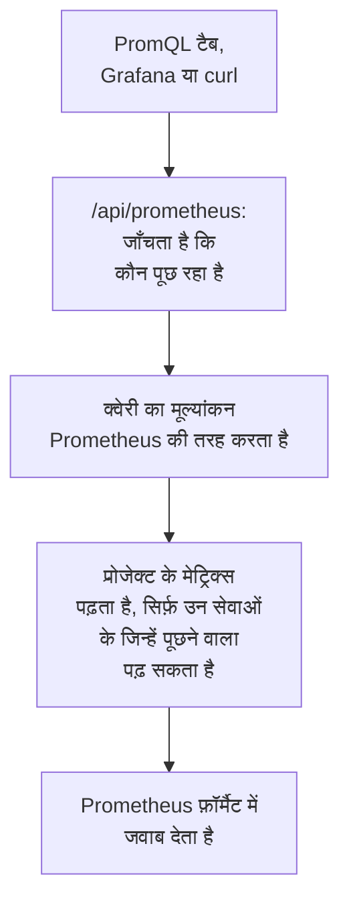

# PromQL से मेट्रिक्स क्वेरी करें

PromQL, Prometheus की क्वेरी भाषा है, और मेट्रिक्स के चार्ट बनाने वाले ज़्यादातर लोग इसे पहले से जानते हैं। OneUptime आपके प्रोजेक्ट के मेट्रिक्स इसी से पढ़ता है: मेट्रिक्स के **PromQL** टैब पर, और एक Prometheus-संगत API के ज़रिए, जिससे Grafana या Prometheus डेटा स्रोत वाला कोई भी टूल जुड़ सकता है।

:::cards
- [क्वेरी लिखना](#क्वेरी-लिखना): मेट्रिक्स पेज पर PromQL चलाएँ और ग्राफ़ या तालिका देखें।
- [मेट्रिक्स के नाम कैसे बनते हैं](#मेट्रिक्स-के-नाम-कैसे-बनते-हैं): OpenTelemetry के नाम और विशेषताएँ PromQL में कैसे पढ़े जाते हैं।
- [Grafana कनेक्ट करना](#grafana-कनेक्ट-करना): OneUptime को Prometheus डेटा स्रोत के रूप में जोड़ें।
- [सीमाएँ](#सीमाएँ): कोई क्वेरी क्या पढ़ सकती है, और कितनी देर तक।
:::

## यह कैसे काम करता है

PromQL टैब और Grafana एक ही API से पूछते हैं। OneUptime जाँचता है कि पूछने वाला प्रोजेक्ट के मेट्रिक्स पढ़ सकता है, सिर्फ़ उन्हीं सेवाओं को पढ़ता है जिन्हें वह पढ़ सकता है, और क्वेरी का मूल्यांकन वैसे ही करता है जैसे Prometheus करता है।



## शुरू करने से पहले

- **आते हुए मेट्रिक्स।** उन्हें [OpenTelemetry](/docs/telemetry/open-telemetry) से भेजें, या किसी एजेंट से, जैसे [होस्ट OpenTelemetry Collector](/docs/telemetry/host-otel-collector)।
- **मेट्रिक्स पढ़ सकने वाली भूमिका।** Project Owner, Project Admin, Project Member, Viewer, Telemetry Admin, Telemetry Member या Telemetry Viewer, या Read Metrics अनुमति वाली कस्टम भूमिका। कुछ सेवाओं तक सीमित भूमिका सिर्फ़ उन्हीं सेवाओं के मेट्रिक्स पढ़ती है।
- **Grafana या किसी स्क्रिप्ट के लिए: प्रोजेक्ट की एक API कुंजी**, जिसमें इनमें से कोई भूमिका या Read Metrics अनुमति हो। देखें [एक API कुंजी बनाएँ](/docs/api-reference/api-reference#एक-api-कुंजी-बनाएँ)। OneUptime Cloud पर API कुंजियों के लिए **Growth** प्लान चाहिए।

## क्वेरी लिखना

:::steps
### PromQL खोलें

**मेट्रिक्स** खोलें और **PromQL** टैब पर क्लिक करें।

### क्वेरी लिखें

इसे एडिटर में टाइप करें, **उदाहरण** के तहत कोई उदाहरण चुनें, या **मेट्रिक का नाम जोड़ें** से शुरू करें, जो आपके प्रोजेक्ट के मेट्रिक्स को उन्हीं नामों से दिखाता है जो PromQL उन्हें देता है।

### उसे चलाएँ

**क्वेरी चलाएँ** पर क्लिक करें, या Ctrl+Enter (Mac पर ⌘+Enter) दबाएँ। **ग्राफ़** पूरी समय सीमा पर क्वेरी बनाता है; **तालिका** समय सीमा के अंत में हर सीरीज़ का मान दिखाती है।
:::

शुरुआत के लिए कुछ क्वेरी:

```text title="PromQL"
# Requests per second, by service
sum by (job) (rate(http_requests_total[5m]))

# The 95th percentile of a latency histogram
histogram_quantile(0.95, sum by (le) (rate(http_server_request_duration_bucket[5m])))

# The five hosts using the most memory
topk(5, system_memory_usage)
```

जो क्वेरी नहीं चलती, उसमें क्या गलत हुआ और कहाँ, यह एडिटर दिखाता है: उदाहरण के लिए, `rate(http_requests_total)` पर वह बताता है कि फ़ंक्शन को `[5m]` जैसी रेंज चाहिए।

## मेट्रिक्स के नाम कैसे बनते हैं

OneUptime मेट्रिक्स को OpenTelemetry के तरीक़े से सहेजता है। PromQL उन्हें उन्हीं नामों से पढ़ता है जो Prometheus का अपना OpenTelemetry समर्थन उन्हें देता है, इसलिए Prometheus के लिए लिखी गई क्वेरी यहाँ भी काम करती है:

| OneUptime में | PromQL में |
| --- | --- |
| गेज `system.cpu.utilization` | `system_cpu_utilization` |
| काउंटर `http.requests` | `http_requests`, या `http_requests_total` |
| हिस्टोग्राम `http.server.request.duration` | `http_server_request_duration_bucket` (`le` के साथ), `_count` और `_sum` |
| समरी `rpc.latency` | `rpc_latency` (`quantile` के साथ), `_count` और `_sum` |
| विशेषता `http.route` | लेबल `http_route` |
| रिसोर्स विशेषता `service.name` | लेबल `resource_service_name`, और `job` |
| रिसोर्स विशेषता `service.instance.id` | लेबल `resource_service_instance_id`, और `instance` |

- **डॉट और डैश अंडरस्कोर बन जाते हैं**, मेट्रिक और लेबल दोनों के नामों में। किसी मेट्रिक या लेबल को ठीक उसी नाम से लेने के लिए जिससे वह सहेजा गया है, उसे कोट करें, जैसे Prometheus 3 करता है: `{"http.server.request.duration", "http.route"="/checkout"}`।
- **डेल्टा काउंटर जोड़कर पढ़े जाते हैं**, क्वेरी की समय सीमा की शुरुआत से, इसलिए `rate()` और `increase()` उन्हें किसी भी दूसरे काउंटर की तरह पढ़ते हैं।
- **एक्सपोनेंशियल हिस्टोग्राम** में `_count` और `_sum` होते हैं, पर कोई बकेट नहीं।

## Grafana कनेक्ट करना

:::steps
### एक API कुंजी बनाएँ

OneUptime में **प्रोजेक्ट सेटिंग्स → उन्नत → API कुंजियाँ** खोलें और **API कुंजी बनाएँ** पर क्लिक करें। कुंजी को टेलीमेट्री पढ़ सकने वाली भूमिका दें, या Read Metrics अनुमति।

### Prometheus डेटा स्रोत जोड़ें

Grafana में **Connections → Data sources → Add data source** खोलें और **Prometheus** चुनें।

### सर्वर URL दर्ज करें

**Prometheus server URL** में अपना OneUptime पता डालें, और उसके बाद `/api/prometheus`। OneUptime Cloud पर यह `https://oneuptime.com/api/prometheus` है। **PromQL** टैब आपके अपने सर्वर का पता एक कॉपी बटन के साथ दिखाता है।

### API कुंजी भेजें

**HTTP headers** के तहत `Authorization` हेडर जोड़ें, जिसका मान `Bearer` हो, उसके बाद एक स्पेस और आपकी API कुंजी। बेसिक ऑथेंटिकेशन भी काम करता है: कोई भी यूज़र नाम, और पासवर्ड के रूप में API कुंजी।

### सहेजें और जाँचें

**Save & test** पर क्लिक करें। Grafana एक क्वेरी चलाता है, और बताता है कि डेटा स्रोत काम करता है।
:::

कोई भी दूसरा Prometheus क्लाइंट इसी तरह काम करता है। curl से:

```bash title="Query OneUptime's Prometheus API"
curl -H "Authorization: Bearer $ONEUPTIME_API_KEY" \
  "https://oneuptime.com/api/prometheus/api/v1/query?query=up"
```

## API

API, `/api/prometheus` के तहत, Prometheus HTTP API के रूट का जवाब `GET` या `POST` से देता है:

| रूट | यह क्या लौटाता है |
| --- | --- |
| `/api/v1/query` | किसी एक समय पर क्वेरी (`time`, डिफ़ॉल्ट रूप से अभी)। |
| `/api/v1/query_range` | `start` से `end` तक हर `step` पर क्वेरी। |
| `/api/v1/series` | वे सीरीज़ जिन्हें `match[]` चुनता है। |
| `/api/v1/labels` | लेबल नाम, `match[]` से चुनी गई सीरीज़ के या हर मेट्रिक के। |
| `/api/v1/label/<name>/values` | किसी एक लेबल के मान। `__name__` मेट्रिक नामों की सूची देता है। |
| `/api/v1/metadata` | हर मेट्रिक का प्रकार, सहायता पाठ और इकाई। |

समय Unix सेकंड या RFC 3339 में होते हैं, अवधियाँ सेकंड में या `15s` जैसी अवधि के रूप में, और जवाब Prometheus के फ़ॉर्मैट में आते हैं। `/api/v1/status/buildinfo` एक Prometheus 3 सर्वर की तरह जवाब देता है; नियम और अलर्ट खाली होते हैं, क्योंकि OneUptime [मॉनिटर](/docs/monitor/metrics-monitor) से अलर्ट करता है।

## PromQL में क्या-क्या शामिल है

- **सिलेक्टर**, हर मैचर (`=`, `!=`, `=~`, `!~`), रेंज, `offset`, `@` (`start()` और `end()` के साथ) और सबक्वेरी के साथ।
- **ऑपरेटर**: अंकगणित, तुलना (`bool` के साथ), `and`, `or`, `unless`, और `on`, `ignoring`, `group_left` और `group_right` के साथ वेक्टर मैचिंग।
- **एग्रीगेशन**: `sum`, `avg`, `min`, `max`, `count`, `group`, `stddev`, `stdvar`, `topk`, `bottomk`, `quantile` और `count_values`, `by` या `without` के साथ।
- **फ़ंक्शन**: `rate`, `irate`, `increase`, `delta`, `idelta`, `deriv`, `predict_linear`, `histogram_quantile`, हर `*_over_time` फ़ंक्शन, `changes`, `resets`, `absent`, `label_replace`, `label_join`, `sort`, `clamp`, `round`, गणित और तारीख़ वाले फ़ंक्शन, और भी बहुत कुछ।

Prometheus के नेटिव हिस्टोग्राम फ़ंक्शन, जैसे `histogram_count()`, उपलब्ध नहीं हैं: OneUptime हिस्टोग्राम को बकेट के साथ सहेजता है, जिन्हें `histogram_quantile()` और `_count` व `_sum` सीरीज़ पढ़ती हैं।

## सीमाएँ

हर क्वेरी सीमित है, ताकि कई पैनल वाला डैशबोर्ड OneUptime पर ज़्यादा बोझ न डाल सके:

| सीमा | मान |
| --- | --- |
| किसी रेंज क्वेरी की एक सीरीज़ में बिंदु | 11,000 |
| एक क्वेरी जितने सैंपल पढ़ और रख सकती है | 5,000,000 |
| एक सिलेक्टर जितने मेट्रिक बिंदु पढ़ सकता है | 1,000,000 |
| एक रीड में लगने वाला समय | 30 सेकंड |
| मूल्यांकन में लगने वाला समय | 30 सेकंड |
| किसी सीरीज़ का नवीनतम सैंपल ढूँढने के लिए सिलेक्टर कितना पीछे देखता है | 5 मिनट |
| सबक्वेरी का स्टेप, जब क्वेरी उसे नहीं बताती | 1 मिनट |

## समस्या निवारण

:::details Grafana कहता है कि डेटा स्रोत काम नहीं करता
जाँचें कि URL `/api/prometheus` पर ख़त्म होता है, और `Authorization` हेडर में `Bearer`, एक स्पेस और API कुंजी है। मेट्रिक्स पढ़ सकने वाली भूमिका के बिना कुंजी अस्वीकार कर दी जाती है: उसे **प्रोजेक्ट सेटिंग्स → उन्नत → API कुंजियाँ** में ऐसी भूमिका दें।
:::

:::details एक्सप्लोरर का कोई मेट्रिक कुछ नहीं ढूँढ पाता
उसके PromQL नाम में वहाँ अंडरस्कोर हैं जहाँ सहेजे गए नाम में डॉट हैं, और हिस्टोग्राम `_bucket`, `_count` या `_sum` के ज़रिए पढ़ा जाता है। PromQL टैब पर **मेट्रिक का नाम जोड़ें** हर नाम को वैसे ही दिखाता है जैसे PromQL उसे लिखता है।
:::

:::details "The query reads more than 1,000,000 metric points"
क्वेरी उससे ज़्यादा माँगती है जितना एक रीड रख सकता है। लेबल मैचर जोड़ें, समय सीमा छोटी करें, या बड़ा स्टेप इस्तेमाल करें।
:::

## अगले कदम

:::cards
- [मेट्रिक्स एक्सप्लोरर](/docs/telemetry/metrics-explorer): बिना क्वेरी लिखे मेट्रिक्स का चार्ट बनाएँ।
- [मेट्रिक्स मॉनिटर](/docs/monitor/metrics-monitor): जब कोई मेट्रिक किसी सीमा को पार करे तो अलर्ट करें।
- [बाहरी डेटा स्रोत](/docs/dashboards/data-sources): अपने डैशबोर्ड पर किसी बाहरी Prometheus का चार्ट बनाएँ।
:::
