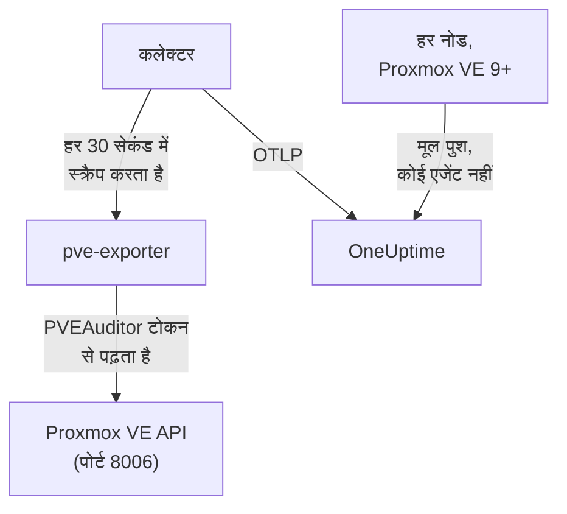

# Proxmox एजेंट

OneUptime Proxmox एजेंट किसी Proxmox VE क्लस्टर की निगरानी करता है: उसके नोड, QEMU VM, LXC कंटेनर, स्टोरेज, HA स्थिति, बैकअप कवरेज और रेप्लिकेशन। यह केवल-पढ़ने वाले टोकन के साथ Proxmox VE API के ज़रिए क्लस्टर पढ़ता है और जो मिलता है वह OneUptime को भेजता है, जहाँ क्लस्टर अपने नोड, गेस्ट और स्टोरेज के साथ दिखता है। Proxmox VE 9 और उसके बाद के संस्करणों पर नोड अपने मेट्रिक्स खुद भी पुश कर सकते हैं, बिना कुछ इंस्टॉल किए। [Proxmox मॉनिटर](/docs/monitor/proxmox-monitor) आने वाले डेटा पर अलर्ट करते हैं।

:::cards
- [चुनें कि कैसे कनेक्ट करना है](#चुनें-कि-कैसे-कनेक्ट-करना-है): एजेंट, या Proxmox VE 9 का अपना पुश।
- [एजेंट इंस्टॉल करें](#एजेंट-इंस्टॉल-करें): एक API टोकन, फिर इंस्टॉल स्क्रिप्ट या Docker Compose।
- [मूल पुश](#बिना-इंस्टॉल-का-विकल्प-proxmox-ve-9-का-मूल-opentelemetry-पुश): Proxmox VE 9 अपने मेट्रिक्स खुद भेजता है।
- [समस्या निवारण](#समस्या-निवारण): एक डायग्नोस्टिक स्क्रिप्ट, और आम समस्याएँ।
:::

## यह कैसे काम करता है

एजेंट कंटेनरों का एक सेट है जिसे आप Docker Compose से एक मशीन पर चलाते हैं: [prometheus-pve-exporter](https://github.com/prometheus-pve/prometheus-pve-exporter) पोर्ट 8006 पर Proxmox VE API पढ़ता है, एक OpenTelemetry Collector हर 30 सेकंड में एक्सपोर्टर स्क्रैप करता है और हर मेट्रिक पर आपके क्लस्टर का नाम लगाता है, और Proxmox AI एजेंट OneUptime AI को जाँच के दौरान क्लस्टर पढ़ने देता है। इसके बजाय Proxmox VE 9 का मूल पुश हर नोड के मेट्रिक्स सीधे OneUptime को भेजता है।



क्लस्टर अपने पहले डेटा के साथ, उस नाम के अंतर्गत खुद को रजिस्टर करता है जिसे एजेंट हर मेट्रिक पर `proxmox.cluster.name` के रूप में लगाता है।

## चुनें कि कैसे कनेक्ट करना है

| | एजेंट | मूल पुश |
| --- | --- | --- |
| Proxmox VE | कोई भी समर्थित संस्करण | 9.0 या उसके बाद |
| क्या इंस्टॉल करना है | एक मशीन पर Docker Compose | कुछ नहीं: Proxmox वेब UI में एक मेट्रिक सर्वर |
| नोड, गेस्ट और स्टोरेज | हाँ | हाँ |
| HA स्थिति, बूट पर शुरू, बैकअप कवरेज और रेप्लिकेशन | हाँ | नहीं |
| Proxmox AI एजेंट | हाँ | नहीं |

**HA Resource in Error State**, **Guest Down**, **Guest Not Backed Up** और **Replication Failing** टेम्पलेट को एजेंट चाहिए। किसी क्लस्टर के लिए इनमें से एक ही उपयोग करें: दोनों चलाने से हर संसाधन दो बार रिपोर्ट होता है।

## शुरू करने से पहले

- Docker Compose v2 प्लगइन के साथ Docker Engine 20.10 या उसके बाद का संस्करण, ऐसी मशीन पर जो पोर्ट 8006 पर Proxmox VE API तक पहुँच सके।
- API टोकन बनाने के लिए किसी भी Proxmox VE नोड पर root शेल, या Proxmox वेब UI।
- एक इंजेशन कुंजी। **प्रोजेक्ट सेटिंग्स → टेलीमेट्री और APM → इंजेशन कुंजियाँ** के अंतर्गत एक बनाएँ और उसका मान कॉपी करें।
- उस मशीन से आपके OneUptime URL तक आउटबाउंड HTTPS।

### एजेंट कहाँ चलाएँ

एजेंट नेटवर्क पर Proxmox VE API से क्वेरी करता है, इसलिए उसे किसी क्लस्टर नोड पर रहने की ज़रूरत नहीं, और उसे वहाँ रहना भी नहीं चाहिए: उसे ऐसी मशीन पर चलाएँ जो किसी नोड की विफलता झेल ले (अलग हार्डवेयर पर एक छोटा निगरानी VM, एक प्रबंधन होस्ट), या `PVE_HOST` को किसी एक नोड के पते के बजाय एक वर्चुअल IP या round-robin DNS नाम की ओर इंगित करें। अगर एजेंट का API लक्ष्य वही नोड है जो अभी बंद हुआ, तो आपकी निगरानी भी उसके साथ बंद हो जाती है। एकमात्र अपवाद वैकल्पिक journald लॉग पाइपलाइन है, जिसे किसी Proxmox VE नोड पर चलना ही होगा ([Proxmox सेवा लॉग भेजें](#वैकल्पिक-proxmox-सेवा-लॉग-भेजें) देखें)।

## एजेंट इंस्टॉल करें

:::steps
### एक केवल-पढ़ने वाला API टोकन बनाएँ

एजेंट क्लस्टर को ऐसे API टोकन से पढ़ता है जिसके पास **PVEAuditor** भूमिका है, जो पढ़ सकती है और कुछ नहीं।

:::tabs
@tab Shell
किसी भी Proxmox VE नोड पर root के रूप में:

```bash
pveum user add monitoring@pam
pveum acl modify / --roles PVEAuditor --users monitoring@pam
pveum user token add monitoring@pam oneuptime --privsep 1
pveum acl modify / --roles PVEAuditor --tokens 'monitoring@pam!oneuptime'
```

पहला कमांड सिर्फ़ तब विफल होता है, बिना नुकसान के, जब `monitoring@pam` पहले से मौजूद हो: API टोकन का अपना सीक्रेट होता है, इसलिए उपयोगकर्ता को न पासवर्ड चाहिए न सिस्टम खाता। `pveum user token add` टोकन सीक्रेट एक बार छापता है; टोकन ID `monitoring@pam!oneuptime` है।
@tab Proxmox web UI
1. *Datacenter → Permissions → API Tokens* पर जाएँ और **Add** पर क्लिक करें।
2. एक उपयोगकर्ता चुनें (या बनाएँ), टोकन को `oneuptime` जैसी ID दें, और **Privilege Separation** को चेक रहने दें।
3. टोकन ID (`user@realm!tokenname`) और सीक्रेट कॉपी करें: सीक्रेट सिर्फ़ एक बार दिखता है।
4. *Datacenter → Permissions* के अंतर्गत पथ `/` पर **PVEAuditor** भूमिका दो बार जोड़ें: एक बार टोकन के लिए **API Token Permission** के रूप में, और एक बार उसके उपयोगकर्ता के लिए **User Permission** के रूप में।
:::

भूमिका टोकन के साथ उपयोगकर्ता पर भी लगती है, क्योंकि privilege-separated टोकन को सिर्फ़ वे अनुमतियाँ मिलती हैं जो उसके उपयोगकर्ता के पास भी हैं। इसे रूट पथ `/` पर होना चाहिए, क्योंकि एक्सपोर्टर हर नोड, गेस्ट और स्टोरेज ऑब्जेक्ट पढ़ता है: संकरा पथ बाकी क्लस्टर छिपा देता है और `401`/`403 Permission check failed (/, Sys.Audit)` के साथ विफल होता है।

### एजेंट इंस्टॉल करें और शुरू करें

:::tabs
@tab install.sh
इंस्टॉल स्क्रिप्ट डाउनलोड करें और उसे उस मशीन पर चलाएँ जो एजेंट को होस्ट करेगी:

```bash
curl -sSL https://raw.githubusercontent.com/OneUptime/oneuptime/master/agents/ProxmoxAgent/install.sh -o install.sh
bash install.sh
```

स्क्रिप्ट आपका OneUptime URL, इंजेशन कुंजी, क्लस्टर का एक नाम, Proxmox VE API होस्ट, बंडल किया गया एक्सपोर्टर चलाना है या नहीं, और टोकन ID और सीक्रेट पूछती है — और यह भी कि क्या [AI एजेंट](#ai-एजेंट) सुधार लागू कर सकता है, और अगर हाँ, तो उसके लिए एक अलग टोकन और वे गेस्ट जिन्हें उसे कभी नहीं बदलना चाहिए। यह `/opt/oneuptime-proxmox-agent` में इंस्टॉल करती है, `0600` वाली एक `.env` फ़ाइल लिखती है, और Docker Compose से एजेंट शुरू करती है। स्क्रिप्ट फिर से चलाने पर वह फिर से पूछने के बजाय उस `.env` की हर चीज़ दोबारा उपयोग करती है, और [एजेंट अपग्रेड करना](#एजेंट-अपग्रेड-करना) इसी तरह होता है।
@tab Docker Compose
[ProxmoxAgent डायरेक्टरी](https://github.com/OneUptime/oneuptime/tree/master/agents/ProxmoxAgent) से `docker-compose.yml` और `otel-collector-config.yaml` एक नए फ़ोल्डर में डाउनलोड करें:

```bash
mkdir oneuptime-proxmox-agent && cd oneuptime-proxmox-agent
curl -fsSLO https://raw.githubusercontent.com/OneUptime/oneuptime/master/agents/ProxmoxAgent/docker-compose.yml
curl -fsSLO https://raw.githubusercontent.com/OneUptime/oneuptime/master/agents/ProxmoxAgent/otel-collector-config.yaml
```

उनके बगल में एक `.env` फ़ाइल बनाएँ। इसमें टोकन सीक्रेट होता है, इसलिए इसे `chmod 600 .env` से निजी रखें:

```bash title=".env"
ONEUPTIME_URL=YOUR_ONEUPTIME_URL
ONEUPTIME_TELEMETRY_INGESTION_KEY=YOUR_TELEMETRY_INGESTION_TOKEN
PROXMOX_CLUSTER_NAME=my-proxmox-cluster
PVE_HOST=192.168.1.10
PVE_API_TOKEN_ID=monitoring@pam!oneuptime
PVE_API_TOKEN_SECRET=your-token-secret
COMPOSE_PROFILES=pve-exporter
```

`COMPOSE_PROFILES=pve-exporter` बंडल किया गया एक्सपोर्टर भी शुरू करता है। एजेंट शुरू करें:

```bash
docker compose up -d
```
:::

पहले से prometheus-pve-exporter चलाते हैं? जब स्क्रिप्ट बंडल वाला चलाने के बारे में पूछे तो **n** जवाब दें, या `.env` से `COMPOSE_PROFILES` हटाएँ, और एजेंट को अपने वाले की ओर इंगित करें (`host:port`, बिना स्कीम के, ऐसा पता जिस तक एजेंट का कंटेनर पहुँच सके: `localhost` खुद कंटेनर है)। अगर आप [AI एजेंट](#ai-एजेंट) उपयोग करते हैं, जो उसी टोकन से API को कॉल करता है, तो `PVE_API_TOKEN_ID` और `PVE_API_TOKEN_SECRET` रखें:

```bash
PVE_EXPORTER_URL=your-exporter-host:9221
```

### जाँचें कि एजेंट चल रहा है

```bash
docker compose ps
docker logs -f oneuptime-proxmox-agent
```

`docker compose ps` कलेक्टर (`oneuptime-proxmox-agent`), बंडल किया गया एक्सपोर्टर (`oneuptime-pve-exporter`, जब तक आप अपना उपयोग न करें) और AI एजेंट (`oneuptime-proxmox-ai-agent`) सूचीबद्ध करता है। कलेक्टर शुरू होने के बाद उसके लॉग में यह लाइन दिखनी चाहिए:

```text
Everything is ready. Begin running and processing data.
```

### OneUptime में क्लस्टर खोजें

**उत्पाद → बुनियादी ढांचा → Proxmox → सभी क्लस्टर** खोलें। क्लस्टर पहले स्क्रैप के लगभग एक मिनट बाद अपने `PROXMOX_CLUSTER_NAME` के अंतर्गत, अपने नोड, गेस्ट और स्टोरेज के साथ दिखता है।
:::

## एनवायरनमेंट वेरिएबल

इंस्टॉल स्क्रिप्ट इन्हें `/opt/oneuptime-proxmox-agent/.env` में लिखती है; Docker Compose इंस्टॉल इन्हें `docker-compose.yml` के बगल की `.env` से पढ़ता है। कोई मान बदलने के बाद उस फ़ोल्डर में `docker compose up -d` चलाएँ।

| वेरिएबल | ज़रूरी | विवरण |
| --- | --- | --- |
| `ONEUPTIME_URL` | हाँ | आपका OneUptime URL, जैसे `https://oneuptime.com` या आपका सेल्फ़-होस्टेड इंस्टेंस। अगर इंस्टेंस सिर्फ़ HTTP पर है तो `http://` और उसका पोर्ट उपयोग करें। |
| `ONEUPTIME_TELEMETRY_INGESTION_KEY` | हाँ | **प्रोजेक्ट सेटिंग्स → टेलीमेट्री और APM → इंजेशन कुंजियाँ** से इंजेशन कुंजी। |
| `PROXMOX_CLUSTER_NAME` | हाँ | OneUptime में क्लस्टर का नाम, हर मेट्रिक पर `proxmox.cluster.name` रिसोर्स एट्रिब्यूट के रूप में लगाया गया। इसे स्थिर रखें: बाद में बदलने से एक दूसरा क्लस्टर रजिस्टर होता है। डिफ़ॉल्ट `proxmox-cluster` है। |
| `PVE_HOST` | हाँ | Proxmox VE API होस्ट (क्लस्टर का कोई भी नोड) जिससे एक्सपोर्टर और AI एजेंट क्वेरी करते हैं, जैसे `192.168.1.10`। |
| `PVE_EXPORTER_URL` | नहीं | prometheus-pve-exporter का पता (`host:port`, बिना स्कीम के)। डिफ़ॉल्ट बंडल किया गया एक्सपोर्टर है, `pve-exporter:9221`। |
| `PVE_API_TOKEN_ID` | बंडल किया गया एक्सपोर्टर या AI एजेंट | पूरी Proxmox API टोकन ID, जैसे `monitoring@pam!oneuptime`। AI एजेंट इसी से API पढ़ता है, जब तक उसके पास अपना टोकन न हो (`ONEUPTIME_AI_PVE_API_TOKEN_ID` / `ONEUPTIME_AI_PVE_API_TOKEN_SECRET`)। |
| `PVE_API_TOKEN_SECRET` | बंडल किया गया एक्सपोर्टर या AI एजेंट | Proxmox API टोकन सीक्रेट। |
| `PVE_VERIFY_SSL` | नहीं | Proxmox API का TLS प्रमाणपत्र सत्यापित करें (एक्सपोर्टर और AI एजेंट)। डिफ़ॉल्ट `false` है, क्योंकि Proxmox स्व-हस्ताक्षरित प्रमाणपत्रों के साथ आता है। |
| `COMPOSE_PROFILES` | नहीं | बंडल किया गया एक्सपोर्टर कंटेनर शुरू करने के लिए `pve-exporter` पर सेट करें। |

## एजेंट क्या इकट्ठा करता है

कलेक्टर हर 30 सेकंड में एक्सपोर्टर को उसके क्लस्टर और नोड दोनों कलेक्टर चालू रखकर स्क्रैप करता है, जो एक्सपोर्टर के डिफ़ॉल्ट रूप से चालू `backup-info` (क्लस्टर स्तर) और `replication` (नोड स्तर) कलेक्टर को भी कवर करता है। हर सीरीज़ में संसाधन का नाम बताने वाला एक `id` लेबल होता है: `node/<name>`, `qemu/<vmid>`, `lxc/<vmid>` या `storage/<node>/<storage>`।

| श्रेणी | मेट्रिक्स |
| --- | --- |
| उपलब्धता | `pve_up`, `pve_uptime_seconds` |
| नोड | `pve_node_info`, `pve_cpu_usage_ratio`, `pve_cpu_usage_limit`, `pve_memory_usage_bytes`, `pve_memory_size_bytes` |
| गेस्ट (VM या LXC) | `pve_guest_info`, और `qemu/*` और `lxc/*` ID पर CPU, मेमोरी और नेटवर्क सीरीज़ (`pve_network_receive_bytes`, `pve_network_transmit_bytes`) |
| स्टोरेज | `pve_disk_usage_bytes`, `pve_disk_size_bytes`, `pve_storage_info` |
| HA | `pve_ha_state` |
| बैकअप कवरेज | `pve_not_backed_up_total` (वे गेस्ट जिन्हें कोई बैकअप जॉब कवर नहीं करता; क्लस्टर स्तर की एक सीरीज़, बिना `id` लेबल के) और `pve_not_backed_up_info` (हर बिना कवर वाले गेस्ट की एक सीरीज़, उसके `id` के साथ)। कवर का अर्थ है कि कम से कम एक जॉब गेस्ट को चुनता है: बैकअप हाल में चले या सफल हुए या नहीं, यह एक्सपोर्टर उजागर नहीं करता। |
| रेप्लिकेशन | `pve_replication_failed_syncs`, `pve_replication_duration_seconds`, `pve_replication_last_sync_timestamp_seconds`, `pve_replication_last_try_timestamp_seconds`, `pve_replication_next_sync_timestamp_seconds`, `pve_replication_info`, हर स्टोरेज रेप्लिकेशन जॉब के लिए। इनका `id` लेबल जॉब ID है (जैसे `100-0`), कोई संसाधन नहीं। |

मॉनिटर मानदंड और एट्रिब्यूट फ़िल्टर समानता पर मेल खाते हैं, उपसर्ग पर नहीं, इसलिए कलेक्टर का `transform/pve-identity` प्रोसेसर `id` को तीन एट्रिब्यूट में भी बाँटता है। बिल्ट-इन Proxmox अलर्ट टेम्पलेट इन्हीं पर फ़िल्टर करते हैं, इसलिए अगर आप कॉन्फ़िगरेशन बदलते हैं तो प्रोसेसर रखें:

| एट्रिब्यूट | मान | `qemu/100` के लिए |
| --- | --- | --- |
| `pve.scope` | `node`, `guest`, `storage`, `cluster` (`qemu` और `lxc` दोनों `guest` हैं) | `guest` |
| `pve.type` | `node`, `qemu`, `lxc`, `storage` | `qemu` |
| `pve.id` | `id` के पहले `/` के बाद का सब कुछ (`pve1`, `100`, `pve1/local`) | `100` |

मूल `id` लेबल जैसा है वैसा रखा जाता है।

## वैकल्पिक — Proxmox सेवा लॉग भेजें

डिफ़ॉल्ट रूप से एजेंट सिर्फ़ मेट्रिक्स भेजता है, इसलिए क्लस्टर का **लॉग** पेज खाली रहता है। Proxmox VE सेवाएँ आठ यूनिट के अंतर्गत systemd जर्नल में लॉग करती हैं: `pveproxy`, `pvedaemon`, `pve-firewall`, `pve-ha-crm`, `pve-ha-lrm`, `pvescheduler`, `pvestatd` और `qmeventd`। साथ आने वाली `otel-collector-config.yaml` में ठीक इन्हीं यूनिट के लिए कमेंट किया हुआ `journald` रिसीवर है, जो कमेंट की हुई `logs` पाइपलाइन से जुड़ा है जो `proxmox.cluster.name` लगाती है ताकि लॉग आपके क्लस्टर पर पहुँचें।

:::steps
### किसी नोड पर एजेंट चलाएँ

जर्नल हर होस्ट का अलग होता है, इसलिए रिमोट एजेंट उसे नहीं पढ़ सकता। यह एकमात्र सेटअप है जो [एजेंट कहाँ चलाएँ](#एजेंट-कहाँ-चलाएँ) के उलट जाता है: मेट्रिक्स एजेंट को क्लस्टर से बाहर रखने के लिए, इसके बजाय नोड पर सिर्फ़ लॉग वाला एक दूसरा कलेक्टर चलाएँ (कॉन्फ़िगरेशन कॉपी करें, फिर `prometheus` रिसीवर और `metrics` पाइपलाइन हटाएँ)।

### रिसीवर चालू करें

`otel-collector-config.yaml` में `journald` रिसीवर और `logs` पाइपलाइन, और `docker-compose.yml` में जर्नल वॉल्यूम अनकमेंट करें, ताकि कंटेनर होस्ट का जर्नल पढ़ सके:

```yaml
- /var/log/journal:/var/log/journal:ro
- /etc/machine-id:/etc/machine-id:ro
```

### कलेक्टर इमेज बदलें

मानक `otel/opentelemetry-collector-contrib` इमेज `FROM scratch` बनाई गई है: इसमें `journalctl` नहीं है, जिसे journald रिसीवर चलाता है, और यह ऐसे उपयोगकर्ता के रूप में चलती है जो जर्नल नहीं पढ़ सकता। यह रैपर बनाएँ और `docker-compose.yml` में `image:` को उसकी ओर इंगित करें:

```dockerfile title="Dockerfile"
FROM otel/opentelemetry-collector-contrib:0.161.0 AS otelcol
FROM debian:stable-slim
RUN apt-get update \
    && apt-get install -y --no-install-recommends systemd \
    && rm -rf /var/lib/apt/lists/*
COPY --from=otelcol /otelcol-contrib /otelcol-contrib
ENTRYPOINT ["/otelcol-contrib"]
CMD ["--config", "/etc/otelcol-contrib/config.yaml"]
```

`systemd` पैकेज सिर्फ़ `journalctl` के लिए है, और यह इमेज root के रूप में चलती है, जो जर्नल पढ़ सकता है। या लॉग के लिए Docker छोड़ दें और `otelcol-contrib` रिलीज़ का `.deb` सीधे नोड पर चलाएँ, जहाँ `journalctl` पहले से है।
:::

हर नोड सिर्फ़ अपना जर्नल भेजता है: हर नोड से सेवा लॉग के लिए, हर नोड पर सिर्फ़ लॉग वाला कलेक्टर चलाएँ।

### बिना कस्टम इमेज के विकल्प: /var/log/syslog पर filelog

मानक इमेज रखने के लिए इसके बजाय syslog फ़ॉलो करें। नोड पर rsyslog इंस्टॉल करें (`apt install rsyslog`; Debian 12 और Proxmox VE 8 और उसके बाद के संस्करण अब इसे साथ नहीं देते), कंटेनर में `/var/log` डायरेक्टरी माउंट करें (`- /var/log:/var/log:ro`; डायरेक्टरी, फ़ाइल नहीं, ताकि लॉग रोटेशन किसी पुरानी फ़ाइल को पकड़े न रखे), और journald रिसीवर की जगह `filelog` रिसीवर उपयोग करें:

```yaml
receivers:
  filelog:
    include:
      - /var/log/syslog
    start_at: end
```

आप प्रति-यूनिट फ़िल्टर खो देते हैं (syslog में सब कुछ होता है, सिर्फ़ आठ सेवाएँ नहीं), और मानक इमेज के उपयोगकर्ता को फ़ाइल पढ़ पानी चाहिए। इसे उसी कमेंट की हुई `logs` पाइपलाइन (`receivers: [filelog]`) से जोड़ें।

## बिना इंस्टॉल का विकल्प: Proxmox VE 9+ का मूल OpenTelemetry पुश

Proxmox VE 9.0 और उसके बाद के संस्करण एक OpenTelemetry मेट्रिक सर्वर के साथ आते हैं जो नोड, गेस्ट और स्टोरेज मेट्रिक्स किसी भी OTLP/HTTP एंडपॉइंट पर पुश करता है, बिना कोई एजेंट या एक्सपोर्टर इंस्टॉल किए। Proxmox वेब UI में *Datacenter → Metric Server → Add → OpenTelemetry* पर जाएँ और भरें:

| फ़ील्ड | मान |
| --- | --- |
| Server | आपका OneUptime होस्ट, जैसे `oneuptime.com`, या आपका सेल्फ़-होस्टेड होस्ट |
| Port | `443` |
| Protocol | `https` |
| Path | `/otlp/v1/metrics` |
| Headers | `{"x-oneuptime-token": "YOUR_TELEMETRY_INGESTION_TOKEN"}` |

इसे एक बार जोड़ें: क्लस्टर का हर नोड अपने मेट्रिक्स पुश करता है। OneUptime इस पुश को पहचानता है और इसे उन्हीं `pve_*` सीरीज़ में बदलता है जो एजेंट भेजता है, इसलिए:

- क्लस्टर आपके Proxmox क्लस्टर के नाम के अंतर्गत (अकेला नोड अपने नोड नाम के अंतर्गत) रजिस्टर होता है, और *Resource Attributes* के अंतर्गत आपका सेट किया `proxmox.cluster.name` इसके बजाय उपयोग होता है;
- नोड, गेस्ट और स्टोरेज पेज, अवलोकन चार्ट, मेट्रिक कैटलॉग और CPU, मेमोरी और स्टोरेज के अलर्ट टेम्पलेट वैसे ही काम करते हैं जैसे एजेंट के साथ;
- मूल `proxmox_node_*`, `proxmox_vm_*` और `proxmox_storage_*` सीरीज़ Proxmox VE की बताई बाकी किसी भी चीज़ (load average, swap, pressure stall, हर NIC का ट्रैफ़िक) के लिए [Metrics Explorer](/docs/monitor/metrics-monitor) में रहती हैं।

### जब कोई नोड रिपोर्ट करना बंद कर दे

हर नोड सिर्फ़ अपनी स्थिति पुश करता है, इसलिए बंद होने वाला नोड खुद यह नहीं बता सकता। जो नोड अब भी चल रहे हैं, वे उसकी ओर से यह बताते हैं:

- अपनी आखिरी रिपोर्ट के लगभग 2 मिनट बाद नोड, नोड पेज पर **ऑफ़लाइन** दिखता है। नोड के अपने पेज पर **अंतिम बार देखा गया** उसकी अपनी आखिरी रिपोर्ट का समय रखता है।
- लगभग 5 मिनट बाद उसके लिए **Node Offline** चलता है। **Cluster Quorum at Risk** भी उसे ऑफ़लाइन गिनता है; क्योंकि उस टेम्पलेट को रिपोर्ट की पूरी 5 मिनट की विंडो चाहिए, यह नोड के चुप होने के लगभग 7–9 मिनट बाद चलता है।
- अपनी अगली रिपोर्ट के साथ वह फिर से **Online** होता है और उसका अलर्ट ठीक हो जाता है।

यहाँ ऑफ़लाइन का अर्थ है कि नोड ने रिपोर्ट करना बंद कर दिया, ज़रूरी नहीं कि वह डाउन हो। ऐसा नोड जो चल रहा है पर जिसका `pvestatd` अटका या मारा गया है, जिसका क्लस्टर फ़ाइल सिस्टम (`pmxcfs`) डाउन है, या जिसका OneUptime तक नेटवर्क कटा है, उसी तरह रिपोर्ट होता है।

यह क्या कवर नहीं कर सकता:

- अकेला होस्ट, या एक साथ चुप हो जाने वाला पूरा क्लस्टर: रिपोर्ट करने को कोई नहीं बचता, इसलिए कोई प्रति-नोड अलर्ट नहीं चलता। इसके बजाय क्लस्टर **डिस्कनेक्टेड** हो जाता है, जैसे एजेंट रुकने पर।
- 7 दिन से ज़्यादा चुप रहने वाला नोड अब रिपोर्ट नहीं होता: उसका अलर्ट हल हो जाता है और वह नोड पेज से हट जाता है। सेल्फ़-होस्टेड OneUptime ये 7 दिन `PVE_SILENT_NODE_RETENTION_HOURS` से बदलता है।
- जिस नोड को आप क्लस्टर से निकालते हैं वह मरे हुए नोड जैसा ही दिखता है। उसके पेज पर **Remove Node** उपयोग करें: वह हट जाता है और उसका अलर्ट हल हो जाता है। वरना वह 7 दिन तक ऑफ़लाइन रहता है।
- नोड के गेस्ट और स्टोरेज: सिर्फ़ खुद नोड ऑफ़लाइन के रूप में रखा जाता है। उसके VM, कंटेनर और स्टोरेज उसकी आखिरी रिपोर्ट के लगभग 15 मिनट बाद अपने पेज से हट जाते हैं, और HA जिन गेस्ट को किसी दूसरे नोड पर फिर से शुरू करता है वे उस नोड के अंतर्गत लौट आते हैं।

OneUptime इंजेशन बंद होने के बाद, हाल में चुप हुआ नोड तभी रिपोर्ट होता है जब बाकी में से कोई 2 मिनट तक फिर से पुश कर चुका हो, इसलिए खुद यह बंद होना कभी हर नोड के लिए अलर्ट नहीं करता। जो नोड पहले से ऑफ़लाइन था वह छोटे बंद के दौरान ऑफ़लाइन रहता है और अपना अलर्ट रखता है; 5 मिनट से लंबे बंद के बाद, बाकी के 2 मिनट पुश करते ही वह फिर से रिपोर्ट होता है।

[Metrics Explorer](/docs/monitor/metrics-monitor) में ये रिपोर्ट `oneuptime.proxmox.inferred` = `not-reporting` लेबल वाले `pve_up` = 0 पॉइंट हैं, इसलिए आप उन्हें हमेशा उससे अलग कर सकते हैं जो किसी नोड ने अपने बारे में कहा।

### मूल पुश क्या नहीं कर सकता

मूल पुश सिर्फ़ वही भेजता है जो हर नोड अपने बारे में जानता है, इसलिए एजेंट जो इकट्ठा करता है उसके एक हिस्से का कोई मूल समकक्ष नहीं है:

| एजेंट चाहिए | क्यों |
| --- | --- |
| HA स्थिति | पुश नहीं होती: **HA Resource in Error State** टेम्पलेट को एजेंट चाहिए। |
| बूट पर शुरू होने का फ़्लैग | पुश नहीं होता: **Guest Down**, जो सिर्फ़ बूट पर शुरू होने के लिए सेट गेस्ट के लिए अलर्ट करता है, को एजेंट चाहिए। |
| बैकअप कवरेज और रेप्लिकेशन | पुश नहीं होते: **Guest Not Backed Up** और **Replication Failing** को एजेंट चाहिए। |

अगर आपको ये चाहिए, तो इसके बजाय एजेंट चलाएँ, और मेट्रिक सर्वर हटाएँ: दोनों चलाने से हर संसाधन दो बार रिपोर्ट होता है।

## systemd सेवा के रूप में चलाएँ

एजेंट को मशीन के साथ शुरू करने और विफल होने पर फिर से शुरू करने के लिए उसकी systemd यूनिट इंस्टॉल करें। यह मानती है कि एजेंट `/opt/oneuptime-proxmox-agent` में है, जहाँ इंस्टॉल स्क्रिप्ट उसे रखती है:

```bash
sudo cp systemd/oneuptime-proxmox-agent.service /etc/systemd/system/
sudo systemctl daemon-reload
sudo systemctl enable --now oneuptime-proxmox-agent
```

## एजेंट अपग्रेड करना

एजेंट अपनी फ़ाइलों में पिन किया गया कलेक्टर संस्करण अपने **एजेंट संस्करण** के रूप में बताता है। जब वह इस OneUptime रिलीज़ के पिन किए संस्करण से पुराना हो, तो क्लस्टर के **अवलोकन** पर उसके बगल में एक चेतावनी चिह्न दिखता है। ये कमांड देखने के लिए उसे चुनें। जो एजेंट उसकी फ़ाइलों के संस्करण बताने से पहले इंस्टॉल हुआ था, वह इस तरह अपग्रेड होने तक कोई संस्करण नहीं दिखाता।

कलेक्टर इमेज `docker-compose.yml` में पिन है और उसका कॉन्फ़िगरेशन उसके बगल की एक फ़ाइल है, इसलिए सिर्फ़ पुल करने से एजेंट आगे नहीं बढ़ता। `install.sh` फिर से चलाएँ: यह आपकी मौजूदा `.env` का हर मान दोबारा उपयोग करती है (कुछ भी फिर से नहीं पूछा जाता), `docker-compose.yml` और `otel-collector-config.yaml` ताज़ा करती है (आपकी संपादित फ़ाइल `<file>.bak.<timestamp>` के रूप में रखी जाती है), इमेज पुल करती है और एजेंट दोबारा बनाती है ताकि कलेक्टर अपना नया कॉन्फ़िगरेशन पढ़े।

```bash
curl -sSL https://raw.githubusercontent.com/OneUptime/oneuptime/master/agents/ProxmoxAgent/install.sh -o install.sh
bash install.sh
```

इसके बजाय Docker Compose से इंस्टॉल किया था? एजेंट के फ़ोल्डर में दोनों फ़ाइलें फिर से डाउनलोड करें (और उनमें किए गए बदलाव फिर से करें), फिर इमेज पुल करें और एजेंट दोबारा बनाएँ:

```bash
curl -fsSLO https://raw.githubusercontent.com/OneUptime/oneuptime/master/agents/ProxmoxAgent/docker-compose.yml
curl -fsSLO https://raw.githubusercontent.com/OneUptime/oneuptime/master/agents/ProxmoxAgent/otel-collector-config.yaml
docker compose pull
docker compose up -d --force-recreate
```

## एजेंट अनइंस्टॉल करना

```bash
cd /opt/oneuptime-proxmox-agent
docker compose down
```

फिर अगर अब आपको API टोकन की ज़रूरत नहीं, तो उसे *Datacenter → Permissions → API Tokens* के अंतर्गत हटाएँ।

## AI एजेंट

एजेंट की `docker-compose.yml` **Proxmox AI एजेंट** भी चलाती है, `oneuptime-proxmox-ai-agent` (इमेज `oneuptime/resource-ai-agent:release`)। जब OneUptime AI इस क्लस्टर पर किसी घटना या अलर्ट की जाँच करता है, तो वह इसके ज़रिए केवल-पढ़ने वाले `pvesh` कमांड चलाता है — `pvesh get /cluster/status`, `pvesh get /nodes/pve1/qemu/101/status/current`, `pvesh get /nodes/pve1/tasks --errors 1 --limit 20` — और सिर्फ़ आपकी अनुमति होने पर किसी गेस्ट को शुरू करने या रीबूट करने जैसे सुधार लागू करता है। इसमें कोई `pvesh` बाइनरी नहीं है: हर कमांड `PVE_HOST` पर Proxmox VE API की ठीक एक कॉल बनता है, उसी `.env` के एक टोकन के साथ। यह कलेक्टर की तरह `PROXMOX_CLUSTER_NAME` नाम वाले क्लस्टर के रूप में रजिस्टर होता है, और OneUptime में क्लस्टर के **AI एजेंट** पेज पर दिखता है।

- **AI जाँच डिफ़ॉल्ट रूप से चालू है।** एजेंट के कनेक्ट होते ही OneUptime AI इस क्लस्टर की घटनाओं और अलर्ट की जाँच इसके साथ करता है, और क्लस्टर का **अवलोकन** एजेंट की स्थिति दिखाता है। रोकने के लिए, जहाँ एजेंट चलता है वहाँ `ONEUPTIME_AI_INVESTIGATION=false` सेट करें (AI एजेंट पेज पर **AI क्या कर सकता है** के अंतर्गत **बदलें** तरीका दिखाता है), या एजेंट को छोड़ दें।
- API टोकन ही कठोर सीमा है। जाँच कलेक्टर के PVEAuditor टोकन (`PVE_API_TOKEN_ID` / `PVE_API_TOKEN_SECRET`) का उपयोग करती है, जो पढ़ सकता है और कुछ नहीं; अगर आप अपना एक्सपोर्टर चलाते हैं और `.env` में कोई टोकन नहीं है, तो एक जोड़ें। सुधारों को AI एजेंट का अपना ऐसा टोकन चाहिए जो गेस्ट को चालू और बंद कर सके (`VM.PowerMgmt`, उदाहरण के लिए `/vms` या किसी एक पूल पर `PVEVMUser` भूमिका), जो `ONEUPTIME_AI_PVE_API_TOKEN_ID` / `ONEUPTIME_AI_PVE_API_TOKEN_SECRET` के रूप में सेट हो।
- यह केवल-पढ़ने वाला है जब तक आप `ONEUPTIME_AI_ALLOW_WRITES=true` सेट न करें; `ONEUPTIME_AI_WRITE_TARGETS` (`100,101` जैसे VMID, और नोड सेवाओं के लिए `<node>/<service>`) सीमित करता है कि कोई सुधार क्या छू सकता है। अगर एजेंट इसी क्लस्टर के किसी गेस्ट में चलता है, तो उस गेस्ट का VMID `ONEUPTIME_AI_PROTECTED_TARGETS` में रखें। उसी `.env` में `ONEUPTIME_AI_FIXES` बताता है कि सुधार कैसे चलते हैं — `ask-for-approval` (हर एक को एक व्यक्ति मंज़ूरी देता है), `automatic` या `bypass-approval` — और AI एजेंट पेज इसे केवल-पढ़ने के रूप में दिखाता है ([AI क्या कर सकता है, एजेंट द्वारा सेट](/docs/ai/infrastructure-ai-agents#what-ai-may-do-set-by-the-agent))।
- एक्सपोर्टर की तरह यह API का स्व-हस्ताक्षरित प्रमाणपत्र सत्यापित नहीं करता, जब तक आप `PVE_VERIFY_SSL=true` सेट न करें या `PVE_CA_FILE` को क्लस्टर के CA (`/etc/pve/pve-root-ca.pem`, कंटेनर में माउंट किया हुआ) की ओर इंगित न करें।
- यह UID 1000 के रूप में, बिना किसी capability और केवल-पढ़ने वाले रूट फ़ाइल सिस्टम के साथ चलता है, और कभी `/access` नहीं पढ़ता, कंसोल नहीं खोलता या कॉन्फ़िगरेशन नहीं बदलता। अगर आप OneUptime AI उपयोग नहीं करते, तो `docker-compose.yml` से `oneuptime-proxmox-ai-agent` सेवा हटा दें।

यह क्या चला सकता है, सुधार कैसे काम करते हैं और इसकी समस्याएँ कैसे सुलझाएँ: [Infrastructure AI Agents](/docs/ai/infrastructure-ai-agents#proxmox-clusters)। एजेंट की README में सुधार टोकन के लिए सटीक `pveum` कमांड हैं।

## समस्या निवारण

:::details पहले डायग्नोस्टिक स्क्रिप्ट चलाएँ
एजेंट एक स्क्रिप्ट, [`troubleshoot.sh`](https://github.com/OneUptime/oneuptime/blob/master/agents/ProxmoxAgent/troubleshoot.sh), के साथ आता है, जो पूरी शृंखला जाँचती है: कंटेनर रनटाइम, एक्सपोर्टर स्क्रैप, हर मेट्रिक पर लगा क्लस्टर नाम, टोकन का आकार, कलेक्टर के अपने मेट्रिक्स, और क्या OneUptime इंजेशन कुंजी स्वीकार करता है। वह आखिरी जाँच सबसे अहम है। OneUptime गलत कुंजी को `401` के साथ अस्वीकार करता है (अक्षम कुंजी या ब्राउज़र कुंजी के लिए `422`), और कलेक्टर दोनों को स्थायी मानता है: वह बैच हटा देता है और एक `Exporting failed` त्रुटि लॉग करता है, जो कंटेनर के स्वस्थ रहते आसानी से छूट जाती है। स्क्रिप्ट सीधे `200` (मान्य) या `401` (अमान्य) पाने के लिए एजेंट के नेटवर्क के भीतर से `GET <url>/otlp/v1/validate` पूछती है, और पुराने सर्वर पर `POST /fluentd/v1/logs` पर लौट जाती है।

```bash
curl -sSL https://raw.githubusercontent.com/OneUptime/oneuptime/master/agents/ProxmoxAgent/troubleshoot.sh -o troubleshoot.sh
bash troubleshoot.sh    # add -d <dir> if you installed outside /opt/oneuptime-proxmox-agent
```

यह सबसे संभावित कारण बताने वाले एक निष्कर्ष के साथ खत्म होती है।
:::

:::details OneUptime में कोई क्लस्टर नहीं दिखता
1. कलेक्टर के लॉग पढ़ें: `docker logs oneuptime-proxmox-agent`। एक्सपोर्ट पर `401` का अर्थ है गलत इंजेशन कुंजी; अस्वीकृत कनेक्शन का अर्थ है गलत `ONEUPTIME_URL`।
2. जाँचें कि एक्सपोर्टर जवाब देता है। बंडल किया गया एक्सपोर्टर अपना पोर्ट होस्ट पर प्रकाशित नहीं करता, इसलिए उसके नेटवर्क के भीतर से पूछें: `docker run --rm --network container:oneuptime-pve-exporter curlimages/curl -s "http://localhost:9221/pve?target=YOUR_PVE_HOST" | head` को `pve_*` लाइनें छापनी चाहिए। अपने एक्सपोर्टर के लिए सीधे उसके `host:9221` से पूछें।
3. जाँचें कि `PROXMOX_CLUSTER_NAME` सेट है: क्लस्टर अपने `proxmox.cluster.name` रिसोर्स एट्रिब्यूट से खोजा जाता है।
:::

:::details एक्सपोर्टर 401 या 595 त्रुटियाँ लौटाता है
API टोकन गलत है या उसके पास अनुमतियाँ नहीं हैं। टोकन ID का प्रारूप (`user@realm!tokenname`), सीक्रेट, और यह जाँचें कि **PVEAuditor** भूमिका पथ `/` पर टोकन और उसके उपयोगकर्ता दोनों के लिए है। एक्सपोर्टर के अपने लॉग API का जवाब दिखाते हैं: `docker logs oneuptime-pve-exporter`।
:::

:::details सिर्फ़ नोड मेट्रिक्स, कोई गेस्ट मेट्रिक्स नहीं
गेस्ट सीरीज़ (`qemu/*` और `lxc/*` ID) एक्सपोर्टर के क्लस्टर कलेक्टर से आती हैं, जिसे साथ आने वाला कॉन्फ़िगरेशन `cluster=1` स्क्रैप पैरामीटर से चालू करता है। अगर आपने `otel-collector-config.yaml` बदला है, तो `cluster: ["1"]` पैरामीटर वापस रखें।
:::

:::details मेट्रिक्स गलत क्लस्टर में पहुँचते हैं
OneUptime किसी Proxmox क्लस्टर को उसके `proxmox.cluster.name` से रजिस्टर करता है, जिसे एजेंट `PROXMOX_CLUSTER_NAME` से लेता है। पहले डेटा के बाद इसे बदलने से पहले का नाम बदलने के बजाय एक दूसरा क्लस्टर बनता है।
:::

:::details मूल पुश के साथ कोई नोड ऑफ़लाइन दिखता है
उसने रिपोर्ट करना बंद कर दिया: डाउन नोड, अटका `pvestatd`, रुका हुआ `pmxcfs` या OneUptime तक कटा नेटवर्क एक जैसे दिखते हैं। उसकी अगली रिपोर्ट उसे वापस लाती है। अगर आपने नोड को क्लस्टर से निकाला है, तो उसके पेज पर **Remove Node** उपयोग करें; वरना वह 7 दिन तक ऑफ़लाइन रहता है। [जब कोई नोड रिपोर्ट करना बंद कर दे](#जब-कोई-नोड-रिपोर्ट-करना-बंद-कर-दे) देखें।
:::

:::details मूल पुश के साथ Guest Down, HA या बैकअप अलर्ट कभी नहीं चलते
मूल पुश HA स्थिति, बूट पर शुरू, बैकअप कवरेज या रेप्लिकेशन नहीं भेजता। उनके लिए [एजेंट इंस्टॉल करें](#एजेंट-इंस्टॉल-करें), और मेट्रिक सर्वर हटाएँ: दोनों चलाने से हर संसाधन दो बार रिपोर्ट होता है।
:::

## अगले कदम

:::cards
- [Proxmox मॉनिटर](/docs/monitor/proxmox-monitor): नोड, गेस्ट, स्टोरेज, HA, बैकअप और रेप्लिकेशन पर अलर्ट करें।
- [Ceph एजेंट](/docs/telemetry/ceph): अपने Proxmox क्लस्टर के नीचे के Ceph स्टोरेज की निगरानी करें।
- [Infrastructure AI Agents](/docs/ai/infrastructure-ai-agents): Proxmox AI एजेंट क्या चला सकता है, और सुधार कैसे काम करते हैं।
- [होस्ट OpenTelemetry कलेक्टर](/docs/telemetry/host-otel-collector): हर नोड का OS-स्तर का दृश्य।
:::
