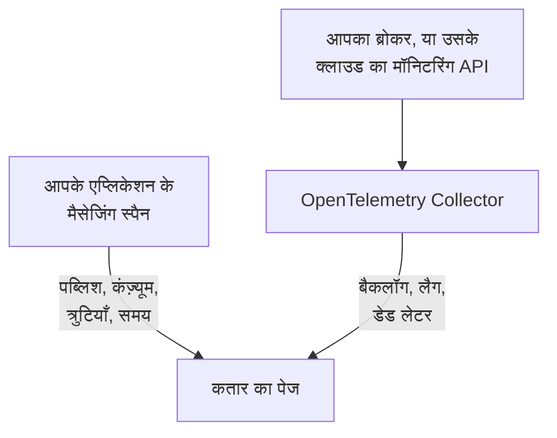

# कतारें

**Queues** आपके एप्लिकेशन जिन संदेश कतारों, टॉपिक और सब्सक्रिप्शन का इस्तेमाल करते हैं, उनमें से हर एक को उसका अपना पेज देता है: कौन-सी सेवाएँ उसमें पब्लिश करती हैं और कौन-सी उससे कंज़्यूम करती हैं, कितने संदेश उससे गुज़रते हैं, कितने विफल होते हैं और प्रोसेसिंग में कितना समय लगता है, उसके ट्रेस और मेट्रिक्स — और, जब ब्रोकर की अपनी मेट्रिक्स OneUptime तक पहुँचने लगती हैं, तो उसका बैकलॉग, कंज़्यूमर लैग, डेड लेटर और थ्रॉटलिंग भी। हर दूसरे रिसोर्स की तरह, कतारों में भी लेबल, मालिक, लेबल और मालिक नियम और आर्काइव करने की सुविधा होती है। इन्हें **उत्पाद → संसाधन → कतारें** में खोलें।

:::cards
- [एप्लिकेशन को इंस्ट्रूमेंट करना](#एप्लिकेशन-को-इंस्ट्रूमेंट-करना): आपका OpenTelemetry इंस्ट्रूमेंटेशन जो मैसेजिंग स्पैन पहले से भेजता है।
- [ब्रोकर हेल्थ मेट्रिक्स](#ब्रोकर-हेल्थ-मेट्रिक्स): आपके ब्रोकर से बैकलॉग, लैग और डेड लेटर, एक-एक सिस्टम करके।
- [अलर्टिंग](#अलर्टिंग): तैयार टेम्पलेट, और देर से आने वाली या गिनती वाली मेट्रिक्स।
- [समस्या निवारण](#समस्या-निवारण): ऐसी कतार जो नहीं बनी, या ब्रोकर हेल्थ जो खाली ही रहती है।
:::

## यह कैसे काम करता है

यह हर ब्रोकर के लिए एक ही तरह काम करता है — Apache Kafka, RabbitMQ, Apache ActiveMQ और दूसरे JMS ब्रोकर, Amazon SQS और SNS, Google Cloud Pub/Sub, Azure Service Bus, Event Hubs और Event Grid, Apache Pulsar, Apache RocketMQ, NATS और BullMQ ([समर्थित मैसेजिंग सिस्टम](#समर्थित-मैसेजिंग-सिस्टम) देखें) — और किसी भी दूसरे ब्रोकर के लिए जिसका नाम आपके स्पैन `messaging.system` में देते हैं। ज़्यादातर कतारें दो स्रोतों से अपने आप दिखाई देती हैं:

| स्रोत | आपसे क्या चाहिए | कतार के पेज में क्या जोड़ता है |
| --- | --- | --- |
| **एप्लिकेशन ट्रेस** | इंस्ट्रूमेंट किए गए एप्लिकेशन (OpenTelemetry) — [एप्लिकेशन को इंस्ट्रूमेंट करना](#एप्लिकेशन-को-इंस्ट्रूमेंट-करना) देखें | पब्लिश और कंज़्यूम किए गए संदेश, त्रुटियाँ और प्रोसेसिंग समय, दोनों तरफ़ की सेवाएँ, और खुद ट्रेस |
| **ब्रोकर मेट्रिक्स** (एक OpenTelemetry Collector) | आपके ब्रोकर के लिए कलेक्टर रिसीवर या स्क्रेप — [ब्रोकर हेल्थ मेट्रिक्स](#ब्रोकर-हेल्थ-मेट्रिक्स) देखें | **Broker health**: बैकलॉग, कंज़्यूमर लैग, डेड लेटर, सबसे पुराने संदेश की उम्र, थ्रॉटलिंग और ब्रोकर की अपनी संदेश दरें |



ट्रेस OneUptime को बताते हैं कि कतार मौजूद है और एप्लिकेशन उसका उपयोग कैसे करते हैं, लेकिन यह नहीं कि वह कितनी भरी है। यह जानकारी खुद ब्रोकर से या उसके क्लाउड प्रोवाइडर के मॉनिटरिंग API से आती है — या, [BullMQ](#bullmq) के लिए, जो अपने जॉब Redis में रखता है और जिसके पास पूछने के लिए कोई ब्रोकर नहीं है, एप्लिकेशन द्वारा रिपोर्ट किए गए गेज से।

आप कतार को हाथ से भी जोड़ सकते हैं: **Queues → Queue बनाएँ** में उसका मैसेजिंग सिस्टम और डेस्टिनेशन नाम दें — और, Azure Service Bus और Event Hubs के लिए, उसका नेमस्पेस भी। फ़ॉर्म अपने पहले चरण **मैसेजिंग सिस्टम** में यही पूछता है, फिर एक वैकल्पिक नाम और विवरण, और लेबल **और फ़ील्ड** (**कतार जानकारी**) के नीचे होते हैं। नेमस्पेस को सिर्फ़ उसी कतार के लिए खाली छोड़ें जिस तक आपके एप्लिकेशन किसी एम्युलेटर या कस्टम डोमेन नाम के ज़रिए पहुँचते हैं: उनके स्पैन किसी नेमस्पेस का नाम नहीं देते, और Azure Monitor की मेट्रिक्स ऐसी कतार तक कभी नहीं पहुँचतीं ([सीमाएँ](#सीमाएँ) देखें)।

## शुरू करें

:::steps
### अपने एप्लिकेशन के ट्रेस भेजें

पब्लिश और कंज़्यूम करने वाले एप्लिकेशन को इंस्ट्रूमेंट करें, और उनके ट्रेस OneUptime को भेजें ([एप्लिकेशन को इंस्ट्रूमेंट करना](#एप्लिकेशन-को-इंस्ट्रूमेंट-करना) देखें)। OneUptime के लिए कुछ खास करने की ज़रूरत नहीं है: आपका इंस्ट्रूमेंटेशन जो मैसेजिंग स्पैन पहले से बनाता है, वे कतारों के नाम देते हैं।

### अपने ब्रोकर की मेट्रिक्स भेजें

[ब्रोकर हेल्थ मेट्रिक्स](#ब्रोकर-हेल्थ-मेट्रिक्स) में अपना मैसेजिंग सिस्टम ढूँढें, और उसका कलेक्टर कॉन्फ़िगरेशन अपनी इंजेशन कुंजी के साथ चलाएँ। हर कतार के **दस्तावेज़ीकरण** टैब में उस कतार का कॉन्फ़िगरेशन कॉपी करने के लिए तैयार रहता है।

### कतार खोलें

**उत्पाद → संसाधन → कतारें** खोलें। डिस्कवरी हर 10 मिनट में चलती है: कोई कतार तब दिखाई देती है जब 15 मिनट के भीतर उसके कम से कम 3 स्पैन आ जाएँ, या किसी ब्रोकर मेट्रिक ने उसका नाम दिया हो।
:::

## समर्थित मैसेजिंग सिस्टम

OneUptime नीचे दिए गए मैसेजिंग सिस्टम को नाम से पहचानता है। इंस्ट्रूमेंटेशन `messaging.system` में जो डालते हैं, उसे वह दूसरे कॉलम के मान में सामान्य करता है — जहाँ OpenTelemetry का कोई जाना-माना मान है, वही — और अक्षरों के बड़े-छोटे होने की परवाह किए बिना, इसलिए `AmazonSQS`, `aws.sqs` और `aws_sqs` एक ही सिस्टम हैं। `nats` और `bullmq` OpenTelemetry के जाने-माने मान नहीं हैं: `nats` वह मान है जो Java एजेंट का NATS इंस्ट्रूमेंटेशन रिपोर्ट करता है, और `bullmq` वह मान है जो BullMQ के लिए सेट करना होता है ([BullMQ](#bullmq) देखें)।

जिस सिस्टम को OneUptime नहीं जानता, वह भी काम करता है: सही बनावट वाला मान (`ibmmq`, `solace`, `mqtt` — छोटे अक्षर, अंक, `.`, `_` और `-`, अधिकतम 64 वर्ण) जैसा आया वैसा ही रखा जाता है, इसलिए उस ब्रोकर की कतारें खोजी जाती हैं और उसी नाम से दिखाई जाती हैं; सिर्फ़ ब्रोकर की अपनी मेट्रिक्स के लिए इस तालिका का कोई सिस्टम ज़रूरी है। `spring_integration` को अनदेखा किया जाता है: Spring Integration के चैनल एक ही प्रोसेस के भीतर मेथड कॉल हैं, ब्रोकर नहीं।

**ब्रोकर मेट्रिक्स** बताता है कि किसी सिस्टम की हेल्थ मेट्रिक्स कहाँ से आती हैं: collector-contrib का कोई रिसीवर, कोई Prometheus एंडपॉइंट (`:port/path`, जिसे कलेक्टर के `prometheus` रिसीवर से स्क्रेप किया जाता है), क्लाउड प्रोवाइडर का मॉनिटरिंग API, या कलेक्टर के बाहर का कोई प्रोग्राम जो उन्हें OTLP पर पुश करता है। हर सिस्टम नीचे अपने सेटअप से लिंक होता है, और हर कतार का **दस्तावेज़ीकरण** टैब उसे उस कतार के कॉन्फ़िगरेशन में बदल देता है।

| सिस्टम | `messaging.system` | यह भी स्वीकार्य | ब्रोकर मेट्रिक्स |
| --- | --- | --- | --- |
| [Amazon SNS](#amazon-sns) | `aws.sns` | `aws_sns`, `amazonsns`, `sns` | `aws_cloudwatch` या `awsfirehose` रिसीवर (क्लाउड मॉनिटरिंग) |
| [Amazon SQS](#amazon-sqs) | `aws_sqs` | `aws.sqs`, `amazonsqs`, `sqs` | `aws_cloudwatch` या `awsfirehose` रिसीवर (क्लाउड मॉनिटरिंग) |
| [Apache ActiveMQ](#apache-activemq) | `activemq` | `artemis`, `activemq_artemis` | OpenTelemetry JMX Scraper (OTLP पुश करता है) |
| [Apache Kafka](#apache-kafka) | `kafka` | — | `kafka_metrics` रिसीवर |
| [Apache Pulsar](#apache-pulsar) | `pulsar` | `apache_pulsar` | Prometheus (Pulsar ब्रोकर), `:8080/metrics/` |
| [Apache RocketMQ](#apache-rocketmq) | `rocketmq` | — | Prometheus (RocketMQ ब्रोकर), `:5557/metrics` |
| [Azure Event Grid](#azure-event-grid) | `eventgrid` | `azure_eventgrid`, `azure.eventgrid`, `microsoft.eventgrid` | `azure_monitor` रिसीवर (क्लाउड मॉनिटरिंग) |
| [Azure Event Hubs](#azure-event-hubs) | `eventhubs` | `azure_eventhubs`, `azure.eventhubs`, `microsoft.eventhub` | `azure_monitor` रिसीवर (क्लाउड मॉनिटरिंग) |
| [Azure Service Bus](#azure-service-bus) | `servicebus` | `azure_servicebus`, `azure.servicebus`, `microsoft.servicebus` | `azure_monitor` रिसीवर (क्लाउड मॉनिटरिंग) |
| [BullMQ](#bullmq) | `bullmq` | — | कोई बिल्ट-इन नहीं |
| [Google Cloud Pub/Sub](#google-cloud-pubsub) | `gcp_pubsub` | `gcp.pubsub`, `pubsub`, `google_pubsub` | `googlecloudmonitoring` रिसीवर (क्लाउड मॉनिटरिंग) |
| [JMS](#jms) | `jms` | — | कोई बिल्ट-इन नहीं |
| [NATS](#nats) | `nats` | `jetstream` | Prometheus (prometheus-nats-exporter), `:7777/metrics` |
| [RabbitMQ](#rabbitmq) | `rabbitmq` | — | `rabbitmq` रिसीवर |

एक कतार एक सिस्टम का एक डेस्टिनेशन है। **Azure Service Bus** और **Azure Event Hubs** के लिए उसका नेमस्पेस भी उसका हिस्सा है, क्योंकि दो नेमस्पेस में से हर एक में `orders` नाम की कतार हो सकती है। **JMS** और **Apache ActiveMQ** अपनी कतारें साझा करते हैं: Java एप्लिकेशन ActiveMQ तक JMS API के ज़रिए पहुँचते हैं, जिसके स्पैन ब्रोकर चाहे जो हो `jms` कहते हैं, जबकि ब्रोकर की अपनी मेट्रिक्स सिर्फ़ `activemq` कह सकती हैं — इसलिए दोनों एक ही कतार पर पहुँचते हैं ([दो बार दिखना कब एक ही कतार है](#दो-बार-दिखना-कब-एक-ही-कतार-है) देखें)।

## कतारें कैसे खोजी जाती हैं

हर कतार दर्ज करती है कि उसे ट्रेस ने, ब्रोकर मेट्रिक्स ने या किसी व्यक्ति ने बनाया। बाद में जो कुछ भी उसी कतार का नाम देता है, वह नई कतार बनाने के बजाय उसी में जुड़ता है ([दो बार दिखना कब एक ही कतार है](#दो-बार-दिखना-कब-एक-ही-कतार-है) देखें)।

### एप्लिकेशन ट्रेस से

हर 10 मिनट में OneUptime उन स्पैन का सारांश बनाता है जो आपके एप्लिकेशन ने पिछले 15 मिनट में भेजे और जिनमें `messaging.system`, `messaging.destination.name`, `messaging.destination`, `message_bus.destination`, `az.namespace`, `azure.resource_provider.namespace`, `aws.sqs.queue.url`, `aws.queue_url` या `aws.sns.topic.arn` में से कोई भी हो। SERVER स्पैन को छोड़कर हर स्पैन गिना जाता है: PRODUCER, CONSUMER, CLIENT और INTERNAL स्पैन, और वे स्पैन जिन्हें किसी ट्रेस पाइपलाइन के **स्पैन प्रकार रीमैपर** ने कोई दूसरा प्रकार (जैसे Unspecified) दिया या कोई प्रकार नहीं दिया; SERVER स्पैन कभी किसी कतार का नाम नहीं देता।

ब्रोकर के अपने स्पैन भी SERVER स्पैन होते हैं। [Kubernetes एजेंट](/docs/telemetry/kubernetes-agent#ebpf-ट्रेस-कैसे-दिखते-हैं) का eBPF ट्रेसर हर लेन-देन में Kafka, MQTT या NATS ब्रोकर का पक्ष दर्ज करता है — कोई संदेश जो उसे मिलता है, कोई संदेश जो वह पहुँचाता है — और उनमें से ज़्यादातर को PRODUCER या CONSUMER के रूप में भेजता है; OneUptime उन्हें SERVER के रूप में सहेजता है, इसलिए कोई ब्रोकर उन टॉपिक के प्रोड्यूसर या कंज़्यूमर में नहीं गिना जाता जिन्हें वह ढोता है। किसी सब्सक्राइबर तक संदेश आगे पहुँचाने वाला MQTT ब्रोकर वही PUBLISH लिखता है जो कोई क्लाइंट लिखता है, और ट्रेसर दोनों को एक जैसा रिपोर्ट करता है, इसलिए MQTT और NATS पब्लिश के लिए OneUptime कनेक्शन के दूसरे छोर के पोर्ट से तय करता है: 32768 और उससे ऊपर से — जहाँ ऑपरेटिंग सिस्टम कनेक्ट करने वाले क्लाइंट का पोर्ट चुनते हैं (Linux की डिफ़ॉल्ट रेंज वहीं से शुरू होती है; Windows और macOS 49152–65535 का इस्तेमाल करते हैं) — वह किसी सब्सक्राइबर का पोर्ट है, और स्पैन ब्रोकर का है। इसलिए कोई एप्लिकेशन जो ऐसे MQTT या NATS ब्रोकर पर पब्लिश करता है जो खुद 32768 या उससे ऊपर के पोर्ट पर सुनता है, जैसे कि रैंडम रूप से पब्लिश किया गया Docker पोर्ट, अपने टॉपिक के प्रोड्यूसर के रूप में नहीं दिखता, और जिस टॉपिक का इस्तेमाल सिर्फ़ ऐसे एप्लिकेशन करते हैं, वह शायद ट्रेसर के स्पैन से खोजा ही न जाए। जो सब्सक्राइबर 32768 से नीचे के पोर्ट से ब्रोकर से कनेक्ट होता है (छोटी की गई पोर्ट रेंज, या NAT द्वारा बदला गया पोर्ट), उसके लिए ब्रोकर अब भी उन टॉपिक का प्रोड्यूसर दिखता है जो उसे पहुँचाए जाते हैं।

OpenTelemetry का हर मैसेजिंग एट्रिब्यूट अब भी विकासाधीन के रूप में चिह्नित है, इसलिए एक ही प्रोजेक्ट के एप्लिकेशन एक ही चीज़ों को नामों की पाँच पीढ़ियों तक में रिपोर्ट करते हैं। OneUptime उन सभी को पढ़ता है, सबसे नए पहले, और स्पैन के नामों को कभी पार्स नहीं करता, जिनका फ़ॉर्मेट सिमैंटिक कन्वेंशन 1.27 में बदल गया था और जिन्हें वेंडर अपनी मर्ज़ी से चुनते हैं:

- **सिस्टम**: `messaging.system`, जिसे [समर्थित मैसेजिंग सिस्टम](#समर्थित-मैसेजिंग-सिस्टम) की तरह सामान्य किया जाता है। उसके न होने पर, Azure SDK का `az.namespace` या `azure.resource_provider.namespace` (`Microsoft.ServiceBus`, `Microsoft.EventHub`), पुराने Azure SDK की `component` कुंजी, SQS या SNS को कॉल करने वाला AWS SDK स्पैन (`rpc.system` = `aws-api`) — Java एजेंट के SNS स्पैन में `messaging.system` नहीं होता — या SQS कतार URL या SNS टॉपिक ARN की कुंजी।
- **डेस्टिनेशन**: `messaging.destination.template`, `messaging.destination.name`, `messaging.source.template`, `messaging.source.name`, `messaging.destination` और `message_bus.destination` में से पहला जो स्पैन में हो। जिस स्पैन में इनमें से कोई नहीं, वह अपने सिस्टम की अपनी कुंजियों पर लौटता है: SQS कतार URL (`aws.sqs.queue.url`, `aws.queue_url`, या `messaging.url`, `server.address` या `net.peer.name` में कतार URL), SNS टॉपिक ARN (`aws.sns.topic.arn`), और RabbitMQ के लिए राउटिंग की (`messaging.rabbitmq.destination.routing_key` या `messaging.rabbitmq.routing_key`), जो डिफ़ॉल्ट एक्सचेंज से गुज़रने वाले संदेश के लिए कतार का नाम होती है।
- **दिशा**: पहले `messaging.operation.type`, फिर स्पैन का प्रकार — PRODUCER पब्लिश करता है, CONSUMER कंज़्यूम करता है — फिर पुराना `messaging.operation`, फिर `messaging.operation.name`, और SQS और SNS के लिए `rpc.method` में AWS SDK का ऑपरेशन (`SendMessage`, `ReceiveMessage`, …)। प्रकार पुरानी कुंजियों से ऊपर है क्योंकि कुछ इंस्ट्रूमेंटेशन ने उन्हें गलत भरा: Python के लिए confluent-kafka ने अपने प्रोड्यूसर स्पैन पर `receive` लिखा।

कोई कतार ट्रेस से तब **बनाई जाती** है जब एक रन जिस 15 मिनट की विंडो को देखता है, उसमें उसके स्पैन कम से कम 3 हों (`MESSAGE_QUEUE_MIN_SPANS`), ताकि कोई एक बार चलने वाली स्क्रिप्ट कतार न बनाए, और सिर्फ़ तब जब प्रोजेक्ट अपने [ऑटो-क्रिएट बजट](#ऑटो-क्रिएट-बजट) के भीतर हो। जो स्पैन कतार नहीं बनाते, वे भी किसी मौजूदा कतार में गिने जाते हैं।

हर मैसेजिंग स्पैन इंजेस्ट होते समय अपनी कतार से टैग भी किया जाता है, इसलिए कतार का **ट्रेस** टैब उसका नाम देने वाला हर स्पैन दिखाता है — उन स्पैन समेत जो कतार बनने से पहले भेजे गए थे।

### ब्रोकर मेट्रिक्स से

[ब्रोकर हेल्थ मेट्रिक्स](#ब्रोकर-हेल्थ-मेट्रिक्स) की सूचियों में से कोई ब्रोकर मेट्रिक अपनी कतार का नाम ब्रोकर के अपने एट्रिब्यूट में देती है — Kafka का `topic`, RabbitMQ का `rabbitmq.queue.name`, Azure Monitor का `EntityName` डाइमेंशन, CloudWatch का `QueueName` — और OneUptime इंजेस्ट होते समय उसे उस कतार से मिलाता है। ब्रोकर मेट्रिक्स में `messaging.system` नहीं होता: हर एक को उसके नाम (`kafka.consumer_group.lag_sum`) से पहचाना जाता है और, जहाँ दो सिस्टम एक ही नाम साझा करते हैं — Azure Monitor, Service Bus और Event Hubs की मेट्रिक्स के नाम एक जैसे रखता है — डेटापॉइंट में मौजूद रिसोर्स प्रकार से।

अगर कतार अभी मौजूद नहीं है, तो अगला डिस्कवरी रन उसे बनाता है: [ऑटो-क्रिएट बजट](#ऑटो-क्रिएट-बजट) के भीतर एक ब्रोकर मेट्रिक काफ़ी है। इसलिए जिस कतार को कोई इंस्ट्रूमेंट किया गया एप्लिकेशन नहीं छूता, वह भी तब दिखाई देती है जब उसका ब्रोकर उसे रिपोर्ट करता है।

क्लाउड मॉनिटरिंग API — CloudWatch, Azure Monitor और Cloud Monitoring — हर संख्या उस समय के कुछ मिनट बाद प्रकाशित करते हैं जिसे वह मापती है, और वह उसी समय के तहत सहेजी जाती है। इसलिए हर रन उनकी मेट्रिक्स पिछले एक घंटे से पढ़ता है, न कि पिछले 15 मिनट से, जहाँ से वह स्पैन और दूसरी मेट्रिक्स पढ़ता है: देर से आने वाला डेटापॉइंट भी अपनी कतार को देखा हुआ दर्ज करता है, या उसे बनाता है।

### मैसेजिंग क्लाइंट मेट्रिक्स से

इंस्ट्रूमेंट किए गए क्लाइंट भी मेट्रिक्स रिपोर्ट कर सकते हैं: OpenTelemetry की मैसेजिंग क्लाइंट मेट्रिक्स `messaging.client.sent.messages`, `messaging.client.consumed.messages`, `messaging.client.operation.duration` और `messaging.process.duration`, उनके पुराने नाम `messaging.publish.duration`, `messaging.receive.duration`, `messaging.publish.messages`, `messaging.receive.messages`, `messaging.process.messages` और `messaging.client.published.messages`, और Java के लिए Azure SDK की `messaging.servicebus.messages.sent`, `messaging.servicebus.receiver.lag`, `messaging.servicebus.settlement.request.duration` और `messaging.servicebus.settlement.sequence_number`। हर डेटापॉइंट अपने सिस्टम और डेस्टिनेशन का नाम उसी तरह देता है जैसे कोई स्पैन देता है — Azure SDK की Service Bus मेट्रिक्स किसी सिस्टम का नाम नहीं देतीं, इसलिए उनका नाम उसकी जगह लेता है — और इंजेस्ट होते समय उस कतार से मिलाया जाता है, इसलिए वह कतार के **मेट्रिक्स** टैब पर दिखता है। यही आपकी अपनी किसी भी मेट्रिक के साथ होता है जिसके हर डेटापॉइंट पर `messaging.system` और `messaging.destination.name` हों — रिसोर्स पर नहीं, जहाँ उन्हें पढ़ा नहीं जाता — जैसे कतार की गहराई का गेज ([BullMQ](#bullmq) देखें)।

मैसेजिंग क्लाइंट मेट्रिक्स कभी कतार नहीं बनातीं: ट्रेस, ब्रोकर मेट्रिक्स या कोई व्यक्ति बनाता है। किसी मौजूदा कतार का नाम देने वाली क्लाइंट मेट्रिक उसके **आख़िरी बार देखा गया** को उसी तरह ताज़ा रखती है जैसे उसके स्पैन रखते हैं। आपकी अपनी मेट्रिक इनमें से कुछ नहीं करती: वह सिर्फ़ कतार के **मेट्रिक्स** टैब पर दिखती है।

### दो बार दिखना कब एक ही कतार है

किसी कतार की पहचान उसका **सिस्टम** और उसका **डेस्टिनेशन** है, जिनकी तुलना अक्षरों के बड़े-छोटे होने की परवाह किए बिना होती है: `Orders` और `orders` एक ही कतार हैं, जो उस नाम से दिखती है जिससे वह पहली बार देखी गई थी। Azure Service Bus और Event Hubs के लिए पहचान में **नेमस्पेस** भी शामिल है:

- स्पैन पर, उस होस्ट का पहला DNS लेबल जिससे SDK कनेक्ट हुआ, इस क्रम में `server.address`, `net.peer.name`, `peer.address` या `network.peer.address` से, जब वह होस्ट कोई नेमस्पेस होस्ट हो: `<namespace>.servicebus.windows.net`, या किसी सॉवरेन क्लाउड का `.servicebus.usgovcloudapi.net`, `.servicebus.chinacloudapi.cn` या `.servicebus.cloudapi.de`। Event Hubs, Service Bus का डोमेन साझा करता है;
- Azure Monitor मेट्रिक पर, उस नेमस्पेस का `name` जिसकी वह रिपोर्ट करती है।

इसके अलावा कुछ भी इसका हिस्सा नहीं है, इसलिए इनमें से कोई भी कभी कतार को नहीं बाँटता: ब्रोकर का पता (Kafka क्लाइंट इसे शायद ही रिपोर्ट करते हैं, और एक Azure नेमस्पेस कई पतों पर जवाब देता है), कंज़्यूमर ग्रुप या सब्सक्रिप्शन (किसी टॉपिक के कंज़्यूमर अलग कतारें नहीं हैं), पार्टिशन, और डेड-लेटर सब-क्यू। इनमें से कतार सिर्फ़ ब्रोकर का पता रखती है, दिखाने के लिए।

**JMS और ActiveMQ एक ही परिवार हैं।** हर JMS स्पैन, उसके पीछे चाहे जो ब्रोकर हो, `jms` कहता है, और ब्रोकर की अपनी मेट्रिक्स ([OpenTelemetry JMX Scraper](#apache-activemq)) सिर्फ़ `activemq` कह सकती हैं, इसलिए OneUptime किसी ActiveMQ कतार को उसके JMS परिवार पर पहचानता है: `orders` के स्पैन और ब्रोकर मेट्रिक्स एक ही कतार पर पहुँचते हैं। ब्रोकर की मेट्रिक्स आने तक वह JMS के रूप में दिखती है, और उसके बाद से Apache ActiveMQ के रूप में — कभी उल्टा नहीं। जो कतार आप हाथ से Apache ActiveMQ के रूप में बनाते हैं, वह वही कतार है।

### डेस्टिनेशन के नाम कैसे पढ़े जाते हैं

इंस्ट्रूमेंटेशन एक ही कतार का नाम कई तरह से देते हैं, और OneUptime वे जो रिपोर्ट करते हैं उसे कतार के अपने नाम तक घटा देता है:

| सिस्टम | किस रूप में रिपोर्ट होता है | कतार |
| --- | --- | --- |
| Amazon SQS | `https://sqs.us-east-1.amazonaws.com/123456789012/orders`, एक कतार URL (Go का `otelaws` इसे `server.address` में रखता है) | `orders` |
| Amazon SNS | `arn:aws:sns:us-east-1:123456789012:order-events`, एक टॉपिक ARN | `order-events` |
| Google Cloud Pub/Sub | `projects/shop/topics/orders`, एक रिसोर्स नाम | `orders` |
| Azure Service Bus | `orders/Subscriptions/billing`, टॉपिक के सब्सक्रिप्शन `billing` का एंटिटी पाथ | `orders` |
| Azure Service Bus | `orders/$DeadLetterQueue`, कतार के डेड-लेटर सब-क्यू का एंटिटी पाथ | `orders` |
| Azure Event Hubs | `telemetry/ConsumerGroups/$Default/Partitions/3`, कंज़्यूमर ग्रुप `$Default` के लिए किसी रिसीवर का एंटिटी पाथ | `telemetry` |
| Apache Pulsar | `orders-partition-3`, छोटे नाम वाले टॉपिक का एक पार्टिशन | `persistent://public/default/orders` |
| Apache Pulsar | `acme/shop/orders`, डोमेन के बिना एक टॉपिक | `persistent://acme/shop/orders` |
| JMS | `queue://orders`, अपने डेस्टिनेशन-प्रकार प्रीफ़िक्स के साथ | `orders` |
| RabbitMQ | `shop:new-order:orders`, किसी कंज़्यूमर पर एक्सचेंज, राउटिंग की और कतार (सिमैंटिक कन्वेंशन 1.30 और बाद के) | `orders` |
| RabbitMQ | `amq.default`, डिफ़ॉल्ट एक्सचेंज, राउटिंग की `orders` के साथ | `orders` |
| RabbitMQ | `,orders`, डिफ़ॉल्ट एक्सचेंज से होकर aio-pika का `{exchange},{routing key}` | `orders` |
| RabbitMQ | `shop,new-order`, aio-pika का `{exchange},{routing key}` | `shop` |

Pulsar का पार्टिशन अपने टॉपिक में मिल जाता है, और डोमेन के बिना नाम उसी तरह पूरा किया जाता है जैसे Pulsar खुद उसे पूरा करता है — छोटा नाम `public/default` नेमस्पेस में — ताकि Java एजेंट के नाम ब्रोकर के पूरी तरह योग्य मेट्रिक लेबल से जुड़ सकें। RabbitMQ स्पैन आमतौर पर उस एक्सचेंज का नाम देता है जिससे संदेश गुज़रा, पब्लिश और कंज़्यूम दोनों तरफ़; डिफ़ॉल्ट एक्सचेंज (`amq.default`, `<default>` या खाली नाम) अपनी राउटिंग की की जगह लेता है, जो कतार का नाम है। सिमैंटिक कन्वेंशन 1.30 एक्सचेंज, राउटिंग की और कतार को `:` से जोड़ते हैं — Java एजेंट के ऑप्ट-इन नाम — और OneUptime कंज़्यूमर के जुड़े नाम से कतार रखता है और पब्लिशर के जुड़े नाम से एक्सचेंज। aio-pika पब्लिश की तरफ़ एक्सचेंज और राउटिंग की को कॉमा से जोड़ता है, और OneUptime उसे उसी तरह बाँटता है।

### क्या अनदेखा किया जाता है

OneUptime कतार न बनाने की तरफ़ झुकता है: हर अनुरोध या हर कंज़्यूमर के लिए गढ़ा गया नाम वरना हर संदेश के लिए एक ऐसी कतार बना देता जिसका कोई मालिक नहीं। ये कभी कतार नहीं बनते:

- **SERVER स्पैन**, और वे स्पैन जिनका `messaging.system`, `spring_integration` है।
- **अस्थायी या अनाम चिह्नित डेस्टिनेशन**: `messaging.destination.temporary`, `messaging.destination.anonymous`, `messaging.source.temporary` या `messaging.source.anonymous` को `true` पर सेट किया गया हो। पुराने `messaging.temp_destination` पर भरोसा नहीं किया जाता: Python के pika और aio-pika इंस्ट्रूमेंटेशन इसे हर पब्लिश पर सेट करते हैं।
- **नाम की जगह इंस्ट्रूमेंटेशन द्वारा रिपोर्ट किए गए प्लेसहोल्डर**: `(temporary)`, `(anonymous)`, `<generated>`, `unknown` (कई टॉपिक में फैला Kafka बैच), `aws:sqs` (Java एजेंट के Lambda SQS इवेंट), Azure Monitor का `-NamespaceOnlyMetric-`, और ऐसा मान जिसे OneUptime की अपनी डेटा स्क्रबिंग ने पूरा बदल दिया (`[REDACTED]`)।
- **जनरेट किए गए और जवाब वाले डेस्टिनेशन**: RabbitMQ की `amq.gen-JzTY20BRgKO-HjmUJj0wLg` जैसी सर्वर-नामित कतारें, Spring की `spring.gen-…` कतारें और बिना ग्रुप वाले कंज़्यूमर की Spring Cloud Stream `<destination>.anonymous.<id>` कतारें, और डायरेक्ट रिप्लाई-टू (`amq.rabbitmq.reply-to…`); JMS के अस्थायी डेस्टिनेशन (`temp-queue://…`, `temp-topic://…`) और TIBCO का `$TMP$…`; ActiveMQ के एडवाइज़री टॉपिक (`ActiveMQ.Advisory.…`); NATS इनबॉक्स (`_INBOX.…`) और JetStream के एक्नॉलेजमेंट सब्जेक्ट (`$JS.ACK.…`); Pulsar के सिस्टम टॉपिक (`__change_events`, `__transaction_…`, और `/__` सेगमेंट के नीचे का कुछ भी); और ऐसा डेस्टिनेशन जो सिर्फ़ एक UUID हो।
- **SNS टेक्स्ट संदेश और मोबाइल पुश**: कोई फ़ोन नंबर (`+15555550123`, या botocore का `phone_number:**`) या कोई प्लेटफ़ॉर्म एंडपॉइंट ARN (`arn:aws:sns:us-east-1:123456789012:endpoint/GCM/shop-app/1234`) एक डिवाइस है, टॉपिक नहीं।
- **ऐसे नाम जो एक कतार नहीं हो सकते**: किसी बैच के डेस्टिनेशन की सूची (`["orders","payments"]`), कंट्रोल वर्ण वाला नाम, और 255 वर्णों से लंबा नाम।

**UUID टेम्पलेट में बदले जाते हैं।** किसी डेस्टिनेशन के भीतर हर UUID को `{uuid}` से बदल दिया जाता है, इसलिए `reply-7f1c2a9e-4b1d-4c3e-9f1a-2b3c4d5e6f70` जैसे हर अनुरोध के नाम हर एक की अपनी कतार के बजाय एक कतार, `reply-{uuid}`, बन जाते हैं।

### ऑटो-क्रिएट बजट

ट्रेस और ब्रोकर मेट्रिक्स अपने आप कतारें सिर्फ़ तब तक बनाते हैं जब तक प्रोजेक्ट में 500 से कम सक्रिय, बिना आर्काइव की गई खोजी गई कतारें हों (`MESSAGE_QUEUE_AUTO_CREATE_BUDGET`, [सेल्फ़-होस्टेड ट्यूनिंग](#सेल्फ़-होस्टेड-ट्यूनिंग) देखें)। आपकी हाथ से बनाई कतारें कभी नहीं गिनी जातीं और कभी रोकी नहीं जातीं; आर्काइव की गई कतारें नहीं गिनी जातीं, इसलिए [अपने आप आर्काइव होना](#लाइफ़साइकल-और-आर्काइविंग) बजट खाली करता है; और जो कतारें पहले से मौजूद हैं, वे मिलाई और अपडेट होती रहती हैं।

### लाइफ़साइकल और आर्काइविंग

- **आख़िरी बार देखा गया** वह समय है जब डिस्कवरी ने कतार को आखिरी बार ट्रेस, मैसेजिंग क्लाइंट मेट्रिक्स या ब्रोकर मेट्रिक्स में देखा।
- **हटाने के लिए आर्काइव करें।** खोजी गई कतार को डिलीट करने से वह सिर्फ़ तब तक हटती है जब तक वह फिर से न दिखे: अगली बार दिखने पर वह एक नई कतार के रूप में लौट आती है। उसे हमेशा के लिए हटाने के लिए उसे **आर्काइव** करें। आर्काइव की गई कतार अपनी पहचान रखती है, इसलिए जो कुछ भी उसका नाम देता है, वह नई कतार बनाने के बजाय आर्काइव की गई कतार से जुड़ा रहता है।
- **अपने आप आर्काइव होना।** जो खोजी गई कतार 7 दिनों (`MESSAGE_QUEUE_AUTO_ARCHIVE_DAYS`) से नहीं दिखी, वह अपने आप आर्काइव हो जाती है, जब तक किसी व्यक्ति ने उसका नाम न बदला हो, उसका विवरण न लिखा हो, उस पर लेबल न लगाया हो या उसे मालिक न दिए हों। लेबल या मालिक नियमों ने अपने आप जो लेबल और मालिक जोड़े, वे नहीं गिने जाते।
- **वापस लाना।** अपने आप आर्काइव हुई कतार फिर से दिखने पर अपने आप वापस आ जाती है। आपकी हाथ से बनाई कतारें, और किसी व्यक्ति द्वारा आर्काइव की गई कतारें, डिस्कवरी द्वारा कभी आर्काइव या वापस नहीं की जातीं। जिस कतार को कोई व्यक्ति वापस लाता है, वह 30 दिनों तक (या आर्काइव विंडो तक, अगर वह लंबी हो) वापस बनी रहती है, भले ही उसे कुछ न देखे; उसके अगली बार दिखने से 7 दिनों वाला नियम फिर लागू होता है।

## एप्लिकेशन को इंस्ट्रूमेंट करना

कतारें उन मैसेजिंग स्पैन से आती हैं जो आपका OpenTelemetry इंस्ट्रूमेंटेशन पहले से बनाता है; OneUptime के लिए कुछ खास करने की ज़रूरत नहीं है। ट्रेस को [OpenTelemetry](/docs/telemetry/open-telemetry) में बताए तरीके से OneUptime को भेजें, फिर अपनी भाषा की सूची देखें।

:::tabs
@tab Java
OpenTelemetry Java एजेंट Kafka, RabbitMQ, JMS (ActiveMQ, Artemis, IBM MQ और हर दूसरा JMS ब्रोकर), Amazon SQS और SNS, Pulsar, RocketMQ और NATS क्लाइंट को बिना कोड बदले ट्रेस करता है। OneUptime वे एट्रिब्यूट नाम भी पढ़ता है जो यह डिफ़ॉल्ट रूप से भेजता है और वे नए नाम भी जो यह `OTEL_SEMCONV_STABILITY_OPT_IN=messaging` के साथ भेजता है (एजेंट 2.31.0 और बाद के)। JMS स्पैन, उनके पीछे चाहे जो ब्रोकर हो, `jms` कहते हैं ([JMS](#jms) देखें)।

- **Azure Service Bus और Event Hubs**: Java के लिए Azure SDK खुद को ट्रेस करता है, और Java एजेंट उस ट्रेसिंग को OpenTelemetry से जोड़ता है।
- **Google Cloud Pub/Sub**: क्लाइंट खुद को तब ट्रेस करता है जब उसके `Publisher` और `Subscriber` बिल्डर को एक OpenTelemetry इंस्टेंस और ट्रेसिंग स्विच मिलता है — `setOpenTelemetry(GlobalOpenTelemetry.get())` और `setEnableOpenTelemetryTracing(true)`। इनमें से कोई एक कॉल अकेले कुछ भी ट्रेस नहीं करती।
@tab .NET
- **Azure Service Bus और Event Hubs** (`Azure.Messaging.ServiceBus`, `Azure.Messaging.EventHubs`): Azure SDK में उनके OpenTelemetry स्पैन प्रायोगिक हैं। उन्हें एनवायरनमेंट वेरिएबल `AZURE_EXPERIMENTAL_ENABLE_ACTIVITY_SOURCE=true` (या नीचे दिए `Azure.Experimental.EnableActivitySource` स्विच) से चालू करें, और `Azure.*` स्रोतों को सब्सक्राइब करें।
- **RabbitMQ.Client** 7 खुद को ट्रेस करता है: `RabbitMQ.Client.*` को सब्सक्राइब करें।
- **MassTransit** खुद को ट्रेस करता है: `MassTransit` को सब्सक्राइब करें (उसके स्पैन क्या छोड़ देते हैं, इसके लिए [सीमाएँ](#सीमाएँ) देखें)।
- **Confluent.Kafka**: `OpenTelemetry.Instrumentation.ConfluentKafka` पैकेज।
- **Amazon SQS और SNS**: `OpenTelemetry.Instrumentation.AWS` पैकेज, `.AddAWSInstrumentation(opt => opt.SemanticConventionVersion = SemanticConventionVersion.Latest)` के साथ। इसका डिफ़ॉल्ट एट्रिब्यूट सेट (`V1_28_0`) SQS कतार का नाम सिर्फ़ उसके URL से देता है (`aws.queue_url`, जिसे OneUptime पढ़ता है) और SNS टॉपिक का बिल्कुल नहीं।

```csharp
// Before any Azure client is created; or set AZURE_EXPERIMENTAL_ENABLE_ACTIVITY_SOURCE=true.
AppContext.SetSwitch("Azure.Experimental.EnableActivitySource", true);

builder.Services.AddOpenTelemetry()
    .WithTracing(tracing => tracing
        .AddSource("Azure.*")
        .AddSource("RabbitMQ.Client.*")
        .AddSource("MassTransit")
        .AddOtlpExporter());
```
@tab Node.js
- `@opentelemetry/auto-instrumentations-node`, `amqplib` (RabbitMQ), `kafkajs` और AWS SDK (SQS और SNS) को ट्रेस करता है।
- **Azure Service Bus और Event Hubs**: `@azure/opentelemetry-instrumentation-azure-sdk` से `createAzureSdkInstrumentation()` रजिस्टर करें।
- **Google Cloud Pub/Sub**: `new PubSub({ enableOpenTelemetryTracing: true })`।
- **BullMQ**: [BullMQ](#bullmq) देखें — उसकी अपनी टेलीमेट्री में दो एट्रिब्यूट जोड़ने होते हैं।
@tab Python
- Kafka: `opentelemetry-instrumentation-kafka-python`, `opentelemetry-instrumentation-confluent-kafka` या `opentelemetry-instrumentation-aiokafka`। RabbitMQ: `opentelemetry-instrumentation-pika` या `opentelemetry-instrumentation-aio-pika`। SQS और SNS: `opentelemetry-instrumentation-botocore`, या SQS के लिए `opentelemetry-instrumentation-boto3sqs`। `opentelemetry-bootstrap -a install` वे चुन लेता है जिनकी आपकी इंस्टॉल की गई लाइब्रेरी को ज़रूरत है।
- **Azure Service Bus और Event Hubs**: `azure-core-tracing-opentelemetry` इंस्टॉल करें और `settings.tracing_implementation = "opentelemetry"` सेट करें (`azure.core.settings` से)।
- **Google Cloud Pub/Sub**: `PublisherOptions(enable_open_telemetry_tracing=True)` और `SubscriberOptions(enable_open_telemetry_tracing=True)`।
- Celery के स्पैन में `messaging.system` नहीं होता और वे किसी ब्रोकर का नाम नहीं देते, इसलिए वे कतारें नहीं बनाते।
@tab Go
- **Amazon SQS और SNS**: `otelaws` (`go.opentelemetry.io/contrib/instrumentation/github.com/aws/aws-sdk-go-v2/otelaws`), जिसे `otelaws.AppendMiddlewares(&cfg.APIOptions)` से जोड़ा जाता है। इसके SQS स्पैन `server.address` में कतार URL रखते हैं, जिसे OneUptime कतार के रूप में पढ़ता है।
- **Google Cloud Pub/Sub**: `pubsub.ClientConfig{EnableOpenTelemetryTracing: true}`।
- `segmentio/kafka-go` के साथ **Kafka**: OpenTelemetry Go ऑटो-इंस्ट्रूमेंटेशन (`go.opentelemetry.io/auto`, eBPF, Linux पर) बिना कोड बदले इसके प्रोड्यूसर और कंज़्यूमर को ट्रेस करता है।
- OpenTelemetry की Go contrib लाइब्रेरी में Kafka, RabbitMQ या NATS इंस्ट्रूमेंटेशन नहीं है। दूसरे क्लाइंट के लिए, क्लाइंट लाइब्रेरी का अपना OpenTelemetry सपोर्ट इस्तेमाल करें, या अपने भेजने वाले कोड और हैंडलर के आसपास के स्पैन पर `messaging.system`, `messaging.destination.name` और स्पैन का प्रकार सेट करें।
:::

## ब्रोकर हेल्थ मेट्रिक्स

ब्रोकर वह जानता है जो कोई एप्लिकेशन नहीं देख सकता: कितने संदेश इंतज़ार कर रहे हैं, हर कंज़्यूमर ग्रुप कितना पीछे है, क्या डेड-लेटर कतार में गया। नीचे के हर सेक्शन में एक सिस्टम का कलेक्टर कॉन्फ़िगरेशन है — एक पूरा OpenTelemetry Collector कॉन्फ़िग जो OneUptime को भेजने वाले OTLP एक्सपोर्टर पर खत्म होता है। एक टेलीमेट्री इंजेशन कुंजी (**प्रोजेक्ट सेटिंग्स → टेलीमेट्री और APM → इंजेशन कुंजियाँ**) `x-oneuptime-token` में डालें, अगर आप सेल्फ़-होस्ट करते हैं तो `https://oneuptime.com` को अपने होस्ट से बदलें, और इसे `otel/opentelemetry-collector-contrib` 0.161.0 या बाद के संस्करण के साथ चलाएँ (यहाँ का हर कॉन्फ़िग 0.161.0 पर जाँचा गया है)। नए कलेक्टर लॉग करते हैं कि `otlphttp` को `otlp_http` के पक्ष में डिप्रिकेट किया गया है; दोनों नाम एक ही एक्सपोर्टर हैं। कई सिस्टम एकत्र करने के लिए, उनके रिसीवर एक कलेक्टर में मिला दें।

हर कतार का **Broker health** सेक्शन उसके सिस्टम के लिए सूचीबद्ध मेट्रिक्स का चार्ट बनाता है — गेज उसके मान के रूप में, हर अवधि की गिनती हर अंतराल में जोड़कर, काउंटर प्रति सेकंड दर के रूप में — और कतार की सीरीज़ को हर मेट्रिक की ज़रूरत के हिसाब से जोड़ता है (RabbitMQ कतार के तैयार और बिना एक्नॉलेज किए संदेश जुड़ते हैं; सबसे पीछे वाला कंज़्यूमर ग्रुप ही लैग है)। कलेक्टर जो कुछ भी भेजता है, वह **मेट्रिक्स** एक्सप्लोरर में भी होता है। जब तक किसी कतार के लिए कोई सूचीबद्ध मेट्रिक नहीं आई है, सेक्शन दिखाता है कि उस सिस्टम की मेट्रिक्स कहाँ से आती हैं, यहाँ उसके सेक्शन के लिंक के साथ।

### Amazon SNS

टॉपिक की CloudWatch मेट्रिक्स कलेक्टर के `aws_cloudwatch` रिसीवर से पढ़ें, या उन्हें CloudWatch Metric Stream और Amazon Data Firehose के ज़रिए उसके `awsfirehose` रिसीवर तक स्ट्रीम करें।

`aws_cloudwatch` रिसीवर CloudWatch के `GetMetricData` API को पोल करता है, हर रिसीवर एक नेमस्पेस, इसलिए SNS को [Amazon SQS](#amazon-sqs) के इंस्टेंस के बगल में अपना इंस्टेंस मिलता है। यह AWS SDK के डिफ़ॉल्ट क्रेडेंशियल (एनवायरनमेंट, साझा प्रोफ़ाइल या इंस्टेंस रोल) इस्तेमाल करता है, जिन्हें `cloudwatch:ListMetrics` और `cloudwatch:GetMetricData` चाहिए:

```yaml
receivers:
  aws_cloudwatch/sns:
    region: us-east-1
    metrics:
      collection_interval: 5m
      period: 1m
      delay: 10m
      discovery:
        filters:
          namespace: AWS/SNS
        limit: 500

processors:
  batch: {}

exporters:
  otlphttp:
    endpoint: https://oneuptime.com/otlp
    headers:
      x-oneuptime-token: YOUR_TELEMETRY_INGESTION_TOKEN

service:
  pipelines:
    metrics:
      receivers: [aws_cloudwatch/sns]
      processors: [batch]
      exporters: [otlphttp]
```

`stats` को सेट न करें, जैसे [Amazon SQS](#amazon-sqs) में। एक Metric Stream SNS और SQS को साथ ले जाता है: [Amazon SQS](#amazon-sqs) सेटअप में स्ट्रीम के नेमस्पेस में `AWS/SNS` जोड़ें।

किसी टॉपिक का नाम दोनों तरफ़ से एक ही तरह आता है: स्पैन उसका ARN या उसका नाम रिपोर्ट करते हैं, और OneUptime ARN के आखिरी `:` के बाद का नाम रखता है।

| मेट्रिक | इस रूप में दिखती है | प्रकार |
| --- | --- | --- |
| `amazonaws.com/aws/sns/numberofmessagespublished` (JSON स्ट्रीम: `numberofmessagespublished`) | Messages published | हर अवधि की गिनती |
| `amazonaws.com/aws/sns/numberofnotificationsdelivered` (JSON स्ट्रीम: `numberofnotificationsdelivered`) | Notifications delivered | हर अवधि की गिनती |
| `amazonaws.com/aws/sns/numberofnotificationsfailed` (JSON स्ट्रीम: `numberofnotificationsfailed`) | Notifications failed | हर अवधि की गिनती |
| `amazonaws.com/aws/sns/numberofnotificationsredriventodlq` (JSON स्ट्रीम: `numberofnotificationsredriventodlq`) | Redriven to dead-letter queue | हर अवधि की गिनती |

### Amazon SQS

कतारों की CloudWatch मेट्रिक्स कलेक्टर के `aws_cloudwatch` रिसीवर से पढ़ें, या उन्हें CloudWatch Metric Stream और Amazon Data Firehose के ज़रिए उसके `awsfirehose` रिसीवर तक स्ट्रीम करें।

**CloudWatch को पोल करने** के लिए AWS की तरफ़ क्रेडेंशियल के सिवा कुछ नहीं चाहिए। रिसीवर AWS SDK के डिफ़ॉल्ट क्रेडेंशियल (एनवायरनमेंट, साझा प्रोफ़ाइल या इंस्टेंस रोल) इस्तेमाल करता है, जिन्हें `cloudwatch:ListMetrics` और `cloudwatch:GetMetricData` चाहिए:

```yaml
receivers:
  aws_cloudwatch/sqs:
    region: us-east-1
    metrics:
      collection_interval: 5m
      period: 1m
      delay: 10m
      discovery:
        filters:
          namespace: AWS/SQS
        # Metrics per scrape: about nine per queue. Must be set.
        limit: 500

processors:
  batch: {}

exporters:
  otlphttp:
    endpoint: https://oneuptime.com/otlp
    headers:
      x-oneuptime-token: YOUR_TELEMETRY_INGESTION_TOKEN

service:
  pipelines:
    metrics:
      receivers: [aws_cloudwatch/sqs]
      processors: [batch]
      exporters: [otlphttp]
```

- **`stats` को सेट न करें।** इसके बिना हर मेट्रिक हर अवधि के एक सारांश के रूप में आती है, जिसे OneUptime पढ़ता है; इसके साथ, हर आँकड़ा अपनी अलग सीरीज़ बन जाता है और चार्ट उन्हें मिला देते हैं।
- `discovery.limit` सेट होना ज़रूरी है, और यह हर स्क्रेप में पढ़ी जाने वाली मेट्रिक्स की सीमा तय करता है — हर कतार की लगभग नौ। हर एक की कीमत हर स्क्रेप में चार `GetMetricData` सब-क्वेरी है, जिनका बिल AWS बनाता है।
- `delay` CloudWatch के किसी अवधि को प्रकाशित करने का इंतज़ार करता है (इसमें कुछ मिनट लगते हैं), इसलिए इस कॉन्फ़िगरेशन के साथ किसी कतार की ब्रोकर मेट्रिक्स 11 से 17 मिनट देर से आती हैं: उन पर बने मॉनिटर को लंबी विंडो चाहिए ([अलर्टिंग](#अलर्टिंग) में **देर से आने वाली मेट्रिक्स** देखें)।
- एक रिसीवर एक क्षेत्र और एक नेमस्पेस पढ़ता है: हर क्षेत्र के लिए एक इंस्टेंस जोड़ें।

**स्ट्रीमिंग** मेट्रिक्स को उसी समय पुश करती है जब CloudWatch उन्हें प्रकाशित करता है। `AWS/SQS` (और `AWS/SNS`) नेमस्पेस के लिए **OpenTelemetry 1.0** आउटपुट फ़ॉर्मेट वाला एक CloudWatch Metric Stream बनाएँ, जो ऐसे Amazon Data Firehose स्ट्रीम तक पहुँचाए जिसका डेस्टिनेशन एक HTTP एंडपॉइंट हो: आपका कलेक्टर, एक एक्सेस कुंजी के साथ। Firehose सिर्फ़ पोर्ट 443 पर `https://` तक पहुँचाता है, इसलिए कलेक्टर को एक सर्टिफ़िकेट और एक सार्वजनिक पोर्ट 443 चाहिए (उदाहरण के लिए किसी लोड बैलेंसर के पीछे):

```yaml
extensions:
  awscloudwatchmetricstreams_encoding:
    format: opentelemetry1.0

receivers:
  awsfirehose:
    # Firehose delivers to HTTPS on port 443 only: expose this port as 443,
    # for example behind a load balancer.
    endpoint: 0.0.0.0:4433
    encoding: awscloudwatchmetricstreams_encoding
    access_key: ${env:FIREHOSE_ACCESS_KEY}
    tls:
      cert_file: /etc/otelcol/tls/server.crt
      key_file: /etc/otelcol/tls/server.key

processors:
  batch: {}

exporters:
  otlphttp:
    endpoint: https://oneuptime.com/otlp
    headers:
      x-oneuptime-token: YOUR_TELEMETRY_INGESTION_TOKEN

service:
  extensions: [awscloudwatchmetricstreams_encoding]
  pipelines:
    metrics:
      receivers: [awsfirehose]
      processors: [batch]
      exporters: [otlphttp]
```

**JSON** आउटपुट फ़ॉर्मेट (`format: json`) वाला स्ट्रीम भी काम करता है: वह हर मेट्रिक उसके सादे नाम से भेजता है, और OneUptime SQS की मेट्रिक्स को SNS की मेट्रिक्स से उस `service.name` से अलग करता है जो स्ट्रीम लगाता है (`SQS`, `SNS`)।

डेड-लेटर कतार अपनी मेट्रिक्स वाली एक सामान्य SQS कतार है, इसलिए OneUptime में वह एक अलग कतार है। कतारों के नाम सिर्फ़ उनके नाम से होते हैं, उनके खाते या क्षेत्र से नहीं ([सीमाएँ](#सीमाएँ) देखें)।

| मेट्रिक | इस रूप में दिखती है | प्रकार |
| --- | --- | --- |
| `amazonaws.com/aws/sqs/approximatenumberofmessagesvisible` (JSON स्ट्रीम: `approximatenumberofmessagesvisible`) | Messages visible | गेज |
| `amazonaws.com/aws/sqs/approximateageofoldestmessage` (JSON स्ट्रीम: `approximateageofoldestmessage`) | Oldest message age | गेज |
| `amazonaws.com/aws/sqs/approximatenumberofmessagesnotvisible` (JSON स्ट्रीम: `approximatenumberofmessagesnotvisible`) | Messages in flight | गेज |
| `amazonaws.com/aws/sqs/numberofmessagessent` (JSON स्ट्रीम: `numberofmessagessent`) | Messages sent | हर अवधि की गिनती |
| `amazonaws.com/aws/sqs/numberofmessagesreceived` (JSON स्ट्रीम: `numberofmessagesreceived`) | Messages received | हर अवधि की गिनती |
| `amazonaws.com/aws/sqs/numberofmessagesdeleted` (JSON स्ट्रीम: `numberofmessagesdeleted`) | Messages deleted | हर अवधि की गिनती |

### Apache ActiveMQ

कलेक्टर में कोई JMX रिसीवर नहीं है, इसलिए ActiveMQ Classic ब्रोकर के बगल में `OTEL_JMX_TARGET_SYSTEM=activemq` के साथ OpenTelemetry JMX Scraper चलाएँ; यह ब्रोकर की डेस्टिनेशन मेट्रिक्स OTLP पर पुश करता है।

1. ब्रोकर को JMX कनेक्शन स्वीकार करने दें। `apache/activemq-classic` इमेज या `bin/activemq` स्क्रिप्ट के साथ, शुरू करने से पहले `ACTIVEMQ_SUNJMX_START` सेट करें। यह उदाहरण प्रमाणीकरण बंद कर देता है: पोर्ट को किसी निजी नेटवर्क पर रखें, या पासवर्ड फ़ाइल के साथ `jmxremote.authenticate` चालू करें और स्क्रेपर को `OTEL_JMX_USERNAME` और `OTEL_JMX_PASSWORD` दें।

```bash
ACTIVEMQ_SUNJMX_START="-Dcom.sun.management.jmxremote.port=1099 -Dcom.sun.management.jmxremote.rmi.port=1099 -Dcom.sun.management.jmxremote.authenticate=false -Dcom.sun.management.jmxremote.ssl=false -Djava.rmi.server.hostname=activemq"
```

2. स्क्रेपर को वहाँ चलाएँ जहाँ से वह उस पोर्ट तक पहुँच सके, किसी Java रनटाइम के साथ। यह सीधे OneUptime को भेजता है; इसकी जगह इसे अपने कलेक्टर से होकर भेजने के लिए, `OTEL_EXPORTER_OTLP_ENDPOINT` को कलेक्टर के OTLP रिसीवर पर पॉइंट करें।

```bash
curl -fsSLo opentelemetry-jmx-scraper.jar https://github.com/open-telemetry/opentelemetry-java-contrib/releases/latest/download/opentelemetry-jmx-scraper.jar

export OTEL_JMX_SERVICE_URL=service:jmx:rmi:///jndi/rmi://activemq:1099/jmxrmi
export OTEL_JMX_TARGET_SYSTEM=activemq
export OTEL_JMX_TARGET_SOURCE=instrumentation
export OTEL_METRIC_EXPORT_INTERVAL=30000
export OTEL_SERVICE_NAME=activemq-prod
export OTEL_EXPORTER_OTLP_PROTOCOL=http/protobuf
export OTEL_EXPORTER_OTLP_ENDPOINT=https://oneuptime.com/otlp
export OTEL_EXPORTER_OTLP_HEADERS=x-oneuptime-token=YOUR_TELEMETRY_INGESTION_TOKEN
java -jar opentelemetry-jmx-scraper.jar
```

`OTEL_JMX_TARGET_SOURCE=instrumentation` वे मेट्रिक नाम रखता है जो स्क्रेपर 1.53.0-alpha से इस्तेमाल करता आया है (`activemq.message.queue.size`, डेस्टिनेशन `messaging.destination.name` में)। OneUptime पुराने स्क्रेपर के और `OTEL_JMX_TARGET_SOURCE=legacy` के नाम भी पढ़ता है (`activemq.message.current`, डेस्टिनेशन `destination` में)।

ब्रोकर की मेट्रिक्स उस कतार से जुड़ती हैं जिसे उसके JMS क्लाइंट के स्पैन ने बनाया — और तब से कतार Apache ActiveMQ के रूप में दिखती है ([दो बार दिखना कब एक ही कतार है](#दो-बार-दिखना-कब-एक-ही-कतार-है) देखें)। स्क्रेपर हर डेस्टिनेशन रिपोर्ट करता है: OneUptime एडवाइज़री टॉपिक को अनदेखा करता है, जबकि डेड-लेटर कतारें (`ActiveMQ.DLQ`, या अलग-अलग डेड-लेटर रणनीति के साथ `DLQ.<destination>`) अपनी अलग कतारें हैं। ActiveMQ Artemis के MBean अलग हैं, जिन्हें ये नियम नहीं पढ़ते: Artemis कतारें अब भी अपने JMS स्पैन से आती हैं, ब्रोकर हेल्थ के बिना।

| मेट्रिक | इस रूप में दिखती है | प्रकार |
| --- | --- | --- |
| `activemq.message.queue.size` | Queue size | गेज |
| `activemq.message.current` | Queue size (legacy names) | गेज |
| `activemq.message.enqueued` | Enqueued | काउंटर, प्रति सेकंड चार्ट |
| `activemq.message.dequeued` | Dequeued | काउंटर, प्रति सेकंड चार्ट |
| `activemq.message.expired` | Expired | काउंटर, प्रति सेकंड चार्ट |
| `activemq.consumer.count` | Consumers | गेज |
| `activemq.message.enqueue.average_duration` | Average time in queue | गेज |
| `activemq.message.wait_time.avg` | Average time in queue (legacy names) | गेज |

### Apache Kafka

कलेक्टर का `kafka_metrics` रिसीवर ब्रोकर से कंज़्यूमर-ग्रुप लैग और पार्टिशन ऑफ़सेट पढ़ता है; इसके `topics` और `consumers` स्क्रेपर चालू करें।

```yaml
receivers:
  kafka_metrics:
    brokers: ["kafka-1:9092", "kafka-2:9092"]
    # topics: each partition's log-end offset; consumers: each group's
    # committed offsets and lag. brokers: the broker count.
    scrapers: [brokers, topics, consumers]
    collection_interval: 30s
    # auth:
    #   sasl:
    #     mechanism: SCRAM-SHA-512
    #     username: ${env:KAFKA_USERNAME}
    #     password: ${env:KAFKA_PASSWORD}
    # tls:
    #   ca_file: /etc/kafka/ca.pem

processors:
  batch: {}

exporters:
  otlphttp:
    endpoint: https://oneuptime.com/otlp
    headers:
      x-oneuptime-token: YOUR_TELEMETRY_INGESTION_TOKEN

service:
  pipelines:
    metrics:
      receivers: [kafka_metrics]
      processors: [batch]
      exporters: [otlphttp]
```

SASL या TLS वाले क्लस्टर के लिए, `auth` और `tls` को अनकमेंट करें। रिसीवर हर टॉपिक का नाम `topic` में देता है, और इसी से मेट्रिक्स टॉपिक की कतार ढूँढती हैं। यह किसी कंज़्यूमर ग्रुप का लैग और कमिट किए गए ऑफ़सेट सिर्फ़ उन टॉपिक पर रिपोर्ट करता है जिन पर ग्रुप ने कोई ऑफ़सेट कमिट किया है, और उन टॉपिक को छोड़ देता है जिनके नाम `_` से शुरू होते हैं — Kafka के आंतरिक टॉपिक (`topic_match` का डिफ़ॉल्ट `^[^_].*$` है)।

| मेट्रिक | इस रूप में दिखती है | प्रकार |
| --- | --- | --- |
| `kafka.consumer_group.lag_sum` | Consumer lag | गेज |
| `kafka.consumer_group.lag` | Partition lag | गेज |
| `kafka.consumer_group.offset_sum` | Consumed | काउंटर, प्रति सेकंड चार्ट |
| `kafka.partition.current_offset` | Produced | काउंटर, प्रति सेकंड चार्ट |

### Apache Pulsar

हर ब्रोकर अपने टॉपिक और सब्सक्रिप्शन की मेट्रिक्स अपने वेब सर्विस पोर्ट पर देता है; हर ब्रोकर को स्क्रेप करें, क्योंकि कोई ब्रोकर सिर्फ़ उन्हीं टॉपिक को रिपोर्ट करता है जो इस समय उसके पास हैं।

```yaml
receivers:
  prometheus:
    config:
      scrape_configs:
        - job_name: pulsar-broker
          scrape_interval: 30s
          metrics_path: /metrics/
          # Every broker: each one reports only the topics it owns.
          static_configs:
            - targets: ["pulsar-broker-0:8080", "pulsar-broker-1:8080"]
          # Keeps the families the queue page charts; remove it to keep all.
          metric_relabel_configs:
            - source_labels: [__name__]
              regex: "pulsar_(msg_backlog|subscription_back_log|storage_backlog_age_seconds|in_messages_total|out_messages_total)"
              action: keep

processors:
  batch: {}

exporters:
  otlphttp:
    endpoint: https://oneuptime.com/otlp
    headers:
      x-oneuptime-token: YOUR_TELEMETRY_INGESTION_TOKEN

service:
  pipelines:
    metrics:
      receivers: [prometheus]
      processors: [batch]
      exporters: [otlphttp]
```

- टॉपिक और सब्सक्रिप्शन सीरीज़ के लिए `broker.conf` में `exposeTopicLevelMetricsInPrometheus=true` चाहिए, जो डिफ़ॉल्ट है।
- Pulsar हर सीरीज़ पर टॉपिक का पूरा नाम (`persistent://public/default/orders`) लेबल करता है, और किसी पार्टिशन की सीरीज़ पर पार्टिशन का (`persistent://public/default/orders-partition-3`): पार्टिशन जुड़कर अपने टॉपिक में मिल जाते हैं।
- बैकलॉग एंट्री में गिना जाता है, और Pulsar संदेशों के एक बैच को एक एंट्री गिनता है।
- `exposeConsumerLevelMetricsInPrometheus=true` होने पर Pulsar हर कंज़्यूमर के लिए `pulsar_out_messages_total` दोहराता है; हर कंज़्यूमर वाली वे सीरीज़ चार्ट से बाहर रखी जाती हैं, ताकि कोई संदेश दो बार न गिना जाए।
- जब ब्रोकर बता नहीं सकता, तब `pulsar_storage_backlog_age_seconds` का मान `-1` होता है।
- Pulsar 3.3 और बाद के संस्करणों की नेटिव OpenTelemetry मेट्रिक्स (प्रायोगिक, डिफ़ॉल्ट रूप से बंद) दूसरे नाम इस्तेमाल करती हैं, जिनका चार्ट नहीं बनता।

| मेट्रिक | इस रूप में दिखती है | प्रकार |
| --- | --- | --- |
| `pulsar_msg_backlog` | Backlog | गेज |
| `pulsar_subscription_back_log` | Subscription backlog | गेज |
| `pulsar_storage_backlog_age_seconds` | Backlog age | गेज |
| `pulsar_in_messages_total` | Messages in | काउंटर, प्रति सेकंड चार्ट |
| `pulsar_out_messages_total` | Messages out | काउंटर, प्रति सेकंड चार्ट |

### Apache RocketMQ

ब्रोकर की `broker.conf` में `metricsExporterType=PROM` सेट करें ताकि ब्रोकर अपनी लैग और थ्रूपुट मेट्रिक्स दे।

```text
metricsExporterType=PROM
metricsPromExporterPort=5557
metricsPromExporterHost=0.0.0.0
```

फिर हर ब्रोकर को स्क्रेप करें:

```yaml
receivers:
  prometheus:
    config:
      scrape_configs:
        - job_name: rocketmq-broker
          scrape_interval: 30s
          metrics_path: /metrics
          static_configs:
            - targets: ["rocketmq-broker-a:5557", "rocketmq-broker-b:5557"]

processors:
  batch: {}

exporters:
  otlphttp:
    endpoint: https://oneuptime.com/otlp
    headers:
      x-oneuptime-token: YOUR_TELEMETRY_INGESTION_TOKEN

service:
  pipelines:
    metrics:
      receivers: [prometheus]
      processors: [batch]
      exporters: [otlphttp]
```

यह RocketMQ 5 का बिल्ट-इन एक्सपोर्टर है। RocketMQ 4 में यह नहीं है; वह जो अलग `rocketmq-exporter` इस्तेमाल करता है, वह दूसरे मेट्रिक नाम रिपोर्ट करता है, जिनका चार्ट नहीं बनता। किसी कंज़्यूमर ग्रुप का डेड-लेटर टॉपिक (`%DLQ%<group>`) अपनी अलग कतार है।

| मेट्रिक | इस रूप में दिखती है | प्रकार |
| --- | --- | --- |
| `rocketmq_consumer_lag_messages` | Consumer lag | गेज |
| `rocketmq_consumer_ready_messages` | Ready messages | गेज |
| `rocketmq_send_to_dlq_messages_total` | Sent to dead-letter queue | काउंटर, प्रति सेकंड चार्ट |
| `rocketmq_messages_in_total` | Messages in | काउंटर, प्रति सेकंड चार्ट |

### Azure Event Grid

Azure Monitor के पास टॉपिक की डिलीवरी और डेड-लेटर मेट्रिक्स हैं, जिन्हें कलेक्टर का `azure_monitor` रिसीवर पढ़ता है; अभी उनका चार्ट किसी कतार के पेज पर नहीं बनता, इसलिए उन्हें मेट्रिक्स में देखें।

रिसीवर `azure_auth` एक्सटेंशन के ज़रिए साइन इन करता है। सर्विस प्रिंसिपल को सब्सक्रिप्शन पर **Monitoring Reader** रोल दें:

```yaml
extensions:
  azure_auth:
    service_principal:
      tenant_id: ${env:AZURE_TENANT_ID}
      client_id: ${env:AZURE_CLIENT_ID}
      client_secret: ${env:AZURE_CLIENT_SECRET}

receivers:
  azure_monitor/eventgrid:
    subscription_ids: ["${env:AZURE_SUBSCRIPTION_ID}"]
    auth:
      authenticator: azure_auth
    collection_interval: 60s
    services:
      - Microsoft.EventGrid/topics
      - Microsoft.EventGrid/systemTopics
      - Microsoft.EventGrid/domains
    maximum_number_of_records_per_resource: 1000

processors:
  batch: {}

exporters:
  otlphttp:
    endpoint: https://oneuptime.com/otlp
    headers:
      x-oneuptime-token: YOUR_TELEMETRY_INGESTION_TOKEN

service:
  extensions: [azure_auth]
  pipelines:
    metrics:
      receivers: [azure_monitor/eventgrid]
      processors: [batch]
      exporters: [otlphttp]
```

OneUptime, Event Grid की मेट्रिक्स का चार्ट किसी कतार के पेज पर नहीं बनाता: Azure Monitor उन्हें हर Event Grid रिसोर्स और इवेंट सब्सक्रिप्शन के हिसाब से रिपोर्ट करता है, ऐसे रूप में नहीं जो आपकी किसी कतार का नाम दे। वे **मेट्रिक्स** एक्सप्लोरर में आती हैं — `azure_publishsuccesscount_total`, `azure_deliverysuccesscount_total`, `azure_deadletteredcount_total` और बाकी। Event Grid नेमस्पेस के लिए, `services` में `Microsoft.EventGrid/namespaces` जोड़ें।

### Azure Event Hubs

नेमस्पेस की मेट्रिक्स Azure Monitor से कलेक्टर के `azure_monitor` रिसीवर के साथ पढ़ें, जो उन्हें EntityName डाइमेंशन के हिसाब से हर इवेंट हब में बाँटता है।

रिसीवर `azure_auth` एक्सटेंशन के ज़रिए साइन इन करता है। सर्विस प्रिंसिपल को सब्सक्रिप्शन पर **Monitoring Reader** रोल दें:

```yaml
extensions:
  azure_auth:
    service_principal:
      tenant_id: ${env:AZURE_TENANT_ID}
      client_id: ${env:AZURE_CLIENT_ID}
      client_secret: ${env:AZURE_CLIENT_SECRET}

receivers:
  azure_monitor/eventhubs:
    subscription_ids: ["${env:AZURE_SUBSCRIPTION_ID}"]
    auth:
      authenticator: azure_auth
    collection_interval: 60s
    services: [Microsoft.EventHub/namespaces]
    maximum_number_of_records_per_resource: 1000
    metrics:
      "Microsoft.EventHub/namespaces":
        IncomingMessages: [Total]
        OutgoingMessages: [Total]
        ServerErrors: [Total]
        UserErrors: [Total]
        QuotaExceededErrors: [Total]
        ThrottledRequests: [Total]

processors:
  batch: {}

exporters:
  otlphttp:
    endpoint: https://oneuptime.com/otlp
    headers:
      x-oneuptime-token: YOUR_TELEMETRY_INGESTION_TOKEN

service:
  extensions: [azure_auth]
  pipelines:
    metrics:
      receivers: [azure_monitor/eventhubs]
      processors: [batch]
      exporters: [otlphttp]
```

मेट्रिक्स अपना इवेंट हब नेमस्पेस (`name`) और इवेंट हब (`EntityName`) से ढूँढती हैं — स्पैन नेमस्पेस को `<namespace>.servicebus.windows.net` के रूप में रिपोर्ट करते हैं। `maximum_number_of_records_per_resource` बताता है कि Azure हर मेट्रिक और नेमस्पेस के लिए कितनी सीरीज़ लौटाता है, जब तक आप इसे न बढ़ाएँ तब तक 10: इसे अपने इवेंट हब की संख्या से ऊपर रखें, वरना बाकी रिपोर्ट नहीं होते। `use_batch_api` को बंद रहने दें, जैसा कि वह डिफ़ॉल्ट रूप से है: कलेक्टर 0.155.0 से बैच API, Event Hubs नेमस्पेस के लिए विफल होता रहा है।

Azure Monitor में Event Hubs के लिए कोई कंज़्यूमर-लैग मेट्रिक नहीं है: उसका `ConsumerLag` सिर्फ़ Premium और Dedicated टियर के एप्लिकेशन मेट्रिक्स लॉग में है, जिन्हें यह रिसीवर नहीं पढ़ता।

| मेट्रिक | इस रूप में दिखती है | प्रकार |
| --- | --- | --- |
| `azure_incomingmessages_total` | Incoming messages | हर अवधि की गिनती |
| `azure_outgoingmessages_total` | Outgoing messages | हर अवधि की गिनती |
| `azure_servererrors_total` | Server errors | हर अवधि की गिनती |
| `azure_usererrors_total` | User errors | हर अवधि की गिनती |
| `azure_quotaexceedederrors_total` | Quota exceeded errors | हर अवधि की गिनती |
| `azure_throttledrequests_total` | Throttled requests | हर अवधि की गिनती |

### Azure Service Bus

नेमस्पेस की मेट्रिक्स Azure Monitor से कलेक्टर के `azure_monitor` रिसीवर के साथ पढ़ें, जो उन्हें EntityName डाइमेंशन के हिसाब से हर कतार और टॉपिक में बाँटता है।

रिसीवर `azure_auth` एक्सटेंशन के ज़रिए साइन इन करता है। सर्विस प्रिंसिपल को सब्सक्रिप्शन पर **Monitoring Reader** रोल दें:

```yaml
extensions:
  azure_auth:
    service_principal:
      tenant_id: ${env:AZURE_TENANT_ID}
      client_id: ${env:AZURE_CLIENT_ID}
      client_secret: ${env:AZURE_CLIENT_SECRET}

receivers:
  azure_monitor/servicebus:
    subscription_ids: ["${env:AZURE_SUBSCRIPTION_ID}"]
    auth:
      authenticator: azure_auth
    collection_interval: 60s
    services: [Microsoft.ServiceBus/namespaces]
    # Series Azure returns per metric and namespace (default 10): keep it
    # above your number of queues and topics.
    maximum_number_of_records_per_resource: 1000
    metrics:
      "Microsoft.ServiceBus/namespaces":
        ActiveMessages: [Average]
        DeadletteredMessages: [Average]
        IncomingMessages: [Total]
        OutgoingMessages: [Total]
        CompleteMessage: [Total]
        AbandonMessage: [Total]
        ServerErrors: [Total]
        UserErrors: [Total]
        ThrottledRequests: [Total]

processors:
  batch: {}

exporters:
  otlphttp:
    endpoint: https://oneuptime.com/otlp
    headers:
      x-oneuptime-token: YOUR_TELEMETRY_INGESTION_TOKEN

service:
  extensions: [azure_auth]
  pipelines:
    metrics:
      receivers: [azure_monitor/servicebus]
      processors: [batch]
      exporters: [otlphttp]
```

- मेट्रिक्स अपनी कतार या टॉपिक नेमस्पेस (`name`) और एंटिटी (`EntityName`) से ढूँढती हैं; SDK के स्पैन उसी नेमस्पेस का नाम `<namespace>.servicebus.windows.net` के रूप में देते हैं। `orders/Subscriptions/billing` या `orders/$DeadLetterQueue` पर कोई स्पैन, मेट्रिक्स की तरह, `orders` का है।
- `maximum_number_of_records_per_resource` बताता है कि Azure हर मेट्रिक और नेमस्पेस के लिए कितनी सीरीज़ लौटाता है, जब तक आप इसे न बढ़ाएँ तब तक 10: इसे अपनी कतारों और टॉपिक की संख्या से ऊपर रखें — त्रुटि मेट्रिक्स हर एंटिटी को नतीजे के हिसाब से और बाँटती हैं — वरना बाकी रिपोर्ट नहीं होते।
- Azure Monitor टॉपिक सब्सक्रिप्शन के हिसाब से नहीं बाँटता: किसी टॉपिक की गिनतियाँ उसके सभी सब्सक्रिप्शन को कवर करती हैं।
- `metrics` सूची ठीक वही एकत्र करती है जिसका चार्ट कतार का पेज बनाता है, हर एक उसी एक एग्रीगेशन के साथ जिसका वह चार्ट बनाता है; किसी मेट्रिक (`ScheduledMessages`, `Size`, …) को भी एकत्र करने के लिए उसे जोड़ें।
- रिसीवर आपके नेमस्पेस दिन में एक बार सूचीबद्ध करता है, इसलिए नए नेमस्पेस को दिखने में 24 घंटे तक लग सकते हैं।

| मेट्रिक | इस रूप में दिखती है | प्रकार |
| --- | --- | --- |
| `azure_activemessages_average` | Active messages | गेज |
| `azure_deadletteredmessages_average` | Dead-lettered messages | गेज |
| `azure_incomingmessages_total` | Incoming messages | हर अवधि की गिनती |
| `azure_outgoingmessages_total` | Outgoing messages | हर अवधि की गिनती |
| `azure_completemessage_total` | Completed messages | हर अवधि की गिनती |
| `azure_abandonmessage_total` | Abandoned messages | हर अवधि की गिनती |
| `azure_servererrors_total` | Server errors | हर अवधि की गिनती |
| `azure_usererrors_total` | User errors | हर अवधि की गिनती |
| `azure_throttledrequests_total` | Throttled requests | हर अवधि की गिनती |

### BullMQ

BullMQ अपने जॉब Redis में रखता है और उसके पास स्क्रेप करने के लिए कोई ब्रोकर नहीं है; कतार की गहराई एप्लिकेशन से ऐसी मेट्रिक के रूप में रिपोर्ट करें जिसमें `messaging.system` और `messaging.destination.name` हों, जैसा OneUptime के अपने वर्कर `queue.size` के साथ करते हैं।

BullMQ की अपनी टेलीमेट्री — उसका `telemetry` विकल्प, जिसे `bullmq-otel` पैकेज लागू करता है — कतार का नाम `bullmq.queue.name` में देती है और कोई `messaging.system` सेट नहीं करती, इसलिए अपने आप में वह कोई कतार नहीं बनाती। जिस कलेक्टर को आपके एप्लिकेशन भेजते हैं, उसमें एक `transform` प्रोसेसर वे दो कुंजियाँ जोड़ता है जिन्हें OneUptime पढ़ता है, जॉब जोड़ने और प्रोसेस करने वाले स्पैन पर और BullMQ की अपनी मेट्रिक्स पर:

```yaml
receivers:
  otlp:
    protocols:
      grpc:
        endpoint: 0.0.0.0:4317
      http:
        endpoint: 0.0.0.0:4318

processors:
  # BullMQ names the queue in bullmq.queue.name and sets no
  # messaging.system: copy it into the keys OneUptime reads, on the spans
  # that publish (add) and process jobs, and on BullMQ's own metrics.
  transform/bullmq:
    error_mode: ignore
    trace_statements:
      - set(span.attributes["messaging.system"], "bullmq") where span.attributes["bullmq.queue.name"] != nil and span.attributes["messaging.system"] == nil and (span.kind == SPAN_KIND_PRODUCER or span.kind == SPAN_KIND_CONSUMER)
      - set(span.attributes["messaging.destination.name"], span.attributes["bullmq.queue.name"]) where span.attributes["messaging.system"] == "bullmq" and span.attributes["messaging.destination.name"] == nil
    metric_statements:
      - set(datapoint.attributes["messaging.system"], "bullmq") where datapoint.attributes["bullmq.queue.name"] != nil and datapoint.attributes["messaging.system"] == nil
      - set(datapoint.attributes["messaging.destination.name"], datapoint.attributes["bullmq.queue.name"]) where datapoint.attributes["messaging.system"] == "bullmq" and datapoint.attributes["messaging.destination.name"] == nil
  batch: {}

exporters:
  otlphttp:
    endpoint: https://oneuptime.com/otlp
    headers:
      x-oneuptime-token: YOUR_TELEMETRY_INGESTION_TOKEN

service:
  pipelines:
    traces:
      receivers: [otlp]
      processors: [transform/bullmq, batch]
      exporters: [otlphttp]
    metrics:
      receivers: [otlp]
      processors: [transform/bullmq, batch]
      exporters: [otlphttp]
```

सिर्फ़ जॉब जोड़ने वाले PRODUCER स्पैन और उन्हें प्रोसेस करने वाले CONSUMER स्पैन टैग किए जाते हैं: BullMQ के आंतरिक स्पैन (अगला जॉब लाना, लॉक बढ़ाना) भी कतार का नाम देते हैं, लेकिन वे संदेश नहीं हैं। कतार की गहराई के लिए, एप्लिकेशन में जॉब की गिनती देखें; जो गेज खुद दोनों कुंजियाँ रखता है, उसे किसी transform की ज़रूरत नहीं:

```ts
import { metrics } from "@opentelemetry/api";
import { Queue } from "bullmq";

const queue = new Queue("orders", { connection: { host: "redis" } });

metrics
  .getMeter("bullmq-queues")
  .createObservableGauge("queue.size", { unit: "{job}" })
  .addCallback(async (result) => {
    const counts = await queue.getJobCounts("waiting", "active", "delayed", "failed");
    for (const [state, count] of Object.entries(counts)) {
      result.observe(count, {
        "messaging.system": "bullmq",
        "messaging.destination.name": queue.name,
        state,
      });
    }
  });
```

यह कतार के **मेट्रिक्स** टैब पर दिखता है। OneUptime के पास **Broker health** में चार्ट बनाने के लिए अपनी कोई BullMQ मेट्रिक्स नहीं है।

### Google Cloud Pub/Sub

टॉपिक और सब्सक्रिप्शन की मेट्रिक्स Cloud Monitoring से कलेक्टर के `googlecloudmonitoring` रिसीवर के साथ पढ़ें, और हर मेट्रिक प्रकार को `metrics_list` में सूचीबद्ध करें।

रिसीवर Application Default Credentials (`GOOGLE_APPLICATION_CREDENTIALS`, या वह सर्विस अकाउंट जिससे कलेक्टर चलता है) से साइन इन करता है, जिन्हें प्रोजेक्ट पर **Monitoring Viewer** रोल चाहिए:

```yaml
receivers:
  googlecloudmonitoring:
    project_id: my-gcp-project
    collection_interval: 2m
    # Only the metric types listed here are read.
    metrics_list:
      - metric_name: pubsub.googleapis.com/subscription/num_undelivered_messages
      - metric_name: pubsub.googleapis.com/subscription/oldest_unacked_message_age
      - metric_name: pubsub.googleapis.com/subscription/dead_letter_message_count
      - metric_name: pubsub.googleapis.com/subscription/ack_message_count
      - metric_name: pubsub.googleapis.com/topic/send_request_count

processors:
  batch: {}

exporters:
  otlphttp:
    endpoint: https://oneuptime.com/otlp
    headers:
      x-oneuptime-token: YOUR_TELEMETRY_INGESTION_TOKEN

service:
  pipelines:
    metrics:
      receivers: [googlecloudmonitoring]
      processors: [batch]
      exporters: [otlphttp]
```

- जो मेट्रिक प्रकार `metrics_list` में नहीं है, उसे कभी नहीं पढ़ा जाता, और सूची कलेक्टर के शुरू होने पर पढ़ी जाती है: बदलाव के बाद उसे रीस्टार्ट करें।
- `collection_interval` कम से कम एक मिनट है। Cloud Monitoring, Pub/Sub की मेट्रिक्स दो से चार मिनट देर से प्रकाशित करता है।
- सब्सक्रिप्शन मेट्रिक्स सब्सक्रिप्शन की कतार (`subscription_id`) से जुड़ती हैं, टॉपिक मेट्रिक्स टॉपिक की कतार (`topic_id`) से — क्लाइंट लाइब्रेरी के स्पैन भी उनका नाम इसी तरह देते हैं ([सीमाएँ](#सीमाएँ) देखें)।

| मेट्रिक | इस रूप में दिखती है | प्रकार |
| --- | --- | --- |
| `pubsub.googleapis.com/subscription/num_undelivered_messages` | Undelivered messages | गेज |
| `pubsub.googleapis.com/subscription/oldest_unacked_message_age` | Oldest unacked message age | गेज |
| `pubsub.googleapis.com/subscription/dead_letter_message_count` | Dead-lettered messages | हर अवधि की गिनती |
| `pubsub.googleapis.com/subscription/ack_message_count` | Acknowledged messages | हर अवधि की गिनती |
| `pubsub.googleapis.com/topic/send_request_count` | Publish requests | हर अवधि की गिनती |

### JMS

JMS एक API है, और उसके स्पैन उसके पीछे के ब्रोकर का नाम नहीं देते; जब ब्रोकर Apache ActiveMQ हो, तो उस पर OpenTelemetry JMX Scraper चलाएँ और उसकी मेट्रिक्स उसी कतार से जुड़ जाती हैं, जो तब ActiveMQ कतार के रूप में दिखती है, जबकि IBM MQ जैसे दूसरे JMS ब्रोकर के लिए मेट्रिक्स का कोई तैयार रास्ता नहीं है।

JMS एप्लिकेशन की कतारें उनके स्पैन से दिखाई देती हैं, ब्रोकर चाहे जो हो: स्क्रेपर के लिए [Apache ActiveMQ](#apache-activemq) देखें। किसी भी दूसरे ब्रोकर के लिए, उसकी मेट्रिक्स ऐसे भेजें कि हर डेटापॉइंट पर `messaging.system` का मान `jms` हो और `messaging.destination.name` का मान कतार का नाम हो: तब वे स्पैन वाली कतार से ही जुड़ती हैं, और उसके **मेट्रिक्स** टैब पर दिखती हैं।

### NATS

सर्वर के मॉनिटरिंग पोर्ट पर `-jsz=all` के साथ prometheus-nats-exporter चलाएँ। इसकी JetStream मेट्रिक्स हर स्ट्रीम और कंज़्यूमर की होती हैं, हर सब्जेक्ट की नहीं, इसलिए वे सब्जेक्ट-स्तर की कतारों से नहीं जुड़तीं।

सर्वर का मॉनिटरिंग पोर्ट `-m 8222` से (या उसके कॉन्फ़िगरेशन में `http_port: 8222` से) चालू करें, फिर एक्सपोर्टर चलाएँ:

```bash
prometheus-nats-exporter -varz -jsz=all http://nats:8222
```

और उसे स्क्रेप करें:

```yaml
receivers:
  prometheus:
    config:
      scrape_configs:
        - job_name: nats
          scrape_interval: 30s
          metrics_path: /metrics
          static_configs:
            - targets: ["nats-exporter:7777"]

processors:
  batch: {}

exporters:
  otlphttp:
    endpoint: https://oneuptime.com/otlp
    headers:
      x-oneuptime-token: YOUR_TELEMETRY_INGESTION_TOKEN

service:
  pipelines:
    metrics:
      receivers: [prometheus]
      processors: [batch]
      exporters: [otlphttp]
```

NATS कतारें सब्जेक्ट (`orders.created`) हैं, जिनका नाम Java एजेंट के स्पैन देते हैं, और JetStream की स्ट्रीम और कंज़्यूमर किसी एक सब्जेक्ट से मेल नहीं खाते, इसलिए OneUptime इनमें से किसी का चार्ट कतार के पेज पर नहीं बनाता। वे **मेट्रिक्स** एक्सप्लोरर में आती हैं: `jetstream_consumer_num_pending`, `jetstream_consumer_num_ack_pending`, `jetstream_stream_total_messages` और बाकी।

### RabbitMQ

कलेक्टर का `rabbitmq` रिसीवर हर कतार की गहराई, कंज़्यूमर और संदेश दरें मैनेजमेंट प्लगइन के HTTP API से पढ़ता है, ऐसे उपयोगकर्ता के रूप में जिस पर `monitoring` टैग हो और जिसे हर वर्चुअल होस्ट तक पहुँच हो।

मैनेजमेंट प्लगइन चालू करें और वह उपयोगकर्ता बनाएँ। सिर्फ़ `monitoring` टैग उसे कोई कतार नहीं दिखाता: मैनेजमेंट API किसी उपयोगकर्ता को सिर्फ़ उन वर्चुअल होस्ट की कतारें दिखाता है जिन तक उसकी पहुँच है, इसलिए उसे हर उस वर्चुअल होस्ट तक पहुँच दें जिसे मॉनिटर करना है। खाली पैटर्न कॉन्फ़िगर, पब्लिश या कंज़्यूम करने का कोई अधिकार दिए बिना वह पहुँच देते हैं:

```bash
rabbitmq-plugins enable rabbitmq_management
rabbitmqctl add_user otel 'a-strong-password'
rabbitmqctl set_user_tags otel monitoring
# Once per virtual host to monitor; "/" is the default one.
rabbitmqctl set_permissions -p / otel "" "" ""
```

```yaml
receivers:
  rabbitmq:
    endpoint: http://rabbitmq:15672
    username: ${env:RABBITMQ_USERNAME}
    password: ${env:RABBITMQ_PASSWORD}
    collection_interval: 30s

processors:
  batch: {}

exporters:
  otlphttp:
    endpoint: https://oneuptime.com/otlp
    headers:
      x-oneuptime-token: YOUR_TELEMETRY_INGESTION_TOKEN

service:
  pipelines:
    metrics:
      receivers: [rabbitmq]
      processors: [batch]
      exporters: [otlphttp]
```

- रिसीवर हर कतार को उसके RabbitMQ नाम से रिपोर्ट करता है। ज़्यादातर इंस्ट्रूमेंटेशन के स्पैन इसके बजाय एक्सचेंज का नाम देते हैं, पब्लिशर और कंज़्यूमर दोनों पर, इसलिए वे OneUptime में अपनी अलग कतार पर पहुँचते हैं। डिफ़ॉल्ट एक्सचेंज से भेजे गए संदेशों के लिए स्पैन खुद कतार का नाम देते हैं, और उन कंज़्यूमर पर भी जिन्हें Java एजेंट `OTEL_SEMCONV_STABILITY_OPT_IN=messaging` के साथ ट्रेस करता है ([सीमाएँ](#सीमाएँ) देखें)।
- किसी वर्चुअल होस्ट तक पहुँच के बिना, रिसीवर उसकी कोई कतार नहीं देखता: वह उनके लिए कुछ नहीं भेजता और कोई त्रुटि लॉग नहीं करता।
- पब्लिश किए गए, पहुँचाए गए, एक्नॉलेज किए गए और ड्रॉप किए गए काउंटर तभी दिखते हैं जब कतार में वह गतिविधि हो चुकी हो: तब तक रिसीवर कुछ नहीं भेजता, 0 भी नहीं।

| मेट्रिक | इस रूप में दिखती है | प्रकार |
| --- | --- | --- |
| `rabbitmq.message.current` | Queue depth | गेज |
| `rabbitmq.message.published` | Published | काउंटर, प्रति सेकंड चार्ट |
| `rabbitmq.message.delivered` | Delivered | काउंटर, प्रति सेकंड चार्ट |
| `rabbitmq.message.acknowledged` | Acknowledged | काउंटर, प्रति सेकंड चार्ट |
| `rabbitmq.message.dropped` | Dropped | काउंटर, प्रति सेकंड चार्ट |
| `rabbitmq.consumer.count` | Consumers | गेज |

## अलर्टिंग

कतारों पर नज़र उनकी ब्रोकर मेट्रिक्स पर बने **मेट्रिक्स** मॉनिटर से रखी जाती है ([मेट्रिक्स मॉनिटर](/docs/monitor/metrics-monitor) देखें)।

**कतार के पेज से।** **Broker health** में हर गेज और हर अवधि की हर गिनती में **Create monitor** होता है: यह उस मेट्रिक पर एक नया मेट्रिक्स मॉनिटर खोलता है, जो उन सटीक एट्रिब्यूट मानों पर फ़िल्टर होता है जो उस मेट्रिक में इस कतार का नाम देते हैं, और जहाँ मेट्रिक किसी स्पष्ट रूप से खराब दिशा वाली चीज़ को मापती है — बैकलॉग, डेड लेटर, कंज़्यूमर लैग, सबसे पुराने संदेश की उम्र, थ्रॉटलिंग या त्रुटियाँ — वहाँ एक शुरुआती थ्रेशोल्ड के साथ। उनमें से चार बिना थ्रेशोल्ड के शुरू होते हैं, क्योंकि उन पर तय थ्रेशोल्ड गुमराह करता है: Kafka का पार्टिशन लैग (`kafka.consumer_group.lag`), जिसे उसके कंज़्यूमर ग्रुप का लैग पहले से कवर करता है; ActiveMQ का कतार में औसत समय (`activemq.message.enqueue.average_duration`, `activemq.message.wait_time.avg`), ब्रोकर के शुरू होने के बाद का एक औसत जो किसी रुकावट के बहुत बाद तक ऊँचा बना रहता है; और Pulsar की बैकलॉग उम्र (`pulsar_storage_backlog_age_seconds`), जिसका मान ब्रोकर के बता न पाने पर `-1` होता है। काउंटर को कोई मॉनिटर नहीं मिलता: उनका चार्ट एक दर दिखाता है, और मॉनिटर में कोई दर फ़ंक्शन नहीं है।

**काउंटर।** RabbitMQ, Apache ActiveMQ और Apache RocketMQ के काउंटर कलेक्टर तक संचयी योग के रूप में पहुँचते हैं, जिन्हें एक `cumulative_to_delta` प्रोसेसर (पुराने कलेक्टर में `cumulativetodelta`) डेल्टा में बदलता है जिन पर मॉनिटर अलर्ट कर सकता है। उसके अपने नाम के तहत एक कॉपी को बदलें, खुद काउंटर को कभी नहीं: कतार का पेज इनमें से हर काउंटर को एक चलते योग की तरह पढ़ता है और चार्ट करता है कि वह कितनी तेज़ी से बढ़ता है, इसलिए डेल्टा में बदला गया काउंटर **Broker health** में और **मेट्रिक्स** टैब पर बेतुका चार्ट बनाता है — स्थिर ट्रैफ़िक 0 संदेश प्रति सेकंड के रूप में दिखता है। Apache Kafka के ऑफ़सेट (`kafka.consumer_group.offset_sum`, `kafka.partition.current_offset`) और Apache Pulsar के `pulsar_in_messages_total` और `pulsar_out_messages_total` गेज के रूप में आते हैं, जिन्हें `cumulative_to_delta` नहीं छूता: इसके बजाय उन सिस्टम के लैग और बैकलॉग गेज पर अलर्ट करें।

अलर्ट करने के लिए `rabbitmq.message.published` की एक कॉपी के साथ [RabbitMQ](#rabbitmq) कॉन्फ़िग:

```yaml
receivers:
  rabbitmq:
    endpoint: http://rabbitmq:15672
    username: ${env:RABBITMQ_USERNAME}
    password: ${env:RABBITMQ_PASSWORD}
    collection_interval: 30s

processors:
  # A copy of each counter to alert on, under a name of its own: the queue
  # page keeps charting the original.
  transform/alerting:
    error_mode: ignore
    metric_statements:
      - copy_metric(name="rabbitmq.message.published.delta") where metric.name == "rabbitmq.message.published"
  # Turns only the copies into deltas. `drop` keeps back each copy's first
  # point after a start, which would otherwise be the counter's whole total.
  cumulative_to_delta/alerting:
    initial_value: drop
    include:
      metrics:
        - rabbitmq.message.published.delta
      match_type: strict
  batch: {}

exporters:
  otlphttp:
    endpoint: https://oneuptime.com/otlp
    headers:
      x-oneuptime-token: YOUR_TELEMETRY_INGESTION_TOKEN

service:
  pipelines:
    metrics:
      receivers: [rabbitmq]
      processors: [transform/alerting, cumulative_to_delta/alerting, batch]
      exporters: [otlphttp]
```

`rabbitmq.message.published.delta` का हर पॉइंट पिछले स्क्रेप के बाद से पब्लिश हुए संदेशों की संख्या है, इसलिए उस पर बना मेट्रिक्स मॉनिटर, जो `resource.rabbitmq.queue.name` पर फ़िल्टर हो और अपनी विंडो में जोड़ा गया हो, गिनता है कि उस विंडो में क्या पब्लिश हुआ: 15 मिनट में 1 से कम, यानी कोई पब्लिश नहीं कर रहा। हर कलेक्टर स्टार्ट के बाद, प्रोसेसर के पास कोई पिछला मान नहीं होता जिससे किसी कतार के पहले पॉइंट को घटाया जाए, और डिफ़ॉल्ट रूप से वह उस पॉइंट को जैसा है वैसा भेजता है: काउंटर का पूरा चलता योग, मानो कतार का हर संदेश एक ही स्क्रेप में पब्लिश हुआ हो। `initial_value: drop` उस पॉइंट को रोक लेता है, इसलिए किसी कतार की कॉपी उस दूसरे स्क्रेप से शुरू होती है जो उसका काउंटर रिपोर्ट करता है। किसी दूसरे काउंटर की कॉपी उसी तरह बनाएँ, हर एक के लिए एक `copy_metric` स्टेटमेंट और एक `include` एंट्री के साथ। तब ActiveMQ के JMX Scraper को ऐसे कलेक्टर से होकर भेजना होगा, `rabbitmq` की जगह एक `otlp` रिसीवर को; RocketMQ के काउंटर उसके `prometheus` रिसीवर की पाइपलाइन में यही दो प्रोसेसर लेते हैं।

**हाथ से बनाते समय**, उस एट्रिब्यूट पर फ़िल्टर करें जो उस मेट्रिक में कतार का नाम देता है — किसी सिस्टम की हर कतार के लिए वे एक जैसे होते हैं:

| कब अलर्ट करें | मेट्रिक | फ़िल्टर | एग्रीगेशन |
| --- | --- | --- | --- |
| कोई Kafka कंज़्यूमर ग्रुप पीछे रह जाता है | `kafka.consumer_group.lag_sum` | `topic` = `orders` | Max |
| किसी SQS कतार का सबसे पुराना संदेश पुराना हो जाता है | `amazonaws.com/aws/sqs/approximateageofoldestmessage` | `Dimensions.QueueName` = `orders` | Max |
| संदेश किसी Service Bus डेड-लेटर कतार तक पहुँचते हैं | `azure_deadletteredmessages_average` | `name` = `shop-prod`, `metadata_entityname` = `orders` | Max |
| किसी Pub/Sub सब्सक्रिप्शन का बैकलॉग बढ़ता है | `pubsub.googleapis.com/subscription/num_undelivered_messages` | `resource.subscription_id` = `orders-billing` | Max |
| किसी RabbitMQ कतार से कोई कंज़्यूम नहीं करता | `rabbitmq.consumer.count` | `resource.rabbitmq.queue.name` = `orders` | Min |

किसी सिस्टम की हर कतार पर एक मॉनिटर से नज़र रखने के लिए, उस एट्रिब्यूट पर फ़िल्टर करने के बजाय उसके हिसाब से ग्रुप करें: तब हर कतार अपने आप में अलर्ट करती है ([सीरीज़ के अनुसार अलर्ट](/docs/monitor/metrics-monitor#सीरीज़-के-अनुसार-अलर्ट-group-by) देखें)। RabbitMQ कतार की गहराई (`rabbitmq.message.current`) दो सीरीज़ के रूप में आती है, `state` = `ready` और `state` = `unacknowledged`। **Create monitor** जो मॉनिटर बनाता है, वह उन्हें उसी तरह जोड़ता है जैसे कतार का पेज: हर स्थिति के लिए एक क्वेरी, `a_ready` और `a_unacknowledged`, और सूत्र `a_ready + a_unacknowledged`, जिसके उपनाम `a` पर उसका शुरुआती थ्रेशोल्ड लागू होता है। हाथ से बनाया गया मॉनिटर भी यही करे, अपने मानदंड सूत्र पर रखकर।

**देर से आने वाली मेट्रिक्स।** क्लाउड मॉनिटरिंग API अपनी संख्याएँ घटना के कुछ मिनट बाद प्रकाशित करते हैं: इस पेज के कॉन्फ़िगरेशन के साथ `aws_cloudwatch` रिसीवर का सबसे नया पॉइंट 11 से 17 मिनट पुराना होता है, और रिसीवर के डिफ़ॉल्ट पाँच मिनट वाले `period` के साथ 25 तक; `googlecloudmonitoring` रिसीवर का 9 तक। इसलिए SQS, SNS या Pub/Sub मेट्रिक्स पर बने मॉनिटर को इससे लंबी विंडो चाहिए, वरना उसे कोई डेटा नहीं दिखता और वह कभी फ़ायर नहीं होता; **Create monitor** उन मॉनिटर को 30 और 15 मिनट से शुरू करता है।

## सीमाएँ

- **दो क्लस्टर या खातों पर एक ही नाम वाले डेस्टिनेशन एक कतार हैं।** किसी Kafka टॉपिक, RabbitMQ कतार या SQS कतार की पहचान सिर्फ़ उसके नाम से होती है: स्पैन शायद ही अपने क्लस्टर का नाम देते हैं (Java एजेंट, kafkajs और Confluent का .NET क्लाइंट कोई ब्रोकर पता रिपोर्ट नहीं करते), इसलिए पहचान में क्लस्टर होने से हर टॉपिक इंस्ट्रूमेंटेशन के हिसाब से बँट जाता। `orders` नाम के टॉपिक वाले दो क्लस्टर, या `orders` नाम की कतार वाले दो AWS खाते या क्षेत्र, एक प्रोजेक्ट में एक कतार साझा करते हैं। Azure Service Bus और Event Hubs अपवाद हैं: उनका नेमस्पेस पहचान का हिस्सा है।
- **Event Hubs पर Kafka क्लाइंट Kafka हैं।** Event Hubs के Kafka एंडपॉइंट से जुड़ा Kafka क्लाइंट `kafka` रिपोर्ट करता है, इसलिए उसका टॉपिक एक Kafka कतार है, जो इवेंट हब की अपनी Azure Event Hubs कतार और उसकी Azure Monitor मेट्रिक्स से अलग है।
- **नेमस्पेस होस्ट के बिना Service Bus स्पैन अलग पहचाने जाते हैं।** नेमस्पेस उस होस्ट से आता है जिससे SDK कनेक्ट हुआ। Service Bus एम्युलेटर को या कस्टम डोमेन के ज़रिए भेजे गए स्पैन किसी नेमस्पेस का नाम नहीं देते, इसलिए उनकी कतार उस कतार से अलग है जिससे Azure Monitor की मेट्रिक्स जुड़ती हैं।
- **RabbitMQ स्पैन आमतौर पर एक्सचेंज का नाम देते हैं; ब्रोकर की मेट्रिक्स कतारों का।** ज़्यादातर इंस्ट्रूमेंटेशन — डिफ़ॉल्ट रूप से Java एजेंट, Node.js के लिए amqplib, Python के लिए pika और aio-pika, .NET के लिए RabbitMQ.Client — उस एक्सचेंज का नाम देते हैं जिससे संदेश गुज़रा, पब्लिश और कंज़्यूम दोनों तरफ़। उनके स्पैन एक्सचेंज के नाम वाली कतार पर पहुँचते हैं, और `rabbitmq` रिसीवर की मेट्रिक्स खुद कतार पर। दोनों डिफ़ॉल्ट एक्सचेंज से भेजे गए संदेशों के लिए मिलते हैं, जिनकी राउटिंग की कतार का नाम है, और उन कंज़्यूमर के लिए जिन्हें Java एजेंट 2.31.0 या बाद का संस्करण `OTEL_SEMCONV_STABILITY_OPT_IN=messaging` के साथ ट्रेस करता है, जिनके स्पैन एक्सचेंज, राउटिंग की और कतार का नाम देते हैं (`shop:new-order:orders`), जिससे OneUptime कतार लेता है। MassTransit हर संदेश प्रकार के लिए एक एक्सचेंज का नाम देता है (`Namespace:Type`), जिसे पूरा रखा जाता है, और उसके रिसीव स्पैन कोई `messaging.system` सेट नहीं करते, इसलिए वे कोई कतार नहीं बनाते और उसके कंज़्यूमर के रूप में नहीं दिखते।
- **Pub/Sub पब्लिशर टॉपिक का नाम देते हैं; सब्सक्राइबर सब्सक्रिप्शन का।** हर Google क्लाइंट लाइब्रेरी पब्लिश की तरफ़ टॉपिक और कंज़्यूम की तरफ़ सब्सक्रिप्शन रिपोर्ट करती है, इसलिए एक टॉपिक और उसका हर सब्सक्रिप्शन अलग कतारें हैं: पब्लिश स्पैन और टॉपिक मेट्रिक्स एक पर, कंज़्यूम स्पैन और सब्सक्रिप्शन मेट्रिक्स दूसरों पर।
- **Pulsar की हर कंज़्यूमर वाली सीरीज़ चार्ट से बाहर रखी जाती हैं**, ताकि किसी सब्सक्रिप्शन को पहुँचाए गए संदेश दो बार न गिने जाएँ।
- **Azure Storage Queues की हर कतार की मेट्रिक्स नहीं हैं।** Azure Monitor सिर्फ़ पूरे स्टोरेज खाते की संदेश गिनती रिपोर्ट करता है, घंटे में एक बार, इसलिए उनकी कोई ब्रोकर हेल्थ नहीं है।
- **RocketMQ के रीट्राई और सिस्टम टॉपिक ब्रोकर मेट्रिक्स से फ़िल्टर नहीं किए जाते।** जिन सीरीज़ को RocketMQ `is_retry` या `is_system` से चिह्नित करता है, वे किसी भी दूसरी सीरीज़ की तरह गिनी जाती हैं।

## सेल्फ़-होस्टेड ट्यूनिंग

सेल्फ़-होस्टेड इंस्टॉलेशन OneUptime ऐप पर इन एनवायरनमेंट वेरिएबल से डिस्कवरी को ट्यून कर सकते हैं:

| वेरिएबल | डिफ़ॉल्ट | यह क्या नियंत्रित करता है |
| --- | --- | --- |
| `MESSAGE_QUEUE_MIN_SPANS` | `3` | हर 10 मिनट वाला रन जिस 15 मिनट की विंडो को देखता है, उसमें किसी डेस्टिनेशन को कितने स्पैन चाहिए ताकि ट्रेस उसके लिए कतार बनाएँ |
| `MESSAGE_QUEUE_AUTO_CREATE_BUDGET` | `500` | सक्रिय, बिना आर्काइव की गई खोजी गई कतारें जो किसी प्रोजेक्ट में हो सकती हैं, इससे पहले कि ट्रेस और ब्रोकर मेट्रिक्स नई कतारें बनाना बंद करें। हाथ से बनाई गई कतारें इससे बाहर हैं; `0` अपने आप बनाना बंद कर देता है |
| `MESSAGE_QUEUE_AUTO_ARCHIVE_DAYS` | `7` | बिना छेड़ी गई खोजी गई कतार के आर्काइव होने से पहले न दिखने के दिन (कम से कम 1) |

## समस्या निवारण

### मेरे एप्लिकेशन जिस कतार का इस्तेमाल करते हैं, वह नहीं बनी

- उसके स्पैन ऐसे किसी मैसेजिंग सिस्टम का नाम नहीं देते जिसे OneUptime पहचान सके: Celery के स्पैन, BullMQ की अपनी टेलीमेट्री ([BullMQ](#bullmq) देखें) या खुद बनाया गया क्लाइंट। `messaging.system` और `messaging.destination.name` जोड़ें, और स्पैन को PRODUCER या CONSUMER प्रकार दें।
- उसका नाम ऐसा है जिसे OneUptime अनदेखा करता है ([क्या अनदेखा किया जाता है](#क्या-अनदेखा-किया-जाता-है) देखें), या सिर्फ़ SERVER स्पैन उसका नाम देते हैं।
- पिछले 15 मिनट में उसके 3 से कम स्पैन आए, या प्रोजेक्ट अपने [ऑटो-क्रिएट बजट](#ऑटो-क्रिएट-बजट) तक पहुँच गया।

जब उसके स्पैन उसका नाम देते हैं, तो उसे उसी सिस्टम और डेस्टिनेशन के साथ हाथ से बनाएँ (**Queues → Queue बनाएँ**): उसका **ट्रेस** टैब पहले से सहेजे गए स्पैन से भर जाता है।

### ब्रोकर हेल्थ खाली रहती है

- कलेक्टर का लॉग देखें। OneUptime गलत इंजेशन कुंजी को `401` के साथ अस्वीकार करता है (बंद की गई कुंजी या ब्राउज़र कुंजी के लिए `422`), और कलेक्टर अपने छोड़े हर बैच के लिए `Exporting failed` लॉग करता है।
- मेट्रिक कतार का नाम स्पैन से अलग तरह से देती है। RabbitMQ स्पैन आमतौर पर एक्सचेंज का नाम देते हैं, जबकि ब्रोकर की मेट्रिक्स कतारों का वर्णन करती हैं; किसी Pub/Sub टॉपिक के पास टॉपिक मेट्रिक्स होती हैं और उसके सब्सक्रिप्शन के पास सब्सक्रिप्शन मेट्रिक्स; नेमस्पेस होस्ट के बिना Service Bus और Event Hubs स्पैन, Azure Monitor की मेट्रिक्स से अलग कतार पर होते हैं ([सीमाएँ](#सीमाएँ) देखें)।
- रिसीवर उसे रिपोर्ट नहीं करता। Kafka किसी कंज़्यूमर ग्रुप का लैग तभी रिपोर्ट करता है जब ग्रुप कोई ऑफ़सेट कमिट करे; RabbitMQ सिर्फ़ उन वर्चुअल होस्ट की कतारें रिपोर्ट करता है जिन तक उसके उपयोगकर्ता की पहुँच है, और बाकी के लिए कोई त्रुटि लॉग नहीं करता ([RabbitMQ](#rabbitmq) देखें); RabbitMQ के काउंटर पहली गतिविधि के साथ दिखते हैं; Azure Monitor हर मेट्रिक और नेमस्पेस के लिए 10 कतारें लौटाता है जब तक `maximum_number_of_records_per_resource` न बढ़ाया जाए; Cloud Monitoring सिर्फ़ `metrics_list` के प्रकार पढ़ता है।
- वह देर से है। `aws_cloudwatch` CloudWatch के प्रकाशित करने के लिए `delay` (10 मिनट) इंतज़ार करता है, इसलिए उसके पॉइंट 11 से 17 मिनट देर से आते हैं, और Pub/Sub की मेट्रिक्स कुछ मिनट देर से आती हैं।
- सिस्टम की चार्ट होने वाली कोई मेट्रिक्स नहीं हैं: Azure Event Grid, NATS, ActiveMQ के अलावा दूसरे JMS ब्रोकर और BullMQ (उनके सेक्शन देखें)। उनकी मेट्रिक्स **मेट्रिक्स** एक्सप्लोरर में हैं।

### एक डेस्टिनेशन के लिए दो कतारें

- दो सिस्टम उसका नाम देते हैं: Event Hubs के Kafka एंडपॉइंट पर Kafka क्लाइंट `kafka` रिपोर्ट करता है, Event Hubs SDK `eventhubs`।
- Service Bus या Event Hubs के किसी एक बार दिखने में कोई नेमस्पेस नहीं है: एम्युलेटर या कोई कस्टम डोमेन।
- RabbitMQ स्पैन आमतौर पर एक्सचेंज का नाम देते हैं, और ब्रोकर की मेट्रिक्स कतार का: OneUptime में दो कतारें, जब तक एक्सचेंज और कतार का नाम एक न हो ([सीमाएँ](#सीमाएँ) देखें)।

जो आपको नहीं चाहिए उसे आर्काइव करें: आर्काइव की गई कतार आर्काइव ही रहती है, और जो उसका नाम देता है वह अब नई कतार नहीं बनाता।

### हर अनुरोध के लिए एक नई कतार

हर अनुरोध या हर कंज़्यूमर के लिए नामित ऐसा डेस्टिनेशन जिसे OneUptime नहीं पहचानता — कोई संख्यात्मक प्रत्यय, कोई हैश — हर नाम के लिए एक कतार बनाता है। UUID पहले से मिला दिए जाते हैं ([क्या अनदेखा किया जाता है](#क्या-अनदेखा-किया-जाता-है) देखें)। ऐसे डेस्टिनेशन को अपने इंस्ट्रूमेंटेशन में `messaging.destination.temporary=true` चिह्नित करें, या उन्हें एक स्थिर नाम दें, फिर पहले से बनी कतारों को आर्काइव करें।

## अगले कदम

:::cards
- [मेट्रिक्स मॉनिटर](/docs/monitor/metrics-monitor): किसी कतार के बैकलॉग, लैग या डेड लेटर पर अलर्ट करें।
- [OpenTelemetry](/docs/telemetry/open-telemetry): अपने एप्लिकेशन के ट्रेस भेजें, ताकि उनकी कतारें दिखाई दें।
- [Serverless फ़ंक्शन](/docs/telemetry/serverless-functions#azure-functions): Service Bus या Event Hubs से ट्रिगर होने वाले Azure Functions।
:::
