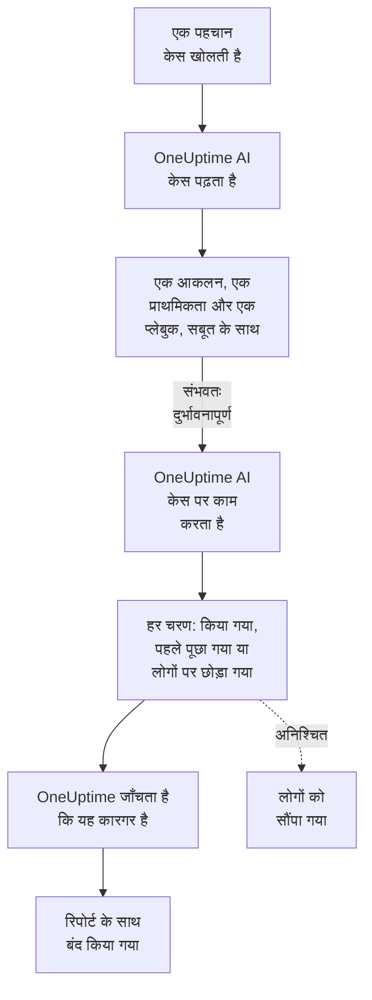

# सुरक्षा में OneUptime AI

OneUptime AI हर सुरक्षा केस को वैसे ही पढ़ता है जैसे कोई विश्लेषक पढ़ता: उसकी पहचानें, इवेंट, एंटिटीज़ और थ्रेट इंटेलिजेंस, और उसके आसपास के होस्ट और लोग। यह बताता है कि क्या हुआ और क्या यह असली लगता है, एक प्राथमिकता और एक प्लेबुक सुझाता है, और हर दावे के पीछे का सबूत बताता है। आप अनुमति दें, तो यह फिर केस पर शुरू से अंत तक काम करता है: केस अपने ज़िम्मे लेता है, खतरे को नियंत्रित करता है, जाँचता है कि उसका किया कारगर है, कोड ठीक करवाता है, और एक रिपोर्ट के साथ केस बंद करता है। हर तरह का चरण यह अपने आप करता है, पहले किसी व्यक्ति से पूछता है, या किसी व्यक्ति पर छोड़ देता है, जैसा आप तय करें, और हर चरण उसी प्लेबुक इंजन से करता है जिसे लोग इस्तेमाल करते हैं, इसलिए हर चरण केस की टाइमलाइन पर OneUptime AI के चरण के रूप में दिखता है और पूर्ववत किया जा सकता है। यह एक वाक्य से पहचान नियमों का मसौदा भी बनाता है, और Ask AI में आपके सुरक्षा डेटा के बारे में सवालों के जवाब देता है।

:::cards
- [केस का ट्राइएज करें](#केस-का-ट्राइएज-करें): OneUptime AI क्या पढ़ता है, किस नतीजे पर पहुँचता है, और क्या कभी नहीं करता।
- [नए केस का अपने आप ट्राइएज करें](#नए-केस-का-अपने-आप-ट्राइएज-करें): पहचान से खुलने वाला हर केस, खुलते ही ट्राइएज होता है।
- [किसी केस पर शुरू से अंत तक काम करें](#किसी-केस-पर-शुरू-से-अंत-तक-काम-करें): नियंत्रित करें, जाँचें, ठीक करें और बंद करें, और आप जो चुनें उसे कोई व्यक्ति स्वीकृत करे।
- [OneUptime AI किसी केस पर क्या कर सकता है](#oneuptime-ai-किसी-केस-पर-क्या-कर-सकता-है): हर तरह के चरण के लिए बंद, पहले पूछें या अपने आप।
- [यह केस लोगों को कब सौंपता है](#यह-केस-लोगों-को-कब-सौंपता-है): यह क्यों रुकता है, और इसकी सूचना किसे मिलती है।
- [ट्राइएज के बाद प्लेबुक चलाएँ](#ट्राइएज-के-बाद-प्लेबुक-चलाएँ): उस केस पर कार्रवाई करें जिसे संभवतः दुर्भावनापूर्ण पढ़ा गया हो।
- [पहचान नियम का मसौदा बनाएँ](#पहचान-नियम-का-मसौदा-बनाएँ): बताएँ कि क्या पकड़ना है, और Sigma नियम पढ़ें।
- [सुरक्षा पेजों पर Ask AI](#सुरक्षा-पेजों-पर-ask-ai): केस और इवेंट के बारे में सीधे शब्दों में सवाल।
:::

## यह कैसे काम करता है

ट्राइएज सिर्फ़ पढ़ता है। केस पर काम करना कार्रवाई करता है, उतनी ही जितनी आप अनुमति दें, और अनिश्चित होते ही केस लोगों को सौंप देता है। दोनों प्रोजेक्ट के अपने AI पर चलते हैं: **AI सक्षम करें**, प्रोजेक्ट का LLM प्रदाता, उसके AI क्रेडिट और उसकी दैनिक AI सीमाएँ।

## शुरू करने से पहले

- **प्रोजेक्ट सेटिंग्स → एआई → AI सुविधाएं** में **AI सक्षम करें** चालू हो। बंद होने पर सुरक्षा में OneUptime AI का कुछ नहीं दिखता और कुछ नहीं चलता।
- **प्रोजेक्ट सेटिंग्स → एआई → LLM प्रदाता** में एक LLM प्रदाता जिसे OneUptime AI इस्तेमाल कर सके। OneUptime Cloud एक प्रदाता देता है।
- ट्राइएज शुरू करने के लिए ऐसी भूमिका जो सुरक्षा केस पर काम कर सके: प्रोजेक्ट स्वामी, प्रोजेक्ट एडमिन, सुरक्षा एडमिन या सुरक्षा सदस्य। सुरक्षा दर्शक हर ट्राइएज पढ़ सकता है, पर कोई शुरू नहीं कर सकता। देखें [भूमिकाएँ](/docs/permissions/reference#भूमिकाएँ)।

## केस का ट्राइएज करें

कोई केस खोलें: **OneUptime AI** कार्ड उसके पेज में सबसे ऊपर होता है।

| कार्ड क्या कहता है | इसका मतलब |
| --- | --- |
| **अभी ट्राइएज नहीं हुआ** | अभी कोई ट्राइएज नहीं चला। **एआई से ट्राइएज करें** एक शुरू करता है। |
| **इस केस का ट्राइएज हो रहा है** | OneUptime AI केस पढ़ रहा है। हर जाँच चलते समय दिखती है। |
| कोई आकलन, जैसे **संभवतः दुर्भावनापूर्ण** | ट्राइएज पूरा हुआ। **फिर से ट्राइएज करें** केस को फिर से शुरू से पढ़ता है। |
| **ट्राइएज पूरा नहीं हुआ** | रन रुक गया। **फिर से प्रयास करें** नया रन शुरू करता है। |

सुरक्षा दर्शक को भी वही कार्ड दिखता है: **एआई से ट्राइएज करें** और **फिर से प्रयास करें** धूसर रहते हैं, और उनके पास एक पंक्ति बताती है कि ट्राइएज कौन शुरू कर सकता है; **फिर से ट्राइएज करें** और **प्राथमिकता सेट करें** नहीं दिखाए जाते।

ट्राइएज ये पढ़ता है:

- केस: उसका शीर्षक, प्राथमिकता, स्थिति, एंटिटीज़ और ATT&CK मैपिंग;
- उसकी पहचानें, सबसे नई पहले, हर एक के एक नमूना इवेंट के साथ;
- उसके उपयोगकर्ताओं, होस्ट और पतों के बारे में सुरक्षा इवेंट और थ्रेट इंटेलिजेंस;
- उसके उपयोगकर्ताओं, होस्ट और पतों का जोखिम, और इस हफ़्ते उसमें क्या जुड़ा;
- OneUptime के वे होस्ट जिनसे उसके होस्ट और पते मेल खाते हैं, और उनके मालिक;
- उसकी घोषित घटना, उसके नोट, उसकी सुरक्षित एंटिटीज़, और चालू प्लेबुक।

यह OneUptime का बाकी हिस्सा भी वैसे ही पढ़ सकता है जैसे किसी घटना की जाँच पढ़ती है: लॉग, ट्रेस, मेट्रिक्स, होस्ट, और प्रोजेक्ट के MCP सर्वरों के सिर्फ़-पढ़ने वाले टूल।

केस देख सकने वाला हर व्यक्ति उसका ट्राइएज पढ़ता है, इसलिए ट्राइएज केवल वही पढ़ता है जो वे सभी पढ़ सकते हैं। कोई टीम, कस्टम भूमिका या API कुंजी, जो किसी तरह के रिकॉर्ड को केवल मालिक या लेबल के आधार पर पढ़ती है, तभी गिनी जाती है जब वह API कुंजी, या टीम का कोई सदस्य, सुरक्षा केस या ऑडिट लॉग पढ़ सकता हो। ऐसी किसी तरह के रिकॉर्ड को, जिसे इनमें से कोई केवल मालिक या लेबल के आधार पर नहीं पढ़ता, पूरा पढ़ा जाता है; जहाँ कुछ ऐसा करते हैं, वहाँ कोई होस्ट, क्लस्टर, सेवा या दूसरा रिकॉर्ड जिसे कोई मालिक या लेबल अलग करता है, छोड़ दिया जाता है, और उसका कभी नाम नहीं लिया जाता और न उसे गिना जाता है। कौन सुरक्षा केस पढ़ सकता है, यह हर बार ट्राइएज चलने पर तय होता है, इसलिए किसी को यह पहुँच मिलने से पहले लिखा गया ट्राइएज ऐसे रिकॉर्ड का नाम ले सकता है जो उससे अलग किए गए हैं। केस हमेशा पढ़ा जाता है, और उसकी घोषित घटना भी, जब तक वह घटना निजी न हो। निजी घटनाएँ और अलर्ट कभी नहीं पढ़े जाते।

### यह किस नतीजे पर पहुँचता है

| आकलन | मतलब | बंद करने का सुझाव |
| --- | --- | --- |
| संभवतः दुर्भावनापूर्ण | सबूत दुर्भावनापूर्ण या अनधिकृत गतिविधि की ओर इशारा करते हैं | True Positive |
| संभवतः हानिरहित | गतिविधि असली लेकिन अपेक्षित लगती है, जैसे कोई एडमिन काम या आपकी टीम का चलाया स्कैन | Benign Positive |
| संभवतः गलत अलर्ट | लगता है पहचान ने सामान्य गतिविधि को गलत पढ़ा | False Positive |
| अनिर्णीत | तय करने लायक सबूत नहीं थे, और किसी व्यक्ति को देखना होगा | कुछ नहीं |

आकलन OneUptime AI का है, केस का निर्णय कभी नहीं: **केस बंद करें** उसके सुझाए निर्णय से शुरू होता है, और चुनता व्यक्ति है। आकलन के नीचे कार्ड में ये होते हैं:

- **सुझाई गई प्राथमिकता**, और जब केस किसी दूसरी प्राथमिकता पर हो तो **प्राथमिकता सेट करें**।
- **सुझाई गई प्लेबुक**, और **प्लेबुक चलाएँ**, जो उसे आपकी ओर से चलाता है, हर ज़रूरी अनुमोदन के साथ। जब वह प्लेबुक इस केस पर पहले से चल रही हो, तो **प्लेबुक चलाएँ** की जगह उसके रन की स्थिति दिखती है, जैसे **स्वीकृति की प्रतीक्षा में**: रन केस के **प्लेबुक** में है, और दूसरा रन वही अनुमोदन फिर से माँगेगा।
- रिपोर्ट: क्या हुआ, आकलन कितना पक्का है और आगे क्या करना है, हर दावे के बाद C1 जैसा एक हवाला।
- **जाँचे गए साक्ष्य**: ट्राइएज की चलाई हर क्वेरी। हवाला अपनी क्वेरी खोलता है, और किसी क्वेरी को खोलने पर वह आपकी अनुमतियों के साथ, ट्राइएज के पढ़े हुए समय पर फिर से चलती है।
- **इस केस के बारे में पूछें**, जो केस पर Ask AI खोलता है।

हर केस सूची हर केस के शीर्षक के पास आकलन दिखाती है, और **एआई का आकलन** से उसके हिसाब से फ़िल्टर करती है।

### यह क्या कभी नहीं करता

ट्राइएज केस में कुछ नहीं बदलता: न उसकी स्थिति, न प्राथमिकता, न ज़िम्मेदार व्यक्ति, न निर्णय, न नोट। यह कोई प्लेबुक नहीं चलाता और किसी को कंटेन नहीं करता। इसकी सुझाई प्लेबुक तब चलती है जब कोई व्यक्ति उसे चलाए, या नीचे बताए गए ट्रिगर से। केस पर कार्रवाई करना OneUptime AI का उस पर काम करना है, जिसकी अपनी अलग सेटिंग है: देखें [किसी केस पर शुरू से अंत तक काम करें](#किसी-केस-पर-शुरू-से-अंत-तक-काम-करें)।

### AI को चलाने के लिए लिखा गया टेक्स्ट

इवेंट, अलर्ट और एंटिटीज़ के मान प्रोजेक्ट के बाहर से आते हैं, और कोई हमलावर उन्हें लिख सकता है। OneUptime AI इन सबको डेटा की तरह पढ़ता है, निर्देशों की तरह कभी नहीं। जब किसी केस के डेटा का कोई हिस्सा AI के लिए निर्देशों जैसा लगता है, तो कार्ड सबसे पहले यह बताता है, संभवतः हानिरहित या संभवतः गलत अलर्ट आकलन अनिर्णीत बन जाता है, वह ट्राइएज कोई प्लेबुक शुरू नहीं करता, और OneUptime AI केस पर काम नहीं करता: वह उसे लोगों को सौंप देता है।

## नए केस का अपने आप ट्राइएज करें

**उत्पाद → सुरक्षा इवेंट → एआई → सेटिंग्स** खोलें और **नए केस का ट्राइएज करें** चालू करें: इसके बाद पहचान से खुलने वाले हर केस का खुलते ही ट्राइएज होता है। स्विच पलटते ही सेव हो जाता है। प्रोजेक्ट स्वामी और प्रोजेक्ट एडमिन इसे बदल सकते हैं।

नए प्रोजेक्ट इसके चालू रहने से शुरू होते हैं; पहले बना प्रोजेक्ट इसे तब तक बंद रखता है जब तक कोई इसे चालू न करे। हाथ से खोला गया केस, और **टेस्ट हमला भेजें** के टेस्ट हमले का केस, तब ट्राइएज होते हैं जब कोई **एआई से ट्राइएज करें** पर क्लिक करता है।

## किसी केस पर शुरू से अंत तक काम करें

उसी पेज पर **केस पर शुरू से अंत तक काम करें** चालू करें: इसके बाद OneUptime AI हर उस केस को अपने ज़िम्मे लेता है जिसे उसका ट्राइएज संभवतः दुर्भावनापूर्ण पढ़ता है, और **OneUptime AI किसी केस पर क्या कर सकता है** में दी गई आपकी अनुमति के भीतर उस पर काम करता है। नए प्रोजेक्ट इसके चालू रहने से शुरू होते हैं; पहले बना प्रोजेक्ट इसे तब तक बंद रखता है जब तक कोई इसे चालू न करे। प्रोजेक्ट स्वामी और प्रोजेक्ट एडमिन इसे बदल सकते हैं।

जब यह चालू हो, तो कोई व्यक्ति इसे किसी एक केस पर भी शुरू कर सकता है: केस के **OneUptime AI** कार्ड पर **एआई से प्रतिक्रिया दें** उस केस पर काम करता है जिसे OneUptime AI के ट्राइएज ने संभवतः दुर्भावनापूर्ण, संभवतः हानिरहित या संभवतः गलत अलर्ट पढ़ा हो। यह उस केस पर नहीं दिखता जिसका ट्राइएज अनिर्णीत रहा, जिसका डेटा AI के लिए निर्देशों जैसा लगता है, या जो आपकी सबसे ऊँची प्राथमिकता पर है: ऐसे केस किसी व्यक्ति के हैं। इसके लिए ऐसी भूमिका चाहिए जो सुरक्षा केस पर काम कर सके।

### यह क्या करता है

OneUptime AI केस की **प्रतिक्रिया योजना** पर काम करता है, सबसे ज़रूरी पहले: **पुष्टि करें कि यह असली है**, **खतरे को नियंत्रित करें**, **जिस वजह से यह हुआ, उसे ठीक करें** और **केस बंद करें**। हर चरण किया जाता है, किसी व्यक्ति से पूछा जाता है, या किसी व्यक्ति पर छोड़ा जाता है, जैसा **OneUptime AI किसी केस पर क्या कर सकता है** में उसकी तरह की पंक्ति कहती है।

| चरण | OneUptime AI क्या करता है |
| --- | --- |
| केस अपने ज़िम्मे लेना | उसे अपने ज़िम्मे लेता है, और उसकी प्राथमिकता बढ़ाकर वही कर देता है जो ट्राइएज ने सुझाई थी। यह कभी प्राथमिकता कम नहीं करता, और जिस केस को यह आपकी सबसे ऊँची प्राथमिकता तक बढ़ाता है, वह लोगों के पास जाता है |
| गलत अलर्ट की संभावना खत्म करना | इसे तभी पूरा चिह्नित करता है जब OneUptime के अपने तथ्य कोई शक न छोड़ें: पता आपका नहीं है और उससे किसी ने साइन इन नहीं किया। वरना यह चरण किसी व्यक्ति पर छोड़ देता है |
| पता ब्लॉक करना | आपकी [ब्लॉकलिस्ट](/docs/telemetry/security-cases#ब्लॉकलिस्ट) के ज़रिए उसे 24 घंटे के लिए ब्लॉक करता है, फिर OneUptime की उस जाँच की प्रतीक्षा करता है जो बताए कि ब्लॉक कारगर है। जब कुछ भी आपकी ब्लॉकलिस्ट लागू नहीं करता, तो यह चरण किसी व्यक्ति पर छोड़ देता है |
| उपयोगकर्ता को निलंबित करना, होस्ट को नियंत्रित करना | आपकी किसी प्लेबुक का वह चरण चलाता है जो यह करता है, आपके पहचान प्रदाता या EDR के ज़रिए। ऐसी कोई प्लेबुक न हो, तो यह चरण किसी व्यक्ति पर छोड़ देता है |
| घटना घोषित करना | हमेशा पहले पूछता है: घटना लोगों को पेज करती है |
| केस को नियंत्रित में ले जाना | जब OneUptime खतरे को नियंत्रित करने वाले हर चरण को सत्यापित कर चुका हो |
| हमला जिस रूट तक पहुँचा, उसे ठीक करना | "AI से ठीक करें" से एक pull request खुलवाता है। उसे कोई व्यक्ति मर्ज करता है। OneUptime के प्रोडक्शन में सुधार सत्यापित करते ही यह केस बंद करता है, सुधार सिर्फ़ पूरा लगने पर किसी व्यक्ति से पूछता है, और जब तक सुधार कारगर नहीं होता, केस पर काम करता रहता है |
| MFA चालू करना, खाते के बदलावों की समीक्षा करना | किसी व्यक्ति पर छोड़ा जाता है: कोई उत्पाद OneUptime को नहीं बताता कि वे कारगर हैं या नहीं |
| केस बंद करना | जब बाकी हर चरण पूरा हो जाए और केस की पहचान 24 घंटे तक शांत रहे, True Positive के रूप में, एक [समापन रिपोर्ट](#समापन-रिपोर्ट) के साथ |

केस का पहचान नियम जो चरण अपनी ओर से जोड़ता है, और ऐसा कुछ भी जिसे करने का OneUptime के पास कोई तरीका नहीं है, जैसे आपके DNS फ़िल्टर पर किसी डोमेन को ब्लॉक करना, वजह बताते हुए किसी व्यक्ति पर छोड़ दिया जाता है।

OneUptime AI का हर चरण प्लेबुक इंजन से होकर जाता है, केस के **प्लेबुक** पेज पर एक चरण के रन के रूप में, जिसका ट्रिगर **OneUptime AI** होता है। इसलिए वह अनुमोदन की प्रतीक्षा करता है, संरक्षित एंटिटीज़ को नहीं छूता, केस की टाइमलाइन पर दिखता है, ऑडिट लॉग में रखा जाता है और पूर्ववत किया जा सकता है, ठीक वैसे ही जैसे कोई भी व्यक्ति चरण चलाए, और टाइमलाइन बताती है कि वह OneUptime AI का था। जिस चरण के बारे में यह पूछता है, वह किसी व्यक्ति के अनुमोदन की प्रतीक्षा करता है: केस पर, उसके **प्लेबुक** पेज पर, या Slack या Microsoft Teams में एक टैप में।

### केस पर इसका लॉग

ट्राइएज के नीचे, **OneUptime AI** कार्ड **केस पर काम** के अंतर्गत बताता है कि OneUptime AI केस पर कैसे काम कर रहा है:

| कार्ड क्या कहता है | इसका मतलब |
| --- | --- |
| **OneUptime AI इस केस पर काम नहीं कर रहा** | **एआई से प्रतिक्रिया दें** इसे अपने ज़िम्मे लेता है। |
| **इस केस पर काम हो रहा है** | OneUptime AI योजना पर काम कर रहा है। **अपने हाथ में लें** इसे रोकता है, और केस आपका हो जाता है। |
| **किसी व्यक्ति की प्रतीक्षा में** | इसने किसी से एक चरण स्वीकृत करने को कहा है, और किसी के जवाब देते ही आगे बढ़ता है। |
| **लोगों को सौंपा गया** | यह रुक गया है, और वजह बताता है। |
| **केस बंद हो गया है** | इसने केस बंद किया, या किसी व्यक्ति ने। इसकी **समापन रिपोर्ट** इसके चरणों के ऊपर है। |

इसके नीचे, इसका उठाया, पूछा या छोड़ा हर चरण, सबसे नया पहले, हर एक के साथ उसकी वजह: **अपने आप किया गया: आपकी सेटिंग्स इसकी अनुमति देती हैं।**, **आपकी सेटिंग्स के अनुसार यह किसी व्यक्ति की स्वीकृति की प्रतीक्षा करता है।**, **OneUptime के पास यह चरण करने का कोई तरीका नहीं है, इसलिए इसे कोई व्यक्ति करता है।** जिस चरण के बारे में इसने पूछा, उस पर **स्वीकृत करें** और **अस्वीकार करें** होते हैं; इसके उठाए चरण से उसके रन का लिंक होता है, जहाँ उसे पूर्ववत किया जा सकता है। जिस चरण की जाँच OneUptime करता है, वह बताता है कि जाँच में क्या मिला, और जो चरण इसने पहले उसी नियम के केस पर उठाया था, वह बताता है कि वह कितनी बार कारगर रहा: "यह 15 मिलते-जुलते केस में से 14 पर कारगर रहा।"

### जिस केस को यह हानिरहित या गलत अलर्ट पढ़ता है

जिस केस को ट्राइएज ने संभवतः हानिरहित या संभवतः गलत अलर्ट पढ़ा हो, उस पर **एआई से प्रतिक्रिया दें** उसे Benign Positive या False Positive के रूप में बंद करता है, जितनी **केस बंद करें** अनुमति दे। उसके बंद होते ही OneUptime AI केस के लगाए ब्लॉक हटा देता है, यह भी जितनी **केस बंद करें** अनुमति दे, और केस के नियम को उस मान के लिए अपवाद का प्रस्ताव देता है जिसने उसे ट्रिगर किया। अपवाद हमेशा किसी व्यक्ति की प्रतीक्षा करता है: **स्वीकृत करें** उसे आपकी ओर से जोड़ता है।

## OneUptime AI किसी केस पर क्या कर सकता है

**उत्पाद → सुरक्षा इवेंट → एआई → सेटिंग्स** पर, **OneUptime AI किसी केस पर क्या कर सकता है** के अंतर्गत, हर तरह के चरण की अपनी पंक्ति होती है, जो चुनते ही सेव हो जाती है:

- **बंद**: OneUptime AI इसे किसी व्यक्ति पर छोड़ देता है, और केस पर यह बताता है।
- **पहले पूछें**: यह साक्ष्य के साथ किसी व्यक्ति से पूछता है, और किसी के स्वीकृत करते ही इसे करता है।
- **अपने आप**: यह बिना पूछे इसे करता है, और केस की टाइमलाइन पर यह बताता है।

| पंक्ति | किसे कवर करती है | नए प्रोजेक्ट किससे शुरू होते हैं |
| --- | --- | --- |
| **केस पर काम करें** | केस अपने ज़िम्मे लेना, उसकी प्राथमिकता बढ़ाना, चरणों को उनके साक्ष्य के साथ पूरा चिह्नित करना, उसे नियंत्रित में ले जाना | अपने आप |
| **पते ब्लॉक करें** | केस के पते को आपके एज पर 24 घंटे के लिए ब्लॉक करना | पहले पूछें |
| **खाते नियंत्रित करें** | केस के उपयोगकर्ता को निलंबित करना या उसके सेशन खत्म करना | पहले पूछें |
| **होस्ट नियंत्रित करें** | केस के होस्ट को नियंत्रित करना या अलग करना | पहले पूछें |
| **कोड ठीक करें** | हमला जिस रूट तक पहुँचा, उसके लिए "AI से ठीक करें" से pull request खुलवाना | अपने आप |
| **केस बंद करें** | केस को उसकी समापन रिपोर्ट के साथ बंद करना, और हानिरहित के रूप में बंद होने पर केस के ब्लॉक हटाना | पहले पूछें |

ये सेटिंग्स तभी लागू होती हैं जब **केस पर शुरू से अंत तक काम करें** चालू हो, और जब यह बंद हो तो कार्ड यह बताता है। प्रोजेक्ट स्वामी और प्रोजेक्ट एडमिन इन्हें बदल सकते हैं।

**पते ब्लॉक करें**, **खाते नियंत्रित करें** या **होस्ट नियंत्रित करें** को **अपने आप** पर सेट करने के लिए सुरक्षा एडमिन का अधिकार चाहिए, जो प्रोजेक्ट स्वामियों और प्रोजेक्ट एडमिन के पास भी होता है, और OneUptime दर्ज रखता है कि यह किसने और कब किया, जैसे वह उस प्लेबुक चरण के लिए रखता है जिसका अनुमोदन बंद है। **पते ब्लॉक करें** पहले पूछता है: **पुष्टि करें और चालू करें** सुरक्षा एडमिन की पुष्टि है, और फिर पंक्ति बताती है कि यह कब दी गई। जब तक कोई सुरक्षा एडमिन इसकी पुष्टि नहीं करता, OneUptime AI ब्लॉक करने से पहले पूछता है।

पंक्तियाँ चाहे जो कहें, OneUptime AI:

- किसी संरक्षित उपयोगकर्ता, होस्ट या पते पर कभी कार्रवाई नहीं करता: वह केस लोगों को सौंप देता है;
- आपके सभी केस में मिलाकर एक घंटे में अपने आप ज़्यादा से ज़्यादा 10 कार्रवाइयाँ करता है, और फिर अगला केस लोगों को सौंप देता है;
- ज़्यादा से ज़्यादा 24 घंटे के लिए ब्लॉक करता है;
- कभी कोड मर्ज नहीं करता: हर pull request कोई व्यक्ति मर्ज करता है;
- घटना घोषित करने या नियम अपवाद जोड़ने से पहले हमेशा पूछता है;
- एक केस पर एक समय में एक ही रन से काम करता है, और रीस्टार्ट होने वाला सर्वर कार्रवाई करने वाले रन को कभी नहीं छोड़ता।

## यह केस लोगों को कब सौंपता है

OneUptime AI कभी चुपचाप पीछे नहीं हटता। यह कार्ड और टाइमलाइन पर वजह बताते हुए केस लोगों को सौंप देता है, जब:

- केस के डेटा का कुछ हिस्सा AI के लिए निर्देशों जैसा लगता है;
- केस आपकी सबसे ऊँची प्राथमिकता पर है;
- इसका अगला चरण जिस पर कार्रवाई करेगा, वह संरक्षित है;
- यह एक घंटे में जितनी बार अपने आप कार्रवाई कर सकता है, उतनी बार कर चुका है;
- प्रोजेक्ट या सुरक्षा केस के लिए AI बंद है, कोई LLM प्रदाता नहीं है, या प्रोजेक्ट के AI क्रेडिट खत्म हो गए हैं या वह अपनी दैनिक AI सीमा तक पहुँच गया है;
- इसका ट्राइएज तय नहीं कर सका कि केस असली है या नहीं;
- इसका उठाया कोई चरण कारगर नहीं है, इसका शुरू किया कोई चरण पूरा नहीं हुआ, या किसी व्यक्ति ने इसके उठाए किसी चरण को अस्वीकार या पूर्ववत किया;
- यह तय नहीं कर सकता कि आगे क्या करना है, या केस पर जो कुछ बचा है वह किसी व्यक्ति को करना है।

केस पर काम कर रहे लोगों को इसकी सूचना तुरंत मिलती है, या जब उस पर कोई नहीं हो, तो उन लोगों को जिन्हें उसकी प्राथमिकता वाले केस की सूचना दी जाती है: **उपयोगकर्ता सेटिंग्स → सूचना सेटिंग्स** में **OneUptime AI ने एक सुरक्षा केस लोगों को सौंपा**। सुरक्षा केस के लिए वर्कस्पेस सूचना नियम इसे अपने Slack या Microsoft Teams चैनल पर **OneUptime AI द्वारा लोगों को सौंपे गए केस** के अंतर्गत पोस्ट करता है। **अपने हाथ में लें** किसी को बताए बिना केस सौंप देता है, क्योंकि जिस व्यक्ति ने इसे दबाया, केस उसी के पास है।

**एआई से प्रतिक्रिया दें** OneUptime AI से केस पर फिर से काम करने को कहता है, वहीं से जहाँ केस अभी है।

## समापन रिपोर्ट

जब OneUptime AI कोई केस बंद करता है, या किसी व्यक्ति से उसे बंद करने को कहता है, तो यह केस में मौजूद जानकारी से समापन रिपोर्ट लिखता है, ट्राइएज के शब्दों से नहीं: क्या हुआ, असर, क्या किया गया, क्या ठीक किया गया और किस पर नज़र रखनी है। रिपोर्ट केस का समापन नोट होती है, वह टाइमलाइन पर होती है, और कार्ड उसे **समापन रिपोर्ट** के अंतर्गत दिखाता है। जब **केस बंद करें** **पहले पूछें** पर हो, तो केस बंद होने के लिए किसी व्यक्ति के अनुमोदन की प्रतीक्षा करता है, और पढ़ने के लिए रिपोर्ट पहले से मौजूद रहती है।

## इसे कैसे मापा जाता है

**उत्पाद → सुरक्षा इवेंट → अवलोकन** दिखाता है कि OneUptime AI ने पिछले 30 दिनों के केस पर कैसे काम किया, जब वह किसी केस पर काम कर चुका हो या उसके बारे में पूछ चुका हो: **OneUptime AI ने हल किया**, उन केस में से जिन पर उसने काम किया; **एआई के साथ नियंत्रण में लगा समय** और **एआई के साथ बंद करने में लगा समय**, हर एक उसके बिना लगे समय के साथ; और **माँगी गई स्वीकृतियाँ**, लोगों ने कितनी जल्दी जवाब दिया, और लोगों ने उसके कितने चरण पूर्ववत किए।

## ट्राइएज के बाद प्लेबुक चलाएँ

जिस प्लेबुक का **ट्रिगर** **संभवतः दुर्भावनापूर्ण के रूप में ट्राइएज किया गया** है, वह किसी केस पर एक बार चलती है, जब ट्राइएज उसे संभवतः दुर्भावनापूर्ण पढ़ता है। **कम से कम इस प्राथमिकता के केस**, **सिर्फ़ इनसे आए डिटेक्शन के लिए** और **सिर्फ़ इन डिटेक्शन नियमों के लिए** उसे किसी भी ट्रिगर की तरह सीमित करते हैं, और उसके कंटेनमेंट चरण हमेशा की तरह अनुमोदन की प्रतीक्षा करते हैं। यह नहीं चलती:

- ऐसे ट्राइएज के बाद जिसने AI को चलाने के लिए लिखा गया टेक्स्ट पाया;
- उसी केस पर दूसरी बार, केस का ट्राइएज चाहे जितनी बार हो;
- टेस्ट हमले के केस पर, जब तक प्लेबुक का हर चरण OneUptime के भीतर न रहे।

नई प्लेबुक को यह ट्रिगर तभी दिखता है जब प्रोजेक्ट का AI चालू हो।

## पहचान नियम का मसौदा बनाएँ

**डिटेक्शन नियम** पर, **Sigma नियम (YAML)** फ़ील्ड के नीचे **एआई से ड्राफ़्ट करें** पर क्लिक करें और बताएँ कि नियम को क्या पकड़ना है, जैसे पाँच मिनट के भीतर एक IP पते से दस असफल साइन-इन। **नियम का मसौदा बनाएँ** फ़ील्ड में एक Sigma नियम डालता है, जिसे सेव किए गए नियम की तरह ही जाँचा जाता है। उसे पढ़ें, ज़रूरत हो तो बदलें, और हमेशा की तरह सेव करें: जब तक आप सेव नहीं करते, कुछ सेव नहीं होता। अगर फ़ील्ड में पहले से कोई नियम हो, तो बटन **एआई से फिर से मसौदा बनाएँ** दिखाता है, और मसौदा उस नियम की जगह ले लेता है।

मसौदे के लिए ऐसी भूमिका चाहिए जो पहचान नियम बना सके।

## सुरक्षा पेजों पर Ask AI

**AI से पूछें** जानता है कि आप किस सुरक्षा पेज पर हैं। किसी केस पर यह पहले केस पढ़ता है और **क्या यह असली है?** जैसे सवाल सुझाता है। सुरक्षा इवेंट के बाकी पेजों पर, सीधे शब्दों में पूछा गया सवाल आपके सुरक्षा इवेंट खोजता है। यह मानों को आपकी थ्रेट इंटेलिजेंस से मिला सकता है, देख सकता है कि कोई उपयोगकर्ता, होस्ट या पता कितना सक्रिय रहा, और वे प्लेबुक बता सकता है जो किसी केस के लिए सही हों।

Ask AI किसी केस में नोट जोड़ सकता है और उस पर प्लेबुक चला सकता है, आपकी ओर से, और हर बार पहले पूछता है। इसकी चलाई प्लेबुक बाकी प्लेबुक की तरह अनुमोदन की प्रतीक्षा करती है।

जब कोई केस घटना घोषित करता है, तो घटना की AI जाँच भी केस पढ़ती है: क्या पहचाना गया, किसके बारे में, और उस पर OneUptime AI का ट्राइएज।

## लागत और सीमाएँ

ट्राइएज OneUptime AI का काम है, किसी घटना की जाँच की तरह। OneUptime Cloud पर इसका भुगतान प्रोजेक्ट के AI क्रेडिट से होता है, और यह प्रोजेक्ट की अपनी दैनिक AI सीमाओं में गिना जाता है (**प्रोजेक्ट सेटिंग्स → एआई → AI सुविधाएं** में **दैनिक सीमाएं**)। घटनाओं और अलर्ट की दैनिक सीमाएँ लागू नहीं होतीं। एक केस पर एक समय में एक ही ट्राइएज होता है, और AI लॉग (**प्रोजेक्ट सेटिंग्स → एआई → AI लॉग**) उसकी कॉल दिखाते हैं।

जब प्रोजेक्ट के AI क्रेडिट खत्म हो जाएँ या वह किसी दैनिक AI सीमा तक पहुँच जाए, तो नए केस का ट्राइएज नहीं होता: कार्ड वजह बताता है, और क्रेडिट जुड़ते ही या सीमा रीसेट होते ही **एआई से ट्राइएज करें** फिर काम करता है। केस पर काम करते समय OneUptime AI, LLM से पूछने के बजाय केस की अपनी योजना और जाँचें पढ़ता है, और उन्हीं सीमाओं पर रुकता है: वह वजह बताते हुए केस लोगों को सौंप देता है।

## समस्या निवारण

:::details नए केस का ट्राइएज नहीं हुआ
जाँचें कि **AI सक्षम करें** चालू है, और **उत्पाद → सुरक्षा इवेंट → एआई → सेटिंग्स** में **नए केस का ट्राइएज करें** भी। हाथ से खोला गया केस और टेस्ट हमले का केस तभी ट्राइएज होते हैं जब कोई कहे। केस खोलें: जब कुछ ट्राइएज को रोकता है, तो कार्ड बताता है कि क्या, और उसे कहाँ ठीक करना है।
:::

:::details OneUptime AI ने किसी केस पर काम नहीं किया
जाँचें कि **उत्पाद → सुरक्षा इवेंट → एआई → सेटिंग्स** में **केस पर शुरू से अंत तक काम करें** चालू है। यह किसी केस को अपने आप तभी उठाता है जब ट्राइएज उसे संभवतः दुर्भावनापूर्ण पढ़ता है। केस खोलें: **केस पर काम** के अंतर्गत कार्ड बताता है कि यह उस पर काम क्यों नहीं कर रहा, और **एआई से प्रतिक्रिया दें** उससे काम करने को कहता है।
:::

:::details "पते ब्लॉक करें" के "अपने आप" पर होने के बावजूद यह ब्लॉक करने से पहले पूछता है
**पते ब्लॉक करें** के लिए **अपने आप** तभी गिना जाता है जब कोई सुरक्षा एडमिन इसकी पुष्टि कर चुका हो: पंक्ति बताती है कि कब, या यह कि अभी तक किसी ने नहीं की। संरक्षित पता, या आपका अपना कोई पता, कभी ब्लॉक नहीं होता: OneUptime AI केस लोगों को सौंप देता है। जब तक कुछ भी आपकी ब्लॉकलिस्ट लागू नहीं करता, यह चरण किसी व्यक्ति पर छोड़ देता है।
:::

:::details कार्ड कहता है कि प्रोजेक्ट के AI क्रेडिट खत्म हो गए, या वह अपनी दैनिक AI सीमा तक पहुँच गया
प्रोजेक्ट स्वामी या Manage Billing वाला व्यक्ति **प्रोजेक्ट सेटिंग्स → एआई → AI क्रेडिट** में क्रेडिट जोड़ सकता है, या **प्रोजेक्ट सेटिंग्स → एआई → AI सुविधाएं** में सीमा बढ़ा या हटा सकता है। फिर केस पर **एआई से ट्राइएज करें** पर क्लिक करें।
:::

:::details कार्ड कहता है कि केस का टेक्स्ट AI के लिए निर्देशों जैसा लगता है
केस के डेटा का कोई हिस्सा, जैसे किसी इवेंट का संदेश या कोई उपयोगकर्ता नाम, AI को चलाने के लिए लिखा गया था। OneUptime AI ने उसे डेटा की तरह पढ़ा और फ़ैसला आप पर छोड़ा: केस बंद करने से पहले पहचानें और सबूत खुद पढ़ें।
:::

:::details AI ट्रिगर वाली प्लेबुक नहीं चली
जाँचें कि प्लेबुक सक्षम है, ट्राइएज ने केस को संभवतः दुर्भावनापूर्ण पढ़ा, और उसकी **कम से कम इस प्राथमिकता के केस**, **सिर्फ़ इनसे आए डिटेक्शन के लिए** और **सिर्फ़ इन डिटेक्शन नियमों के लिए** सेटिंग्स केस से मेल खाती हैं। यह हर केस पर एक बार चलती है, और ऐसे ट्राइएज के बाद नहीं जिसने AI को चलाने के लिए लिखा गया टेक्स्ट पाया।
:::

## अगले कदम

:::cards
- [सुरक्षा केस और प्लेबुक](/docs/telemetry/security-cases): केस पर काम करें, उन्हें निर्णय के साथ बंद करें, और प्लेबुक बनाएँ।
- [AI SRE](/docs/ai/ai-sre): OneUptime AI घटनाओं और अलर्ट की जाँच कैसे करता है, और उसकी सीमाएँ।
- [AI से पूछें](/docs/ai/ask-ai): अपने प्रोजेक्ट के बारे में सीधे शब्दों में सवाल पूछें।
- [LLM प्रदाता](/docs/ai/llm-provider): वह मॉडल चुनें जिसे OneUptime AI इस्तेमाल करता है।
:::
