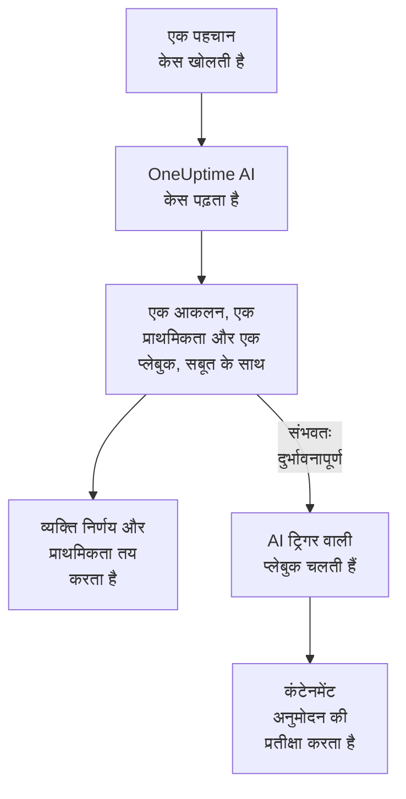

# सुरक्षा में OneUptime AI

OneUptime AI हर सुरक्षा केस को वैसे ही पढ़ता है जैसे कोई विश्लेषक पढ़ता: उसकी पहचानें, इवेंट, एंटिटीज़ और थ्रेट इंटेलिजेंस, और उसके आसपास के होस्ट और लोग। यह बताता है कि क्या हुआ और क्या यह असली लगता है, एक प्राथमिकता और एक प्लेबुक सुझाता है, और हर दावे के पीछे का सबूत बताता है। यह अपने आप कुछ नहीं बदलता: निर्णय और प्राथमिकता कोई व्यक्ति तय करता है, और प्लेबुक भी वही चलाता है। यह एक वाक्य से पहचान नियमों का मसौदा भी बनाता है, और Ask AI में आपके सुरक्षा डेटा के बारे में सवालों के जवाब देता है।

:::cards
- [केस का ट्राइएज करें](#केस-का-ट्राइएज-करें): OneUptime AI क्या पढ़ता है, किस नतीजे पर पहुँचता है, और क्या कभी नहीं करता।
- [नए केस का अपने आप ट्राइएज करें](#नए-केस-का-अपने-आप-ट्राइएज-करें): पहचान से खुलने वाला हर केस, खुलते ही ट्राइएज होता है।
- [ट्राइएज के बाद प्लेबुक चलाएँ](#ट्राइएज-के-बाद-प्लेबुक-चलाएँ): उस केस पर कार्रवाई करें जिसे संभवतः दुर्भावनापूर्ण पढ़ा गया हो।
- [पहचान नियम का मसौदा बनाएँ](#पहचान-नियम-का-मसौदा-बनाएँ): बताएँ कि क्या पकड़ना है, और Sigma नियम पढ़ें।
- [सुरक्षा पेजों पर Ask AI](#सुरक्षा-पेजों-पर-ask-ai): केस और इवेंट के बारे में सीधे शब्दों में सवाल।
:::

## यह कैसे काम करता है

ट्राइएज सिर्फ़ पढ़ता है। यह प्रोजेक्ट के अपने AI पर चलता है: **AI सक्षम करें**, प्रोजेक्ट का LLM प्रदाता, उसके AI क्रेडिट और उसकी दैनिक AI सीमाएँ।

## शुरू करने से पहले

- **प्रोजेक्ट सेटिंग्स → एआई → AI Features** में **AI सक्षम करें** चालू हो। बंद होने पर सुरक्षा में OneUptime AI का कुछ नहीं दिखता और कुछ नहीं चलता।
- **प्रोजेक्ट सेटिंग्स → एआई → LLM प्रदाता** में एक LLM प्रदाता जिसे OneUptime AI इस्तेमाल कर सके। OneUptime Cloud एक प्रदाता देता है।
- ट्राइएज शुरू करने के लिए ऐसी भूमिका जो सुरक्षा केस पर काम कर सके: Project Owner, Project Admin, Security Admin या Security Member। Security Viewer हर ट्राइएज पढ़ सकता है, पर कोई शुरू नहीं कर सकता। देखें [भूमिकाएँ](/docs/permissions/reference#भूमिकाएँ)।

## केस का ट्राइएज करें

कोई केस खोलें: **OneUptime AI** कार्ड उसके पेज में सबसे ऊपर होता है।

| कार्ड क्या कहता है | इसका मतलब |
| --- | --- |
| **अभी ट्राइएज नहीं हुआ** | अभी कोई ट्राइएज नहीं चला। **एआई से ट्राइएज करें** एक शुरू करता है। |
| **इस केस का ट्राइएज हो रहा है** | OneUptime AI केस पढ़ रहा है। हर जाँच चलते समय दिखती है। |
| कोई आकलन, जैसे **संभवतः दुर्भावनापूर्ण** | ट्राइएज पूरा हुआ। **फिर से ट्राइएज करें** केस को फिर से शुरू से पढ़ता है। |
| **ट्राइएज पूरा नहीं हुआ** | रन रुक गया। **फिर से प्रयास करें** नया रन शुरू करता है। |

Security Viewer को भी वही कार्ड दिखता है: **एआई से ट्राइएज करें** और **फिर से प्रयास करें** धूसर रहते हैं, और उनके पास एक पंक्ति बताती है कि ट्राइएज कौन शुरू कर सकता है; **फिर से ट्राइएज करें** और **प्राथमिकता सेट करें** नहीं दिखाए जाते।

ट्राइएज ये पढ़ता है:

- केस: उसका शीर्षक, प्राथमिकता, स्थिति, एंटिटीज़ और ATT&CK मैपिंग;
- उसकी पहचानें, सबसे नई पहले, हर एक के एक नमूना इवेंट के साथ;
- उसके उपयोगकर्ताओं, होस्ट और पतों के बारे में सुरक्षा इवेंट और थ्रेट इंटेलिजेंस;
- उसके उपयोगकर्ताओं, होस्ट और पतों का जोखिम, और इस हफ़्ते उसमें क्या जुड़ा;
- OneUptime के वे होस्ट जिनसे उसके होस्ट और पते मेल खाते हैं, और उनके मालिक;
- उसकी घोषित घटना, उसके नोट, उसकी सुरक्षित एंटिटीज़, और चालू प्लेबुक।

यह OneUptime का बाकी हिस्सा भी वैसे ही पढ़ सकता है जैसे किसी घटना की जाँच पढ़ती है: लॉग, ट्रेस, मेट्रिक्स, होस्ट, और प्रोजेक्ट के MCP सर्वरों के सिर्फ़-पढ़ने वाले टूल।

### यह किस नतीजे पर पहुँचता है

| आकलन | मतलब | बंद करने का सुझाव |
| --- | --- | --- |
| संभवतः दुर्भावनापूर्ण | सबूत दुर्भावनापूर्ण या अनधिकृत गतिविधि की ओर इशारा करते हैं | True Positive |
| संभवतः हानिरहित | गतिविधि असली लेकिन अपेक्षित लगती है, जैसे कोई एडमिन काम या आपकी टीम का चलाया स्कैन | Benign Positive |
| संभवतः गलत अलर्ट | लगता है पहचान ने सामान्य गतिविधि को गलत पढ़ा | False Positive |
| अनिर्णीत | तय करने लायक सबूत नहीं थे, और किसी व्यक्ति को देखना होगा | कुछ नहीं |

आकलन OneUptime AI का है, केस का निर्णय कभी नहीं: **केस बंद करें** उसके सुझाए निर्णय से शुरू होता है, और चुनता व्यक्ति है। आकलन के नीचे कार्ड में ये होते हैं:

- **सुझाई गई प्राथमिकता**, और जब केस किसी दूसरी प्राथमिकता पर हो तो **प्राथमिकता सेट करें**।
- **सुझाई गई प्लेबुक**, और **प्लेबुक चलाएँ**, जो उसे आपकी ओर से चलाता है, हर ज़रूरी अनुमोदन के साथ। जब वह प्लेबुक इस केस पर पहले से चल रही हो, तो **प्लेबुक चलाएँ** की जगह उसके रन की स्थिति दिखती है, जैसे **स्वीकृति की प्रतीक्षा में**: रन केस के **प्लेबुक** में है, और दूसरा रन वही अनुमोदन फिर से माँगेगा।
- रिपोर्ट: क्या हुआ, आकलन कितना पक्का है और आगे क्या करना है, हर दावे के बाद C1 जैसा एक हवाला।
- **Evidence checked**: ट्राइएज की चलाई हर क्वेरी। हवाला अपनी क्वेरी खोलता है, और किसी क्वेरी को खोलने पर वह आपकी अनुमतियों के साथ, ट्राइएज के पढ़े हुए समय पर फिर से चलती है।
- **इस केस के बारे में पूछें**, जो केस पर Ask AI खोलता है।

हर केस सूची हर केस के शीर्षक के पास आकलन दिखाती है, और **एआई का आकलन** से उसके हिसाब से फ़िल्टर करती है।

### यह क्या कभी नहीं करता

ट्राइएज केस में कुछ नहीं बदलता: न उसकी स्थिति, न प्राथमिकता, न ज़िम्मेदार व्यक्ति, न निर्णय, न नोट। यह कोई प्लेबुक नहीं चलाता और किसी को कंटेन नहीं करता। इसकी सुझाई प्लेबुक तब चलती है जब कोई व्यक्ति उसे चलाए, या नीचे बताए गए ट्रिगर से।

### AI को चलाने के लिए लिखा गया टेक्स्ट

इवेंट, अलर्ट और एंटिटीज़ के मान प्रोजेक्ट के बाहर से आते हैं, और कोई हमलावर उन्हें लिख सकता है। OneUptime AI इन सबको डेटा की तरह पढ़ता है, निर्देशों की तरह कभी नहीं। जब किसी केस के डेटा का कोई हिस्सा AI के लिए निर्देशों जैसा लगता है, तो कार्ड सबसे पहले यह बताता है, संभवतः हानिरहित या संभवतः गलत अलर्ट आकलन अनिर्णीत बन जाता है, और वह ट्राइएज कोई प्लेबुक शुरू नहीं करता।

## नए केस का अपने आप ट्राइएज करें

**उत्पाद → Security Events → एआई → सेटिंग्स** खोलें और **नए केस का ट्राइएज करें** चालू करें: इसके बाद पहचान से खुलने वाले हर केस का खुलते ही ट्राइएज होता है। स्विच पलटते ही सेव हो जाता है। Project Owner और Project Admin इसे बदल सकते हैं।

नए प्रोजेक्ट इसके चालू रहने से शुरू होते हैं; पहले बना प्रोजेक्ट इसे तब तक बंद रखता है जब तक कोई इसे चालू न करे। हाथ से खोला गया केस, और **टेस्ट हमला भेजें** के टेस्ट हमले का केस, तब ट्राइएज होते हैं जब कोई **एआई से ट्राइएज करें** पर क्लिक करता है।

## ट्राइएज के बाद प्लेबुक चलाएँ

जिस प्लेबुक का **ट्रिगर** **संभवतः दुर्भावनापूर्ण के रूप में ट्राइएज किया गया** है, वह किसी केस पर एक बार चलती है, जब ट्राइएज उसे संभवतः दुर्भावनापूर्ण पढ़ता है। **कम से कम इस प्राथमिकता के केस**, **सिर्फ़ इनसे आए डिटेक्शन के लिए** और **सिर्फ़ इन डिटेक्शन नियमों के लिए** उसे किसी भी ट्रिगर की तरह सीमित करते हैं, और उसके कंटेनमेंट चरण हमेशा की तरह अनुमोदन की प्रतीक्षा करते हैं। यह नहीं चलती:

- ऐसे ट्राइएज के बाद जिसने AI को चलाने के लिए लिखा गया टेक्स्ट पाया;
- उसी केस पर दूसरी बार, केस का ट्राइएज चाहे जितनी बार हो;
- टेस्ट हमले के केस पर, जब तक प्लेबुक का हर चरण OneUptime के भीतर न रहे।

नई प्लेबुक को यह ट्रिगर तभी दिखता है जब प्रोजेक्ट का AI चालू हो।

## पहचान नियम का मसौदा बनाएँ

**डिटेक्शन नियम** पर, **Sigma नियम (YAML)** फ़ील्ड के नीचे **एआई से ड्राफ़्ट करें** पर क्लिक करें और बताएँ कि नियम को क्या पकड़ना है, जैसे पाँच मिनट के भीतर एक IP पते से दस असफल साइन-इन। **नियम का मसौदा बनाएँ** फ़ील्ड में एक Sigma नियम डालता है, जिसे सेव किए गए नियम की तरह ही जाँचा जाता है। उसे पढ़ें, ज़रूरत हो तो बदलें, और हमेशा की तरह सेव करें: जब तक आप सेव नहीं करते, कुछ सेव नहीं होता। अगर फ़ील्ड में पहले से कोई नियम हो, तो बटन **एआई से फिर से मसौदा बनाएँ** दिखाता है, और मसौदा उस नियम की जगह ले लेता है।

मसौदे के लिए ऐसी भूमिका चाहिए जो पहचान नियम बना सके।

## सुरक्षा पेजों पर Ask AI

**AI से पूछें** जानता है कि आप किस सुरक्षा पेज पर हैं। किसी केस पर यह पहले केस पढ़ता है और **क्या यह असली है?** जैसे सवाल सुझाता है। सुरक्षा इवेंट के बाकी पेजों पर, सीधे शब्दों में पूछा गया सवाल आपके सुरक्षा इवेंट खोजता है। यह मानों को आपकी थ्रेट इंटेलिजेंस से मिला सकता है, देख सकता है कि कोई उपयोगकर्ता, होस्ट या पता कितना सक्रिय रहा, और वे प्लेबुक बता सकता है जो किसी केस के लिए सही हों।

Ask AI किसी केस में नोट जोड़ सकता है और उस पर प्लेबुक चला सकता है, आपकी ओर से, और हर बार पहले पूछता है। इसकी चलाई प्लेबुक बाकी प्लेबुक की तरह अनुमोदन की प्रतीक्षा करती है।

जब कोई केस घटना घोषित करता है, तो घटना की AI जाँच भी केस पढ़ती है: क्या पहचाना गया, किसके बारे में, और उस पर OneUptime AI का ट्राइएज।

## लागत और सीमाएँ

ट्राइएज OneUptime AI का काम है, किसी घटना की जाँच की तरह। OneUptime Cloud पर इसका भुगतान प्रोजेक्ट के AI क्रेडिट से होता है, और यह प्रोजेक्ट की अपनी दैनिक AI सीमाओं में गिना जाता है (**प्रोजेक्ट सेटिंग्स → एआई → AI Features** में **दैनिक सीमाएं**)। घटनाओं और अलर्ट की दैनिक सीमाएँ लागू नहीं होतीं। एक केस पर एक समय में एक ही ट्राइएज होता है, और AI लॉग (**प्रोजेक्ट सेटिंग्स → एआई → AI लॉग**) उसकी कॉल दिखाते हैं।

जब प्रोजेक्ट के AI क्रेडिट खत्म हो जाएँ या वह किसी दैनिक AI सीमा तक पहुँच जाए, तो नए केस का ट्राइएज नहीं होता: कार्ड वजह बताता है, और क्रेडिट जुड़ते ही या सीमा रीसेट होते ही **एआई से ट्राइएज करें** फिर काम करता है।

## समस्या निवारण

:::details नए केस का ट्राइएज नहीं हुआ
जाँचें कि **AI सक्षम करें** चालू है, और **उत्पाद → Security Events → एआई → सेटिंग्स** में **नए केस का ट्राइएज करें** भी। हाथ से खोला गया केस और टेस्ट हमले का केस तभी ट्राइएज होते हैं जब कोई कहे। केस खोलें: जब कुछ ट्राइएज को रोकता है, तो कार्ड बताता है कि क्या, और उसे कहाँ ठीक करना है।
:::

:::details कार्ड कहता है कि प्रोजेक्ट के AI क्रेडिट खत्म हो गए, या वह अपनी दैनिक AI सीमा तक पहुँच गया
प्रोजेक्ट का मालिक या Manage Billing वाला व्यक्ति **प्रोजेक्ट सेटिंग्स → एआई → AI क्रेडिट** में क्रेडिट जोड़ सकता है, या **प्रोजेक्ट सेटिंग्स → एआई → AI Features** में सीमा बढ़ा या हटा सकता है। फिर केस पर **एआई से ट्राइएज करें** पर क्लिक करें।
:::

:::details कार्ड कहता है कि केस का टेक्स्ट AI के लिए निर्देशों जैसा लगता है
केस के डेटा का कोई हिस्सा, जैसे किसी इवेंट का संदेश या कोई उपयोगकर्ता नाम, AI को चलाने के लिए लिखा गया था। OneUptime AI ने उसे डेटा की तरह पढ़ा और फ़ैसला आप पर छोड़ा: केस बंद करने से पहले पहचानें और सबूत खुद पढ़ें।
:::

:::details AI ट्रिगर वाली प्लेबुक नहीं चली
जाँचें कि प्लेबुक सक्षम है, ट्राइएज ने केस को संभवतः दुर्भावनापूर्ण पढ़ा, और उसकी **कम से कम इस प्राथमिकता के केस**, **सिर्फ़ इनसे आए डिटेक्शन के लिए** और **सिर्फ़ इन डिटेक्शन नियमों के लिए** सेटिंग्स केस से मेल खाती हैं। यह हर केस पर एक बार चलती है, और ऐसे ट्राइएज के बाद नहीं जिसने AI को चलाने के लिए लिखा गया टेक्स्ट पाया।
:::

## अगले कदम

:::cards
- [सुरक्षा केस और प्लेबुक](/docs/telemetry/security-cases): केस पर काम करें, उन्हें निर्णय के साथ बंद करें, और प्लेबुक बनाएँ।
- [AI SRE](/docs/ai/ai-sre): OneUptime AI घटनाओं और अलर्ट की जाँच कैसे करता है, और उसकी सीमाएँ।
- [AI से पूछें](/docs/ai/ask-ai): अपने प्रोजेक्ट के बारे में सीधे शब्दों में सवाल पूछें।
- [LLM प्रदाता](/docs/ai/llm-provider): वह मॉडल चुनें जिसे OneUptime AI इस्तेमाल करता है।
:::
