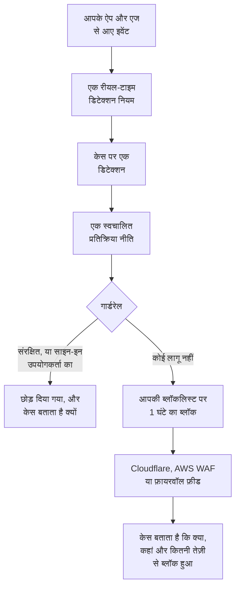

# स्वचालित प्रतिक्रिया

स्वचालित प्रतिक्रिया नीतियां डिटेक्शन होते ही, किसी के केस की छंटाई करने से पहले, हमला करने वाले पते पर चैलेंज लगाती हैं या उसे ब्लॉक करती हैं: आपके ऐप को टटोलने वाले स्कैनर और एक के बाद एक पासवर्ड आज़माने वाले बॉट अपने पहले अनुरोध के कुछ ही मिनटों में लौटा दिए जाते हैं। हर प्रोजेक्ट में तीन तैयार नीतियां आती हैं, हर एक तब तक बंद रहती है जब तक आप उसे चालू न करें, और हर एक एक हफ़्ते के ट्रायल रन से शुरू होती है जो सिर्फ़ रिकॉर्ड करता है कि वह क्या करती। गार्डरेल किसी नीति को चालू छोड़ने के लिए सुरक्षित बनाते हैं: वह आपके अपने पतों या आपके साइन-इन किए हुए उपयोगकर्ताओं के पते को कभी नहीं छूती, और जब कोई हमला उसके अकेले संभालने लायक से बड़ा हो, तो वह रुककर किसी व्यक्ति को पेज करती है।

:::cards
- [नीति चालू करें](#नीति-चालू-करें): पहले एक हफ़्ते का ट्रायल रन, फिर एक क्लिक।
- [गार्डरेल](#गार्डरेल): नीति क्या कभी नहीं करती, और कब रुकती है।
- [ब्लॉक तक का समय](#ब्लॉक-तक-का-समय): हर नीति कितनी तेज़ी से ब्लॉक करती है, उसके कार्ड पर और केस पर।
- [आपकी अपनी नीति](#आपकी-अपनी-नीति): अपनी चुनी हुई तकनीकों, नियमों या थ्रेट इंटेल पर कार्रवाई करें।
:::

## यह कैसे काम करता है

कोई नीति डिटेक्शन पर तभी कार्रवाई करती है जब वह अपने केस पर दर्ज होता है, नियम के ट्रिगर होने के कुछ सेकंड बाद। उसका ब्लॉक प्लेबुक के चरण **पता ब्लॉक करें** की तरह आपकी [ब्लॉकलिस्ट](/docs/telemetry/security-cases#ब्लॉकलिस्ट) पर जाता है, बनाने वाले के रूप में नीति के नाम के साथ: आपकी ब्लॉकलिस्ट लागू करने वाले गंतव्य उसे बनाए रखते हैं, वह केस की टाइमलाइन और ऑडिट लॉग में दिखता है, और अपने-आप समाप्त हो जाता है। उसे किसी की मंज़ूरी नहीं चाहिए: जिसने नीति चालू की, उसी ने उसके ब्लॉक मंज़ूर किए।

## शुरू करने से पहले

- एक गंतव्य जो आपकी ब्लॉकलिस्ट लागू करे: Cloudflare, AWS WAF, या कोई फ़ायरवॉल या प्रॉक्सी जो [ब्लॉकलिस्ट फ़ीड](/docs/telemetry/blocklist-feeds) पढ़ता हो। जब तक कुछ भी इसे लागू नहीं करता, पेज यह बताता है, और किसी नीति के ब्लॉक कहीं लागू नहीं होते।
- वे इवेंट जिन्हें किसी नीति के नियम पढ़ते हैं: आपके ऐप के एक्सेस लॉग या ट्रेस, या आपके एज के इवेंट, जैसे Cloudflare के फ़ायरवॉल इवेंट, और आपके साइन-इन। देखें [सुरक्षा इवेंट](/docs/telemetry/security-events)।
- एक भूमिका जो नीति चालू कर सके: सुरक्षा एडमिन, प्रोजेक्ट एडमिन या प्रोजेक्ट स्वामी। सुरक्षा सदस्य और सुरक्षा दर्शक नीतियों को और उन्होंने क्या किया, यह देख सकते हैं। देखें [भूमिकाएँ](/docs/permissions/reference#भूमिकाएँ)।

## तैयार नीतियां

| नीति | किस पर कार्रवाई | क्या करती है | पहला ब्लॉक |
| --- | --- | --- | --- |
| **स्कैनर** | वेब स्कैनिंग और एक्सप्लॉइट के प्रयास (ATT&CK T1595, T1190): SQL इंजेक्शन, पाथ ट्रैवर्सल और Log4Shell के प्रयास, और एक पते से बहुत सारे Cloudflare प्रबंधित नियम हिट, जब तक उस पते का हर अनुरोध लौटा दिया गया हो | चैलेंज करें | 1 घंटा |
| **पासवर्ड का अनुमान लगाना** | ब्रूट फ़ोर्स और पासवर्ड स्प्रेइंग (ATT&CK T1110): एक पते से विफल साइन-इन, और उसी पते से विफल साइन-इन के बाद एक सफल साइन-इन | ब्लॉक करें | 1 घंटा |
| **ज्ञात दुर्भावनापूर्ण पते** | किसी ऐसे पते के बारे में कोई भी डिटेक्शन जिसे आपका [थ्रेट इंटेल](/docs/telemetry/threat-intelligence) सूचीबद्ध करता है | ब्लॉक करें | 24 घंटे |

लोग चैलेंज पास कर लेते हैं, स्क्रिप्ट और बॉट नहीं। स्कैनर किसी पते पर सिर्फ़ तब तक चैलेंज लगाती है जब तक उसका कोई भी अनुरोध आपके ऐप तक नहीं पहुंचा हो: जिस पते के अनुरोध पहुंच गए, वह किसी व्यक्ति के लिए केस है।

स्कैनर या पासवर्ड का अनुमान लगाना चालू करने पर, ट्रायल रन में या पूरी तरह, वे **नियम लाइब्रेरी** नियम रीयल-टाइम में चलते हैं जिन पर नीति कार्रवाई करती है, और जो नियम आपके प्रोजेक्ट में नहीं हैं वे जोड़ दिए जाते हैं: रीयल-टाइम नियम इवेंट आने के कुछ सेकंड बाद ट्रिगर होता है, जबकि शेड्यूल वाला नियम कुछ मिनट पीछे पढ़ता है। जिस नियम को किसी ने बंद किया है, वह बंद रहता है। एक प्रोजेक्ट ज़्यादा से ज़्यादा 50 नियम रीयल-टाइम में चलाता है: उससे आगे कोई नियम अपने शेड्यूल पर रहता है, और नीति के कार्ड पर उसके बगल में **शेड्यूल पर** दिखता है।

## नीति चालू करें

:::steps
### स्वचालित प्रतिक्रिया खोलें

**उत्पाद → सुरक्षा इवेंट → प्लेबुक → स्वचालित प्रतिक्रिया** खोलें। हर नीति का अपना कार्ड है: वह क्या करती है, एक चिप जो **बंद**, **ट्रायल रन**, **ट्रायल पूरा हुआ** या **चालू** बताती है, और उसका स्विच।

### ट्रायल रन शुरू करें

नीति का स्विच पलटें। 7 दिन तक वह रिकॉर्ड करती है कि वह क्या करती, और किसी ट्रैफ़िक को नहीं छूती: केस कहता है "Trial run: the Scanners policy would have challenged 35.205.11.131 for 1 hour." कार्ड अब तक के पते गिनता है, और यह भी कि उसके गार्डरेल ने किन्हें छोड़ दिया।

### इसे चालू करें

हफ़्ता पूरा होने पर कार्ड बताता है कि नीति क्या करती, जैसे "7 दिनों में यह 1,283 पतों पर चैलेंज लगाती। किसी के भी साइन-इन किए हुए उपयोगकर्ता नहीं थे, और कोई भी आपका नहीं था। इसे चालू करें?", और आपके सुरक्षा ज़िम्मेदारों को यही ईमेल से मिलता है। **चालू करें** पर क्लिक करें: तब से नीति कार्रवाई करती है।
:::

किसी नीति को उसके एक हफ़्ते के ट्रायल रन के बिना चालू करने के लिए, उसके कार्ड पर **और सेटिंग्स** खोलें और **ट्रायल रन के बिना चालू करें** पर क्लिक करें। उसके गार्डरेल अब भी लागू होते हैं। नीति बंद करने के लिए स्विच फिर से पलटें; पूरे एक हफ़्ते के ट्रायल रन के बाद फिर से चालू करने पर वह तुरंत कार्रवाई करती है।

## गार्डरेल

- **आपके अपने या संरक्षित पते कभी नहीं।** **संरक्षित एंटिटीज़** की एंट्री, और वह सब कुछ जिसे OneUptime खुद संरक्षित करता है: आपके होस्ट, क्लाउड रिसोर्स और प्रोब, वे रेंज जो इंटरनेट पर नहीं हैं, और आपके ऐप के सामने का एज। देखें [ब्लॉकलिस्ट](/docs/telemetry/security-cases#ब्लॉकलिस्ट)।
- **ऐसा पता कभी नहीं जिसका उपयोग किसी साइन-इन किए हुए उपयोगकर्ता ने पिछले 30 दिनों में किया हो।** किसी दफ़्तर का नेटवर्क, किसी ग्राहक का प्रॉक्सी या किसी व्यक्ति का घर: OneUptime आपके पहचान प्रदाता के साइन-इन में और उन अनुरोधों में पता खोजता है जिन्हें आपके ऐप ने किसी साइन-इन किए हुए उपयोगकर्ता के लिए पूरा किया, यानी जिनके ट्रेस या लॉग में उपयोगकर्ता ID है। जिस पते की वह जांच नहीं कर सकता, क्योंकि वे इवेंट पढ़े नहीं जा सके या आपके स्क्रब नियम पतों को ऐसे छिपाते हैं कि वह मिलान नहीं कर सकता, उसे किसी व्यक्ति पर छोड़ दिया जाता है।
- **लौटकर आने वाले पते के लिए लंबे ब्लॉक।** पहला ब्लॉक 1 घंटे का होता है, फिर 30 दिनों के भीतर दोबारा ब्लॉक होने वाले पते के लिए 24 घंटे, फिर 7 दिन। ज्ञात दुर्भावनापूर्ण पते 24 घंटे से शुरू होती है।
- **प्रति घंटे ज़्यादा से ज़्यादा 50 स्वचालित ब्लॉक।** उससे आगे आपकी नीतियां ब्लॉक करना बंद करके आपके सुरक्षा ज़िम्मेदारों को पेज करती हैं: इतने बड़े हमले के लिए एक व्यक्ति चाहिए। जब तक ऐसा रहता है, पेज यह बताता है।
- **संदेह होने पर वापस लेना।** जब किसी नीति के ब्लॉक किए गए पते से कोई साइन-इन किया हुआ उपयोगकर्ता दिखता है, तो नीति ब्लॉक हटाती है और आपके सुरक्षा ज़िम्मेदारों को बताती है।

आपके सुरक्षा ज़िम्मेदार आपके प्रोजेक्ट के सुरक्षा एडमिन हैं, या अगर कोई नहीं है तो उसके प्रोजेक्ट स्वामी। हर पता जिसे किसी गार्डरेल ने छोड़ा, कारण के साथ उसके केस पर दर्ज है।

## जहां गंतव्य चैलेंज नहीं कर सकता

Cloudflare और AWS WAF चैलेंज करते हैं। ब्लॉकलिस्ट फ़ीड पढ़ने वाला फ़ायरवॉल नहीं कर सकता, इसलिए वहां नीति का चैलेंज उतने ही समय का ब्लॉक होता है, और नीति का कार्ड और केस यह बताते हैं, जैसे "FortiGate feed cannot challenge, so it blocks the address there for the same time." जो चैलेंज आप खुद लगाते हैं, वह कभी ब्लॉक में नहीं बदलता।

## ब्लॉक तक का समय

ब्लॉक तक का समय पते के पहले अनुरोध, यानी उसके डिटेक्शन के सबसे पुराने इवेंट, से लेकर आपके एज पर ब्लॉक लागू होने तक चलता है। हर नीति का कार्ड पिछले 30 दिनों में दिन-ब-दिन उसके 50वें और 95वें पर्सेंटाइल दिखाता है। जिस केस को स्वचालित प्रतिक्रिया ने ब्लॉक किया, वह अपने **अवलोकन** पर **नियंत्रण में लगा समय** के नीचे यह बताता है, जैसे "पहले अनुरोध के 41s बाद अपने-आप ब्लॉक किया गया", और उसकी टाइमलाइन बताती है कि क्या, कहां और कितनी तेज़ी से ब्लॉक हुआ: "OneUptime challenged 35.205.11.131 at Cloudflare for 1 hour (Scanners policy), 41 seconds after its first request." केस की **प्रतिक्रिया योजना** में पते का चरण पूरा हो जाता है, बगल में **अनब्लॉक करें** के साथ।

## आपकी अपनी नीति

तैयार नीतियों के नीचे **नीति बनाएं** पर क्लिक करें। आपकी अपनी नीति को एक **नाम** और यह चाहिए कि वह किस पर कार्रवाई करे:

| फ़ील्ड | यह क्या करता है |
| --- | --- |
| **ATT&CK तकनीकें** | वे तकनीकें जो किसी डिटेक्शन में होनी चाहिए, कॉमा से अलग, जैसे `T1110, T1190`। कोई तकनीक अपनी उप-तकनीकों को भी शामिल करती है। |
| **कार्रवाई** | **और फ़ील्ड** में: **ब्लॉक करें** या **चैलेंज करें**। |
| **पहला ब्लॉक कितनी देर** | **और फ़ील्ड** में: 1 घंटा, 24 घंटे या 7 दिन। लौटकर आने वाला पता ज़्यादा समय के लिए ब्लॉक होता है। |
| **डिटेक्शन नियम** | **और फ़ील्ड** में: या इनमें से किसी नियम का डिटेक्शन। |
| **सिर्फ़ वे पते जिन्हें आपका थ्रेट इंटेल सूचीबद्ध करता है** | **और फ़ील्ड** में: सिर्फ़ उन पतों पर कार्रवाई करती है जिन्हें आपका थ्रेट इंटेल सूचीबद्ध करता है। अकेले में, ऐसे किसी पते के बारे में किसी भी डिटेक्शन पर कार्रवाई करती है। |
| **सिर्फ़ तब तक जब तक हर अनुरोध लौटाया गया** | **और फ़ील्ड** में: सिर्फ़ तब तक कार्रवाई करती है जब तक पते का कोई भी अनुरोध आपके ऐप तक नहीं पहुंचा हो। |

आपकी अपनी नीति बंद रहकर शुरू होती है, तैयार नीति की तरह एक हफ़्ते का ट्रायल रन चलाती है, और उसके गार्डरेल वही हैं। **नीति संपादित करें** और **नीति हटाएं** उसके कार्ड पर हैं; उसे हटाने पर उसके ब्लॉक समय समाप्त होने तक आपकी ब्लॉकलिस्ट पर रहते हैं।

## समस्या निवारण

:::details नीति चालू है, लेकिन उसने किसी पते को ब्लॉक नहीं किया
केस की टाइमलाइन देखें: जिस नीति ने किसी पते को छोड़ा, वह कारण बताती है, जैसे कि किसी साइन-इन किए हुए उपयोगकर्ता ने उसका उपयोग किया था। जांचें कि कोई गंतव्य आपकी ब्लॉकलिस्ट लागू करता है, और नीति के कार्ड पर उसके नियम **रीयल-टाइम** दिखाते हैं।
:::

:::details पेज कहता है कि इस घंटे के स्वचालित ब्लॉक खत्म हो गए
आपकी नीतियों ने पिछले घंटे में 50 स्वचालित ब्लॉक किए और आपके सुरक्षा ज़िम्मेदारों को पेज किया। उस घंटे के ब्लॉक पुराने होने के साथ वे फिर शुरू होती हैं। हमले के केस देखें, और अगर हमला एक ही नेटवर्क से आता है, तो **ब्लॉकलिस्ट** से एक रेंज ब्लॉक करें।
:::

## अगले कदम

:::cards
- [सुरक्षा केस और प्लेबुक](/docs/telemetry/security-cases): उन केस पर काम करें जिन पर आपकी नीतियां कार्रवाई करती हैं, और हाथ से ब्लॉक करें।
- [ब्लॉकलिस्ट फ़ीड](/docs/telemetry/blocklist-feeds): किसी फ़ायरवॉल या प्रॉक्सी पर अपनी ब्लॉकलिस्ट लागू करें।
- [थ्रेट इंटेलिजेंस](/docs/telemetry/threat-intelligence): वे फ़ीड जिन पर ज्ञात दुर्भावनापूर्ण पते कार्रवाई करती है।
:::
