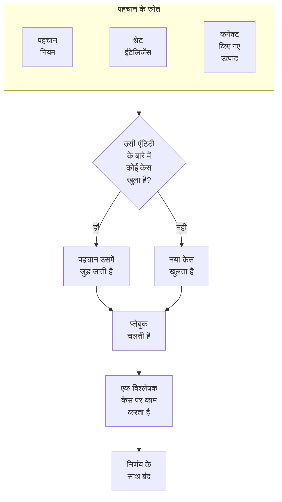

# सुरक्षा केस और प्लेबुक (SOAR)

Security Events आपके पहचान नियमों, थ्रेट इंटेलिजेंस और कनेक्ट किए गए सुरक्षा उत्पादों को जो कुछ मिलता है, उसे केस में बदल देता है: जाँचने लायक हर चीज़ के लिए एक केस, जिसमें एक ही उपयोगकर्ता, होस्ट या पते से जुड़ी हर पहचान एक साथ रखी जाती है। विश्लेषक कतार में केस पर काम करते हैं, और प्लेबुक उन पर प्रतिक्रिया देती हैं, अपने आप या एक क्लिक पर।

:::cards
- [केस कहाँ से आते हैं](#केस-कहाँ-से-आते-हैं): पहचान नियम, थ्रेट इंटेलिजेंस, कनेक्ट किए गए उत्पाद और लोग।
- [केस पर काम करें](#केस-पर-काम-करें): इसे असाइन करें, इसकी एंटिटी की जाँच करें, और निर्णय के साथ इसे बंद करें।
- [केस की प्राथमिकताएँ और स्थितियाँ](#केस-की-प्राथमिकताएँ-और-स्थितियाँ): उनके नाम, रंग और क्रम बदलें, और अपनी जोड़ें।
- [सूचनाएँ](#सूचनाएँ): नए केस, असाइनमेंट और अनुमोदन की प्रतीक्षा कर रहे चरण के बारे में किसे बताया जाता है।
- [प्लेबुक](#प्लेबुक): किसी केस पर चलने वाले चरण, जहाँ ज़रूरी हो वहाँ अनुमोदन के साथ।
- [अवलोकन](#अवलोकन): अभी किस चीज़ पर किसी का ध्यान चाहिए, और केस कितनी तेज़ी से निपटाए जाते हैं।
:::

## यह कैसे काम करता है

कतार के लिए **उत्पाद → Security Events → सुरक्षा केस → खुले केस** खोलें। **मुझे सौंपे गए**, **सौंपा नहीं गया**, **बंद केस** और **सभी केस** इसके बगल में अपने-अपने पेज हैं, और हर एक वे केस दिखाता है जो उसका नाम कहता है।

## शुरू करने से पहले

केस और प्लेबुक तीन Security भूमिकाओं के हिसाब से काम करते हैं। Project Owner और Project Admin सब कुछ कर सकते हैं।

| भूमिका | यह क्या कर सकती है |
| --- | --- |
| Security Admin | सब कुछ, केस हटाना और प्लेबुक सेट करना भी |
| Security Member | केस खोलना, असाइन करना, बदलना और बंद करना, नोट लिखना, प्लेबुक चलाना और उनके चरणों को अनुमोदित या अस्वीकार करना |
| Security Viewer | केस, पहचानें, नोट, प्लेबुक और उनके रन पढ़ना |

इनमें से हर अनुमति अलग से भी दी जा सकती है, केस बनाने से लेकर प्लेबुक के चरण अनुमोदित करने तक; देखें [अनुमति संदर्भ](/docs/permissions/reference)।

## केस कहाँ से आते हैं

| स्रोत | केस कब खुलता है | इसे किससे बंद करें |
| --- | --- | --- |
| पहचान नियम | कोई नियम मेल खाता है | नियम के **मिलान होने पर** चरण में **Open a Case on Match** |
| थ्रेट इंटेलिजेंस | कोई इवेंट किसी ज्ञात संकेतक का नाम लेता है | फ़ीड के **मिलान होने पर** चरण में **Open a Case on Match** |
| कनेक्ट किए गए उत्पाद | उत्पाद का अपना अलर्ट कनेक्शन के थ्रेशोल्ड पर या उससे ऊपर इम्पोर्ट होता है | कनेक्शन के **Polling** चरण में **Open Cases From** को **कभी नहीं** पर सेट करके |
| लोग | कोई **सुरक्षा केस** से, या किसी इवेंट के पैनल में **Open Case** से एक केस खोलता है | कोई नहीं |

हर स्रोत डिफ़ॉल्ट रूप से चालू है। कनेक्शन **उच्च और ऊपर** के लिए केस खोलता है, जब तक आप कोई दूसरा स्तर न चुनें; उससे नीचे के अलर्ट फिर भी इवेंट के रूप में इम्पोर्ट होते हैं।

### पहचानें कैसे समूहित होती हैं

हर पहचान किसी एंटिटी के बारे में होती है: वह मान जिसके हिसाब से उसका नियम समूह बनाता है, जैसे ब्रूट-फ़ोर्स नियम का IP पता, या वह संकेतक जिसका नाम थ्रेट इंटेलिजेंस का मिलान लेता है। जिस पहचान की कोई एंटिटी नहीं होती, वह अकेली रहती है।

- जब कोई खुला केस पहले से उस एंटिटी के बारे में होता है, तो पहचान उसमें जुड़ जाती है। केस की एंटिटी और ATT&CK मैपिंग बढ़ती हैं, और उसकी प्राथमिकता बढ़कर पहचान की प्राथमिकता तक पहुँच जाती है, कभी घटती नहीं।
- जब ऐसा कोई खुला केस नहीं होता, तो पहचान के नाम पर, पहचान की प्राथमिकता के साथ एक नया केस खुलता है।
- जो पहचान फिर से फ़ायर होती है, वह नई पंक्ति जोड़ने के बजाय अपनी ही पंक्ति पर गिनती बढ़ाती है।

केस की प्राथमिकता पहचान की गंभीरता से तय होती है: उस स्तर के लिए प्रोजेक्ट की बिल्ट-इन प्राथमिकता, आपने उसका नाम चाहे जो रखा हो:

| गंभीरता | प्राथमिकता |
| --- | --- |
| Critical या Fatal | Critical |
| High | High |
| Medium, Unknown या Other | Medium |
| Low | Low |
| Informational | Informational |

## केस पर काम करें

नए प्रोजेक्ट के केस चार स्थितियों से गुज़रते हैं, जिनके नाम आप बदल सकते हैं और जिनमें अपनी स्थितियाँ जोड़ सकते हैं (देखें [केस की प्राथमिकताएँ और स्थितियाँ](#केस-की-प्राथमिकताएँ-और-स्थितियाँ))। केस किसी स्थिति को छोड़ भी सकता है, जैसे New से सीधे बंद किया गया कोई फ़ॉल्स पॉज़िटिव, और उसे फिर से खोला जा सकता है।

| स्थिति | मतलब |
| --- | --- |
| New | अभी तक किसी ने इसे नहीं देखा है |
| Investigating | कोई पता लगा रहा है कि क्या हुआ |
| Contained | खतरा अब नुकसान नहीं पहुँचा सकता; सफ़ाई अभी बाकी है |
| Closed | पूरा हुआ, इस निर्णय के साथ कि यह क्या था |

केस के पेज पर उस पर काम करने के लिए सब कुछ है:

- सबसे ऊपर: **मुझे असाइन करें**, **Run Playbook**, **घटना घोषित करें** और **Close Case**, स्थिति के चरण, और उनके बगल वाले मेनू में प्राथमिकता।
- **OneUptime AI**: OneUptime AI ने केस को कैसे पढ़ा, वह कौन-सी प्राथमिकता और प्लेबुक सुझाता है, और उनके पीछे का सबूत। देखें [सुरक्षा में OneUptime AI](/docs/telemetry/security-ai)।
- **Detections**: केस खोलने या उसमें जुड़ने के लिए क्या फ़ायर हुआ, कितनी बार, और सबसे हाल का मेल खाने वाला इवेंट।
- **एंटिटीज़**: वे उपयोगकर्ता, होस्ट और पते जिनके बारे में केस है, पिछले 7 दिनों में आपके सभी सुरक्षा इवेंट में उनकी गतिविधि के साथ। हर एक **सहसंबंधित करें** में खुलती है।
- **MITRE ATT&CK**: वे टैक्टिक और तकनीकें जिनसे इसकी पहचानें मैप होती हैं, हर एक attack.mitre.org पर अपने पेज से लिंक की हुई।
- **प्लेबुक रन**: हर प्लेबुक ने केस पर चरण-दर-चरण क्या किया, और अनुमोदन की प्रतीक्षा कर रहे चरण।
- **नोट** और **टाइमलाइन**: टीम ने क्या लिखा, और जो कुछ भी हुआ, किसने किया इसके साथ।

कई केस पर एक साथ काम करने के लिए, उन्हें कतार में चुनें और **मुझे असाइन करें**, **Change Status** या **Change Priority** इस्तेमाल करें।

### केस बंद करें

**Close Case** एक निर्णय और एक वैकल्पिक समापन नोट माँगता है:

| निर्णय | मतलब |
| --- | --- |
| True Positive | दुर्भावनापूर्ण या अनधिकृत गतिविधि सच में हुई |
| Benign Positive | गतिविधि असली थी लेकिन अपेक्षित, जैसे कोई पेनिट्रेशन टेस्ट या कोई एडमिन कार्य |
| False Positive | पहचान गलत थी: नियम या डेटा ने सामान्य गतिविधि को गलत समझा |
| Undetermined | यह तय करने के लिए पर्याप्त जानकारी नहीं थी |

निर्णय अवलोकन पर गिने जाते हैं। जिस नियम के केस बार-बार False Positive के रूप में बंद होते हैं, उस नियम को ट्यून करना चाहिए।

Google SecOps अलर्ट से खुला केस, अगर उसके कनेक्शन पर **केस बंद होने पर उसके अलर्ट बंद करें** चालू है, तो उन्हें Google SecOps में भी निर्णय और बंद करने वाले नोट के साथ बंद कर देता है: [Google SecOps](/docs/integrations/google-secops#केस-बंद-होने-पर-उसके-अलर्ट-बंद-करें) देखें।

### घटना घोषित करें

**घटना घोषित करें** केस के लिए, आपकी चुनी गंभीरता पर, एक OneUptime घटना खोलता है, और दोनों को दोनों तरफ़ से जोड़ता है: घटना के विवरण में केस का नाम होता है, और केस का हेडर घटना से लिंक करता है। वहाँ से ऑन-कॉल, स्टेटस पेज और पोस्टमॉर्टम काम सँभाल लेते हैं। इसके लिए ऐसी भूमिका चाहिए जो केस पर काम भी कर सके और घटनाएँ भी बना सके।

## केस की प्राथमिकताएँ और स्थितियाँ

हर प्रोजेक्ट की अपनी केस प्राथमिकताएँ और स्थितियाँ होती हैं, **उत्पाद → Security Events → सेटिंग्स → केस प्राथमिकताएं** और **केस स्थितियां** में। उनके नाम और रंग बदलें, उन्हें खींचकर दूसरे क्रम में रखें, और अपनी जोड़ें, जैसे "Triage" स्थिति या **गंभीर** से ऊपर "Emergency" प्राथमिकता। नया नाम हर जगह एक साथ दिखता है: कतार में, केस पेजों और ओवरव्यू पर, सूचनाओं में, Slack और Microsoft Teams में, और प्लेबुक संदेशों में।

कुछ बिल्ट-इन हैं, क्योंकि OneUptime पढ़ता है कि उनका मतलब क्या है। उनके नाम और रंग बदले जा सकते हैं, पर उन्हें हटाया या संग्रहित नहीं किया जा सकता, और उनका क्रम बना रहता है:

| बिल्ट-इन | OneUptime उसके साथ क्या करता है |
| --- | --- |
| नई स्थिति | नए केस इसी में शुरू होते हैं |
| स्वीकृत स्थिति | इस तक पहुँचने पर दर्ज होता है कि केस कब स्वीकार किया गया, और **Reopen** बंद केस को वापस इसी में ले आता है |
| नियंत्रित स्थिति | इस तक पहुँचने पर दर्ज होता है कि केस कब नियंत्रित हुआ |
| बंद स्थिति | **Close Case** केस को निर्णय के साथ इसमें ले जाता है |
| Critical, High, Medium, Low और Informational प्राथमिकताएँ | पहचान अपना केस अपनी गंभीरता की प्राथमिकता पर खोलती है, और किसी व्यक्ति का खोला केस Medium से शुरू होता है |

- स्थिति कहाँ है, इससे तय होता है कि उसमें मौजूद केस किस रूप में गिना जाता है, जैसा **माना जाता है** कॉलम दिखाता है: स्वीकृत स्थिति से नीचे स्वीकृत, नियंत्रित स्थिति से नीचे नियंत्रित, और बंद स्थिति से नीचे बंद। आपकी जोड़ी स्थिति बंद स्थिति के ठीक ऊपर आती है, और केस को ऐसी स्थिति में ले जाने पर जो उसे बंद करती है, पहले निर्णय पूछा जाता है।
- प्राथमिकता का स्थान उसकी तात्कालिकता है, सबसे ज़रूरी पहले: **For Cases At Least**, सूचना के विकल्प और Slack व Microsoft Teams के नियम इसी क्रम को पढ़ते हैं। आपकी जोड़ी प्राथमिकता अंत में जाती है, और **डिटेक्शन की गंभीरता** कॉलम दिखाता है कि कौन-सी पहचानें हर बिल्ट-इन प्राथमिकता पर अपने केस खोलती हैं।

अपनी बनाई किसी स्थिति या प्राथमिकता का इस्तेमाल बंद करने के लिए, उसकी पंक्ति में **संग्रहित करें** इस्तेमाल करें। फिर कोई उसे दोबारा नहीं चुन सकता, और API, Terraform और MCP उसे अस्वीकार करते हैं, पर जिन केस में वह है वे उसे रखते हैं, और आप अब भी उससे फ़िल्टर कर सकते हैं। संग्रहीत मान तालिका के नीचे मुड़े हुए **संग्रहीत केस स्थितियां** या **संग्रहीत केस प्राथमिकताएं** सेक्शन में दिखते हैं, जहाँ **अनसंग्रहीत करें** किसी एक को वापस लाता है। जब तक केस में वह मान है या कोई प्लेबुक उस प्राथमिकता से चलती है, **हटाएं** अस्वीकार होता है।

## सूचनाएँ

OneUptime किसी केस पर तीन चीज़ों के बारे में लोगों को बताता है। किसी को कुछ भी सेट नहीं करना पड़ता: जिस प्रोजेक्ट ने सिर्फ़ **सुझाए गए चालू करें** पर क्लिक किया है, उसे भी अपने High और Critical केस के बारे में ईमेल और पुश से पता चलता है।

| सूचना | किसे बताया जाता है | डिफ़ॉल्ट रूप से |
| --- | --- | --- |
| नया सुरक्षा केस | हर वह व्यक्ति जो प्रोजेक्ट के केस देख सकता है, जब कोई केस उसकी चुनी हुई प्राथमिकता या उससे ऊपर खुलता है, या उस तक बढ़ता है | ईमेल और पुश, High और Critical केस के लिए |
| मुझे सौंपा गया सुरक्षा केस | वह व्यक्ति जिसे केस असाइन है, और उस टीम के सदस्य जिसे वह असाइन है | ईमेल और पुश |
| मेरी स्वीकृति की प्रतीक्षा में प्लेबुक चरण | केस के वे लोग जो चरण को अनुमोदित कर सकते हैं: वह व्यक्ति जिसे केस असाइन है, और उसकी टीम के सदस्य। जब उनमें से कोई अनुमोदन नहीं कर सकता, तो प्रोजेक्ट में हर वह व्यक्ति जो कर सकता है | ईमेल और पुश |

- केस के बारे में सिर्फ़ उन्हीं लोगों को बताया जाता है जो उसे देख सकते हैं: Project Owner, Project Admin, और Security Admin, Security Member और Security Viewer भूमिकाएँ। कुछ लेबल तक सीमित भूमिका को सिर्फ़ उन लेबल वाले केस के बारे में बताया जाता है।
- किसी को उसके अपने किए काम के बारे में नहीं बताया जाता: जो व्यक्ति हाथ से केस खोलता है, उसे असाइन करता है या कोई रन शुरू करता है, उसे इसकी सूचना नहीं मिलती।
- हर व्यक्ति को किसी केस के बारे में एक ही बार पता चलता है। जो केस Medium पर खुलता है और बाद में Critical तक बढ़ता है, वह बढ़ने पर उन लोगों तक पहुँचता है जिन्होंने High या Critical चुना था, और उन लोगों तक दोबारा नहीं पहुँचता जिन्होंने Medium चुना था, क्योंकि उन्हें केस खुलते ही पता चल गया था।
- **टेस्ट हमला भेजें** से भेजा गया टेस्ट हमला ऐसा केस खोलता है जिसकी सूचना किसी को नहीं जाती।
- Critical केस और अनुमोदन की प्रतीक्षा कर रहा चरण तुरंत भेजे जाते हैं, उन्हें कभी किसी [ईमेल सारांश](/docs/emails/notification-rollup) में रोका नहीं जाता।
- केस की **टाइमलाइन** बताती है कि किसे बताया गया, और कब।

### चुनें कि आपको किस बारे में बताया जाए

हर व्यक्ति अपने लिए खुद चुनता है, **उपयोगकर्ता सेटिंग्स → सूचना सेटिंग्स → सुरक्षा** में: हर सूचना के चैनल (ईमेल, SMS, कॉल, पुश, Telegram, Slack, Microsoft Teams या वेबहुक), और **नया सुरक्षा केस** के नीचे, वह प्राथमिकता जिस पर उसे सूचना मिलती है:

| विकल्प | किन केस के बारे में सूचित करता है |
| --- | --- |
| केवल गंभीर | Critical |
| उच्च और ऊपर | Critical और High (डिफ़ॉल्ट) |
| मध्यम और ऊपर | Critical, High और Medium |
| निम्न और ऊपर | Informational को छोड़कर हर प्राथमिकता |
| हर केस | हर प्राथमिकता |

विकल्प प्रोजेक्ट की केस प्राथमिकताओं के हिसाब से, उनके अपने नामों के साथ आते हैं: ये नए प्रोजेक्ट के विकल्प हैं।

सुरक्षा केस के लिए WhatsApp संदेश नहीं भेजे जाते। पुश सूचना OneUptime ऐप खोलती है, और उसका लिंक केस को ब्राउज़र में खोलता है।

### Slack और Microsoft Teams चैनलों पर पोस्ट करें

किसी चैनल पर पोस्ट करने के लिए, **उत्पाद → Security Events → वर्कस्पेस → Slack** (या **Microsoft Teams**) के अंदर एक नियम जोड़ें। जब दोनों में से कोई भी कनेक्ट न हो, तो इस सेक्शन में सिर्फ़ एक प्रविष्टि होती है: **Slack या Teams कनेक्ट करें**। नियम बताता है कि किन चैनलों पर पोस्ट करना है (और, Microsoft Teams में, किन चैट में) और, अगर आप चाहें, तो वह किन केस के लिए है:

| शर्त | किससे मेल खाती है |
| --- | --- |
| सुरक्षा केस की प्राथमिकता | प्रोजेक्ट की केस प्राथमिकताओं में से कोई एक, जैसे Critical या High |
| सुरक्षा केस का शीर्षक, सुरक्षा केस का विवरण | वह टेक्स्ट जो केस के शीर्षक या विवरण में है, या जिससे वह शुरू या खत्म होता है |
| सुरक्षा केस की स्थिति | प्रोजेक्ट की केस स्थितियों में से कोई एक, जैसे New या Closed |
| सुरक्षा केस का स्रोत | Detection Rule, Threat Intel, Connected Product या Manual |
| सुरक्षा केस के लेबल | केस के लेबल |

तीनों सूचनाएँ उस समय केस से मेल खाने वाले हर नियम के चैनलों पर पोस्ट होती हैं। जिस नियम में **सुरक्षा केस की प्राथमिकता** में **गंभीर** और **High** में से कोई भी शामिल है, वह High और Critical केस खुलते ही पोस्ट करता है, और Medium केस तब, जब वह High तक बढ़ता है। किसी सुरक्षा केस को कभी अपना अलग चैनल नहीं मिलता।

## प्लेबुक

प्लेबुक चरणों की एक सूची है जो किसी केस पर चलते हैं। इसे **उत्पाद → Security Events → Playbooks** के अंदर किसी टेम्पलेट से या खाली बनाएँ, और इसके पेज पर इसके चरण जोड़ें।

### प्लेबुक कब चलती है

| रन | कब |
| --- | --- |
| Case Opened | एक बार, जब केस खुलता है |
| Detection Added | हर बार जब कोई नई पहचान किसी खुले केस में जुड़ती है |
| संभवतः दुर्भावनापूर्ण के रूप में ट्राइएज किया गया | एक बार, जब OneUptime AI का ट्राइएज केस को संभवतः दुर्भावनापूर्ण पढ़ता है |
| Manual | सिर्फ़ तब, जब कोई इसे किसी केस से चलाता है |

कोई भी सक्षम प्लेबुक किसी केस पर **Run Playbook** से हाथ से भी चलाई जा सकती है। अपने आप चलने वाली प्लेबुक का दायरा सीमित किया जा सकता है:

- **For Cases At Least**: सिर्फ़ इस प्राथमिकता या उससे ऊँची प्राथमिकता वाले केस।
- **Only For Detections From**: सिर्फ़ तब, जब केस के पीछे की पहचान इस स्रोत से आई हो।
- **Only For These Detection Rules**: सिर्फ़ तब, जब वह इनमें से किसी एक नियम से आई हो।

अक्षम प्लेबुक न अपने आप चलती है, न हाथ से।

### चरण

| श्रेणी | चरण | यह क्या करता है |
| --- | --- | --- |
| Case | Assign the case | केस को किसी व्यक्ति, किसी टीम, या दोनों को सौंपता है |
| Case | Set the priority | केस की प्राथमिकता बढ़ाता या घटाता है |
| Case | Set the status | केस को प्रोजेक्ट की किसी दूसरी स्थिति में ले जाता है, और अगर वह स्थिति केस को बंद करती है तो आपका चुना निर्णय लगाता है |
| Case | Add a note | केस पर एक नोट लिखता है, जैसे विश्लेषक के लिए एक चेकलिस्ट |
| Case | Add labels | केस को लेबल से टैग करता है |
| Investigate | Check entities against threat intel | हर एंटिटी को आपके थ्रेट इंटेलिजेंस में खोजता है, और मिलान होने पर प्राथमिकता बढ़ा सकता है |
| Investigate | Look up entity activity | हाल की एक विंडो में हर एंटिटी के सुरक्षा इवेंट गिनता है, और इसे केस पर नोट करता है |
| Notify | Email people | उपयोगकर्ताओं और टीमों को केस का सारांश, उसके लिंक के साथ, ईमेल करता है |
| Notify | Post to Slack | केस का सारांश किसी Slack चैनल पर पोस्ट करता है |
| Notify | Post to Microsoft Teams | केस का सारांश किसी Microsoft Teams चैनल पर पोस्ट करता है |
| Escalate | Page on-call | एक ऑन-कॉल नीति चलाता है |
| Escalate | Declare an incident | केस से लिंक की हुई एक OneUptime घटना खोलता है |
| Contain | Suspend the user in Okta | जिस उपयोगकर्ता के बारे में केस है, उसे Okta में निलंबित करता है |
| Contain | End the user's Okta sessions | जिस उपयोगकर्ता के बारे में केस है, उसे Okta से साइन आउट करता है और उसके टोकन रद्द करता है |
| Contain | Contain the host in CrowdStrike | जिस होस्ट के बारे में केस है, उसे CrowdStrike Falcon से नेटवर्क से अलग (कंटेन) करता है |
| Contain | Isolate the device in Microsoft Defender | जिस होस्ट के बारे में केस है, उसे Microsoft Defender for Endpoint से आइसोलेट करता है |
| Contain | Unsuspend the user in Okta | जिस उपयोगकर्ता के बारे में केस है, उसका Okta में निलंबन हटाता है |
| Contain | Lift containment in CrowdStrike | जिस होस्ट के बारे में केस है, उससे CrowdStrike Falcon का नेटवर्क कंटेनमेंट हटाता है |
| Contain | Release the device in Microsoft Defender | जिस होस्ट के बारे में केस है, उसे Microsoft Defender for Endpoint में आइसोलेशन से मुक्त करता है |
| Automate | Send a webhook | केस को JSON के रूप में किसी URL पर पोस्ट करता है |
| Automate | Run a workflow | केस को इनपुट बनाकर एक OneUptime वर्कफ़्लो शुरू करता है |

एक प्लेबुक में ज़्यादा से ज़्यादा 25 चरण होते हैं। वे क्रम से चलते हैं, हर चरण अपने से पिछले चरण के पूरा होने के बाद। हर चरण यह भी कर सकता है:

- **Needs Approval**: रन को चरण से पहले तब तक रोकना, जब तक कोई केस पर उसे अनुमोदित न कर दे। किसी की पहुँच काटने वाले चार चरण हमेशा ऐसा करते हैं, जब तक कोई Security Admin इसे बंद न कर दे।
- **Only If Threat Intel Matched**: चरण को छोड़ देना, जब तक रन के किसी पिछले **Check entities against threat intel** चरण को कोई ज्ञात संकेतक न मिला हो।
- **Carry On If It Fails**: यह चरण विफल हो जाए, तब भी अगला चरण चलाना। बंद होने पर, विफल चरण रन को रोक देता है।

### रोकथाम

Contain चरण उत्पाद से बने [सुरक्षा इवेंट कनेक्शन](/docs/telemetry/security-events#किसी-सुरक्षा-उत्पाद-को-कनेक्ट-करें) के ज़रिए काम करते हैं, जिसे सिर्फ़ पढ़ने की पहुँच से ज़्यादा चाहिए:

| चरण | कनेक्शन | क्या चाहिए |
| --- | --- | --- |
| Suspend the user in Okta, End the user's Okta sessions, Unsuspend the user in Okta | Okta System Log | उपयोगकर्ताओं को प्रबंधित करने की अनुमति वाला API टोकन |
| Contain the host in CrowdStrike, Lift containment in CrowdStrike | CrowdStrike Falcon | Hosts write स्कोप वाला API क्लाइंट |
| Isolate the device in Microsoft Defender, Release the device in Microsoft Defender | Microsoft Defender XDR | Machine.Isolate अनुमति वाला ऐप |

Contain चरण सिर्फ़ उन उपयोगकर्ताओं या होस्ट पर काम करता है जिनके बारे में केस है, उन सब पर कभी नहीं जिनका नाम केस में आता है:

- वह मान जिसके हिसाब से केस की कोई पहचान समूहित होती है, जैसे वह खाता जिसके हिसाब से कोई असंभव-यात्रा नियम समूह बनाता है, या वह होस्ट जिसका नाम किसी कनेक्ट किए गए उत्पाद का अलर्ट लेता है।
- केस का कोई उपयोगकर्ता या होस्ट जिसे आपका थ्रेट इंटेलिजेंस संकेतक के रूप में जानता है।

किसी पते पर समूहित केस, जैसे आपके VPN पर ब्रूट-फ़ोर्स हमला, इन दोनों में से किसी के बारे में नहीं होता: उसके Contain चरण छोड़ दिए जाते हैं, और जिस खाते को उसने आज़माया और जिस गेटवे को निशाना बनाया, उन्हें छुआ नहीं जाता। एक चरण ज़्यादा से ज़्यादा 10 उपयोगकर्ताओं या होस्ट पर काम करता है। यह हर एक को उत्पाद में नाम से ढूँढता है, और रन पर बताता है कि उसने हर एक के साथ क्या किया: हो गया, पहले से हो चुका था, नहीं मिला, अस्वीकार हुआ, या सुरक्षित।

#### सुरक्षित एंटिटी

मेनू में **Playbooks** के अंदर **Protected Entities** उन उपयोगकर्ताओं और होस्ट को दिखाता है जिन्हें कोई प्लेबुक कंटेन नहीं करती, जैसे ब्रेक-ग्लास खाते, डोमेन कंट्रोलर और VPN गेटवे। किसी मान का मिलान बड़े-छोटे अक्षरों का अंतर किए बिना होता है, और `*` अक्षरों के किसी भी क्रम की जगह लेता है: `svc-*` हर सर्विस खाते को सुरक्षित रखता है। चरण किसी सुरक्षित उपयोगकर्ता या होस्ट को सुरक्षित बताता है और उसे छूता नहीं। यह सूची Security Admin सँभालते हैं।

#### अनुमोदन

किसी की पहुँच काटने वाले चार चरण अनुमोदन की प्रतीक्षा करते हैं। सिर्फ़ कोई Security Admin ही इनमें से किसी चरण के लिए **Needs Approval** बंद कर सकता है, और OneUptime दर्ज करता है कि किसने बंद किया। अनुमोदन में चरण जिन उपयोगकर्ताओं या होस्ट पर काम करेगा, वे **Act On** के अंदर दिखते हैं, हर एक पर टिक लगा होता है: जिसे चरण को नहीं छूना चाहिए, उसका टिक हटा दें। सुरक्षित उपयोगकर्ता या होस्ट चुनने के लिए नहीं दिखाए जाते। जिसने रन शुरू किया, वह उसके चरणों को अनुमोदित नहीं कर सकता: यह कोई और करता है, हालाँकि वह उन्हें फिर भी अस्वीकार कर सकता है।

#### पूर्ववत करें

पूर्ववत करने वाले चरण, उन चरणों की तरह जिन्हें वे पूर्ववत करते हैं, उन उपयोगकर्ताओं या होस्ट पर काम करते हैं जिनके बारे में केस है। रन रुकने के बाद, कंटेन किए गए उपयोगकर्ता या होस्ट के चरण पर उसका अपना एक बटन भी होता है: **Unsuspend**, **Lift Containment** या **रिलीज़**। खत्म किया गया Okta सेशन पूर्ववत नहीं किया जा सकता। हर पूर्ववत कार्रवाई केस की टाइमलाइन पर और प्रोजेक्ट के ऑडिट लॉग में सहेजी जाती है।

### संदेश

नोट, ईमेल, Slack पोस्ट और Teams पोस्ट केस के मान इस्तेमाल कर सकते हैं:

| प्लेसहोल्डर | किसमें बदलता है |
| --- | --- |
| `{{case.number}}` | केस नंबर, जैसे CASE-42 |
| `{{case.title}}` | केस का शीर्षक |
| `{{case.priority}}` | केस की प्राथमिकता, उसी नाम से जो आपका प्रोजेक्ट देता है, जैसे High |
| `{{case.status}}` | केस की स्थिति, उसी नाम से जो आपका प्रोजेक्ट देता है, जैसे Investigating |
| `{{case.assignee}}` | केस किसे असाइन है |
| `{{case.url}}` | OneUptime में केस का लिंक |
| `{{case.entities}}` | वे उपयोगकर्ता, होस्ट और पते जिनके बारे में केस है |
| `{{case.detections}}` | केस में कितनी पहचानें हैं |

जिस ईमेल या पोस्ट का अपना कोई संदेश नहीं होता, वह केस का सारांश भेजता है।

### रन और अनुमोदन

हर रन अपने केस पर और **उत्पाद → Security Events → Playbooks → प्लेबुक रन** के अंदर, चरण-दर-चरण, सूचीबद्ध होता है:

| रन की स्थिति | मतलब |
| --- | --- |
| Queued | किसी वर्कर की प्रतीक्षा में |
| Running | अपने चरण चला रहा है |
| Waiting for Approval | ऐसे चरण से पहले रुका है जिसे अनुमोदन चाहिए |
| Succeeded | हर चरण चला, या छोड़ा गया |
| Failed | एक चरण विफल हुआ और रन रुक गया |
| Cancelled | किसी ने इसे रद्द किया, या किसी चरण को अस्वीकार किया |

अनुमोदन की प्रतीक्षा कर रहा चरण रन पर **Approve** और **Reject** दिखाता है, एक वैकल्पिक टिप्पणी के साथ। अनुमोदन करने पर रन उसी चरण से आगे बढ़ता है; अस्वीकार करने पर वह खत्म हो जाता है। फ़ैसला, किसने लिया और उनकी टिप्पणी, चरण पर, केस की टाइमलाइन पर और प्रोजेक्ट के ऑडिट लॉग में सहेजे जाते हैं। मेनू में **Playbooks** के अंदर **स्वीकृति की प्रतीक्षा में** फ़ैसले का इंतज़ार कर रहे रन दिखाता है और उन्हें गिनता है; **प्लेबुक रन** हर रन दिखाता है।

जिस रन को अपने वर्कर से कोई खबर मिलनी बंद हो जाए, जैसे किसी रीस्टार्ट के बाद, उसे फिर से उठाया जाता है: कतार में लगा रन 2 मिनट बाद फिर से कतार में लगता है, और जिस रन से 30 मिनट तक कोई खबर नहीं आई, उसे विफल कर दिया जाता है।

## अवलोकन

**उत्पाद → Security Events → अवलोकन** वह पेज है जिस पर यह उत्पाद खुलता है:

- आपको असाइन किए गए खुले केस, वे खुले केस जिन्हें अभी तक किसी ने नहीं उठाया, और अनुमोदन की प्रतीक्षा कर रहे प्लेबुक चरण; हर गिनती उन्हें दिखाने वाला पेज खोलती है।
- **स्वीकार करने का औसत समय**, **रोकथाम का औसत समय** और **बंद करने का औसत समय**, पिछले 30 दिनों में खुले केस पर: केस खुलने से लेकर किसी के उसे अपने हाथ में लेने (किसी व्यक्ति को असाइन करना, या उसे ऐसी स्थिति में ले जाना जो स्वीकृत मानी जाती है) तक, नियंत्रित मानी जाने वाली स्थिति तक, और बंद मानी जाने वाली स्थिति तक। जो केस अभी भी प्रतीक्षा में है, वह किसी औसत में नहीं गिना जाता।
- 30 दिनों तक हर दिन खुले केस, प्राथमिकता के हिसाब से, और 14 दिनों तक हर दिन बनी पहचानें, स्रोत के हिसाब से।
- प्राथमिकता और स्थिति के हिसाब से खुले केस, पिछले 30 दिनों के निर्णय, केस के पीछे के ATT&CK टैक्टिक, सबसे ज़्यादा फ़ायर हुई पहचानें, और सबसे ज़्यादा निष्कर्षों में आने वाली एंटिटी।

इनके ऊपर एक पट्टी दिखाती है कि सुरक्षा कैसे सेट है: उसके स्रोत, पहचान, केस और प्लेबुक, हर एक अपने आंकड़ों के साथ। जिस प्रोजेक्ट ने इसे अभी सेट नहीं किया है, उसे वहाँ **सुझाए गए चालू करें** और **टेस्ट हमला भेजें** दिखते हैं; [सुरक्षा के साथ शुरुआत](/docs/telemetry/security-getting-started) देखें। जब किसी को कुछ करने की ज़रूरत नहीं होती, तो पेज **सब शांत है** कहता है, और दिखाने को कुछ होते ही चार्ट दिखाई देते हैं।

## खतरे खोजें

- **एंटिटीज़** उन उपयोगकर्ताओं, होस्ट, पतों और हैश को रैंक करता है जिन्हें आपके निष्कर्ष पिछले दिन, हफ़्ते या महीने में सबसे ज़्यादा बार नाम से बताते हैं, और किसी भी मान को 30 दिनों के इवेंट में खोजता है।
- **Rule Library** में आइडेंटिटी, एंडपॉइंट, क्लाउड, नेटवर्क, वेब और Kubernetes खतरों के लिए तैयार पहचान नियम हैं। हर एक Sigma नियम है, उन फ़ील्ड के लिए लिखा गया जिनमें हर कनेक्ट किया गया स्रोत सामान्यीकृत किया जाता है। हर नियम की पंक्ति बताती है कि वह क्या ढूंढता है, उस पर लगे MITRE ATT&CK टैक्टिक और तकनीकें, वह कौन से इवेंट पढ़ता है और पिछले 7 दिनों में उनमें से कोई आया या नहीं (**मिल रहे हैं** या **नहीं मिल रहे**), और उसकी गंभीरता। सूची को श्रेणी से, नियमों के पढ़े जाने वाले डेटा से और इस आधार पर सीमित करें कि आपने उन्हें जोड़ा है या नहीं, या उसमें नाम, ATT&CK तकनीक या गंभीरता से खोजें; पेज का पता फ़िल्टर बनाए रखता है। किसी नियम का विवरण देखने के लिए उसे चुनें: उसके पढ़े जाने वाले इवेंट भेजना कैसे शुरू करें, वह कैसे चलता है, और उसका Sigma नियम। **जोड़ें** इसे आपके अपने पहचान नियम के रूप में बनाता है, चालू, और अलर्ट के बजाय केस खोलने वाला; इसे किसी भी दूसरे नियम की तरह **Detection Rules** के अंदर बदलें। **सुझाए गए** चिह्न वाले नियम उस डेटा में खतरे ढूंढते हैं जो OneUptime के पास पहले से है, और एक बटन वे नियम जोड़ देता है जो आपके पास अभी नहीं हैं।
- **ATT&CK Coverage** MITRE ATT&CK मैट्रिक्स दिखाता है, जिसमें आपके सक्षम नियमों से कवर होने वाली तकनीकें हाइलाइट होती हैं, और जिन तकनीकों को लाइब्रेरी का कोई नियम कवर करेगा, उनकी सिर्फ़ रूपरेखा दिखती है। किसी तकनीक को चुनें, ताकि उसे कवर करने वाले लाइब्रेरी के नियम दिखें, और **Rule Library** को उन्हीं नियमों पर खोलें।

## स्वचालित करें

- **वर्कफ़्लो**: कोई केस या नोट बनाए, अपडेट किए या हटाए जाने पर वर्कफ़्लो शुरू कर सकता है। **Run a workflow** चरण ऐसा वर्कफ़्लो शुरू करता है जिसका ट्रिगर एक वेबहुक है।
- **API**: केस, नोट, पहचानों, प्लेबुक, रन, सुरक्षित एंटिटी और केस की प्राथमिकताओं और स्थितियों का वही REST API है जो बाकी OneUptime का है, `/security-case`, `/security-case-note`, `/security-detection`, `/security-playbook`, `/security-playbook-run`, `/security-protected-entity`, `/security-case-priority` और `/security-case-status` के अंदर। देखें [API संदर्भ](/docs/api-reference/api-reference)।
- AI एजेंट: MCP सर्वर में केस, नोट, पहचानों, प्लेबुक और केस की प्राथमिकताओं और स्थितियों के लिए टूल हैं। देखें [MCP सर्वर](/docs/ai/mcp-server)।
- Terraform: `oneuptime_security_case_priority` और `oneuptime_security_case_status` रिसोर्स प्रोजेक्ट की प्राथमिकताओं और स्थितियों को कोड के रूप में रखते हैं।

## समस्या निवारण

:::details नियम मेल खाता है, लेकिन कोई केस नहीं खुलता
नियम के **मिलान होने पर** चरण में **Open a Case on Match** जाँचें। जिस एंटिटी का पहले से कोई खुला केस है, उसके बारे में पहचान दूसरा केस खोलने के बजाय उसी केस में जुड़ जाती है: उसे खुले केस पर **Detections** के अंदर ढूँढें।
:::

:::details किसी केस के बारे में किसी को नहीं बताया गया
केस की **टाइमलाइन** देखें, जो बताती है कि किसे सूचित किया गया। **नया सुरक्षा केस** सूचना उन लोगों को जाती है जिनकी चुनी हुई प्राथमिकता तक केस पहुँचता है, इसलिए Medium केस उनमें से किसी को सूचित नहीं करता जिन्होंने डिफ़ॉल्ट, **उच्च और ऊपर**, रहने दिया है। जाँचें कि जिन लोगों को पता चलना चाहिए वे सुरक्षा केस देख सकते हैं (कोई Security भूमिका, या Project Owner या Project Admin), और उनके लिए **उपयोगकर्ता सेटिंग्स → सूचना सेटिंग्स → सुरक्षा** में यह सूचना चालू है।
:::

:::details प्लेबुक नहीं चली
जाँचें कि वह सक्षम है, कि उसकी **ट्रिगर** सेटिंग सही है (Case Opened एक बार चलती है, जब केस खुलता है), और कि केस उसकी **For Cases At Least**, **Only For Detections From** और **Only For These Detection Rules** सेटिंग्स पर खरा उतरता है। हाथ से खोले गए केस की कोई पहचान नहीं होती, इसलिए किसी स्रोत या नियमों तक सीमित प्लेबुक उस पर नहीं चलती।
:::

:::details कोई Contain चरण विफल हुआ
केस पर रन खोलें: चरण हर उपयोगकर्ता या होस्ट के लिए बताता है कि उत्पाद ने उसे अस्वीकार किया, उसे नहीं ढूँढ पाया, या उत्पाद तक पहुँचा नहीं जा सका। जाँचें कि कनेक्शन का क्रेडेंशियल यह बदलाव कर सकता है, और उसकी पंक्ति में **कनेक्शन का परीक्षण करें** इस्तेमाल करें।
:::

:::details कोई Contain चरण छोड़ दिया गया
केस किसी उपयोगकर्ता या होस्ट के बारे में नहीं है, उदाहरण के लिए सिर्फ़ किसी पते के बारे में है, या जिन उपयोगकर्ताओं या होस्ट के बारे में वह है, वे सभी सुरक्षित हैं। केस पर रन खोलें: चरण बताता है कि इनमें से कौन-सी बात है।
:::

:::details किसी स्थिति या प्राथमिकता को हटाया या संग्रहित नहीं किया जा सकता
बिल्ट-इन मान का नाम और रंग बदला जा सकता है, पर उसे कभी हटाया या संग्रहित नहीं किया जा सकता: उसका **संग्रहित करें** कारण के साथ लॉक रहता है। आपका अपना मान तब तक नहीं हटाया जा सकता जब तक केस में वह है या कोई प्लेबुक उससे चलती है: पहले केस को किसी दूसरे मान पर ले जाएँ, या उसे संग्रहित करें।
:::

## अगले कदम

:::cards
- [सुरक्षा इवेंट](/docs/telemetry/security-events): इवेंट भेजें, पहचान नियम लिखें और सुरक्षा उत्पाद कनेक्ट करें।
- [थ्रेट इंटेलिजेंस](/docs/telemetry/threat-intelligence): अपने इवेंट का STIX/TAXII फ़ीड से मिलान करें।
- [सुरक्षा में OneUptime AI](/docs/telemetry/security-ai): AI से केस का ट्राइएज करें, पहचान नियमों का मसौदा बनाएँ, और सुरक्षा के बारे में पूछें।
- [अनुमति संदर्भ](/docs/permissions/reference): Security भूमिकाएँ, और हर एक क्या कर सकती है।
:::
