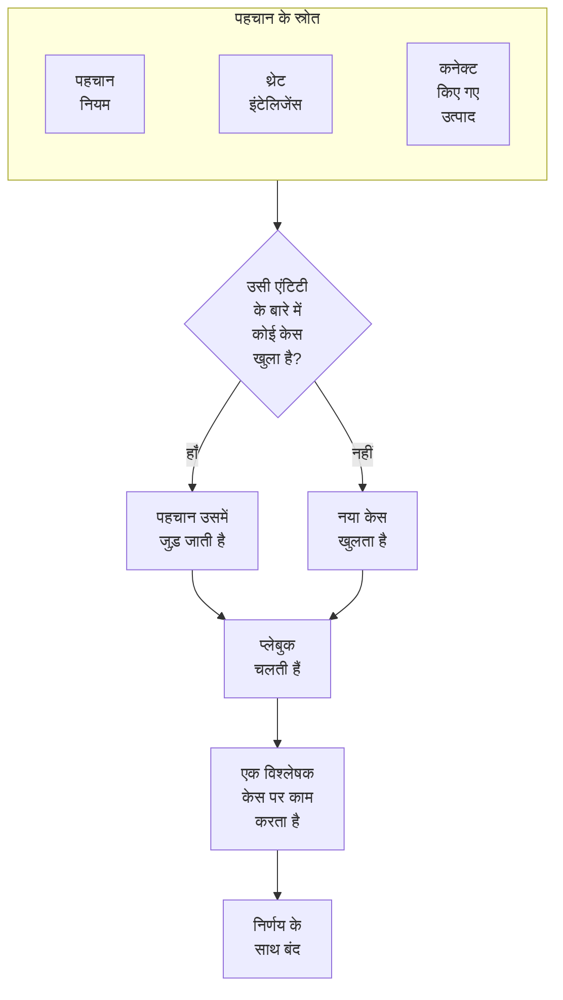

# सुरक्षा केस और प्लेबुक (SOAR)

सुरक्षा इवेंट आपके पहचान नियमों, थ्रेट इंटेलिजेंस और कनेक्ट किए गए सुरक्षा उत्पादों को जो कुछ मिलता है, उसे केस में बदल देता है: जाँचने लायक हर चीज़ के लिए एक केस, जिसमें एक ही उपयोगकर्ता, होस्ट या पते से जुड़ी हर पहचान एक साथ रखी जाती है। विश्लेषक क्यू में केस पर काम करते हैं, और प्लेबुक उन पर प्रतिक्रिया देती हैं, अपने आप या एक क्लिक पर।

:::cards
- [केस कहाँ से आते हैं](#केस-कहाँ-से-आते-हैं): पहचान नियम, थ्रेट इंटेलिजेंस, कनेक्ट किए गए उत्पाद, एंटिटी जोखिम और लोग।
- [केस पर काम करें](#केस-पर-काम-करें): इसे असाइन करें, इसकी एंटिटी की जाँच करें, और निर्णय के साथ इसे बंद करें।
- [केस की प्राथमिकताएँ और स्थितियाँ](#केस-की-प्राथमिकताएँ-और-स्थितियाँ): उनके नाम, रंग और क्रम बदलें, और अपनी जोड़ें।
- [प्रतिक्रिया लक्ष्य](#प्रतिक्रिया-लक्ष्य): हर प्राथमिकता वाले केस को कितनी जल्दी संभालना और नियंत्रित करना है।
- [सूचनाएँ](#सूचनाएँ): नए केस, असाइनमेंट, प्रतिक्रिया लक्ष्य, कार्य और अनुमोदन की प्रतीक्षा कर रहे चरण के बारे में किसे बताया जाता है।
- [प्लेबुक](#प्लेबुक): किसी केस पर चलने वाले चरण, जहाँ ज़रूरी हो वहाँ अनुमोदन के साथ।
- [अवलोकन](#अवलोकन): अभी किस चीज़ पर किसी का ध्यान चाहिए, और केस कितनी तेज़ी से निपटाए जाते हैं।
:::

## यह कैसे काम करता है

क्यू के लिए **उत्पाद → सुरक्षा इवेंट → सुरक्षा केस → खुले केस** खोलें। **मुझे सौंपे गए**, **सौंपा नहीं गया**, **बंद केस** और **सभी केस** इसके बगल में अपने-अपने पेज हैं, और हर एक वे केस दिखाता है जो उसका नाम कहता है।

## शुरू करने से पहले

केस और प्लेबुक तीन Security भूमिकाओं के हिसाब से काम करते हैं। प्रोजेक्ट स्वामी और प्रोजेक्ट एडमिन सब कुछ कर सकते हैं।

| भूमिका | यह क्या कर सकती है |
| --- | --- |
| सुरक्षा एडमिन | सब कुछ, केस हटाना, साक्ष्य हटाना और प्लेबुक सेट करना भी |
| सुरक्षा सदस्य | केस खोलना, असाइन करना, बदलना और बंद करना, नोट लिखना, कार्यों पर काम करना, साक्ष्य जोड़ना, प्लेबुक चलाना और उनके चरणों को अनुमोदित या अस्वीकार करना |
| सुरक्षा दर्शक | केस, पहचानें, नोट, कार्य, साक्ष्य, प्लेबुक और उनके रन पढ़ना |

इनमें से हर अनुमति अलग से भी दी जा सकती है, केस बनाने से लेकर प्लेबुक के चरण अनुमोदित करने तक; देखें [अनुमति संदर्भ](/docs/permissions/reference)।

## केस कहाँ से आते हैं

| स्रोत | केस कब खुलता है | इसे किससे बंद करें |
| --- | --- | --- |
| पहचान नियम | कोई नियम मेल खाता है | नियम के **मिलान होने पर** चरण में **मिलान होने पर केस खोलें** |
| थ्रेट इंटेलिजेंस | कोई इवेंट किसी ज्ञात संकेतक का नाम लेता है | फ़ीड के **मिलान होने पर** चरण में **मिलान होने पर केस खोलें** |
| कनेक्ट किए गए उत्पाद | उत्पाद का अपना अलर्ट कनेक्शन के थ्रेशोल्ड पर या उससे ऊपर आयात होता है | कनेक्शन के **पोलिंग** चरण में **केस इस स्तर से खोलें** को **कभी नहीं** पर सेट करके |
| आपके लॉग में सुरक्षा उत्पाद | कोई फ़ायरवॉल, IDS या एंडपॉइंट उत्पाद आपके लॉग में जो ख़तरा लिखता है, वह आपके लॉग के थ्रेशोल्ड पर या उससे ऊपर है | **आपके लॉग** पर **इस स्तर से केस खोलें** को **कभी नहीं** पर सेट करके |
| एंटिटी जोखिम | किसी यूज़र, होस्ट या पते का जोखिम प्रोजेक्ट की सीमा तक पहुँचता है | **सेटिंग्स → जोखिम स्कोरिंग** में **जोखिम केस** |
| लोग | कोई **सुरक्षा केस** से, या किसी इवेंट के पैनल में **केस खोलें** से एक केस खोलता है | कोई नहीं |

हर स्रोत डिफ़ॉल्ट रूप से केस खोलता है, सिवाय उन प्रोजेक्ट में एंटिटी जोखिम के जो इसके आने से पहले बने थे: वहाँ पहले **जोखिम केस** चालू करें ([एंटिटी जोखिम](/docs/telemetry/security-entity-risk))। कनेक्शन **उच्च और ऊपर** के लिए केस खोलता है, जब तक आप कोई दूसरा स्तर न चुनें; उससे नीचे के अलर्ट फिर भी इवेंट के रूप में आयात होते हैं। **आपके लॉग** आपके लॉग के ख़तरों के लिए भी यही करता है।

### पहचानें कैसे समूहित होती हैं

हर पहचान किसी एंटिटी के बारे में होती है: वह मान जिसके हिसाब से उसका नियम समूह बनाता है, जैसे ब्रूट-फ़ोर्स नियम का IP पता, या वह संकेतक जिसका नाम थ्रेट इंटेलिजेंस का मिलान लेता है। जिस पहचान की कोई एंटिटी नहीं होती, वह अकेली रहती है।

- जब कोई खुला केस पहले से उस एंटिटी के बारे में होता है, तो पहचान उसमें जुड़ जाती है। केस की एंटिटी और ATT&CK मैपिंग बढ़ती हैं, और उसकी प्राथमिकता बढ़कर पहचान की प्राथमिकता तक पहुँच जाती है, कभी घटती नहीं।
- जब ऐसा कोई खुला केस नहीं होता, तो पहचान के नाम पर, पहचान की प्राथमिकता के साथ एक नया केस खुलता है।
- जो पहचान फिर से फ़ायर होती है, वह नई पंक्ति जोड़ने के बजाय अपनी ही पंक्ति पर गिनती बढ़ाती है।

केस की प्राथमिकता पहचान की गंभीरता से तय होती है: उस स्तर के लिए प्रोजेक्ट की बिल्ट-इन प्राथमिकता, आपने उसका नाम चाहे जो रखा हो:

| गंभीरता | प्राथमिकता |
| --- | --- |
| Critical या Fatal | Critical |
| High | High |
| Medium, Unknown या Other | Medium |
| Low | Low |
| Informational | Informational |

## केस पर काम करें

नए प्रोजेक्ट के केस चार स्थितियों से गुज़रते हैं, जिनके नाम आप बदल सकते हैं और जिनमें अपनी स्थितियाँ जोड़ सकते हैं (देखें [केस की प्राथमिकताएँ और स्थितियाँ](#केस-की-प्राथमिकताएँ-और-स्थितियाँ))। केस किसी स्थिति को छोड़ भी सकता है, जैसे New से सीधे बंद किया गया कोई फ़ॉल्स पॉज़िटिव, और उसे फिर से खोला जा सकता है।

| स्थिति | मतलब |
| --- | --- |
| New | अभी तक किसी ने इसे नहीं देखा है |
| Investigating | कोई पता लगा रहा है कि क्या हुआ |
| Contained | खतरा अब नुकसान नहीं पहुँचा सकता; सफ़ाई अभी बाकी है |
| Closed | पूरा हुआ, इस निर्णय के साथ कि यह क्या था |

घटना की तरह, केस का भी अपना साइड मेनू है, और केस का हर हिस्सा अपने अलग पेज पर है:

| साइड मेनू सेक्शन | पेज |
| --- | --- |
| **अवलोकन** | **अवलोकन**, **टाइमलाइन** |
| **जांच** | **घटनाक्रम**, **डिटेक्शन**, **एंटिटीज़**, **जुड़े सिग्नल**, **साक्ष्य**, **कार्य**, **प्लेबुक** |
| **नोट** | **निजी नोट** |
| **उन्नत** | **कस्टम फ़ील्ड**, **ऑडिट लॉग**, **केस हटाएं** — जब तक आप **उन्नत** पर क्लिक न करें, मुड़ा रहता है |

हर पेज सबसे ऊपर केस का हेडर रखता है: उसका नंबर, प्राथमिकता, स्थिति और शीर्षक, **मुझे असाइन करें**, **प्लेबुक चलाएँ**, **घटना घोषित करें** और **केस बंद करें**, और उनके बगल वाले ⋯ मेनू में **प्राथमिकता सेट करें**, **किसी और को असाइन करें**, **स्थिति बदलें**, **केस संपादित करें** और **केस हटाएं**। इसलिए केस पर उसके किसी भी पेज से काम किया जा सकता है, और केस का लिंक अब भी उसका **अवलोकन** खोलता है। जब केस की प्राथमिकता के प्रतिक्रिया लक्ष्य होते हैं, तो हेडर यह भी बताता है कि अगला लक्ष्य कब नियत है ([प्रतिक्रिया लक्ष्य](#प्रतिक्रिया-लक्ष्य))।

- **अवलोकन**: केस का विवरण, लेबल और स्थिति के चरण, केस किसके पास है और उसे किसने खोला, और उसके आंकड़े: उसमें कितनी पहचानें हैं, वह कितने समय से खुला है, और उसे स्वीकार करने और नियंत्रित करने में कितना समय लगा। **स्वीकार करने में लगा समय** और **नियंत्रण में लगा समय** के नीचे दिखता है कि केस अपने प्रतिक्रिया लक्ष्यों के मुकाबले कहां है।
- **यह केस क्यों खोला गया**, **अवलोकन** पर: वह डिटेक्शन जिसने केस खोला, और उसका नियम कैसे फ़ायर होता है (उसका थ्रेशोल्ड, वह किसके हिसाब से समूह बनाता है और किस विंडो में गिनता है), वह कितने इवेंट से मेल खाया, किससे और कब से कब तक, नियम क्या खोजता है, और अनुरोध कहाँ तक पहुँचे। **क्या मेल खाया** के नीचे खुद इवेंट दिखते हैं, सबसे पुराने पहले: हर इवेंट में नियम जो खोजता है वह हाइलाइट होता है, साथ में यह कि उसका अनुरोध कहाँ तक पहुँचा, वह किस लॉग लाइन या उत्पाद से आया, और उसके **ट्रेस**, **लॉग** और **अपवाद** बस एक क्लिक दूर रहते हैं; जिस लॉग लाइन से वह आया, वह लॉग एक्सप्लोरर में उसी लाइन पर खुलती है। किसी इवेंट पर क्लिक करके उसे पूरा देखें, उस लॉग लाइन के साथ जिससे उसे पढ़ा गया था। **इस केस में रखें**, जो उसकी पंक्ति में या उसके पैनल में होता है, इवेंट को केस के **साक्ष्य** में रखता है, और उस डिटेक्शन का नाम लेता है जो उससे मेल खाया; जिस इवेंट को केस पहले से रखता है, वह यह बताता है, और उसे वहीं खोलता है। डिटेक्शन फ़ायर होने पर उन इवेंट में से 25 तक रखता है जिनसे वह मेल खाया, और उन्हीं को सूचीबद्ध करता है, भले ही उनकी रिटेंशन ख़त्म हो चुकी हो; आपकी भूमिका उनमें से वही देखती है जो उन स्रोतों से आए हैं जिन्हें वह पढ़ सकती है। जो नियम एक साथ कई समूहों के लिए फ़ायर होता है, सहसंबंध नियम भी, वह उनमें से हर समूह के इवेंट रखता है: कुल मिलाकर अधिकतम 1,000, इसलिए हर समूह कम से कम 10 रखता है, और फिर से फ़ायर होने पर 25 तक। इवेंट रखे जाने से पहले के डिटेक्शन के लिए, नियम के मिलान वे इवेंट हैं जो डिटेक्शन के समूह के लिए, उन विंडो में जिनमें वह फ़ायर हुआ, नियम की अपनी शर्त पूरी करते हैं; थ्रेट इंटेलिजेंस का मिलान उन इवेंट को सूचीबद्ध करता है जिनमें उसका संकेतक है, और कनेक्ट किए गए उत्पाद का अलर्ट वह इवेंट दिखाता है जिसके रूप में उसे भेजा गया था। **आगे यहाँ देखें** ये खोलता है: उस पते या उपयोगकर्ता के बारे में सब कुछ जिसके बारे में डिटेक्शन है, उसका नाम लेने वाले इवेंट और लॉग लाइनें, उन सेवाओं के लॉग जिनसे उसकी लॉग लाइनें आईं, और उसके अनुरोधों के ट्रेस, हर एक उसी डिटेक्शन की विंडो पर, और साथ ही केस का **घटनाक्रम** और उसके **जुड़े सिग्नल**। केस के बाकी डिटेक्शन **इस केस के अन्य डिटेक्शन** के नीचे मुड़े रहते हैं।
- **प्रतिक्रिया योजना**, **अवलोकन** पर: केस के बारे में अभी क्या करना है, सबसे ज़रूरी पहले, **पुष्टि करें कि यह असली है**, **खतरे को नियंत्रित करें**, **जिस वजह से यह हुआ, उसे ठीक करें** और **केस बंद करें** के नीचे। हर चरण इसी केस के बारे में होता है: उसके पते, उपयोगकर्ता और होस्ट, उसके अनुरोध कहाँ तक पहुँचे, उसके नियम के अनुसार वह और किन चीज़ों पर भी फ़ायर हो सकता है, वे ATT&CK टैक्टिक और तकनीकें जिनसे उसके डिटेक्शन मैप होते हैं, और प्रोजेक्ट में मौजूद प्लेबुक। पहचान नियम के अपने चरण, जो उसके फ़ॉर्म पर **प्रतिक्रिया चरण** के नीचे लिखे जाते हैं, योजना के उस हिस्से में सबसे पहले आते हैं जिसके नीचे वे जाते हैं, और नियम लाइब्रेरी के नियम अपने खुद के चरणों के साथ आते हैं। जो चरण OneUptime कर सकता है, उसका अपना बटन होता है: **मुझे असाइन करें**, **अपवाद जोड़ें**, जिसमें नियम और पता पहले से भरे होते हैं, खाते को निलंबित करने वाली या होस्ट को कंटेन करने वाली प्लेबुक पर, या OneUptime AI की सुझाई प्लेबुक पर **प्लेबुक चलाएँ**, **घटना घोषित करें**, **नियंत्रित के रूप में चिह्नित करें** और **केस बंद करें**। किसी सार्वजनिक पते का चरण, जैसे ही कोई गंतव्य आपकी ब्लॉकलिस्ट लागू करता है, उसे एक क्लिक में ब्लॉक करता है, **24 घंटे के लिए ब्लॉक करें** (देखें [केस से पता ब्लॉक करें](#केस-से-पता-ब्लॉक-करें))। जो चरण OneUptime नहीं कर सकता, जैसे आपके DNS फ़िल्टर पर किसी डोमेन को ब्लॉक करना, उस पर **OneUptime के बाहर** लिखा होता है, और मान एक क्लिक में क्लिपबोर्ड पर कॉपी हो जाता है। जहाँ कोई कनेक्शन हर मशीन पर ब्लॉक करता है ([ब्लॉकलिस्ट](#ब्लॉकलिस्ट) देखें), वहाँ केस के डोमेन, उसकी फ़ाइल या उसके कमांड-एंड-कंट्रोल सर्वर को ब्लॉक करना भी एक क्लिक है: **7 दिन के लिए ब्लॉक करें**, या 30 दिन के लिए **फ़ाइल ब्लॉक करें**, उसे ब्लॉकलिस्ट पर डालता है, और जैसे ही Microsoft Defender या CrowdStrike Falcon ब्लॉक लागू करता है, चरण पूरा हो जाता है। चरण पूरा होने पर उस पर टिक लगाएं: वह केस के **कार्य** में पूरे हो चुके कार्य के रूप में रखा जाता है, इसके साथ कि उसे किसने और कब पूरा किया। जिन चरणों का पूरा होना केस खुद तय करता है, उन पर अपने आप टिक लग जाता है: केस असाइन है, कोई घटना घोषित हुई, कोई प्लेबुक चली, केस नियंत्रित या बंद है। खतरे को नियंत्रित करने वाले सभी चरण पूरे होते ही योजना **नियंत्रित के रूप में चिह्नित करें** दिखाती है, जिससे केस का नियंत्रण में लगा समय दर्ज होता है। जब OneUptime AI केस का ट्राइएज कर चुका हो, तो योजना उसके आकलन से शुरू होती है, और उसके सुझाए चरण योजना के अपने चरणों के नीचे मुड़े रहते हैं। ज़्यादातर चरणों की जाँच OneUptime खुद करता है, और हर चरण के पास बताता है कि उसे क्या मिला: [OneUptime किसी चरण की जाँच कैसे करता है](#oneuptime-किसी-चरण-की-जाँच-कैसे-करता-है) देखें।
- **OneUptime AI**, **अवलोकन** पर: OneUptime AI ने केस को कैसे पढ़ा, वह कौन-सी प्राथमिकता और प्लेबुक सुझाता है, और उनके पीछे का सबूत। देखें [सुरक्षा में OneUptime AI](/docs/telemetry/security-ai)।
- **प्रभाव**, **अवलोकन** पर: केस किन चीज़ों को जोखिम में डालता है: क्या OneUptime ने इसके रिकॉर्ड तक इंटरनेट से पहुंच देखी है, उनके मालिक कौन हैं, उनमें आखिरी बार क्या बदला, और जोखिम में डेटा - संवेदनशील डेटा वाले वे स्टोर जिनका केस नाम लेता है या जिन तक उसके उपयोगकर्ता और भूमिकाएं पहुंच सकती हैं (देखें [डेटा सुरक्षा इंटीग्रेशन](/docs/data-security/integrations#सुरक्षा-संचालन))। इसे खोलकर देखें कि हर रिकॉर्ड किसे कॉल करता है और कौन उसे कॉल करता है, कौन से मॉनिटर और स्थिति पृष्ठ उस पर नज़र रखते हैं, और केस के पतों ने किन मशीनों से बात की।
- **MITRE ATT&CK**, **अवलोकन** पर: वे टैक्टिक और तकनीकें जिनसे इसकी पहचानें मैप होती हैं, हर एक attack.mitre.org पर अपने पेज से लिंक की हुई।
- **टाइमलाइन**: केस के साथ जो कुछ भी हुआ, किसने किया इसके साथ।
- **घटनाक्रम**: पूरे OneUptime में क्रम से क्या हुआ: हर डिटेक्शन और उसके पीछे के सुरक्षा इवेंट, उनके अनुरोध कहां तक पहुंचे, उन्होंने कौन से एक्सेप्शन फेंके, केस में नामित रिकॉर्ड पर हुए बदलाव, उन पर उठी घटनाएं और अलर्ट, और टीम ने क्या किया। किसी स्कैनर की ढेरों जांचें एक ही पंक्ति हैं, और हर पंक्ति वह खोलती है जिसका वह नाम लेती है, जैसे अनुरोध का ट्रेस या एक्सेप्शन।
- **डिटेक्शन**: केस खोलने या उसमें जुड़ने के लिए क्या फ़ायर हुआ, कितनी बार, और सबसे हाल का मेल खाने वाला इवेंट।
- **एंटिटीज़**: वे उपयोगकर्ता, होस्ट और पते जिनके बारे में केस है, पिछले 7 दिनों में आपके सभी सुरक्षा इवेंट में उनकी गतिविधि के साथ। हर एक **सहसंबंधित करें** में खुलती है।
- **जुड़े सिग्नल**: वे होस्ट, क्लस्टर, सेवाएं और सदस्य जिनका नाम केस लेता है, जैसा OneUptime उन्हें जानता है, और उसके डिटेक्शन के आसपास हर एक पर क्या हो रहा था: उनके लॉग, ट्रेस और मेट्रिक्स, उन पर क्या खुला है और क्या बदला। [जुड़े सिग्नल](/docs/telemetry/security-connected-signals) देखें।
- **साक्ष्य**: केस पर रखी गई फ़ाइलें, लिंक और सुरक्षा इवेंट, हर एक के साथ किसने और कब जोड़ा। **फ़ाइल जोड़ें** से 10 MB तक की फ़ाइल अपलोड होती है और अपलोड की गई सामग्री का SHA-256 दर्ज होता है, ताकि बाद में डाउनलोड करने वाला जांच सके कि यह वही है जो रखा गया था; **लिंक जोड़ें** से कहीं और रखे साक्ष्य की ओर इंगित किया जाता है। केवल सुरक्षा एडमिन साक्ष्य हटा सकता है, और केस की **टाइमलाइन** बताती है कि क्या जोड़ा और हटाया गया। कोई सुरक्षा इवेंट **इवेंट** पर या किसी [हंट](/docs/telemetry/security-events#हंट) के पेज पर **केस में जोड़ें** से, या जिस इवेंट से कोई डिटेक्शन मेल खाया उस पर **इस केस में रखें** से, यहाँ वैसा ही रखा जाता है जैसा वह था, और **इवेंट देखें** उसे खोलता है। किसी प्लेबुक का **Preserve the evidence** चरण भी केस के डिटेक्शन के पीछे के इवेंट यहाँ रखता है।
- **कार्य**: केस पर क्या करना है, कौन कर रहा है, और क्या वह हो गया है। एक पंक्ति में कार्य जोड़ें, उसे किसी को सौंपें, और पूरा होने पर उस पर टिक लगाएं। जिसे कार्य सौंपा जाता है, उसे बताया जाता है, जब तक कि उसने खुद न लिया हो, और मेनू **कार्य** के बगल में दिखाता है कि कितने कार्य खुले हैं। किसी प्लेबुक का **कार्य जोड़ें** चरण भी कार्य जोड़ता है, और जो कार्य केस में पहले से हैं, उन्हें छोड़ देता है।
- **प्लेबुक**: हर प्लेबुक ने केस पर चरण-दर-चरण क्या किया, और अनुमोदन की प्रतीक्षा कर रहे चरण। जब तक रन प्रतीक्षा में हैं, मेनू **प्लेबुक** के बगल में उनकी संख्या दिखाता है।
- **निजी नोट**: टीम ने केस के बारे में क्या लिखा। एडिटर का **टेम्पलेट** मेनू प्रोजेक्ट के नोट टेम्पलेट में से एक को नोट में डालता है।
- **कस्टम फ़ील्ड**: प्रोजेक्ट के अपने फ़ील्ड, इस केस के लिए भरे गए, और उन्हें बदलने के लिए **फ़ील्ड संपादित करें**। जैसे ही प्रोजेक्ट में कोई फ़ील्ड होता है, **अवलोकन** भी उन्हें अपने आखिरी कार्ड में दिखाता है। देखें [कस्टम फ़ील्ड, नोट टेम्पलेट और क्रमांकन](#कस्टम-फ़ील्ड-नोट-टेम्पलेट-और-क्रमांकन)।
- **ऑडिट लॉग**: केस में किया गया हर बदलाव, और उसे किसने किया। देखें [ऑडिट लॉग](/docs/configuration/audit-logs)।
- **केस हटाएं**: केस को उसकी पहचानों, नोट, टाइमलाइन और प्लेबुक रन के साथ हमेशा के लिए हटा देता है। रिकॉर्ड रखने के लिए, इसके बजाय उसे किसी निर्णय के साथ बंद करें।

### OneUptime किसी चरण की जाँच कैसे करता है

टिक बताता है कि किसी ने चरण पूरा किया। OneUptime किसी केस की **प्रतिक्रिया योजना** के चरणों की जाँच खुद भी करता है, जो असल में हुआ उसके आधार पर: केस खुला रहने तक हर मिनट, और तुरंत जब कोई चरण टिक किया जाता है, कोई कार्य बदलता है या कोई प्लेबुक किसी चीज़ को नियंत्रित करती है। जाँचे गए हर चरण के पास योजना बताती है कि OneUptime को क्या मिला:

| चरण के पास | मतलब |
| --- | --- |
| **OneUptime द्वारा जाँचा गया** | OneUptime ने चरण को पूरा हुआ देखा, और वह कारगर है। किसी को उसे टिक करने की ज़रूरत नहीं |
| **पूरा हुआ लगता है** | OneUptime जो देखता है वह चरण के पूरा होने से मेल खाता है, पर उसे साबित नहीं करता। **पुष्टि करें** उसे आपके नाम पर टिक कर देता है |
| **अभी पूरा नहीं हुआ** | OneUptime देखता है कि चरण अभी बाकी है |
| **OneUptime नहीं बता सकता** | OneUptime के पास चरण की जाँच के लिए कुछ नहीं है, और वह **OneUptime को इसकी जाँच करने देने का तरीका** के साथ बताता है कि क्यों |
| **अब कारगर नहीं** | चरण पूरा हो चुका था, और अब काम नहीं कर रहा, जैसे ब्लॉक किया गया पता फिर से पहुँचने लगे |
| **अब तक ज़रूरी नहीं** | अब तक ऐसा कुछ नहीं हुआ जिसके लिए चरण ज़रूरी हो |

OneUptime को जो मिला उसके पास **हम कैसे जानते हैं** बाकी चीज़ें खोलता है: उसने और क्या देखा, ट्रेस या उसके पढ़े गए उत्पाद का लिंक, और उसने कब जाँच की। योजना की प्रगति उन चरणों को गिनती है जिनकी जाँच OneUptime ने खुद की, जैसे "9 में से 4 हो गए, 3 की जाँच OneUptime ने की"।

| चरण | OneUptime क्या पढ़ता है |
| --- | --- |
| पता ब्लॉक करें | क्या कोई गंतव्य आपकी [ब्लॉकलिस्ट](#ब्लॉकलिस्ट) में उस पते का ब्लॉक रखे हुए है और उसने उसे वापस पढ़कर पुष्टि की है, और क्या उस पते के अनुरोध अब भी आपके ऐप तक पहुँच रहे हैं, उसके ट्रेस और एक्सेस लॉग में। जो ब्लॉक कोई गंतव्य रखे हुए है, वह जाँचा हुआ माना जाता है; जिस ब्लॉक को कोई लागू नहीं करता, वह नहीं। जो पता बिना ब्लॉक के शांत हो जाता है वह पूरा हुआ लगता है: हो सकता है उसे ब्लॉक किया गया हो, या वह बस रुक गया हो |
| जाँचें कि और कुछ नहीं निकला | केस के पहले डिटेक्शन के बाद से उस पते का हर अनुरोध कैसे खत्म हुआ। जब आपके ऐप ने सभी को अस्वीकार कर दिया, तो चरण जाँचा हुआ है |
| खाता निलंबित करें | Okta, Microsoft Entra ID या Google Workspace में खाता: निलंबित, या अक्षम और केस खुलने के बाद उसके सेशन समाप्त |
| होस्ट को नेटवर्क से हटाएँ | CrowdStrike Falcon या Microsoft Defender for Endpoint में होस्ट: नियंत्रित या आइसोलेट |
| हर मशीन पर डोमेन, फ़ाइल या सर्वर ब्लॉक करें | ब्लॉकलिस्ट पर उसका ब्लॉक: जब तक Microsoft Defender या CrowdStrike Falcon उसे लागू करता है तब तक पूरा, जब तक वह रास्ते में है या अस्वीकार हुआ तब तक अधूरा, जो चरण बताता है |
| घटना घोषित करें | केस खुले रहने के दौरान क्या कोई अनुरोध आपके ऐप की जाँचों से आगे निकला, या जिन सेवाओं तक वह पहुँचा उनका कोई मॉनिटर डाउन हुआ। तब तक यह चरण अब तक ज़रूरी नहीं है |
| False Positive की संभावना खारिज करें | कुछ नहीं: इसे केवल आप खारिज कर सकते हैं। चरण बताता है कि OneUptime उस पते के बारे में क्या जानता है: क्या आपके किसी रिकॉर्ड में वह है, कौन-सी थ्रेट इंटेल फ़ीड उसे सूचीबद्ध करती हैं, और पिछले 30 दिनों में किन साइन-इन उपयोगकर्ताओं ने उसका उपयोग किया |
| उस रूट को ठीक करें जिस पर हमला हुआ | आपके ऐप के ट्रेस और लॉग में उस रूट पर हमले के अनुरोध, उसके पीछे की सेवा में कोई बदलाव रिलीज़ होने से पहले और बाद: किसी प्लेबुक के **Fix the code with AI** का खोला गया pull request, या सेवा का कोई भी डिप्लॉय या नया संस्करण। तब से उसी हमले के पर्याप्त अनुरोध अस्वीकार हो जाएँ, या जहाँ पहले वे डेटाबेस तक पहुँचे थे वहाँ अब डेटाबेस से बाहर रहें, तो चरण जाँचा हुआ है। तब से कोई हमला न हो, तो यह बताता है कि सुधार के बाद से कोई कोशिश नहीं हुई, और पूरा हुआ लगता है |
| पासवर्ड रीसेट करें | Okta या Microsoft Entra ID में खाता: केस खुलने के बाद उसका पासवर्ड बदला गया, और उसके सेशन समाप्त किए गए। Google Workspace यह नहीं बताता कि पासवर्ड कब बदला, इसलिए OneUptime नहीं बता सकता |
| पक्का करें कि खाते MFA इस्तेमाल करें | हमले के निशाने पर रहा हर खाता, Okta, Microsoft Entra ID या Google Workspace में: एक सक्रिय फ़ैक्टर, एक MFA तरीका, या 2-चरण सत्यापन। हर खाते पर MFA चालू हो, तो चरण पूरा हुआ लगता है: कोई भी उत्पाद यह नहीं बताता कि विफल साइन-इन पर खाता लॉक होता है या नहीं, इसलिए इसकी पुष्टि आप करते हैं |

- OneUptime के बाहर पूरा किया गया चरण भी गिना जाता है। अपने फ़ायरवॉल पर पता ब्लॉक करें, और OneUptime उसके अनुरोध रुकते देखता है; Okta में खाता निलंबित करें, और OneUptime उसे वापस पढ़ लेता है।
- आप अब भी किसी चरण को खुद टिक कर सकते हैं, उसे भी जिसे OneUptime पूरा हुआ नहीं देखता। जिस चरण की जाँच OneUptime ने कर ली है, उसे टिक की ज़रूरत नहीं।
- जब पूरा हुआ कोई चरण कारगर नहीं रहता, तो योजना सबसे ऊपर यह बताती है, केस की **टाइमलाइन** बताती है कि OneUptime ने क्या देखा, और केस पर काम कर रहे लोगों को बताया जाता है: [सूचनाएँ](#सूचनाएँ) देखें।
- OneUptime किसी पते के अनुरोध तब नहीं देख सकता जब आपका ऐप उसे कोई ट्रेस या लॉग नहीं भेजता, जब उसके ट्रेस यह नहीं बताते कि हर अनुरोध किस पते से आया, या जब उनमें आपके विज़िटर के पतों के बजाय आपके ऐप के आगे लगे Cloudflare या लोड बैलेंसर के पते होते हैं। अपने ऐप के सर्वर स्पैन पर क्लाइंट का पता (`client.address`) सेट करें: Cloudflare के पीछे `CF-Connecting-IP` से, लोड बैलेंसर के पीछे `X-Forwarded-For` से।
- OneUptime खातों और होस्ट को उन उत्पादों से प्रोजेक्ट के कनेक्शन के ज़रिए पढ़ता है जिनमें वे हैं, वही जिनका उपयोग [OneUptime के ज़रिए जवाब देना](#oneuptime-के-ज़रिए-जवाब-देना) करता है। कोई कनेक्शन न हो, तो वह नहीं बता सकता।
- कोई उत्पाद जो जवाब नहीं देता, या कोई पढ़ाई जो विफल हो जाती है, कभी भी अधूरा चरण नहीं गिनी जाती: चरण बताता है कि OneUptime अभी उसकी जाँच नहीं कर सका, और OneUptime कुछ मिनटों में फिर कोशिश करता है।
- किसी रूट का सुधार तभी जाँचा हुआ होता है जब हमला खुद अस्वीकार हो: अकेला डिप्लॉय सुधार नहीं है। OneUptime तब तक इंतज़ार करता है जब तक सुधार रिलीज़ होने के बाद इतने हमले अस्वीकार न हो जाएँ कि, पहले जिस दर से वे आगे निकलते थे उस पर, कुछ न बदला होता तो कम से कम एक लगभग निश्चित रूप से (95%) आगे निकल जाता, और कभी 3 से कम नहीं। चरण बताता है कि वह कितनों का इंतज़ार कर रहा है, और सुधार रिलीज़ होने के बाद 7 दिन तक रूट पर नज़र रखता है, जैसे "27 नव॰ तक /api/search पर नज़र रखी जा रही है"। जब पहले लगभग कोई भी आगे नहीं निकला था, तो हमले यह नहीं दिखा सकते कि सुधार काम आया, और चरण आपकी पुष्टि के लिए **पूरा हुआ लगता है** पर रहता है।
- OneUptime को सुधार के रिलीज़ होने का पता तब चलता है जब वह सेवा के डिप्लॉय देखता है: उन्हें OneUptime को भेजें, या अपने ऐप की टेलीमेट्री में `service.version` बताएँ ([डिप्लॉय और बदलाव](/docs/telemetry/change-events) देखें)। **Fix the code with AI** का खोला गया pull request केस पर रखा जाता है, और उसका डिप्लॉय उसके कमिट से मिलाया जाता है। आपके एज पर रोके गए अनुरोध, जैसे Cloudflare द्वारा, आपके ऐप तक कभी नहीं पहुँचे, इसलिए वे सुधार के बारे में कुछ नहीं बताते।
- Microsoft Entra ID में किसी खाते का MFA पढ़ने के लिए, [रोकथाम](#रोकथाम) में दी गई अनुमतियों के साथ UserAuthenticationMethod.Read.All एप्लिकेशन अनुमति भी चाहिए।

**उत्पाद → सुरक्षा इवेंट → सेटिंग्स → केस स्थितियां** में **सत्यापित होने पर केस को नियंत्रित के रूप में चिह्नित करें** किसी केस को नियंत्रित में ले जाता है, जैसे ही उसे नियंत्रित करने वाला हर चरण **OneUptime द्वारा जाँचा गया** या **अब तक ज़रूरी नहीं** हो जाता है। उसका नियंत्रण में लगा समय दर्ज होता है, और केस की **टाइमलाइन** बताती है कि OneUptime ने खतरे को नियंत्रित करने वाले हर चरण को सत्यापित किया। जो चरण केवल पूरा हुआ लगता है, या कोई टिक, किसी केस को अपने आप कभी आगे नहीं बढ़ाता। यह सेटिंग हर प्रोजेक्ट में चालू है, और प्रोजेक्ट स्वामी या प्रोजेक्ट एडमिन इसे बंद कर सकता है: तब केस जहाँ है वहीं रहता है, जब तक कोई उसे नियंत्रित के रूप में चिह्नित न करे।

जो भी किसी केस को देख सकता है, वह देखता है कि OneUptime को क्या मिला। कोई इसे संपादित नहीं करता: जो असहमत है, वह चरण को खुद टिक करता है, जिसके लिए ऐसी भूमिका चाहिए जो केस के कार्यों पर काम कर सके।

### केस से पता ब्लॉक करें

केस जिस सार्वजनिक पते के बारे में है, उसका **प्रतिक्रिया योजना** में अपना एक चरण होता है। जब तक कोई गंतव्य आपकी ब्लॉकलिस्ट लागू करता है, जैसे Cloudflare, [AWS WAF](/docs/telemetry/cloud-aws-waf-blocklist) या सूची पढ़ने वाला फ़ायरवॉल, चरण उसका नाम बताता है, जैसे "Cloudflare पर 35.205.11.131 ब्लॉक करें।" **24 घंटे के लिए ब्लॉक करें** वहाँ पते को ब्लॉक करता है, और उसके बगल वाले मेनू में **इसके बजाय चैलेंज करें**, **7 दिन के लिए ब्लॉक करें** और **अनब्लॉक होने तक ब्लॉक करें** हैं, जिन्हें केवल सुरक्षा एडमिन, प्रोजेक्ट एडमिन या प्रोजेक्ट स्वामी चुन सकते हैं। लोग चैलेंज पास कर लेते हैं, स्क्रिप्ट और API क्लाइंट नहीं। केस के **एंटिटीज़** पेज पर, किसी पते का **ब्लॉक करें…** भी यही करता है, और पूछता है कि कितने समय के लिए।

- ब्लॉक प्लेबुक इंजन से होकर जाता है, जैसे किसी प्लेबुक का ब्लॉक: यह केस के **प्लेबुक** पेज, उसकी **टाइमलाइन** और ऑडिट लॉग में सहेजा जाता है। यह किसी और की स्वीकृति की प्रतीक्षा करता है, जब तक आप सुरक्षा एडमिन, प्रोजेक्ट एडमिन या प्रोजेक्ट स्वामी न हों।
- ऐसे पते के लिए जिसका केस के अनुरोधों ने सिर्फ़ दावा किया था, आपके अपने या किसी संरक्षित पते के लिए, और ऐसे पते के लिए जिसे पहले से कोई ब्लॉक कवर करता है, इसे कारण बताते हुए अस्वीकार किया जाता है।
- जैसे ही कोई गंतव्य ब्लॉक रखता है, चरण पूरा हो जाता है और बताता है कि कहाँ, कब से, किसने और कब तक, साथ में **अनब्लॉक करें**। जब तक कोई गंतव्य इसे नहीं रखता, चरण यह बताता है और पूरा नहीं होता।
- जब तक कोई भी आपकी ब्लॉकलिस्ट लागू नहीं करता, चरण बताता है कि Cloudflare, AWS WAF या फ़ायरवॉल कैसे कनेक्ट करें, और **ब्लॉक करने का तरीका** Cloudflare डैशबोर्ड, AWS CLI, nginx और nftables में पते को ब्लॉक करना दिखाता है।
- किसी केस को **फ़ॉल्स पॉज़िटिव** या **हानिरहित पॉज़िटिव** के रूप में बंद करने पर उसके लगाए ब्लॉक हटाने का प्रस्ताव मिलता है, टिक किए हुए, हर एक के नाम के साथ।

### क्यू से केस पर काम करें

किसी केस पर काम करने के लिए उसे खोलना ज़रूरी नहीं है। क्यू की सूचियों में, केस की पंक्ति के ⋯ मेनू में **मुझे असाइन करें**, **किसी और को असाइन करें**, **स्थिति बदलें** और **प्राथमिकता बदलें** हैं। कई केस पर एक साथ काम करने के लिए, उन्हें चुनें और **बल्क कार्रवाइयाँ** में यही कार्रवाइयाँ इस्तेमाल करें: वहाँ दिखता है कि कौन-से केस बदले गए, कौन-से जैसे थे वैसे छोड़े गए, और क्यों।

- किसी केस को किसी और को देने के लिए, **किसी और को असाइन करें** इस्तेमाल करें और एक व्यक्ति या एक टीम चुनें। टीम का केस **सौंपा नहीं गया** में तब तक इंतज़ार करता है, जब तक टीम का कोई सदस्य उसे नहीं ले लेता।
- जो स्थिति केस को बंद करती है, वह **केस बंद करें** की तरह एक निर्णय और एक समापन नोट माँगती है।
- बंद केस किसी को असाइन नहीं किया जाता। उस पर फिर से काम करने के लिए, उसे **स्थिति बदलें** से फिर खोलें।

### केस बंद करें

**केस बंद करें** एक निर्णय और एक वैकल्पिक समापन नोट माँगता है:

| निर्णय | मतलब |
| --- | --- |
| True Positive | दुर्भावनापूर्ण या अनधिकृत गतिविधि सच में हुई |
| Benign Positive | गतिविधि असली थी लेकिन अपेक्षित, जैसे कोई पेनिट्रेशन टेस्ट या कोई एडमिन कार्य |
| False Positive | पहचान गलत थी: नियम या डेटा ने सामान्य गतिविधि को गलत समझा |
| Undetermined | यह तय करने के लिए पर्याप्त जानकारी नहीं थी |

निर्णय अवलोकन पर गिने जाते हैं। जिस नियम के केस बार-बार False Positive के रूप में बंद होते हैं, उस नियम को ट्यून करना चाहिए।

जब तक केस के कार्य खुले हैं, **केस बंद करें** संवाद बताता है कि कितने।

Google SecOps अलर्ट से खुला केस, अगर उसके कनेक्शन पर **केस बंद होने पर उसके अलर्ट बंद करें** चालू है, तो उन्हें Google SecOps में भी निर्णय और बंद करने वाले नोट के साथ बंद कर देता है: [Google SecOps](/docs/integrations/google-secops#केस-बंद-होने-पर-उसके-अलर्ट-बंद-करें) देखें।

### घटना घोषित करें

**घटना घोषित करें** केस के लिए, आपकी चुनी गंभीरता पर, एक OneUptime घटना खोलता है, और दोनों को दोनों तरफ़ से जोड़ता है: घटना के विवरण में केस का नाम होता है, और केस का हेडर घटना से लिंक करता है। वहाँ से ऑन-कॉल, स्थिति पृष्ठ और पोस्टमॉर्टम काम सँभाल लेते हैं। इसके लिए ऐसी भूमिका चाहिए जो केस पर काम भी कर सके और घटनाएँ भी बना सके।

## केस की प्राथमिकताएँ और स्थितियाँ

हर प्रोजेक्ट की अपनी केस प्राथमिकताएँ और स्थितियाँ होती हैं, **उत्पाद → सुरक्षा इवेंट → सेटिंग्स → केस प्राथमिकताएं** और **केस स्थितियां** में। उनके नाम और रंग बदलें, उन्हें खींचकर दूसरे क्रम में रखें, और अपनी जोड़ें, जैसे "Triage" स्थिति या **गंभीर** से ऊपर "Emergency" प्राथमिकता। नया नाम हर जगह एक साथ दिखता है: क्यू में, केस पेजों और ओवरव्यू पर, सूचनाओं में, Slack, Microsoft Teams और Mattermost में, और प्लेबुक संदेशों में।

कुछ बिल्ट-इन हैं, क्योंकि OneUptime पढ़ता है कि उनका मतलब क्या है। उनके नाम और रंग बदले जा सकते हैं, पर उन्हें हटाया या संग्रहीत नहीं किया जा सकता, और उनका क्रम बना रहता है:

| बिल्ट-इन | OneUptime उसके साथ क्या करता है |
| --- | --- |
| नई स्थिति | नए केस इसी में शुरू होते हैं |
| स्वीकृत स्थिति | इस तक पहुँचने पर दर्ज होता है कि केस कब स्वीकार किया गया, और **फिर से खोलें** बंद केस को वापस इसी में ले आता है |
| नियंत्रित स्थिति | इस तक पहुँचने पर दर्ज होता है कि केस कब नियंत्रित हुआ |
| बंद स्थिति | **केस बंद करें** केस को निर्णय के साथ इसमें ले जाता है |
| Critical, High, Medium, Low और Informational प्राथमिकताएँ | पहचान अपना केस अपनी गंभीरता की प्राथमिकता पर खोलती है, और किसी व्यक्ति का खोला केस Medium से शुरू होता है |

- स्थिति कहाँ है, इससे तय होता है कि उसमें मौजूद केस किस रूप में गिना जाता है, जैसा **माना जाता है** कॉलम दिखाता है: स्वीकृत स्थिति से नीचे स्वीकृत, नियंत्रित स्थिति से नीचे नियंत्रित, और बंद स्थिति से नीचे बंद। आपकी जोड़ी स्थिति बंद स्थिति के ठीक ऊपर आती है, और केस को ऐसी स्थिति में ले जाने पर जो उसे बंद करती है, पहले निर्णय पूछा जाता है।
- प्राथमिकता का स्थान उसकी तात्कालिकता है, सबसे ज़रूरी पहले: **कम से कम इस प्राथमिकता के केस**, सूचना के विकल्प और Slack, Microsoft Teams व Mattermost के नियम इसी क्रम को पढ़ते हैं। आपकी जोड़ी प्राथमिकता अंत में जाती है, और **डिटेक्शन की गंभीरता** कॉलम दिखाता है कि कौन-सी पहचानें हर बिल्ट-इन प्राथमिकता पर अपने केस खोलती हैं।

अपनी बनाई किसी स्थिति या प्राथमिकता का इस्तेमाल बंद करने के लिए, उसकी पंक्ति में **संग्रहीत करें** इस्तेमाल करें। फिर कोई उसे दोबारा नहीं चुन सकता, और API, Terraform और MCP उसे अस्वीकार करते हैं, पर जिन केस में वह है वे उसे रखते हैं, और आप अब भी उससे फ़िल्टर कर सकते हैं। संग्रहीत मान तालिका के नीचे मुड़े हुए **संग्रहीत केस स्थितियां** या **संग्रहीत केस प्राथमिकताएं** सेक्शन में दिखते हैं, जहाँ **संग्रह से निकालें** किसी एक को वापस लाता है। जब तक केस में वह मान है या कोई प्लेबुक उस प्राथमिकता से चलती है, **हटाएं** अस्वीकार होता है।

## प्रतिक्रिया लक्ष्य

प्रतिक्रिया लक्ष्य बताता है कि केस पर कितनी जल्दी काम होना चाहिए: **इतने समय में स्वीकार करें**, नया केस कितनी देर तक किसी के संभालने का इंतज़ार कर सकता है, और **इतने समय में नियंत्रण**, उसके नियंत्रित या बंद होने में कितना समय लग सकता है। हर केस प्राथमिकता के अपने लक्ष्य होते हैं, **उत्पाद → सुरक्षा इवेंट → सेटिंग्स → प्रतिक्रिया लक्ष्य** में: किसी प्राथमिकता की पंक्ति पर **संपादित करें** से उसके दोनों लक्ष्य मिनट, घंटे या दिन में, एक वर्ष तक, तय होते हैं, और खाली लक्ष्य का मतलब है कोई लक्ष्य नहीं। नए प्रोजेक्ट की प्राथमिकताएं इनसे शुरू होती हैं:

| प्राथमिकता | इतने समय में स्वीकार करें | इतने समय में नियंत्रण |
| --- | --- | --- |
| Critical | 15 मिनट | 4 घंटे |
| High | 1 घंटा | 1 दिन |
| Medium | 12 घंटे | 3 दिन |
| Low | 1 दिन | 7 दिन |
| Informational | कोई लक्ष्य नहीं | कोई लक्ष्य नहीं |

प्रतिक्रिया लक्ष्यों से पहले बने प्रोजेक्ट में तब तक कोई लक्ष्य नहीं होता, जब तक कोई उन्हें तय न करे।

- केस खुलते समय उसकी प्राथमिकता के लक्ष्यों से उसके नियत समय तय होते हैं। बाद में बदला गया लक्ष्य उसके बाद खुलने वाले केस पर लागू होता है।
- केस तब स्वीकार हो जाता है जब कोई उसे संभाल ले: किसी व्यक्ति को असाइन किया जाए, या वह ऐसी स्थिति में जाए जो स्वीकार मानी जाती है। वह तब नियंत्रित होता है जब ऐसी स्थिति में पहुंचे जो नियंत्रित मानी जाती है, या बंद हो।
- जब केस की प्राथमिकता बदलती है, तो जो लक्ष्य वह पूरा कर चुका या चूक चुका है, वह वैसा ही रहता है। ऊंची प्राथमिकता नियत समय को पास लाती है: नया लक्ष्य बदलाव से गिना जाता है, जब तक कि पुराना नियत समय पहले न आए। नीची प्राथमिकता उसे बाद में ले जाती है, कभी पहले नहीं: नया लक्ष्य केस खुलने से गिना जाता है। बिना लक्ष्य वाली प्राथमिकता बढ़ाए गए केस का नियत समय रखती है और घटाए गए केस का हटा देती है।
- बंद केस जो कभी नियंत्रित होने से पहले फिर खोला जाता है, उसे नियंत्रण का नया नियत समय मिलता है, जो फिर खोलने से गिना जाता है।
- लक्ष्य के आखिरी पांचवें हिस्से में केस उससे चूकने वाला होता है: केस पर काम कर रहे लोगों को बताया जाता है, और लक्ष्य चूकने पर फिर बताया जाता है। देखें [सूचनाएँ](#सूचनाएँ)।

लक्ष्य कहां दिखते हैं:

- केस का हेडर अगला लक्ष्य और बचा हुआ समय बताता है, या वह कितनी देर से अतिदेय है: समय रहते धूसर, आखिरी पांचवें हिस्से में एम्बर, चूकने के बाद लाल।
- केस के **अवलोकन** पर, **स्वीकार करने में लगा समय** और **नियंत्रण में लगा समय** के नीचे: केस हर लक्ष्य के मुकाबले कहां है, या वह उससे कितना आगे निकल गया।
- क्यू की सूचियों में: हर केस की प्राथमिकता के नीचे की पंक्ति, और एक **नियत समय** कॉलम, जिसे आप चालू कर सकते हैं और जिससे क्रमबद्ध कर सकते हैं। जब तक यह कॉलम चालू है, प्राथमिकता के नीचे की पंक्ति नहीं दिखती। सूचियां इन्हें तभी दिखाती हैं जब प्रोजेक्ट की किसी प्राथमिकता का लक्ष्य हो।

## कस्टम फ़ील्ड, नोट टेम्पलेट और क्रमांकन

तीन और सेटिंग्स केस को आपके प्रोजेक्ट के अपने बनाती हैं, **उत्पाद → सुरक्षा इवेंट → सेटिंग्स** में:

- **कस्टम फ़ील्ड**: वे फ़ील्ड जो आपकी टीम हर केस पर भरती है, जैसे वह व्यावसायिक इकाई जिससे केस जुड़ा है या किसी दूसरे टूल में उसका टिकट। किसी फ़ील्ड में टेक्स्ट, संख्या, तारीख, हाँ या नहीं, सूची में से कोई विकल्प, या फ़ाइल हो सकती है। किसी केस का **कस्टम फ़ील्ड** पेज, **उन्नत** के तहत, हर फ़ील्ड को केस के मान के साथ दिखाता है, और **फ़ील्ड संपादित करें** उन्हें बदलता है। क्यू की सूचियों में हर फ़ील्ड एक कॉलम है, जिसे आप **कॉलम** में चालू कर सकते हैं।
- **नोट टेम्पलेट**: आपकी टीम हर केस पर बार-बार जो नोट लिखती है, उनके लिए पहले से लिखा टेक्स्ट, जैसे रोकथाम चेकलिस्ट या अगली शिफ़्ट को हैंड-ओवर। किसी केस के **निजी नोट** पर, एडिटर का **टेम्पलेट** मेनू एक टेम्पलेट को नोट में डालता है, जिसे पोस्ट करने से पहले संपादित किया जा सकता है, और **टेम्पलेट प्रबंधित करें** सूची खोलता है।
- **क्रमांकन**: केस संख्याओं के आगे लगने वाला टेक्स्ट, जब तक आप अपना न चुनें तब तक `CASE-`, जैसे `CASE-42` में, और अगले केस को मिलने वाली संख्या। किसी दूसरे टूल से आ रहे हैं? उसकी आखिरी केस संख्या के बाद से शुरू करें, ताकि एक संख्या कभी दो केस न दर्शाए। नया उपसर्ग या नई शुरुआत केवल नए केस पर लागू होती है, और शुरुआत अब तक इस्तेमाल हुई सबसे बड़ी संख्या से बड़ी होनी चाहिए।

सुरक्षा एडमिन कस्टम फ़ील्ड और नोट टेम्पलेट प्रबंधित करता है, और सुरक्षा सदस्य किसी केस के फ़ील्ड भरता है; OneUptime Cloud पर इनके लिए Growth या उससे ऊपर का प्लान चाहिए। क्रमांकन प्रोजेक्ट स्वामी या प्रोजेक्ट एडमिन सेट करता है, जैसे घटनाओं और अलर्ट के लिए।

## सूचनाएँ

OneUptime किसी केस पर सात चीज़ों के बारे में लोगों को बताता है। किसी को कुछ भी सेट नहीं करना पड़ता: जिस प्रोजेक्ट ने सिर्फ़ **सुझाए गए चालू करें** पर क्लिक किया है, उसे भी अपने High और Critical केस के बारे में ईमेल और पुश से पता चलता है।

| सूचना | किसे बताया जाता है | डिफ़ॉल्ट रूप से |
| --- | --- | --- |
| नया सुरक्षा केस | हर वह व्यक्ति जो प्रोजेक्ट के केस देख सकता है, जब कोई केस उसकी चुनी हुई प्राथमिकता या उससे ऊपर खुलता है, या उस तक बढ़ता है | ईमेल और पुश, High और Critical केस के लिए |
| मुझे सौंपा गया सुरक्षा केस | वह व्यक्ति जिसे केस असाइन है, और उस टीम के सदस्य जिसे वह असाइन है | ईमेल और पुश |
| मेरी स्वीकृति की प्रतीक्षा में प्लेबुक चरण | केस के वे लोग जो चरण को अनुमोदित कर सकते हैं: वह व्यक्ति जिसे केस असाइन है, और उसकी टीम के सदस्य। जब उनमें से कोई अनुमोदन नहीं कर सकता, तो प्रोजेक्ट में हर वह व्यक्ति जो कर सकता है | ईमेल और पुश |
| सुरक्षा केस प्रतिक्रिया लक्ष्य | केस पर काम कर रहे लोग: वह व्यक्ति जिसे केस असाइन है, और उसकी टीम के सदस्य। जब केस पर कोई नहीं है, तो वे लोग जिन्हें उसकी प्राथमिकता वाले नए केस के बारे में बताया जाता है | ईमेल और पुश |
| मुझे असाइन किया गया सुरक्षा केस कार्य | वह व्यक्ति जिसे केस का कोई कार्य सौंपा जाता है, जब तक कि उसने उसे खुद न लिया हो | ईमेल और पुश |
| सुरक्षा केस का चरण अब कारगर नहीं रहा | केस पर काम कर रहे लोग, जब OneUptime का पूरा हुआ देखा गया कोई चरण कारगर नहीं रहता: वह व्यक्ति जिसे केस असाइन है, और उसकी टीम के सदस्य। जब केस पर कोई नहीं होता, तो वे लोग जिन्हें उसकी प्राथमिकता वाले नए केस के बारे में बताया जाता है | ईमेल और पुश |
| OneUptime AI ने एक सुरक्षा केस लोगों को सौंपा | केस पर काम कर रहे लोग, जब OneUptime AI उस पर काम करना बंद करता है और वजह बताता है: वह व्यक्ति जिसे केस असाइन है, और उसकी टीम के सदस्य। जब केस पर कोई नहीं होता, तो वे लोग जिन्हें उसकी प्राथमिकता वाले नए केस के बारे में बताया जाता है | ईमेल और पुश |

- केस के बारे में सिर्फ़ उन्हीं लोगों को बताया जाता है जो उसे देख सकते हैं: प्रोजेक्ट स्वामी, प्रोजेक्ट एडमिन, और सुरक्षा एडमिन, सुरक्षा सदस्य और सुरक्षा दर्शक भूमिकाएँ। कुछ लेबल तक सीमित भूमिका को सिर्फ़ उन लेबल वाले केस के बारे में बताया जाता है।
- किसी को उसके अपने किए काम के बारे में नहीं बताया जाता: जो व्यक्ति हाथ से केस खोलता है, उसे असाइन करता है या कोई रन शुरू करता है, उसे इसकी सूचना नहीं मिलती।
- हर व्यक्ति को किसी केस के बारे में एक ही बार पता चलता है। जो केस Medium पर खुलता है और बाद में Critical तक बढ़ता है, वह बढ़ने पर उन लोगों तक पहुँचता है जिन्होंने High या Critical चुना था, और उन लोगों तक दोबारा नहीं पहुँचता जिन्होंने Medium चुना था, क्योंकि उन्हें केस खुलते ही पता चल गया था।
- **टेस्ट हमला भेजें** से भेजा गया टेस्ट हमला ऐसा केस खोलता है जिसकी सूचना किसी को नहीं जाती।
- **OneUptime AI को पहले प्रतिक्रिया देने दें** चालू होने पर, उसमें चुनी गई प्राथमिकता से नीचे का नया केस OneUptime AI की प्रतीक्षा करता है: लोगों को उसकी सूचना तभी मिलती है जब OneUptime AI को उनकी ज़रूरत होती है, और तब तुरंत और वजह के साथ। देखें [OneUptime AI को पहले प्रतिक्रिया देने दें](/docs/telemetry/security-ai#oneuptime-ai-को-पहले-प्रतिक्रिया-देने-दें)।
- Critical केस और अनुमोदन की प्रतीक्षा कर रहा चरण तुरंत भेजे जाते हैं, उन्हें कभी किसी [ईमेल सारांश](/docs/emails/notification-rollup) में रोका नहीं जाता। चूकने वाला या चूका हुआ प्रतिक्रिया लक्ष्य, कारगर न रहा चरण, और OneUptime AI का लोगों को सौंपा गया केस भी ऐसे ही भेजे जाते हैं।
- केस की **टाइमलाइन** बताती है कि किसे बताया गया, और कब।

### चुनें कि आपको किस बारे में बताया जाए

हर व्यक्ति अपने लिए खुद चुनता है, **उपयोगकर्ता सेटिंग्स → सूचना सेटिंग्स → सुरक्षा** में: हर सूचना के चैनल (ईमेल, SMS, कॉल, पुश, Telegram, Slack, Microsoft Teams, Mattermost या वेबहुक), और **नया सुरक्षा केस** के नीचे, वह प्राथमिकता जिस पर उसे सूचना मिलती है:

| विकल्प | किन केस के बारे में सूचित करता है |
| --- | --- |
| केवल गंभीर | Critical |
| उच्च और ऊपर | Critical और High (डिफ़ॉल्ट) |
| मध्यम और ऊपर | Critical, High और Medium |
| निम्न और ऊपर | Informational को छोड़कर हर प्राथमिकता |
| हर केस | हर प्राथमिकता |

विकल्प प्रोजेक्ट की केस प्राथमिकताओं के हिसाब से, उनके अपने नामों के साथ आते हैं: ये नए प्रोजेक्ट के विकल्प हैं।

सुरक्षा केस के लिए WhatsApp संदेश नहीं भेजे जाते। पुश सूचना केस को OneUptime On-Call ऐप (1.7.0 या बाद का) में खोलती है, जहाँ आप प्रतीक्षा कर रहे प्लेबुक चरण को अनुमोदित या अस्वीकार कर सकते हैं, केस अपने ज़िम्मे ले सकते हैं और उसे बंद कर सकते हैं। उसका लिंक केस को ब्राउज़र में खोलता है। आपकी स्वीकृति की प्रतीक्षा कर रहे चरण के बारे में पुश सूचना वही स्वीकृति उसके सबूतों के साथ खोलती है; अगर इस बीच किसी ने उस पर फ़ैसला कर लिया हो, तो केस बताता है कि किसने, कब, और चरण कैसा रहा।

आपकी स्वीकृति की प्रतीक्षा कर रहा चरण Slack या Microsoft Teams में आपको एक ऐसे संदेश के रूप में मिलता है जिससे आप उसे स्वीकृत कर सकते हैं, और उसका ईमेल बताता है कि चरण क्या करेगा और क्यों: [Slack और Microsoft Teams से स्वीकृत करें](#slack-और-microsoft-teams-से-स्वीकृत-करें) देखें।

### Slack, Microsoft Teams और Mattermost चैनलों पर पोस्ट करें

किसी चैनल पर पोस्ट करने के लिए, **उत्पाद → सुरक्षा इवेंट → वर्कस्पेस → Slack** (या **Microsoft Teams**, या **Mattermost**) के अंदर एक नियम जोड़ें। जब इनमें से कोई भी कनेक्ट न हो, तो इस सेक्शन में सिर्फ़ एक प्रविष्टि होती है: **कोई वर्कस्पेस कनेक्ट करें**। नियम बताता है कि किन चैनलों पर पोस्ट करना है (और, Microsoft Teams में, किन चैट में) और, अगर आप चाहें, तो वह किन केस के लिए है:

| शर्त | किससे मेल खाती है |
| --- | --- |
| सुरक्षा केस की प्राथमिकता | प्रोजेक्ट की केस प्राथमिकताओं में से कोई एक, जैसे Critical या High |
| सुरक्षा केस का शीर्षक, सुरक्षा केस का विवरण | वह टेक्स्ट जो केस के शीर्षक या विवरण में है, या जिससे वह शुरू या खत्म होता है |
| सुरक्षा केस की स्थिति | प्रोजेक्ट की केस स्थितियों में से कोई एक, जैसे New या Closed |
| सुरक्षा केस का स्रोत | Detection Rule, Threat Intel, Connected Product, एंटिटी जोखिम, डेटा सुरक्षा या Manual |
| सुरक्षा केस के लेबल | केस के लेबल |

कार्य की सूचना को छोड़कर हर सूचना उस समय केस से मेल खाने वाले हर नियम के चैनलों पर पोस्ट होती है। जिस नियम में **सुरक्षा केस की प्राथमिकता** में **गंभीर** और **उच्च** में से कोई भी शामिल है, वह High और Critical केस खुलते ही पोस्ट करता है, और Medium केस तब, जब वह High तक बढ़ता है। किसी सुरक्षा केस को कभी अपना अलग चैनल नहीं मिलता।

किसी नियम का **अपडेट** चरण चुनता है कि वह इनमें से कौन-सी सूचनाएँ पोस्ट करे: **नए केस और बढ़ी हुई प्राथमिकता**, **असाइनमेंट**, **स्वीकृति अनुरोध**, **प्रतिक्रिया लक्ष्य** और **OneUptime AI द्वारा लोगों को सौंपे गए केस**, **अपडेट चुनें** के नीचे हर एक का अपना चेकबॉक्स। **केवल मुख्य अपडेट** असाइनमेंट को छोड़कर सब पोस्ट करता है, ऐसे चैनल के लिए जिसे केवल वही सुनना चाहिए जिस पर किसी को कार्रवाई करनी है। इस चरण से पहले सहेजा गया नियम, और नया नियम, हर सूचना पोस्ट करता है।

## प्लेबुक

प्लेबुक चरणों की एक सूची है जो किसी केस पर चलते हैं। इसे **उत्पाद → सुरक्षा इवेंट → प्लेबुक** के अंदर किसी टेम्पलेट से या खाली बनाएँ, और इसके पेज पर इसके चरण जोड़ें। जिस प्रोजेक्ट में कोई प्लेबुक नहीं है, उसे खाली सूची की जगह टेम्पलेट दिखते हैं; प्लेबुक होने के बाद, सूची पर **टेम्पलेट से बनाएँ** उन्हें खोलता है, और जो टेम्पलेट प्रोजेक्ट में पहले से हैं उन पर **जोड़ा गया** दिखता है।

### प्लेबुक कब चलती है

| रन | कब |
| --- | --- |
| Case Opened | एक बार, जब केस खुलता है |
| Detection Added | हर बार जब कोई नई पहचान किसी खुले केस में जुड़ती है |
| संभवतः दुर्भावनापूर्ण के रूप में ट्राइएज किया गया | एक बार, जब OneUptime AI का ट्राइएज केस को संभवतः दुर्भावनापूर्ण पढ़ता है |
| Manual | सिर्फ़ तब, जब कोई इसे किसी केस से चलाता है |

कोई भी सक्षम प्लेबुक किसी केस पर **प्लेबुक चलाएँ** से हाथ से भी चलाई जा सकती है। अपने आप चलने वाली प्लेबुक का दायरा सीमित किया जा सकता है:

- **कम से कम इस प्राथमिकता के केस**: सिर्फ़ इस प्राथमिकता या उससे ऊँची प्राथमिकता वाले केस।
- **सिर्फ़ इनसे आए डिटेक्शन के लिए**: सिर्फ़ तब, जब केस के पीछे की पहचान इस स्रोत से आई हो।
- **सिर्फ़ इन डिटेक्शन नियमों के लिए**: सिर्फ़ तब, जब वह इनमें से किसी एक नियम से आई हो।

अक्षम प्लेबुक न अपने आप चलती है, न हाथ से।

### चरण

| श्रेणी | चरण | यह क्या करता है |
| --- | --- | --- |
| Case | Assign the case | केस को किसी व्यक्ति, किसी टीम, या दोनों को सौंपता है |
| Case | Set the priority | केस की प्राथमिकता बढ़ाता या घटाता है |
| Case | Set the status | केस को प्रोजेक्ट की किसी दूसरी स्थिति में ले जाता है, और अगर वह स्थिति केस को बंद करती है तो आपका चुना निर्णय लगाता है |
| Case | Add a note | केस पर एक नोट लिखता है, जैसे विश्लेषक के लिए संदर्भ |
| Case | Add labels | केस को लेबल से टैग करता है |
| Case | Add tasks | केस की चेकलिस्ट में कार्य जोड़ता है, किसी व्यक्ति के लिए या केस पर काम करने वाले के लिए |
| Investigate | Check entities against threat intel | हर एंटिटी को आपके थ्रेट इंटेलिजेंस में खोजता है, और मिलान होने पर प्राथमिकता बढ़ा सकता है |
| Investigate | Look up entity activity | हाल की एक विंडो में हर एंटिटी के सुरक्षा इवेंट गिनता है, और इसे केस पर नोट करता है |
| Investigate | Preserve the evidence | केस के डिटेक्शन के पीछे के इवेंट और उसके अनुरोधों के सेशन रीप्ले रखता है, और उनके ट्रेस व एक्सेप्शन केस पर नोट करता है |
| Notify | Email people | उपयोगकर्ताओं और टीमों को केस का सारांश, उसके लिंक के साथ, ईमेल करता है |
| Notify | Notify data store owners | केस जिस भी डेटा स्टोर के बारे में है, उसके मालिकों को केस का लिंक ईमेल करता है |
| Notify | Post to Slack | केस का सारांश किसी Slack चैनल पर पोस्ट करता है |
| Notify | Post to Microsoft Teams | केस का सारांश किसी Microsoft Teams चैनल पर पोस्ट करता है |
| Notify | Post a status page announcement | आपकी लिखी घोषणा आपके चुने हुए स्थिति पृष्ठों पर पोस्ट करता है |
| Escalate | Page on-call | एक ऑन-कॉल नीति चलाता है |
| Escalate | Declare an incident | केस से लिंक की हुई एक OneUptime घटना खोलता है |
| Contain | Suspend the user in Okta | जिस उपयोगकर्ता के बारे में केस है, उसे Okta में निलंबित करता है |
| Contain | End the user's Okta sessions | जिस उपयोगकर्ता के बारे में केस है, उसे Okta से साइन आउट करता है और उसके टोकन रद्द करता है |
| Contain | Contain the host in CrowdStrike | जिस होस्ट के बारे में केस है, उसे CrowdStrike Falcon से नेटवर्क से अलग (कंटेन) करता है |
| Contain | Isolate the device in Microsoft Defender | जिस होस्ट के बारे में केस है, उसे Microsoft Defender for Endpoint से आइसोलेट करता है |
| Contain | Disable the user in Microsoft Entra ID | जिस उपयोगकर्ता के बारे में केस है, उसका खाता Microsoft Entra ID में अक्षम करता है |
| Contain | Sign the user out of Microsoft Entra ID | जिस उपयोगकर्ता के बारे में केस है, उसे हर जगह Microsoft Entra ID से साइन आउट करता है और उसके रीफ़्रेश टोकन रद्द करता है |
| Contain | Suspend the user in Google Workspace | जिस उपयोगकर्ता के बारे में केस है, उसे Google Workspace में निलंबित करता है |
| Contain | Sign the user out of Google Workspace | जिस उपयोगकर्ता के बारे में केस है, उसे हर ब्राउज़र और डिवाइस पर Google Workspace से साइन आउट करता है |
| Contain | Unsuspend the user in Okta | जिस उपयोगकर्ता के बारे में केस है, उसका Okta में निलंबन हटाता है |
| Contain | Lift containment in CrowdStrike | जिस होस्ट के बारे में केस है, उससे CrowdStrike Falcon का नेटवर्क कंटेनमेंट हटाता है |
| Contain | Release the device in Microsoft Defender | जिस होस्ट के बारे में केस है, उसे Microsoft Defender for Endpoint में आइसोलेशन से मुक्त करता है |
| Contain | Enable the user in Microsoft Entra ID | जिस उपयोगकर्ता के बारे में केस है, उसका खाता Microsoft Entra ID में फिर से सक्षम करता है |
| Contain | Unsuspend the user in Google Workspace | जिस उपयोगकर्ता के बारे में केस है, उसका निलंबन Google Workspace में हटाता है |
| Contain | डेटा स्टोर का सार्वजनिक एक्सेस ब्लॉक करें | केस जिस भी बकेट या स्टोरेज खाते के बारे में है, उसके क्लाउड कनेक्शन के ज़रिए उसका सार्वजनिक एक्सेस ब्लॉक करता है |
| Contain | डेटा स्टोर की शेयरिंग रद्द करें | केस जिस भी डेटाबेस के बारे में है, उसके क्लाउड कनेक्शन के ज़रिए उसके स्नैपशॉट की आपके खातों के बाहर शेयरिंग बंद करता है |
| Contain | पता ब्लॉक करें | केस जिस पते के बारे में है, उसे आपकी ब्लॉकलिस्ट लागू करने वाले हर गंतव्य पर ब्लॉक या चैलेंज करता है |
| Contain | पते को अनब्लॉक करें | केस जिस पते के बारे में है, उसका ब्लॉक हटाता है |
| Automate | Send a webhook | केस को JSON के रूप में किसी URL पर पोस्ट करता है |
| Automate | Run a workflow | केस को इनपुट बनाकर एक OneUptime वर्कफ़्लो शुरू करता है |
| Automate | Run a runbook | केस को इनपुट बनाकर आपकी किसी OneUptime रनबुक को शुरू करता है |
| Automate | Fix the code with AI | OneUptime AI से एक pull request माँगता है जो केस के अनुरोधों से हुए एक्सेप्शन ठीक करे |
| Flow control | रन रोकें | रन को वहीं पूरा मानकर खत्म करता है: इसके बाद के चरण नहीं चलते |

एक प्लेबुक में ज़्यादा से ज़्यादा 25 चरण होते हैं। वे क्रम से चलते हैं, हर चरण अपने से पिछले चरण के पूरा होने के बाद। हर चरण यह भी कर सकता है:

- **स्वीकृति आवश्यक**: रन को चरण से पहले तब तक रोकना, जब तक कोई केस पर उसे अनुमोदित न कर दे। किसी की पहुँच काटने वाले नौ चरण हमेशा ऐसा करते हैं, जब तक कोई सुरक्षा एडमिन इसे बंद न कर दे। **Run a runbook**, **Post a status page announcement** और डेटा स्टोर वाले दोनों चरण स्वीकृति चालू के साथ शुरू होते हैं, क्योंकि वे आपके सिस्टम पर कमांड चलाते हैं, आपके ग्राहकों से बात करते हैं या किसी क्लाउड की सेटिंग्स बदलते हैं; चरण जोड़ने वाला इसे बंद कर सकता है।
- **यह चरण चलाएँ**: **हमेशा**, या सिर्फ़ पिछले चरणों के नतीजों के बाद, जैसे **एंटिटीज़ को थ्रेट इंटेल से जाँचें** को कोई ज्ञात हानिकारक एंटिटी मिलने पर; देखें [किसी चरण के नतीजे पर शाखा बनाना](#किसी-चरण-के-नतीजे-पर-शाखा-बनाना)।
- **विफल होने पर भी जारी रखें**: यह चरण विफल हो जाए, तब भी अगला चरण चलाना। बंद होने पर, विफल चरण रन को रोक देता है। यह **और फ़ील्ड** में **यह चरण चलाएँ** के साथ मिलता है।

### किसी चरण के नतीजे पर शाखा बनाना

**यह चरण चलाएँ** किसी चरण को इस बात का इंतज़ार कराता है कि उससे पहले का कोई चरण कैसे खत्म हुआ। उससे पहले का हर चरण अपने नतीजे देता है:

| उससे पहले का चरण | उसके नतीजे |
| --- | --- |
| एंटिटीज़ को थ्रेट इंटेल से जाँचें | कोई ज्ञात हानिकारक एंटिटी मिली, या कुछ भी ज्ञात हानिकारक नहीं मिला |
| एंटिटी गतिविधि देखें | गतिविधि मिली, या कोई गतिविधि नहीं मिली |
| कोई भी दूसरा चरण | सफल रहा, और विफल रहा जब उस पर **विफल होने पर भी जारी रखें** चालू हो |

एक ही चरण के उलटे नतीजों का इंतज़ार करने वाले दो चरण एक if और एक else होते हैं: किसी उपयोगकर्ता को सिर्फ़ तब निलंबित करें जब थ्रेट इंटेल उसे जानता हो, और नहीं तो उससे साइन-इन की पुष्टि करने का एक कार्य जोड़ें। जब इंतज़ार किया जा रहा चरण किसी और तरह खत्म होता है, तो इंतज़ार करने वाला चरण छोड़ दिया जाता है, और रन उसके नीचे वजह बताता है; छोड़े गए चरण का इंतज़ार करने वाले चरण के साथ भी यही होता है। किसी चरण का कार्ड बताता है कि वह किसका इंतज़ार कर रहा है, और जिस चरण का इंतज़ार कोई दूसरा चरण कर रहा हो, उसे तब तक उसके नीचे नहीं ले जाया जा सकता या मिटाया नहीं जा सकता, जब तक वह दूसरा चरण किसी और तरह न चले। **ज्ञात हानिकारक इंडिकेटर एस्केलेट करें** टेम्पलेट किसी केस की प्राथमिकता और स्थिति सिर्फ़ थ्रेट इंटेल मिलान होने पर बढ़ाता है, और पुराने थ्रेट इंटेल स्विच के साथ सहेजा गया चरण उसे **सिर्फ़ तब, जब किसी पिछली थ्रेट इंटेल जाँच में कोई ज्ञात हानिकारक एंटिटी मिली हो** के रूप में रखता है।

एक चरण ज़्यादा से ज़्यादा पाँच नतीजों का इंतज़ार कर सकता है: **यह चरण चलाएँ** में हर एक चुनें, और **कब चलाएँ** पूछता है कि उन्हें कैसे पढ़ा जाए, **जब ये सभी हुए हों** या **जब इनमें से कोई एक हुआ हो**। किसी उपयोगकर्ता को सिर्फ़ तब निलंबित करें जब थ्रेट इंटेल उसे जानता हो और उसकी गतिविधि मिली हो, या जब दोनों में से किसी भी खोज को कुछ मिले तो ऑन-कॉल को पेज करें। जो चरण अपने सभी नतीजों का इंतज़ार करता है, वह एक ही चरण के दो नतीजों का इंतज़ार नहीं कर सकता, जैसे मिला और कुछ नहीं मिला, क्योंकि किसी भी रन में दोनों नहीं होते।

### रन रोकें

**फ़्लो नियंत्रण** के तहत **रन रोकें** रन को जहाँ है वहीं पूरा मानकर खत्म करता है: इसके बाद के चरण छोड़ दिए जाते हैं, हर एक बताता है कि रन कहाँ रुका, और रन सफल होता है। **यह चरण चलाएँ** के साथ, यह सिर्फ़ किसी नतीजे के बाद रुकता है: जब थ्रेट इंटेल को कुछ भी ज्ञात हानिकारक न मिले तो रुकें, वरना इसके नीचे के नियंत्रण वाले चरण चलने दें। आप **रुकने की वजह** में जो लिखते हैं, वह रन के वहाँ रुकने पर केस की टाइमलाइन पर बताया जाता है। इसमें स्वीकृत करने को कुछ नहीं होता और यह कभी विफल नहीं होता, इसलिए इसमें न **स्वीकृति आवश्यक** है न **विफल होने पर भी जारी रखें**, और कोई चरण इसका इंतज़ार नहीं कर सकता। जो रोकने वाला चरण हमेशा चलता है, वह हर रन को खत्म कर देता है, इसलिए वह सिर्फ़ आखिरी चरण हो सकता है।

### वेबहुक भेजना

**वेबहुक भेजें** केस को JSON के रूप में अपने **वेबहुक URL** पर भेजता है, हस्ताक्षर के साथ, ताकि प्राप्तकर्ता जाँच सके कि वह OneUptime से आया है। जिस प्राप्तकर्ता का प्रमाणपत्र उसने ख़ुद साइन किया हो, या आपके अपने CA ने साइन किया हो, उसे तब तक अस्वीकार किया जाता है जब तक चरण उस पर भरोसा न करे: कुछ भी नहीं भेजा जाता, और चरण विफल होकर बताता है कि क्या बदलना है। **और फ़ील्ड** में, जिस प्रमाणपत्र ने उसे साइन किया, उसे **CA प्रमाणपत्र** में पेस्ट करें: CA का, या प्राप्तकर्ता का अपना, जब वह स्व-हस्ताक्षरित हो। तब चरण प्राप्तकर्ता के प्रमाणपत्र को उससे जाँचता है, होस्ट नाम और वैधता की तारीख़ें समेत, इसलिए जो सर्वर केवल प्राप्तकर्ता होने का दिखावा करता है, वह अब भी अस्वीकार होता है। **स्व-हस्ताक्षरित प्रमाणपत्रों की अनुमति दें** तभी चालू करें जब आप प्रमाणपत्र पेस्ट न कर सकें: तब चरण कोई भी प्रमाणपत्र नहीं जाँचता, इसलिए नेटवर्क पथ पर कोई भी केस पढ़ सकता है और जवाब बदल सकता है। दोनों डिफ़ॉल्ट रूप से बंद होते हैं, और दोनों केवल इस चरण के अनुरोध पर लागू होते हैं, कभी किसी दूसरे चरण, OneUptime के किसी दूसरे अनुरोध या किसी आउटबाउंड प्रॉक्सी से कनेक्शन पर नहीं। ऐसे प्रमाणपत्र वाला प्राप्तकर्ता आम तौर पर आपके अपने नेटवर्क पर होता है, जहाँ प्लेबुक तभी पहुँचती है जब कोई स्व-होस्टेड व्यवस्थापक वेबहुक के लिए निजी नेटवर्क पतों की अनुमति दे: देखें [वेबहुक और वर्कफ़्लो](/docs/self-hosted/private-network-access#वेबहुक-और-वर्कफ़्लो)।

### OneUptime के ज़रिए जवाब देना

चार चरण किसी जुड़े हुए प्रोडक्ट के बजाय OneUptime के बाकी हिस्सों के ज़रिए काम करते हैं:

- **Run a runbook** केस को इनपुट बनाकर आपकी किसी [रनबुक](/docs/runbooks/index) को शुरू करता है, और Bash चरण इन इनपुट को एनवायरनमेंट वेरिएबल के रूप में पढ़ता है ([वेबहुक कॉल करें](/docs/runbooks/triggers#वेबहुक-कॉल-करें) देखें)। `ONEUPTIME_INPUT_IP`, `ONEUPTIME_INPUT_USER` और `ONEUPTIME_INPUT_HOST` वह पता, उपयोगकर्ता और होस्ट हैं जिनके बारे में केस है, जिन्हें Contain चरण वाले नियम से ही चुना जाता है, और जब केस इनमें से किसी के बारे में न हो तो ये खाली रहते हैं। `ONEUPTIME_INPUT_IPS`, `ONEUPTIME_INPUT_USERS` और `ONEUPTIME_INPUT_HOSTS` केस में नामित हर एक को JSON के रूप में सूचीबद्ध करते हैं, और `ONEUPTIME_INPUT_CASE_NUMBER`, `ONEUPTIME_INPUT_CASE_TITLE` और `ONEUPTIME_INPUT_CASE_URL` बताते हैं कि यह कौन-सा केस है। कोई संरक्षित उपयोगकर्ता या होस्ट कभी इनमें शामिल नहीं होता। रनबुक का रन बताता है कि इसे केस के लिए **Security playbook** ने शुरू किया था।
- **Preserve the evidence** केस के हर डिटेक्शन का सबसे नया इवेंट, 100 तक, जैसा वह अभी है, केस के **साक्ष्य** पेज पर रखता है, केस के पीछे के अनुरोधों के सेशन रीप्ले को उनकी रिटेंशन अवधि के बाद भी रखता है, और केस पर एक नोट लिखता है जो हर अनुरोध के ट्रेस, हर रीप्ले और हर एक्सेप्शन से लिंक करता है। लॉग और ट्रेस को प्रोजेक्ट के टेलीमेट्री रखने की अवधि से ज़्यादा नहीं रखा जा सकता, इसलिए जो चाहिए उसे उससे पहले एक्सपोर्ट कर लें।
- **Post a status page announcement** आपने जो लिखा, उसे ठीक वैसा ही आपके चुने हुए स्थिति पृष्ठों पर पोस्ट करता है। केस से इसमें कुछ नहीं जोड़ा जाता। उनके सब्सक्राइबरों को तभी सूचना मिलती है जब **सब्सक्राइबर्स को सूचित करें** चालू हो।
- **Fix the code with AI** केस के अनुरोधों से हुए हर एक्सेप्शन के लिए, अधिकतम तीन तक, OneUptime AI से एक pull request माँगता है जो उसे ठीक करे। इसके लिए OneUptime AI चालू होना, कोड वाली एक रिपॉज़िटरी जो GitHub App से जुड़ी हो, और एक रनर चाहिए। इनके बिना चरण छोड़ दिया जाता है और बताता है कि क्या कमी है। हर pull request केस पर रखा जाता है, और प्रतिक्रिया योजना का सुधार वाला चरण पढ़ता है कि वह रिलीज़ हुआ या नहीं और उसने हमले को अस्वीकार किया या नहीं: [OneUptime किसी चरण की जाँच कैसे करता है](#oneuptime-किसी-चरण-की-जाँच-कैसे-करता-है) देखें। जिस डेटा सुरक्षा केस की समस्याएं एक ही गलती से बनी हों, उस पर यह इसके बजाय वह एक पुल रिक्वेस्ट मांगता है जो उनका कारण ठीक करता है, और कंसोल में बने डेटा स्टोर को किसी व्यक्ति की मंज़ूरी के लिए छोड़ देता है ([एक कारण वाली समस्याएं](/docs/data-security/checks-and-issues#एक-कारण-वाली-समस्याएं) देखें)।

### रोकथाम

Contain चरण ऐसे कनेक्शन के ज़रिए काम करते हैं जिसे सिर्फ़ पढ़ने की पहुँच से ज़्यादा चाहिए: उत्पाद से बना [सुरक्षा इवेंट कनेक्शन](/docs/telemetry/security-events#किसी-सुरक्षा-उत्पाद-को-कनेक्ट-करें), या डेटा स्टोर का [क्लाउड कनेक्शन](/docs/telemetry/cloud-accounts):

| चरण | कनेक्शन | क्या चाहिए |
| --- | --- | --- |
| Suspend the user in Okta, End the user's Okta sessions, Unsuspend the user in Okta | Okta System Log | उपयोगकर्ताओं को प्रबंधित करने की अनुमति वाला API टोकन |
| Contain the host in CrowdStrike, Lift containment in CrowdStrike | CrowdStrike Falcon | Hosts write स्कोप वाला API क्लाइंट |
| Isolate the device in Microsoft Defender, Release the device in Microsoft Defender | Microsoft Defender XDR | Machine.Isolate अनुमति वाला ऐप |
| Disable the user in Microsoft Entra ID, Sign the user out of Microsoft Entra ID, Enable the user in Microsoft Entra ID | Microsoft Entra ID | User.Read.All, User.EnableDisableAccount.All और User.RevokeSessions.All एप्लिकेशन अनुमतियों वाला ऐप |
| Suspend the user in Google Workspace, Sign the user out of Google Workspace, Unsuspend the user in Google Workspace | Google Workspace | admin.directory.user और admin.directory.user.security स्कोप वाला डोमेन-व्यापी डेलिगेशन, ऐसे व्यवस्थापक के लिए जो उस उपयोगकर्ता को प्रबंधित करता हो |
| डेटा स्टोर का सार्वजनिक एक्सेस ब्लॉक करें, डेटा स्टोर की शेयरिंग रद्द करें | स्टोर का क्लाउड कनेक्शन | **डेटा सुरक्षा प्रतिक्रिया** चालू हो, और उसकी सेटअप कमांड फिर से चलाई गई हो |

उपयोगकर्ता या होस्ट वाला चरण सिर्फ़ उन उपयोगकर्ताओं या होस्ट पर काम करता है जिनके बारे में केस है, उन सब पर कभी नहीं जिनका नाम केस में आता है:

- वह मान जिसके हिसाब से केस की कोई पहचान समूहित होती है, जैसे वह खाता जिसके हिसाब से कोई असंभव-यात्रा नियम समूह बनाता है, या वह होस्ट जिसका नाम किसी कनेक्ट किए गए उत्पाद का अलर्ट लेता है।
- केस का कोई उपयोगकर्ता या होस्ट जिसे आपका थ्रेट इंटेलिजेंस संकेतक के रूप में जानता है।

किसी पते पर समूहित केस, जैसे आपके VPN पर ब्रूट-फ़ोर्स हमला, इन दोनों में से किसी के बारे में नहीं होता: उसके Contain चरण छोड़ दिए जाते हैं, और जिस खाते को उसने आज़माया और जिस गेटवे को निशाना बनाया, उन्हें छुआ नहीं जाता। एक चरण ज़्यादा से ज़्यादा 10 उपयोगकर्ताओं या होस्ट पर काम करता है। यह हर एक को उत्पाद में नाम से ढूँढता है, और रन पर बताता है कि उसने हर एक के साथ क्या किया: हो गया, पहले से हो चुका था, नहीं मिला, अस्वीकार हुआ, या सुरक्षित। Microsoft Entra ID किसी उपयोगकर्ता को साइन-इन नाम या मेल पते से ढूँढता है, और किसी व्यवस्थापक का खाता सिर्फ़ ऐसे ऐप के लिए बदलता है जिसके पास Privileged Authentication Administrator भूमिका भी हो; Google Workspace उसे प्राथमिक पते या उपनाम से ढूँढता है।

**पता ब्लॉक करें** और **पते को अनब्लॉक करें** आपकी [ब्लॉकलिस्ट](#ब्लॉकलिस्ट) के ज़रिए काम करते हैं, जिसे उसके गंतव्य लागू करते हैं, इसलिए उन्हें अपने किसी कनेक्शन की ज़रूरत नहीं होती। ये केस के उन सार्वजनिक पतों पर काम करते हैं जिन पर कोई डिटेक्शन उसे समूहित करता है या जिन्हें आपका थ्रेट इंटेलिजेंस जानता है, ज़्यादा से ज़्यादा 10, उस पते पर कभी नहीं जिसका उसके अनुरोधों ने सिर्फ़ दावा किया था। आपका अपना कोई पता, जैसे किसी होस्ट या लोड बैलेंसर का, संरक्षित रहता है और उसे छोड़ दिया जाता है, यह बताते हुए कि वह क्या है। प्लेबुक का ब्लॉक समाप्त हो जाता है: 24 घंटे बाद, जब तक चरण 1 घंटा, 7 दिन या 30 दिन न बताए। जिस ब्लॉक को कोई लागू नहीं करता, वह चरण को विफल कर देता है: "Not enforced anywhere: connect Cloudflare, AWS WAF or a firewall."

डेटा स्टोर वाले दोनों चरण उन डेटा स्टोर पर काम करते हैं जिनके बारे में केस है, ज़्यादा से ज़्यादा 10: केस ने जिन डेटा सुरक्षा समस्याओं को लिया उनके स्टोर, और कोई भी स्टोर जिस पर किसी पहचान ने उसे समूहित किया। ये **जानबूझकर सार्वजनिक** चिह्नित स्टोर को नहीं छूते, किसी स्टोर को साझा करने का तरीका बदलते हैं पर उसका डेटा कभी नहीं, और रन पर बताते हैं कि उन्होंने हर स्टोर के साथ क्या किया (देखें [एक्सपोज़र बंद करें](/docs/data-security/integrations#एक्सपोज़र-बंद-करें))।

#### सुरक्षित एंटिटी

मेनू में **प्लेबुक** के अंदर **संरक्षित एंटिटीज़** उन उपयोगकर्ताओं, होस्ट, आईपी पतों, डोमेन और फ़ाइलों को दिखाता है जिन्हें कोई प्लेबुक कंटेन नहीं करती और ब्लॉकलिस्ट कभी ब्लॉक नहीं करती, जैसे ब्रेक-ग्लास खाते, डोमेन कंट्रोलर, VPN गेटवे, ऑफ़िस के पते, आपके डोमेन और आपके बिल्ड। किसी मान का मिलान बड़े-छोटे अक्षरों का अंतर किए बिना होता है, और `*` अक्षरों के किसी भी क्रम की जगह लेता है: `svc-*` हर सर्विस खाते को सुरक्षित रखता है। पते की कोई एंट्री एक पता या रेंज होती है, जैसे `203.0.113.0/24`, जो उसके भीतर के हर पते को सुरक्षित रखती है। कोई डोमेन एंट्री, जैसे `status.acme.com`, कभी ब्लॉक नहीं होती, और न उसके ऊपर का कोई डोमेन, जिसे ब्लॉक करने से वह भी ब्लॉक हो जाती; उसके नीचे हर नाम को भी संरक्षित करने के लिए डोमेन से पहले `*.` लिखें, जैसे `*.acme.com`। कोई फ़ाइल हैश एंट्री, MD5, SHA-1 या SHA-256, उस फ़ाइल को संरक्षित करती है: आप जो सॉफ़्टवेयर देते हैं उसके हैश सूची में जोड़ें। चरण किसी सुरक्षित उपयोगकर्ता या होस्ट को सुरक्षित बताता है और उसे छूता नहीं। यह सूची सुरक्षा एडमिन सँभालते हैं।

#### अनुमोदन

किसी की पहुँच काटने वाले नौ चरण अनुमोदन की प्रतीक्षा करते हैं। सिर्फ़ कोई सुरक्षा एडमिन ही इनमें से किसी चरण के लिए **स्वीकृति आवश्यक** बंद कर सकता है, और OneUptime दर्ज करता है कि किसने बंद किया। अनुमोदन में चरण जिन उपयोगकर्ताओं या होस्ट पर काम करेगा, वे **इन पर कार्रवाई करें** के अंदर दिखते हैं, हर एक पर टिक लगा होता है: जिसे चरण को नहीं छूना चाहिए, उसका टिक हटा दें। सुरक्षित उपयोगकर्ता या होस्ट चुनने के लिए नहीं दिखाए जाते। जिसने रन शुरू किया, वह उसके चरणों को अनुमोदित नहीं कर सकता: यह कोई और करता है, हालाँकि वह उन्हें फिर भी अस्वीकार कर सकता है।

#### Slack और Microsoft Teams से स्वीकृत करें

स्वीकृति की प्रतीक्षा कर रहा चरण **स्वीकृत करें**, **अस्वीकार करें** और **केस खोलें** वाला एक संदेश होता है; जब वह एक से ज़्यादा उपयोगकर्ता या होस्ट पर काम करता है, तो आप उनमें से केवल कुछ को भी स्वीकृत कर सकते हैं। यह हर उस सुरक्षा केस नियम के चैनलों और चैट में जाता है जिसके **अपडेट** **स्वीकृति अनुरोध** पोस्ट करते हैं, और हर उस अनुमोदक को जिसने **मेरी स्वीकृति की प्रतीक्षा में प्लेबुक चरण** के लिए Slack या Microsoft Teams चुना है, उसके खाते की भाषा में। यह बताता है कि चरण क्या करेगा और किस कनेक्शन से, वह किन उपयोगकर्ताओं या होस्ट पर काम करता है और क्यों, किन सुरक्षित को छोड़ देता है, किसने या किस चीज़ ने कहा, केस के पीछे के सबूत (उसके पीछे के अनुरोध कहाँ तक पहुँचे, थ्रेट इंटेलिजेंस क्या जानता है, और यह कि जिस पर वह काम करता है उसमें से कुछ भी सुरक्षित नहीं है) और क्या उसे पूर्ववत किया जा सकता है। स्वीकृति माँगने वाला ईमेल भी यही बताता है; उसका बटन केस पर स्वीकृति खोलता है और कभी कुछ तय नहीं करता, क्योंकि मेल स्कैनर लिंक खोलते हैं।

- केवल कुछ को स्वीकृत करने पर उन उपयोगकर्ताओं या होस्ट की सूची दिखती है जिन पर चरण काम करेगा, सब पर निशान लगा हुआ: जिन्हें छोड़ना है उनका निशान हटाएँ। कम से कम एक रहता है, नहीं तो उसकी जगह चरण को अस्वीकार करें।
- बटन दबाना आपकी ओर से फ़ैसला करता है, उस Slack या Microsoft Teams खाते के ज़रिए जिसे आपने OneUptime से जोड़ा है। अगर अभी नहीं जोड़ा है, तो आपसे जोड़ने और फिर से दबाने को कहा जाता है। आपको ऐसी भूमिका चाहिए जो प्लेबुक चला सके, और केस देख पाना ज़रूरी है; जिसने रन शुरू किया वह उसे स्वीकृत नहीं कर सकता, हालाँकि अस्वीकार कर सकता है। मना होने पर कारण बताया जाता है: Slack में उसे केवल आप देखते हैं।
- OneUptime जाँचता है कि हर बार बटन Slack या Microsoft Teams से दबाया गया, और एक ही बार फ़ैसला करता है: दोहराया गया, दोबारा भेजा गया या किसी दूसरे चरण वाले संदेश पर दबाया गया बटन कुछ तय नहीं करता, और किसी के फ़ैसला करने के बाद दबाया गया बटन बताता है कि किसने और कब।
- जब कोई फ़ैसला करता है, Slack में, Microsoft Teams में, केस पर या ऐप में, तो संदेश की हर कॉपी बताती है कि किसने उसे स्वीकृत या अस्वीकार किया और कब, फिर चरण कैसा रहा और हर उपयोगकर्ता या होस्ट का क्या हुआ, **केस खोलें** के सिवा किसी बटन के बिना। फ़ैसला केस की टाइमलाइन पर, यह बताते हुए कि वह Slack या Microsoft Teams से आया, और प्रोजेक्ट के ऑडिट लॉग में सहेजा जाता है।

Mattermost को स्वीकृति बिना बटन के टेक्स्ट के रूप में मिलती है।

#### पूर्ववत करें

पूर्ववत करने वाले चरण, उन चरणों की तरह जिन्हें वे पूर्ववत करते हैं, उन उपयोगकर्ताओं या होस्ट पर काम करते हैं जिनके बारे में केस है। रन रुकने के बाद, कंटेन किए गए उपयोगकर्ता या होस्ट के चरण पर उसका अपना एक बटन भी होता है: **निलंबन हटाएँ**, **नियंत्रण हटाएँ**, **रिलीज़**, **सक्षम करें** या **अनब्लॉक करें**। साइन आउट पूर्ववत नहीं किया जा सकता। हर पूर्ववत कार्रवाई केस की टाइमलाइन पर और प्रोजेक्ट के ऑडिट लॉग में सहेजी जाती है। OneUptime On-Call ऐप में, केस बताता है कि उसकी प्लेबुक ने क्या कंटेन किया, और हर एक को वहीं से पूर्ववत किया जा सकता है।

### ब्लॉकलिस्ट

मेनू में **प्लेबुक** के अंदर **ब्लॉकलिस्ट** वह सब दिखाता है जिसे आपका प्रोजेक्ट ब्लॉक करता है, हर तरह के लिए एक टैब पर, **पते**, **डोमेन और URL** और **फ़ाइलें**: क्यों, कब तक, उसका केस, और उसे किसने या किस चीज़ ने जोड़ा। **पता ब्लॉक करें** किसी पते या रेंज को 24 घंटे के लिए ब्लॉक करता है, जब तक आप 1 घंटा, 7 दिन या 30 दिन न चुनें। केवल सुरक्षा एडमिन, प्रोजेक्ट एडमिन या प्रोजेक्ट स्वामी ही किसी ब्लॉक को तब तक रख सकते हैं जब तक कोई उसे अनब्लॉक न करे, या /24 (IPv6 के लिए /48) से बड़ी रेंज ब्लॉक कर सकते हैं, और /8 (IPv6 के लिए /16) से बड़ी रेंज कोई भी ब्लॉक नहीं करता। **अनब्लॉक करें** एक पंक्ति पर या एक साथ कई पंक्तियों पर किसी ब्लॉक को खत्म करता है, और **बढ़ाएँ** उसका अंत आगे खिसकाता है।

**डोमेन या URL ब्लॉक करें** और **फ़ाइल ब्लॉक करें** हर मशीन पर ब्लॉक करते हैं, ब्लॉकिंग चालू किए हुए किसी [Microsoft Defender](/docs/integrations/microsoft-defender-xdr) या [CrowdStrike Falcon](/docs/integrations/crowdstrike-falcon) कनेक्शन के ज़रिए: अपने नीचे के हर नाम के साथ एक डोमेन, एक URL, या MD5, SHA-1 या SHA-256 हैश से एक फ़ाइल, जो क्वारंटाइन भी होती है जब तक आप **क्वारंटाइन करें** बंद न करें। कोई डोमेन या URL 7 दिन के लिए और फ़ाइल 30 दिन के लिए ब्लॉक होती है, जब तक आप कुछ और न चुनें। **पता ब्लॉक करें** में **हर मशीन पर भी ब्लॉक करें** किसी पते को एज पर और हर मशीन पर ब्लॉक करता है, उस कमांड-एंड-कंट्रोल सर्वर के लिए जिससे आपकी मशीनें संपर्क करती हैं। जिस ब्लॉक को आपकी जोड़ी हुई कोई भी चीज़ लागू नहीं कर सकती, वह अस्वीकार होता है, यह बताते हुए कि क्या चालू करना है।

आपके प्रोजेक्ट के अपने पते कभी ब्लॉक नहीं होते: **संरक्षित एंटिटीज़** की एंट्री, आपके होस्ट, Kubernetes नोड, क्लाउड संसाधन, नेटवर्क डिवाइस और एंडपॉइंट, आपके पतों के नाम और प्रोब, OneUptime Cloud के प्रोब, वे रेंज जो इंटरनेट पर नहीं हैं, और आपके ऐप के सामने का एज। जो ब्लॉक इनमें से किसी से टकराता, वह यह बताते हुए अस्वीकार हो जाता है कि वह पता क्या है, और **संरक्षित एंटिटीज़** उन्हें **स्वचालित रूप से संरक्षित** के अंदर दिखाता है। प्रोजेक्ट के अपने डोमेन भी कभी ब्लॉक नहीं होते: OneUptime, Microsoft Defender और CrowdStrike Falcon के डोमेन, आपके मॉनिटर जिन होस्ट को जाँचते हैं, आपके स्थिति पृष्ठों के डोमेन, आपके सत्यापित डोमेन और आपके क्लाउड संसाधनों के DNS नाम और ज़ोन, और खाली फ़ाइल का हैश भी नहीं। इनमें से किसी का ब्लॉक भी इसी तरह अस्वीकार होता है। जब OneUptime यह तय नहीं कर पाता कि कोई पता, डोमेन या फ़ाइल संरक्षित है या नहीं, तो वह उसे ब्लॉक नहीं करता।

**कहाँ लागू है** हर वह जगह दिखाता है जहाँ कोई ब्लॉक लागू होता है, और क्या वह वहाँ टिका है। कोई फ़ायरवॉल या प्रॉक्सी इसे एक [ब्लॉकलिस्ट फ़ीड](/docs/telemetry/blocklist-feeds) पढ़कर लागू करता है, जो एक गुप्त URL है जिसे वह हर कुछ मिनट में फ़ेच करता है। AWS WAF इसे आपके चुने हुए web ACL में लागू करता है, जब आप इसे किसी AWS क्लाउड कनेक्शन के लिए चालू करते हैं: [AWS WAF में पते ब्लॉक करें](/docs/telemetry/cloud-aws-waf-blocklist)। Azure WAF और Cloud Armor इसे आपकी चुनी हुई नीतियों में लागू करते हैं, जब आप इसे किसी Azure या Google Cloud कनेक्शन के लिए चालू करते हैं: [Azure WAF में पते ब्लॉक करें](/docs/telemetry/cloud-azure-waf-blocklist) और [Cloud Armor में पते ब्लॉक करें](/docs/telemetry/cloud-armor-blocklist)। जब तक कोई भी ब्लॉकलिस्ट लागू नहीं करता, पेज यह बताता है, और ब्लॉक दर्ज तो होता है पर कुछ भी ब्लॉक नहीं करता। हर ब्लॉक, अनब्लॉक और समय-सीमा का खत्म होना प्रोजेक्ट के ऑडिट लॉग में सहेजा जाता है, और जब उसका कोई केस हो, तो उस केस की टाइमलाइन पर भी। किसी केस के पते का ब्लॉक उसकी **प्रतिक्रिया योजना** में भी दिखता है, जहाँ **अनब्लॉक करें** उसे खत्म करता है, और **अभियान** की किसी पंक्ति पर **पता ब्लॉक करें** उस अभियान का पता ब्लॉक करता है।

### संदेश

नोट, ईमेल, Slack पोस्ट और Teams पोस्ट केस के मान इस्तेमाल कर सकते हैं:

| प्लेसहोल्डर | किसमें बदलता है |
| --- | --- |
| `{{case.number}}` | केस नंबर, जैसे CASE-42 |
| `{{case.title}}` | केस का शीर्षक |
| `{{case.priority}}` | केस की प्राथमिकता, उसी नाम से जो आपका प्रोजेक्ट देता है, जैसे High |
| `{{case.status}}` | केस की स्थिति, उसी नाम से जो आपका प्रोजेक्ट देता है, जैसे Investigating |
| `{{case.assignee}}` | केस किसे असाइन है |
| `{{case.url}}` | OneUptime में केस का लिंक |
| `{{case.entities}}` | वे उपयोगकर्ता, होस्ट और पते जिनके बारे में केस है |
| `{{case.detections}}` | केस में कितनी पहचानें हैं |

जिस ईमेल या पोस्ट का अपना कोई संदेश नहीं होता, वह केस का सारांश भेजता है।

### रन और अनुमोदन

हर रन अपने केस पर और **उत्पाद → सुरक्षा इवेंट → प्लेबुक → प्लेबुक रन** के अंदर, चरण-दर-चरण, सूचीबद्ध होता है:

| रन की स्थिति | मतलब |
| --- | --- |
| कतार में | किसी वर्कर की प्रतीक्षा में |
| चल रहा है | अपने चरण चला रहा है |
| स्वीकृति की प्रतीक्षा में | ऐसे चरण से पहले रुका है जिसे अनुमोदन चाहिए |
| OneUptime AI की प्रतीक्षा में | **ऑन-कॉल को पेज करें** चरण से पहले रुका है, जब तक [OneUptime AI उसके केस पर पहले प्रतिक्रिया दे रहा है](/docs/telemetry/security-ai#oneuptime-ai-को-पहले-प्रतिक्रिया-देने-दें) |
| सफल रहा | हर चरण चला, या छोड़ा गया, या किसी **रन रोकें** चरण ने उसे खत्म किया |
| विफल | एक चरण विफल हुआ और रन रुक गया |
| रद्द किया गया | किसी ने इसे रद्द किया, या किसी चरण को अस्वीकार किया |

अनुमोदन की प्रतीक्षा कर रहा चरण रन पर **स्वीकृत करें** और **अस्वीकार करें** दिखाता है, एक वैकल्पिक टिप्पणी के साथ। अनुमोदन करने पर रन उसी चरण से आगे बढ़ता है; अस्वीकार करने पर वह खत्म हो जाता है। फ़ैसला, किसने लिया और उनकी टिप्पणी, चरण पर, केस की टाइमलाइन पर और प्रोजेक्ट के ऑडिट लॉग में सहेजे जाते हैं। मेनू में **प्लेबुक** के अंदर **स्वीकृतियाँ** पेज फ़ैसले का इंतज़ार कर रहे रन दिखाता है और उन्हें गिनता है; **प्लेबुक रन** हर रन दिखाता है। **प्लेबुक रन** पर, किसी प्लेबुक के पेज पर और किसी केस के **प्लेबुक** पर, हर रन एक पंक्ति है जो बताती है कि वह कहाँ तक पहुँचा, या किस चरण पर रुका; **चरण दिखाएँ** उसके चरण खोलता है। अनुमोदन की प्रतीक्षा कर रहा रन अपने आप खुल जाता है, और किसी केस का सबसे नया रन भी।

जिस रन को अपने वर्कर से कोई खबर मिलनी बंद हो जाए, जैसे किसी रीस्टार्ट के बाद, उसे फिर से उठाया जाता है: कतार में लगा रन 2 मिनट बाद फिर से कतार में लगता है, और जिस रन से 30 मिनट तक कोई खबर नहीं आई, उसे विफल कर दिया जाता है।

## अवलोकन

**उत्पाद → सुरक्षा इवेंट → अवलोकन** वह पेज है जिस पर यह उत्पाद खुलता है:

- आपको असाइन किए गए खुले केस, वे खुले केस जिन्हें अभी तक किसी ने नहीं उठाया, और अनुमोदन की प्रतीक्षा कर रहे प्लेबुक चरण; हर गिनती उन्हें दिखाने वाला पेज खोलती है।
- **स्वीकार करने का औसत समय**, **रोकथाम का औसत समय** और **बंद करने का औसत समय**, पिछले 30 दिनों में खुले केस पर: केस खुलने से लेकर किसी के उसे अपने हाथ में लेने (किसी व्यक्ति को असाइन करना, या उसे ऐसी स्थिति में ले जाना जो स्वीकृत मानी जाती है) तक, नियंत्रित मानी जाने वाली स्थिति तक, और बंद मानी जाने वाली स्थिति तक। जो केस अभी भी प्रतीक्षा में है, वह किसी औसत में नहीं गिना जाता।
- 30 दिनों तक हर दिन खुले केस, प्राथमिकता के हिसाब से, और 14 दिनों तक हर दिन बनी पहचानें, स्रोत के हिसाब से।
- प्राथमिकता और स्थिति के हिसाब से खुले केस, जोखिम स्कोर के हिसाब से सबसे जोखिम वाली एंटिटी, सबसे ज़्यादा फ़ायर हुई पहचानें, केस के पीछे के ATT&CK टैक्टिक, और पिछले 30 दिनों के निर्णय।

इनके ऊपर एक पट्टी दिखाती है कि सुरक्षा कैसे सेट है: उसके स्रोत, पहचान, केस और प्लेबुक, हर एक अपने आंकड़ों के साथ। जिस प्रोजेक्ट ने इसे अभी सेट नहीं किया है, उसे वहाँ **सुझाए गए चालू करें** और **टेस्ट हमला भेजें** दिखते हैं; [सुरक्षा के साथ शुरुआत](/docs/telemetry/security-getting-started) देखें। जब किसी को कुछ करने की ज़रूरत नहीं होती, तो पेज **सब शांत है** कहता है, और दिखाने को कुछ होते ही चार्ट दिखाई देते हैं।

## खतरे खोजें

- **एंटिटी जोखिम** उपयोगकर्ताओं, होस्ट और पतों को उनके जोखिम स्कोर से रैंक करता है, सबसे जोखिम वाले पहले, और अवलोकन का **सबसे जोखिम वाली एंटिटी** उसी सूची का ऊपरी हिस्सा दिखाता है। किसी एंटिटी को चुनें, ताकि दिखे कि वह जोखिम भरी क्यों है। सूची के नीचे, **किसी एंटिटी को खोजें** किसी भी मान को 30 दिनों के इवेंट में खोजता है, डोमेन या फ़ाइल हैश भी, और उसे **सहसंबंधित करें** में खोलता है।
- **नियम लाइब्रेरी** में आइडेंटिटी, एंडपॉइंट, क्लाउड, नेटवर्क, वेब और Kubernetes खतरों के लिए तैयार पहचान नियम हैं। हर एक Sigma नियम है, उन फ़ील्ड के लिए लिखा गया जिनमें हर कनेक्ट किया गया स्रोत सामान्यीकृत किया जाता है। हर नियम की पंक्ति बताती है कि वह क्या ढूंढता है, उस पर लगे MITRE ATT&CK टैक्टिक और तकनीकें, वह कौन से इवेंट पढ़ता है और पिछले 7 दिनों में उनमें से कोई आया या नहीं (**मिल रहे हैं** या **नहीं मिल रहे**), और उसकी गंभीरता। सूची को श्रेणी से, नियमों के पढ़े जाने वाले डेटा से और इस आधार पर सीमित करें कि आपने उन्हें जोड़ा है या नहीं, या उसमें नाम, ATT&CK तकनीक या गंभीरता से खोजें; पेज का पता फ़िल्टर बनाए रखता है। किसी नियम का विवरण देखने के लिए उसे चुनें: उसके पढ़े जाने वाले इवेंट भेजना कैसे शुरू करें, वह कैसे चलता है, और उसका Sigma नियम। **जोड़ें** इसे आपके अपने पहचान नियम के रूप में बनाता है, चालू, और अलर्ट के बजाय केस खोलने वाला; इसे किसी भी दूसरे नियम की तरह **डिटेक्शन नियम** के अंदर बदलें। **सुझाए गए** चिह्न वाले नियम उस डेटा में खतरे ढूंढते हैं जो OneUptime के पास पहले से है, और एक बटन वे नियम जोड़ देता है जो आपके पास अभी नहीं हैं।
- **ATT&CK कवरेज** MITRE ATT&CK की टैक्टिक्स की सूची दिखाता है, हर टैक्टिक के साथ यह कि उसकी कितनी तकनीकें आपके सक्षम नियम कवर करते हैं, और कितनी और तकनीकों के लिए **नियम लाइब्रेरी** में नियम हैं। किसी टैक्टिक को खोलें ताकि उसकी तकनीकें दिखें, या पूरी मैट्रिक्स के लिए **मैट्रिक्स** पर जाएँ। किसी तकनीक को चुनें, ताकि उसे कवर करने वाले लाइब्रेरी के नियम दिखें, और **नियम लाइब्रेरी** को उन्हीं नियमों पर खोलें।

## स्वचालित करें

- **वर्कफ़्लो**: कोई केस या नोट बनाए, अपडेट किए या हटाए जाने पर वर्कफ़्लो शुरू कर सकता है। **वर्कफ़्लो चलाएँ** चरण ऐसा वर्कफ़्लो शुरू करता है जिसका ट्रिगर एक वेबहुक है।
- **API**: केस, नोट, कार्यों, साक्ष्य, पहचानों, प्लेबुक, रन, सुरक्षित एंटिटी, ब्लॉक और केस की प्राथमिकताओं और स्थितियों का वही REST API है जो बाकी OneUptime का है, `/security-case`, `/security-case-note`, `/security-case-task`, `/security-case-evidence`, `/security-detection`, `/security-playbook`, `/security-playbook-run`, `/security-protected-entity`, `/security-block`, `/security-case-priority` और `/security-case-status` के अंदर। देखें [API संदर्भ](/docs/api-reference/api-reference)।
- AI एजेंट: MCP सर्वर में केस, नोट, कार्यों, साक्ष्य, पहचानों, प्लेबुक और केस की प्राथमिकताओं और स्थितियों के लिए टूल हैं। देखें [MCP सर्वर](/docs/ai/mcp-server)।
- Terraform: `oneuptime_security_case_priority` और `oneuptime_security_case_status` रिसोर्स प्रोजेक्ट की प्राथमिकताओं और स्थितियों को कोड के रूप में रखते हैं।

## समस्या निवारण

:::details नियम मेल खाता है, लेकिन कोई केस नहीं खुलता
नियम के **मिलान होने पर** चरण में **मिलान होने पर केस खोलें** जाँचें। जिस एंटिटी का पहले से कोई खुला केस है, उसके बारे में पहचान दूसरा केस खोलने के बजाय उसी केस में जुड़ जाती है: उसे खुले केस पर **डिटेक्शन** के अंदर ढूँढें।
:::

:::details किसी केस के बारे में किसी को नहीं बताया गया
केस की **टाइमलाइन** देखें, जो बताती है कि किसे सूचित किया गया। **नया सुरक्षा केस** सूचना उन लोगों को जाती है जिनकी चुनी हुई प्राथमिकता तक केस पहुँचता है, इसलिए Medium केस उनमें से किसी को सूचित नहीं करता जिन्होंने डिफ़ॉल्ट, **उच्च और ऊपर**, रहने दिया है। जाँचें कि जिन लोगों को पता चलना चाहिए वे सुरक्षा केस देख सकते हैं (कोई Security भूमिका, या प्रोजेक्ट स्वामी या प्रोजेक्ट एडमिन), और उनके लिए **उपयोगकर्ता सेटिंग्स → सूचना सेटिंग्स → सुरक्षा** में यह सूचना चालू है।
:::

:::details केस कोई नियत समय नहीं दिखाता
उसकी प्राथमिकता का कोई प्रतिक्रिया लक्ष्य नहीं है, या केस खुलने के बाद लक्ष्य मिला: केस के नियत समय उसके खुलते समय तय होते हैं। परीक्षण हमले के केस में कोई नहीं होता। देखें [प्रतिक्रिया लक्ष्य](#प्रतिक्रिया-लक्ष्य)।
:::

:::details कोई चरण "OneUptime नहीं बता सकता" दिखाता है
चरण अपने पास ही बताता है कि क्यों। ज़्यादातर, आपका ऐप OneUptime को कोई ट्रेस या लॉग नहीं भेजता, उसके ट्रेस में क्लाइंट का पता नहीं होता, या प्रोजेक्ट का उस उत्पाद से कोई कनेक्शन नहीं होता जिसमें खाता या होस्ट है। [OneUptime किसी चरण की जाँच कैसे करता है](#oneuptime-किसी-चरण-की-जाँच-कैसे-करता-है) देखें।
:::

:::details प्लेबुक नहीं चली
जाँचें कि वह सक्षम है, कि उसकी **ट्रिगर** सेटिंग सही है (Case Opened एक बार चलती है, जब केस खुलता है), और कि केस उसकी **कम से कम इस प्राथमिकता के केस**, **सिर्फ़ इनसे आए डिटेक्शन के लिए** और **सिर्फ़ इन डिटेक्शन नियमों के लिए** सेटिंग्स पर खरा उतरता है। हाथ से खोले गए केस की कोई पहचान नहीं होती, इसलिए किसी स्रोत या नियमों तक सीमित प्लेबुक उस पर नहीं चलती।
:::

:::details कोई Contain चरण विफल हुआ
केस पर रन खोलें: चरण हर उपयोगकर्ता या होस्ट के लिए बताता है कि उत्पाद ने उसे अस्वीकार किया, उसे नहीं ढूँढ पाया, या उत्पाद तक पहुँचा नहीं जा सका। जाँचें कि कनेक्शन का क्रेडेंशियल यह बदलाव कर सकता है, और उसकी पंक्ति में **कनेक्शन का परीक्षण करें** इस्तेमाल करें।
:::

:::details कोई Contain चरण छोड़ दिया गया
केस किसी उपयोगकर्ता या होस्ट के बारे में नहीं है, उदाहरण के लिए सिर्फ़ किसी पते के बारे में है, या जिन उपयोगकर्ताओं या होस्ट के बारे में वह है, वे सभी सुरक्षित हैं। केस पर रन खोलें: चरण बताता है कि इनमें से कौन-सी बात है।
:::

:::details किसी दूसरे चरण के बाद ही चलने वाला चरण छोड़ दिया गया
जिस चरण का वह इंतज़ार करता है, वह किसी और तरह खत्म हुआ, या खुद छोड़ दिया गया: जैसे, चरण किसी ज्ञात हानिकारक एंटिटी का इंतज़ार करता है, पर उसे कुछ भी ज्ञात हानिकारक नहीं मिला। केस पर रन खोलें: छोड़ा गया चरण बताता है कि वह किस चरण का और किस नतीजे का इंतज़ार कर रहा था। इसे बदलने के लिए चरण को संपादित करें और **और फ़ील्ड** खोलें।
:::

:::details कोई रन अपने आखिरी चरणों से पहले खत्म हो गया
कोई **रन रोकें** चरण चला: जिस नतीजे का वह इंतज़ार करता है वह आया, या वह हमेशा चलता है। केस पर रन खोलें: इसके बाद के चरण बताते हैं कि रन कहाँ रुका, और अगर आपने वजह दी थी तो रोकने वाला चरण बताता है कि क्यों। यह कब रुके, इसे बदलने के लिए चरण को संपादित करें और **और फ़ील्ड** खोलें।
:::

:::details किसी स्थिति या प्राथमिकता को हटाया या संग्रहीत नहीं किया जा सकता
बिल्ट-इन मान का नाम और रंग बदला जा सकता है, पर उसे कभी हटाया या संग्रहीत नहीं किया जा सकता: उसका **संग्रहीत करें** कारण के साथ लॉक रहता है। आपका अपना मान तब तक नहीं हटाया जा सकता जब तक केस में वह है या कोई प्लेबुक उससे चलती है: पहले केस को किसी दूसरे मान पर ले जाएँ, या उसे संग्रहीत करें।
:::

## अगले कदम

:::cards
- [सुरक्षा इवेंट](/docs/telemetry/security-events): इवेंट भेजें, पहचान नियम लिखें और सुरक्षा उत्पाद कनेक्ट करें।
- [थ्रेट इंटेलिजेंस](/docs/telemetry/threat-intelligence): अपने इवेंट का STIX/TAXII फ़ीड से मिलान करें।
- [सुरक्षा में OneUptime AI](/docs/telemetry/security-ai): AI से केस का ट्राइएज करें, पहचान नियमों का मसौदा बनाएँ, और सुरक्षा के बारे में पूछें।
- [अनुमति संदर्भ](/docs/permissions/reference): Security भूमिकाएँ, और हर एक क्या कर सकती है।
:::
