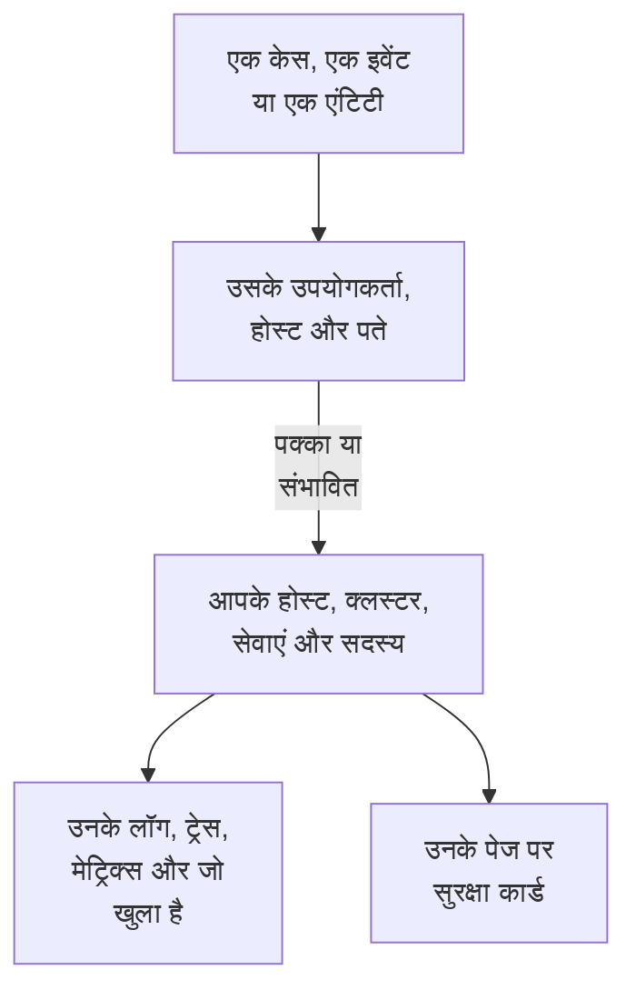

# जुड़े सिग्नल

एक सुरक्षा केस बताता है कि वह किन उपयोगकर्ताओं, होस्ट और पतों के बारे में है। जुड़े सिग्नल बताते हैं कि उनमें से किन्हें OneUptime पहले से जानता है - आपके होस्ट, कंटेनर होस्ट, Kubernetes क्लस्टर, नेटवर्क डिवाइस, सेवाएं और सदस्य - और केस के आसपास हर एक पर क्या हो रहा था: उसके लॉग, ट्रेस और मेट्रिक्स, उस पर खुली घटनाएं और अलर्ट, उसकी निगरानी करने वाले मॉनिटर और उस पर क्या बदला। उल्टी तरफ़, किसी होस्ट, क्लस्टर, सेवा या सदस्य का पेज बताता है कि Security Events को उसके बारे में क्या मिला।

:::cards
- [यह कहाँ दिखता है](#यह-कहाँ-दिखता-है): केस का पेज, इवेंट का टैब, एंटिटी का पेज, और वे जिनका नाम लेते हैं उनके पेज।
- [किसी मान का मिलान कैसे होता है](#किसी-मान-का-मिलान-कैसे-होता-है): क्या एक ही रिकॉर्ड गिना जाता है, और क्या सिर्फ़ शायद।
- [हर रिकॉर्ड क्या दिखाता है](#हर-रिकॉर्ड-क्या-दिखाता-है): केस के आसपास उसके सिग्नल, और उस पर क्या खुला है।
- [कौन क्या देखता है](#कौन-क्या-देखता-है): हर रिकॉर्ड पढ़ने वाले की अपनी भूमिका से पढ़ा जाता है।
:::

## यह कैसे काम करता है

OneUptime हर मान को प्रोजेक्ट के रिकॉर्ड में खोजता है, बताता है कि हर मिलान कितना पक्का है, और दिखाता है कि केस के आसपास हर रिकॉर्ड पर क्या हो रहा था।

## शुरू करने से पहले

- आते हुए सुरक्षा इवेंट, और प्रोजेक्ट में ऐसे होस्ट, Kubernetes क्लस्टर, सेवाएं या सदस्य जिनका वे नाम ले सकें। [सुरक्षा के साथ शुरुआत](/docs/telemetry/security-getting-started) देखें।
- ऐसी भूमिका जो सुरक्षा इवेंट पढ़ सके, और वे रिकॉर्ड पढ़ सके जिन्हें आप देखना चाहते हैं।

## यह कहाँ दिखता है

- **जुड़े सिग्नल**, हर सुरक्षा केस का एक पेज: **उत्पाद → Security Events → सुरक्षा केस → खुले केस** में कोई केस खोलें, फिर उसके मेनू में **एंटिटीज़** के बाद **जुड़े सिग्नल** खोलें।
- **कनेक्टेड**, हर सुरक्षा इवेंट का एक टैब: **उत्पाद → Security Events → इवेंट** में कोई इवेंट खोलें। यह बताता है कि इवेंट उसके आसपास के एक घंटे में किनका नाम लेता है।
- किसी एंटिटी का पेज, **उत्पाद → Security Events → एंटिटी जोखिम** में: उसके आख़िरी सुरक्षा इवेंट के आसपास OneUptime उस उपयोगकर्ता, होस्ट या पते को कहाँ जानता है।
- हर होस्ट, Docker होस्ट, Podman होस्ट, Kubernetes क्लस्टर, नेटवर्क डिवाइस, सेवा, सदस्य और इन्वेंटरी आइटम के पेज पर एक **सुरक्षा** कार्ड: उसका नाम लेने वाले खुले सुरक्षा केस, पिछले 7 दिनों में कितने सुरक्षा इवेंट और निष्कर्षों ने उसका नाम लिया, उनमें सबसे गंभीर, और उसका जोखिम। **Security Events में खोलें** उसे वहाँ खोलता है।
- किसी घटना के पेज पर एक **सुरक्षा** कार्ड, जब किसी सुरक्षा केस ने वह घटना घोषित की हो (**यहाँ से घोषित**) या खुले केस उस होस्ट या क्लस्टर का नाम लेते हों जिस पर वह असर डालती है (**इससे प्रभावित चीज़ों का नाम लेने वाले खुले केस**)।

## किसी मान का मिलान कैसे होता है

केस या इवेंट जिस भी उपयोगकर्ता, होस्ट और पते का नाम लेता है, उसे प्रोजेक्ट के रिकॉर्ड में खोजा जाता है:

| केस या इवेंट किसका नाम लेता है | किससे मिलाया गया | कितना पक्का |
| --- | --- | --- |
| वही होस्ट या डोमेन नाम जो कोई होस्ट, कंटेनर होस्ट, क्लस्टर या नेटवर्क डिवाइस रिपोर्ट करता है | वह रिकॉर्ड | पक्का |
| वही नाम, बिना यह बताए कि वह होस्ट है | वह रिकॉर्ड | संभावित |
| किसी रिकॉर्ड के नाम का छोटा या पूरा रूप, जैसे `web-1` और `web-1.acme.internal` | वह रिकॉर्ड | संभावित |
| एक सार्वजनिक IP पता जो सिर्फ़ एक रिकॉर्ड के पास है | वह रिकॉर्ड | पक्का |
| एक निजी IP पता, या ऐसा पता जो एक से ज़्यादा रिकॉर्ड के पास है | उसे रखने वाला हर रिकॉर्ड | संभावित |
| किसी सदस्य का ईमेल | वह सदस्य | पक्का |
| आपके लॉग से पढ़े गए इवेंट के लिए, वह रिकॉर्ड जिसके तहत लॉग लाइन भेजी गई | वह होस्ट, क्लस्टर या सेवा | पक्का |
| सिर्फ़ उपयोगकर्ता नाम, URL, फ़ाइल हैश या प्रोसेस | कुछ नहीं: कोई रिकॉर्ड इनसे नहीं पहचाना जाता | - |

- संभावित मिलान अपने नाम के पास **संभावित मिलान** दिखाता है और बताता है क्यों। इसे रिकॉर्ड के पेज पर कभी नहीं गिना जाता, और केस जो घटना घोषित करता है उसे इससे कभी नहीं जोड़ा जाता।
- जो खोजा गया और प्रोजेक्ट का रिकॉर्ड नहीं है, वह **OneUptime में नहीं** में दिखता है। कोई मान वहाँ कभी नहीं दिखता जब उस तरह का रिकॉर्ड, जो वह हो सकता है, पढ़ा न जा सका हो।
- किसी केस के लिए ज़्यादा से ज़्यादा 10 रिकॉर्ड दिखते हैं, पक्के वाले पहले।

## हर रिकॉर्ड क्या दिखाता है

- उसके सिग्नल, हर एक रिकॉर्ड और केस की अवधि पर खुलता है: **लॉग**, **ट्रेस** और **मेट्रिक्स**, किसी सेवा के **अपवाद**, किसी क्लस्टर के **Kubernetes इवेंट्स**, रिकॉर्ड की **टोपोलॉजी**, और जब इन्वेंटरी में उसका आइटम हो तो उसका **Inventory** आइटम।
- उस पर अभी खुली घटनाएं और अलर्ट, और उसकी निगरानी करने वाले मॉनिटर, हर एक अपना पेज खोलता है।
- अवधि में उस पर क्या बदला: किसी सेवा के डिप्लॉय, किसी क्लस्टर के रोलआउट और किसी होस्ट के सुधार।

| कहाँ | अवधि |
| --- | --- |
| एक केस | उसके पहले डिटेक्शन से 30 मिनट पहले से उसके आख़िरी डिटेक्शन के 30 मिनट बाद तक, ज़्यादा से ज़्यादा उसके आख़िरी 24 घंटे |
| एक इवेंट | उससे 30 मिनट पहले और बाद |
| किसी एंटिटी का पेज | उसके आख़िरी सुरक्षा इवेंट से 30 मिनट पहले और बाद |
| किसी रिकॉर्ड का **सुरक्षा** कार्ड | पिछले 7 दिन |

## कौन क्या देखता है

- जुड़े सिग्नल और किसी रिकॉर्ड के **सुरक्षा** कार्ड के लिए ऐसी भूमिका चाहिए जो सुरक्षा इवेंट पढ़ सके: Security Admin, Security Member, Security Viewer, Project Owner या Project Admin। बाकी किसी को किसी भी पेज पर सुरक्षा डेटा नहीं दिखता। [भूमिकाएँ](/docs/permissions/reference#भूमिकाएँ) देखें।
- किसी घटना के **सुरक्षा** कार्ड के लिए ऐसी भूमिका चाहिए जो सुरक्षा केस पढ़ सके।
- हर रिकॉर्ड आपकी अपनी भूमिका से पढ़ा जाता है। जिस तरह का रिकॉर्ड आपकी भूमिका नहीं पढ़ सकती, वह छोड़ दिया जाता है और पेज यह बताता है; जो अभी पढ़ा नहीं जा सका, वह भी **फिर से प्रयास करें** के साथ यह बताता है।
- किसी रिकॉर्ड का पेज अपना **सुरक्षा** कार्ड सिर्फ़ उस प्रोजेक्ट में दिखाता है जो Security Events इस्तेमाल करता है: जिसे पिछले 7 दिनों में कोई सुरक्षा इवेंट मिला हो।

## केस जो घटनाएं घोषित करता है

किसी केस पर **घटना घोषित करें**, या घटना घोषित करने वाला प्लेबुक का कोई चरण, घटना को उन होस्ट, Docker और Podman होस्ट, Kubernetes क्लस्टर और सेवाओं से जोड़ता है जिनसे केस पक्के तौर पर जुड़ा है। घटना उनके पेज पर दिखती है, उनके मालिकों के नियम उस पर लागू होते हैं, और उसकी फ़ीड केस का और जिनसे उसे जोड़ा गया उनका नाम लेती है। संभावित मिलान कभी नहीं जोड़ा जाता।

## OneUptime AI

OneUptime AI किसी केस का ट्रायाज करते समय उसके जुड़े सिग्नल पढ़ता है: केस जिन होस्ट, सेवाओं और सदस्यों का नाम लेता है उन पर क्या खुला है और क्या बदला। किसी घटना की जांच उसे घोषित करने वाला सुरक्षा केस और उससे प्रभावित चीज़ों का नाम लेने वाले खुले केस पढ़ती है। [सुरक्षा में OneUptime AI](/docs/telemetry/security-ai) देखें।

## समस्या निवारण

:::details केस जिस होस्ट का नाम लेता है, वह सूची में नहीं है
जांचें कि केस होस्ट का नाम वैसे ही लेता है जैसे होस्ट ख़ुद को कहता है, या कोई ऐसा सार्वजनिक पता लेता है जो सिर्फ़ उसी होस्ट के पास है। `web-1.acme.internal` के लिए `web-1` जैसा छोटा नाम संभावित मिलान के रूप में दिखता है, और सिर्फ़ उपयोगकर्ता नाम, URL, फ़ाइल हैश या प्रोसेस खोजे ही नहीं जाते।
:::

:::details सही होस्ट संभावित मिलान के रूप में दिखता है
संभावित मिलान को कभी गिना या जोड़ा नहीं जाता, ताकि दो मशीनों का साझा नाम आपको कभी ग़लत मशीन के बारे में कुछ न बताए। अपने लॉग और डिटेक्शन में होस्ट का वही नाम लें जो वह रिपोर्ट करता है।
:::

:::details किसी होस्ट के पेज पर सुरक्षा कार्ड नहीं है
यह कार्ड उस भूमिका को दिखता है जो सुरक्षा इवेंट पढ़ सकती है, उस प्रोजेक्ट में जिसे पिछले 7 दिनों में कोई सुरक्षा इवेंट मिला हो। जिस होस्ट का उस दौरान किसी ने नाम नहीं लिया, वह एक पंक्ति में यही बताता है।
:::

:::details पेज कहता है कि आपकी भूमिका किसी तरह का रिकॉर्ड नहीं देख सकती
हर रिकॉर्ड आपकी अपनी भूमिका से पढ़ा जाता है। किसी Project Owner या Project Admin से ऐसी भूमिका मांगें जो उस तरह का रिकॉर्ड पढ़ सके।
:::

## आगे के कदम

:::cards
- [सुरक्षा केस और प्लेबुक](/docs/telemetry/security-cases): किसी केस पर काम करें, और उससे एक घटना घोषित करें।
- [सुरक्षा इवेंट (SIEM)](/docs/telemetry/security-events): किसी केस के पीछे के इवेंट, और वे लॉग जिनसे उन्हें पढ़ा गया।
- [एंटिटी जोखिम (जोखिम-आधारित अलर्टिंग)](/docs/telemetry/security-entity-risk): किसी एंटिटी का पेज, उसका जोखिम, और OneUptime उसे कहाँ जानता है।
- [सुरक्षा में OneUptime AI](/docs/telemetry/security-ai): ट्रायाज किसी केस के नाम लिए गए चीज़ों को कैसे पढ़ता है।
:::
