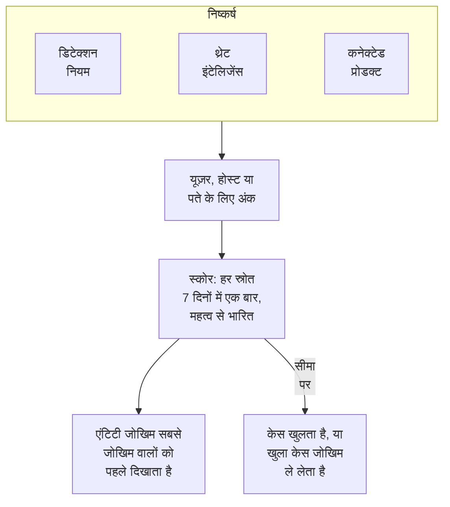

# एंटिटी जोखिम (जोखिम-आधारित अलर्टिंग)

एक अकेला निष्कर्ष शायद ही कुछ ज़्यादा बताता है। लगातार विफल साइन-इन, किसी होस्ट पर पहला sudo और किसी नए देश से साइन-इन, हर एक एक नज़र के लायक है; एक हफ़्ते में तीनों में वही अकाउंट हो, तो वह एक केस के लायक है। एंटिटी जोखिम आपके डिटेक्शन नियमों, थ्रेट इंटेलिजेंस, कनेक्टेड प्रोडक्ट्स और डेटा सुरक्षा को हर यूज़र, होस्ट, IP पते और डेटा स्टोर के बारे में जो मिलता है उसे जोड़ता है, सबसे जोखिम वालों को पहले दिखाता है, और जिसका जोखिम प्रोजेक्ट की सीमा तक पहुँचे उसके बारे में केस खोलता है।

:::cards
- [स्कोर कैसे गिना जाता है](#स्कोर-कैसे-गिना-जाता-है): गंभीरता के अनुसार अंक, और हर स्रोत हफ़्ते में एक बार।
- [जोखिम स्तर और केस](#जोखिम-स्तर-और-केस): स्कोर का स्तर क्या है, और केस कब खुलता है।
- [एंटिटी महत्व](#एंटिटी-महत्व): जो ज़्यादा अहम है उसे ज़्यादा गिनें, और जो कम अहम है उसे कम।
- [किसी एंटिटी का पेज](#किसी-एंटिटी-का-पेज): वह जोखिम भरी क्यों है, उसका महीना, और उसके बारे में केस।
- [डिटेक्शन नियम के जोखिम अंक](#डिटेक्शन-नियम-के-जोखिम-अंक): स्कोर में किसी नियम का अपना भार।
:::

## यह कैसे काम करता है

**उत्पाद → Security Events → एंटिटी जोखिम** खोलें: अभी जोखिम वाले हर यूज़र, होस्ट, IP पते और डेटा स्टोर, सबसे जोखिम वाले पहले, उनके स्तर, महत्व, उन्हें किसने पाया और कब के साथ। हर एक अपने पेज पर खुलता है। अवलोकन का **सबसे जोखिम वाली एंटिटी** इस सूची का ऊपरी हिस्सा दिखाता है, और उसके नीचे **किसी एंटिटी को खोजें** किसी भी मान को 30 दिनों के इवेंट में खोजता है, डोमेन या फ़ाइल हैश भी।

## शुरू करने से पहले

- आते हुए सुरक्षा इवेंट, और डिटेक्शन नियम, थ्रेट इंटेलिजेंस या कनेक्टेड प्रोडक्ट जो उनमें कुछ पाते हैं। देखें [सुरक्षा के साथ शुरुआत](/docs/telemetry/security-getting-started)।
- ऐसे डिटेक्शन नियम जो किसी को बताने वाले फ़ील्ड से समूह बनाते हैं: **समूह फ़ील्ड**, जैसे `principalUser`, `principalHost` या `principalIp`, या वे फ़ील्ड जिनसे कोई कोरिलेशन समूह बनाता है। जो नियम किसी से भी समूह नहीं बनाता, वह कोई जोखिम नहीं जोड़ता।
- **जोखिम स्कोरिंग** बदलने के लिए: स्विच और सीमा के लिए Project Owner या Project Admin, और एंटिटी की सूची के लिए ऐसी भूमिका जो डिटेक्शन नियम बना सके। Security Viewer सब कुछ पढ़ सकता है। देखें [भूमिकाएँ](/docs/permissions/reference#भूमिकाएँ)।

## स्कोर कैसे गिना जाता है

हर निष्कर्ष उस यूज़र, होस्ट, IP पते या डेटा स्टोर को जोखिम अंक देता है जिसके बारे में वह है:

| निष्कर्ष की गंभीरता | जोड़ता है |
| --- | --- |
| निम्न | 10 अंक |
| मध्यम | 25 अंक |
| उच्च | 50 अंक |
| गंभीर | 75 अंक |

- सूचनात्मक निष्कर्ष कुछ नहीं जोड़ता, और अज्ञात गंभीरता वाला निष्कर्ष मध्यम गिना जाता है।
- डिटेक्शन नियम के अंक उस मान को जाते हैं जिससे वह समूह बनाता है। थ्रेट इंटेलिजेंस का मैच उस IP पते में जुड़ता है जिसे इंडिकेटर बताता है। कनेक्टेड प्रोडक्ट का अलर्ट उस यूज़र और होस्ट में जुड़ता है जिन्हें वह बताता है, नहीं तो उसके IP पते में। डेटा सुरक्षा की समस्या उस डेटा स्टोर में जुड़ती है जिसमें वह मिली।
- हर स्रोत एक बार गिना जाता है। डिटेक्शन नियम, थ्रेट इंटेलिजेंस फ़ीड, कनेक्टेड प्रोडक्ट का नियम या डेटा सुरक्षा की जांच 7 दिनों में एक बार गिना जाता है, उसके जोड़े गए अधिकतम से, चाहे वह कितनी भी बार चले: एक शोर करने वाला नियम किसी एंटिटी को तीन अलग नियमों से बदतर नहीं दिखा सकता।
- जिस स्रोत को 7 दिनों तक कुछ नहीं मिला, वह गिनना बंद कर देता है, और स्कोर घटता है। स्कोर हर 15 मिनट में जाँचे जाते हैं, इसलिए नए निष्कर्ष के बिना भी स्कोर समय पर घटता है।

किसी एंटिटी का स्कोर उसके स्रोतों का योग है, जो उसके महत्व से भारित होता है। **टेस्ट हमला भेजें** का टेस्ट हमला, और कोई केस जो कोई हाथ से खोलता है, कोई जोखिम नहीं जोड़ते।

## जोखिम स्तर और केस

हर स्कोर प्रोजेक्ट की सीमा के मुकाबले एक स्तर के रूप में पढ़ा जाता है, जो 100 है जब तक आप उसे न बदलें:

| जोखिम स्कोर | स्तर | क्या होता है |
| --- | --- | --- |
| 1 से 49 | निम्न | एंटिटी जोखिम में सूचीबद्ध |
| 50 से 99 | मध्यम | एंटिटी जोखिम में सूचीबद्ध |
| 100 से 199 | उच्च | उच्च स्तर पर केस खुलता है |
| 200 या अधिक | गंभीर | गंभीर स्तर पर केस खुलता है |

जब किसी एंटिटी का जोखिम सीमा तक पहुँचता है, तो उसके बारे में एंटिटी जोखिम स्रोत का एक डिटेक्शन बनता है। यह एंटिटी के बारे में खुले केस में जुड़ जाता है, या उसके नाम पर एक केस खोलता है, जैसे `High risk — k.morgan@acme-commerce.example`, और जोखिम में सबसे ज़्यादा जोड़ने वाले स्रोतों को, 10 तक, उनके अंकों, चलने की संख्या और आख़िरी बार के साथ सूचीबद्ध करता है।

एक बार किसी एंटिटी के जोखिम के बारे में केस खुल जाए, तो उसके पीछे की चीज़ें फिर से नहीं गिनी जातीं: दूसरा केस तभी खुलता है जब तब से नए स्रोत फिर से सीमा तक पहुँचें। निपटाए गए के रूप में बंद केस उन्हीं निष्कर्षों से फिर नहीं खुलता।

सीमा **उत्पाद → Security Events → सेटिंग्स → जोखिम स्कोरिंग → जोखिम सीमा** में बदलें: 10 से 10000 तक की पूर्ण संख्या। मध्यम उसके आधे से और गंभीर उसके दोगुने से शुरू होता है, हर पेज पर।

### जोखिम केस चालू या बंद करें

**सेटिंग्स → जोखिम स्कोरिंग** में **जोखिम केस** तय करता है कि जोखिम केस खोलेगा या नहीं, और बदलते ही सहेजा जाता है। नए प्रोजेक्ट इसे चालू रखकर शुरू होते हैं। एंटिटी जोखिम से पहले बना प्रोजेक्ट इसे तब तक बंद रखता है जब तक कोई इसे चालू न करे, और **एंटिटी जोखिम** अपनी सूची के ऊपर यह बताता है। जोखिम हर हाल में स्कोर होता है और सूचीबद्ध होता है।

## एंटिटी महत्व

कुछ एंटिटी दूसरों से ज़्यादा अहम हैं: डोमेन कंट्रोलर, किसी अधिकारी का अकाउंट, पेमेंट सर्वर। कुछ कम अहम हैं, जैसे कोई वल्नरेबिलिटी स्कैनर जिसके स्कैन अपेक्षित हैं। उन्हें **सेटिंग्स → जोखिम स्कोरिंग → एंटिटी महत्व** में **एंटिटी जोड़ें** से सूचीबद्ध करें:

| महत्व | जोखिम की गिनती |
| --- | --- |
| निम्न | ×0.5 |
| सूचीबद्ध नहीं | ×1 |
| उच्च | ×1.5 |
| अत्यधिक | ×2 |

कोई प्रविष्टि एक मान या `*` पैटर्न होती है, बड़े-छोटे अक्षरों से फ़र्क नहीं पड़ता: `dc-*` हर डोमेन कंट्रोलर को, और `*@contractors.example` हर ठेकेदार को दर्शाता है। **प्रकार** इसे यूज़र, होस्ट, IP पतों या डेटा स्टोर तक सीमित करता है; खाली होने पर यह सब पर लागू होता है। जब कई प्रविष्टियाँ किसी एंटिटी को बताती हैं, तो सबसे सटीक गिनी जाती है: पूरा लिखा मान पैटर्न से पहले, और लंबा पैटर्न छोटे से पहले। कोई बदलाव कुछ ही मिनटों में हर एंटिटी के स्कोर तक पहुँचता है। डेटा सुरक्षा जिन डेटा स्टोर को संवेदनशील पाती है, उन्हें खुद सूची में जोड़ती है: गोपनीय वालों को उच्च और प्रतिबंधित वालों को अत्यधिक; ऐसी प्रविष्टि बदलने पर वह आपकी हो जाती है, और डेटा सुरक्षा उसे नहीं छूती।

## किसी एंटिटी का पेज

**एंटिटी जोखिम** की किसी पंक्ति पर **देखें** क्लिक करें, या किसी केस के **एंटिटीज़** पेज पर एंटिटी के पास के जोखिम पर:

| भाग | क्या दिखाता है |
| --- | --- |
| हेडर | उसका प्रकार और महत्व, उसका स्कोर और स्तर, और स्कोर कैसे निकला |
| **गतिविधि** | पिछले 7 दिनों के उसके सुरक्षा इवेंट और निष्कर्ष |
| **इसके जोखिम में क्या जुड़ता है** | हर स्रोत, उसकी गंभीरता, उसके जोड़े अंक, चलने की संख्या और आख़िरी बार |
| **पिछले 30 दिनों का जोखिम** | हर दिन के अंत में उसका स्कोर, स्तर के अनुसार रंग में |
| **इसके बारे में केस** | उसके बारे में खुले सुरक्षा केस, नए पहले |

**सहसंबंधित करें में खोलें** उसके इवेंट का ग्राफ़ बनाता है, और **इसके इवेंट खोजें** उसके हफ़्ते पर **इवेंट** खोलता है। **जोखिम रीसेट करें** उसका स्कोर और स्रोत साफ़ करता है, जैसे किसी योजनाबद्ध टेस्ट के बाद: आगे जो मिलेगा वह शून्य से गिना जाएगा, और उसके केस नहीं बदलते। रीसेट के लिए ऐसी भूमिका चाहिए जो सुरक्षा डेटा हटा सके, और [ऑडिट लॉग](/docs/configuration/audit-logs) इसे दर्ज करता है।

OneUptime AI किसी केस का ट्राइएज करते समय उसकी एंटिटी का जोखिम पढ़ता है। देखें [सुरक्षा में OneUptime AI](/docs/telemetry/security-ai)।

## डिटेक्शन नियम के जोखिम अंक

डिटेक्शन नियम अपने स्तर के अंक जोड़ता है, जो उसके Sigma `level` से आता है। उसे अपना भार देने के लिए, नियम का फ़ॉर्म खोलें, **मिलान होने पर** पर जाएँ, **और फ़ील्ड** खोलें और **जोखिम अंक** को 0, जो कोई जोखिम नहीं जोड़ता, से 100 तक सेट करें। उसके स्तर के अंकों के लिए इसे खाली छोड़ें।

## समस्या निवारण

:::details कोई एंटिटी एंटिटी जोखिम में नहीं है
जाँचें कि किसी डिटेक्शन नियम, थ्रेट इंटेलिजेंस फ़ीड या कनेक्टेड प्रोडक्ट ने पिछले 7 दिनों में उसके बारे में कुछ पाया है, और नियम ऐसे फ़ील्ड से समूह बनाता है जो उसे बताता है। सूचनात्मक निष्कर्ष कुछ नहीं जोड़ते, और जिस स्रोत को 7 दिनों तक कुछ नहीं मिला, वह गिनना बंद कर देता है।
:::

:::details किसी एंटिटी का जोखिम सीमा तक पहुँचा, और कोई केस नहीं खुला
जाँचें कि **सेटिंग्स → जोखिम स्कोरिंग** में **जोखिम केस** चालू है। अगर एंटिटी के जोखिम के बारे में पहले केस खुल चुका है, तो अगले के लिए सिर्फ़ तब से नए स्रोत गिने जाते हैं।
:::

:::details कोई नियम बार-बार चलता है, और एंटिटी का स्कोर नहीं बढ़ता
गिनती ऐसे ही होती है: कोई स्रोत 7 दिनों में एक बार गिना जाता है, उसके जोड़े गए अधिकतम से। शोर करने वाले नियम के **जोखिम अंक** घटाएँ, या जिस एंटिटी के निष्कर्ष अपेक्षित हैं उसे निम्न महत्व दें।
:::

:::details कोई स्कोर उसके स्रोतों का योग नहीं है
उसका महत्व उसे भारित करता है। एंटिटी का पेज उसके स्रोतों का योग और भार दिखाता है, जैसे इसके स्रोतों से 100 × 2 = 200।
:::

## आगे के कदम

:::cards
- [सुरक्षा केस और प्लेबुक](/docs/telemetry/security-cases): जोखिम से खुले केस पर काम करें, और उन्हें निर्णय के साथ बंद करें।
- [सुरक्षा इवेंट (SIEM)](/docs/telemetry/security-events): डिटेक्शन नियम, कोरिलेट और हर निष्कर्ष के पीछे के इवेंट।
- [थ्रेट इंटेलिजेंस (STIX/TAXII)](/docs/telemetry/threat-intelligence): वे मैच जो किसी पते के जोखिम में जुड़ते हैं।
- [सुरक्षा में OneUptime AI](/docs/telemetry/security-ai): ट्राइएज किसी केस की एंटिटी का जोखिम कैसे पढ़ता है।
:::
