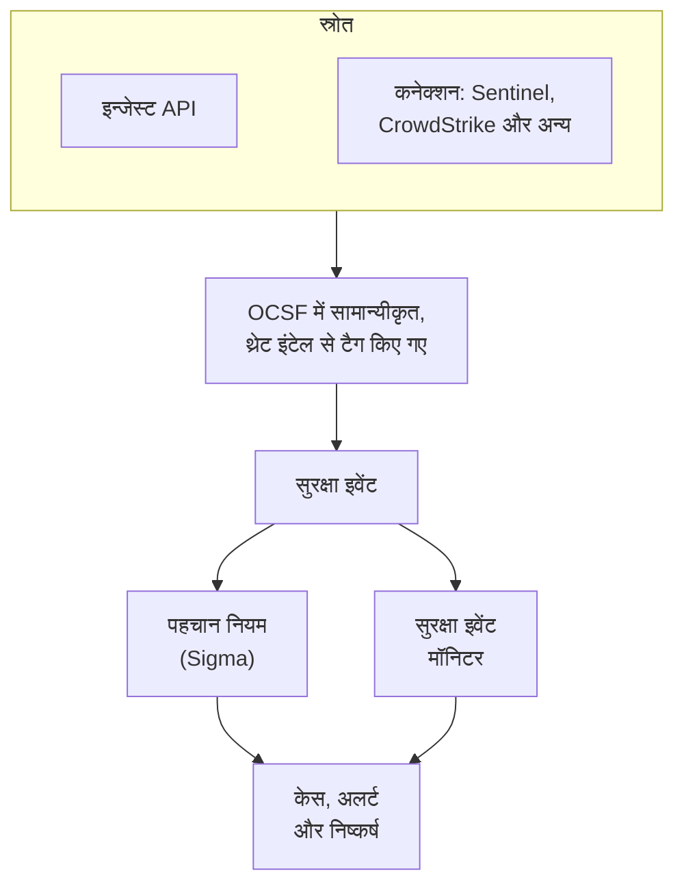
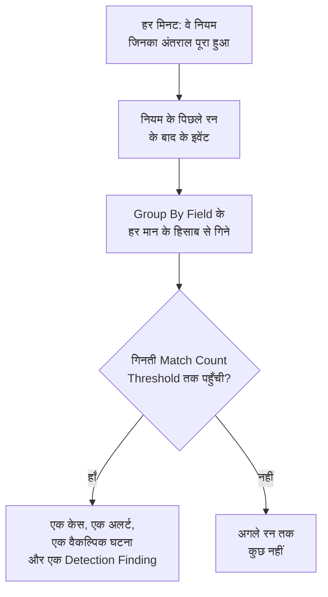

# सुरक्षा इवेंट (SIEM)

OneUptime सुरक्षा इवेंट को आपके लॉग, ट्रेस और मेट्रिक्स के बगल में रखता है, और हर इवेंट को एक ही आकार देता है, [OCSF](https://schema.ocsf.io/) (Open Cybersecurity Schema Framework), चाहे वह किसी भी फ़ॉर्मेट में आया हो। किसी भी स्रोत से इवेंट भेजें, उन्हें खोजें, और Sigma पहचान नियमों, थ्रेट इंटेलिजेंस और मॉनिटर से उन इवेंट को ढूँढें जो मायने रखते हैं। उन्हें जो मिलता है, वह काम करने के लिए [केस](/docs/telemetry/security-cases) बन जाता है, और प्लेबुक उन पर प्रतिक्रिया देती हैं।

:::cards
- [इवेंट भेजें](#सुरक्षा-इवेंट-भेजें): एक HTTPS POST, एक Fluent Bit आउटपुट, या किसी सुरक्षा उत्पाद से कनेक्शन।
- [खोजें और सहसंबंध देखें](#सुरक्षा-इवेंट-एक्सप्लोर-करें): इवेंट एक्सप्लोरर और सहसंबंध ग्राफ़।
- [हंट](#हंट): सहेजी गई खोजें जो शेड्यूल पर चलती हैं और कुछ मिलने पर लोगों को बताती हैं।
- [पहचान नियम](#पहचान-नियम): Sigma नियम जो केस और अलर्ट खोलते हैं।
- [मॉनिटर](#सुरक्षा-इवेंट-मॉनिटर): रोलिंग विंडो पर गिनती, ऐसी स्थिति के साथ जो ठीक हो जाती है।
:::

## यह कैसे काम करता है



**सुरक्षा** के अंदर **उत्पाद → सुरक्षा इवेंट** खोलें। इसके मेनू में सुरक्षा के हर हिस्से के लिए एक सेक्शन है, और उसमें हर चीज़ के लिए अपना एक पेज:

| पेज | सेक्शन | यह किसलिए है |
| --- | --- | --- |
| **अवलोकन** | अवलोकन | सुरक्षा कैसे सेट है, अभी किसकी ज़रूरत है, और केस कितनी जल्दी निपटाए जाते हैं |
| **खुले केस** | सुरक्षा केस | क्यू: हर वह केस जो अभी बंद नहीं हुआ, इस हिसाब से समूहित कि वह किसके बारे में है |
| **मुझे सौंपे गए** | सुरक्षा केस | आपको सौंपे गए खुले केस |
| **सौंपा नहीं गया** | सुरक्षा केस | वे खुले केस जिन्हें किसी ने नहीं उठाया |
| **बंद केस** | सुरक्षा केस | नतीजे के साथ बंद हुए केस, सबसे नए पहले |
| **सभी केस** | सुरक्षा केस | हर केस, खुला या बंद |
| **इवेंट** | इवेंट | हर इवेंट खोजें और फ़िल्टर करें, और किसी एक को खोलकर उसके सभी फ़ील्ड देखें |
| **हंट** | इवेंट | इवेंट से सहेजी गई खोजें, जो एक क्लिक में फिर से खुलती हैं या ऐसे शेड्यूल पर चलती हैं जो कुछ मिलने पर लोगों को बताता है |
| **हंट लाइब्रेरी** | इवेंट | इवेंट पर आज़माने या अपने हंट में जोड़ने के लिए तैयार हंट, हर एक के साथ वे इवेंट जो वह पढ़ता है और क्या वे आ रहे हैं |
| **अभियान** | इवेंट | हर वह पता जिसने हमले के अनुरोध भेजे, और क्या उसका कोई अनुरोध आगे पहुँचा |
| **एंटिटी जोखिम** | इवेंट | इस हफ़्ते मिली चीज़ों से स्कोर किया गया हर यूज़र, होस्ट और पता, सबसे जोखिम वाले पहले |
| **सहसंबंधित करें** | इवेंट | उन इवेंट का ग्राफ़ जो एक ही होस्ट, उपयोगकर्ता या IP पता साझा करते हैं |
| **डिटेक्शन नियम** | Detections | Sigma नियम जो शेड्यूल पर चलते हैं और केस खोलते हैं |
| **नियम अपवाद** | Detections | आपके नियम जानबूझकर क्या छोड़ते हैं, जैसे कोई स्कैनर या योजनाबद्ध परीक्षण, हर एक के साथ यह कि किसने और क्यों जोड़ा |
| **वॉचलिस्ट** | Detections | वे सूचियाँ जिनसे आपके नियम मिलान करते हैं, जैसे VIP उपयोगकर्ता, महत्वपूर्ण होस्ट, ज्ञात ख़राब फ़ाइल हैश और वे पते जहाँ से एडमिन साइन इन कर सकते हैं |
| **नियम लाइब्रेरी** | Detections | जोड़ने के लिए तैयार पहचान नियम, हर एक के साथ वह कौन से इवेंट पढ़ता है और वे आ रहे हैं या नहीं, सुझाए गए नियमों पर निशान के साथ |
| **थ्रेट इंटेल** | Detections | ज्ञात हानिकारक संकेतकों की STIX/TAXII फ़ीड |
| **ATT&CK कवरेज** | Detections | वे MITRE ATT&CK तकनीकें जिन्हें आपके नियम कवर करते हैं |
| **प्लेबुक** | Playbooks | केस पर चलने वाले चरण, अपने आप या हाथ से |
| **स्वीकृतियाँ** | Playbooks | वे प्लेबुक चरण जो किसी के स्वीकार या अस्वीकार करने का इंतज़ार कर रहे हैं |
| **प्लेबुक रन** | Playbooks | हर प्लेबुक ने चरण-दर-चरण क्या किया |
| **स्वचालित प्रतिक्रिया** | Playbooks | वे नीतियां जो डिटेक्शन होते ही हमला करने वाले पते पर चैलेंज लगाती हैं या उसे ब्लॉक करती हैं, हर एक अपने ट्रायल रन और गार्डरेल के साथ |
| **ब्लॉकलिस्ट** | Playbooks | वे पते जिन्हें आपका प्रोजेक्ट ब्लॉक करता है, कब तक, और हर ब्लॉक कहाँ लागू है |
| **ब्लॉकलिस्ट फ़ीड** | Playbooks | गुप्त URL जिनसे आपके फ़ायरवॉल और प्रॉक्सी ब्लॉकलिस्ट पढ़ते हैं, और उनके फ़ेच |
| **संरक्षित एंटिटीज़** | Playbooks | वे उपयोगकर्ता, होस्ट और पते जिन्हें कोई प्लेबुक कंटेन नहीं करती और कोई ब्लॉक नहीं छूता |
| **सेटिंग्स** | एआई | क्या OneUptime AI हर नए केस का ट्राइएज करता है |
| **कनेक्शन** | Connections | आपके लॉग, वे सुरक्षा उत्पाद जिनसे OneUptime पोल करता है, और वे SIEM जिन्हें वह भेजता है |
| **सेटअप गाइड** | Connections | इवेंट भेजने के स्निपेट, आपकी इंजेशन कुंजी भरी हुई |
| **केस प्राथमिकताएं** | सेटिंग्स | केस कितना ज़रूरी है: प्रोजेक्ट की अपनी प्राथमिकताएँ, सबसे ज़रूरी पहले |
| **प्रतिक्रिया लक्ष्य** | सेटिंग्स | हर प्राथमिकता वाले केस को कितनी जल्दी संभालना और नियंत्रित करना है |
| **केस स्थितियां** | सेटिंग्स | वे चरण जिनसे केस गुज़रता है, और हर चरण में केस किस रूप में गिना जाता है |
| **कस्टम फ़ील्ड** | सेटिंग्स | वे फ़ील्ड जो आपकी टीम हर केस पर भरती है, जैसे वह व्यावसायिक इकाई जिससे केस जुड़ा है |
| **नोट टेम्पलेट** | सेटिंग्स | आपकी टीम अपने केस पर जो नोट लिखती है, उनके लिए पहले से लिखा टेक्स्ट |
| **क्रमांकन** | सेटिंग्स | केस संख्याओं के आगे लगने वाला टेक्स्ट, और अगले केस को मिलने वाली संख्या |
| **जोखिम स्कोरिंग** | सेटिंग्स | क्या किसी एंटिटी का जोखिम केस खोलता है, किस जोखिम पर, और हर एंटिटी कितनी अहम है |
| **मिटाने के अनुरोध** | सेटिंग्स | अनुरोध पर मिटाए गए लोग, और हर मिटाने ने क्या बदला |

**डिटेक्शन**, **एआई**, **कनेक्शन** और **सेटिंग्स**, जिन्हें एक बार सेट किया जाता है, तब तक मुड़े रहते हैं जब तक आप उन्हें खोलते नहीं। सुरक्षा में नए हैं? [सुरक्षा के साथ शुरुआत](/docs/telemetry/security-getting-started) इसे दो क्लिक में सेट कर देता है।

## शुरू करने से पहले

सुरक्षा डेटा सिर्फ़ प्रोजेक्ट स्वामी और प्रोजेक्ट एडमिन भूमिकाएँ और तीन Security भूमिकाएँ पढ़ सकती हैं; दूसरी भूमिकाओं को सुरक्षा इवेंट में कुछ नहीं दिखता। देखें [भूमिकाएँ](/docs/permissions/reference#भूमिकाएँ)।

| भूमिका | यह क्या कर सकती है |
| --- | --- |
| सुरक्षा एडमिन | सब कुछ: इवेंट, केस, प्लेबुक, पहचान नियम, थ्रेट इंटेल फ़ीड और कनेक्शन |
| सुरक्षा सदस्य | इवेंट और थ्रेट इंटेल पढ़ना, केस पर काम करना, प्लेबुक चलाना और उनके चरणों को अनुमोदित करना, पते ब्लॉक करना, और पहचान नियम और फ़ीड बनाना, बदलना और हटाना। यह प्लेबुक या कनेक्शन सेट नहीं कर सकती, और सुरक्षा डेटा नहीं हटा सकती। |
| सुरक्षा दर्शक | इवेंट, केस, प्लेबुक, ब्लॉकलिस्ट, नियम, फ़ीड, संकेतक और कनेक्शन पढ़ना |

## सुरक्षा इवेंट भेजें

:::steps
### इंजेशन कुंजी बनाएँ

**प्रोजेक्ट सेटिंग्स → टेलीमेट्री और APM → इंजेशन कुंजियाँ** खोलें और **इंजेशन कुंजी बनाएँ** पर क्लिक करें। सुरक्षा इवेंट बाकी टेलीमेट्री वाली ही कुंजियाँ इस्तेमाल करते हैं।

### अपने इवेंट पोस्ट करें

`x-oneuptime-token` में कुंजी के साथ `/security-events/v1/ingest` पर JSON भेजें:

:::tabs
@tab OCSF
```bash
curl -X POST "https://oneuptime.com/security-events/v1/ingest?format=ocsf" \
  -H "Content-Type: application/json" \
  -H "x-oneuptime-token: YOUR_INGESTION_TOKEN" \
  -H "x-oneuptime-service-name: my-security-source" \
  -d '{ "events": [ { "class_uid": 3002, "severity_id": 4, "status": "Failure", "message": "Failed logon for alice", "actor": { "user": { "name": "alice" } }, "src_endpoint": { "ip": "203.0.113.7", "hostname": "laptop-alice" } } ] }'
```
@tab Google UDM
```bash
curl -X POST "https://oneuptime.com/security-events/v1/ingest?format=udm" \
  -H "Content-Type: application/json" \
  -H "x-oneuptime-token: YOUR_INGESTION_TOKEN" \
  -d '{ "events": [ { "metadata": { "event_type": "USER_LOGIN" }, "principal": { "hostname": "laptop-alice", "user": { "userid": "alice" }, "ip": ["203.0.113.7"] }, "security_result": [{ "severity": "HIGH", "action": ["BLOCK"] }] } ] }'
```
@tab Generic JSON
```bash
curl -X POST "https://oneuptime.com/security-events/v1/ingest" \
  -H "Content-Type: application/json" \
  -H "x-oneuptime-token: YOUR_INGESTION_TOKEN" \
  -d '{ "events": [ { "severity": "high", "event_type": "ssh_brute_force", "message": "12 failed SSH logins in 60s", "username": "root", "hostname": "web-01", "src_ip": "203.0.113.7" } ] }'
```
:::

इवेंट कतार में लगते ही एंडपॉइंट `200` जवाब देता है। इनकी तरह बिना समय के भेजा गया इवेंट उसी पल पर रखा जाता है जब वह पहुँचता है।

### उन्हें इवेंट में ढूँढें

**उत्पाद → सुरक्षा इवेंट → इवेंट** खोलें। इवेंट कुछ ही सेकंड में दिखते हैं, उनकी गंभीरता, क्लास, उपयोगकर्ता, होस्ट और IP पते भरे हुए।
:::

### फ़ॉर्मेट

| `format` | यह क्या पढ़ता है | और भी स्वीकार |
| --- | --- | --- |
| `ocsf` | OCSF इवेंट JSON (`class_uid`, `severity_id` आदि) | कोई नहीं |
| `udm` | Google SecOps (Chronicle) UDM इवेंट (`metadata.event_type` आदि) | `chronicle`, `google-secops` |
| `google-secops-alert` | Google SecOps की पहचान और अलर्ट: SOAR वेबहुक और पहचान स्ट्रीम | `secops-alert`, `detection` |
| `crowdsec` | CrowdSec के अलर्ट, जैसे उसका `http` सूचना प्लगइन उन्हें भेजता है (देखें [CrowdSec](/docs/integrations/crowdsec)) | `crowdsec-alert` |
| `generic` | कोई भी दूसरा JSON, आम फ़ील्ड नामों से पढ़ा जाता है | कोई नहीं |

फ़ॉर्मेट `?format=` से, `x-oneuptime-security-event-format` हेडर से, या टॉप-लेवल `"format"` फ़ील्ड से बताएँ। इसे छोड़ दें, तो हर इवेंट का फ़ॉर्मेट अलग से तय होता है, इसलिए एक वेबहुक पहचानों को कच्चे इवेंट के साथ मिला सकता है।

- बॉडी एक इवेंट, इवेंट का ऐरे, या `{ "events": [...] }` हो सकती है।
- बैच को gzip से कंप्रेस करके `Content-Encoding: gzip` के साथ भेजा जा सकता है: उसे वैसे ही पढ़ा जाता है जैसे बिना कंप्रेस किया गया वही बैच। Fluent Bit का `http` आउटपुट `compress gzip` से कंप्रेस करता है, Vector का `http` सिंक `compression = "gzip"` से, और Logstash का `http` आउटपुट `http_compression => true` से। सिर्फ़ JSON ही कंप्रेस्ड रूप में पढ़ा जाता है: किसी भी दूसरे प्रकार की कंप्रेस की गई बॉडी `400` के साथ अस्वीकार कर दी जाती है।
- `x-oneuptime-service-name` हेडर उस टेलीमेट्री सेवा का नाम बताता है जिससे इवेंट जुड़े हैं। इसके बिना वे पहले इवेंट के उत्पाद या विक्रेता के नाम वाली सेवा से, या `Security Events` से जुड़ते हैं।
- मैप न हो पाने की वजह से कुछ नहीं छोड़ा जाता: स्रोत का हर फ़ील्ड इवेंट की विशेषताओं में पहुँचता है।

### जेनेरिक JSON फ़ील्ड

जेनेरिक इवेंट आम फ़ील्ड नामों से पढ़ा जाता है:

| इवेंट का फ़ील्ड | इनमें से पहले मिलने वाले से पढ़ा जाता है |
| --- | --- |
| `message` | `message`, `msg`, `summary`, `description`, `title` |
| `severityName` | `severity`, `severity_name`, `level`, `priority`, `risk_level` |
| `time` | `timestamp`, `time`, `@timestamp`, `event_time`, `created_at` |
| `principalUser` | `user`, `username`, `user_name`, `account`, `actor` |
| `principalHost` | `host`, `hostname`, `computer`, `device`, `machine` |
| `principalIp` | `source_ip`, `src_ip`, `client_ip`, `ip` |
| `targetIp` | `destination_ip`, `dest_ip`, `dst_ip`, `target_ip` |
| `className` | `event_type`, `category`, `type`, `action` |
| `ruleName` | `rule`, `rule_name`, `signature`, `detection` |
| `productName` | `product`, `product_name`, `source`, `log_source` |
| `processName` | `process_name`, `process.name`, `proc.name`, `comm` |
| `processPath` | `process_path`, `Image`, `NewProcessName`, `exe`, `process.executable` |
| `processCommandLine` | `command_line`, `CommandLine`, `cmdline`, `process.command_line`, `proc.cmdline`, `process` |
| `parentProcessName` | `parent_process_name`, `process.parent.name`, `proc.pname` |
| `parentProcessPath` | `parent_process_path`, `ParentImage`, `ParentProcessName`, `process.parent.executable` |
| `parentProcessCommandLine` | `parent_command_line`, `ParentCommandLine`, `process.parent.command_line`, `proc.pcmdline` |

गंभीरता बताने वाला शब्द OCSF स्तर बन जाता है: `info` को Informational, `warning` को Low, `error` को Medium, `alert` को Critical और `emergency` को Fatal पढ़ा जाता है।

### Fluent Bit से फ़ॉरवर्ड करें

जो सुरक्षा लॉग आप पहले से इकट्ठा करते हैं, जैसे auditd, syslog या Falco, उन्हें भेजने के लिए Fluent Bit में एक `http` आउटपुट जोड़ें:

```ini title="fluent-bit.conf"
[OUTPUT]
    Name             http
    Match            security.*
    Host             oneuptime.com
    Port             443
    tls              On
    URI              /security-events/v1/ingest
    Format           json
    compress         gzip
    Json_date_key    timestamp
    Json_date_format iso8601
    Header           x-oneuptime-token YOUR_INGESTION_TOKEN
    Header           x-oneuptime-service-name my-security-source
    Retry_Limit      5
```

**कनेक्शन** के अंदर **सेटअप गाइड** पेज में ये स्निपेट आपके अपने होस्ट और कुंजी के साथ भरे हुए मिलते हैं।

### अपने लॉग में सुरक्षा इवेंट खोजें

**कनेक्शन** के ऊपर **आपके लॉग** कार्ड उन लॉग को स्रोत बनाता है जो आप पहले से OneUptime को भेजते हैं। **अपने लॉग में सुरक्षा इवेंट खोजें** चालू होने पर प्रोजेक्ट के नए लॉग हर मिनट पढ़े जाते हैं, और उनमें हर SSH या Windows साइन-इन, sudo कमांड, किसी क्लाउड का ऑडिट रिकॉर्ड, किसी सुरक्षा उत्पाद का CEF या LEEF रिकॉर्ड, Palo Alto Networks, FortiGate या Cisco ASA फ़ायरवॉल का रिकॉर्ड, Kubernetes ऑडिट रिकॉर्ड, वेब हमला और किसी संवेदनशील फ़ाइल के लिए अनुरोध एक सुरक्षा इवेंट के रूप में सहेजा जाता है। हर प्रकार में क्या आता है, यह [सुरक्षा के साथ शुरुआत](/docs/telemetry/security-getting-started#अपने-लॉग-में-सुरक्षा-इवेंट-खोजें) में देखें।

हर प्रकार साधारण लॉग के रूप में OneUptime तक पहुंचता है:

| प्रकार | कहां से भेजें |
| --- | --- |
| SSH साइन-इन, sudo | किसी Linux मशीन का journal या ऑथ लॉग, [OpenTelemetry Collector](/docs/telemetry/host-otel-collector) के साथ |
| Windows इवेंट | मशीन पर कलेक्टर का `windowseventlog` रिसीवर, या ऐसा फ़ॉरवर्डर जो हर इवेंट को JSON के रूप में लिखता है, जैसे NXLog या Winlogbeat। OneUptime में जोड़ा गया [होस्ट](/docs/telemetry/hosts) जहाँ हों वहाँ Sysmon, Microsoft Defender और PowerShell भी पढ़ता है |
| AWS CloudTrail | CloudWatch Logs को दिया गया ट्रेल, जिसे कलेक्टर का `awscloudwatch` रिसीवर पढ़ता है, या **क्लाउड** के अंतर्गत कनेक्ट किए गए खाते के लिए [क्लाउड ऑडिट लॉग](#अपने-क्लाउड-खातों-के-ऑडिट-लॉग-पढ़ें) |
| Google Cloud ऑडिट लॉग | Pub/Sub तक जाने वाला लॉग सिंक, जिसे कलेक्टर का `googlecloudpubsub` रिसीवर `encoding: raw_text` के साथ पढ़ता है, या **क्लाउड** के अंतर्गत कनेक्ट किए गए प्रोजेक्ट के लिए उसकी [स्ट्रीम](/docs/telemetry/cloud-streaming-google-cloud) या [क्लाउड ऑडिट लॉग](#अपने-क्लाउड-खातों-के-ऑडिट-लॉग-पढ़ें) |
| Azure गतिविधि और Entra ID लॉग | Event Hub में स्ट्रीम करने वाली डायग्नोस्टिक सेटिंग, जिसे कलेक्टर का `azureeventhub` रिसीवर `format: raw` के साथ पढ़ता है, या जो कनेक्ट की गई सदस्यता की [स्ट्रीम](/docs/telemetry/cloud-streaming-azure) के इवेंट हब में भेजती है, या **क्लाउड** के अंतर्गत कनेक्ट की गई सदस्यता के Activity Log के लिए [क्लाउड ऑडिट लॉग](#अपने-क्लाउड-खातों-के-ऑडिट-लॉग-पढ़ें) |
| Azure Key Vault, Storage और SQL लॉग | किसी संसाधन की Event Hub में स्ट्रीम करने वाली डायग्नोस्टिक सेटिंग, जिसे कलेक्टर का `azureeventhub` रिसीवर `format: raw` के साथ पढ़ता है, या कनेक्ट की गई सदस्यता की [स्ट्रीम](/docs/telemetry/cloud-streaming-azure) की डायग्नोस्टिक सेटिंग, जब वह लॉग भी स्ट्रीम करती हो। देखें [Azure संसाधनों के अपने ऑडिट लॉग](#azure-संसाधनों-के-अपने-ऑडिट-लॉग) |
| OpenStack ऑडिट ट्रेल | क्लाउड की नोटिफ़िकेशन और ऑडिट फ़िल्टर, जो `driver = log` के साथ उसके लॉग में भेजे जाते हैं, और जिन्हें एजेंट की [लॉग प्रोफ़ाइल](/docs/telemetry/openstack#किसने-क्या-किया) पढ़ती है |
| CEF, LEEF | उत्पाद का syslog, जिसे [rsyslog](/docs/telemetry/syslog) आगे भेजता है |
| Palo Alto Networks, FortiGate, Cisco ASA | फ़ायरवॉल का अपना syslog, जिसे [rsyslog](/docs/telemetry/syslog) आगे भेजता है |
| Kubernetes ऑडिट लॉग | API सर्वर की ऑडिट लॉग फ़ाइल, जिसे कलेक्टर का `filelog` रिसीवर पढ़ता है |
| वेब हमले | किसी वेब सर्वर का एक्सेस लॉग, जिसे कलेक्टर का `filelog` रिसीवर पढ़ता है |

**आपके लॉग** पर हर प्रकार बताता है कि वह आखिरी बार कब मिला, और **एक लॉग लाइन जाँचें** दिखाता है कि आपकी पेस्ट की गई लाइन क्या बनती है, कोई लाइन आने से पहले ही। OneUptime इसे वैसे ही पढ़ता है जैसे स्कैन आपके लॉग पढ़ते हैं, आपके [भरोसेमंद प्रॉक्सी](#भरोसेमंद-प्रॉक्सी) और आपके एक्सेस लॉग की सेटिंग्स के साथ, इसलिए यह वही क्लाइंट बताता है जो सहेजा गया इवेंट बताएगा, और कुछ भी सहेजता नहीं।

कोई सुरक्षा उत्पाद आपके लॉग में जो ख़तरा लिखता है, जैसे कोई CEF या LEEF निष्कर्ष या Palo Alto Networks, FortiGate या Cisco ASA का ख़तरा, वह किसी कनेक्ट किए गए उत्पाद के अलर्ट की तरह एक [केस](/docs/telemetry/security-cases) खोलता है, और जिस उपयोगकर्ता, होस्ट या पते का वह नाम लेता है उसका जोखिम बढ़ाता है। **आपके लॉग** पर **इस स्तर से केस खोलें** बताता है कि किस गंभीरता से: डिफ़ॉल्ट रूप से **उच्च और ऊपर**, जब तक आप कोई दूसरी न चुनें, या **कभी नहीं**। उत्पाद के साइन-इन और ब्लॉक किए गए कनेक्शन इवेंट ही रहते हैं, ताकि आपके नियम उन्हें पढ़ सकें।

जो रिकॉर्ड OneUptime तक दो रास्तों से पहुँचता है, वह एक ही बार सहेजा जाता है: Microsoft Entra ID का कोई साइन-इन जिसे उसका कनेक्शन पढ़ता है और जिसे Azure आपके लॉग में भी एक्सपोर्ट करता है, कोई CloudTrail रिकॉर्ड जो आपके लॉग में और किसी कनेक्ट किए गए AWS खाते के ऑडिट लॉग में है, या कोई ऑडिट रिकॉर्ड जिसे किसी क्लाउड खाते की स्ट्रीम भेजती है और जिसे **क्लाउड ऑडिट लॉग** भी पढ़ता है।

#### Azure संसाधनों के अपने ऑडिट लॉग

Key Vault, स्टोरेज खाता और Azure SQL डेटाबेस, हर एक अपना अलग ऑडिट लॉग रखता है, जो हर अनुरोध दर्ज करता है। उनमें से केवल वही सुरक्षा इवेंट बनता है जिसे कोई सुरक्षा टीम देखती है:

| संसाधन | क्या सुरक्षा इवेंट बनता है |
| --- | --- |
| Key Vault (`AuditEvent`) | ऐसा अनुरोध जिसे वॉल्ट ने अस्वीकार किया; सौंपा गया सीक्रेट; हटाया गया, स्थायी रूप से मिटाया गया या बैकअप किया गया सीक्रेट, कुंजी, प्रमाणपत्र या ख़ुद वॉल्ट; उसकी एक्सेस नीति में बदलाव; और उसमें रखी चीज़ों में बदलाव। वह 401 नहीं, जो हर Azure SDK क्लाइंट को उसके पहले कॉल पर मिलता है, जो टेनेंट जानने के लिए बिना टोकन के किया जाता है: Key Vault उसे अपने `Authentication` ऑपरेशन के तहत लॉग करता है |
| स्टोरेज खाता (`StorageRead`, `StorageWrite`, `StorageDelete`) | अधिकार न होने के कारण अस्वीकार किया गया अनुरोध; बिना किसी क्रेडेंशियल के पूरा किया गया अनुरोध, स्टैटिक वेबसाइट के पेज और CORS preflight को छोड़कर; किसी कंटेनर, शेयर, क्यू या टेबल की एक्सेस सूची में बदलाव, या उनमें से किसी एक को पूरा हटाना; और ऐसा लिखना या हटाना जिस पर शेयर्ड एक्सेस सिग्नेचर (SAS) के हस्ताक्षर हों। सफल रीड नहीं, SAS से किया गया रीड भी नहीं |
| Azure SQL (`SQLSecurityAuditEvents`) | विफल साइन-इन; नए कनेक्शन पर साइन-इन, पूल किए गए कनेक्शन का दोबारा इस्तेमाल नहीं; कोई अनुमति देना, नकारना या वापस लेना, किसी भूमिका का सदस्य या पासवर्ड बदलना, प्रतिरूपण (impersonation), और कोई लॉगिन, उपयोगकर्ता या भूमिका बनाना, बदलना या हटाना; और ऐसी कार्रवाई जिसकी अनुमति जाँच विफल रही। बैच नहीं, जो किसी ऑडिट का ज़्यादातर हिस्सा होते हैं |

स्टोरेज खाता जो लॉग करता है, उसका ज़्यादातर हिस्सा उसके सफल रीड होते हैं: ज़्यादातर ऐप ब्राउज़र को फ़ाइलें SAS के ज़रिए ही देते हैं। ये पूरे के पूरे लॉग में, खाते के **लॉग** टैब पर रहते हैं: शेयर्ड एक्सेस सिग्नेचर ने क्या पढ़ा, यह देखने के लिए वहाँ `"type":"SAS"` खोजें। हर इवेंट अपने संसाधन का नाम उसकी ID से लेता है, और किसी स्टोरेज सेवा का इवेंट उसके खाते का भी, इसलिए वह उस संसाधन के **सुरक्षा इवेंट** पेज पर दिखता है, और दो बार आने वाला रिकॉर्ड एक ही बार सहेजा जाता है।

### अपने क्लाउड खातों के ऑडिट लॉग पढ़ें

[**क्लाउड** के अंतर्गत कनेक्ट किए गए](/docs/telemetry/cloud-accounts) AWS खाते, Google Cloud प्रोजेक्ट या Azure सदस्यता को किसी लॉग पाइपलाइन की ज़रूरत नहीं होती। **कनेक्शन** पर **आपका OneUptime डेटा** के अंतर्गत **क्लाउड ऑडिट लॉग** चालू करें, और खाते की हर रीडिंग उसके ऑडिट लॉग को सुरक्षा इवेंट के रूप में रखती है:

| क्लाउड | क्या पढ़ा जाता है |
| --- | --- |
| AWS | खाते के इस्तेमाल किए गए हर Region में CloudTrail के वे प्रबंधन इवेंट जो कुछ बदलते हैं: कंसोल साइन-इन, बदलाव और वे कॉल जिन्हें AWS ने अस्वीकार किया |
| Google Cloud | Admin Activity ऑडिट लॉग: संसाधनों में और उन तक कौन पहुँच सकता है इसमें बदलाव, और वे कॉल जिन्हें Google ने अस्वीकार किया |
| Azure | Activity Log: सदस्यता में किए गए बदलाव, विफल ऑपरेशन, Azure Policy के इनकार और Defender for Cloud अलर्ट |

- हर रिकॉर्ड वैसे ही पढ़ा जाता है जैसे **आपके लॉग** उसे किसी पाइपलाइन से पढ़ता है, इसलिए नियम लाइब्रेरी के CloudTrail, Google Cloud और Azure नियम उससे मेल खाते हैं।
- कोई इवेंट उस समय से चिह्नित होता है जब उसे सहेजा जाता है, और रिकॉर्ड का अपना समय `oneuptime.cloud.record_time` में रहता है: ऑडिट लॉग OneUptime तक कुछ मिनट देर से पहुँचता है, और नियम इवेंट को उनके समय से पढ़ता है।
- खाते की अपनी रीडिंग इससे ज़्यादा कुछ नहीं लाती: डेटा इवेंट, Data Access लॉग और Microsoft Entra ID के लॉग के लिए अब भी **आपके लॉग** या कोई [कनेक्शन](/docs/integrations/microsoft-entra-id) चाहिए।
- हर इवेंट उन क्लाउड संसाधनों का नाम उनके अपने ID से लेता है जिनके बारे में उसका रिकॉर्ड है - एक ARN, एक Azure संसाधन ID, एक Google Cloud संसाधन नाम - इसलिए वह उनमें से हर एक के **सुरक्षा इवेंट** पेज पर दिखता है, और किसी serverless फ़ंक्शन के पेज पर भी, जैसे ही उसकी टेलीमेट्री `cloud.account.id` और `cloud.region` सेट करती है।

### आपके नेटवर्क फ़्लो में OneUptime के अपने प्रोब

**कनेक्शन** पर **आपका OneUptime डेटा** के अंतर्गत **नेटवर्क फ़्लो** चालू करें, और आपके नेटवर्क डिवाइस जो फ़्लो एक्सपोर्ट करते हैं, उन्हें पोर्ट स्कैन, नेटवर्क स्वीप, ज्ञात-बुरे पतों वाले ट्रैफ़िक और बाहर जाने वाले बड़े ट्रांसफ़र के लिए पढ़ा जाता है। वहाँ किसी प्रोब का अपना काम स्कैन जैसा दिखता है: SNMP पर 40 डिवाइस पोल करना हर पाँच मिनट में 40 होस्ट पर पोर्ट 161 तक पहुँचता है। इसलिए OneUptime के अपने किसी प्रोब का वह ट्रैफ़िक, जो ठीक वही है जो प्रोब को करने के लिए सेट किया गया है, अलग रखा जाता है:

- वे नेटवर्क डिवाइस जिन्हें वह पोल करता है, पिंग किए गए और उनके पोर्ट पर SNMP से पूछे गए;
- उसकी हर डिस्कवरी की रेंज, जब तक स्कैन चल रहा हो;
- वे होस्ट और पोर्ट जिन्हें उसके मॉनिटर जाँचते हैं।

इसे प्रोब का नाम बताने वाले सूचनात्मक इवेंट `oneuptime-probe-traffic` के रूप में रखा जाता है, और कोई नियम इसे नहीं पढ़ता। **नेटवर्क फ़्लो** बताता है कि पिछले एक दिन में कितना अलग रखा गया, **देखें** के साथ। किसी प्रोब के पते से आया बाकी सब किसी के भी ट्रैफ़िक की तरह गिना जाता है, और प्रोब के काम से आगे का स्वीप या स्कैन प्रोब के नाम के साथ रिपोर्ट किया जाता है। किसी प्रोब को उस पते से पहचाना जाता है जिससे वह चेक इन करता है, और उसके अपने नेटवर्क इंटरफ़ेस के उन पतों से जिन्हें वह हर चेक-इन पर सूचीबद्ध करता है। होस्ट नेटवर्किंग के बिना कोई कस्टम प्रोब, जैसे Kubernetes पॉड या Docker ब्रिज नेटवर्क पर कोई कंटेनर, अपने होस्ट के पतों से भी पहचाना जाता है, जो उसे `PROBE_HOST_IP_ADDRESSES` देता है: जब तक वे उसके पास नहीं होते, उसकी पोलिंग ऐसे पते से निकलती है जिससे उसे पहचाना नहीं जाता, और स्वीप के रूप में रिपोर्ट की जाती है। देखें [चेक-इन करते समय प्रोब क्या भेजता है](/docs/probe/custom-probe#चेक-इन-करते-समय-प्रोब-क्या-भेजता-है)।

### किसी सुरक्षा उत्पाद को कनेक्ट करें

**कनेक्शन** आपके लिए किसी सुरक्षा उत्पाद से पोल करता है और उसके नए रिकॉर्ड सुरक्षा इवेंट के रूप में आयात करता है। कनेक्शन में उत्पाद की सेटिंग्स और एक एन्क्रिप्टेड क्रेडेंशियल रहता है; एक वर्कर आपके सेट किए अंतराल पर उससे पोल करता है और पहले से आयात हो चुके रिकॉर्ड छोड़ देता है।

| उत्पाद | क्या आयात करता है | सेटअप गाइड |
| --- | --- | --- |
| Google SecOps (Chronicle) | नियम पहचान, क्यूरेटेड पहचान और अलर्ट, Detection Findings के रूप में | [Google SecOps](/docs/integrations/google-secops) |
| Microsoft Sentinel | घटनाएँ, Incident Findings के रूप में | [Microsoft Sentinel](/docs/integrations/microsoft-sentinel) |
| Microsoft Defender XDR | अलर्ट, Detection Findings के रूप में | [Microsoft Defender XDR](/docs/integrations/microsoft-defender-xdr) |
| CrowdStrike Falcon | अलर्ट, Detection Findings के रूप में | [CrowdStrike Falcon](/docs/integrations/crowdstrike-falcon) |
| Splunk Enterprise Security | Notable इवेंट, या कोई भी खोज, Detection Findings के रूप में | [Splunk Enterprise Security](/docs/integrations/splunk) |
| Elastic Security | पहचान अलर्ट, Detection Findings के रूप में | [Elastic Security](/docs/integrations/elastic-security) |
| AWS Security Hub | Findings, Detection और Compliance Findings के रूप में | [AWS Security Hub](/docs/integrations/aws-security-hub) |
| Okta System Log | साइन-इन, MFA, खाते और नीति के इवेंट | [Okta System Log](/docs/integrations/okta) |
| Microsoft Entra ID | साइन-इन, डायरेक्टरी बदलाव और जोखिम पहचान, चाहें तो विफल बैकग्राउंड और ऐप साइन-इन, और Microsoft 365 ऑडिट लॉग से मेल फ़ॉरवर्डिंग, शेयरिंग और फ़िशिंग के निर्णय | [Microsoft Entra ID](/docs/integrations/microsoft-entra-id) |
| Google Workspace | साइन-इन, Google की अपनी पहचानें, एडमिन बदलाव और ऐप को दी गई पहुंच, और Drive में शेयरिंग | [Google Workspace](/docs/integrations/google-workspace) |
| Cloudflare | उसके फ़ायरवॉल ने एज पर जो ब्लॉक किया, चुनौती दी और लॉग किया, HTTP Activity के रूप में | [Cloudflare](/docs/integrations/cloudflare) |
| CrowdSec | उसके सूचना प्लगइन से भेजे गए अलर्ट, Detection Findings के रूप में, और आपके ब्लॉक किए गए पतों के बैन | [CrowdSec](/docs/integrations/crowdsec) |

- उत्पाद के अपने जो अलर्ट **केस इस स्तर से खोलें** के स्तर पर या उससे ऊपर हैं (डिफ़ॉल्ट रूप से **उच्च और ऊपर**, जब तक आप कोई दूसरा स्तर या **कभी नहीं** न चुनें), वे [केस](/docs/telemetry/security-cases) खोलते हैं, जो उस उपयोगकर्ता, होस्ट या पते के हिसाब से समूहित होते हैं जिसके बारे में वे हैं।
- कनेक्शन रिकॉर्ड को उस समय के हिसाब से पढ़ता है जब उत्पाद ने उन्हें बनाया, न कि उस गतिविधि के समय से जिसका वे वर्णन करते हैं। हर घंटे चलने वाला SIEM नियम जिन इवेंट से मेल खाता है, उनके बहुत बाद पहचान बनाता है, और वे फिर भी आयात होती हैं।
- पहला पोल 24 घंटे पीछे देखता है, इसलिए नया कनेक्शन तुरंत हाल के रिकॉर्ड दिखाता है।
- CrowdSec कनेक्शन को कभी पोल नहीं किया जाता: CrowdSec हर अलर्ट को जनरेट करते ही भेजता है, उस सूचना के ज़रिए जो कनेक्शन की पंक्ति में **अलर्ट भेजें** देता है।
- कनेक्शन की पंक्ति में **कनेक्शन का परीक्षण करें** उत्पाद तक पहुँच और OneUptime के अपने वर्कर चल रहे हैं या नहीं, यह जाँचता है, और कुछ आयात नहीं करता। **अभी चलाएँ** तुरंत पोल करता है।

## इवेंट में क्या होता है

हर इवेंट टाइप किए गए फ़ील्ड और अपने स्रोत पेलोड के साथ सहेजा जाता है:

| समूह | फ़ील्ड |
| --- | --- |
| वर्गीकरण | `categoryName`, `className`, `activityName`, `statusName`, उनकी OCSF ID (`categoryUid`, `classUid`) के साथ |
| गंभीरता | `severityName`, जो Unknown, Informational, Low, Medium, High, Critical, Fatal या Other में से एक है, और `severityId` |
| किसने किया | `principalUser`, `principalHost`, `principalIp`, `principalProcess` |
| किस पर असर हुआ | `targetUser`, `targetHost`, `targetIp`, `targetPort`, `targetResource` |
| प्रक्रिया | `processName`, `processPath` और `processCommandLine`: किसी प्रक्रिया की गतिविधि में वह प्रक्रिया जो शुरू की गई, खोली गई, जिसमें इंजेक्शन हुआ या जो बंद की गई, वरना वह प्रक्रिया जिसने काम किया। `parentProcessName`, `parentProcessPath` और `parentProcessCommandLine`: वह प्रक्रिया जिसने उसे शुरू किया |
| स्रोत | `productName`, `vendorName`, `ruleId`, `ruleName`, `eventUid` |
| सामग्री | `message`, `mitreTactics`, `mitreTechniques` और `observables`: इवेंट से निकाला गया हर उपयोगकर्ता, होस्ट, IP पता, डोमेन और हैश |
| विशेषताएँ | पूरा स्रोत पेलोड, बिंदु वाली कुंजियों में चपटा किया हुआ |

जो इवेंट OneUptime 14.0.84 से पहले सहेजे गए, उनमें प्रक्रिया फ़ील्ड खाली रहते हैं और उनकी प्रक्रिया सिर्फ़ `principalProcess` के रूप में दर्ज होती है, यानी वह प्रक्रिया जिसने काम किया। इन्हें बाद में भरा नहीं जाता: रिटेंशन खत्म होने तक ये वैसे ही रहते हैं जैसे सहेजे गए थे।

### कोई इवेंट कौन सा पता बताता है

कोई इवेंट उस पते को अनुरोध का स्रोत तभी बताता है जब अनुरोध भेजने वाला उसे लिख न सकता हो। वह पता सत्यापित होता है, और वह इवेंट का **स्रोत IP** बन जाता है: डिटेक्शन नियम उसे गिनते हैं, थ्रेट इंटेलिजेंस उसका मिलान करता है, और किसी केस की **प्रतिक्रिया योजना** उसे ब्लॉक करने का सुझाव देती है। अनुरोध जो भी दूसरा पता बताता है, वह केवल दावा है: इवेंट उसे **दावा किया गया IP** के रूप में रखता है, और कुछ भी उसे गिनता या ब्लॉक नहीं करता।

- कनेक्शन का अपना पता सत्यापित होता है: सर्वर स्पैन का `network.peer.address`, या वेब सर्वर की एक्सेस लॉग पंक्ति का पहला फ़ील्ड। कोई भी इसे अनुरोध में नहीं लिख सकता।
- आपके भरोसेमंद प्रॉक्सी के पीछे, कनेक्शन का पता प्रॉक्सी का होता है, और क्लाइंट वह पता है जिसे प्रॉक्सी ने `X-Forwarded-For` में आगे भेजा। हर प्रॉक्सी उस पते को जोड़ता है जिससे उसने कनेक्शन लिया, इसलिए OneUptime हेडर को दाएँ से पढ़ता है और पहला ऐसा पता लेता है जो आपका भरोसेमंद प्रॉक्सी नहीं है। भेजने वाला हेडर में जो लिखता है, वह उसके बाईं ओर आता है और दावा ही रहता है।
- अनुरोध अपने बारे में जो पता बताता है, वह दावा है: `client.address`, जिसे इंस्ट्रुमेंटेशन हेडर के बाएँ हिस्से से भरता है, `X-Forwarded-For` का बाकी हिस्सा, और `Forwarded`।

दावा किया गया पता किसी केस से कभी ब्लॉक नहीं होता: कोई भी `X-Forwarded-For: 192.0.2.44` भेज सकता है, और ब्लॉक करने से 192.0.2.44 जिसका भी हो, वह कट जाएगा। जिस इवेंट के पास केवल दावा किया गया पता है, उसकी **प्रतिक्रिया योजना** आपको असली पता अपने लोड बैलेंसर या फ़ायरवॉल के लॉग में खोजने को कहती है।

जिस इवेंट का क्लाइंट आपके भरोसेमंद प्रॉक्सी ने फ़ॉरवर्ड किया, वह **फ़ॉरवर्ड करने वाले प्रॉक्सी** में बताता है कि वह किन प्रॉक्सी से होकर आया: उसी क्रम में जिसमें `X-Forwarded-For` उन्हें सूचीबद्ध करता है, कनेक्शन का अपना पता आखिर में। वे `oneuptime.request.forwarded_by` में होते हैं, और **एक लॉग लाइन जाँचें** बताता है कि हर एक पर भरोसा क्यों किया जाता है।

पते सत्यापित हों, इसके लिए अपने ऐप के सर्वर स्पैन पर दो चीज़ें दर्ज करें: कनेक्शन का अपना पता, `network.peer.address`, जिसे OpenTelemetry के HTTP इंस्ट्रुमेंटेशन सेट करते हैं, और प्रॉक्सी के पीछे `X-Forwarded-For` हेडर, जिसे वे `http.request.header.x-forwarded-for` के रूप में दर्ज करते हैं जब आप उसे `OTEL_INSTRUMENTATION_HTTP_CAPTURE_HEADERS_SERVER_REQUEST` में सूचीबद्ध करते हैं। JSON एक्सेस लॉग भी इसी तरह पढ़ा जाता है: उसका क्लाइंट फ़ील्ड, जैसे `remote_addr`, कनेक्शन का पता है, और उसका `http_x_forwarded_for` फ़ील्ड हेडर है।

#### भरोसेमंद प्रॉक्सी

सुरक्षा इवेंट किसी प्रॉक्सी पर यह बताने के लिए भरोसा करता है कि उसका क्लाइंट कौन था, जब उसका पता:

| भरोसेमंद | क्यों |
| --- | --- |
| **भरोसेमंद प्रॉक्सी** में सूचीबद्ध हो | आपने उसे सूचीबद्ध किया |
| आपके कनेक्ट किए गए एज की प्रकाशित रेंज में हो, जैसे [Cloudflare](/docs/integrations/cloudflare) | जब तक कनेक्शन मौजूद है |
| आपके अपने एप्लिकेशन लोड बैलेंसर में से एक हो, या Google Cloud का ऐसा सिर्फ़-प्रॉक्सी सबनेट हो जिससे सिर्फ़ आपके Application Load Balancer कनेक्ट करते हैं | जब तक आप **आपके लोड बैलेंसर** बंद नहीं करते |
| आपके Google Cloud Application Load Balancer के पीछे, Google के फ़्रंट एंड में से एक हो | आपके लोड बैलेंसर के साथ, जब तक आपका कोई TCP या SSL प्रॉक्सी लोड बैलेंसर भी उन्हीं से कनेक्ट न करता हो |
| निजी, लूपबैक या लिंक-लोकल हो, जैसे `10.0.0.5` | जब तक **निजी पते** चालू है |

TCP स्तर पर काम करने वाला आपका कोई लोड बैलेंसर जिन पतों से कनेक्ट करता है, उन पर कभी भरोसा नहीं किया जाता, सूची में होने पर भी: देखें [TCP स्तर पर काम करने वाले प्रॉक्सी](#tcp-स्तर-पर-काम-करने-वाले-प्रॉक्सी)।

**सुरक्षा इवेंट → कनेक्शन → और सेटिंग्स** में **भरोसेमंद प्रॉक्सी** है, यानी वह सूची जो आप लिखते हैं, और **अपने-आप भरोसेमंद** है, जो बाकी चीज़ें और उनकी वजह दिखाता है। किसी प्रॉक्सी को **भरोसेमंद प्रॉक्सी** में, हर पंक्ति में एक पता या रेंज, तब सूचीबद्ध करें जब कोई और उस पर भरोसा न करता हो: ऐसा CDN जिसे आपने कनेक्ट नहीं किया, ऐसा लोड बैलेंसर जो इंटरनेट के ज़रिए आपके ऐप तक पहुँचता है, आपके ऐप के आगे सार्वजनिक पते वाले सर्वर पर nginx जैसा रिवर्स प्रॉक्सी, या, जब तक **निजी पते** बंद है, आपके नेटवर्क के अंदर का कोई HTTP प्रॉक्सी, जैसे आपका इनग्रेस। जब तक आप ऐसा नहीं करते, उससे होकर आए हर हमले का दोष प्रॉक्सी पर जाता है। किसी प्रॉक्सी की रेंज से चौड़ी रेंज, जैसे `0.0.0.0/0`, अस्वीकार कर दी जाती है: वह हर पते पर भरोसा करेगी, इसलिए कोई भी वह पता चुन सकता है जिस पर किसी हमले का दोष जाए। प्रोजेक्ट स्वामी, प्रोजेक्ट एडमिन या सुरक्षा एडमिन सूची संपादित करते हैं, और हर बदलाव प्रोजेक्ट के [ऑडिट लॉग](/docs/configuration/audit-logs) में होता है।

आपके अपने एप्लिकेशन लोड बैलेंसर वे हैं जिन्हें आपके [कनेक्ट किए गए क्लाउड खाते](/docs/telemetry/cloud-accounts) सूचीबद्ध करते हैं: AWS Application Load Balancer, ऐसे AWS Classic Load Balancer जिनका हर लिसनर HTTP या HTTPS है, Google Cloud Application Load Balancer और Azure Application Gateway, उनके सार्वजनिक पतों से। हर एक, जिस क्लाइंट को आगे भेजता है, उसे `X-Forwarded-For` में जोड़ता है। Google Cloud लोड बैलेंसर क्लाइंट के पते के बाद अपना पता जोड़ता है, और Application Gateway किसी सार्वजनिक बैकएंड तक अपने पते से पहुँचता है, इसलिए इनके बिना इनसे होकर आए हर हमले का दोष लोड बैलेंसर पर जाता। **अपने-आप भरोसेमंद** पर **आपके लोड बैलेंसर** उन्हें सूचीबद्ध करता है, और प्रोजेक्ट स्वामी, प्रोजेक्ट एडमिन या सुरक्षा एडमिन इसे बंद कर सकते हैं।

Google Cloud के ग्लोबल एक्सटर्नल एप्लिकेशन लोड बैलेंसर, या क्लासिक वाले, के पीछे आपके ऐप के कनेक्शन Google के फ़्रंट एंड से आते हैं, लोड बैलेंसर के अपने पते से नहीं। इसलिए जब तक किसी कनेक्ट किए गए Google Cloud प्रोजेक्ट में ऐसा लोड बैलेंसर है, सुरक्षा इवेंट फ़्रंट एंड की रेंज पर भी भरोसा करता है: `35.191.0.0/16`, `130.211.0.0/22` और `2600:2d00:1:1::/64`, जैसा Google के [लोड बैलेंसिंग फ़ायरवॉल नियम](https://cloud.google.com/load-balancing/docs/firewall-rules) उन्हें सूचीबद्ध करते हैं। **आपके लोड बैलेंसर** उन्हें सूची की आखिरी पंक्ति पर, उन्हें लाने वाले लोड बैलेंसर के साथ दिखाता है, और उसका स्विच उन्हें भी बंद करता है। Google के बाहर कोई भी इन रेंज से कनेक्ट नहीं करता, और इन पर भरोसा करने से कोई भी किसी क्लाइंट का नाम नहीं दे पाता: किसी और के लोड बैलेंसर से होकर आया अनुरोध अपना `X-Forwarded-For` उस लोड बैलेंसर के पते पर खत्म करता है, जो आपका नहीं है, इसलिए इवेंट उसी का नाम देता है। लेकिन Google के TCP और SSL प्रॉक्सी लोड बैलेंसर भी इन्हीं रेंज से कनेक्ट करते हैं और अनुरोध को वैसे ही आगे भेजते हैं जैसा क्लाइंट ने भेजा, इसलिए जब तक आपका ऐसा कोई लोड बैलेंसर मौजूद है, या सभी लोड बैलेंसर सूचीबद्ध नहीं हो सके, तब तक इन रेंज पर भरोसा नहीं किया जाता, और पंक्ति इसकी वजह बताती है। अगर ऐसा लोड बैलेंसर किसी ऐसे Google Cloud प्रोजेक्ट में है जिसे आपने कनेक्ट नहीं किया, तो उसे कनेक्ट करें, या **आपके लोड बैलेंसर** बंद करें। इन दस्तावेज़ों के पुराने संस्करण `35.191.0.0/16` और `130.211.0.0/22` को **भरोसेमंद प्रॉक्सी** में सूचीबद्ध करने को कहते थे: जब तक आपका कोई TCP या SSL प्रॉक्सी लोड बैलेंसर उनसे कनेक्ट करता है, सूची में होने पर भी उन पर भरोसा नहीं किया जाता, और **भरोसेमंद प्रॉक्सी** आपकी हर उस रेंज के बारे में चेतावनी देता है जिसमें वे हैं। आप उन्हें सूची से हटा सकते हैं: जब ऐसा करना सुरक्षित हो, **आपके लोड बैलेंसर** उन पर भरोसा करता है।

आपकी और कोई चीज़ अपने-आप भरोसेमंद नहीं है: न आपके होस्ट, Kubernetes नोड, प्रोब या वर्चुअल मशीनें, न NAT गेटवे, न Network, Gateway या Azure लोड बैलेंसर। ये किसी को आगे नहीं भेजते, या अनुरोध को जैसा आया वैसा ही आगे दे देते हैं, इसलिए उन पर चलने वाली कोई भी चीज़ किसी भी क्लाइंट का नाम दे सकती है: कोई मॉनिटर अपने हेडर के साथ जो अनुरोध भेजता है, कोई पॉड, गेटवे के पीछे का कोई लैपटॉप। अगर इनमें से कोई आपका प्रॉक्सी है, तो उसे **भरोसेमंद प्रॉक्सी** में जोड़ें। Kubernetes इनग्रेस पर उस लोड बैलेंसर की तरह भरोसा किया जाता है जो वह असल में है: GKE इनग्रेस एक Google Cloud Application Load Balancer है, AKS का Application Gateway इनग्रेस एक Application Gateway, और `alb` क्लास का EKS इनग्रेस एक AWS Application Load Balancer। आपके क्लस्टर के अंदर का इनग्रेस कंट्रोलर किसी निजी पते से आगे भेजता है, जिस पर तब तक भरोसा किया जाता है जब तक **निजी पते** चालू है; जब वह बंद हो, तो उसके पते सूचीबद्ध करें।

इनमें से किसी में भी बदलाव एक मिनट के भीतर लागू हो जाता है, और नए लोड बैलेंसर पर पाँच मिनट के भीतर भरोसा होने लगता है।

#### TCP स्तर पर काम करने वाले प्रॉक्सी

TCP स्तर पर काम करने वाला प्रॉक्सी `X-Forwarded-For` में कुछ नहीं जोड़ता: वह क्लाइंट का लिखा हेडर ही आगे भेज देता है, और आपके ऐप को कनेक्शन प्रॉक्सी से आता दिखता है। उस पर भरोसा किया जाए, तो क्लाइंट वह पता चुन सकता है जिस पर किसी हमले का दोष जाए, और किसी और का पता ब्लॉक करवा सकता है। इसके उदाहरण हैं क्लाइंट IP संरक्षण के बिना AWS Network Load Balancer, Google Cloud के प्रॉक्सी Network Load Balancer, `mode tcp` में HAProxy, nginx का `stream` मॉड्यूल, और `externalTrafficPolicy: Cluster` वाली Kubernetes Service, जो आपके इनग्रेस को हर कनेक्शन किसी नोड के पते से सौंपती है।

OneUptime उन्हें ढूँढता है जिन्हें आपके [कनेक्ट किए गए क्लाउड खाते](/docs/telemetry/cloud-accounts) सूचीबद्ध करते हैं, और जिन पतों से वे कनेक्ट करते हैं उन पर कभी भरोसा नहीं करता, तब भी जब **भरोसेमंद प्रॉक्सी** उन्हें सूचीबद्ध करता हो:

- Google Cloud का रीजनल या क्रॉस-रीजन प्रॉक्सी Network Load Balancer: उसके रीजन और VPC नेटवर्क का सिर्फ़-प्रॉक्सी सबनेट, जिसे वहाँ के सभी लोड बैलेंसर साझा करते हैं। जब तक किसी सिर्फ़-प्रॉक्सी सबनेट का इस्तेमाल सिर्फ़ आपके Application Load Balancer करते हैं, उसमें और कुछ नहीं हो सकता, और उस पर उनके सबनेट के रूप में भरोसा किया जाता है।
- Google Cloud का ग्लोबल एक्सटर्नल या क्लासिक प्रॉक्सी Network Load Balancer: Google के फ़्रंट एंड।
- ऐसा AWS Network Load Balancer जो क्लाइंट का अपना पता बनाए नहीं रखता, उन सबनेट से जिनमें वह है: जिसका कोई टार्गेट ग्रुप TCP या TLS पर इंस्टेंस या IP पतों तक भेजता हो और उसका क्लाइंट IP संरक्षण बंद हो (IP टार्गेट के लिए यह तब तक बंद रहता है जब तक आप इसे चालू न करें); ड्यूल-स्टैक वाला, जो IPv6 क्लाइंट को अपने पते से IPv4 टार्गेट तक पहुँचाता है; या ऐसा, जिसके टार्गेट ग्रुप OneUptime नहीं पढ़ सका।
- TCP या SSL लिसनर वाला AWS Classic Load Balancer, उन सबनेट से जिनमें वह है।

**अपने-आप भरोसेमंद** उन्हें **सूची में होने पर भी भरोसेमंद नहीं** के अंदर दिखाता है, हर एक के साथ उसकी वजह। ऐसे लोड बैलेंसर के पीछे, कनेक्शन पर क्लाइंट का अपना पता बनाए रखें: क्लाइंट IP संरक्षण चालू करें, या आगे Application Load Balancer लगाएँ। AWS लोड बैलेंसर आपके क्लाउड खाते की इन्वेंटरी के साथ पढ़े जाते हैं, इसलिए कोई बदलाव अगली बार पढ़े जाने के बाद दिखता है।

ऐसे प्रॉक्सी के लिए जिसे OneUptime नहीं देख सकता, **अपने-आप भरोसेमंद** पर **निजी पते** बंद करें। बंद होने पर, निजी पते पर तभी भरोसा किया जाता है जब वह **भरोसेमंद प्रॉक्सी** में सूचीबद्ध हो या आपके किसी लोड बैलेंसर का हो, इसलिए पहले अपने नेटवर्क के अंदर के HTTP प्रॉक्सी सूचीबद्ध करें: जब तक आप ऐसा नहीं करते, उनमें से किसी से होकर आए हर हमले का दोष उसी पर जाता है। AWS Application Load Balancer और Azure Application Gateway आपके ऐप तक अपने सबनेट के उन निजी पतों से पहुँचते हैं जिन्हें OneUptime अभी सूचीबद्ध नहीं करता: उन सबनेट को भी सूचीबद्ध करें। नया प्रोजेक्ट **निजी पते** बंद के साथ शुरू होता है। इससे पहले का प्रोजेक्ट पहले की तरह निजी पतों पर भरोसा करता रहता है, और **अपने-आप भरोसेमंद** बताता है कि इसमें क्या जोखिम है। प्रोजेक्ट स्वामी, प्रोजेक्ट एडमिन या सुरक्षा एडमिन इसे बदलते हैं, और हर बदलाव प्रोजेक्ट के ऑडिट लॉग में होता है।

आप जो भी चुनें, कोई पता कभी अपने-आप ब्लॉक नहीं होता जब वह ऐसे निजी पते से होकर आया हो जो न सूचीबद्ध है और न आपके लोड बैलेंसर का है: [स्वचालित प्रतिक्रिया](/docs/telemetry/security-automatic-response) उसे किसी व्यक्ति पर छोड़ देती है, और प्लेबुक का **पता ब्लॉक करें** चरण स्वीकृति का इंतज़ार करता है, तब भी जब उसकी स्वीकृति बंद हो, और उस प्रॉक्सी का नाम बताता है जिससे होकर पता आया। किसी केस की **प्रतिक्रिया योजना** से पता ब्लॉक करने वाला व्यक्ति खुद तय करता है। अगर आपके ऐप के आगे आपका अपना निजी HTTP प्रॉक्सी है, तो उसे **भरोसेमंद प्रॉक्सी** में सूचीबद्ध करें, और स्वचालित प्रतिक्रिया उसी के आधार पर काम करती है जो वह आगे भेजता है।

#### ऐसे एक्सेस लॉग जो X-Forwarded-For पर खत्म होते हैं

लोड बैलेंसर के पीछे, कई वेब सर्वर आगे भेजे गए पते को सबसे आखिर में लॉग करते हैं, जैसा nginx का अपना `main` फ़ॉर्मेट करता है:

```nginx
log_format main '$remote_addr - $remote_user [$time_local] "$request" '
                '$status $body_bytes_sent "$http_referer" '
                '"$http_user_agent" "$http_x_forwarded_for"';
```

कोई पंक्ति कभी नहीं बताती कि उसके फ़ील्ड क्या हैं, इसलिए उसका आखिरी फ़ील्ड `X-Forwarded-For` के रूप में तभी पढ़ा जाता है जब आप **और सेटिंग्स** के अंतर्गत **एक्सेस लॉग** पर **लॉग X-Forwarded-For पर खत्म होते हैं** चालू करते हैं, और तब भी केवल:

- जब पंक्ति का पहला फ़ील्ड आपका भरोसेमंद प्रॉक्सी हो: किसी क्लाइंट की पंक्ति, जो सीधे आपके वेब सर्वर तक पहुँचा, उसी क्लाइंट की है;
- combined फ़ॉर्मेट में, जब यूज़र एजेंट के बाद ठीक एक उद्धृत फ़ील्ड हो और उसके बाद कुछ न हो;
- जब वह फ़ील्ड `-` हो या पतों की ऐसी सूची हो जिसके आखिरी पते में कोई पोर्ट न हो।

इसे बंद रखें जब आपका फ़ॉर्मेट किसी दूसरे हेडर पर खत्म होता हो जिसमें पता होता है, जैसे `X-Real-IP`, या जब आपका वेब सर्वर हेडर उनके उद्धरण चिह्नों को एस्केप किए बिना लिखता हो, जैसा Express का `morgan` करता है: तब अनुरोध का अपना यूज़र एजेंट कोई फ़ील्ड जोड़ सकता है। JSON एक्सेस लॉग को स्विच की ज़रूरत नहीं होती, क्योंकि उसके फ़ील्ड के नाम होते हैं।

#### आपका अपना लॉग फ़ॉर्मैट

अगर आपके वेब सर्वर `X-Forwarded-For` को आखिर के अलावा कहीं और रखते हैं, तो उनका फ़ॉर्मैट दें: **और सेटिंग्स** के अंतर्गत **एक्सेस लॉग** पर **लॉग फ़ॉर्मैट**। अपना nginx `log_format` वैसे ही पेस्ट करें जैसा आपकी `nginx.conf` उसे लिखती है, या किसी जाने-पहचाने फ़ॉर्मैट से शुरू करें, nginx का `main` या ingress-nginx का `upstreaminfo`। उदाहरण के लिए, ऐसा फ़ॉर्मैट जो हेडर के बाद लॉग करता है कि हर अनुरोध में कितना समय लगा:

```nginx
log_format timed '$remote_addr - $remote_user [$time_local] "$request" '
                 '$status $body_bytes_sent "$http_referer" '
                 '"$http_user_agent" "$http_x_forwarded_for" $request_time';
```

आपके फ़ॉर्मैट की हर पंक्ति फ़ील्ड-दर-फ़ील्ड पढ़ी जाती है: कनेक्ट करने वाला पता `$remote_addr` से, और `X-Forwarded-For` `$http_x_forwarded_for` से, फ़ॉर्मैट उसे जहाँ भी रखे। इसे वैसे ही पढ़ा जाता है जैसे कोई भी `X-Forwarded-For`: केवल तब जब `$remote_addr` आपका भरोसेमंद प्रॉक्सी हो, और दाईं ओर से। किसी और फ़ील्ड को कभी इनमें से किसी के रूप में नहीं लिया जाता, और जो पंक्ति आपके फ़ॉर्मैट में नहीं है वह पहले की तरह पढ़ी जाती है, और उसका आखिरी फ़ील्ड **लॉग X-Forwarded-For पर खत्म होते हैं** तय करता है।

- nginx क्लाइंट के भेजे उद्धरण चिह्नों को `\x22` के रूप में एस्केप करता है, इसलिए किसी पंक्ति का हर उद्धरण चिह्न आपके फ़ॉर्मैट का होता है। जिस पंक्ति में आपके फ़ॉर्मैट से ज़्यादा उद्धरण चिह्न हों, जैसे उन्हें एस्केप न करने वाला सर्वर लिखता है (`escape=none`, Express का `morgan`), वह आपके फ़ॉर्मैट की पंक्ति नहीं है, और उसमें कुछ भी उस तरह नहीं पढ़ा जाता।
- **लॉग फ़ॉर्मैट** ऐसा फ़ॉर्मैट अस्वीकार करता है जिसके `X-Forwarded-For` या `$remote_addr` को उसके बगल के फ़ील्ड से अलग न पहचाना जा सके, जैसे क्लाइंट के लिखे दो फ़ील्ड के बीच बिना उद्धरण चिह्नों वाला हेडर, और उसे उद्धरण चिह्नों में रखने को कहता है, जैसे `"$http_x_forwarded_for"`।
- ingress-nginx का `upstreaminfo` कोई `X-Forwarded-For` लॉग नहीं करता, इसलिए हर पंक्ति का क्लाइंट उसका `$remote_addr` है। अगर इसके आगे कोई Application Load Balancer या कोई दूसरा HTTP प्रॉक्सी है, तो उसके फ़ॉरवर्ड किए गए क्लाइंट को पढ़ने के लिए अपने `log-format-upstream` में `"$http_x_forwarded_for"` जोड़ें। Network Load Balancer के पीछे, जो क्लाइंट का लिखा हेडर ही आगे भेजता है, ऐसा न करें।
- जब nginx खुद `X-Forwarded-For` से `$remote_addr` सेट करता है, अपने realip मॉड्यूल से या ingress-nginx के `use-forwarded-headers` से, तो वह हर उस पर भरोसा करता है जिसका नाम `set_real_ip_from` या `proxy-real-ip-cidr` देता है, और ingress-nginx का डिफ़ॉल्ट हर किसी का नाम देता है। सचमुच कनेक्ट करने वाला पता, `$realip_remote_addr`, `$http_x_forwarded_for` के बगल में लॉग करें: तब सुरक्षा इवेंट `$realip_remote_addr` को कनेक्शन के रूप में, `$remote_addr` को केवल एक दावे के रूप में पढ़ता है, और आपके भरोसेमंद प्रॉक्सी से तय करता है।

प्रोजेक्ट स्वामी, प्रोजेक्ट एडमिन या सुरक्षा एडमिन इसे देते हैं, और हर बदलाव प्रोजेक्ट के ऑडिट लॉग में होता है।

### सफ़ाई नियम द्वारा छिपाया गया

आपके लॉग या ट्रेस को मिटाने या मास्क करने वाला IP पता नियम उस पते को, जिससे हमला आया, सुरक्षा इवेंट के उन्हें पढ़ने से पहले ही छिपा देता है। इवेंट फिर भी सहेजा जाता है, बिना पते के, और जहाँ भी वह पता बताता, वहाँ वह बताता है कि किसी स्क्रब नियम ने उसे छिपाया:

- इवेंट के पैनल में **स्रोत IP**, जब संभव हो, पता छिपाने वाले नियम का नाम बताता है, लॉग या ट्रेस के **स्क्रब नियम** के लिंक के रूप में। उसके बगल वाला फ़िल्टर हर वह इवेंट दिखाता है जिसका पता किसी स्क्रब नियम ने छिपाया।
- **लक्ष्य IP** भी यही बताता है, जब किसी नियम ने छिपाया कि कनेक्शन कहाँ गया: फ़ायरवॉल का गंतव्य, या जहाँ डेटा भेजा गया। उसके बगल वाला फ़िल्टर हर वह इवेंट दिखाता है जिसका लक्ष्य पता किसी स्क्रब नियम ने छिपाया।
- **इसके बाद क्या हुआ** बताता है कि अनुरोध ऐसे पते से आया जिसे किसी स्क्रब नियम ने छिपाया, और **अभियान** ऐसे अनुरोधों को उनकी अपनी एक पंक्ति में समूहित करता है।
- जिस केस के सभी इवेंट अपना पता खो चुके हैं, वह यह बात अपनी **प्रतिक्रिया योजना** में बताता है: पता ब्लॉक करने के बजाय, वह आपसे उसे अपने लोड बैलेंसर या फ़ायरवॉल के लॉग में ढूँढकर वहीं ब्लॉक करने को कहता है, **स्क्रब नियम खोलें** के साथ।
- **अवलोकन** उस नियम का नाम बताता है जो सुरक्षा इवेंट द्वारा पढ़े जाने वाले पतों को छिपाता है, यहाँ भी **स्क्रब नियम खोलें** के साथ।

हैश करने वाला नियम सुरक्षा इवेंट के लिए पता रखता है, इसलिए इवेंट उसे बताता है, जब तक कि उसका टोकन 30 दिन से पुराना न हो या टोकन को कुंजी मिलने से पहले न बना हो: [संवेदनशील डेटा स्क्रब करें](/docs/telemetry/drop-filters-and-scrub-rules#संवेदनशील-डेटा-स्क्रब-करें) देखें। इन इवेंट को ढूँढने के लिए `@oneuptime.request.client_address_hidden:scrub-rule` खोजें। नियम ने पते की जगह जो छोड़ा, जैसे `[REDACTED]`, वह `oneuptime.request.client_address_scrubbed` में होता है। किसी गंतव्य के लिए `@oneuptime.target_address_hidden:scrub-rule` खोजें।

जो पहचान नियम हर पते के हिसाब से गिनता है, उसे नियम लाइब्रेरी के नियमों की तरह `principalIp` या `targetIp` के हिसाब से गिनना चाहिए: ये फ़ील्ड हैश करने वाले नियम के टोकन के पीछे का पता बताते हैं। किसी फ़ॉर्मेट का अपना पता फ़ील्ड, जैसे `openstack.audit.initiator_address` या `asa.src_ip`, सिर्फ़ वही पता रखता है जो लॉग में लिखा गया, इसलिए जहाँ भी किसी स्क्रब नियम ने पता छिपाया, वहाँ वह खाली रहता है।

किसी उपयोगकर्ता को मिटाने या मास्क करने वाला नियम उसे भी इसी तरह छिपाता है: जहाँ इवेंट उपयोगकर्ता बताता, वहाँ **स्रोत उपयोगकर्ता** या **लक्ष्य उपयोगकर्ता** बताता है कि किसी स्क्रब नियम ने उसे छिपाया। जहाँ सुरक्षा इवेंट कोई उपयोगकर्ता पढ़ते हैं, वहाँ हैश करने वाला नियम उनके लिए उपयोगकर्ता को रखता है: किसी अनुरोध का `enduser.id` या `user.id`, किसी AI कॉल का उपयोगकर्ता, और वह उपयोगकर्ता जिसे कोई लॉग लाइन बताती है, जैसे किसी क्लाउड ऑडिट लॉग का प्रिंसिपल। इसलिए इवेंट टोकन के पीछे का उपयोगकर्ता बताता है, उसके बारे में केस उस खाते का नाम बताता है, और कोई प्लेबुक उस पर किसी भी दूसरे उपयोगकर्ता की तरह कार्रवाई कर सकती है। नियम ने जो छोड़ा, वह `oneuptime.principal_user_hashed_as` या `oneuptime.target_user_hashed_as` में होता है, ताकि आप उपयोगकर्ता को अपने लॉग और ट्रेस में ढूँढ सकें, जिनमें केवल टोकन होता है। जिस टोकन के लिए कोई उपयोगकर्ता नहीं रखा गया, जैसे टोकन को कुंजी मिलने से पहले बना टोकन, वह इवेंट का उपयोगकर्ता बना रहता है: नियम उसे एक खाता गिनते हैं, और कोई प्लेबुक उस पर कार्रवाई नहीं करती।

इवेंट का पैनल **स्रोत उपयोगकर्ता** और **लक्ष्य उपयोगकर्ता** में दिखाए गए उपयोगकर्ता के नीचे यह बताता है: लॉग के लिए “आपके लॉग में … के रूप में हैश किया गया”, या आपके ट्रेस से पढ़े गए उपयोगकर्ता के लिए “आपके ट्रेस में … के रूप में हैश किया गया”, जहाँ … टोकन है। टोकन एक लिंक है जो इवेंट से एक दिन पहले से एक दिन बाद तक आपके लॉग या ट्रेस में उसे उसी फ़ील्ड में खोजता है जिससे उपयोगकर्ता पढ़ा गया था: किसी लॉग लाइन का मुख्य भाग या उसका कोई एट्रिब्यूट, या किसी स्पैन का एट्रिब्यूट, जैसे `user.id` या किसी AI कॉल का उपयोगकर्ता। वह फ़ील्ड `oneuptime.principal_user_hashed_field` या `oneuptime.target_user_hashed_field` में होता है। अनुरोध पर मिटाए गए उपयोगकर्ता के लिए इसके बजाय **अनुरोध पर मिटाया गया** दिखता है, और इवेंट उसका टोकन दिखाता है: देखें [किसी व्यक्ति को मिटाएँ](#किसी-व्यक्ति-को-मिटाएँ)।

## सुरक्षा इवेंट एक्सप्लोर करें

**इवेंट** लॉग और ट्रेस एक्सप्लोरर जैसा एक टेलीमेट्री एक्सप्लोरर है: गंभीरता के हिसाब से विंडो के इवेंट का चार्ट, फ़ैसेट की साइडबार, सूची, और एक पैनल जिसमें खोले गए इवेंट का हर फ़ील्ड और विशेषता होती है। विंडो, फ़िल्टर और खोज सब URL में रहते हैं, इसलिए फ़िल्टर किया गया व्यू साझा किया जा सकता है और रीफ़्रेश के बाद भी बना रहता है।

### खोज

खोज बार वही भाषा बोलता है जो दूसरे टेलीमेट्री एक्सप्लोरर (देखें [खोज सिंटैक्स](/docs/telemetry/search-syntax)):

| सिंटैक्स | मतलब | उदाहरण |
| --- | --- | --- |
| मुक्त टेक्स्ट | संदेश में यह शामिल है | `failed logon` |
| `"quoted phrase"` | शब्दों को साथ रखें | `"brute force"` |
| `<field>:<value>` | टाइप किया गया फ़ील्ड | `severity:Critical` |
| `@<attribute>:<value>` | स्रोत विशेषता | `@threat.matched:true` |
| `-<filter>` | यह नहीं | `-severity:Informational` |
| `<field>:(a OR b)` | इनमें से कोई भी मान | `severity:(High OR Critical)` |
| `<field>:a*` | `*` कोई भी टेक्स्ट, `?` एक अक्षर | `host:web-*` |
| `@<attribute>:*` | विशेषता मौजूद है | `@threat.indicator_id:*` |
| `@<attribute>:~text` | विशेषता में यह टेक्स्ट है | `@finding_info.title:~ransom` |
| `<field>:%<watchlist>%` | फ़ील्ड किसी [वॉचलिस्ट](#वॉचलिस्ट) में है | `user:%vip_users%` |

फ़ील्ड या तो एक छोटा नाम है (`severity`, `class`, `category`, `activity`, `status`, `vendor`, `product`, `rule`, `user`, `host`, `ip`, `targetuser`, `targethost`, `targetip`, `processname`, `commandline`, `parentprocessname`, `observable`, `tactic`, `technique`, `requestoutcome`, `trace`, `session`) या फ़ील्ड का अपना नाम, जैसे `severityName` या `principalHost`। कोई भी दूसरा नाम स्रोत विशेषता के रूप में पढ़ा जाता है। `observable:<value>` हर वह इवेंट ढूँढता है जिसमें कोई मान आता है, चाहे वह गतिविधि के किसी भी तरफ़ हो।

### फ़ैसेट

साइडबार विंडो के इवेंट को **स्रोत**, **गंभीरता**, **अनुरोध का परिणाम**, **इवेंट क्लास**, **श्रेणी**, **गतिविधि**, **स्थिति**, **विक्रेता**, **उत्पाद**, **डिटेक्शन नियम**, **स्रोत उपयोगकर्ता**, **स्रोत होस्ट**, **प्रक्रिया** और **पैरेंट प्रक्रिया** के हिसाब से गिनता है। किसी मान पर क्लिक करके सिर्फ़ उसके इवेंट रखें, या उसके बगल के माइनस पर क्लिक करके उन्हें हटाएँ। इसे वापस लेने के लिए फिर से क्लिक करें। चार्ट और हर गिनती ठीक-ठीक सूची के इवेंट को बताते हैं।

### आगे क्या हुआ

ट्रेस किए गए अनुरोध के अंदर लिखी गई लॉग लाइन से पढ़ा गया इवेंट उस अनुरोध के अंदर तक फ़ॉलो किया जाता है। उसका पैनल बताता है कि अनुरोध कहाँ तक पहुँचा (**अस्वीकृत**, **ऐप तक पहुँचा**, **त्रुटि** या **डेटाबेस तक पहुँचा**), उसे किसने भेजा, और उसके ट्रेस, उसके एक्सेप्शन, उसके सेशन रीप्ले और खुद लॉग लाइन के लिंक देता है। हमले का हिस्सा बनी लॉग लाइन, ट्रेस और एक्सेप्शन भी अपने पेज पर यह बताते हैं।

### आपकी साइट की दी हुई संवेदनशील फ़ाइल

सीक्रेट रखने वाली किसी फ़ाइल का अनुरोध, जैसे `/.env`, `/.git/config`, `/.aws/credentials` या `wp-config.php` की कोई कॉपी, तब लीक है जब आपकी साइट ने उसका जवाब ख़ुद फ़ाइल से दिया: जिसने भी माँगा, उसके पास अब उसके पासवर्ड, कुंजियाँ और टोकन हैं। कोई सिंगल-पेज ऐप हर उस पाथ का जवाब, जो उसके पास नहीं है, अपने पेज और 200 से देता है, इसलिए सिर्फ़ 200 से यह कभी पता नहीं चलता। OneUptime पढ़ता है कि जवाब में क्या था:

- ऐसा प्रकार जो किसी वेब पेज का नहीं होता, जैसे `text/plain` या `application/octet-stream`: ख़ुद फ़ाइल।
- एक वेब पेज, या ऐसी फ़ाइल के लिए JSON जो JSON नहीं है: आपकी साइट का अपना पेज।
- उसमें कुछ नहीं: कुछ नहीं लिया गया।
- सिर्फ़ आकार और कोई प्रकार नहीं, जैसा वेब सर्वर का एक्सेस लॉग दर्ज करता है: ख़ुद फ़ाइल, जब किसी और पाथ को वह आकार नहीं मिला और आपकी साइट उन पाथ के लिए 404 देती है जो उसके पास नहीं हैं; और आपकी साइट का अपना पेज, जब एक ही आकार ने दो अलग-अलग पाथ का जवाब दिया। जिस अनुरोध के साथ और कुछ नहीं है, जैसे किसी स्कैनर का अकेला `/.env`, उसे इस आधार पर परखा जाता है कि आपकी साइट ने पिछले एक दिन में क्या जवाब दिया। जब कुछ भी तय नहीं होता, तो अनुरोध कोई इवेंट नहीं बनता।

दी गई फ़ाइल Critical है, और नियम लाइब्रेरी का **Sensitive file served** उस पर एक केस खोलता है, जिसमें फ़ाइल हटाने और उसमें रखी चीज़ों को रोटेट करने के चरण होते हैं। इनमें से हर अनुरोध **Scanning for sensitive files** में भी गिना जाता है, किसी सिंगल-पेज ऐप का भी। आपकी साइट जो एडमिन पेज देती है, जैसे WordPress का, वह कभी इनमें नहीं आता, और WordPress ने जो `wp-config.php` चलाई, वह आपकी साइट की अपनी है। Cloudflare के फ़ायरवॉल इवेंट यह नहीं बताते कि आपके ओरिजिन ने क्या भेजा, इसलिए Cloudflare ने जो अनुरोध आगे जाने दिया, वह सिर्फ़ स्कैनिंग में गिना जाता है। किसी इवेंट का पैनल **इसके बाद क्या हुआ** में बताता है कि आपकी साइट ने क्या भेजा। जिस प्रोजेक्ट ने **Sensitive file served** के सुझाए गए नियमों में शामिल होने से पहले सुझाए गए नियम चालू किए थे, और जो बाकी सभी चलाता है, उसे यह नियम अपग्रेड पर मिला, और **अवलोकन** यह बताता है।

### Campaigns

**अभियान** हमले के अनुरोध भेजने वाले हर पते को एक पंक्ति में दिखाता है, जिसमें हमले के प्रकार, टूल और भेजे गए अनुरोध होते हैं, और यह भी कि कितने आगे पहुँचे। जिनके अनुरोध आपके ऐप तक पहुँचे, वे पते सबसे पहले आते हैं। जिस पंक्ति को आपकी ब्लॉकलिस्ट पहले से रखती है, वह बताती है कि वह कब तक ब्लॉक है या उस पर चैलेंज लगा है, और उस रेंज या नेटवर्क का नाम बताती है जो उसे रखता है।

कई हमलावरों को एक साथ ब्लॉक करने के लिए, उनकी पंक्तियाँ चुनें और **पते ब्लॉक करें** दबाएँ। एक ही डायलॉग हर वह पता दिखाता है जिसे वह ब्लॉक करता है और हर वह पता जिसे वह छोड़ता है, कारण के साथ: पहले से ब्लॉक, आपका अपना या कोई संरक्षित पता, ऐसा पता जिसका उपयोग किसी साइन-इन किए हुए उपयोगकर्ता ने पिछले 30 दिनों में किया, या ऐसा पता जिसे OneUptime जाँच नहीं सका। यह 24 घंटे के लिए ब्लॉक करता है, जब तक आप कोई और अवधि न चुनें, या **इसके बजाय चैलेंज करें** से चैलेंज लगाता है, और हर ब्लॉक आपके नाम से आपकी [ब्लॉकलिस्ट](/docs/telemetry/security-cases#ब्लॉकलिस्ट) में जाता है।

**नेटवर्क के अनुसार समूहित करें** एक नेटवर्क के पतों को एक पंक्ति में रखता है: जहाँ आपके [Cloudflare](/docs/integrations/cloudflare) कनेक्शन के इवेंट कोई ASN बताते हैं वहाँ उसके ASN के अनुसार, वरना IPv4 के लिए उसके /24 और IPv6 के लिए उसके /48 के अनुसार। किसी ASN की पंक्ति उन रेंज को दिखाती है जिनसे उसके पतों ने अनुरोध भेजे। **इस नेटवर्क पर चैलेंज लगाएं** करने से पहले बताता है कि यह क्या करेगा, कहाँ और कितनी देर के लिए: 24 घंटे, जब तक आप कोई और अवधि न चुनें, और पहले चैलेंज किए जा चुके नेटवर्क के लिए सीढ़ी का अगला पायदान। Cloudflare किसी रेंज को अपनी चैलेंज सूची में रखता है, और किसी ASN को IP Access Rule के रूप में, जो हर प्लान में होता है। किसी नेटवर्क की पंक्ति पर **अनुरोध देखें** उसके भेजे अनुरोधों को **इवेंट** में खोलता है: किसी ASN के अनुरोध उस ASN से जो उसके Cloudflare इवेंट में होता है, और किसी रेंज के अनुरोध उसके पतों की खोज के रूप में, जैसे `ip:203.0.113.*`, जिसे आप बदल सकते हैं।

- जिस नेटवर्क में ऐसा पता है जिसका उपयोग किसी साइन-इन किए हुए उपयोगकर्ता ने पिछले 30 दिनों में किया, या आपका अपना कोई पता है, उस पर कभी चैलेंज नहीं लगता, और डायलॉग बताता है कि कौन या क्या।
- /24 (IPv6 के लिए /48) से बड़ी रेंज और पूरे ASN के लिए सुरक्षा एडमिन, प्रोजेक्ट एडमिन या प्रोजेक्ट स्वामी चाहिए। किसी ASN की पंक्ति उसकी हर रेंज भी पेश करती है, जिस पर ब्लॉक कर सकने वाला कोई भी चैलेंज लगा सकता है।
- जब OneUptime यह नहीं बता सकता कि किसी नेटवर्क का उपयोग कौन करता है, क्योंकि वह पूरा ASN है या कोई स्क्रब नियम क्लाइंट के पते छिपाता है, तो उस पर केवल सुरक्षा एडमिन, प्रोजेक्ट एडमिन या प्रोजेक्ट स्वामी ही चैलेंज लगा सकते हैं, यह टिक करने के बाद कि उन्हें यह पता है।
- जब तक सर्वर पर सुरक्षा इवेंट बंद है, कुछ भी ब्लॉक नहीं होता और किसी पर चैलेंज नहीं लगता।

### सहसंबंध

**सहसंबंधित करें** किसी होस्ट, उपयोगकर्ता या IP पते के आसपास के इवेंट दिखाता है: आपने जो खोजा उसके चारों ओर उनकी इवेंट क्लास, उनकी सबसे खराब गंभीरता से चिह्नित, और उन्हीं इवेंट में दिखे दूसरे मान बाहरी घेरे पर। किसी क्लास पर क्लिक करके उसके इवेंट की सूची देखें, या किसी मान पर क्लिक करके आगे उस पर सहसंबंध देखें। **इवेंट** में किसी इवेंट के पैनल का हर observable उस पर **सहसंबंधित करें** खोलता है।

## हंट

हंट आपके सुरक्षा इवेंट पर एक खोज है जिसे एक नाम के साथ सहेजा गया है: सर्च बार का टेक्स्ट, साइडबार के फ़िल्टर, और वह कितना पीछे तक देखता है। इसे एक क्लिक में फिर से खोलें, ऐसे शेड्यूल पर चलाएँ जो कुछ मिलने पर लोगों को बताए, और इसे मिले इवेंट किसी केस पर रखें।

### किसी खोज को हंट के रूप में सहेजें

**इवेंट** पर तब तक खोजें और फ़िल्टर करें जब तक सूची वह न दिखाए जो आप ढूँढ़ रहे हैं, फिर टूलबार पर **हंट** खोलें और **हंट के रूप में सहेजें** चुनें। उसे नाम दें, चुनें कि वह शेड्यूल पर चले या नहीं, और उसका पेज खुल जाता है। **इवेंट → हंट** प्रोजेक्ट के हंट दिखाता है, हर एक के साथ उसकी खोज, वह कितनी बार चलता है, किसे बताता है और उसकी पिछली रन में क्या मिला; वहाँ **हंट बनाएँ** खोज को वैसे ही लेता है जैसे आप उसे **इवेंट** पर लिखते। एक प्रोजेक्ट में अधिकतम 200 हंट रखे जा सकते हैं। कोई खोज `user:%vip_users%` की तरह किसी [वॉचलिस्ट](#वॉचलिस्ट) को पढ़ सकती है, और जो हंट ऐसी सूची पढ़ता है जो प्रोजेक्ट में नहीं है, वह सेव करते समय अस्वीकार होता है।

हंट का पेज उसकी खोज है, जो इवेंट एक्सप्लोरर में खुलती है। वहाँ खोज या फ़िल्टर बदलें, और हंट का हेडर **परिवर्तन सहेजें** और **परिवर्तन रद्द करें** दिखाता है। **संपादित करें** उसका नाम, उसकी खोज, वह कितना पीछे तक देखता है, उसका शेड्यूल और वह किसे बताता है, बदलता है, और **हंट हटाएं** उसके मेनू में है। सुरक्षा सदस्य या उससे ऊपर की भूमिका हंट सहेज, बदल और हटा सकती है, और सुरक्षा दर्शक उन्हें खोल सकता है।

इवेंट साइडबार के फ़िल्टर के साथ सहेजा गया हंट उन्हें **संपादित करें** में **फ़िल्टर** के नीचे वैसे ही दिखाता है जैसे इवेंट उन्हें दिखाता है, हर एक के साथ उसे हटाने के लिए एक x। फ़िल्टर हंट के पेज पर, साइडबार से जोड़ें।

### हंट लाइब्रेरी से शुरू करें

**इवेंट → हंट लाइब्रेरी** उन चीज़ों के लिए तैयार हंट दिखाता है जिन्हें सुरक्षा टीमें सबसे ज़्यादा ढूँढ़ती हैं, जैसे विफल साइन-इन, एन्कोड किया गया PowerShell, AWS रूट खाता और Kubernetes पॉड में खोले गए शेल। हर एक दिखाता है कि वह क्या ढूँढ़ता है, उसकी खोज वैसे जैसे आप उसे **इवेंट** पर लिखते, और क्या वे इवेंट आ रहे हैं जिन्हें वह पढ़ता है, जैसे **नियम लाइब्रेरी** अपने नियमों के लिए दिखाती है। उन्हें **हंट श्रेणी**, **डेटा** और **स्थिति** से सीमित करें, या उनमें खोजें।

**आज़माएं** खोज को **इवेंट** पर, हंट की समय-सीमा पर खोलता है और कुछ भी सहेजता नहीं। **जोड़ें** उसे तुरंत प्रोजेक्ट के एक हंट के रूप में सहेजता है, आपकी भाषा में नाम और विवरण के साथ और बिना शेड्यूल के, जैसे हर नया हंट होता है। उसके बाद वहाँ **जोड़ा गया** दिखता है, और **खोलें** उसे खोलता है, जहाँ आप उसे शेड्यूल दे सकते हैं।

### हंट को शेड्यूल पर चलाएँ

| शेड्यूल | चलता है |
| --- | --- |
| **शेड्यूल नहीं** | केवल जब आप उसे खोलते हैं |
| **हर घंटे**, **हर 6 घंटे**, **हर दिन**, **हर सप्ताह** | अपने आप, उतनी बार |

शेड्यूल किया गया हंट उन लोगों और टीमों को बताता है जिन्हें आप **सूचित करें** में चुनते हैं: कम से कम एक, और कुल मिलाकर अधिकतम 50। हर रन:

- उन इवेंट को पढ़ती है जो पिछली रन के बाद आए, दो मिनट पहले तक, चाहे वे कभी भी हुए हों, ताकि हर इवेंट एक बार खोजा जाए, देर से आने वाला भी। पहली रन उस समय से पढ़ती है जब शेड्यूल सेट किया गया था या खोज आख़िरी बार बदली गई थी, और किसी आउटेज के बाद एक रन अपने अंतराल से अधिकतम एक दिन ज़्यादा तक की भरपाई करती है। जो इवेंट होने के एक दिन से ज़्यादा बाद आता है, वह सहेजा जाता है और खोजा जा सकता है, पर कोई रन उसे नहीं गिनती।
- वहाँ उसकी खोज को मिले इवेंट ठीक वैसे ही गिनती है जैसे **इवेंट** उन्हें सूचीबद्ध करता, और केवल वही पढ़ती है जो वह व्यक्ति पढ़ सकता है जिसके रूप में हंट चलता है।
- इवेंट मिलने पर, हंट जिन लोगों का नाम लेता है उन्हें, और जिन टीमों का नाम लेता है उनके सदस्यों को बताती है, जो हंट और सुरक्षा इवेंट पढ़ सकते हैं।

कोई रन न केस खोलती है न अलर्ट उठाती है: जो केस खोलना चाहिए उसे [पहचान नियम](#पहचान-नियम) के रूप में लिखें। जिस रन की खोज में बहुत समय लगता है, या जो इवेंट नहीं पढ़ सकती, वह हंट पर कारण बताती है और एक घंटे के भीतर वहीं से फिर कोशिश की जाती है जहाँ वह रुकी थी।

शेड्यूल किया गया हंट उस व्यक्ति के रूप में चलता है जिसने आख़िरी बार उसका शेड्यूल सेट किया, उसकी खोज बदली या उसे **संपादित करें** से सहेजा। API कुंजी शेड्यूल सेट नहीं कर सकती। जब वह व्यक्ति प्रोजेक्ट छोड़ देता है या अब सुरक्षा इवेंट नहीं पढ़ सकता, तो हंट यह बताता है: **संपादित करें** खोलें और उसे सहेजें ताकि वह आपके रूप में चले।

### रन इतिहास

हर शेड्यूल की गई रन 90 दिनों तक रखी जाती है। **रन इतिहास**, उस पंक्ति के अंत में जो बताती है कि किसी हंट की रन में क्या मिला, उन्हें सबसे नई पहले दिखाता है: हर रन कब चली और जिन इवेंट में उसने खोजा वे कब आए, फिर उसे कितने मिले, साथ में **उन्हें दिखाएँ** ताकि ठीक वही इवेंट हंट के पेज पर खुलें; कि उसे कुछ नहीं मिला; या वह क्यों नहीं चल सकी। जो कोई हंट खोल सकता है, वह उसकी रन भी पढ़ सकता है।

### किसे बताया जाता है

सूचना **हंट को सुरक्षा इवेंट मिले** हंट और उसकी खोज, उसकी रन में मिले इवेंट की संख्या और वे कब आए, यह बताती है, और ठीक उन्हीं इवेंट पर हंट के पेज का लिंक देती है: उनसे पहले के दिन पर **आगमन** फ़िल्टर, जिसे हटाकर आप उस समय का बाकी सब देख सकते हैं; इसमें किसी इवेंट के अपने शब्द नहीं होते। सभी को यह ईमेल और पुश से मिलती है, और वे इसके चैनल **उपयोगकर्ता सेटिंग्स → सूचना सेटिंग्स** में चुनते हैं। दूसरे नियमित ईमेल की तरह, इसे एक [ईमेल रोलअप](/docs/emails/notification-rollup) में रोका जा सकता है।

हंट को जो मिलता है उसे Slack, Microsoft Teams या Mattermost पर पोस्ट करने के लिए, **उत्पाद → सुरक्षा इवेंट → वर्कस्पेस → Slack** (या **Microsoft Teams**, या **Mattermost**) के अंदर, [सुरक्षा केस](/docs/telemetry/security-cases#slack-microsoft-teams-और-mattermost-चैनलों-पर-पोस्ट-करें) पोस्ट करने वाले नियमों के नीचे, **हंट नियम** में एक नियम जोड़ें। नियम उन चैनलों के नाम बताता है जिन पर पोस्ट करना है (और Microsoft Teams में चैट भी) और, अगर आप चाहें, वे हंट जिनके लिए वह है, **हंट का नाम** से: ऐसा नाम जो आपका टेक्स्ट है, उसे रखता है, उससे शुरू होता है या उस पर ख़त्म होता है। हर बार जब कोई शेड्यूल की गई रन इवेंट पाती है, तो वह हंट, उसकी खोज, कितने इवेंट और कब, उनके लिंक के साथ पोस्ट करती है, और किसी इवेंट के अपने शब्द नहीं। हंट नियम वह भूमिका सेट करती है जो सुरक्षा प्लेबुक सेट कर सकती है, जैसे प्रोजेक्ट स्वामी, प्रोजेक्ट एडमिन या सुरक्षा एडमिन।

### इवेंट किसी केस पर रखें

**इवेंट** पर या किसी हंट के पेज पर इवेंट चुनें और **बल्क कार्रवाइयाँ → केस में जोड़ें** चुनें, या एक इवेंट खोलें और **केस में जोड़ें** चुनें। कोई खुला केस उसके नंबर या शीर्षक से चुनें। एक बार में अधिकतम 100 इवेंट जोड़े जा सकते हैं।

OneUptime हर इवेंट को आपके रूप में फिर से पढ़ता है और उसे केस के **साक्ष्य** पेज पर वैसा ही रखता है जैसा वह था, ताकि इवेंट की रिटेंशन ख़त्म होने के बाद भी केस उसे दिखाए। जिस इवेंट को आप नहीं पढ़ सकते, उसे नहीं रखा जाता, और जिसे केस पहले से रखता है, वह जैसा है वैसा ही रहता है। किसी हंट से मिला इवेंट उस हंट का नाम लेता है, और **इवेंट देखें** उसे वैसा ही खोलता है जैसा उसे रखा गया था।

हंट के पास OneUptime के बाकी हिस्सों जैसा ही REST API है, `/security-hunt` के अंतर्गत, और `POST /security-case-evidence/add-events` इवेंट को किसी केस पर रखता है। किसी हंट की रन `/security-hunt-run` के अंतर्गत पढ़ी जाती हैं। [API संदर्भ](/docs/api-reference/api-reference) देखें।

## पहचान नियम

पहचान नियम एक [Sigma](https://sigmahq.io/) नियम है, संदिग्ध गतिविधि बताने का एक खुला YAML फ़ॉर्मेट, जिसे OneUptime शेड्यूल पर आपके इवेंट पर चलाता है, या हर इवेंट पर उसके आते ही। मेल खाने पर यह एक [केस](/docs/telemetry/security-cases) खोलता है या उसमें जुड़ता है, एक अलर्ट खोलता है, चाहें तो एक घटना भी, और इवेंट में वापस एक Detection Finding लिखता है। **नियम लाइब्रेरी** में शुरुआत के लिए तैयार नियम हैं।



### नियम बनाएँ

:::steps
1. **उत्पाद → सुरक्षा इवेंट → डिटेक्शन → डिटेक्शन नियम** खोलें और **डिटेक्शन नियम बनाएँ** पर क्लिक करें।
2. **Sigma नियम** में, नियम का YAML **Sigma नियम (YAML)** में चिपकाएँ। सहेजते समय इसे पार्स किया जाता है, इसलिए कोई गलती फ़ॉर्म में दिखती है।
3. **नाम** नियम के `title` से भर जाता है: नियम को कुछ और कहने के लिए उसे बदल दें। नया नियम चलने लगता है; **सक्षम** उसके संपादन फ़ॉर्म में है।
4. **मिलान होने पर** में **मिलान होने पर केस खोलें** चालू रखें, ताकि इसके मिलान उस मान के हिसाब से केस में समूहित हों जिससे नियम समूह बनाता है।
5. **अलर्ट और घटनाएं** में चुनें कि मिलान और क्या खोले: **अलर्ट बनाएं** (डिफ़ॉल्ट), **घटना घोषित करें**, **दोनों** या **कोई नहीं**, साथ में वैकल्पिक **अलर्ट गंभीरता** या **घटना गंभीरता**।
6. **और फ़ील्ड** में **विवरण**, **मिलान होने पर Detection Finding लिखें** (चालू), **रीयल-टाइम में चलाएँ** (बंद), मिलानों की गिनती का तरीका, और **प्रतिक्रिया चरण** हैं: नियम के केस खोलने पर क्या करना है, हर चरण केस की प्रतिक्रिया योजना के उस हिस्से के नीचे जिसे आप चुनते हैं, अधिकतम 10। किसी चरण को उसके हैंडल से खींचें, या **ऊपर ले जाएँ** और **नीचे ले जाएँ** का उपयोग करें: केस की योजना हर हिस्से के चरण उसी क्रम में दिखाती है जो आप उन्हें देते हैं। देखें [मूल्यांकन सेटिंग्स](#मूल्यांकन-सेटिंग्स)।
:::

पहला नियम, जो `10.x.x.x` के बाहर से हुए विफल लॉगऑन से मेल खाता है:

```yaml title="failed-logon-burst.yml"
title: Failed logon burst
description: Repeated authentication failures from one source.
level: high
tags:
  - attack.t1110
  - attack.ta0006
detection:
  selection:
    className: Authentication
    statusName: Failure
  filter_internal:
    principalIp|startswith: '10.'
  condition: selection and not filter_internal
```

### नियम क्या कह सकता है

OneUptime Sigma का बूलियन मूल हिस्सा चलाता है:

- सिलेक्शन फ़ील्ड मैप होते हैं (हर फ़ील्ड मेल खाना चाहिए; मानों की सूची उनमें से किसी से भी मेल खाती है) या कीवर्ड सूचियाँ, जो संदेश में कहीं भी मेल खाती हैं।
- कंडीशन सिलेक्शन को `and`, `or`, `not` और कोष्ठकों से, या `1 of selection_*`, `all of selection_*`, `any of them` और `all of them` से जोड़ती हैं।
- फ़ील्ड मॉडिफ़ायर: `contains`, `startswith`, `endswith`, `all`, `re`, `cased`, `gt`, `gte`, `lt`, `lte`, `cidr`, `exists`, `windash` और `expand`, जो कोई [वॉचलिस्ट](#वॉचलिस्ट) पढ़ता है। टेक्स्ट की तुलना अक्षरों के बड़े-छोटे होने को अनदेखा करके होती है, जब तक आप `cased` न जोड़ें।
- फ़ील्ड एक टाइप किया गया फ़ील्ड है (`principalUser`), उसकी आम Sigma वर्तनी (`CommandLine`, `src_ip`, `Hostname`), या कोई भी विशेषता कुंजी, वैसे ही लिखी जैसे इवेंट में है (`threat.matched`)।
- `Image` और `CommandLine` उस प्रक्रिया को पढ़ते हैं जिसके बारे में इवेंट है, यानी प्रक्रिया शुरू होने पर वह प्रक्रिया जो शुरू हुई (`processPath`, `processCommandLine`), और `ParentImage` और `ParentCommandLine` उस प्रक्रिया को जिसने उसे शुरू किया (`parentProcessPath`, `parentProcessCommandLine`)। `principalProcess` वह प्रक्रिया है जिसने काम किया, जो प्रक्रिया शुरू होने पर पैरेंट होती है।
- `level` गंभीरता तय करता है: `informational`, `low`, `medium`, `high` या `critical`, और न होने पर `medium`। `tags` में ATT&CK ID (`attack.t1110`, `attack.ta0006`) निष्कर्ष के MITRE फ़ील्ड भरती हैं।

`| count() by principalIp > 5` जैसे एग्रीगेशन सहेजते समय अस्वीकार हो जाते हैं: इसके बजाय [कोरिलेशन नियम](#कोरिलेशन-नियम), या **समूह फ़ील्ड** और **मिलान संख्या सीमा** इस्तेमाल करें। `logsource` सिर्फ़ जानकारी के लिए है और कुछ सीमित नहीं करता: वह फ़िल्टर किसी सिलेक्शन में डालें, जैसे `className: Authentication`। `timeframe` अनदेखा किया जाता है, क्योंकि नियम का अंतराल ही उसकी विंडो तय करता है।

### कोरिलेशन नियम

[Sigma कोरिलेशन](https://sigmahq.io/docs/meta/correlations.html) एक इवेंट पर नहीं, बल्कि कई इवेंट के साथ होने पर चलता है। इसे उन नियमों के साथ **Sigma नियम (YAML)** में चिपकाएँ जिन्हें यह पढ़ता है, `---` से अलग किए YAML दस्तावेज़ों के रूप में, या प्रोजेक्ट में पहले से मौजूद नियमों को उनके Sigma `name` या `id` से बताएँ। **नियम लाइब्रेरी** में तैयार नियम हैं, जैसे विफल साइन-इन के बाद एक सफल साइन-इन।

| प्रकार | कब चलता है | किस नाम से दिखता है |
| --- | --- | --- |
| `event_count` | एक समूह `timespan` के भीतर तय संख्या में इवेंट तक पहुँचता है | इवेंट संख्या |
| `value_count` | एक समूह `timespan` के भीतर किसी फ़ील्ड के तय संख्या में अलग-अलग मान दिखाता है | अलग-अलग मान |
| `temporal` | `timespan` के भीतर एक ही समूह के लिए हर नियम मेल खाता है, किसी भी क्रम में | साथ होने वाले इवेंट |
| `temporal_ordered` | `timespan` के भीतर एक ही समूह के लिए नियम अपने क्रम में मेल खाते हैं | Sequence |
| `new_value` | एक समूह किसी फ़ील्ड का ऐसा मान दिखाता है जो उसने `timespan` के भीतर नहीं दिखाया | First seen |

```yaml title="failed-then-success.yml"
title: Failed sign-ins, then a success from the same address
level: high
correlation:
  type: temporal_ordered
  rules:
    - failed_sign_ins
    - successful_sign_in
  group-by:
    - principalIp
  timespan: 10m
---
title: Five failed sign-ins
name: failed_sign_ins
correlation:
  type: event_count
  rules:
    - failed_sign_in
  group-by:
    - principalIp
  timespan: 10m
  condition:
    gte: 5
---
title: Failed sign-in
name: failed_sign_in
detection:
  selection:
    className: Authentication
    statusName: Failure
  condition: selection
---
title: Successful sign-in
name: successful_sign_in
detection:
  selection:
    className: Authentication
    statusName: Success
  condition: selection
```

- समूह `group-by` फ़ील्ड का मान होता है, जैसे एक पता। गिनती रोलिंग होती है: जिस उछाल को दो रन बाँट लेते हैं, उसे भी उसके `timespan` के भीतर पूरा गिना जाता है, जो ज़्यादा से ज़्यादा 24 घंटे का होता है।
- `new_value` OneUptime का अपना प्रकार है, क्योंकि Sigma में "पहली बार देखा गया" कोरिलेशन नहीं है: यह 30 दिन तक के इतिहास से तुलना करता है। `value_sum`, `value_avg`, `value_percentile` और `value_median` सहेजते समय अस्वीकार हो जाते हैं।
- **डिटेक्शन नियम** का **प्रकार** कॉलम हर नियम का प्रकार बताता है, और फ़ॉर्म एक वाक्य में बताता है कि नियम क्या ढूँढता है।

### मूल्यांकन सेटिंग्स

| फ़ील्ड | यह क्या करता है |
| --- | --- |
| **मूल्यांकन अंतराल (मिनट)** | नियम कितनी बार चलता है: पूरे मिनट, 1 से 1440। नए नियम का फ़ॉर्म 5 से शुरू होता है। रीयल-टाइम में, गिनने वाला नियम जितनी लंबी विंडो पढ़ता है, वह यही है। |
| **रीयल-टाइम में चलाएँ** | नए नियम पर बंद। चालू होने पर नियम हर अंतराल पर नहीं, बल्कि हर इवेंट को आते ही जाँचता है; देखें [रीयल-टाइम नियम](#रीयल-टाइम-नियम)। |
| **समूह फ़ील्ड** | वैकल्पिक। जो मिलान इस फ़ील्ड का मान साझा करते हैं, जैसे `principalHost`, उन्हें साथ गिना जाता है, साथ अलर्ट किया जाता है और साथ डुप्लिकेट हटाए जाते हैं: सैकड़ों के बजाय हर होस्ट पर एक अलर्ट। |
| **अलग-अलग गिनती फ़ील्ड** | वैकल्पिक। मेल खाने वाले इवेंट के बजाय इस फ़ील्ड के अलग-अलग मान गिनें। खाली मान नहीं गिने जाते। |
| **मिलान संख्या सीमा** | कोई समूह तभी फ़ायर होता है जब नियम के अंतराल की एक विंडो के भीतर उसकी गिनती इस संख्या तक पहुँचे: 1 से 1000000, और 1 पर हर मिलान फ़ायर होता है। |

Group By और Distinct Count वही फ़ील्ड नाम लेते हैं जो नियम लेता है। इनके साथ थ्रेशोल्ड का मतलब होता है "एक ही चीज़ से, एक विंडो में, इतने", ऊपर से किसी मॉनिटर के बिना:

| लक्ष्य | Group By Field | Distinct Count Field | थ्रेशोल्ड |
| --- | --- | --- | --- |
| किसी भी मिलान पर अलर्ट | खाली | खाली | 1 |
| हर होस्ट पर एक अलर्ट | `principalHost` | खाली | 1 |
| ब्रूट फ़ोर्स: एक IP से 5 विफल लॉगऑन | `principalIp` | खाली | 5 |
| पासवर्ड स्प्रेइंग: एक IP का 5 अलग-अलग खातों पर विफल होना | `principalIp` | `principalUser` | 5 |
| पोर्ट स्कैन: एक IP का 20 अलग-अलग पोर्ट तक पहुँचना | `principalIp` | `targetPort` | 20 |

**समूह फ़ील्ड** वाला ऐसा नियम, जिसे किसी समूह में एक से ज़्यादा इवेंट चाहिए, यानी 1 से ऊपर की सीमा या **अलग-अलग गिनती फ़ील्ड** के साथ, उन इवेंट को छोड़ देता है जिनके उस फ़ील्ड में कोई मान नहीं होता: गिने जाने पर वे सब एक ही मान बन जाते, यानी बिना पते वाला हर विफल साइन-इन एक ही IP पता। हर इवेंट पर चलने वाला नियम उन पर भी चलता रहता है। **डिटेक्शन नियम** किसी नियम के नाम के नीचे बताता है कि पिछले दिन मेल खाए इवेंट में से कितने वह गिन नहीं सका, और वह पंक्ति कारण खोलती है: कितनों में कोई मान नहीं था, और उनमें से कितनों को किसी स्क्रब नियम ने छिपाया, **स्क्रब नियम खोलें** के साथ। जो नियम अपने मेल खाए किसी भी इवेंट को गिन नहीं सका, वह चल नहीं सकता, और उसकी **स्थिति** में **ध्यान देने की ज़रूरत** दिखता है। **पिछले इवेंट पर चलाएँ** उस अवधि के लिए यही बताता है जिसे वह पढ़ता है।

### नियम कब चलता है

OneUptime हर मिनट उन सक्षम नियमों को जाँचता है जिनका अंतराल पिछले रन के बाद बीत चुका है। हर रन उन इवेंट को पढ़ता है जो पिछले रन और दो मिनट पहले के बीच OneUptime तक पहुँचे, चाहे वे कभी भी हुए हों, फिर आगे बढ़ता है। ये दो मिनट उन इवेंट के लिए जगह छोड़ते हैं जो अभी लिखे जा रहे हैं:

- गिनने वाला नियम और कोरिलेशन अंतराल जितनी लंबी विंडो में गिनते हैं, घड़ी के हिसाब से एक के बाद एक: 10 मिनट के अंतराल पर 09:58 और 10:01 की विफलताएँ अलग-अलग विंडो में पड़ती हैं और अलग गिनी जाती हैं, इसलिए थ्रेशोल्ड चुनते समय गुंजाइश रखें।
- किसी अंतराल के बाद, जैसे वर्कर रुकने या नियम के फिर से चालू होने पर, अगला रन पूरा अंतराल कवर करता है, ज़्यादा से ज़्यादा पिछले 24 घंटे तक।
- जो रन विफल होता है, जैसे बहुत देर लेने वाला, वह नियम को वहीं छोड़ देता है: उसकी **स्थिति** **रन विफल रहा** बताती है, और उसे अगले अंतराल पर, या अंतराल लंबा हो तो एक घंटे के भीतर, फिर से चलाया जाता है। सफल रन पिछले सफल रन के बाद आया सब कुछ पढ़ता है, चाहे वह कितना भी पहले हो, एक बार में एक दिन। जो रन अपने मिलानों पर कार्रवाई के बाद रुक गया, वह दोबारा होता है, पर उन्हें उनके केस में दो बार नहीं जोड़ता।
- देर से आया इवेंट फिर भी अगले रन में एक बार पढ़ा जाता है, और उसी विंडो में गिना जाता है जिसमें वह हुआ था: समूह तब फ़ायर होता है जब उसकी विंडो गिनती तक पहुँचती है, और हर विंडो में ज़्यादा से ज़्यादा एक बार। जो इवेंट होने के एक दिन से ज़्यादा बाद आता है, वह सहेजा जाता है और खोजा जा सकता है, लेकिन नियम के रन उसे नहीं पढ़ते; **पिछले इवेंट पर चलाएँ** पढ़ता है। ऐसा जानबूझकर है, ताकि इतिहास का बैकफ़िल अतीत के बारे में अलर्ट न खोले: पिछले 7 दिनों में कोई इवेंट इतनी देर से पहुँचा हो, तो नियमों के ऊपर एक सूचना बताती है कि कितने, किन स्रोतों से और कब हुए, और उस समय के लिए **पिछले इवेंट पर चलाएँ** खोलती है।
- सीमा तक पहुँचने वाला हर समूह एक Detection Finding बनता है, हर रन में 10,000 तक। सबसे ज़्यादा गिनती वाले 100 समूहों के लिए अलर्ट, घटनाएँ और केस खुलते हैं; बाक़ी समूह नियम के बारे में एक केस साझा करते हैं, और नियम की **पिछली त्रुटि** बताती है कि कितने समूह मेल खाए।

### रीयल-टाइम नियम

`re` मॉडिफ़ायर वाले नियम को छोड़कर कोई भी नियम अपने अंतराल के बजाय रीयल-टाइम में चल सकता है: **मिलान होने पर** चरण में **और फ़ील्ड** के अंदर **रीयल-टाइम में चलाएँ** चालू करें। तब OneUptime को हर स्रोत से मिलने वाला हर इवेंट आते ही नियम से जाँचा जाता है:

- एक इवेंट पर चलने वाला नियम, जिसकी **मिलान संख्या सीमा** 1 हो और जिसमें कोई **अलग-अलग गिनती फ़ील्ड** न हो, हर मिलान पर कुछ ही सेकंड में अपना केस, अलर्ट और फ़ाइंडिंग खोलता है, और उसका कोई अंतराल नहीं होता।
- गिनने वाला नियम और कोरिलेशन उन्हीं विंडो में गिनते हैं जिन्हें उनका शेड्यूल पढ़ता है: घड़ी के हिसाब से एक के बाद एक, हर विंडो **मूल्यांकन अंतराल (मिनट)** जितनी लंबी। समूह उसी पल फ़ायर होता है जब उसकी विंडो गिनती तक पहुँचती है, भले ही उसे पूरा करने वाला इवेंट देर से आए, और हर विंडो में ज़्यादा से ज़्यादा एक बार, इसलिए जारी रहने वाला बर्स्ट अगली विंडो में फिर फ़ायर होता है। कोरिलेशन का `timespan` अब भी विंडो के आर-पार खिसकता है।
- कोई प्रोजेक्ट ज़्यादा से ज़्यादा 50 नियम रीयल-टाइम में चलाता है, क्योंकि हर इवेंट हर नियम से जाँचा जाता है।
- **डिटेक्शन नियम** में रीयल-टाइम नियम की **स्थिति** **रीयल-टाइम** दिखाती है, और उसका अंतराल कॉलम भी, गिनने वाले नियम के लिए अंतराल के बाद। विफल जाँच उसकी **पिछली त्रुटि** में दिखती है, जैसे किसी रन की।
- चालू करने पर नियम पहले वह पढ़ता है जो उसके पिछले रन के बाद आया, ताकि शेड्यूल और रीयल-टाइम के बीच कुछ न छूटे। बंद करने पर वह दो मिनट पहले से फिर अपने अंतराल पर चलने लगता है।
- अक्षम करके फिर से सक्षम किया गया रीयल-टाइम नियम पहले वह समय पढ़ता है जब वह बंद था, पिछले 24 घंटों तक, जैसा शेड्यूल वाला नियम करता है।
- अपवाद और वॉचलिस्ट उस पर किसी भी नियम की तरह लागू होते हैं, और **पिछले इवेंट पर चलाएँ** उसे किसी भी दूसरे नियम की तरह पढ़ता है।

### गंभीरता

नियम का `level` उसके निष्कर्षों की गंभीरता है: `informational`, `low`, `medium`, `high` और `critical` क्रमशः Informational, Low, Medium, High और Critical बनते हैं। उसके अलर्ट और घटनाएँ आपके प्रोजेक्ट की गंभीरताओं में से एक लेते हैं, इस क्रम में:

1. नियम की **अलर्ट गंभीरता** (या **घटना गंभीरता** ), अगर सेट हो।
2. स्तर के नाम वाली आपकी गंभीरता, जैसे High, अक्षरों के बड़े-छोटे होने की परवाह किए बिना।
3. रैंक के हिसाब से: `critical` और `high` नियम आपकी सबसे गंभीर गंभीरता लेते हैं, बाकी सबसे कम गंभीर।

> [!TIP]
> अपनी अलर्ट गंभीरताओं के नाम Sigma स्तरों (Critical, High, Medium, Low, Informational) पर रखें, और हर नियम बिना किसी अलग सेटिंग के सही गंभीरता पर पहुँचेगा।

### अलर्ट और निष्कर्ष

फ़ायर होने वाला हर समूह `[Detection] <rule name> — <group value>` शीर्षक वाला अलर्ट खोलता है, या बिना Group By Field वाले नियम के लिए `[Detection] <rule name>`। जब तक वह खुला है, उस समूह के और मिलान नया अलर्ट नहीं खोलते। नियम सिर्फ़ मिलान देखता है और यह नहीं बता सकता कि हमला रुक गया है, इसलिए उसके अलर्ट तब तक खुले रहते हैं जब तक कोई उन्हें सुलझा न दे।

Detection Finding `OneUptime Detections` उत्पाद से आया `Detection Finding` क्लास (OCSF क्लास 2004) का एक सुरक्षा इवेंट है, जिसमें नियम के MITRE टैग, `observables` में सबसे पहले समूह का मान, और ये विशेषताएँ होती हैं:

| विशेषता | मान |
| --- | --- |
| `oneuptime.detection.rule_id` | फ़ायर हुए नियम की ID |
| `oneuptime.detection.rule_name` | नियम का नाम |
| `oneuptime.detection.match_count` | निष्कर्ष के पीछे कितने इवेंट हैं |
| `oneuptime.detection.distinct_count` | उसके पीछे कितने अलग-अलग मान हैं, Distinct Count Field वाले नियम के लिए |
| `oneuptime.detection.group_value` | समूह का मान, Group By Field वाले नियम के लिए |
| `oneuptime.detection.sigma_id` | Sigma नियम की अपनी `id` |

निष्कर्ष सामान्य इवेंट हैं: उन्हें **इवेंट** में खोजें और **सहसंबंधित करें** में उनसे आगे बढ़ें। किसी नए नियम को चुपचाप आज़माने के लिए, जब तक उस पर भरोसा न हो जाए, निष्कर्ष के अलावा हर कार्रवाई बंद रखें।

### अपवाद

अपवाद वह चीज़ है जिसे कोई नियम इसलिए छोड़ देता है क्योंकि आप उसकी अपेक्षा करते हैं, जैसे कोई कमज़ोरी स्कैनर, रात का बैकअप जॉब या योजनाबद्ध पेनेट्रेशन टेस्ट। यह नियम को बंद किए बिना सिर्फ़ उस एक चीज़ के लिए शांत करता है, और नियम के बाकी मिलान पहले की तरह फ़ायर होते हैं। हर अपवाद **उत्पाद → सुरक्षा इवेंट → डिटेक्शन → नियम अपवाद** में सूचीबद्ध है: वहाँ **नियम अपवाद जोड़ें** से जोड़ें, किसी नियम की पंक्ति में **अपवाद जोड़ें** से, या किसी केस पर डिटेक्शन की पंक्ति में **अपवाद जोड़ें** से, जो उस डिटेक्शन के नियम और जिस पर वह फ़ायर हुआ उससे शुरू होता है।

| नियम क्या छोड़ता है | वह किससे मेल खाता है |
| --- | --- |
| **एक एंटिटी** | कोई उपयोगकर्ता, होस्ट या IP पता, इवेंट उसे जहाँ भी नाम से बताए: कार्रवाई करने वाले के रूप में (`principalUser`, `principalHost`, `principalIp`), जिस पर कार्रवाई हुई उसके रूप में (`targetUser`, `targetHost`, `targetIp`), या उसके `observables` में |
| **एक मान** | किसी एक फ़ील्ड का मान, फ़ील्ड को वैसे ही नाम दें जैसे नियम देता है: `processName`, `principalUser` या `http.user_agent` जैसी कोई एट्रिब्यूट कुंजी |
| **एक समय-सीमा** | **शुरू होता है** से **समाप्त होता है** तक का हर इवेंट, दोनों के बीच अधिकतम 30 दिन |

- मान बड़े-छोटे अक्षरों की परवाह किए बिना मेल खाते हैं, और `*` वर्णों की किसी भी शृंखला के लिए है: `svc-*` हर सर्विस खाते को छोड़ता है, और `*.lab.example.com` किसी डोमेन के हर होस्ट को। IP पता एक रेंज हो सकता है, जैसे `10.20.0.0/16`। सिर्फ़ `*` वाला मान अस्वीकार होता है: किसी नियम को रोकने के लिए उसे बंद करें।
- OneUptime के अपने ऑडिट लॉग के इवेंट किसी प्रोजेक्ट API कुंजी को `principalUser` में `api-key:` और उसके बाद उसकी ID से बताते हैं, इसलिए एक ही नाम वाली दो कुंजियाँ दो अलग कर्ता हैं, और कोई प्लेबुक किसी कुंजी को निलंबित करने लायक उपयोगकर्ता के रूप में पेश नहीं करती। कुंजी का नाम इवेंट के संदेश में और `audit.api_key_name` में बना रहता है। किसी कुंजी के नाम का अपवाद, उपयोगकर्ता के रूप में या `principalUser` के मान के रूप में, अब भी उस नाम की हर कुंजी को छोड़ता है, और `api-key:` और उसके बाद कुंजी की ID का अपवाद केवल उसी कुंजी को छोड़ता है।
- हर अपवाद अपने **कारण** में बताता है कि क्यों, जिसे सूची पढ़ने वाला हर व्यक्ति देखता है, और यह भी रखता है कि उसे किसने और कब जोड़ा। किसी एंटिटी या मान के लिए **इस समय समाप्त होता है** दिया जा सकता है, जिसके बाद नियम उसे फिर से देखता है; समय-सीमा अपने आप खत्म हो जाती है।
- **स्थिति** बताता है कि हर अपवाद किस स्थिति में है: **सक्रिय**, अभी शुरू न हुई समय-सीमा के लिए **आगामी**, **समय-सीमा खत्म** या **समाप्त**। **डिटेक्शन नियम** में नियम के नाम के नीचे एक पंक्ति उसके सक्रिय अपवाद गिनती है, और नियम की पंक्ति में **अपवाद देखें** उस नियम पर फ़िल्टर की गई सूची खोलता है।
- छोड़े गए इवेंट नियम के कुछ भी गिनने से पहले हटा दिए जाते हैं, इसलिए वे उसकी **मिलान संख्या सीमा** में कभी नहीं गिने जाते और कोई केस, अलर्ट, घटना या निष्कर्ष नहीं खोलते। अपवाद नियम के हर रन पर लागू होते हैं, कोरिलेशन सहित, और **पिछले इवेंट पर चलाएँ** पर भी, लेकिन किसी टेस्ट अटैक पर कभी नहीं, जो जाँचता है कि इवेंट पहुँच रहे हैं।
- एक नियम में अधिकतम 100 अपवाद होते हैं। जो डिटेक्शन नियम संपादित कर सकता है वही उन्हें जोड़ता, बदलता और हटाता है, हर Security भूमिका उन्हें पढ़ सकती है, और हर बदलाव प्रोजेक्ट के ऑडिट लॉग में रहता है।

### वॉचलिस्ट

वॉचलिस्ट ऐसी सूची है जिसे आपकी टीम एक बार रखती है और जिसे कोई भी नियम पढ़ सकता है, जैसे VIP उपयोगकर्ता, महत्वपूर्ण होस्ट, ज्ञात ख़राब फ़ाइल हैश या वे पते जहाँ से एडमिन साइन इन कर सकते हैं। हर सूची **उत्पाद → सुरक्षा इवेंट → डिटेक्शन → वॉचलिस्ट** में है: वहाँ **वॉचलिस्ट बनाएँ** से एक बनाएँ, जो उसका नाम और उसमें क्या रहेगा पूछता है, या **किसी आम सूची से शुरू करें** से कोई आम सूची जोड़ें। सूची के पेज पर उसके मान दिखते हैं, और **इस सूची का उपयोग करें** एक सिलेक्शन देता है जो सूची पढ़ता है, जिसे किसी नियम में कॉपी किया जा सकता है, और वह खोज भी जो उसे **इवेंट** पर या किसी हंट में पढ़ती है।

नियम किसी सूची को `expand` और `%` चिह्नों के बीच लिखे सूची के नाम से पढ़ता है। यह नियम तब फ़ायर होता है जब कोई एडमिन ऐसे पते से साइन इन करता है जो अनुमत सूची में नहीं है:

```yaml title="admin-sign-in-from-outside.yml"
title: Admin sign-in from outside the allowed addresses
detection:
  admin_sign_in:
    className: Authentication
    principalUser|expand: '%admins%'
  allowed:
    principalIp|expand: '%admin_addresses%'
  condition: admin_sign_in and not allowed
level: high
```

- सूची में उपयोगकर्ता, होस्ट, IP पते, फ़ाइल हैश, डोमेन, URL, प्रक्रियाएँ या अन्य मान रहते हैं, जो उसे बनाते समय चुना जाता है। मान बड़े-छोटे अक्षरों की परवाह किए बिना मेल खाता है, और `*` वर्णों की किसी भी शृंखला के लिए है: `svc-*` हर सर्विस खाते से मेल खाता है। IP पतों की सूची `10.20.0.0/16` जैसी रेंज भी लेती है, और फ़ाइल हैश की सूची MD5, SHA-1, SHA-256 और SHA-512 हैश लेती है।
- मान एक-एक करके **मान जोड़ें** से जोड़ें, या कई एक साथ **मान आयात करें** से: उन्हें पेस्ट करें, या कोई `.txt` या `.csv` फ़ाइल चुनें, हर पंक्ति में एक मान, कॉमा के बाद वैकल्पिक नोट के साथ। **सूची में जोड़ें** पहले से मौजूद मान रखता है, और **सूची बदलें** वे मान हटाता है जो आयात में नहीं हैं।
- किसी मान के लिए **इस समय समाप्त होता है** सेट किया जा सकता है: उस समय से कोई नियम, मॉनिटर, हंट या खोज उसे नहीं पढ़ती, और OneUptime एक मिनट के भीतर उसे सूची से हटा देता है। खाली छोड़ने पर वह तब तक रहता है जब तक कोई उसे न हटाए।
- **मान निर्यात करें** किसी सूची के मान `value`, `note` और `expires` कॉलम वाली CSV फ़ाइल के रूप में डाउनलोड करता है, जिसे **मान आयात करें** फिर से पढ़ता है। जिस फ़ाइल की पहली पंक्ति इन कॉलम के नाम देती है, वह हर मान को उसका नोट और उसके समाप्त होने का समय देती है: `2026-12-31` जैसी तारीख़, या UTC में तारीख़ और समय।
- इसके बजाय कोई सूची किसी https पते की फ़ाइल से पढ़ी जा सकती है, फिर से **हर घंटे**, **हर 6 घंटे** या **हर दिन**: बनाते समय **और फ़ील्ड** में **किसी पते पर रखी फ़ाइल** चुनें। हर बार पढ़ने पर सूची वही बन जाती है जो फ़ाइल में है, ठीक वैसे पढ़ी गई जैसे आयात पढ़ता है। विफल पढ़ना कोई मान नहीं बदलता और सूची का पेज कारण बताता है, और **अभी पढ़ें** उसे तुरंत पढ़ता है।
- मान खुद रखने के बजाय, IP पतों, फ़ाइल हैश, डोमेन या URL की सूची किसी थ्रेट इंटेल फ़ीड को फ़ॉलो कर सकती है: तब उसके मान सूची के प्रकार वाले फ़ीड के सक्रिय संकेतक होते हैं, जो फ़ीड पढ़े जाने पर अद्यतन रहते हैं।
- `expand` अकेले इस्तेमाल होता है, क्योंकि मिलान कैसे होगा यह सूची के मान तय करते हैं। कई मानों वाला फ़ील्ड, जैसे `observables`, तब मेल खाता है जब उनमें से कोई भी सूची में हो। **पढ़ने वाले** हर सूची को पढ़ने वाले नियम, सुरक्षा इवेंट मॉनिटर और हंट बताता है, और नियम के फ़ॉर्म में उसके YAML के नीचे वे सूचियाँ दिखती हैं जिन्हें नियम पढ़ता है।
- नियम किसी सूची का नाम बड़े-छोटे अक्षरों की परवाह किए बिना लेता है। जो नियम, मॉनिटर या हंट ऐसी सूची का नाम लेता है जो प्रोजेक्ट में नहीं है, वह सेव करते समय अस्वीकार होता है, और जिस सूची को इनमें से कोई पढ़ता है उसका नाम तब तक बदला या उसे हटाया नहीं जा सकता जब तक कुछ भी उसे पढ़ रहा है।
- सूची में बदलाव उसे पढ़ने वाले हर नियम तक उस नियम के अगले रन पर पहुँचता है। कोरिलेशन नियम और **पिछले इवेंट पर चलाएँ** भी सूचियाँ पढ़ते हैं।
- सुरक्षा इवेंट मॉनिटर अपने **वॉचलिस्ट से फ़िल्टर करें** में सूचियाँ पढ़ता है, और **इवेंट** पर या किसी हंट में खोज किसी सूची को `user:%vip_users%` की तरह पढ़ती है। आगे माइनस लगाने पर, जैसे `-ip:%admin_addresses%` में, वे इवेंट बचते हैं जिनका फ़ील्ड सूची में नहीं है।
- एक सूची में अधिकतम 5,000 मान होते हैं, जिनमें से अधिकतम 100 में `*` हो सकता है और अधिकतम 100 रेंज हो सकती हैं, और एक प्रोजेक्ट में अधिकतम 200 सूचियाँ होती हैं: लंबी सूची के लिए किसी थ्रेट इंटेल फ़ीड को फ़ॉलो करें। जो डिटेक्शन नियम बना, संपादित कर या हटा सकता है, वही सूचियों के साथ भी यही कर सकता है, और जो डिटेक्शन नियम संपादित कर सकता है वही उनके मान जोड़ता, बदलता और हटाता है। हर Security भूमिका उन्हें पढ़ सकती है, और हर बदलाव प्रोजेक्ट के ऑडिट लॉग में रहता है।

### पिछले इवेंट पर चलाएँ

**पिछले इवेंट पर चलाएँ** दिखाता है कि अगर नियम चल रहा होता तो उसे क्या मिलता, कुछ भी खोले, भेजे या लिखे बिना। यह किसी नियम की पंक्ति में है, सहेजे गए नियम के लिए, और नियम के फ़ॉर्म में **Sigma नियम (YAML)** के नीचे, फ़ॉर्म में जैसा नियम अभी है उसके लिए, सहेजने से पहले ही। **पिछले 24 घंटे**, **पिछले 7 दिन** या **पिछले 30 दिन** चुनें।

- नियम वैसे ही गिना जाता है जैसे उसके रन गिनते हैं: उसके **मूल्यांकन अंतराल (मिनट)** जितनी लंबी विंडो में, और कोई समूह किसी विंडो में तब फ़ायर होता है जब वहाँ उसकी गिनती **मिलान संख्या सीमा** तक पहुँचती है। कोरिलेशन पूरी अवधि में पढ़ा जाता है, और उन समूहों की सूची देता है जिनसे वह मेल खाता, हर एक के साथ कि क्या हुआ।
- जवाब बताता है कि नियम कितनी बार फ़ायर होता, दिन में कितनी बार, कितने उपयोगकर्ताओं, होस्ट या पतों के लिए, और कितने इवेंट मेल खाए। सबसे ज़्यादा फ़ायर हुए 50 समूह सूचीबद्ध होते हैं, हर एक अपने इवेंट और आखिरी बार फ़ायर होने के समय के साथ।
- सहेजे गए नियम के अपवाद लागू होते हैं, और जवाब बताता है कि उन्होंने कितने इवेंट छोड़े और कितने फ़ायर होने से रोके। जो नियम फ़ायर नहीं होता, वह बताता है कि वह कितना करीब पहुँचा: कितने इवेंट मेल खाए, और वह थ्रेशोल्ड जिस तक कोई समूह एक विंडो में नहीं पहुँचा।
- जो नियम दिन में 20 से ज़्यादा बार फ़ायर होता, वह किसी व्यक्ति के देख पाने से ज़्यादा फ़ायर होता है, और जवाब यह बताता है, उसे शांत करने के तरीकों के साथ।
- यह सिर्फ़ वे स्रोत पढ़ता है जिन्हें आप पढ़ सकते हैं। 45 सेकंड से ज़्यादा चलने वाला रन रोक दिया जाता है और यह बताता है: छोटी अवधि चुनें।

## सुरक्षा इवेंट मॉनिटर

सुरक्षा इवेंट मॉनिटर रोलिंग विंडो पर अपने फ़िल्टर से मेल खाने वाले इवेंट गिनता है और गिनती पर सामान्य मॉनिटर मानदंड चलाता है: यह मॉनिटर की स्थिति बदलता है, अलर्ट या घटनाएँ खोलता है, और ऑन-कॉल को पेज करता है। इसे **मॉनिटर → मॉनिटर बनाएं** के अंदर, प्रकार के रूप में **सुरक्षा इवेंट** चुनकर बनाएँ; यह वहाँ आपके दूसरे मॉनिटर के साथ दिखता है।

इसके फ़ॉर्म में **Monitor events that include this text**, **Monitor Security Events for (time)**, **Event Severity** और **इवेंट क्लास** दिखते हैं। **सेवा के अनुसार फ़िल्टर करें**, **विशेषताओं द्वारा फ़िल्टर करें** और **वॉचलिस्ट से फ़िल्टर करें** **और फ़ील्ड** के अंदर रहते हैं, जिसका हेडर दिखाता है कि कोई मॉनिटर इनमें से कौन-से इस्तेमाल करता है। **वॉचलिस्ट से फ़िल्टर करें** वे इवेंट रखता है जिनका फ़ील्ड आपकी किसी [वॉचलिस्ट](#वॉचलिस्ट) में है या नहीं है। इसके मानदंड **सुरक्षा इवेंट की संख्या** जाँचते हैं।

| | पहचान नियम | सुरक्षा इवेंट मॉनिटर |
| --- | --- | --- |
| किससे मेल खाता है | एक Sigma नियम | गंभीरता, क्लास, संदेश, सेवा, विशेषताओं और वॉचलिस्ट पर फ़िल्टर |
| विंडो | एक के बाद एक, हर रन में एक | रोलिंग: पिछले 5 सेकंड से 24 घंटे तक |
| समूह के हिसाब से गिनती | हाँ, **समूह फ़ील्ड** के साथ | नहीं: मेल खाने वाली हर चीज़ की एक ही गिनती |
| क्या खोलता है | अलर्ट, घटनाएँ और निष्कर्ष | एक स्थिति, अलर्ट और घटनाएँ |
| ठीक होता है | नहीं: अलर्ट सुलझाए जाने तक खुले रहते हैं | हाँ: गिनती लौटने पर स्थिति भी लौट आती है |

पहचान खुद एक नियम के रूप में लिखें, उसके थ्रेशोल्ड के साथ। मॉनिटर तब इस्तेमाल करें जब आपको रोलिंग विंडो, अपने आप ठीक होने वाली स्थिति, स्थिति पृष्ठ, या हर मानदंड के लिए अलग ऑन-कॉल नीतियाँ चाहिए।

### अपनी पहचानों पर नज़र रखें

निष्कर्ष इवेंट हैं, इसलिए मॉनिटर खुद नियमों पर नज़र रख सकता है:

- तूफ़ान: `Detection Finding` क्लास पर एक मॉनिटर, जो हर निष्कर्ष गिनता है। एक घंटे में बीस अलग-अलग नियमों का फ़ायर होना ऐसा संकेत है जो कोई अकेला नियम नहीं देख सकता।
- दर में बदलाव: किसी एक नियम के `oneuptime.detection.rule_id` पर फ़िल्टर करें। जो नियम हफ़्ते में एक बार फ़ायर होता है, वह घंटे में पचास बार फ़ायर हो, तो उसे अलग प्रतिक्रिया चाहिए।
- खामोशी: निष्कर्ष, जो आम तौर पर कुछ दिखते हैं, शून्य पर आ जाएँ, तो आम तौर पर इसका मतलब है कि किसी स्रोत ने भेजना बंद कर दिया। ऐसा मानदंड इस्तेमाल करें जो किसी संख्या से कम गिनती की जाँच करे।

किसी नियम की पंक्ति में **मॉनिटर बनाएं** कार्रवाई पहले से इसी तरह सेट एक नया मॉनिटर खोलती है: `Detection Finding` क्लास, नियम की ID (कभी उसका नाम नहीं, जो नाम बदलने पर बदल जाएगा), और पिछला एक घंटा। ऐसा मॉनिटर निष्कर्ष गिनता है, हर रन में हर समूह का एक, न कि उनके पीछे के इवेंट। कुछ भी फ़ायर होने से पहले कुछ संख्या में इवेंट ज़रूरी बनाने के लिए नियम का **मिलान संख्या सीमा** इस्तेमाल करें।

## थ्रेट इंटेलिजेंस

**थ्रेट इंटेल** ज्ञात हानिकारक IP पतों, डोमेन, URL, ईमेल पतों और फ़ाइल हैश की STIX/TAXII फ़ीड की सदस्यता लेता है। जिन इवेंट में इनमें से कोई आता है, उन्हें पहुँचते ही `threat.*` विशेषताओं से टैग किया जाता है, जिन पर नियम और मॉनिटर फ़िल्टर कर सकते हैं, और हर मिनट हाल के इवेंट का फ़ीड से मिलान होता है, जो किसी नियम की तरह अलर्ट और निष्कर्ष खोलता है। देखें [थ्रेट इंटेलिजेंस](/docs/telemetry/threat-intelligence)।

## प्रतिधारण और बिलिंग

सुरक्षा इवेंट का बिल आपकी बाकी टेलीमेट्री की तरह प्रति GB इन्जेस्ट होता है, और वे आपके टेलीमेट्री प्रतिधारण तक रखे जाते हैं: प्रोजेक्ट का **डिफ़ॉल्ट प्रतिधारण (दिन)** , जो **प्रोजेक्ट सेटिंग्स → टेलीमेट्री और APM → डेटा प्रतिधारण** के अंदर है, या उस टेलीमेट्री सेवा पर सेट प्रतिधारण जिससे वे जुड़े हैं। किसी इवेंट का प्रतिधारण खत्म होने पर उसे हटा दिया जाता है।

सुरक्षा इवेंट में जो कुछ भी पिछले इवेंट पढ़ता है, वह केवल वे इवेंट पढ़ता है जो अभी भी रखे गए हैं, और बताता है कि कब उसे और चाहिए:

- जिस **पहली बार देखा गया** नियम की समयावधि इवेंट रखे जाने की अवधि से लंबी है, वह रखे गए दिनों के आधार पर तय करता है कि कोई मान नया है: 30 दिन की समयावधि और 15 दिन के प्रतिधारण में उसके अलर्ट और केस `First awsRegion in 15 days` कहते हैं, और 20 दिन पहले आख़िरी बार देखा गया मान नया माना जाता है। उसकी पंक्ति में **ध्यान देने की ज़रूरत** दिखता है, और **त्रुटि देखें** बताता है कि क्या बदलना है। नियम फ़ॉर्म और नियम लाइब्रेरी में किसी नियम का विवरण इसे सहेजने या जोड़ने से पहले बताते हैं। जिस गिनती या अनुक्रम की विंडो इवेंट रखे जाने की अवधि से लंबी है, वह केवल उन्हीं को गिनता है।
- रखे गए इवेंट से पहले शुरू होने वाली अवधि पर **पिछले इवेंट पर चलाएँ** बताता है कि सुरक्षा इवेंट 15 दिन तक रखे जाते हैं, इसलिए उसने 15 दिन पीछे तक देखा, और जो उसे नहीं मिला वह केवल उन्हीं दिनों के बारे में कहा जाता है। जो इवेंट पहले हुआ लेकिन देर से पहुँचा, वह अब भी रखा जाता है और अब भी पढ़ा जाता है। **पहली बार देखा गया** नियम बताता है कि वह अवधि से पहले के 30 दिनों में से कितना देख सका।
- जिस हंट की **समय सीमा** इवेंट रखे जाने की अवधि से लंबी है, उसे इससे पुराना कुछ नहीं मिलता, और उसका फ़ॉर्म यह बताता है।

**प्रोजेक्ट सेटिंग्स → टेलीमेट्री और APM → डेटा प्रतिधारण** उन सक्षम नियमों को दिखाता है जो उसके **डिफ़ॉल्ट प्रतिधारण (दिन)** से आगे पीछे तक देखते हैं। उन्हें कवर करने के लिए किसी नियम के नीचे **प्रतिधारण बदलें** से इवेंट लंबे समय तक रखें, या नियम की समयावधि रखी गई अवधि तक छोटी करें। जब तक आप इसे न बदलें, OneUptime 15 दिन रखता है, क्योंकि प्रतिधारण तय करता है कि आपकी टेलीमेट्री की लागत क्या है और इवेंट में व्यक्तिगत डेटा, जैसे पते और उपयोगकर्ता नाम, कितने समय तक रखे जाते हैं। नया प्रतिधारण उसके बाद पहुँचने वाले इवेंट पर लागू होता है, इसलिए जैसे-जैसे वे इवेंट पुराने होते हैं, नियम और पीछे तक देख पाते हैं।

## किसी व्यक्ति को मिटाएँ

जब कोई आपसे अपना डेटा मिटाने को कहे, उदाहरण के लिए GDPR अनुच्छेद 17 के तहत, तो उसे **सुरक्षा इवेंट → सेटिंग्स → मिटाने के अनुरोध** में मिटाएँ। **व्यक्ति को मिटाएँ** चुनें और उसकी उपयोगकर्ता ID या ईमेल पता वैसे ही दर्ज करें जैसे आपके Hash स्क्रब नियम द्वारा छिपाने से पहले आपके लॉग में था, या वह टोकन जो कोई इवेंट उसकी जगह दिखाता है। ईमेल पता छोटे अक्षरों में भी मिटाया जाता है। **संदर्भ** में अपना संदर्भ जोड़ें, जैसे अनुरोध का टिकट नंबर, व्यक्ति का नाम कभी नहीं।

अनुरोध क्या करता है:

- एक मिनट के भीतर उस व्यक्ति का नाम लिया जाना बंद हो जाता है। तब से उपयोगकर्ता वॉल्ट उसके टोकन अस्वीकार करता है, इसलिए कोई इवेंट, केस या प्लेबुक उसका नाम फिर नहीं लेता, भले ही बाद का कोई इवेंट वही टोकन लाए: वह इवेंट टोकन को अपने उपयोगकर्ता के रूप में रखता है, जैसे किसी भी ऐसे टोकन के लिए जिसके लिए कोई उपयोगकर्ता नहीं रखा गया। लौटकर आए टोकन को रखना उस व्यक्ति का नाम फिर से लेना होगा, और ठीक यही उसने आपसे बंद करने को कहा है।
- कुछ मिनटों के भीतर यह उस व्यक्ति के बारे में वॉल्ट की प्रविष्टियाँ हटाता है और उन इवेंट में उसकी जगह टोकन वापस रखता है जिन्होंने वॉल्ट के ज़रिए उसका नाम लिया था: **स्रोत उपयोगकर्ता**, **लक्ष्य उपयोगकर्ता**, ऑब्ज़र्वेबल और एट्रिब्यूट। किसी पहचान नियम या थ्रेट इंटेल फ़ीड द्वारा उसके बारे में लिखे गए Detection Finding में भी यह उनके संदेश, ऑब्ज़र्वेबल और एट्रिब्यूट में यही करता है, और ऐसे हर फ़ाइंडिंग को `oneuptime.finding_user_erased` से चिह्नित करता है। यह उसे केस और डिटेक्शन के शीर्षकों, एंटिटी और रखे गए इवेंट से, और एंटिटी जोखिम से हटाता है, वहाँ भी जहाँ कोई कोरिलेशन उसे किसी दूसरे मान के साथ जोड़ता है, जैसे `alice@example.com / 203.0.113.7`।
- जिन चीज़ों ने उसका नाम लिया था, उनके फ़िंगरप्रिंट भी बदलते हैं। कोई पहचान नियम या थ्रेट इंटेल फ़ीड जिस मान से समूह बनाता है, जैसे कोई उपयोगकर्ता, उसका फ़िंगरप्रिंट आपके प्रोजेक्ट की अपनी कुंजी से बनाता है, ताकि कोई भी किसी अनुमान से फ़िंगरप्रिंट न निकाल सके। व्यक्ति के फ़िंगरप्रिंट, किसी Detection Finding की इवेंट ID में, डिटेक्शन में, और किसी डिटेक्शन द्वारा खोले गए अलर्ट और घटनाओं में, टोकन के फ़िंगरप्रिंट बन जाते हैं: वह फ़िंगरप्रिंट जो कोई नियम अगली बार उससे मिलान होने पर बनाता है, ताकि खुला अलर्ट उन मिलानों को समूहित करता रहे। इसमें ऐसा कोरिलेशन भी शामिल है जो कोई Detection Finding नहीं लिखता और कोई केस नहीं खोलता: मिटाना उसके मान उसके खोले गए अलर्ट और घटनाओं के शीर्षकों से, और उसके समूह की दूसरी एंटिटी के जोखिम से पढ़ता है, और केवल वही मान रखता है जिन्हें उनके फ़िंगरप्रिंट साबित करते हैं।
- जब कोई थ्रेट इंटेल फ़ीड उसका ईमेल पता सूचीबद्ध करता है, तो OneUptime ने उस मिलान के बारे में जो कुछ लिखा, उसमें से कुछ भी अब फ़ीड के संकेतक की ओर इशारा नहीं करता। Detection Finding में, उन इवेंट में जिनका फ़ीड से मिलान हुआ, डिटेक्शन और केस में, और उस मिलान द्वारा खोले गए अलर्ट या घटना में, संकेतक की ID `[INDICATOR:…]` बन जाती है, जो टोकन का एक फ़िंगरप्रिंट है, और संकेतक का नाम हट जाता है। फ़ीड, संकेतक का प्रकार और उसका confidence बने रहते हैं। इवेंट वह पता भी खो देते हैं जिसका फ़ीड से मिलान हुआ था, `threat.indicator_value`, जिसमें अब टोकन होता है।
- उस पर कार्रवाई के लिए अनुमोदन की प्रतीक्षा कर रहा प्लेबुक रन या OneUptime AI की कार्रवाई वापस ले ली जाती है, और कारण बताती है।

हर अनुरोध अपनी स्थिति, **कतार में**, **मिटाया जा रहा है**, **मिटाया गया** या **विफल**, और उसने क्या बदला यह दिखाता है: हटाई गई वॉल्ट प्रविष्टियाँ, वे इवेंट और केस जो अब उसका नाम नहीं लेते, और वापस लिए गए प्रस्ताव। जब तक वह **मिटाया जा रहा है** दिखाता है, उसके नीचे एक पंक्ति बताती है कि काम कहाँ तक पहुँचा है: व्यक्ति को केस और इवेंट से हटाना, उन बदलावों के लागू होने का इंतज़ार, Detection Finding पढ़ना (कौन-सा दौर, और किस फ़ाइंडिंग के समय तक), अंतिम जाँच कब शुरू होगी, और खुद अंतिम जाँच। मिटाना अनुरोध दर्ज होने के दो मिनट बाद शुरू होता है, जब कोई भी OneUptime सर्वर उस व्यक्ति का नाम नहीं लेता, और अनुरोध **मिटाया गया** तभी दिखाता है जब हर बदलाव लागू हो चुका हो और प्रोजेक्ट के Detection Finding को आखिरी बार पढ़ने पर बदलने के लिए कुछ बाकी न मिले। यह पढ़ना तब तक इंतज़ार करता है जब तक यह पक्का न हो जाए कि व्यक्ति का नाम पढ़ने वाला कोई भी डिटेक्शन अब नहीं चल रहा, इसलिए अनुरोध आम तौर पर दर्ज होने के लगभग 15 मिनट बाद **मिटाया गया** दिखाता है। जिस प्रोजेक्ट में एक रन जितने पढ़ सकता है उससे ज़्यादा Detection Finding हों, उसे कई रन में पढ़ा जाता है, और हर रन वहीं से आगे बढ़ता है जहाँ पिछला रुका था। विफल अनुरोध फिर से आज़माया जाता है; पाँच प्रयासों के बाद वह कारण के साथ **विफल** दिखाता है, और प्रोजेक्ट के स्वामियों को ईमेल भेजा जाता है। उस व्यक्ति का नाम तब भी नहीं लिया जाता, और अनुरोध फिर से दर्ज करने पर दोबारा प्रयास होता है।

यह क्या छोड़ता है:

- लोगों का लिखा हुआ: नोट, समापन नोट, टास्क, साक्ष्य, कस्टम फ़ील्ड और OneUptime AI ने किसी केस के बारे में जो लिखा।
- वे इवेंट जिन्होंने व्यक्ति का नाम इसलिए लिया क्योंकि आपके लॉग में, या आपके जोड़े गए किसी उत्पाद में, वह स्पष्ट रूप में था, और आपके लॉग और ट्रेस स्वयं, जिनमें केवल टोकन होता है।
- पहले से भेजी गई सूचनाएँ, किसी डिटेक्शन द्वारा खोली गई घटनाओं और अलर्ट के शीर्षक और विवरण (किसी थ्रेट इंटेल फ़ीड के संकेतक की ID को छोड़कर), किसी केस की गतिविधि, एक्सपोर्ट, बैकअप और ऑडिट लॉग।
- किसी थ्रेट इंटेल फ़ीड के अपने संकेतक। फ़ीड उस पते को सूचीबद्ध करता रहता है, और उसके संकेतक वैसे ही रहते हैं जैसे वे फ़ीड में हैं।
- वह जोखिम जो किसी कोरिलेशन ने अपने समूह की दूसरी एंटिटी के लिए गिना, जब वह कोरिलेशन ऐसे मान से भी समूह बनाता है जिसका कोई जोखिम नहीं होता, जैसे कोई प्रक्रिया, और कोई अलर्ट, घटना या केस नहीं खोलता। जो कुछ बचा है उसमें कुछ भी नहीं बताता कि वह मान क्या था, इसलिए समूह का फ़िंगरप्रिंट जैसा था वैसा ही रहता है।
- ऐसे सेल्फ-होस्टेड OneUptime पर जिसका `ENCRYPTION_SECRET` बदल गया हो, बदलाव से पहले बने टोकन: हर एक को उस टोकन से मिटाएँ जो कोई इवेंट दिखाता है।

अनुरोध यह रखता है कि उसे किसने और कब दर्ज किया, आपका संदर्भ और व्यक्ति के टोकन, जिनसे वॉल्ट उसे अस्वीकार करता रहता है। उपयोगकर्ता ID या ईमेल पता, और वे नाम जिनसे मिटाना व्यक्ति को ढूँढता है, एन्क्रिप्ट करके वहाँ संग्रहीत होते हैं जहाँ कोई पेज, एक्सपोर्ट या API उन्हें नहीं पढ़ सकता, और मिटाना पूरा होते ही मिटा दिए जाते हैं; ClickHouse को हमेशा केवल टोकन भेजे जाते हैं। अनुरोधों को संपादित या हटाया नहीं जा सकता: वे मिटाने का आपका रिकॉर्ड हैं।

प्रोजेक्ट स्वामी, प्रोजेक्ट एडमिन, सुरक्षा एडमिन और Create Security Erasure Request वाला कोई भी व्यक्ति, जैसे आपका गोपनीयता अधिकारी, पेज से या API के `/security-user-erasure-request` के ज़रिए अनुरोध दर्ज कर सकता है। हर सुरक्षा भूमिका उन्हें पढ़ सकती है।

## समस्या निवारण

:::details इवेंट नहीं दिखते
`x-oneuptime-token` में कुंजी और पथ `/security-events/v1/ingest` जाँचें। फिर **इवेंट** में विंडो जाँचें, जो आपके बदलने तक पिछला एक दिन है: इवेंट अपने समय पर रखा जाता है, इसलिए पुराने टाइमस्टैम्प वाला इवेंट विंडो के बाहर पड़ता है।
:::

:::details नियम कभी मेल नहीं खाता
उसकी **स्थिति** जाँचें: **अक्षम** नियम नहीं चलता, और **रन विफल रहा** दिखने पर उसकी पंक्ति में **त्रुटि देखें** वजह दिखाता है। कोई ऐसा इवेंट खोलें जिसके मेल खाने की आपको उम्मीद थी, और उसकी तुलना नियम से फ़ील्ड-दर-फ़ील्ड करें: सादा मान पूरे फ़ील्ड के बराबर होना चाहिए, इसलिए किसी हिस्से के लिए `contains` या `*` इस्तेमाल करें। विशेषता का नाम वैसे ही लिखा जाता है जैसे इवेंट में है (`threat.matched`, न कि `attributes.threat.matched`)। 1 से ज़्यादा थ्रेशोल्ड होने पर मिलान एक ही रन में पड़ने चाहिए, या रीयल-टाइम नियम के लिए एक ही विंडो में।
:::

:::details रीयल-टाइम में चलाएँ चालू नहीं होता
नियम खुद या उसके कोरिलेशन द्वारा पढ़ा जाने वाला कोई नियम रेगुलर एक्सप्रेशन पढ़ता है, और फ़ॉर्म यही बताता है: `re` की जगह `contains`, `startswith` या `endswith` इस्तेमाल करें। कोई प्रोजेक्ट ज़्यादा से ज़्यादा 50 नियम रीयल-टाइम में चलाता है: पहले किसी दूसरे नियम पर इसे बंद करें।
:::

:::details गिनने वाला रीयल-टाइम नियम लंबे बर्स्ट में सिर्फ़ एक बार फ़ायर हुआ
यह उसी पल फ़ायर होता है जब कोई समूह किसी विंडो में अपनी गिनती तक पहुँचता है, और हर विंडो में ज़्यादा से ज़्यादा एक बार: उसी विंडो में उसके बाद आने वाले इवेंट से कोई नया डिटेक्शन नहीं बनता। बर्स्ट जारी रहे, तो अगली विंडो फिर फ़ायर होती है। शेड्यूल पर भी यह उस विंडो के लिए एक ही बार फ़ायर होता, कुछ मिनट बाद।
:::

:::details नियम मेल खाया, लेकिन कोई अलर्ट नहीं खुला
**अलर्ट और घटनाएं** में **घटना घोषित करें** या **कोई नहीं** चुना है, या उसी नियम और समूह मान का अलर्ट अभी भी खुला है, और बाद के मिलान उसी में जुड़ जाते हैं। नियमों के अलर्ट खोलने के लिए प्रोजेक्ट में कम से कम एक अलर्ट गंभीरता होनी चाहिए।
:::

:::details नियम बहुत ज़्यादा अलर्ट खोलता है
**समूह फ़ील्ड** के हर मान को अपना अलर्ट मिलता है: किसी मोटी चीज़ से समूह बनाएँ, थ्रेशोल्ड बढ़ाएँ, या एक Distinct Count Field जोड़ें। अगर हर मिलान के बजाय दर की परवाह है, तो **अलर्ट और घटनाएं** में **कोई नहीं** चुनें और नियम के निष्कर्षों पर एक मॉनिटर लगाएँ।
:::

:::details नियम किसी ऐसी चीज़ पर फ़ायर होता है जिसकी आप अपेक्षा करते हैं
नियम बंद करने के बजाय उसके लिए अपवाद जोड़ें: केस पर डिटेक्शन की पंक्ति में **अपवाद जोड़ें** उस नियम और जिस पर वह फ़ायर हुआ उससे शुरू होता है। नियम को ही बदलना हो तो उसके YAML के नीचे **पिछले इवेंट पर चलाएँ** सहेजने से पहले दिखाता है कि बदलाव को क्या मिलता।
:::

:::details अपवाद वह नहीं छोड़ता जो उसे छोड़ना चाहिए
**नियम अपवाद** में उसका **स्थिति** जाँचें: **समय-सीमा खत्म** स्थिति वाला अपवाद कुछ नहीं छोड़ता, और समय-सीमा सिर्फ़ अपने दोनों समयों के बीच के इवेंट छोड़ती है। एंटिटी को कार्रवाई करने वाले, जिस पर कार्रवाई हुई उसमें और इवेंट के `observables` में खोजा जाता है; किसी दूसरे फ़ील्ड का मान छोड़ने के लिए उस फ़ील्ड का नाम देने वाला **एक मान** अपवाद जोड़ें। `*` के बिना मान पूरे फ़ील्ड के बराबर होना चाहिए: `svc-*` `svc-backup` को छोड़ता है, और `svc-` नहीं।
:::

:::details वॉचलिस्ट पढ़ने वाला नियम मेल नहीं खाता
सूची खोलें और उसके मान जाँचें: `*` के बिना मान को पूरे फ़ील्ड के बराबर होना चाहिए, बड़े-छोटे अक्षरों की परवाह किए बिना, और थ्रेट इंटेल फ़ीड को फ़ॉलो करने वाली सूची में केवल उसके प्रकार वाले फ़ीड के सक्रिय संकेतक होते हैं। जाँचें कि नियम वह फ़ील्ड पढ़ता है जिसे आपके इवेंट भरते हैं: **इस सूची का उपयोग करें** उस फ़ील्ड से शुरू होता है जिसमें उस प्रकार की सूची आम तौर पर होती है। सूची में बदलाव नियम तक उसके अगले रन पर पहुँचता है।
:::

:::details वॉचलिस्ट का नाम बदला नहीं जा सकता या उसे हटाया नहीं जा सकता
नियम, मॉनिटर या हंट अब भी उसे उसके नाम से पढ़ते हैं, और संदेश उनके नाम बताता है। उनमें नाम बदलें या उनसे सूची हटाएँ, फिर उसका नाम बदलें या उसे हटाएँ।
:::

:::details किसी पते से पढ़ी जाने वाली सूची त्रुटि दिखाती है
उसका पेज **पते से पढ़ी गई** में कारण बताता है, साथ में यह भी कि पते ने क्या जवाब दिया, और सूची अपनी पिछली सफल रीडिंग के मान रखती है। पता `https` से शुरू होना चाहिए, बिना साइन इन के इंटरनेट से जवाब देना चाहिए, और अधिकतम 4 MB की टेक्स्ट या CSV फ़ाइल डाउनलोड करनी चाहिए, कोई वेब पेज नहीं। इसे **संपादित करें** में ठीक करें, फिर **अभी पढ़ें** चुनें।
:::

:::details पिछले इवेंट पर चलाने से कुछ नहीं मिलता
यह सिर्फ़ आपकी चुनी अवधि और वे स्रोत पढ़ता है जिन्हें आप पढ़ सकते हैं। जब इवेंट मेल खाए पर कोई समूह एक विंडो में **मिलान संख्या सीमा** तक नहीं पहुँचा, तो जवाब बताता है कि कितने मेल खाए: थ्रेशोल्ड घटाएँ, या ज़्यादा लंबे **मूल्यांकन अंतराल (मिनट)** पर गिनें।
:::

## अगले कदम

:::cards
- [थ्रेट इंटेलिजेंस](/docs/telemetry/threat-intelligence): अपने इवेंट का STIX/TAXII फ़ीड से मिलान करें।
- [सुरक्षा केस और प्लेबुक](/docs/telemetry/security-cases): आपके नियम जो ढूँढते हैं उस पर काम करें, और प्लेबुक से प्रतिक्रिया दें।
- [Google SecOps](/docs/integrations/google-secops): Chronicle की पहचान और इवेंट ले आएँ।
- [खोज सिंटैक्स](/docs/telemetry/search-syntax): वह सब कुछ जो खोज बार समझता है।
- [अनुमति संदर्भ](/docs/permissions/reference): Security भूमिकाएँ, और हर एक क्या कर सकती है।
:::
