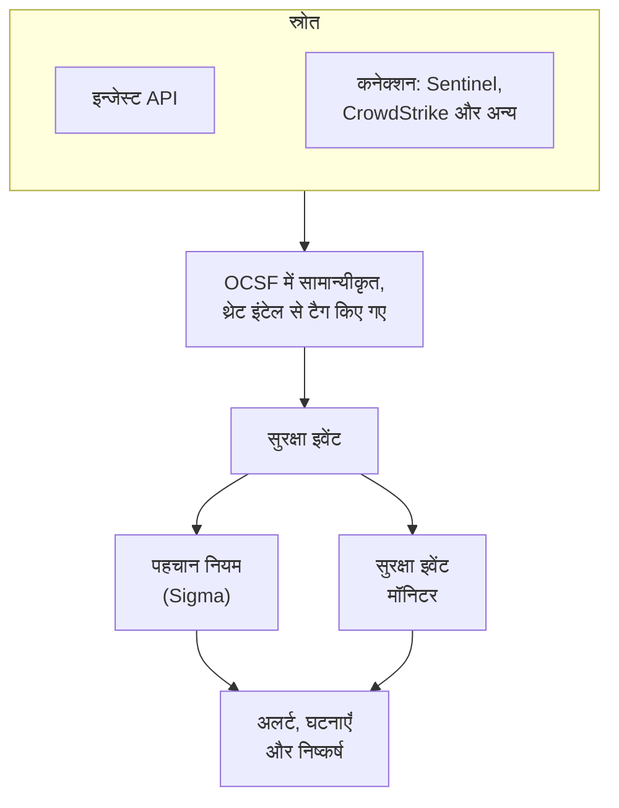
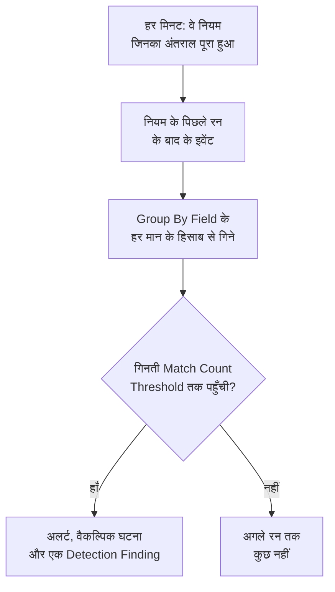

# सुरक्षा इवेंट (SIEM)

OneUptime सुरक्षा इवेंट को आपके लॉग, ट्रेस और मेट्रिक्स के बगल में रखता है, और हर इवेंट को एक ही आकार देता है, [OCSF](https://schema.ocsf.io/) (Open Cybersecurity Schema Framework), चाहे वह किसी भी फ़ॉर्मेट में आया हो। किसी भी स्रोत से इवेंट भेजें, उन्हें खोजें, और जो मायने रखते हैं उन्हें Sigma पहचान नियमों, थ्रेट इंटेलिजेंस और मॉनिटर से अलर्ट में बदलें।

:::cards
- [इवेंट भेजें](#सुरक्षा-इवेंट-भेजें): एक HTTPS POST, एक Fluent Bit आउटपुट, या किसी सुरक्षा उत्पाद से कनेक्शन।
- [खोजें और सहसंबंध देखें](#सुरक्षा-इवेंट-एक्सप्लोर-करें): इवेंट एक्सप्लोरर और सहसंबंध ग्राफ़।
- [पहचान नियम](#पहचान-नियम): Sigma नियम जो अलर्ट खोलते हैं।
- [मॉनिटर](#सुरक्षा-इवेंट-मॉनिटर): रोलिंग विंडो पर गिनती, ऐसी स्थिति के साथ जो ठीक हो जाती है।
:::

## यह कैसे काम करता है



**अवलोकनीयता** के अंदर **उत्पाद → Security Events** खोलें। इसके टैब:

| टैब | यह किसलिए है |
| --- | --- |
| **इवेंट** | हर इवेंट खोजें और फ़िल्टर करें, और किसी एक को खोलकर उसके सभी फ़ील्ड देखें |
| **सहसंबंधित करें** | उन इवेंट का ग्राफ़ जो एक ही होस्ट, उपयोगकर्ता या IP पता साझा करते हैं |
| **Detection Rules** | Sigma नियम जो शेड्यूल पर चलते हैं और अलर्ट खोलते हैं |
| **Threat Intel** | ज्ञात हानिकारक संकेतकों की STIX/TAXII फ़ीड |
| **मॉनिटर** | प्रोजेक्ट के सुरक्षा इवेंट मॉनिटर |
| **Connections** | सुरक्षा उत्पाद जिनसे OneUptime नए रिकॉर्ड के लिए पोल करता है |
| **सेटअप गाइड** | इवेंट भेजने के स्निपेट, आपकी इन्जेशन कुंजी भरी हुई |

## शुरू करने से पहले

सुरक्षा डेटा सिर्फ़ Project Owner और Project Admin भूमिकाएँ और तीन Security भूमिकाएँ पढ़ सकती हैं; दूसरी भूमिकाओं को Security Events में कुछ नहीं दिखता। देखें [भूमिकाएँ](/docs/permissions/reference#भूमिकाएँ)।

| भूमिका | यह क्या कर सकती है |
| --- | --- |
| Security Admin | सब कुछ: इवेंट, पहचान नियम, थ्रेट इंटेल फ़ीड और कनेक्शन |
| Security Member | इवेंट और थ्रेट इंटेल पढ़ना, और पहचान नियम और फ़ीड बनाना, बदलना और हटाना। यह कनेक्शन सेट नहीं कर सकती और सुरक्षा डेटा नहीं हटा सकती। |
| Security Viewer | इवेंट, नियम, फ़ीड, संकेतक और कनेक्शन पढ़ना |

## सुरक्षा इवेंट भेजें

:::steps
### इन्जेशन कुंजी बनाएँ

**प्रोजेक्ट सेटिंग्स → टेलीमेट्री और APM → इंजेशन कुंजियाँ** खोलें और **इन्जेशन कुंजी बनाएँ** पर क्लिक करें। सुरक्षा इवेंट बाकी टेलीमेट्री वाली ही कुंजियाँ इस्तेमाल करते हैं।

### अपने इवेंट पोस्ट करें

`x-oneuptime-token` में कुंजी के साथ `/security-events/v1/ingest` पर JSON भेजें:

:::tabs
@tab OCSF
```bash
curl -X POST "https://oneuptime.com/security-events/v1/ingest?format=ocsf" \
  -H "Content-Type: application/json" \
  -H "x-oneuptime-token: YOUR_INGESTION_TOKEN" \
  -H "x-oneuptime-service-name: my-security-source" \
  -d '{ "events": [ { "class_uid": 3002, "severity_id": 4, "time": 1755770400000, "status": "Failure", "message": "Failed logon for alice", "actor": { "user": { "name": "alice" } }, "src_endpoint": { "ip": "203.0.113.7" } } ] }'
```
@tab Google UDM
```bash
curl -X POST "https://oneuptime.com/security-events/v1/ingest?format=udm" \
  -H "Content-Type: application/json" \
  -H "x-oneuptime-token: YOUR_INGESTION_TOKEN" \
  -d '{ "events": [ { "metadata": { "event_type": "USER_LOGIN", "event_timestamp": "2026-08-21T10:00:00Z" }, "principal": { "user": { "userid": "alice" }, "ip": ["203.0.113.7"] }, "security_result": [{ "severity": "HIGH", "action": ["BLOCK"] }] } ] }'
```
@tab Generic JSON
```bash
curl -X POST "https://oneuptime.com/security-events/v1/ingest" \
  -H "Content-Type: application/json" \
  -H "x-oneuptime-token: YOUR_INGESTION_TOKEN" \
  -d '{ "events": [ { "timestamp": "2026-08-21T10:00:00Z", "severity": "high", "event_type": "ssh_brute_force", "message": "12 failed SSH logins in 60s", "username": "root", "hostname": "web-01", "src_ip": "203.0.113.7" } ] }'
```
:::

इवेंट कतार में लगते ही एंडपॉइंट `200` जवाब देता है।

### उन्हें इवेंट में ढूँढें

**उत्पाद → Security Events → इवेंट** खोलें। इवेंट कुछ ही सेकंड में दिखते हैं, उनकी गंभीरता, क्लास, उपयोगकर्ता, होस्ट और IP पते भरे हुए।
:::

### फ़ॉर्मेट

| `format` | यह क्या पढ़ता है | और भी स्वीकार |
| --- | --- | --- |
| `ocsf` | OCSF इवेंट JSON (`class_uid`, `severity_id` आदि) | कोई नहीं |
| `udm` | Google SecOps (Chronicle) UDM इवेंट (`metadata.event_type` आदि) | `chronicle`, `google-secops` |
| `google-secops-alert` | Google SecOps की पहचान और अलर्ट: SOAR वेबहुक और पहचान स्ट्रीम | `secops-alert`, `detection` |
| `generic` | कोई भी दूसरा JSON, आम फ़ील्ड नामों से पढ़ा जाता है | कोई नहीं |

फ़ॉर्मेट `?format=` से, `x-oneuptime-security-event-format` हेडर से, या टॉप-लेवल `"format"` फ़ील्ड से बताएँ। इसे छोड़ दें, तो हर इवेंट का फ़ॉर्मेट अलग से तय होता है, इसलिए एक वेबहुक पहचानों को कच्चे इवेंट के साथ मिला सकता है।

- बॉडी एक इवेंट, इवेंट का ऐरे, या `{ "events": [...] }` हो सकती है।
- `x-oneuptime-service-name` हेडर उस टेलीमेट्री सेवा का नाम बताता है जिससे इवेंट जुड़े हैं। इसके बिना वे पहले इवेंट के उत्पाद या विक्रेता के नाम वाली सेवा से, या `Security Events` से जुड़ते हैं।
- मैप न हो पाने की वजह से कुछ नहीं छोड़ा जाता: स्रोत का हर फ़ील्ड इवेंट की विशेषताओं में पहुँचता है।

### जेनेरिक JSON फ़ील्ड

जेनेरिक इवेंट आम फ़ील्ड नामों से पढ़ा जाता है:

| इवेंट का फ़ील्ड | इनमें से पहले मिलने वाले से पढ़ा जाता है |
| --- | --- |
| `message` | `message`, `msg`, `summary`, `description`, `title` |
| `severityName` | `severity`, `severity_name`, `level`, `priority`, `risk_level` |
| `time` | `timestamp`, `time`, `@timestamp`, `event_time`, `created_at` |
| `principalUser` | `user`, `username`, `user_name`, `account`, `actor` |
| `principalHost` | `host`, `hostname`, `computer`, `device`, `machine` |
| `principalIp` | `source_ip`, `src_ip`, `client_ip`, `ip` |
| `targetIp` | `destination_ip`, `dest_ip`, `dst_ip`, `target_ip` |
| `className` | `event_type`, `category`, `type`, `action` |
| `ruleName` | `rule`, `rule_name`, `signature`, `detection` |
| `productName` | `product`, `product_name`, `source`, `log_source` |

गंभीरता बताने वाला शब्द OCSF स्तर बन जाता है: `info` को Informational, `warning` को Low, `error` को Medium, `alert` को Critical और `emergency` को Fatal पढ़ा जाता है।

### Fluent Bit से फ़ॉरवर्ड करें

जो सुरक्षा लॉग आप पहले से इकट्ठा करते हैं, जैसे auditd, syslog या Falco, उन्हें भेजने के लिए Fluent Bit में एक `http` आउटपुट जोड़ें:

```ini title="fluent-bit.conf"
[OUTPUT]
    Name             http
    Match            security.*
    Host             oneuptime.com
    Port             443
    tls              On
    URI              /security-events/v1/ingest
    Format           json
    Json_date_key    timestamp
    Json_date_format iso8601
    Header           x-oneuptime-token YOUR_INGESTION_TOKEN
    Header           x-oneuptime-service-name my-security-source
    Retry_Limit      5
```

**सेटअप गाइड** टैब में ये स्निपेट आपके अपने होस्ट और कुंजी के साथ भरे हुए मिलते हैं।

### किसी सुरक्षा उत्पाद को कनेक्ट करें

**Connections** आपके लिए किसी सुरक्षा उत्पाद से पोल करता है और उसके नए रिकॉर्ड सुरक्षा इवेंट के रूप में इम्पोर्ट करता है। कनेक्शन में उत्पाद की सेटिंग्स और एक एन्क्रिप्टेड क्रेडेंशियल रहता है; एक वर्कर आपके सेट किए अंतराल पर उससे पोल करता है और पहले से इम्पोर्ट हो चुके रिकॉर्ड छोड़ देता है।

| उत्पाद | क्या इम्पोर्ट करता है | सेटअप गाइड |
| --- | --- | --- |
| Google SecOps (Chronicle) | नियम पहचान, क्यूरेटेड पहचान और अलर्ट, Detection Findings के रूप में | [Google SecOps](/docs/integrations/google-secops) |
| Microsoft Sentinel | घटनाएँ, Incident Findings के रूप में | [Microsoft Sentinel](/docs/integrations/microsoft-sentinel) |
| Microsoft Defender XDR | अलर्ट, Detection Findings के रूप में | [Microsoft Defender XDR](/docs/integrations/microsoft-defender-xdr) |
| CrowdStrike Falcon | अलर्ट, Detection Findings के रूप में | [CrowdStrike Falcon](/docs/integrations/crowdstrike-falcon) |
| Splunk Enterprise Security | Notable इवेंट, या कोई भी खोज, Detection Findings के रूप में | [Splunk Enterprise Security](/docs/integrations/splunk) |
| Elastic Security | पहचान अलर्ट, Detection Findings के रूप में | [Elastic Security](/docs/integrations/elastic-security) |
| AWS Security Hub | Findings, Detection और Compliance Findings के रूप में | [AWS Security Hub](/docs/integrations/aws-security-hub) |
| Okta System Log | साइन-इन, MFA, खाते और नीति के इवेंट | [Okta System Log](/docs/integrations/okta) |

- कनेक्शन रिकॉर्ड को उस समय के हिसाब से पढ़ता है जब उत्पाद ने उन्हें बनाया, न कि उस गतिविधि के समय से जिसका वे वर्णन करते हैं। हर घंटे चलने वाला SIEM नियम जिन इवेंट से मेल खाता है, उनके बहुत बाद पहचान बनाता है, और वे फिर भी इम्पोर्ट होती हैं।
- पहला पोल 24 घंटे पीछे देखता है, इसलिए नया कनेक्शन तुरंत हाल के रिकॉर्ड दिखाता है।
- कनेक्शन की पंक्ति में **कनेक्शन का परीक्षण करें** उत्पाद तक पहुँच और OneUptime के अपने वर्कर चल रहे हैं या नहीं, यह जाँचता है, और कुछ इम्पोर्ट नहीं करता। **Run now** तुरंत पोल करता है।

## इवेंट में क्या होता है

हर इवेंट टाइप किए गए फ़ील्ड और अपने स्रोत पेलोड के साथ सहेजा जाता है:

| समूह | फ़ील्ड |
| --- | --- |
| वर्गीकरण | `categoryName`, `className`, `activityName`, `statusName`, उनकी OCSF ID (`categoryUid`, `classUid`) के साथ |
| गंभीरता | `severityName`, जो Unknown, Informational, Low, Medium, High, Critical, Fatal या Other में से एक है, और `severityId` |
| किसने किया | `principalUser`, `principalHost`, `principalIp`, `principalProcess` |
| किस पर असर हुआ | `targetUser`, `targetHost`, `targetIp`, `targetPort`, `targetResource` |
| स्रोत | `productName`, `vendorName`, `ruleId`, `ruleName`, `eventUid` |
| सामग्री | `message`, `mitreTactics`, `mitreTechniques` और `observables`: इवेंट से निकाला गया हर उपयोगकर्ता, होस्ट, IP पता, डोमेन और हैश |
| विशेषताएँ | पूरा स्रोत पेलोड, बिंदु वाली कुंजियों में चपटा किया हुआ |

## सुरक्षा इवेंट एक्सप्लोर करें

**इवेंट** लॉग और ट्रेस एक्सप्लोरर जैसा एक टेलीमेट्री एक्सप्लोरर है: गंभीरता के हिसाब से विंडो के इवेंट का चार्ट, फ़ैसेट की साइडबार, सूची, और एक पैनल जिसमें खोले गए इवेंट का हर फ़ील्ड और विशेषता होती है। विंडो, फ़िल्टर और खोज सब URL में रहते हैं, इसलिए फ़िल्टर किया गया व्यू साझा किया जा सकता है और रीफ़्रेश के बाद भी बना रहता है।

### खोज

खोज बार वही भाषा बोलता है जो दूसरे टेलीमेट्री एक्सप्लोरर (देखें [खोज सिंटैक्स](/docs/telemetry/search-syntax)):

| सिंटैक्स | मतलब | उदाहरण |
| --- | --- | --- |
| मुक्त टेक्स्ट | संदेश में यह शामिल है | `failed logon` |
| `"quoted phrase"` | शब्दों को साथ रखें | `"brute force"` |
| `<field>:<value>` | टाइप किया गया फ़ील्ड | `severity:Critical` |
| `@<attribute>:<value>` | स्रोत विशेषता | `@threat.matched:true` |
| `-<filter>` | यह नहीं | `-severity:Informational` |
| `<field>:(a OR b)` | इनमें से कोई भी मान | `severity:(High OR Critical)` |
| `<field>:a*` | `*` कोई भी टेक्स्ट, `?` एक अक्षर | `host:web-*` |
| `@<attribute>:*` | विशेषता मौजूद है | `@threat.indicator_id:*` |
| `@<attribute>:~text` | विशेषता में यह टेक्स्ट है | `@finding_info.title:~ransom` |

फ़ील्ड या तो एक छोटा नाम है (`severity`, `class`, `category`, `activity`, `status`, `vendor`, `product`, `rule`, `user`, `host`, `ip`, `targetuser`, `targethost`, `targetip`, `observable`, `tactic`, `technique`) या फ़ील्ड का अपना नाम, जैसे `severityName` या `principalHost`। कोई भी दूसरा नाम स्रोत विशेषता के रूप में पढ़ा जाता है। `observable:<value>` हर वह इवेंट ढूँढता है जिसमें कोई मान आता है, चाहे वह गतिविधि के किसी भी तरफ़ हो।

### फ़ैसेट

साइडबार विंडो के इवेंट को **स्रोत**, **गंभीरता**, **इवेंट क्लास**, **Category**, **गतिविधि**, **स्थिति**, **विक्रेता**, **उत्पाद**, **Detection Rule**, **स्रोत उपयोगकर्ता** और **स्रोत होस्ट** के हिसाब से गिनता है। किसी मान पर क्लिक करके सिर्फ़ उसके इवेंट रखें, या उसके बगल के माइनस पर क्लिक करके उन्हें हटाएँ। चार्ट और हर गिनती ठीक-ठीक सूची के इवेंट को बताते हैं।

### सहसंबंध

**सहसंबंधित करें** किसी होस्ट, उपयोगकर्ता या IP पते के आसपास के इवेंट दिखाता है: आपने जो खोजा उसके चारों ओर उनकी इवेंट क्लास, उनकी सबसे खराब गंभीरता से चिह्नित, और उन्हीं इवेंट में दिखे दूसरे मान बाहरी घेरे पर। किसी क्लास पर क्लिक करके उसके इवेंट की सूची देखें, या किसी मान पर क्लिक करके आगे उस पर सहसंबंध देखें। **इवेंट** में किसी इवेंट के पैनल का हर observable उस पर **सहसंबंधित करें** खोलता है।

## पहचान नियम

पहचान नियम एक [Sigma](https://sigmahq.io/) नियम है, संदिग्ध गतिविधि बताने का एक खुला YAML फ़ॉर्मेट, जिसे OneUptime शेड्यूल पर आपके इवेंट पर चलाता है। मेल खाने पर यह एक अलर्ट खोलता है, चाहें तो एक घटना भी, और इवेंट में वापस एक Detection Finding लिखता है।



### नियम बनाएँ

:::steps
1. **उत्पाद → Security Events → Detection Rules** खोलें और **Detection Rule बनाएँ** पर क्लिक करें।
2. **मूल जानकारी** में इसे एक **नाम** दें, और **सक्षम** चालू रखें।
3. **Sigma Rule** में, नियम का YAML **Sigma Rule (YAML)** में चिपकाएँ। सहेजते समय इसे पार्स किया जाता है, इसलिए कोई गलती फ़ॉर्म में दिखती है।
4. **मूल्यांकन** में तय करें कि यह कितनी बार चले और इसे कितने मिलान चाहिए; देखें [मूल्यांकन सेटिंग्स](#मूल्यांकन-सेटिंग्स)।
5. **मिलान होने पर** में चुनें कि मिलान पर क्या हो: **Create Alert on Match** (चालू), **Create Incident on Match** (बंद) और **Write Detection Finding on Match** (चालू), साथ में वैकल्पिक **अलर्ट गंभीरता** और **घटना गंभीरता** ।
:::

पहला नियम, जो `10.x.x.x` के बाहर से हुए विफल लॉगऑन से मेल खाता है:

```yaml title="failed-logon-burst.yml"
title: Failed logon burst
description: Repeated authentication failures from one source.
level: high
tags:
  - attack.t1110
  - attack.ta0006
detection:
  selection:
    className: Authentication
    statusName: Failure
  filter_internal:
    principalIp|startswith: '10.'
  condition: selection and not filter_internal
```

### नियम क्या कह सकता है

OneUptime Sigma का बूलियन मूल हिस्सा चलाता है:

- सिलेक्शन फ़ील्ड मैप होते हैं (हर फ़ील्ड मेल खाना चाहिए; मानों की सूची उनमें से किसी से भी मेल खाती है) या कीवर्ड सूचियाँ, जो संदेश में कहीं भी मेल खाती हैं।
- कंडीशन सिलेक्शन को `and`, `or`, `not` और कोष्ठकों से, या `1 of selection_*`, `all of selection_*`, `any of them` और `all of them` से जोड़ती हैं।
- फ़ील्ड मॉडिफ़ायर: `contains`, `startswith`, `endswith`, `all`, `re`, `cased`, `gt`, `gte`, `lt`, `lte`, `cidr`, `exists` और `windash`। टेक्स्ट की तुलना अक्षरों के बड़े-छोटे होने को अनदेखा करके होती है, जब तक आप `cased` न जोड़ें।
- फ़ील्ड एक टाइप किया गया फ़ील्ड है (`principalUser`), उसकी आम Sigma वर्तनी (`CommandLine`, `src_ip`, `Hostname`), या कोई भी विशेषता कुंजी, वैसे ही लिखी जैसे इवेंट में है (`threat.matched`)।
- `level` गंभीरता तय करता है: `informational`, `low`, `medium`, `high` या `critical`, और न होने पर `medium`। `tags` में ATT&CK ID (`attack.t1110`, `attack.ta0006`) निष्कर्ष के MITRE फ़ील्ड भरती हैं।

`| count() by principalIp > 5` जैसे एग्रीगेशन सहेजते समय अस्वीकार हो जाते हैं: इसके बजाय **Group By Field** और **Match Count Threshold** इस्तेमाल करें। `logsource` सिर्फ़ जानकारी के लिए है और कुछ सीमित नहीं करता: वह फ़िल्टर किसी सिलेक्शन में डालें, जैसे `className: Authentication`। `timeframe` अनदेखा किया जाता है, क्योंकि नियम का अंतराल ही उसकी विंडो तय करता है।

### मूल्यांकन सेटिंग्स

| फ़ील्ड | यह क्या करता है |
| --- | --- |
| **Evaluation Interval (Minutes)** | नियम कितनी बार चलता है: पूरे मिनट, 1 से 1440। नए नियम का फ़ॉर्म 5 से शुरू होता है। |
| **Group By Field** | वैकल्पिक। जो मिलान इस फ़ील्ड का मान साझा करते हैं, जैसे `principalHost`, उन्हें साथ गिना जाता है, साथ अलर्ट किया जाता है और साथ डुप्लिकेट हटाए जाते हैं: सैकड़ों के बजाय हर होस्ट पर एक अलर्ट। |
| **Distinct Count Field** | वैकल्पिक। मेल खाने वाले इवेंट के बजाय इस फ़ील्ड के अलग-अलग मान गिनें। खाली मान नहीं गिने जाते। |
| **Match Count Threshold** | कोई समूह तभी फ़ायर होता है जब एक रन के भीतर उसकी गिनती इस संख्या तक पहुँचे: 1 से 1000000, और 1 पर हर मिलान फ़ायर होता है। |

Group By और Distinct Count वही फ़ील्ड नाम लेते हैं जो नियम लेता है। इनके साथ थ्रेशोल्ड का मतलब होता है "एक ही चीज़ से, एक रन में, इतने", ऊपर से किसी मॉनिटर के बिना:

| लक्ष्य | Group By Field | Distinct Count Field | थ्रेशोल्ड |
| --- | --- | --- | --- |
| किसी भी मिलान पर अलर्ट | खाली | खाली | 1 |
| हर होस्ट पर एक अलर्ट | `principalHost` | खाली | 1 |
| ब्रूट फ़ोर्स: एक IP से 5 विफल लॉगऑन | `principalIp` | खाली | 5 |
| पासवर्ड स्प्रेइंग: एक IP का 5 अलग-अलग खातों पर विफल होना | `principalIp` | `principalUser` | 5 |
| पोर्ट स्कैन: एक IP का 20 अलग-अलग पोर्ट तक पहुँचना | `principalIp` | `targetPort` | 20 |

### नियम कब चलता है

OneUptime हर मिनट उन सक्षम नियमों को जाँचता है जिनका अंतराल पिछले रन के बाद बीत चुका है। हर रन उन इवेंट को पढ़ता है जिनका इवेंट समय पिछले रन और अभी के बीच आता है, फिर आगे बढ़ता है:

- विंडो एक के बाद एक लगती हैं, रोलिंग नहीं होतीं। 10 मिनट के अंतराल पर 09:58 और 10:01 की विफलताएँ अलग-अलग रन में पड़ सकती हैं और अलग गिनी जाती हैं, इसलिए थ्रेशोल्ड चुनते समय गुंजाइश रखें।
- किसी अंतराल के बाद, जैसे वर्कर रुकने या नियम के फिर से चालू होने पर, अगला रन पूरा अंतराल कवर करता है, ज़्यादा से ज़्यादा पिछले 24 घंटे तक।
- देर से आया इवेंट, जिसका समय नियम के पिछले रन से पहले का है, सहेजा जाता है और खोजा जा सकता है, लेकिन वह नियम उसे कभी नहीं पढ़ता।
- हर रन में ज़्यादा से ज़्यादा 100 समूह फ़ायर होते हैं: सबसे ज़्यादा गिनती वाले।

### गंभीरता

नियम का `level` उसके निष्कर्षों की गंभीरता है: `informational`, `low`, `medium`, `high` और `critical` क्रमशः Informational, Low, Medium, High और Critical बनते हैं। उसके अलर्ट और घटनाएँ आपके प्रोजेक्ट की गंभीरताओं में से एक लेते हैं, इस क्रम में:

1. नियम की **अलर्ट गंभीरता** (या **घटना गंभीरता** ), अगर सेट हो।
2. स्तर के नाम वाली आपकी गंभीरता, जैसे High, अक्षरों के बड़े-छोटे होने की परवाह किए बिना।
3. रैंक के हिसाब से: `critical` और `high` नियम आपकी सबसे गंभीर गंभीरता लेते हैं, बाकी सबसे कम गंभीर।

> [!TIP]
> अपनी अलर्ट गंभीरताओं के नाम Sigma स्तरों (Critical, High, Medium, Low, Informational) पर रखें, और हर नियम बिना किसी अलग सेटिंग के सही गंभीरता पर पहुँचेगा।

### अलर्ट और निष्कर्ष

फ़ायर होने वाला हर समूह `[Detection] <rule name> — <group value>` शीर्षक वाला अलर्ट खोलता है, या बिना Group By Field वाले नियम के लिए `[Detection] <rule name>`। जब तक वह खुला है, उस समूह के और मिलान नया अलर्ट नहीं खोलते। नियम सिर्फ़ मिलान देखता है और यह नहीं बता सकता कि हमला रुक गया है, इसलिए उसके अलर्ट तब तक खुले रहते हैं जब तक कोई उन्हें सुलझा न दे।

Detection Finding `OneUptime Detections` उत्पाद से आया `Detection Finding` क्लास (OCSF क्लास 2004) का एक सुरक्षा इवेंट है, जिसमें नियम के MITRE टैग, `observables` में सबसे पहले समूह का मान, और ये विशेषताएँ होती हैं:

| विशेषता | मान |
| --- | --- |
| `oneuptime.detection.rule_id` | फ़ायर हुए नियम की ID |
| `oneuptime.detection.rule_name` | नियम का नाम |
| `oneuptime.detection.match_count` | निष्कर्ष के पीछे कितने इवेंट हैं |
| `oneuptime.detection.distinct_count` | उसके पीछे कितने अलग-अलग मान हैं, Distinct Count Field वाले नियम के लिए |
| `oneuptime.detection.group_value` | समूह का मान, Group By Field वाले नियम के लिए |
| `oneuptime.detection.sigma_id` | Sigma नियम की अपनी `id` |

निष्कर्ष सामान्य इवेंट हैं: उन्हें **इवेंट** में खोजें और **सहसंबंधित करें** में उनसे आगे बढ़ें। किसी नए नियम को चुपचाप आज़माने के लिए, जब तक उस पर भरोसा न हो जाए, निष्कर्ष के अलावा हर कार्रवाई बंद रखें।

## सुरक्षा इवेंट मॉनिटर

सुरक्षा इवेंट मॉनिटर रोलिंग विंडो पर अपने फ़िल्टर से मेल खाने वाले इवेंट गिनता है और गिनती पर सामान्य मॉनिटर मानदंड चलाता है: यह मॉनिटर की स्थिति बदलता है, अलर्ट या घटनाएँ खोलता है, और ऑन-कॉल को पेज करता है। इसे **मॉनिटर → मॉनिटर बनाएं** के अंदर, प्रकार के रूप में **Security Events** चुनकर बनाएँ; **Security Events → मॉनिटर** उन सबकी सूची दिखाता है।

इसके फ़ॉर्म में **Monitor events that include this text**, **Monitor Security Events for (time)**, **Event Severity** और **इवेंट क्लास** दिखते हैं। **टेलीमेट्री सेवा द्वारा फ़िल्टर करें** और **विशेषताओं द्वारा फ़िल्टर करें** **और फ़ील्ड** के अंदर रहते हैं, जिसका हेडर दिखाता है कि कोई मॉनिटर इनमें से कौन-से इस्तेमाल करता है। इसके मानदंड **Security Event Count** जाँचते हैं।

| | पहचान नियम | सुरक्षा इवेंट मॉनिटर |
| --- | --- | --- |
| किससे मेल खाता है | एक Sigma नियम | गंभीरता, क्लास, संदेश, सेवा और विशेषताओं पर फ़िल्टर |
| विंडो | एक के बाद एक, हर रन में एक | रोलिंग: पिछले 5 सेकंड से 24 घंटे तक |
| समूह के हिसाब से गिनती | हाँ, **Group By Field** के साथ | नहीं: मेल खाने वाली हर चीज़ की एक ही गिनती |
| क्या खोलता है | अलर्ट, घटनाएँ और निष्कर्ष | एक स्थिति, अलर्ट और घटनाएँ |
| ठीक होता है | नहीं: अलर्ट सुलझाए जाने तक खुले रहते हैं | हाँ: गिनती लौटने पर स्थिति भी लौट आती है |

पहचान खुद एक नियम के रूप में लिखें, उसके थ्रेशोल्ड के साथ। मॉनिटर तब इस्तेमाल करें जब आपको रोलिंग विंडो, अपने आप ठीक होने वाली स्थिति, स्टेटस पेज, या हर मानदंड के लिए अलग ऑन-कॉल नीतियाँ चाहिए।

### अपनी पहचानों पर नज़र रखें

निष्कर्ष इवेंट हैं, इसलिए मॉनिटर खुद नियमों पर नज़र रख सकता है:

- तूफ़ान: `Detection Finding` क्लास पर एक मॉनिटर, जो हर निष्कर्ष गिनता है। एक घंटे में बीस अलग-अलग नियमों का फ़ायर होना ऐसा संकेत है जो कोई अकेला नियम नहीं देख सकता।
- दर में बदलाव: किसी एक नियम के `oneuptime.detection.rule_id` पर फ़िल्टर करें। जो नियम हफ़्ते में एक बार फ़ायर होता है, वह घंटे में पचास बार फ़ायर हो, तो उसे अलग प्रतिक्रिया चाहिए।
- खामोशी: निष्कर्ष, जो आम तौर पर कुछ दिखते हैं, शून्य पर आ जाएँ, तो आम तौर पर इसका मतलब है कि किसी स्रोत ने भेजना बंद कर दिया। ऐसा मानदंड इस्तेमाल करें जो किसी संख्या से कम गिनती की जाँच करे।

किसी नियम की पंक्ति में **मॉनिटर बनाएं** कार्रवाई पहले से इसी तरह सेट एक नया मॉनिटर खोलती है: `Detection Finding` क्लास, नियम की ID (कभी उसका नाम नहीं, जो नाम बदलने पर बदल जाएगा), और पिछला एक घंटा। ऐसा मॉनिटर निष्कर्ष गिनता है, हर रन में हर समूह का एक, न कि उनके पीछे के इवेंट। कुछ भी फ़ायर होने से पहले कुछ संख्या में इवेंट ज़रूरी बनाने के लिए नियम का **Match Count Threshold** इस्तेमाल करें।

## थ्रेट इंटेलिजेंस

**Threat Intel** ज्ञात हानिकारक IP पतों, डोमेन, URL, ईमेल पतों और फ़ाइल हैश की STIX/TAXII फ़ीड की सदस्यता लेता है। जिन इवेंट में इनमें से कोई आता है, उन्हें पहुँचते ही `threat.*` विशेषताओं से टैग किया जाता है, जिन पर नियम और मॉनिटर फ़िल्टर कर सकते हैं, और हर मिनट हाल के इवेंट का फ़ीड से मिलान होता है, जो किसी नियम की तरह अलर्ट और निष्कर्ष खोलता है। देखें [थ्रेट इंटेलिजेंस](/docs/telemetry/threat-intelligence)।

## प्रतिधारण और बिलिंग

सुरक्षा इवेंट का बिल आपकी बाकी टेलीमेट्री की तरह प्रति GB इन्जेस्ट होता है, और वे आपके टेलीमेट्री प्रतिधारण तक रखे जाते हैं: प्रोजेक्ट का **डिफ़ॉल्ट प्रतिधारण (दिन)** , जो **प्रोजेक्ट सेटिंग्स → टेलीमेट्री और APM → डेटा प्रतिधारण** के अंदर है, या उस टेलीमेट्री सेवा पर सेट प्रतिधारण जिससे वे जुड़े हैं। किसी इवेंट का प्रतिधारण खत्म होने पर उसे हटा दिया जाता है।

## समस्या निवारण

:::details इवेंट नहीं दिखते
`x-oneuptime-token` में कुंजी और पथ `/security-events/v1/ingest` जाँचें। फिर **इवेंट** में विंडो जाँचें, जो आपके बदलने तक पिछला एक दिन है: इवेंट अपने समय पर रखा जाता है, इसलिए पुराने टाइमस्टैम्प वाला इवेंट विंडो के बाहर पड़ता है।
:::

:::details नियम कभी मेल नहीं खाता
जाँचें कि वह **सक्षम** है, और उसकी पंक्ति में **Last Evaluated** और **Last Error** पढ़ें। कोई ऐसा इवेंट खोलें जिसके मेल खाने की आपको उम्मीद थी, और उसकी तुलना नियम से फ़ील्ड-दर-फ़ील्ड करें: सादा मान पूरे फ़ील्ड के बराबर होना चाहिए, इसलिए किसी हिस्से के लिए `contains` या `*` इस्तेमाल करें। विशेषता का नाम वैसे ही लिखा जाता है जैसे इवेंट में है (`threat.matched`, न कि `attributes.threat.matched`)। 1 से ज़्यादा थ्रेशोल्ड होने पर मिलान एक ही रन में पड़ने चाहिए।
:::

:::details नियम मेल खाया, लेकिन कोई अलर्ट नहीं खुला
**Create Alert on Match** बंद है, या उसी नियम और समूह मान का अलर्ट अभी भी खुला है, और बाद के मिलान उसी में जुड़ जाते हैं। नियमों के अलर्ट खोलने के लिए प्रोजेक्ट में कम से कम एक अलर्ट गंभीरता होनी चाहिए।
:::

:::details नियम बहुत ज़्यादा अलर्ट खोलता है
**Group By Field** के हर मान को अपना अलर्ट मिलता है: किसी मोटी चीज़ से समूह बनाएँ, थ्रेशोल्ड बढ़ाएँ, या एक Distinct Count Field जोड़ें। अगर हर मिलान के बजाय दर की परवाह है, तो **Create Alert on Match** बंद करें और नियम के निष्कर्षों पर एक मॉनिटर लगाएँ।
:::

## अगले कदम

:::cards
- [थ्रेट इंटेलिजेंस](/docs/telemetry/threat-intelligence): अपने इवेंट का STIX/TAXII फ़ीड से मिलान करें।
- [Google SecOps](/docs/integrations/google-secops): Chronicle की पहचान और इवेंट ले आएँ।
- [खोज सिंटैक्स](/docs/telemetry/search-syntax): वह सब कुछ जो खोज बार समझता है।
- [अनुमति संदर्भ](/docs/permissions/reference): Security भूमिकाएँ, और हर एक क्या कर सकती है।
:::
