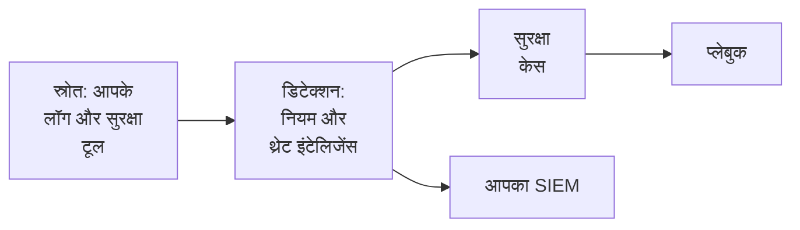

# सुरक्षा के साथ शुरुआत

OneUptime उस डेटा में खतरे ढूंढता है जो आपके पास पहले से है - आपके लॉग, आपके सुरक्षा टूल और जो कुछ भी आप उसे भेजते हैं -, जो मिलता है उसे केस में समूहित करता है और प्लेबुक से प्रतिक्रिया देता है। इसे सेट करने में दो क्लिक लगते हैं, और कुछ भी इंस्टॉल नहीं करना पड़ता।

:::cards
- [सेट अप करें](#सेट-अप-करें): वह चालू करें जिसकी ज़्यादातर टीमों को ज़रूरत होती है, फिर देखें कि एक परीक्षण हमला केस कैसे खोलता है।
- [यह कैसे काम करता है](#यह-कैसे-काम-करता-है): स्रोत, डिटेक्शन, केस और प्लेबुक, और हर एक क्या करता है।
- [आपके लॉग](#अपने-लॉग-में-सुरक्षा-इवेंट-खोजें): वे सुरक्षा इवेंट जो OneUptime को भेजे जाने वाले लॉग में पहले से मौजूद हैं।
- [आपका SIEM](#oneuptime-को-जो-मिलता-है-उसे-अपने-siem-को-भेजें): OneUptime को जो मिलता है उसे Google SecOps को भेजें।
:::

## शुरू करने से पहले

सुरक्षा सेट करने के लिए Project Owner, Project Admin या Security Admin भूमिका चाहिए। Security Member और Security Viewer भूमिकाएँ जो मिलता है उसे पढ़ सकती हैं; [भूमिकाएँ](/docs/permissions/reference#भूमिकाएँ) देखें।

## सेट अप करें

:::steps
### वह चालू करें जिसकी ज़्यादातर टीमों को ज़रूरत होती है

**उत्पाद → Security Events** खोलें। **अवलोकन** पर **सुझाए गए चालू करें** पर क्लिक करें। इससे एक साथ तीन चीज़ें चालू होती हैं: **अपने लॉग में सुरक्षा इवेंट खोजें**, सुझाए गए डिटेक्शन नियम, और **नए केस समृद्ध करें**, एक प्लेबुक जो हर नए केस को थ्रेट इंटेलिजेंस से मिलाता है और उस पर ट्राइएज के लिए एक चेकलिस्ट छोड़ता है।

### परीक्षण हमला भेजें

**टेस्ट हमला भेजें** पर क्लिक करें। दस्तावेज़ों के लिए रखे गए एक पते से दर्जन भर विफल साइन-इन असली प्रोसेसिंग से गुज़रते हैं: वे सहेजे जाते हैं, ब्रूट फ़ोर्स नियम उन्हें पकड़ता है, और एक केस खुल जाता है। किसी को पेज नहीं किया जाता, और कोई SIEM उन्हें प्राप्त नहीं करता।

### केस खोलें

**केस खोलें** पर क्लिक करें। असली खोज ऐसी ही दिखती है: उसके पीछे के इवेंट, वह पता जिसके बारे में वह है, और **नए केस समृद्ध करें** को क्या मिला। काम पूरा होने पर इसे परीक्षण के रूप में बंद कर दें।
:::

इसके बाद से **अवलोकन** **ध्यान देने की ज़रूरत** के नीचे उस चीज़ पर खुलता है जिसे किसी की ज़रूरत है: आपके खुले केस, वे केस जिन्हें किसी ने नहीं उठाया, और मंज़ूरी का इंतज़ार कर रहे प्लेबुक चरण। कुछ न होने पर यह **सब शांत है** दिखाता है।

## यह कैसे काम करता है

| हिस्सा | कहाँ | यह क्या करता है |
| --- | --- | --- |
| **स्रोत** | **कनेक्शन** | आपके लॉग, वे सुरक्षा उत्पाद जिनसे OneUptime पोल करता है, और जो कुछ भी आप भेजते हैं |
| **डिटेक्शन** | **डिटेक्शन** | Sigma नियम और थ्रेट इंटेलिजेंस फ़ीड जो हर इवेंट में खतरे खोजते हैं |
| **सुरक्षा केस** | **सुरक्षा केस** | जो मिला, उसे उस उपयोगकर्ता, होस्ट या पते के अनुसार समूहित किया गया जिसके बारे में वह है |
| **प्लेबुक** | **प्लेबुक** | नए केस पर चलने वाले चरण: उन्हें समृद्ध करना, सूचित करना, इंसिडेंट खोलना या रोकना |

**अवलोकन** के ऊपर, जिसे किसी की ज़रूरत है उसके नीचे, हर हिस्सा अपने आंकड़े दिखाता है: स्रोत और पिछले 24 घंटों के उनके इवेंट, चालू नियम, खुले केस और प्रतिक्रिया देने वाले प्लेबुक। जो हिस्सा सेट अप नहीं है, वह यह बताता है और वह पेज खोलता है जहाँ आप उसे सेट करते हैं।

## अपने लॉग में सुरक्षा इवेंट खोजें

**कनेक्शन** के ऊपर **आपके लॉग** के लिए कुछ भी इंस्टॉल नहीं करना पड़ता। **अपने लॉग में सुरक्षा इवेंट खोजें** चालू होने पर, OneUptime हर मिनट प्रोजेक्ट के नए लॉग पढ़ता है और जिन पंक्तियों को वह पहचानता है उन्हें सुरक्षा इवेंट बना देता है:

| लॉग | क्या सुरक्षा इवेंट बनता है |
| --- | --- |
| SSH साइन-इन | किसी सर्वर के ऑथ लॉग, journal या syslog से विफल और सफल SSH साइन-इन |
| sudo | किसी दूसरे उपयोगकर्ता के रूप में चलाए गए कमांड, गलत sudo पासवर्ड और वे लोग जिन्हें sudo इस्तेमाल करने की अनुमति नहीं है |
| Windows इवेंट | Windows, Sysmon और Microsoft Defender से साइन-इन, नई प्रोसेस, बदले गए खाते और ग्रुप, इंस्टॉल की गई सेवाएं और साफ़ किए गए लॉग |
| AWS CloudTrail | कंसोल साइन-इन, आपके AWS खातों में किए गए बदलाव और वे कॉल जिन्हें AWS ने अस्वीकार किया |
| Google Cloud ऑडिट लॉग | आपके Google Cloud प्रोजेक्ट में किए गए बदलाव, वे कॉल जिन्हें Google ने अस्वीकार किया, और Google Cloud के साथ शेयर किए गए Google Workspace साइन-इन |
| Azure गतिविधि और Entra ID लॉग | आपकी Azure सदस्यताओं में किए गए बदलाव, Defender for Cloud अलर्ट, और Microsoft Entra ID के साइन-इन और डायरेक्टरी बदलाव |
| CEF | Common Event Format भेजने वाले फ़ायरवॉल, IDS, WAF और दूसरे सुरक्षा उत्पादों से खतरे, ब्लॉक किए गए कनेक्शन और साइन-इन |
| LEEF | Log Event Extended Format भेजने वाले उत्पादों से यही सब, जैसा कई उत्पाद IBM QRadar के लिए करते हैं |
| Kubernetes ऑडिट लॉग | क्लस्टर में बदलाव, पॉड में खोले गए शेल, पढ़े गए सीक्रेट और अस्वीकार किए गए अनुरोध |
| वेब हमले | किसी वेब सर्वर के एक्सेस लॉग में ऐसे अनुरोध जो SQL इंजेक्शन, पाथ ट्रैवर्सल या Log4Shell आज़माते हैं |

आपके लॉग जैसे हैं वैसे ही रहते हैं। केवल वे पंक्तियाँ इवेंट बनती हैं जो सुरक्षा के लिए मायने रखती हैं: कभी भी वेब सर्वर का दिया हर पेज या API का हर रीड नहीं।

## OneUptime को जो मिलता है उसे अपने SIEM को भेजें

अगर आपकी टीम पहले से किसी SIEM में काम करती है, तो OneUptime जो पाता है उसे वहाँ भी भेजता है। **कनेक्शन → अपने SIEM में भेजें** के नीचे **गंतव्य जोड़ें** पर क्लिक करें, अपने Google SecOps का क्षेत्र, इंस्टेंस और सर्विस अकाउंट की भरें, और सहेजने से पहले **टेस्ट इवेंट भेजें** पर क्लिक करें। [Google SecOps को सुरक्षा इवेंट भेजें](/docs/integrations/google-secops#google-secops-को-सुरक्षा-इवेंट-भेजें) देखें।

## समस्या निवारण

:::details Turn on recommended धूसर दिख रहा है
आपकी भूमिका डिटेक्शन नियम, प्लेबुक या लॉग स्रोत नहीं जोड़ सकती। किसी Project Owner, Project Admin या Security Admin से कहें, या उनसे आपको Security Admin भूमिका देने को कहें।
:::

:::details Turn on recommended सब कुछ चालू नहीं कर सका
कार्ड हर उस चीज़ का नाम और कारण बताता है जिसे वह चालू नहीं कर सका: आपकी भूमिका, आपका प्लान, या OneUptime की ओर से कोई गड़बड़ी। बाकी सब चालू है। जो कार्ड बताए उसे ठीक करें, फिर **फिर से प्रयास करें** पर क्लिक करें: सिर्फ़ वही चालू होता है जो अभी भी नहीं है, और कुछ भी दो बार नहीं जुड़ता।
:::

:::details परीक्षण हमले से कोई केस नहीं खुला
आम तौर पर बटन के जवाब देने से पहले ही केस खुल जाता है; जब नियम अभी पीछे चल रहा होता है, तो वह यह बताता है और केस एक मिनट के भीतर खुल जाता है। **सुरक्षा केस** फिर से देखें, और **डिटेक्शन** में जाँचें कि ब्रूट फ़ोर्स नियम चालू है।
:::

:::details मेरे लॉग से कोई सुरक्षा इवेंट नहीं आता
जाँचें कि **अपने लॉग में सुरक्षा इवेंट खोजें** चालू है और **आपके लॉग** कार्ड बताता है कि आखिरी जाँच कब हुई। केवल ऊपर की तालिका वाली पंक्तियाँ ही इवेंट बनती हैं: जो सर्वर SSH, sudo, Windows, ऑडिट, CEF, LEEF या एक्सेस लॉग नहीं भेजता, उसके पास खोजने को कुछ नहीं है। यह देखने के लिए कि OneUptime उसे पढ़ता है या नहीं, उसकी कोई एक पंक्ति **आपके लॉग** पर **एक लॉग लाइन जाँचें** में पेस्ट करें।
:::

:::details अवलोकन बताता है कि आखिरी सुरक्षा इवेंट कई दिन पहले आया था
तब से Security तक कुछ नहीं पहुँचा है। **कनेक्शन** खोलें और जाँचें कि **आपके लॉग** और हर कनेक्शन अब भी चालू हैं, और हर एक ने आखिरी बार कब जाँचा।
:::

:::details Security चालू करने वाला कार्ड गायब है
किसी ने उसे **बंद करें** से हटा दिया। जब तक किसी चीज़ पर खतरों के लिए नज़र नहीं रखी जा रही, **अवलोकन** **Security सेट करें** दिखाता है, जिससे कार्ड वापस आ जाता है।
:::

## अगले कदम

:::cards
- [सुरक्षा इवेंट (SIEM)](/docs/telemetry/security-events): इवेंट भेजें, उन्हें खोजें और डिटेक्शन नियम लिखें।
- [सुरक्षा केस और प्लेबुक (SOAR)](/docs/telemetry/security-cases): केस निपटाएँ और प्लेबुक से प्रतिक्रिया दें।
- [थ्रेट इंटेलिजेंस (STIX/TAXII)](/docs/telemetry/threat-intelligence): अपने इवेंट को ज्ञात दुर्भावनापूर्ण संकेतकों से मिलाएँ।
- [Google SecOps](/docs/integrations/google-secops): Google SecOps के डिटेक्शन लाएँ, और OneUptime को जो मिलता है उसे वहाँ भेजें।
:::
