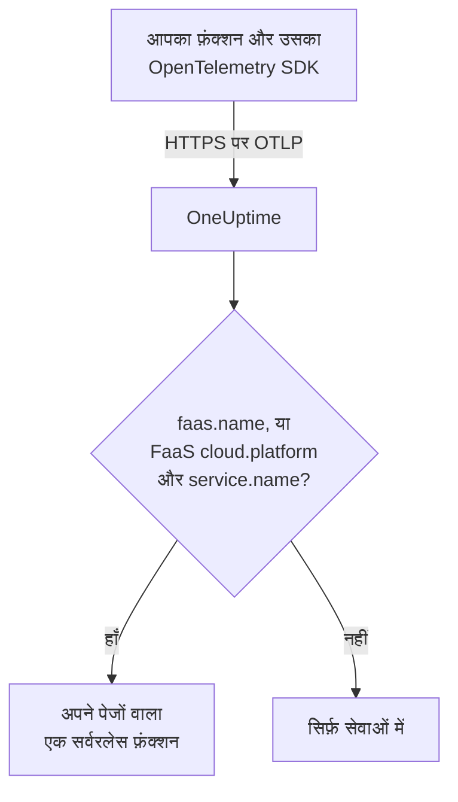

# Serverless फ़ंक्शन

OneUptime किसी सर्वरलेस फ़ंक्शन को उसी क्षण पहचान लेता है जब उसे उससे OpenTelemetry डेटा मिलता है, और उसे उसके ट्रेस, लॉग और मेट्रिक्स के साथ **Serverless फ़ंक्शन** के अंतर्गत सूचीबद्ध करता है। यह AWS Lambda, Google Cloud Functions, Azure Functions, Cloudflare Workers और ऐसे किसी भी अन्य FaaS रनटाइम के लिए काम करता है जो OpenTelemetry भेज सकता हो। हाथ से कुछ भी बनाने की ज़रूरत नहीं: फ़ंक्शन को उसके रनटाइम के OpenTelemetry SDK से इंस्ट्रूमेंट करें और उसके OTLP एक्सपोर्टर को OneUptime की ओर इंगित करें।

:::cards
- [OneUptime किसी फ़ंक्शन को कैसे पहचानता है](#oneuptime-किसी-फ़ंक्शन-को-कैसे-पहचानता-है): `faas.name`, या `service.name` के साथ कोई FaaS `cloud.platform`।
- [किसी फ़ंक्शन की टेलीमेट्री भेजें](#किसी-फ़ंक्शन-की-टेलीमेट्री-भेजें): एक्सपोर्टर सेटिंग्स, और Lambda लेयर।
- [Azure Functions](#azure-functions): हर Function App के लिए एक फ़ंक्शन, Functions होस्ट से।
- [समस्या निवारण](#समस्या-निवारण): ऐसा फ़ंक्शन जो दिखता नहीं, या जिसके पेज खाली हैं।
:::

## यह कैसे काम करता है

OneUptime हर बैच के आते ही उसके रिसोर्स एट्रिब्यूट पढ़ता है। `faas.name` वाला रिसोर्स, या `service.name` के साथ `aws_lambda` या `azure_functions` जैसे FaaS `cloud.platform` वाला रिसोर्स, एक सर्वरलेस फ़ंक्शन है: OneUptime उसके पहले डेटा के साथ उसे बनाता है और टेलीमेट्री को उसके अंतर्गत रखता है।



## शुरू करने से पहले

- एक इंजेशन कुंजी। **प्रोजेक्ट सेटिंग्स → टेलीमेट्री और APM → इंजेशन कुंजियाँ** के अंतर्गत एक बनाएँ और उसका मान कॉपी करें।
- आपके फ़ंक्शन की भाषा के लिए OpenTelemetry SDK, या कोई ऑटो-इंस्ट्रूमेंटेशन लेयर।

## OneUptime किसी फ़ंक्शन को कैसे पहचानता है

OneUptime हर फ़ंक्शन को `faas.name` रिसोर्स एट्रिब्यूट से पहचानता है। कुछ प्लेटफ़ॉर्म के रिसोर्स डिटेक्टर इसे कभी सेट नहीं करते ([Azure Functions](#azure-functions) आम मामला है), इसलिए जब किसी रिसोर्स में `faas.name` नहीं होता लेकिन उसका `cloud.platform` कोई FaaS प्लेटफ़ॉर्म होता है, तो OneUptime उसकी जगह उसके `service.name` को फ़ंक्शन की पहचान के रूप में उपयोग करता है, और वह मान हर उस स्पैन, लॉग, मेट्रिक और प्रोफ़ाइल पर `faas.name` के रूप में भरता है जिसे वह सहेजता है, ताकि फ़ंक्शन के पेज उसकी पूरी टेलीमेट्री ढूँढ सकें:

| एट्रिब्यूट | ज़रूरी | उद्देश्य |
| --- | --- | --- |
| `faas.name` | **हाँ**, जब तक अगले दोनों सेट न हों | फ़ंक्शन की पहचान (जैसे `checkout-handler`) |
| `cloud.platform` | `service.name` के साथ, जब कोई `faas.name` न हो | `aws_lambda`, `gcp_cloud_functions`, `azure_functions`, `tencent_cloud_scf` या `alibaba_cloud_fc` |
| `service.name` | बिना `faas.name` वाले FaaS `cloud.platform` पर | फ़ंक्शन की पहचान, जो टेलीमेट्री पर `faas.name` के रूप में लिखी जाती है |
| `faas.version` | नहीं | ओवरव्यू पर दिखाया जाता है |
| `faas.instance` | नहीं | **इंस्टेंस** पेज पर हर इंस्टेंस के लिए ट्रैक किया जाता है |
| `cloud.provider` / `cloud.region` / `cloud.account.id` | नहीं | ओवरव्यू पर दिखाया जाता है |
| `process.runtime.name` / `process.runtime.version` | नहीं | ओवरव्यू पर रनटाइम के रूप में दिखाया जाता है |

आपका सेट किया हुआ `faas.name` कभी बदला नहीं जाता। `cloud.platform` का मान ठीक वैसे लिखा होना चाहिए जैसा सूची में है (कुछ Azure डिटेक्टर जो बिंदु वाला `azure.functions` भेजते हैं, वह भी स्वीकार किया जाता है), और `service.name` एक रिसोर्स एट्रिब्यूट होना चाहिए: `x-oneuptime-service-name` हेडर किसी सेवा का नाम देता है, फ़ंक्शन का नहीं।

> [!NOTE]
> जो फ़ंक्शन `service.name` भी सेट करता है, वह अब भी **सेवाएं** के अंतर्गत भी दिखता है। **Serverless फ़ंक्शन** फ़ंक्शन के लिए बना दृश्य है, जो `faas.name` से सीमित होता है।

## किसी फ़ंक्शन की टेलीमेट्री भेजें

:::steps
### OTLP एक्सपोर्टर के एनवायरनमेंट वेरिएबल सेट करें

ज़्यादातर भाषाओं के ऑटो-इंस्ट्रूमेंटेशन मानक OpenTelemetry एनवायरनमेंट वेरिएबल पढ़ते हैं:

```bash
OTEL_EXPORTER_OTLP_ENDPOINT="https://oneuptime.com/otlp"
OTEL_EXPORTER_OTLP_HEADERS="x-oneuptime-token=YOUR_TELEMETRY_INGESTION_TOKEN"
OTEL_RESOURCE_ATTRIBUTES="faas.name=checkout-handler,faas.version=1.4.2"
```

अगर आप OneUptime खुद होस्ट करते हैं, तो एंडपॉइंट को `https://YOUR-ONEUPTIME-HOST/otlp` से बदलें। Azure Functions पर `faas.name` को `OTEL_RESOURCE_ATTRIBUTES` से बाहर रखें — [Azure Functions](#azure-functions) देखें।

> [!WARNING]
> इंजेशन कुंजी एक सीक्रेट है। **सर्वर** इंजेशन कुंजी उपयोग करें, जिसे फ़ंक्शन के एनवायरनमेंट वेरिएबल के रूप में सेट किया गया हो। जो कुंजी किसी ब्राउज़र तक पहुँचती है, उसे पेज का सोर्स देखने वाला कोई भी पढ़ सकता है।

### OpenTelemetry Lambda लेयर जोड़ें (AWS Lambda)

AWS Lambda पर सबसे आसान रास्ता [OpenTelemetry Lambda लेयर](https://opentelemetry.io/docs/faas/lambda-auto/) है। अपने फ़ंक्शन के रनटाइम के लिए लेयर जोड़ें, और यह सेट करें:

```bash
AWS_LAMBDA_EXEC_WRAPPER=/opt/otel-handler
OTEL_EXPORTER_OTLP_ENDPOINT=https://oneuptime.com/otlp
OTEL_EXPORTER_OTLP_HEADERS=x-oneuptime-token=YOUR_TELEMETRY_INGESTION_TOKEN
```

लेयर फ़ंक्शन के नाम से `faas.name` सेट करती है, और उसका रिसोर्स डिटेक्टर `cloud.platform`, `cloud.region` और `cloud.account.id` भरता है। किसी दूसरे प्लेटफ़ॉर्म पर यह चरण छोड़ दें।

### फ़ंक्शन चलाएँ और जाँचें कि डेटा पहुँचता है

जाँचें कि OneUptime कुंजी स्वीकार करता है:

```bash
curl -i https://oneuptime.com/otlp/v1/validate \
  -H "x-oneuptime-token: YOUR_TELEMETRY_INGESTION_TOKEN"
```

`"valid": true` के साथ `200` का अर्थ है कि OneUptime कुंजी स्वीकार करता है; `401` का अर्थ है कि वह अज्ञात, रद्द, अक्षम या समाप्त है। फिर फ़ंक्शन चलाएँ। जैसे ही वह कोई स्पैन, लॉग या मेट्रिक भेजता है, वह **उत्पाद → बुनियादी ढांचा → Serverless → सभी फ़ंक्शन** के अंतर्गत दिखता है।
:::

## Azure Functions

Azure Functions होस्ट खुद OpenTelemetry भेज सकता है, इसलिए कोई Function App, चाहे किसी भी भाषा में लिखा हो, बिना कोड बदले अपने इनवोकेशन (ट्रेस, लॉग और मेट्रिक्स) रिपोर्ट करता है। Microsoft की गाइड [Use OpenTelemetry with Azure Functions](https://learn.microsoft.com/en-us/azure/azure-functions/opentelemetry-howto) है।

### Function App कैसे दिखता है

Azure के रिसोर्स डिटेक्टर (Functions होस्ट का अपना, `Microsoft.Azure.Functions.Worker.OpenTelemetry` में .NET आइसोलेटेड वर्कर का, और `@opentelemetry/resource-detector-azure` में Node.js वाला) किसी एक फ़ंक्शन का नहीं, बल्कि **Function App** का वर्णन करते हैं, और उनमें से कोई भी `faas.name` सेट नहीं करता:

| एट्रिब्यूट | मान |
| --- | --- |
| `service.name` | Function App का नाम, `WEBSITE_SITE_NAME` से |
| `cloud.provider` | `azure` |
| `cloud.platform` | `azure_functions`; Node.js डिटेक्टर `azure.functions` लिखता है, जिसे OneUptime फिर से लिखता है |
| `cloud.region` | ऐप का रीजन, `REGION_NAME` से |
| `cloud.resource_id` | `/subscriptions/<subscription>/resourceGroups/<group>/providers/Microsoft.Web/sites/<app>` |
| `faas.instance` | इंस्टेंस, `WEBSITE_INSTANCE_ID` से: सिर्फ़ Node.js डिटेक्टर |

इसलिए OneUptime फ़ंक्शन को `service.name` से पहचानता है, `faas.name` में Function App का नाम भरता है, और **हर Function App के लिए एक सर्वरलेस फ़ंक्शन** दिखाता है। रिसोर्स ऐप का वर्णन करता है, उसके किसी एक फ़ंक्शन का नहीं: हर इंस्टेंस वही ऐप-स्तर के एट्रिब्यूट रिपोर्ट करता है, चाहे वह ऐप का कोई भी फ़ंक्शन चला रहा हो, और Flex Consumption प्लान पर कुछ फ़ंक्शन अपने खुद के इंस्टेंस पर स्केल आउट भी होते हैं। अलग-अलग फ़ंक्शन खुद टेलीमेट्री में होते हैं:

- होस्ट हर इनवोकेशन के लिए एक स्पैन शुरू करता है, जिसका नाम उस फ़ंक्शन पर होता है जिसे उसने चलाया: फ़ंक्शन के **ट्रेस** पेज पर उस नाम से खोजें।
- होस्ट `faas.invoke_duration` रिकॉर्ड करता है, जो सेकंड में एक हिस्टोग्राम है, और फ़ंक्शन का नाम डेटा-पॉइंट एट्रिब्यूट `faas.name` में होता है: हर फ़ंक्शन की लेटेंसी के लिए **मेट्रिक्स** पेज पर या किसी डैशबोर्ड पर मेट्रिक को इसके अनुसार समूहित करें।

Function App पर `faas.name` को `OTEL_RESOURCE_ATTRIBUTES` में न जोड़ें, जैसा सामान्य [पहले चरण](#otlp-एक्सपोर्टर-के-एनवायरनमेंट-वेरिएबल-सेट-करें) का उदाहरण करता है। एप्लिकेशन सेटिंग्स ऐप की हर प्रोसेस तक पहुँचती हैं, इसलिए उसके सभी फ़ंक्शन की टेलीमेट्री में वही एक नाम होगा, और OneUptime उसे दिया गया `faas.name` कभी नहीं बदलता। Microsoft की गाइड भी यही कहती है: रिसोर्स पर किसी एक फ़ंक्शन से जुड़े मान न रखें। इसे सेट न करें, तो फ़ंक्शन का नाम ऐप के नाम पर होगा।

होस्ट और .NET आइसोलेटेड वर्कर, `OTEL_SERVICE_NAME` सेट होने पर ऐप के नाम की जगह उसका उपयोग करते हैं। एक ऐप की हर प्रोसेस को एक ही `service.name` पर रखें: होस्ट और भाषा वर्कर दोनों टेलीमेट्री भेजते हैं, और दूसरा नाम रिपोर्ट करने वाला वर्कर दूसरा सर्वरलेस फ़ंक्शन बना देता है। जिस वर्कर के रिसोर्स में कोई FaaS `cloud.platform` नहीं होता, वह किसी भी सर्वरलेस फ़ंक्शन में शामिल नहीं होता — [अपने फ़ंक्शन का कोड इंस्ट्रूमेंट करें](#अपने-फ़ंक्शन-का-कोड-इंस्ट्रूमेंट-करें-वैकल्पिक) देखें।

:::steps
### Functions होस्ट में OpenTelemetry चालू करें

ऐप की `host.json` के रूट में `"telemetryMode": "OpenTelemetry"` जोड़ें:

```json title="host.json"
{
  "version": "2.0",
  "telemetryMode": "OpenTelemetry"
}
```

इसके बाद होस्ट, ऐप की भाषा चाहे जो हो, अपने ट्रेस (हर इनवोकेशन का एक स्पैन, साथ ही ट्रिगर किए गए फ़ंक्शन के पीछे के Service Bus और Event Hubs प्रोसेसर स्पैन), अपने लॉग, और `faas.invoke_duration` सहित मेट्रिक्स भेजता है।

### होस्ट को OneUptime की ओर इंगित करें

एक्सपोर्टर को एप्लिकेशन सेटिंग्स के रूप में सेट करें:

```bash
az functionapp config appsettings set \
  --name my-function-app \
  --resource-group my-rg \
  --settings \
    OTEL_EXPORTER_OTLP_ENDPOINT=https://oneuptime.com/otlp \
    OTEL_EXPORTER_OTLP_PROTOCOL=http/protobuf \
    "OTEL_EXPORTER_OTLP_HEADERS=x-oneuptime-token=YOUR_TELEMETRY_INGESTION_TOKEN"
```

अगर आप OneUptime खुद होस्ट करते हैं, तो एंडपॉइंट को `https://YOUR-ONEUPTIME-HOST/otlp` से बदलें। `OTEL_EXPORTER_OTLP_PROTOCOL=http/protobuf` अहम है: होस्ट का .NET एक्सपोर्टर डिफ़ॉल्ट रूप से gRPC उपयोग करता है, और `http/protobuf` के साथ वह एंडपॉइंट के अंतर्गत `/otlp/v1/traces`, `/otlp/v1/metrics` और `/otlp/v1/logs` पर भेजता है। होस्ट OTLP सिर्फ़ तब तक भेजता है जब तक `OTEL_EXPORTER_OTLP_ENDPOINT` सेट हो।

> [!WARNING]
> यह टोकन एक सीक्रेट है: **सर्वर** इंजेशन कुंजी उपयोग करें। एप्लिकेशन सेटिंग्स स्टोर होने पर एन्क्रिप्ट रहती हैं; टोकन को इसके बजाय Key Vault में रखने के लिए, `OTEL_EXPORTER_OTLP_HEADERS` को किसी Key Vault रेफ़रेंस पर सेट करें, जैसे `@Microsoft.KeyVault(SecretUri=https://my-vault.vault.azure.net/secrets/oneuptime-otlp-headers/)`, और ऐप की मैनेज्ड आइडेंटिटी को वॉल्ट पर **Key Vault Secrets User** भूमिका दें। रेफ़रेंस सीक्रेट के उसी मान में बदलता है जैसा वह सहेजा गया है, इसलिए सिर्फ़ टोकन नहीं, पूरा हेडर `x-oneuptime-token=YOUR_TELEMETRY_INGESTION_TOKEN` सहेजें।

अगर आपको अब भी Application Insights चाहिए, तो `APPLICATIONINSIGHTS_CONNECTION_STRING` रखें: दोनों सेट होने पर होस्ट वही OpenTelemetry डेटा Application Insights और OneUptime दोनों को भेजता है। सिर्फ़ OneUptime को भेजने के लिए इसे हटा दें।

### अपने फ़ंक्शन का कोड इंस्ट्रूमेंट करें (वैकल्पिक)

होस्ट पहले से हर इनवोकेशन को ट्रेस करता है। अपने कोड से, होस्ट वाले से जुड़े स्पैन और लॉग जोड़ने के लिए, भाषा वर्कर में भी OpenTelemetry चालू करें। वह उन्हीं `OTEL_EXPORTER_OTLP_*` सेटिंग्स से भेजता है:

- **C# (isolated worker)**: NuGet पैकेज `Microsoft.Azure.Functions.Worker.OpenTelemetry`, `OpenTelemetry.Extensions.Hosting` और `OpenTelemetry.Exporter.OpenTelemetryProtocol` जोड़ें, फिर `Program.cs` में: `builder.Services.AddOpenTelemetry().UseFunctionsWorkerDefaults().UseOtlpExporter();`
- **JavaScript / TypeScript**: OpenTelemetry Node.js SDK और उसके OTLP एक्सपोर्टर के साथ `npm install @azure/functions-opentelemetry-instrumentation` चलाएँ, और `AzureFunctionsInstrumentation` को ऐसी फ़ाइल में रजिस्टर करें जिसे `package.json` का `main` फ़ील्ड शामिल करता हो।
- **Java**: Maven डिपेंडेंसी `com.microsoft.azure.functions:azure-functions-java-opentelemetry` जोड़ें।
- **Python**: एप्लिकेशन सेटिंग `PYTHON_ENABLE_OPENTELEMETRY=true` सेट करें, Microsoft के बताए OpenTelemetry पैकेज (उनमें `opentelemetry-sdk` और `opentelemetry-exporter-otlp`) `requirements.txt` में जोड़ें, और `function_app.py` में एक्सपोर्टर कॉन्फ़िगर करें।
- **PowerShell**: एप्लिकेशन सेटिंग `OTEL_FUNCTIONS_WORKER_ENABLED=True` सेट करें और `profile.ps1` से `AzureFunctions.PowerShell.OpenTelemetry.SDK` मॉड्यूल लोड करें।

Microsoft की गाइड में हर भाषा का पूरा कोड है। .NET वर्कर (`UseFunctionsWorkerDefaults()` के ज़रिए) और Python वर्कर (`PYTHON_ENABLE_OPENTELEMETRY` के ज़रिए) होस्ट से कहते हैं कि वह उनके लॉग उन्हीं पर छोड़ दे, इसलिए वे लॉग दो बार नहीं भेजे जाते।

किसी वर्कर के स्पैन और लॉग फ़ंक्शन के पेजों तक सिर्फ़ तब पहुँचते हैं जब उसका रिसोर्स ऐप का वर्णन उसी तरह करता हो जैसे होस्ट का: वही `service.name` और एक FaaS `cloud.platform`। .NET आइसोलेटेड वर्कर (`UseFunctionsWorkerDefaults()` के ज़रिए) और Microsoft का Node.js उदाहरण (उन Azure डिटेक्टर के ज़रिए जिन्हें `getResourceDetectors()` शामिल करता है) दोनों रिपोर्ट करते हैं। Microsoft का Python उदाहरण अपना रिसोर्स बिना Azure डिटेक्टर के बनाता है, इसलिए डिफ़ॉल्ट रूप से वह दोनों में से कुछ भी रिपोर्ट नहीं करता और उसकी टेलीमेट्री कभी फ़ंक्शन तक नहीं पहुँचती। Python के लिए, या बिना Azure Functions रिसोर्स डिटेक्टर के सेट किए गए किसी भी वर्कर के लिए, दो और एप्लिकेशन सेटिंग्स जोड़ें। ऐप की हर प्रोसेस, होस्ट सहित, इन्हें पढ़ती है, इसलिए सभी एक ही पहचान रिपोर्ट करती हैं:

```bash
az functionapp config appsettings set \
  --name my-function-app \
  --resource-group my-rg \
  --settings \
    OTEL_SERVICE_NAME=my-function-app \
    "OTEL_RESOURCE_ATTRIBUTES=cloud.provider=azure,cloud.platform=azure_functions"
```

`OTEL_SERVICE_NAME` को Function App के अपने नाम पर सेट करें। यह वही नाम है जो होस्ट और Node.js डिटेक्टर इसके बिना रिपोर्ट करते हैं, इसलिए फ़ंक्शन की पहचान वही रहती है जो पहले से है।
:::

### सीमाएँ

- **C# इन-प्रोसेस ऐप** OpenTelemetry उपयोग नहीं कर सकते: पहले उन्हें आइसोलेटेड वर्कर मॉडल पर ले जाएँ।
- जब होस्ट OpenTelemetry मोड में हो, तो Azure पोर्टल में **लॉग स्ट्रीमिंग** काम नहीं करती, और पोर्टल की _Recent function invocations_ सूची को Application Insights में टेलीमेट्री चाहिए। इसके बजाय OneUptime में फ़ंक्शन के **लॉग** और **ट्रेस** पेज उपयोग करें।
- जब `telemetryMode` का मान `OpenTelemetry` हो जाता है, तो `host.json` का `logging.applicationInsights` सेक्शन लागू नहीं रहता।
- **इंस्टेंस** `faas.instance` मानों की सूची दिखाता है। ऊपर के डिटेक्टरों में से सिर्फ़ Node.js वाला इसे सेट करता है, इसलिए होस्ट और .NET वर्कर की टेलीमेट्री के लिए यह पेज खाली रहता है।

## आपको क्या मिलता है

जैसे ही फ़ंक्शन कोई स्पैन, लॉग या मेट्रिक भेजता है, वह **Serverless फ़ंक्शन** के अंतर्गत दिखता है। उसका **अवलोकन** दिखाता है:

- **इन्वोकेशन**, **त्रुटि दर** और **p95 अवधि**, जो आपके चुने हुए समय-अंतराल के आपके ट्रेस से निकाले जाते हैं, ट्रेंड चार्ट के साथ।
- **इंस्टेंस**: फ़ंक्शन जो `faas.instance` मान रिपोर्ट करता है, उनकी लाइव सूची।
- इस फ़ंक्शन तक सीमित पूरे **लॉग**, **ट्रेस** और **मेट्रिक्स** पेज।

## फ़ंक्शन पर लेबल लगाएँ और स्वामी असाइन करें

`oneuptime.label.` से शुरू होने वाला रिसोर्स एट्रिब्यूट फ़ंक्शन पर एक प्रोजेक्ट लेबल बन जाता है: `oneuptime.label.team=payments` लेबल `team:payments` जोड़ता है। एट्रिब्यूट को `OTEL_RESOURCE_ATTRIBUTES` में जोड़ें:

```bash
OTEL_RESOURCE_ATTRIBUTES="faas.name=checkout-handler,oneuptime.label.team=payments,oneuptime.label.env=production"
```

इसके बजाय नामों के आधार पर फ़ंक्शन पर लेबल लगाने या स्वामी असाइन करने के लिए, **उत्पाद → बुनियादी ढांचा → Serverless** खोलें और साइड मेनू में **लेबल नियम** और **स्वामी नियम** उपयोग करें। नियम तब चलते हैं जब कोई फ़ंक्शन बनाया जाता है, अपने आप खोजे गए फ़ंक्शन भी। पहले से मौजूद फ़ंक्शन पर कोई नियम लागू करने के लिए उसका **Run Now** उपयोग करें ([मौजूदा संसाधनों पर नियम चलाना](/docs/configuration/run-rules-now) देखें)।

## समस्या निवारण

:::details फ़ंक्शन Serverless फ़ंक्शन के अंतर्गत नहीं दिखता
इस क्रम में जाँचें:

1. वेरिएबल सेट करने के बाद फ़ंक्शन चलाया गया है: वह सिर्फ़ चलते समय टेलीमेट्री भेजता है।
2. AWS Lambda पर, फ़ंक्शन के रनटाइम के लिए लेयर जुड़ी है, और `AWS_LAMBDA_EXEC_WRAPPER` का मान `/opt/otel-handler` है: रैपर के बिना लेयर का इंस्ट्रूमेंटेशन कभी शुरू नहीं होता।
3. दूसरी जगहों पर, फ़ंक्शन का कोड OpenTelemetry SDK या ऑटो-इंस्ट्रूमेंटेशन लोड करता है: सिर्फ़ वेरिएबल कुछ नहीं भेजते।
4. रिसोर्स में `faas.name` है, या कोई FaaS `cloud.platform` और एक `service.name`। इनके बिना टेलीमेट्री इसके बजाय **सेवाएं** के अंतर्गत, एक सेवा के रूप में रखी जाती है।
5. फ़ंक्शन आपके OneUptime URL तक पहुँच सकता है। किसी निजी नेटवर्क पर मौजूद फ़ंक्शन को वहाँ तक बाहर जाने का रास्ता चाहिए, जैसे NAT गेटवे।
:::

:::details फ़ंक्शन सूची में है, लेकिन उसके पेज खाली हैं
फ़ंक्शन के **अवलोकन**, **लॉग**, **ट्रेस** और **मेट्रिक्स** वह टेलीमेट्री दिखाते हैं जिसका `faas.name` फ़ंक्शन के नाम से बिल्कुल मेल खाता हो, अक्षरों के बड़े-छोटे होने सहित। जिस फ़ंक्शन का नाम किसी FaaS `cloud.platform` और उसके `service.name` से तय होता है, उसे अपने `faas.name` की ज़रूरत नहीं: OneUptime टेलीमेट्री के आते ही उस पर `service.name` को `faas.name` के रूप में लिखता है। OneUptime के `faas.name` भरना शुरू करने से पहले सहेजी गई टेलीमेट्री अपडेट नहीं होती और पेजों से बाहर रहती है: नई टेलीमेट्री भेजने के लिए फ़ंक्शन चलाएँ। पेज के ऊपर का समय-अंतराल भी जाँचें।
:::

:::details फ़ंक्शन डिस्कनेक्टेड दिखता है
जब OneUptime को किसी फ़ंक्शन से 15 मिनट तक कुछ नहीं मिलता, तो वह डिस्कनेक्टेड हो जाता है; OneUptime हर 5 मिनट में जाँच करता है, और जिस समय वह खुद डेटा नहीं पा रहा था, वह गिना नहीं जाता। जो फ़ंक्शन सिर्फ़ कभी-कभार चलता है, वह दो रन के बीच डिस्कनेक्टेड रहता है: अपनी अगली टेलीमेट्री के साथ वह फिर से कनेक्टेड हो जाता है।
:::

## अगले कदम

:::cards
- [OpenTelemetry](/docs/telemetry/open-telemetry): किसी भी एप्लिकेशन से ट्रेस, लॉग और मेट्रिक्स भेजें।
- [कतारें](/docs/telemetry/queues): वे कतारें और टॉपिक जिन पर आपके फ़ंक्शन प्रकाशित करते हैं और जिनसे वे उपभोग करते हैं।
- [ट्रेस मॉनिटर](/docs/monitor/traces-monitor): किसी फ़ंक्शन के विफल या धीमे इनवोकेशन पर अलर्ट करें।
:::
