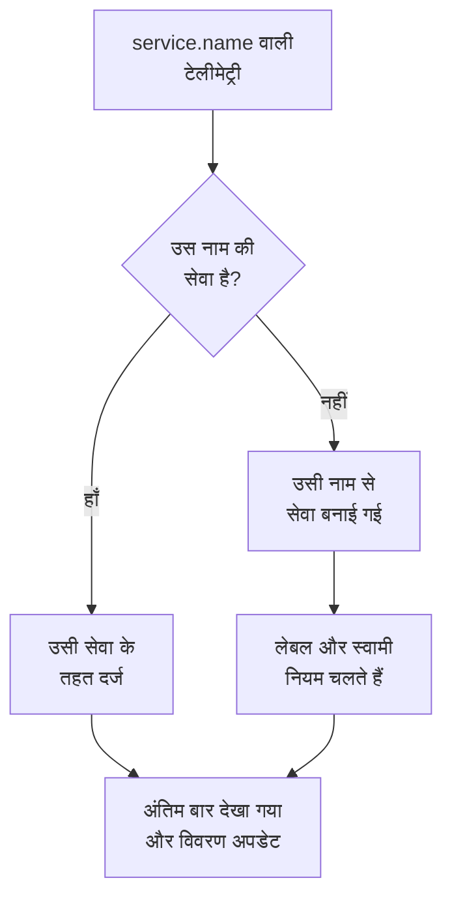

# सेवा कैटलॉग

सेवा कैटलॉग उन एप्लिकेशन और माइक्रोसर्विस की सूची दिखाता है जिन्हें आप चलाते हैं। किसी सेवा की टेलीमेट्री पहली बार आते ही OneUptime उस सेवा को जोड़ देता है, फिर उसके लॉग, ट्रेस, मेट्रिक्स, अपवाद, घटनाएं और मालिक एक ही पेज पर ले आता है, ताकि कोई भी जान सके कि सेवा क्या करती है, उसका मालिक कौन है और उसका हाल कैसा है।

:::cards
- [कोई सेवा कैटलॉग में कैसे आती है](#कोई-सेवा-कैटलॉग-में-कैसे-आती-है): उसका `service.name`, उसकी पहली टेलीमेट्री के साथ।
- [सेवा ढूँढना](#सेवा-ढूँढना): सूची, उसके फ़िल्टर और उसके कॉलम।
- [किसी सेवा के पेज](#किसी-सेवा-के-पेज): एक सेवा के बारे में सब कुछ।
- [सेवा को संग्रहीत करना या हटाना](#सेवा-को-संग्रहीत-करना-या-हटाना): इतिहास रखें, या उसे हटा दें।
:::

## कोई सेवा कैटलॉग में कैसे आती है

आपको सेवाएं बनाने की ज़रूरत नहीं है। टेलीमेट्री का हर बैच अपनी `service.name` रिसोर्स विशेषता में उस सेवा का नाम बताता है जिसने उसे भेजा। OneUptime बैच को उसी नाम वाली सेवा के तहत रखता है, और अगर प्रोजेक्ट में ऐसी कोई सेवा नहीं है तो उसे बना देता है।

- **नाम ही सेवा की पहचान है।** इसकी तुलना बड़े-छोटे अक्षरों का भेद किए बिना होती है, इसलिए `Checkout-API` और `checkout-api` एक ही सेवा हैं। नया `service.name` एक नई सेवा शुरू करता है।
- **कंटेनर अपना नाम ख़ुद रखते हैं।** Docker और Podman एजेंट से आई टेलीमेट्री में `service.name` न हो, तो सेवा का नाम उसके कंटेनर पर रखा जाता है।
- **इंजेशन कुंजी सेवा तय कर सकती है।** जिस कुंजी में **पिन किया गया सेवा नाम** हो, उससे भेजा गया OpenTelemetry डेटा उसी नाम के तहत दर्ज होता है, चाहे उसका `service.name` कुछ भी कहे। देखें [इंजेशन कुंजियाँ](/docs/telemetry/ingestion-keys#ब्राउज़र-कुंजी-को-सुरक्षित-करें)।
- **ब्राउज़र और फ़ोन सेवाएं नहीं हैं।** ब्राउज़र या मोबाइल ऐप से आई टेलीमेट्री इसके बजाय किसी [RUM एप्लिकेशन](/docs/rum/applications) की होती है।
- **लेबल टेलीमेट्री के साथ आ सकते हैं।** `oneuptime.label.<name>` नाम की रिसोर्स विशेषता सेवा में `<name>:<value>` लेबल जोड़ती है, जैसे `oneuptime.label.team=payments` से `team:payments` जुड़ता है।

हर बार टेलीमेट्री आने पर सेवा का **अंतिम बार देखा गया** आगे बढ़ता है, और साथ आई रिसोर्स विशेषताओं से उसका विवरण ताज़ा होता है:

| विवरण | किस विशेषता से |
| --- | --- |
| सेवा संस्करण | `service.version` |
| डिप्लॉयमेंट एनवायरनमेंट | `deployment.environment.name`, या `deployment.environment` |
| सेवा नेमस्पेस | `service.namespace` |
| रनटाइम | `process.runtime.name` और `process.runtime.version` |
| तकनीक | `telemetry.sdk.language`, या रनटाइम |
| क्लाउड | `cloud.provider`, `cloud.platform`, `cloud.region` और `cloud.account.id` |

## शुरू करने से पहले

- **आती हुई टेलीमेट्री** जिसमें `service.name` हो। देखें [OpenTelemetry](/docs/telemetry/open-telemetry): `OTEL_SERVICE_NAME` इसे सेट करता है।
- **सेवाएं पढ़ सकने वाली भूमिका।** Project Owner, Project Admin, Project Member, Viewer, Settings Admin, Settings Member या Settings Viewer, या Read Service अनुमति वाली कस्टम भूमिका। सेवाएं बनाने, बदलने और हटाने के लिए Project Owner, Project Admin, Project Member, Settings Admin या Settings Member, या संबंधित सेवा अनुमतियाँ चाहिए।

## सेवा ढूँढना

**उत्पाद → संसाधन → सेवाएं** पर जाएँ। **सभी सेवाएं** हर सेवा को उसके **नाम**, **विवरण**, **Technology**, **अंतिम बार देखा गया**, **लेबल** और **मालिक** के साथ दिखाता है।

- नाम या विवरण से खोजें, और सूची के ऊपर वाली पट्टी से मालिक या लेबल के अनुसार फ़िल्टर करें।
- कई सेवाएं चुनकर उन सभी में एक साथ लेबल या मालिक जोड़ें, या उन्हें संग्रहीत करें।
- किसी सेवा पर क्लिक करके उसके पेज खोलें।

किसी सेवा की टेलीमेट्री आने से पहले उसे जोड़ने के लिए, जैसे पहले उसके मालिक तय करने के लिए, **सेवा बनाएँ** पर क्लिक करें और उसका **नाम** ठीक वैसा ही डालें जैसा उसका `service.name` होगा। लेबल और स्वामी नियम उस पर वैसे ही चलते हैं जैसे किसी खोजी गई सेवा पर। सहेजे जाने के बाद OpenTelemetry सेटअप गाइड खुलती है, जिसके हर स्निपेट में वही नाम होता है, और उसका आखिरी चरण, **कनेक्ट होने की प्रतीक्षा करें**, बताता है कि सेवा का पहला डेटा कब आता है।

## किसी सेवा के पेज

किसी सेवा के साइड मेन्यू में पाँच सेक्शन होते हैं:

| सेक्शन | पेज |
| --- | --- |
| **बेसिक** | **अवलोकन**: उसके स्पैन से निकले अनुरोध, त्रुटि दर और p95 लेटेंसी, चार्ट, और उसका विवरण। **सुझाव**: सेवा के लिए तैयार मॉनिटर, उसकी भाषा के हिसाब से चुने गए। **मालिक**: उसके लिए ज़िम्मेदार लोग और टीमें। **फ़ीड**: उसके साथ हुआ सब कुछ, उसके बनने से लेकर तब से हुए हर बदलाव तक। |
| **टेलीमेट्री** | उसके **लॉग**, **ट्रेस**, **मेट्रिक्स**, **प्रदर्शन प्रोफ़ाइल**, **अपवाद** और **Source Maps**, जो पहले से इस सेवा के लिए फ़िल्टर हैं। |
| **गतिविधि** | उसे प्रभावित करने वाली **घटनाएं**, **अलर्ट** और **अनुसूचित रखरखाव** इवेंट। |
| **डेवलपर** | **Terraform**, **API** और **AI सहायक**: कोड से प्रबंधित सेवा। यह सेक्शन शुरू में बंद रहता है। |
| **उन्नत** | **सेटिंग्स**, **ऑडिट लॉग** और **सेवा हटाएं**। **उन्नत** शुरू में बंद रहता है: पहले उसे खोलें। |

मालिक इस पेज के बाहर भी मायने रखते हैं: Owned (स्वामित्व) दायरे वाली भूमिका उन सेवाओं की टेलीमेट्री पढ़ती है जिनके मालिक आप या आपकी टीमें हैं। देखें [टेलीमेट्री](/docs/permissions/index#टेलीमेट्री)।

## सेवा बदलना

:::steps
### उसकी सेटिंग्स खोलें

सेवा खोलें, उसके साइड मेन्यू में **उन्नत** खोलें और **सेटिंग्स** पर क्लिक करें।

### नाम बदलें या विवरण लिखें

**सेवा विवरण** पर **विवरण संपादित करें** पर क्लिक करके उसका **नाम**, **विवरण** या **लेबल** बदलें। नाम अब भी उसी `service.name` से मेल खाना चाहिए जो उसकी टेलीमेट्री भेजती है: इसे अपने OpenTelemetry सेटअप में भी बदलें, नहीं तो अगली टेलीमेट्री एक नई सेवा बना देगी।

### रंग और टेक स्टैक चुनें

**सेवा सेटिंग्स** पर **सेटिंग्स संपादित करें** पर क्लिक करें। **सेवा रंग** चार्ट और सूचियों में सेवा को पहचान देता है; नई सेवा को अपना एक रंग मिलता है। **टेक स्टैक** वैकल्पिक है: इसे खाली छोड़ें तो उसकी टेलीमेट्री से पहचानी गई भाषा दिखती है।
:::

इसी पेज पर सेवा का डेटा प्रतिधारण भी है। **टेलीमेट्री डेटा प्रतिधारण** और **टेलीमेट्री प्रकार के अनुसार धारण** कार्ड उसकी टेलीमेट्री को प्रोजेक्ट के डिफ़ॉल्ट प्रतिधारण से ज़्यादा या कम समय तक रखते हैं। ये [Enterprise Edition](/docs/self-hosted/enterprise) का हिस्सा हैं, और OneUptime Cloud पर Scale प्लान का; इनके बिना पेज बताता है कि ये क्या जोड़ते हैं, और सेवा प्रोजेक्ट का प्रतिधारण रखती है।

## लेबल और मालिक अपने आप तय करना

नियम नई सेवाओं को बनते समय उनके लेबल और मालिक देते हैं, खोजी गई सेवाओं को भी। ये **सेवाएं → सेटिंग्स → स्वामी नियम** और **सेवाएं → सेटिंग्स → लेबल नियम** में मिलते हैं; साइड मेन्यू में **सेटिंग्स** शुरू में बंद रहता है। देखें [लेबल और स्वामी नियम](/docs/configuration/label-and-owner-rules)।

## सेवा को संग्रहीत करना या हटाना

जिस सेवा पर अब आप नज़र नहीं रखते, लेकिन जिसका इतिहास रखना चाहते हैं, उसे संग्रहीत करें। संग्रहीत सेवा **सभी सेवाएं** से छिप जाती है, लेकिन टेलीमेट्री इकट्ठा करती रहती है। उसे उसके **सेटिंग्स** पेज से संग्रहीत करें, या सूची में कई सेवाएं चुनें। किसी सेवा को वापस लाने के लिए **सेवाएं → उन्नत → संग्रहीत** खोलें।

> [!WARNING]
> किसी सेवा को हटाने से उसके सोर्स मैप, और उसके लिए सेट किए गए मेट्रिक पाइपलाइन नियम और LLM लागत बजट भी हट जाते हैं। अगर OneUptime को अब भी उसकी टेलीमेट्री मिल रही है, तो सेवा फिर से जुड़ जाती है, लेकिन आपके दिए लेबल, मालिक और सेटिंग्स के बिना। उसे सूची से हटाकर सब कुछ रखने के लिए, उसे संग्रहीत करें।

## समस्या निवारण

:::details एक सेवा दो बार दिखती है
OneUptime तक दो `service.name` मान पहुँचे, जैसे आपके सेटअप के दो संस्करणों से, या सिर्फ़ एक तरफ़ नाम बदलने के बाद। टेलीमेट्री नाम से मिलाई जाती है: हर इंस्टेंस से एक ही `service.name` भिजवाएँ, फिर जिस सेवा की अब ज़रूरत नहीं है उसे संग्रहीत करें या हटाएं।
:::

:::details मेरी सेवा कैटलॉग में नहीं है
जाँचें कि उसकी टेलीमेट्री में `service.name` है। ब्राउज़र या मोबाइल ऐप से आई टेलीमेट्री इसके बजाय Real User Monitoring में जाती है, और बिना सेवा नाम वाले होस्ट या क्लस्टर की टेलीमेट्री उसी होस्ट या क्लस्टर के तहत दर्ज होती है।
:::

:::details अंतिम बार देखा गया पीछे चल रहा है
**अंतिम बार देखा गया** हर बैच पर नहीं, लगभग हर मिनट में एक बार अपडेट होता है, इसलिए यह लाइव टेलीमेट्री से एक मिनट या उसके आसपास पीछे रह सकता है।
:::

## अगले कदम

:::cards
- [लॉग एक्सप्लोरर](/docs/telemetry/logs-explorer): किसी सेवा के लॉग खोजें।
- [ट्रेस एक्सप्लोरर](/docs/telemetry/traces-explorer): उसके अनुरोधों का पीछा करें।
- [अपवाद ट्रैकिंग](/docs/telemetry/exceptions): उसकी फेंकी गई त्रुटियों को छाँटें।
- [लेबल और स्वामी नियम](/docs/configuration/label-and-owner-rules): नई सेवाओं को लेबल और मालिक दें।
:::
