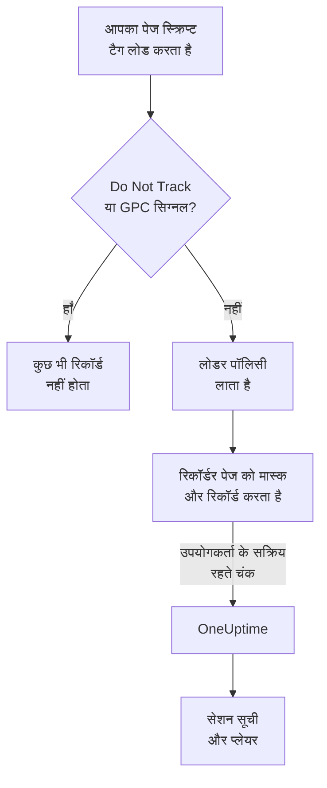
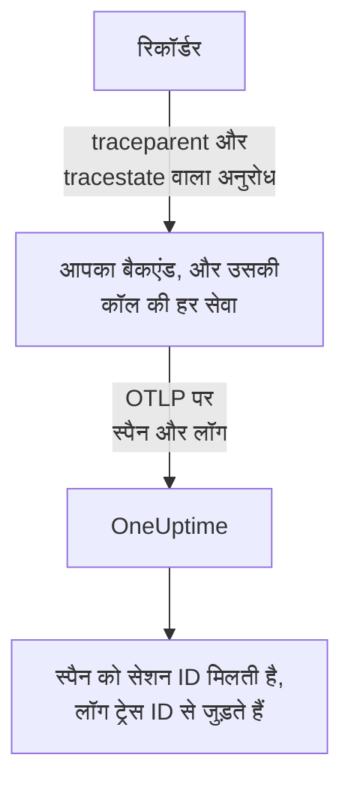
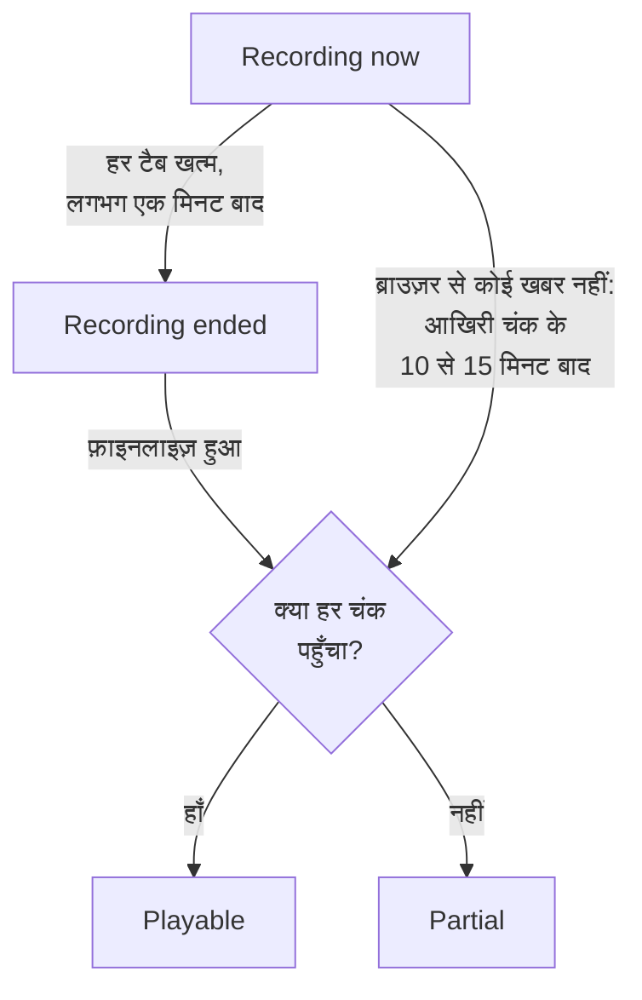
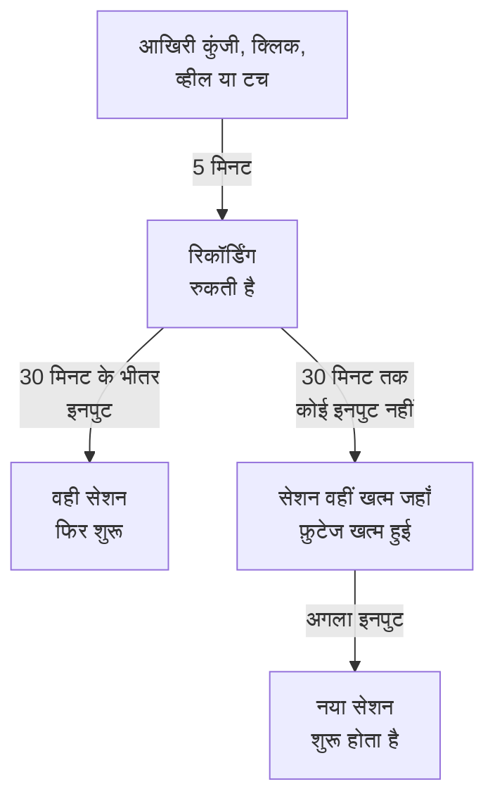

# सेशन रीप्ले

सेशन रीप्ले रिकॉर्ड करता है कि असली उपयोगकर्ताओं ने आपके वेब या React Native ऐप में क्या देखा, और उसे उसी सेशन की त्रुटियों, ट्रेस और लॉग के साथ चलाता है। आप एक स्क्रिप्ट टैग जोड़ते हैं, चुनते हैं कि क्या मास्क किया जाए, और किसी भी सेशन को उसके RUM एप्लिकेशन से देखते हैं।

:::cards
- [यह कैसे काम करता है](#यह-कैसे-काम-करता-है): एक लोडर, एक पॉलिसी और एक रिकॉर्डर जो साथ-साथ अपलोड करता है।
- [इंस्टॉल करें](#इंस्टॉल-करें): हर पेज पर एक स्क्रिप्ट टैग, या React Native SDK।
- [गोपनीयता](#गोपनीयता): क्या मास्क होता है, सहमति, और रिकॉर्डिंग कौन भेज सकता है।
- [अपनी बाकी टेलीमेट्री से संबंध जोड़ना](#अपनी-बाकी-टेलीमेट्री-से-संबंध-जोड़ना): बैकएंड ट्रेस, लॉग और त्रुटियाँ, बिना कोड के जुड़ी हुई।
- [सेशन देखना](#सेशन-देखना): सेशन सूची, उपयोगकर्ता पेज, उपयोगकर्ता फ़्लो और प्लेयर।
- [रिकॉर्डिंग स्वास्थ्य](#रिकॉर्डिंग-स्वास्थ्य): कुछ क्यों नहीं आता, और बजट खत्म होने से पहले अलर्ट।
:::

## यह कैसे काम करता है

आपके पेज पर स्क्रिप्ट एक छोटा लोडर है। यह ब्राउज़र के गोपनीयता सिग्नल जाँचता है, OneUptime से एप्लिकेशन की पॉलिसी लाता है, और तभी रिकॉर्डर लोड करता है, जो पेज को रिकॉर्ड करते समय मास्क करता है और उपयोगकर्ता के सक्रिय रहने पर उसे चंक में अपलोड करता है।



डिफ़ॉल्ट रूप से हर सेशन रिकॉर्ड होता है और होते-होते अपलोड होता है, केवल वे नहीं जिनमें कुछ टूटा। जिन सेशन में कोई त्रुटि नहीं हुई, वहीं आपको वह चेकआउट मिलता है जिसे किसी ने पूरा नहीं किया, वह फ़ॉर्म जिसे सबने छोड़ दिया, और वह पेज जिसके बारे में ग्राहक कहता है कि वह "गलत दिख रहा था"।

कम सहेजने के लिए, एप्लिकेशन की पॉलिसी की दो सेटिंग्स साथ मिलकर काम करती हैं:

| सेटिंग | डिफ़ॉल्ट | यह क्या बदलती है |
| --- | --- | --- |
| **सैंपल प्रतिशत** | 100 | कुल कितने सेशन योग्य हैं। इसे आधा करें और आप सहेजे गए बाइट और संग्रहित अंतिम-उपयोगकर्ता डेटा, दोनों आधे कर देते हैं। फ़ैसला हर सेशन के लिए एक बार, सेशन ID के हैश से होता है, इसलिए कोई सेशन कभी आधा रिकॉर्ड नहीं होता। |
| **रिकॉर्डिंग कब अपलोड करें** | _Always_ | _On error or frustration_ पर सेट करने पर रिकॉर्डर मेमोरी में एक रोलिंग बफ़र रखता है और केवल तब अपलोड करता है जब कुछ गड़बड़ हो। तब लगभग हर विफल सेशन की रिकॉर्डिंग होती है, सबको रिकॉर्ड करने से लगभग 15 गुना कम लागत पर, लेकिन आप ऐसा सेशन नहीं देख सकते जो विफल नहीं हुआ। |

## शुरू करने से पहले

- एक RUM एप्लिकेशन। इसे **उत्पाद → संसाधन → वास्तविक उपयोगकर्ता मॉनिटरिंग** के अंतर्गत बनाएँ, या अपनी टेलीमेट्री को इसे बनाने दें: [एप्लिकेशन प्रबंधित करना](/docs/rum/applications) देखें।
- एक **ब्राउज़र** इन्जेशन कुंजी, **प्रोजेक्ट सेटिंग्स → टेलीमेट्री और APM → इंजेशन कुंजियाँ** से। Browser कुंजी केवल उन्हीं ओरिजिन से काम करती है जिन्हें आप उस पर सूचीबद्ध करते हैं: [प्रोडक्शन में अपने अनुमत ओरिजिन सेट करें](#प्रोडक्शन-में-अपने-अनुमत-ओरिजिन-सेट-करें) देखें।

सेशन रीप्ले डिफ़ॉल्ट रूप से चालू है। इसकी सेटिंग्स तीन जगह हैं:

| कहाँ | वहाँ क्या है |
| --- | --- |
| एप्लिकेशन का **Replay Policy** पेज | पॉलिसी (रिकॉर्डिंग, मास्किंग, सहमति, ट्रेसिंग और सीमाएँ), एक **रिकॉर्डिंग की सेहत** सारांश, **रिकॉर्डिंग में क्या होता है** कार्ड, **Test your installation** पैनल और **Record a specific user's next session**। |
| एप्लिकेशन का **स्वास्थ्य** पेज | रिकॉर्डिंग आ रही हैं या नहीं, और अगर नहीं तो क्यों नहीं। [रिकॉर्डिंग स्वास्थ्य](#रिकॉर्डिंग-स्वास्थ्य) देखें। |
| **वास्तविक उपयोगकर्ता मॉनिटरिंग → सेटिंग्स → सेशन रीप्ले** | पूरे प्रोजेक्ट का स्विच जो हर एप्लिकेशन को एक साथ रोकता है, और हर एप्लिकेशन की पॉलिसी की केवल-पढ़ने वाली सूची। |

## इंस्टॉल करें

हर उस पेज पर एक स्क्रिप्ट टैग जोड़ें जिसे आप रिकॉर्ड करना चाहते हैं।

:::steps
### Browser कुंजी बनाएँ

**प्रोजेक्ट सेटिंग्स → टेलीमेट्री और APM → इंजेशन कुंजियाँ** के अंतर्गत **इन्जेशन कुंजी बनाएँ** पर क्लिक करें, **कुंजी प्रकार** के रूप में **ब्राउज़र** चुनें और **अनुमत ऑरिजिन** में अपनी साइट के ओरिजिन लिखें। फिर कुंजी की **सीक्रेट कुंजी** कॉपी करें। [ब्राउज़र सेटअप](/docs/rum/browser-setup#सेटअप-करें) हर स्क्रीन दिखाता है।

### स्क्रिप्ट टैग जोड़ें

टैग को हर पेज पर, अपनी कुंजी और अपने एप्लिकेशन के पहचानकर्ता के साथ लगाएँ:

```html
<script
  src="https://oneuptime.com/telemetry/session-replay/v1/recorder.js"
  data-oneuptime-token="YOUR_TELEMETRY_INGESTION_KEY"
  data-oneuptime-app-identifier="storefront-web"
  crossorigin="anonymous"
  async
></script>
```

`data-oneuptime-app-identifier` को RUM एप्लिकेशन के पहचानकर्ता से मेल खाना चाहिए, यानी वही मान जो आप `service.name` के लिए इस्तेमाल करते हैं। एप्लिकेशन का **दस्तावेज़ीकरण** पेज, उसके साइड मेनू के **सेशन रीप्ले** सेक्शन में, यह स्निपेट दोनों मान भरे हुए दिखाता है, साथ में इसके Next.js / React और Google Tag Manager वर्ज़न भी।

### जाँचें कि रिकॉर्डिंग आती हैं

अपना कोई पेज खोलें और कुछ सेकंड इधर-उधर क्लिक करें। लगभग एक मिनट में सेशन एप्लिकेशन के **सेशन रीप्ले** पेज पर होता है, **अभी रिकॉर्ड हो रहा है** के निशान के साथ। अगर नहीं है, तो एप्लिकेशन का **स्वास्थ्य** पेज बताता है कि क्यों: [रिकॉर्डिंग स्वास्थ्य](#रिकॉर्डिंग-स्वास्थ्य) देखें।
:::

`/v1/recorder.js` पर स्क्रिप्ट एक छोटा लोडर है। यह Do Not Track जाँचता है, आपके एप्लिकेशन की पॉलिसी लाता है, और तभी `/latest/recorder.js` लोड करता है। पॉलिसी और रिकॉर्डर दोनों `no-store` के साथ परोसे जाते हैं, इसलिए किसी में भी बदलाव ब्राउज़र कैश के खत्म होने का इंतज़ार किए बिना अगले पेज लोड तक पहुँच जाता है।

### स्क्रिप्ट टैग एट्रिब्यूट

| एट्रिब्यूट | ज़रूरी | यह क्या करता है |
| --- | --- | --- |
| `data-oneuptime-token` | हाँ | आपका टेलीमेट्री इन्जेशन टोकन। |
| `data-oneuptime-app-identifier` | हाँ | RUM एप्लिकेशन का पहचानकर्ता। |
| `data-oneuptime-host` | नहीं | OneUptime ओरिजिन। छोड़े जाने पर स्क्रिप्ट के अपने `src` से निकाला जाता है, इसलिए इसकी ज़रूरत तभी है जब आप स्क्रिप्ट को अपने डोमेन से प्रॉक्सी करते हैं। |
| `data-oneuptime-user-ref` | नहीं | पेज लोड के समय ज्ञात अंतिम-उपयोगकर्ता रेफ़रेंस (कोई उपयोगकर्ता ID, कभी ऐसा ईमेल नहीं जिसे आप सहेजा जाना नहीं चाहेंगे)। वही चीज़ जो `identify()` बाद में सेट करता है; [किसी खास उपयोगकर्ता का अगला सेशन रिकॉर्ड करना](#किसी-खास-उपयोगकर्ता-का-अगला-सेशन-रिकॉर्ड-करना) के लिए केवल यही रूप काम करता है। |
| `data-oneuptime-respect-do-not-track` | नहीं | डिफ़ॉल्ट रूप से Do Not Track और Global Privacy Control का पालन करता है। सिग्नल की परवाह किए बिना रिकॉर्ड करने के लिए इसे `"false"` पर सेट करें; [Do Not Track](#do-not-track) देखें। |
| `data-oneuptime-debug` | नहीं | `"true"` रिकॉर्डर के फ़ैसले कंसोल में प्रिंट करता है। [सेशन रीप्ले समस्या निवारण](/docs/rum/session-replay-troubleshooting) देखें। |
| `data-oneuptime-offline-storage` | नहीं | विज़िटर के ऑफ़लाइन रहते रिकॉर्ड हुए चंक को ब्राउज़र के IndexedDB में भी रखने के बजाय केवल मेमोरी में रखने के लिए इसे `"false"` पर सेट करें। [ऑफ़लाइन मोड](#ऑफ़लाइन-मोड) देखें। |

वही विकल्प टैग के बजाय एक ग्लोबल पर भी दिए जा सकते हैं, जिसे टैग मैनेजर और बंडल किए गए इंस्टॉल इस्तेमाल करते हैं:

```js
window.__ONEUPTIME_SESSION_REPLAY__ = {
  host: "https://oneuptime.com",
  token: "YOUR_TELEMETRY_INGESTION_KEY",
  appIdentifier: "storefront-web",
  userRef: "user-123", // optional
  respectDoNotTrack: true, // optional
  debug: false, // optional
  offlineStorage: true, // optional; false keeps offline chunks in memory only
};
```

### ठीक इंस्टॉल कैसा दिखता है

DevTools → Network खोलें और `session-replay` के लिए फ़िल्टर करें। काम करता हुआ पेज ये करता है:

1. हर पेज लोड पर **एक `GET .../session-replay/v1/config`** — पॉलिसी लाना।
2. **उपयोगकर्ता के कुछ करते रहने पर लगभग हर 15 सेकंड में एक `POST .../session-replay/v1/chunk`**, या उससे पहले जब 256 KB इवेंट जमा हो जाएँ। निष्क्रिय टैब कोई इवेंट नहीं बनाता और इसलिए कोई POST भी नहीं: Network टैब से इंस्टॉल को परखने से पहले माउस हिलाएँ या क्लिक करें।
3. जब टैब छिपाया जाता है, और फिर जब पेज चला जाता है, तो `keepalive` के साथ भेजा गया एक `POST`। पेज का जाना — टैब बंद, रीलोड या किसी दूसरे पेज पर नेविगेट होना, या पेज का ब्राउज़र के back/forward कैश में रखा जाना (हर `pagehide`) — इसे आखिरी के रूप में चिह्नित करता है, जो OneUptime को बताता है कि उस टैब की रिकॉर्डिंग खत्म हो गई; जिस पेज को उपयोगकर्ता back/forward कैश से वापस लाता है, वह उसी सेशन के एक नए टैब के रूप में रिकॉर्ड करता रहता है। केवल छिपाया गया टैब खुला रहता है, इसलिए उपयोगकर्ता के लौटने पर रिकॉर्डिंग जारी रहती है। इसकी पूरी बॉडी 56 KB से कम रहती है — ब्राउज़र के प्रति-ओरिजिन 64 KB keepalive कोटा में रिकॉर्डर का हिस्सा — और यह उस एक अनुरोध के फ़्रेम के रूप में कई चंक ले जा सकता है: बंद करने वाला चंक, किसी बड़े बंद करने वाले चंक के कटे हुए टुकड़े (हर एक में अधिकतम 48 KB इवेंट, ताकि फ़्रेम हेडर फिर भी समा जाए), और हर वह चंक जो अब भी दोबारा भेजे जाने का इंतज़ार कर रहा था। जो चंक टैब के केवल छिपने के समय ही उस बजट से बड़ा होता है, वह इसके बजाय सामान्य रास्ते से जाता है, जब पेज उसे भेजने के लिए अभी ज़िंदा होता है।

_On error or frustration_ ट्रिगर में, चरण 2 तब तक नहीं होता जब तक कोई ट्रिगर न चले — [समस्या निवारण](#समस्या-निवारण) देखें।

## React Native में इंस्टॉल करें

React Native SDK नेटिव व्यू हायरार्की को rrweb-संगत सिंथेटिक इवेंट के रूप में रिकॉर्ड करता है, इसलिए मोबाइल रिकॉर्डिंग उसी सेशन सूची और प्लेयर में खुलती हैं जिसमें वेब रिकॉर्डिंग। यह स्क्रीनशॉट नहीं लेता। प्लेयर हर रिकॉर्डिंग को React Native ऐप के रूप में लेबल करता है, और उसका **Fidelity** टैब उन नेटिव सतहों को समझाता है जिन्हें दर्शाया नहीं जा सका।

:::steps
### SDK इंस्टॉल करें

SDK iOS और Android React Native एप्लिकेशन को सपोर्ट करता है। इसे इसकी persistent-outbox peer dependency के साथ इंस्टॉल करें:

```bash
npm install @oneuptime/react-native-replay @react-native-async-storage/async-storage
```

बेयर iOS प्रोजेक्ट के लिए, पैकेज जोड़ने के बाद अपना सामान्य CocoaPods इंस्टॉल चलाएँ; मौजूदा React Native वर्ज़न Android को बिना मैन्युअल रजिस्ट्रेशन के autolink करते हैं। Async Storage के अलावा रिकॉर्डर का अपना व्यू-ट्री नेटिव मॉड्यूल है, इसलिए Expo प्रोजेक्ट को कस्टम डेवलपमेंट या प्रोडक्शन बिल्ड (उदाहरण के लिए EAS Build या prebuild) इस्तेमाल करना होगा। Expo Go इस SDK को नहीं चला सकता, क्योंकि दोनों में से कोई भी नेटिव मॉड्यूल तय Expo Go बाइनरी में जोड़ा नहीं जा सकता।

### रिकॉर्डर शुरू करें और अपने ऐप को रैप करें

सिंगलटन को एक बार शुरू करें, फिर प्रोवाइडर को ऐप के उस हिस्से के ऊपर रखें जिसे आप रिकॉर्ड करना चाहते हैं:

```tsx
import {
  OneUptimeReplay,
  OneUptimeReplayProvider,
} from "@oneuptime/react-native-replay";

OneUptimeReplay.start({
  host: "https://oneuptime.com",
  token: "YOUR_TELEMETRY_INGESTION_KEY",
  appIdentifier: "storefront-mobile",
  mobileAppIdentifier: "com.example.storefront",
  appName: "Storefront", // optional, shown in session details
  appVersion: "4.2.0", // optional, shown in session details
});

export default function App() {
  return (
    <OneUptimeReplayProvider>
      <Navigation />
    </OneUptimeReplayProvider>
  );
}
```

`appIdentifier` RUM एप्लिकेशन का पहचानकर्ता है। `mobileAppIdentifier` बाइनरी में भेजी गई Android एप्लिकेशन ID या iOS बंडल पहचानकर्ता है, कोई डिस्प्ले नाम नहीं। वही मान [`app://` अनुमति सूचियों](#प्रोडक्शन-में-अपने-अनुमत-ओरिजिन-सेट-करें) में इस्तेमाल करें। SDK एप्लिकेशन की Replay Policy `host` से लाता है; सैंपलिंग, ट्रिगर, सहमति, प्रतिधारण और अपलोड बजट सर्वर के नियंत्रण में रहते हैं।
:::

प्रोवाइडर एक non-collapsable नेटिव रूट का मालिक होता है और उसका व्यू ट्री और टच start/move/end इवेंट रिकॉर्ड करता है। अगर आप रिकॉर्डर इंस्टेंस पहले से खुद बनाते हैं, तो `<OneUptimeReplayProvider recorder={recorder}>` से एक पास करें। `MobileReplayRecorder` भी अलग-थलग या multi-client इंटीग्रेशन के लिए एक्सपोर्ट किया गया है; ज़्यादातर ऐप्स को सिंगलटन इस्तेमाल करना चाहिए।

### React Native API

`OneUptimeReplay` को सीधे इम्पोर्ट करें, या प्रोवाइडर के नीचे `useOneUptimeReplay()` कॉल करें। सिंगलटन ये देता है:

| मेथड | यह क्या करता है |
| --- | --- |
| `start(options)` | पॉलिसी लाता है और कैप्चर शुरू करता है। ज़रूरी विकल्प `host`, `token`, `appIdentifier` और `mobileAppIdentifier` हैं; `appName` और `appVersion` वैकल्पिक डिस्प्ले मेटाडेटा हैं, और `connectivity` [ऑफ़लाइन मोड](#ऑफ़लाइन-मोड) के लिए वैकल्पिक नेटवर्क-स्थिति स्रोत है। |
| `stop()` | जो भेजा जा सकता है उसे फ़्लश करता है, कैप्चर रोकता है और लाइफ़साइकल हैंडलर हटाता है। |
| `identify(userRef, traits?)` | **अंतिम उपयोगकर्ता की पहचान कैप्चर करें** के अधीन, साइन-इन किए उपयोगकर्ता और वैकल्पिक ट्रेट्स को जोड़ता है। |
| `setTags(tags)` / `addTag(key, value)` | सभी खोजने योग्य सेशन टैग बदलता है, या दूसरों को बदले बिना एक टैग जोड़ता है। |
| `track(name, properties?)` | रीप्ले टाइमलाइन पर एक एप्लिकेशन इवेंट रखता है। |
| `setRoute(route)` | नेविगेशन के बाद एक साफ़ किया गया लॉजिकल स्क्रीन या रूट रिकॉर्ड करता है। इसे अपने नेविगेटर के route-change कॉलबैक से कॉल करें। |
| `captureSession(reason?)` | _On error or frustration_ में, ऐप-विशेष कारण से रोलिंग बफ़र अपलोड करता है, जैसे किसी उपयोगकर्ता का “Report a problem” पर टैप करना। |
| `captureError(error)` | एक संभाली गई JavaScript त्रुटि रिकॉर्ड करता है और त्रुटि से ट्रिगर होने वाला कैप्चर सक्रिय करता है। |
| `grantConsent()` / `revokeConsent()` | अपलोड की अनुमति देता है, या मेमोरी का बफ़र, सहेजा गया आउटबॉक्स, सेशन और विज़िटर ID तुरंत साफ़ करता है। बाद की सहमति नए पहचानकर्ताओं से शुरू होती है। |
| `getSessionId()` / `onSessionChange(listener)` | ट्रेस और लॉग कोरिलेशन के लिए मौजूदा, सहमति-प्राप्त रीप्ले सेशन ID पढ़ता है या उसकी सदस्यता लेता है। कैप्चर या सहमति खत्म होने पर लिसनर को `null` भी मिलता है। |
| `getDiagnostics()` | कैप्चर किए गए व्यू की सामग्री लौटाए बिना रिकॉर्डर की स्थिति और हाल के फ़ैसले लौटाता है। |

SDK React Native के `AppState` को सुनता है: बैकग्राउंड में जाने पर यह सहमति-प्राप्त इवेंट बंद करके भेज देता है, जबकि सहमति से पहले की फ़ुटेज केवल मेमोरी में रहती है। फ़ोरग्राउंड कैप्चर फिर शुरू होने से पहले SDK कैश किए गए जवाब का इस्तेमाल किए बिना पॉलिसी ताज़ा करता है। यह सक्रिय रहते समय भी समय-समय पर पॉलिसी ताज़ा करता है, ताकि बंद करना, सहमति, सैंपलिंग, टारगेटिंग और पहचान के बदलाव लंबे समय तक खुले ऐप में भी लागू हों। जब आपका इंटीग्रेशन हमेशा के लिए हटाया जाए तो `stop()` कॉल करें; सामान्य स्क्रीन नेविगेशन के लिए रिकॉर्डर रोकने और फिर शुरू करने के बजाय `setRoute()` इस्तेमाल करना चाहिए।

**मोबाइल सेशन निष्क्रियता से कब खत्म होता है।** इनपुट के बिना पाँच मिनट पहले ही कैप्चर रोक देते हैं ([निष्क्रिय समय](#निष्क्रिय-समय) देखें)। बिना किसी टच और बिना किसी रिकॉर्ड हुई SDK कॉल (`track()`, `setTags()`, `identify()` और ऐसी ही कॉल, जो कैप्चर चलते समय की गई हों) के तीस मिनट सेशन खत्म कर देते हैं। यह उस आखिरी गतिविधि पर खत्म होता है, या रुके हुए सेशन के लिए रुकने की जगह पर, जहाँ उसकी फ़ुटेज खत्म हुई — न कि जब ऐप लौटता है या रिकॉर्डर ध्यान देता है — इसलिए बैकग्राउंड में या रुके रहकर बिताया समय सेशन के अंत में कभी नहीं जुड़ता। फ़ोरग्राउंड में खुला छोड़ा गया ऐप हर आधे घंटे में नया सेशन शुरू नहीं करता। अगला सेशन उपयोगकर्ता के लौटने पर शुरू होता है: उनका पहला टच, सॉफ़्ट कीबोर्ड का दिखना या छिपना, ऐप का फ़ोरग्राउंड में लौटना, या `captureSession()` कॉल। यह स्क्रीन के नए स्नैपशॉट पर खुलता है। तब तक `getSessionId()` `null` लौटाता है और `onSessionChange()` को `null` के साथ कॉल किया जाता है। बीच की त्रुटियाँ, नेविगेशन और `track()` कॉल रिकॉर्ड नहीं होतीं।

मोबाइल टेलीमेट्री को किसी रीप्ले से जोड़ने के लिए, `onSessionChange()` से सदस्यता लें और लौटाए गए मान को अपने OpenTelemetry इंस्ट्रुमेंटेशन में `session.id` एट्रिब्यूट के रूप में सेट करें। जब भी कॉलबैक चले, उस एट्रिब्यूट को बदलें, और मान `null` होने पर उसे साफ़ करें। रीप्ले SDK नेटिव नेटवर्किंग को पैच नहीं करता और न ही खुद किसी OpenTelemetry प्रोवाइडर को बदलता है।

### React Native में गोपनीयता और मास्किंग

मोबाइल कैप्चर जानबूझकर वेब के मास्किंग मोड से ज़्यादा सख्त है। नेटिव UI टेक्स्ट, ऐक्सेसिबिलिटी मान, इनपुट मान और चित्र के पिक्सेल कभी सीरियलाइज़ नहीं होते; सर्वर को एक संरचनात्मक वायरफ़्रेम मिलता है, तब भी जब एप्लिकेशन का वेब मास्किंग मोड पढ़ने लायक टेक्स्ट की अनुमति देता। कॉल करने वाले द्वारा दिया गया मेटाडेटा, जैसे उपयोगकर्ता रेफ़रेंस, इवेंट नाम, रूट और खोजने योग्य टैग, API अनुबंध का पालन करता है, इसलिए उन फ़ील्ड में सीक्रेट न रखें। किसी खास संवेदनशील सबट्री को `<ReplayMask>` में रैप करें, ताकि आसपास का लेआउट बचा रहे और वह हिस्सा एक गोपनीयता प्लेसहोल्डर से बदल जाए।

सहमति किसी ऑपरेटिंग-सिस्टम अनुमति या आपके सहमति बैनर से अनुमानित नहीं की जाती। _Require explicit_ में, `grantConsent()` तभी कॉल करें जब आपके ऐप के पास ज़रूरी सहमति हो। `revokeConsent()` कॉल करने से कतार में रखा और सहेजा गया, दोनों तरह का बिना भेजा डेटा फेंक दिया जाता है, साथ ही वे पहचानकर्ता भी जो बाद के किसी सेशन को रद्द किए गए सेशन से जोड़ सकते थे।

मोबाइल रिकॉर्डर व्यू की सीमाएँ और प्रकार, टच की जगहें, लॉजिकल रूट, कस्टम इवेंट और JavaScript त्रुटियाँ कैप्चर करता है। ये सीमाएँ प्लेयर के Fidelity टैब में हमेशा बताई जाती हैं:

- नेटिव `Image` के पिक्सेल अपारदर्शी होते हैं; केवल फ़्रेम दर्शाया जाता है।
- `WebView` की सामग्री React Native ट्री से बाहर है। अगर होस्ट किए गए पेज को अपनी रिकॉर्डिंग चाहिए, तो उसके अंदर वेब रिकॉर्डर इंस्टॉल करें।
- Canvas, Skia, OpenGL, मैप, कैमरा प्रीव्यू, वीडियो और दूसरी कस्टम-ड्रॉ की गई सतहें अपारदर्शी होती हैं।
- `ReplayMask` या किसी अपारदर्शी सतह के अंदर के टच पाथ रिकॉर्ड नहीं होते। नेटिव ब्रिज लाइव टच टारगेट और उसके पूर्वजों की जाँच करता है, और अगर वह गोपनीयता जाँच पूरी नहीं हो पाती तो जेस्चर दबा देता है।
- Reanimated, native-driver और UI-थ्रेड एनिमेशन व्यू-ट्री स्नैपशॉट पर सैंपल किए जाते हैं, फ़्रेम-दर-फ़्रेम दोहराए नहीं जाते।
- JavaScript के फ़्लश कर पाने से पहले ही उसे खत्म करने वाले नेटिव क्रैश के लिए नेटिव क्रैश SDK चाहिए; `captureError()` संभाली गई JavaScript त्रुटियों को कवर करता है, प्रोसेस-स्तर के क्रैश डंप को नहीं।

## अपने उपयोगकर्ताओं की पहचान करें

हर सेशन तब तक गुमनाम रहता है जब तक आपका पेज यह न बताए कि वह किसका है। इसके बिना भी सूची एक ब्राउज़र के सेशन को एक गुमनाम विज़िटर ID के अंतर्गत समूहित कर सकती है (नीचे [गुमनाम विज़िटर](#गुमनाम-विज़िटर) देखें), पर कुछ भी व्यक्ति का नाम नहीं बताता और न ही उनके दूसरे ब्राउज़र को पहले से जोड़ता है। जैसे ही आपको पता चले, `identify()` कॉल करें, या स्क्रिप्ट लोड होने से पहले उसे कतार में रखें — दोनों तरह से यह पहला चंक अपलोड होने से पहले लागू होता है, इसलिए सेशन दिखने के पल से ही उपयोगकर्ता के हिसाब से खोजा जा सकता है:

```js
// After the script has loaded:
OneUptimeReplay.identify("user-123", { plan: "pro", tenant: "acme" });

// Or at any time, whether or not the script has loaded yet:
(window.OneUptimeReplayQueue = window.OneUptimeReplayQueue || []).push([
  "identify",
  "user-123",
  { plan: "pro", tenant: "acme" },
]);
```

- रेफ़रेंस वह है जो सेशन सूची दिखाती है और जिससे `user:` खोजें मेल खाती हैं। ट्रेट्स प्लेयर हेडर में और सेशन के विवरण पैनल पर दिखते हैं।
- **पहचान सेशन की होती है, केवल पेज की नहीं।** सेशन विज़िट के हर पेज लोड और हर टैब में फैला होता है, और जैसे ही उसका कोई भी पेज `identify()` कॉल करता है, पूरा सेशन उस उपयोगकर्ता का हो जाता है — साइन-इन से पहले के पेज भी, क्योंकि वे उसी विज़िट का हिस्सा हैं। सेशन का हर बाद का पेज और टैब भी उपयोगकर्ता का नाम बताता है, वह भी जो खुद कभी `identify()` कॉल नहीं करता: साइन-इन रीडायरेक्ट का लैंडिंग पेज, नए टैब में खोला गया लिंक। जब तक **अंतिम उपयोगकर्ता की पहचान कैप्चर करें** चालू है, रिकॉर्डर `localStorage` में `oneuptime.replay.user` के अंतर्गत याद रखता है कि मौजूदा सेशन किसका है — सेशन ID और रेफ़रेंस, और कुछ नहीं, और _Require explicit_ सहमति में केवल सहमति मिलने के बाद — और केवल उसी सेशन के लिए: अगला सेशन (30 मिनट निष्क्रिय रहने या 4 घंटे की सीमा के बाद) तब तक गुमनाम शुरू होता है जब तक कोई पेज उसकी पहचान न करे, जब तक कि उसे शुरू करने वाले पेज ने खुद उपयोगकर्ता की पहचान न की हो। इसलिए जहाँ भी आपका ऐप उपयोगकर्ता को जानता है, ऐसे हर पेज लोड पर `identify()` कॉल करें, केवल साइन-इन के ठीक बाद नहीं।
- **किसी दूसरे उपयोगकर्ता को अपना सेशन मिलता है।** जब `identify()` उस उपयोगकर्ता के अलावा किसी और का नाम देता है जिसका सेशन पहले से है — एक व्यक्ति ने साइन आउट किया और दूसरे ने उसी ब्राउज़र पर साइन इन किया, इस टैब में या किसी दूसरे में — तो मौजूदा सेशन खत्म होता है, फिर भी पहले उपयोगकर्ता के नाम दर्ज रहता है, और दूसरे के लिए नया सेशन शुरू होता है। `onSessionChange` लिसनर को बताया जाता है, और प्लेयर इस बदलाव को एक रिकॉर्डिंग के अंत और अगली की शुरुआत के रूप में दिखाता है। उसी उपयोगकर्ता की फिर से पहचान करने से कुछ नहीं बदलता; रेफ़रेंस की तुलना दोनों ओर का व्हाइटस्पेस हटाकर, बड़े-छोटे अक्षरों का ध्यान रखते हुए होती है, ठीक वैसे ही जैसे सर्वर उनका मिलान करता है।
- `identify()` रिकॉर्डर को जो देता है, वह रिकॉर्डिंग के साथ केवल तभी अपलोड होता है जब एप्लिकेशन के लिए **अंतिम उपयोगकर्ता की पहचान कैप्चर करें** चालू हो (डिफ़ॉल्ट)। बंद होने पर रिकॉर्डर रेफ़रेंस और ट्रेट्स को चंक से बाहर रखता है, और सर्वर व्यक्ति के बारे में **कुछ भी नहीं** सहेजता — न रेफ़रेंस, न उसका keyed hash, न ट्रेट्स। वे सेशन सचमुच छद्मनाम वाले होते हैं, और इसकी कीमत यह है कि उन्हें _उपयोगकर्ता के हिसाब से_ मिटाया नहीं जा सकता: मिटाने के अनुरोध के पास मिलान के लिए कुछ नहीं होता, इसलिए इसके बजाय `BySessionId`, `ByDateRange` या `ByRumApplication` इस्तेमाल करें ([सेशन मिटाना](#सेशन-मिटाना) देखें)। अगर आपके लिए हर उपयोगकर्ता के हटाने के अनुरोध का पालन करना कोई पहचानकर्ता न सहेजने से ज़्यादा मायने रखता है, तो स्विच चालू रखें — सहेजा गया मान एक-तरफ़ा keyed hash है, इसलिए उसका मिलान किया जा सकता है पर उसे पढ़ा नहीं जा सकता, और केवल अलग लेबल ही रेफ़रेंस को खुद ले जाता है।
- एक रेफ़रेंस उस स्विच की परवाह किए बिना, जानबूझकर, ब्राउज़र छोड़ता है: वह जिसे आपका पेज **लोड के समय** `data-oneuptime-user-ref` या init ग्लोबल पर `userRef` से देता है, हर पेज लोड पर पॉलिसी लाने वाले अनुरोध में एक अनुरोध हेडर के रूप में जाता है, क्योंकि [किसी खास उपयोगकर्ता का अगला सेशन रिकॉर्ड करना](#किसी-खास-उपयोगकर्ता-का-अगला-सेशन-रिकॉर्ड-करना) किसी रिकॉर्डर के अस्तित्व में आने से पहले विज़िटर का मिलान इसी से करता है। सर्वर इसकी तुलना सेट किए गए लक्ष्य से करता है और इसे फेंक देता है; यह सेशन में तब तक नहीं लिखा जाता जब तक पहचान कैप्चर चालू न हो और रिकॉर्डर इसे रिकॉर्डिंग के साथ फिर से न भेजे। `identify()` को दिया गया रेफ़रेंस कभी इस तरह नहीं भेजा जाता।
- ट्रेट्स की सीमा 20 कुंजियाँ, हर कुंजी 40 अक्षर और हर मान 200 अक्षर है, उन्हें स्ट्रिंग में बदला जाता है, और वे एप्लिकेशन के मास्किंग मोड से गुज़रते हैं: _Mask all text_ में वे अपलोड से पहले मास्क होते हैं।
- डैशबोर्ड में पहचान वापस पढ़ने के लिए वही अनुमति चाहिए जो रिकॉर्डिंग देखने के लिए ([रिकॉर्डिंग कौन देख सकता है](#रिकॉर्डिंग-कौन-देख-सकता-है) देखें); दूसरी भूमिकाएँ "Identity hidden" देखती हैं।

### गुमनाम विज़िटर

जो पेज कभी `identify()` कॉल नहीं करता, उसके सेशन भी समूहित करने लायक होने चाहिए, वरना चालीस _Anonymous_ पंक्तियों की सूची आपको नहीं बता सकती कि एक व्यक्ति को एक ही त्रुटि चालीस बार मिली या चालीस लोगों को एक-एक बार। इसलिए रिकॉर्डर हर ब्राउज़र प्रोफ़ाइल और ओरिजिन के लिए एक रैंडम विज़िटर ID बनाता है — 32 छोटे अक्षरों वाले hex वर्ण, `localStorage` में `oneuptime.replay.visitor` के अंतर्गत, सेशन रिकॉर्ड के बगल में रखे गए, इसलिए दो होस्टनाम या पोर्ट से परोसी गई साइट दो विज़िटर के रूप में दिखती है और केवल `identify()` उन्हें जोड़ता है — और इसे मेटाडेटा ले जाने वाले हर चंक पर `meta.visitorId` के रूप में भेजता है: पहला चंक, बंद करने वाला चंक, और `identify()` या `setTags()` कॉल के बाद का चंक। सर्वर इसका आकार जाँचता है और इसे सेशन पर उन्हीं पहुँच नियमों के तहत सहेजता है जो सेशन हेडर के बाकी हिस्से पर लागू होते हैं। यह जानबूझकर सेशन ID से ज़्यादा समय तक रहती है: 30 मिनट की निष्क्रियता वाला बदलाव और 4 घंटे की सीमा नया सेशन शुरू करते हैं, और नया सेशन वही विज़िटर ID ले जाता है, इसलिए एक ही ब्राउज़र से एक हफ़्ते के अंतर पर हुई दो विज़िट [उपयोगकर्ता पेज](#उपयोगकर्ता-पेज) पर और प्लेयर के दूसरे-सेशन मेनू में साथ दिखती हैं ([प्लेयर](#प्लेयर) देखें)।

यह साफ़ रहे कि यह क्या नहीं है:

- **यह पहचान नहीं है।** यह रैंडम है, ब्राउज़र में बनाई जाती है, और न आपके पेज की दी गई किसी चीज़ से निकाली जाती है न डिवाइस के बारे में किसी चीज़ से। एक लैपटॉप पर दो ब्राउज़र, या फ़ोन और डेस्कटॉप पर वही व्यक्ति, दो विज़िटर हैं; केवल `identify()` उन्हें जोड़ता है। प्राइवेट विंडो को एक नई ID मिलती है जो विंडो के साथ चली जाती है, और जहाँ स्टोरेज में बिल्कुल लिखा नहीं जा सकता (Safari का प्राइवेट मोड, ब्लॉक किया गया साइट डेटा), वहाँ ID एक पेज लोड तक चलती है।
- **यह Capture end-user identity के अधीन नहीं है।** वह स्विच तय करता है कि रेफ़रेंस और ट्रेट्स ब्राउज़र छोड़ें या नहीं; विज़िटर ID दोनों स्थितियों में भेजी जाती है, क्योंकि यह किसी का नाम नहीं बताती। अगर आप चाहते हैं कि कोई ID बने ही नहीं, तो जवाब है कोई रिकॉर्डर नहीं: एप्लिकेशन के लिए सेशन रीप्ले बंद करें, या [Do Not Track](#do-not-track) का पालन होने दें।
- **यह सेशन ID के सहमति नियमों का पालन करती है।** `revokeConsent()` इसे सेशन के साथ स्टोरेज से हटाता है, सहमति वापस लिए जाने के दौरान कुछ नहीं लिखा जाता, और बाद का `grantConsent()` एक नई ID बनाता है — इसलिए जो उपयोगकर्ता सहमति वापस लेकर लौटता है, वह उन सेशन से फिर नहीं जुड़ता जिन्हें भूलने के लिए उसने आपसे कहा था। Do Not Track या Global Privacy Control में कोई रिकॉर्डर नहीं चलता, इसलिए कोई ID नहीं बनती।
- **यह आपके अपने अनुरोधों के साथ कभी नहीं जाती।** आपके पेज के अपने ओरिजिन पर किए गए अनुरोधों में रिकॉर्डर जो ट्रेस कॉन्टेक्स्ट जोड़ता है, वह सेशन का नाम बताता है, विज़िटर का कभी नहीं ([आपके अपने अनुरोध क्या ले जाते हैं](#आपके-अपने-अनुरोध-क्या-ले-जाते-हैं) देखें); विज़िटर ID केवल रिकॉर्डिंग पर, OneUptime तक जाती है।
- **यह मिटाने के अनुरोध का लक्ष्य नहीं हो सकती।** अनुरोध के प्रकार नहीं बदले हैं ([सेशन मिटाना](#सेशन-मिटाना) देखें); `visitor:` खोज सूची को एक ब्राउज़र के सेशन तक सीमित करती है, जिनसे आप मिटाने के लिए सेशन ID लेते हैं।

`OneUptimeReplay.getVisitorId()` मौजूदा ID लौटाता है, या रिकॉर्डर शुरू होने से पहले, `stop()` के बाद, और किसी `revokeConsent()` और अगले `grantConsent()` के बीच एक खाली स्ट्रिंग। इसके अस्तित्व में आने से पहले बने रिकॉर्डर कोई ID नहीं भेजते थे, इसलिए उनके रिकॉर्ड किए सेशन का `visitorId` खाली है: सूची उन्हें _Anonymous_ दिखाती है और उपयोगकर्ता पेज उन्हें **Unlinked sessions** के अंतर्गत रखता है। जो रिकॉर्डर ID बनाता है, वह `getDiagnostics()` में और **स्वास्थ्य** पेज पर अपनी `capabilities` में `visitor-id` सूचीबद्ध करता है।

## JavaScript API

रिकॉर्डर `window.OneUptimeReplay` प्रकाशित करता है। क्योंकि यह एसिंक्रोनस रूप से लोड होता है, इसके आने से पहले आपका पेज जो भी कॉल करता है, उसे इसके बजाय कमांड कतार से होकर जाना चाहिए — `window.OneUptimeReplayQueue` `[command, ...arguments]` प्रविष्टियों का एक सादा ऐरे है जिसे रिकॉर्डर शुरू होते ही खाली कर देता है, और यह नीचे के हर कमांड को नाम से स्वीकार करता है:

```js
(window.OneUptimeReplayQueue = window.OneUptimeReplayQueue || []).push(
  ["grantConsent"],
  ["identify", "user-123", { plan: "pro" }],
  ["setTags", { build: "1.4.2" }],
  ["onSessionChange", (sessionId, tabId) => console.log(sessionId)],
);
```

`grantConsent`, `revokeConsent`, `stop`, `identify`, `setTags` और `addTag` रिकॉर्डर शुरू होने से पहले लागू होते हैं, इसलिए कतार में रखा सहमति का फ़ैसला तय करता है कि कुछ भी अपलोड होगा या नहीं, और कतार में रखी पहचान सबसे पहले चंक के साथ जाती है। `track`, `captureSession` और `onSessionChange` इसके शुरू होते ही चलते हैं।

| मेथड | यह क्या करता है |
| --- | --- |
| `identify(userRef, traits?)` | अंतिम उपयोगकर्ता को सेशन से जोड़ता है — उसके हर पेज और टैब से, शुरुआत से ([अपने उपयोगकर्ताओं की पहचान करें](#अपने-उपयोगकर्ताओं-की-पहचान-करें) देखें)। `traits` स्ट्रिंग, नंबर या बूलियन मानों का एक ऑब्जेक्ट है (≤ 20 कुंजियाँ, कुंजी ≤ 40 अक्षर, मान ≤ 200 अक्षर), _Mask all text_ में मास्क होता है और केवल तब अपलोड होता है जब **अंतिम उपयोगकर्ता की पहचान कैप्चर करें** चालू हो। उसी उपयोगकर्ता के लिए इसे फिर कॉल करने पर अगले चंक पर पहचान (और कोई भी नए ट्रेट्स) फिर से भेजी जाती है; किसी दूसरे उपयोगकर्ता का नाम देने पर सेशन खत्म होता है और उसके लिए नया शुरू होता है। |
| `track(name, properties?)` | टाइमलाइन पर एक बिज़नेस इवेंट (`"checkout_failed"`) रिकॉर्ड करता है। `name` ≤ 64 अक्षर, ≤ 20 प्रॉपर्टी कुंजियाँ, जिनके मानों की सीमाएँ ट्रेट्स जैसी हैं। हर 15 सेकंड के चंक में 50 तक; उससे ज़्यादा होने पर चंक गिनती के साथ एक "events dropped" मार्कर ले जाता है। |
| `setTags(tags)` / `addTag(key, value)` | प्रति-सेशन टैग (`{ build: "1.4.2", experiment: "new-checkout" }`), ≤ 20 टैग, कुंजी ≤ 32 अक्षर, मान ≤ 128। सेशन सूची से `tag:key=value` से खोजे जा सकते हैं और सेशन के विवरण में दिखते हैं। `setTags` पूरे मैप को **बदल देता** है, इसलिए दूसरा `setTags({ experiment })` पहले वाले के सेट किए `build` टैग को हटा देता है; `addTag` एक कुंजी सेट करता है और बाकी रखता है। मैप एक ही `setTags` कॉल में बनाएँ, या जैसे-जैसे आपको हर मान पता चले, `addTag` इस्तेमाल करें। |
| `captureSession(reason?)` | _On error or frustration_ में, इस सेशन को उसके रोलिंग बफ़र से आगे अपलोड करने के लिए मजबूर करता है; _Always_ में अपलोड पर इसका कोई असर नहीं होता, पर `reason` (≤ 80 अक्षर) फिर भी टाइमलाइन पर चिह्नित होता है। इसे अपने खुद के "report a problem" बटन से इस्तेमाल करें। |
| `onSessionChange(listener)` | सेशन मौजूद होने पर `listener(sessionId, tabId)` तुरंत कॉल होता है, और फिर जब भी ID बदले — जब उपयोगकर्ता 30 मिनट निष्क्रिय रहने के बाद लौटता है, 4 घंटे की सीमा पर, जब `identify()` किसी दूसरे उपयोगकर्ता का नाम देता है, या जब उसी विज़िटर का कोई दूसरा टैब पहले सेशन बदल देता है। एक अनसब्सक्राइब फ़ंक्शन लौटाता है। **वैकल्पिक**: इसके बिना भी आपके अपने ओरिजिन पर किए अनुरोध आपके बैकएंड के स्पैन, लॉग और अपवादों को रिकॉर्डिंग से जोड़ते हैं ([अपनी बाकी टेलीमेट्री से संबंध जोड़ना](#अपनी-बाकी-टेलीमेट्री-से-संबंध-जोड़ना) देखें)। इसे उस टेलीमेट्री पर `session.id` लगाने के लिए इस्तेमाल करें जो पेज खुद बनाता है, जैसे OpenTelemetry ब्राउज़र SDK के स्पैन; [आपके पेज की अपनी ब्राउज़र टेलीमेट्री](#आपके-पेज-की-अपनी-ब्राउज़र-टेलीमेट्री) देखें। |
| `grantConsent()` | सहमति मोड _Require explicit_ में अपलोड की अनुमति देता है। इससे पहले कुछ अपलोड नहीं होता। |
| `revokeConsent()` | बफ़र की हर चीज़ फेंकता है और अपलोड रोकता है। रिकॉर्डर केवल मेमोरी में चलता रहता है, इसलिए बाद का `grantConsent()` एक नई सेशन ID पर जारी रखता है। |
| `getSessionId()` | मौजूदा सेशन ID, या कुछ रिकॉर्ड न होने पर `null`। `onSessionChange()` को प्राथमिकता दें, जो सेशन बदलने पर भी साथ चलता है। |
| `getVisitorId()` | [गुमनाम विज़िटर ID](#गुमनाम-विज़िटर) — 32 hex वर्ण, हर ब्राउज़र प्रोफ़ाइल के लिए एक, सेशन बदलने पर भी वही — या रिकॉर्डर शुरू होने से पहले, `stop()` के बाद, और सहमति वापस लिए जाने के दौरान `""`। रैंडम है और पहचान नहीं है; **अंतिम उपयोगकर्ता की पहचान कैप्चर करें** के अधीन नहीं। |
| `stop()` | आखिरी चंक अपलोड करता है, सेशन सील करता है, और पेज के बाकी जीवन के लिए रुक जाता है। |
| `setDebug(enabled)` | अब से रिकॉर्डर के फ़ैसले कंसोल में प्रिंट करता है। |
| `getDiagnostics()` | रिकॉर्डर ने जो भी तय किया, चाहे डायग्नॉस्टिक्स चालू थे या नहीं। नीचे देखें। |

### `getDiagnostics()`

सपोर्ट टिकट में पेस्ट करने वाली पहली चीज़ यही है। बनावट के कारण ही इसमें कोई पेज सामग्री नहीं होती ([डायग्नॉस्टिक्स में कभी क्या नहीं होता](/docs/rum/session-replay-troubleshooting#डायग्नॉस्टिक्स-में-कभी-क्या-नहीं-होता) देखें)।

```js
copy(JSON.stringify(OneUptimeReplay.getDiagnostics(), null, 2));
```

| फ़ील्ड | मतलब |
| --- | --- |
| `state` | `none` (कोई रिकॉर्डर नहीं बना), `not-started`, `recording` (केवल मेमोरी में), `uploading`, `paused` (पाँच मिनट से किसी ने पेज नहीं छुआ, इसलिए अगले इनपुट तक कुछ कैप्चर नहीं होता — [निष्क्रिय समय](#निष्क्रिय-समय) देखें), `not-sampled` या `stopped`। |
| `stopReason` | अगर रुका है तो क्यों: `api` (आपका `stop()`), `server-directive`, `transport-failure` या `chunk-cap`। |
| `bootstrapDecision` | आर्टिफ़ैक्ट ने रिकॉर्डर क्यों बनाया या नहीं बनाया: `started`, `privacy-signal`, `directive-stop`, `already-started`, `cancelled-before-start` (कतार में रखा `revokeConsent`/`stop`) या `not-started`। |
| `decisions` | हर गेट का जवाब: `isSampled`, `captureTrigger`, `consentMode`, `consentState`, `uploadsAllowed`, `uploadBlockedBy` (`consent`, `transport` या `null`), `lastDirective` और उसका कारण, और `startDecision` (`recording-and-uploading`, `recording-into-memory`, `not-sampled`, `not-started`)। |
| `capabilities` | यह रिकॉर्डर बिल्ड क्या कैप्चर करता है: `click-events`, `web-vitals`, `custom-events`, `traits`, `tags`, `visibility`, `visitor-id`। डैशबोर्ड का **स्वास्थ्य** पेज सबसे नए सेशन के लिए यही सूची दिखाता है, इसलिए किसी पुराने, लंबे समय से खुले पेज की रिकॉर्डिंग आसानी से पहचानी जा सकती है। |
| `tags`, `hasTraits`, `triggerReason`, `isRecording`, `isUploading`, `sessionId`, `tabId`, `visitorId`, `version` | सेशन की मौजूदा स्थिति। `isRecording` केवल तब true होता है जब रिकॉर्डर सचमुच रिकॉर्ड कर रहा हो। `visitorId` रिकॉर्डर के अस्तित्व में आने तक `null` और सहमति वापस लिए जाने के दौरान `""` होता है। |
| `records` | स्थिर कोड वाले पिछले 250 फ़ैसले — आर्टिफ़ैक्ट के अस्तित्व में आने से पहले के लोडर के फ़ैसलों समेत। हर कोड [सेशन रीप्ले समस्या निवारण](/docs/rum/session-replay-troubleshooting#कोड) में समझाया गया है। |

## गोपनीयता

**मास्किंग कैप्चर के समय, अंतिम उपयोगकर्ता के डिवाइस पर, कुछ भी अपलोड होने से पहले होती है।** सर्वर को वह कभी नहीं मिलता जो मास्क किया गया, इसलिए मास्किंग का फ़ैसला बाद में पलटा नहीं जा सकता, और पिछली तारीख से लागू भी नहीं किया जा सकता। वेब पर, क्या मास्क होता है यह मोड पर निर्भर करता है; React Native हमेशा [React Native में गोपनीयता और मास्किंग](#react-native-में-गोपनीयता-और-मास्किंग) में बताया गया ज़्यादा सख्त संरचनात्मक वायरफ़्रेम भेजता है। एप्लिकेशन के **Replay Policy** पेज पर **रिकॉर्डिंग में क्या होता है** कार्ड आपने जो भी कॉन्फ़िगर किया है, उसके लिए इन फ़ैसलों को सादे वाक्यों में दोहराता है।

पॉलिसी की गोपनीयता सेटिंग्स, उस नाम से जो **नीति संपादित करें** हर एक को देता है:

| सेटिंग | डिफ़ॉल्ट | यह क्या करती है |
| --- | --- | --- |
| **इस ऐप्लिकेशन के सेशन रिकॉर्ड करें** | चालू | एप्लिकेशन का अपना स्विच। इस एप्लिकेशन की रिकॉर्डिंग रोकने के लिए इसे बंद करें। |
| **मास्किंग मोड** | _Mask sensitive inputs only_ | पासवर्ड, कार्ड और वन-टाइम-कोड फ़ील्ड मास्क होते हैं। पेज का बाकी हिस्सा, उसका स्थिर टेक्स्ट और सामान्य इनपुट मान, जैसा दिखता था वैसा रिकॉर्ड होता है। [मास्किंग मोड सोच-समझकर चुनें](#मास्किंग-मोड-सोच-समझकर-चुनें) देखें। |
| **सहमति** | _Not required_ | अपलोड तुरंत शुरू होते हैं। अगर आपको हर सेशन के लिए सहमति की प्रक्रिया चाहिए, तो _Require explicit_ चुनें, जो ज़्यादातर EU डिप्लॉयमेंट को चाहिए होगा। |
| **रिकॉर्डिंग कब अपलोड करें** | _Always_ | हर सैंपल किया गया सेशन अपने पहले इवेंट से अपलोड होता है। केवल कुछ गड़बड़ होने पर अपलोड करने के लिए _On error or frustration_ चुनें। |
| **सैंपल प्रतिशत** | 100% | रिकॉर्डिंग के योग्य सेशन का हिस्सा, और लागत की सेटिंग। _Always_ के साथ 0% कुछ भी रिकॉर्ड नहीं करता, और यह सेट करने पर पॉलिसी पेज चेतावनी देता है। |
| **अनुमत ओरिजिन** | खाली: कोई भी ओरिजिन | रिकॉर्डिंग कौन भेज सकता है, यह सीमित करने के लिए अपने डोमेन सूचीबद्ध करें। [प्रोडक्शन में अपने अनुमत ओरिजिन सेट करें](#प्रोडक्शन-में-अपने-अनुमत-ओरिजिन-सेट-करें) देखें। |
| **अंतिम उपयोगकर्ता की पहचान कैप्चर करें** | चालू | आपके पेज द्वारा दिया गया अंतिम-उपयोगकर्ता रेफ़रेंस और ट्रेट्स सहेजे जाते हैं, ताकि आप किसी नामित ग्राहक का सेशन ढूँढ सकें। रिकॉर्डिंग को छद्मनाम वाला रखने के लिए इसे बंद करें: बंद होने पर व्यक्ति के बारे में कुछ भी नहीं सहेजा जाता, वह मान भी नहीं जिससे उपयोगकर्ता के हिसाब से मिटाने के अनुरोध का मिलान होना होता ([अपने उपयोगकर्ताओं की पहचान करें](#अपने-उपयोगकर्ताओं-की-पहचान-करें))। यह [गुमनाम विज़िटर ID](#गुमनाम-विज़िटर) को नियंत्रित नहीं करता, जो रैंडम है, किसी का नाम नहीं बताती और दोनों स्थितियों में भेजी जाती है। |
| **समान-ओरिजिन ट्रेस प्रसार** | चालू | किसी सेशन के अपलोड होते समय, आपके पेज के अपने ओरिजिन पर किए गए अनुरोध एक W3C `traceparent` और सेशन का नाम बताने वाला `tracestate` ले जाते हैं, इसलिए आपके बैकएंड की टेलीमेट्री बिना कोड के रिकॉर्डिंग से जुड़ती है। आपके बैकएंड का OpenTelemetry दोनों को हर उस सेवा तक आगे भेजता है जिसे वह कॉल करता है। [आपके अपने अनुरोध क्या ले जाते हैं](#आपके-अपने-अनुरोध-क्या-ले-जाते-हैं) देखें। |
| **देश कैप्चर करें** | चालू | केवल देश, IP पता कभी नहीं। |
| **कैनवास की सामग्री रिकॉर्ड करें** | बंद | Canvas और WebGL रिकॉर्ड नहीं होते। |
| **रखने की अवधि** | 7 दिन | दूसरी टेलीमेट्री से छोटा, जानबूझकर। 1, 14, 30 और 90 दिन भी उपलब्ध हैं। |
| **मासिक बजट (GB)** | खाली | इस एप्लिकेशन के लिए हर कैलेंडर महीने में अपलोड होने वाले बाइट की वैकल्पिक सीमा। खाली या 0 का मतलब कोई सीमा नहीं। |

### मास्किंग मोड सोच-समझकर चुनें

> [!WARNING]
> डिफ़ॉल्ट सेटिंग पढ़ने लायक पेज रिकॉर्ड करती है, क्योंकि केवल वायरफ़्रेम से डीबग करना शायद ही कभी काफ़ी होता है। आपके पेज में रेंडर हुई कोई भी चीज़ रिकॉर्डिंग में होती है: कोई ऑर्डर ID, हेडर में कोई ईमेल पता, उपयोगकर्ता डेटा उद्धृत करता कोई त्रुटि बैनर। ऐसा ही किसी ऐसे फ़ील्ड में टाइप की गई हर चीज़ के साथ है जिसे आपका मार्कअप संवेदनशील घोषित नहीं करता। मास्किंग अपलोड से पहले ब्राउज़र में होती है, इसलिए बाद में मोड सख्त करने से पहले ली गई रिकॉर्डिंग साफ़ नहीं होतीं।

तीन मोड, सबसे कम से सबसे ज़्यादा निजी तक:

| मोड | पेज का स्थिर टेक्स्ट | सामान्य इनपुट मान | पासवर्ड, कार्ड और OTP फ़ील्ड |
| --- | --- | --- | --- |
| Mask sensitive inputs only *(डिफ़ॉल्ट)* | रिकॉर्ड | रिकॉर्ड | मास्क |
| Mask inputs only | रिकॉर्ड | मास्क | मास्क |
| Mask all text | मास्क | मास्क | मास्क |

_Mask all text_ में रीप्ले एक वायरफ़्रेम है: टेक्स्ट नोड, रिकॉर्डर द्वारा क्लिक से जोड़े गए लेबल, `identify()` ट्रेट्स और `track()` प्रॉपर्टी, सब अपलोड से पहले मास्क होते हैं, और प्लेयर पेज के किसी भी चित्र या वेब फ़ॉन्ट को उनके पतों से लोड नहीं करता। रिकॉर्डिंग उन पतों को फिर भी रखती है, और इस मोड में रिकॉर्ड हुआ सेशन उनके बिना चलता है, एक अपवाद के साथ: पेज के पास `data:` URL के रूप में रहा चित्र रिकॉर्डिंग का ही हिस्सा है, और फिर भी दिखता है। ऐसे एलिमेंट ब्लॉक करें जो इस तरह कोई निजी चित्र दिखा सकते हैं, जैसे उपयोगकर्ता द्वारा अपलोड किए दस्तावेज़ का प्रीव्यू। स्टाइलशीट फिर भी लोड होती हैं, इसलिए लेआउट अपना आकार बनाए रखता है ([प्लेबैक के दौरान चित्र, स्टाइल और फ़ॉन्ट](#प्लेबैक-के-दौरान-चित्र-स्टाइल-और-फ़ॉन्ट) देखें)।

अगर आपके पेज निजी डेटा रेंडर करते हैं, तो या तो मोड ऊपर करें या खास एलिमेंट के लिए mask या block सेलेक्टर जोड़ें: [अपनी सामग्री को चिह्नित करना](#अपनी-सामग्री-को-चिह्नित-करना) देखें। जब केवल कुछ हिस्से संवेदनशील हों, तो सेलेक्टर सही साधन हैं; जब आप उन्हें गिना न सकें, तो ज़्यादा सख्त मोड सही साधन है।

### प्रोडक्शन में अपने अनुमत ओरिजिन सेट करें

सेशन रीप्ले खाली ओरिजिन अनुमति सूची के साथ तुरंत काम करता है, जो किसी भी ओरिजिन से रिकॉर्डिंग स्वीकार करती है। यह शुरुआत के लिए सुविधाजनक है और प्रोडक्शन के लिए गलत।

आपका इन्जेशन टोकन क्लाइंट तक भेजा जाता है — पेज के JavaScript में या मोबाइल बाइनरी में — इसलिए दो बाड़ हैं, और वे साथ मिलकर काम करती हैं:

- **कुंजी पर।** **कुंजी प्रकार** के रूप में **ब्राउज़र** के साथ इन्जेशन कुंजी बनाएँ। वेब के लिए, उसकी **अनुमत ऑरिजिन** सूचीबद्ध करें (`https://app.example.com`, या सबडोमेन के एक स्तर के लिए `https://*.example.com`)। React Native के लिए, सटीक एप्लिकेशन पहचान `app://com.example.storefront` के रूप में जोड़ें। कुंजी को एक **इस समय समाप्त होता है** भी दें: तब कॉपी किया गया टोकन कभी नहीं के बजाय आपकी चुनी तारीख पर काम करना बंद कर देता है।
- **एप्लिकेशन पर।** **Replay Policy → अनुमत ओरिजिन** सीमित करता है कि इस एप्लिकेशन में रिकॉर्डिंग कौन लिख सकता है, चाहे वह कोई भी कुंजी पेश करे। यहाँ वही वेब ओरिजिन और सटीक `app://` मोबाइल पहचानें जोड़ें।

`app://` प्रविष्टि शाब्दिक प्रीफ़िक्स और `mobileAppIdentifier` के रूप में दी गई नॉर्मलाइज़ की गई Android एप्लिकेशन ID या iOS बंडल पहचानकर्ता होती है। किसी मान्य reverse-DNS पहचानकर्ता को ट्रिम और छोटे अक्षरों में बदलने के बाद मिलान बड़े-छोटे अक्षरों की परवाह किए बिना होता है। मोबाइल पहचानें वाइल्डकार्ड **स्वीकार नहीं** करतीं: `app://*.example.com` अमान्य है। मोबाइल SDK कोई ब्राउज़र `Origin` नहीं भेजता; यह अपना रिकॉर्डर प्रकार और ऐप पहचान अलग हेडर में भेजता है। अगर कोई अनुरोध असली `Origin` ले जाता है, तो वही ओरिजिन हमेशा मान्य होता है — मोबाइल हेडर का इस्तेमाल ब्राउज़र-ओरिजिन जाँच से बचने के लिए कभी नहीं किया जा सकता।

वह मोबाइल पहचान खुद घोषित किया गया HTTP मेटाडेटा है, Apple/Google का प्लेटफ़ॉर्म attestation नहीं, और इस बात का सबूत नहीं कि अनुरोध आपकी साइन की गई बाइनरी से आया। क्लाइंट टोकन निकाल लेने वाला कोई भी व्यक्ति उसी ऐप-पहचान हेडर के साथ गैर-ब्राउज़र अनुरोध भेज सकता है। सटीक `app://` प्रविष्टियाँ फिर भी ऐप्स के बीच अनजाने इस्तेमाल को रोकती हैं और उन मोबाइल पहचानों को अलग रखती हैं जिन्हें आप स्वीकार करना चाहते हैं, लेकिन उन्हें प्रामाणिकता की सीमा न कहें। समाप्ति सेट करें, उजागर हुई कुंजियाँ बदलें, और दुरुपयोग को सीमित रखने के लिए रेट और बाइट बजट चालू रखें; ऐप में कभी कोई सर्वर सीक्रेट रखकर उसे सुरक्षा न मानें, क्योंकि उसे निकाला जा सकता है।

अनुरोध को दोनों अनुमति सूचियों से गुज़रना होता है। वेब अनुरोधों के लिए, ब्राउज़र-नियंत्रित `Origin` जाँच एक वेबसाइट को दूसरी साइट की कुंजी दोबारा इस्तेमाल करने से रोकती है; नेटिव अनुरोधों के लिए, ऊपर के नियंत्रण खुद घोषित पहचान को सीमित और अलग करते हैं। किसी भी रिकॉर्डर पर असली ट्रैफ़िक भेजने से पहले दोनों अनुमति सूचियाँ सेट करें; अस्वीकार हुए अपलोड **स्वास्थ्य** पेज पर `origin-not-allowed` के रूप में दिखते हैं।

### हमेशा मास्क किया जाता है

मोड चाहे जो हो, हमेशा मास्क किया जाता है, और इसे कॉन्फ़िगर नहीं किया जा सकता:

- **पासवर्ड**, "show password" टॉगल के बाद भी। कोई फ़ील्ड एक बार भी पासवर्ड फ़ील्ड रहा हो तो वह मास्क ही रहता है, और टाइप का बदलाव खुद दबा दिया जाता है।
- **कार्ड फ़ील्ड**, `autocomplete` (`cc-number`, `cc-csc`, `cc-exp`) से पहचाने जाते हैं, क्योंकि कार्ड इनपुट `type="text"` होते हैं और वरना टाइप पर आधारित मास्किंग को दिखाई नहीं देते।
- **वन-टाइम कोड** (`autocomplete="one-time-code"`)।
- **फ़ाइल इनपुट के मान** — ब्राउज़र असली फ़ाइलनाम उजागर करता है, और फ़ाइलनाम अक्सर निजी होते हैं।
- **क्वेरी स्ट्रिंग और फ़्रैगमेंट** रिकॉर्डिंग में सहेजे गए पेज URL और हर नेटवर्क अनुरोध के URL से हटा दिए जाते हैं, और पहचानकर्ता जैसे दिखने वाले पाथ सेगमेंट (UUID, ईमेल, लंबे अंक क्रम, लंबे अपारदर्शी टोकन) बदल दिए जाते हैं। यही एक रास्ता है जिसे टेक्स्ट मास्किंग कवर नहीं करती: वरना पासवर्ड-रीसेट लिंक सेशन सूची में पहुँच जाता। पेज के अंदर के पते अलग बात हैं। किसी लिंक का लक्ष्य इसी तरह केवल _Mask all text_ में साफ़ किया जाता है; दूसरे दो मोड में वह पेज के बाकी हिस्से की तरह रिकॉर्ड होता है। चित्र, स्टाइलशीट और फ़ॉन्ट के पते हर मोड में वैसे ही रखे जाते हैं जैसे पेज ने उन्हें लिखा, क्वेरी स्ट्रिंग समेत, क्योंकि प्लेबैक उन्हें वहीं से लोड करता है (_Mask all text_ में केवल स्टाइलशीट; [प्लेबैक के दौरान चित्र, स्टाइल और फ़ॉन्ट](#प्लेबैक-के-दौरान-चित्र-स्टाइल-और-फ़ॉन्ट) देखें)। जिस एलिमेंट के चित्र के पते में कुछ संवेदनशील हो, जैसे साइन किया गया टोकन, उसे ब्लॉक करें।
- **क्लिपबोर्ड इवेंट** कभी रिकॉर्ड नहीं होते।
- **कीस्ट्रोक टाइमिंग** क्वांटाइज़ की जाती है, क्योंकि मान मास्क होने पर भी कीस्ट्रोक के बीच के अंतराल टाइप की गई सामग्री उजागर कर देते हैं।
- **अनुरोध और जवाब की बॉडी और हेडर** कभी रिकॉर्ड नहीं होते। प्लेयर की नेटवर्क पंक्ति में मेथड, URL, स्थिति, टाइमिंग, बाइट की गिनती और ट्रेस ID होते हैं — और कुछ नहीं। (रिकॉर्डर आपके अपने ओरिजिन पर किए अनुरोधों में ट्रेस कॉन्टेक्स्ट _जोड़ता_ ज़रूर है; [आपके अपने अनुरोध क्या ले जाते हैं](#आपके-अपने-अनुरोध-क्या-ले-जाते-हैं) देखें।)
- **क्लिक लेबल** किसी एलिमेंट के `aria-label` या दिखाई देने वाले टेक्स्ट से आते हैं, किसी फ़ॉर्म कंट्रोल के मान से कभी नहीं, और मास्क किए गए हिस्सों के अंदर पूरी तरह हटा दिए जाते हैं।

मास्क किए गए मान लंबाई नहीं बचाते। मास्क किया गया फ़ील्ड एक तय चौड़ाई वाला प्लेसहोल्डर है, इसलिए इससे यह अनुमान नहीं लगाया जा सकता कि पासवर्ड या कार्ड नंबर कितना लंबा था।

### अपनी सामग्री को चिह्नित करना

```html
<!-- Not recorded at all: the element and its subtree are omitted. -->
<div class="oneuptime-block">...</div>

<!-- Recorded, but all text inside is masked. -->
<div class="oneuptime-mask">...</div>

<!-- Recorded, but input events inside are dropped. -->
<div class="oneuptime-ignore">...</div>
```

आप अपना मार्कअप बदले बिना, अपने एप्लिकेशन के **Replay Policy** पेज पर **अतिरिक्त मास्क सेलेक्टर** और **ब्लॉक सेलेक्टर** भी जोड़ सकते हैं। डिफ़ॉल्ट मास्किंग मोड में, ये उस सामग्री को बचाने का मुख्य साधन हैं जिसे आपका मार्कअप संवेदनशील घोषित नहीं करता।

### आपके अपने अनुरोध क्या ले जाते हैं

रिकॉर्डर कभी किसी अनुरोध के हेडर या बॉडी रिकॉर्ड नहीं करता, लेकिन वह आपके पेज के कुछ अपने अनुरोधों में ट्रेस कॉन्टेक्स्ट **जोड़ता** है, और वह OneUptime के बजाय आपके बैकएंड पर जाता है। यही बैकएंड टेलीमेट्री को रिकॉर्डिंग से जोड़ता है ([अपनी बाकी टेलीमेट्री से संबंध जोड़ना](#अपनी-बाकी-टेलीमेट्री-से-संबंध-जोड़ना) देखें):

```text
traceparent: 00-<32 hex trace id>-<16 hex parent id>-01
tracestate:  oneuptime=sid:<32 hex session id>;p:<16 hex parent id>
```

- **कौन-से अनुरोध।** पेज के **अपने ओरिजिन** पर, सेशन के **अपलोड होते समय** किए गए `fetch` और `XMLHttpRequest` कॉल, पेज के अपने OpenTelemetry एक्सपोर्ट को छोड़कर (`/v1/traces`, `/v1/logs` या `/v1/metrics` पर खत्म होने वाले पाथ पर `POST` अनुरोध)। _Require explicit_ में सहमति से पहले, `revokeConsent()` के बाद, _On error or frustration_ में ट्रिगर चलने तक, सैंपल न हुए सेशन में, रिकॉर्डिंग के [किसी के पेज पर न होने से रुके रहने](#निष्क्रिय-समय) के दौरान, या `stop()` के बाद, कुछ नहीं जोड़ा जाता। अनुरोध पहले से जो `traceparent` या `tracestate` ले जाता है, वह कभी बदला नहीं जाता: वह अपना रखता है, और रिकॉर्डर केवल वही जोड़ता है जो गायब है। `;p:` केवल तब दिखता है जब रिकॉर्डर ने `traceparent` खुद बनाया हो। दूसरे ओरिजिन पर किए अनुरोधों को कुछ नहीं मिलता, जब तक आप उस ओरिजिन को **ट्रेस प्रसार ओरिजिन** में सूचीबद्ध न करें, और तब भी केवल एक `traceparent`, जो कोई सेशन ID नहीं ले जाता।
- **सेशन ID क्या है।** वही रैंडम 32-hex ID जिसके अंतर्गत रिकॉर्डिंग दर्ज होती है। यह व्यक्ति के बारे में कुछ नहीं बताती और पूरी विज़िट में एक जैसी रहती है, जब तक 30 मिनट की निष्क्रियता या 4 घंटे की सीमा सेशन खत्म न करे, `identify()` किसी दूसरे उपयोगकर्ता का नाम न दे, या `revokeConsent()` के बाद का `grantConsent()` एक नई ID न बनाए। निष्क्रियता से खत्म हुआ सेशन तब तक कोई ID नहीं भेजता जब तक उपयोगकर्ता न लौटे, जो अगला सेशन शुरू करता है। [गुमनाम विज़िटर ID](#गुमनाम-विज़िटर), उपयोगकर्ता रेफ़रेंस और ट्रेट्स कभी इस तरह नहीं जाते।
- **यह कहाँ जाता है।** आपके बैकएंड का OpenTelemetry `tracestate` को ट्रेस के साथ रखता है और उसकी हर कॉल पर उसे आगे भेजता है, आपकी दूसरी सेवाओं तक और किसी भी तीसरे पक्ष के API तक जिसे वह ट्रेस कॉन्टेक्स्ट के साथ कॉल करता है, ठीक वैसे ही जैसे ट्रेस ID को। OneUptime इन्जेशन के समय हर स्पैन से सदस्य पढ़ता है, सेशन ID को स्पैन के सेशन ID कॉलम में सहेजता है और जो trace state वह सहेजता है उससे सदस्य हटा देता है।
- **यह क्या जोड़ता है।** उपयोगकर्ता का नाम बताने वाला कोई बैकएंड स्पैन, लॉग या अपवाद (कोई `enduser.id` एट्रिब्यूट, किसी लॉग पंक्ति में ईमेल) अब रिकॉर्डिंग से एक क्लिक दूर है, **अंतिम उपयोगकर्ता की पहचान कैप्चर करें** बंद होने पर भी: वह स्विच तय करता है कि रिकॉर्डिंग क्या सहेजती है, न कि आपका बैकएंड क्या लॉग करता है। अगर रिकॉर्डिंग को इस बात से जोड़ा नहीं जाना चाहिए कि उपयोगकर्ता कौन था, तो **समान-ओरिजिन ट्रेस प्रसार** भी बंद करें।
- **इसका दावा कौन कर सकता है।** किसी भी ट्रेस कॉन्टेक्स्ट की तरह, सदस्य क्लाइंट लिखता है। जो कोई किसी सेशन ID को जानता हो, वह उसे आपके API पर भेज सकता है और अपने अनुरोधों के स्पैन उस सेशन के अंतर्गत दर्ज करा सकता है। सेशन ID रैंडम 128-बिट मान हैं, इसलिए उसे पहले ID चाहिए होगी। यही बात उस ट्रेस पर लागू होती है जिसका नाम क्लाइंट बताता है: जो अनुरोध अपने जाने हुए किसी ट्रेस का `traceparent` अपने सेशन के सदस्य के बगल में भेजता है, वह उस ट्रेस की बैकएंड पंक्तियों को अपने सेशन की इवेंट रेल में और उस सेशन के मिटाने के दायरे में ले आता है। मिटाना किसी ट्रेस को पूरा तभी हटाता है जब वह केवल मिटाए गए सेशन का हो; दूसरे सेशन के साथ साझा ट्रेस से यह केवल मिटाई गई ID वाली पंक्तियाँ हटाता है ([सेशन मिटाना](#सेशन-मिटाना) देखें)।

इसे हर एप्लिकेशन के लिए **Replay Policy** पेज पर **समान-ओरिजिन ट्रेस प्रसार** से बंद करें; [अपने आप जोड़ना बंद करना](#अपने-आप-जोड़ना-बंद-करना) देखें।

### सहमति

```js
// After the user accepts. Nothing is uploaded before this.
window.OneUptimeReplay.grantConsent();

// Drops everything buffered and stops uploading. A later grantConsent()
// continues on a fresh session.
window.OneUptimeReplay.revokeConsent();
```

आपका बैनर आमतौर पर रिकॉर्डर स्क्रिप्ट के लोड होने से पहले ही फ़ैसला कर लेता है, इसलिए ग्लोबल का इंतज़ार करने के बजाय फ़ैसले को कतार में रखें:

```js
(window.OneUptimeReplayQueue = window.OneUptimeReplayQueue || []).push(["grantConsent"]);
```

_Require explicit_ में रिकॉर्डर पहले इवेंट से मेमोरी में रिकॉर्ड करता है और सहमति आते ही पूरा बफ़र अपलोड करता है, इसलिए बैनर स्वीकार होने से पहले के सेकंड खोते नहीं। उसके आने तक **स्वास्थ्य** पेज "waiting for consent" दिखाता है, जो पॉलिसी का जवाब है, कोई खराबी नहीं।

`revokeConsent()` तीन चीज़ें भूल जाता है, और बाद का `grantConsent()` पहली दो को फिर से नया बनाता है:

- सेशन ID, ताकि सहमति वापस लेकर लौटने वाला उपयोगकर्ता उसी सेशन से फिर न जुड़े।
- [गुमनाम विज़िटर ID](#गुमनाम-विज़िटर), जो सेशन के साथ स्टोरेज से हटा दी जाती है। सहमति वापस लिए जाने के दौरान कुछ नहीं लिखा जाता, और अगली सहमति तक `getVisitorId()` `""` लौटाता है — इसलिए फिर से सहमति के बाद रिकॉर्ड हुए सेशन आपस में समूहित होते हैं, उन सेशन के साथ कभी नहीं जिन्हें भूलने के लिए उपयोगकर्ता ने आपसे कहा।
- सेशन किसका था (`oneuptime.replay.user`), जो सेशन के साथ स्टोरेज से हटा दिया जाता है। जिस पेज ने `identify()` कॉल किया था वह रेफ़रेंस को मेमोरी में रखता है, और बाद की सहमति से शुरू हुआ सेशन फिर से उसी उपयोगकर्ता का होता है; वापस लिए गए सेशन के उपयोगकर्ता के बारे में ऐसा कुछ नहीं बचता जिसे बाद का कोई पेज उठा सके।

यही गेट [रिकॉर्डर के आपके अपने अनुरोधों में जोड़े ट्रेस कॉन्टेक्स्ट](#आपके-अपने-अनुरोध-क्या-ले-जाते-हैं) को भी नियंत्रित करता है: `grantConsent()` से पहले या `revokeConsent()` के बाद कोई सेशन ID नहीं भेजी जाती, और नई सहमति के बाद अनुरोध नए सेशन की ID ले जाते हैं, वापस लिए गए सेशन की कभी नहीं।

### Do Not Track

कॉन्फ़िग अनुरोध होने से पहले ही `navigator.doNotTrack` और `navigator.globalPrivacyControl` का पालन होता है: जो पेज अपने स्क्रिप्ट टैग पर कुछ नहीं कहता, वह इनमें से कोई भी सिग्नल भेजने वाले उपयोगकर्ता के लिए पीछे हट जाता है, केवल यह जानने के लिए उनके बारे में कोई अनुरोध किए बिना कि वे रिकॉर्ड होते या नहीं। लोडर `privacy-signal` लॉग करता है और इसके अलावा कुछ नहीं होता।

इस नियम का एक ही अपवाद है। अगर आपका कानूनी आधार सचमुच सिग्नल पर निर्भर नहीं है, तो सिग्नल की परवाह किए बिना रिकॉर्ड करने के लिए `data-oneuptime-respect-do-not-track="false"` (या init ग्लोबल पर `respectDoNotTrack: false`) सेट करें। केवल पेज का अपना मार्कअप ही ऐसा कह सकता है: डैशबोर्ड पॉलिसी में कुछ भी इसे ढीला नहीं करता, और जो पेज कुछ नहीं कहता वह सिग्नल का पालन करता है।

## Content Security Policy

> [!IMPORTANT]
> अगर आपकी साइट Content Security Policy भेजती है, तो जब तक आप रिकॉर्डर की अनुमति नहीं देते, वह चुपचाप विफल होता है। आपके उपयोगकर्ताओं के ब्राउज़र से कोई त्रुटि OneUptime तक नहीं पहुँचती, इसलिए जब कोई रिकॉर्डिंग न दिखे, तो सबसे पहले यही जाँचें।

OneUptime का ओरिजिन अपने मौजूदा डायरेक्टिव में जोड़ें। उन्हें बदलें नहीं, वरना आप अपनी ही स्क्रिप्ट को अपने पेज से बाहर कर देंगे:

```text
script-src  'self' https://oneuptime.com;
connect-src 'self' https://oneuptime.com;
```

अगर आप OneUptime सेल्फ़-होस्ट करते हैं, तो इसके बजाय अपना होस्ट इस्तेमाल करें।

CSP से जुड़ा एक और ब्योरा, आपकी पॉलिसी के बजाय स्टाइलशीट के बारे में: रिकॉर्डर केवल वही स्टाइलशीट सहेज सकता है जिसे वह पढ़ सके। किसी दूसरे ओरिजिन की स्टाइलशीट तभी पढ़ी जा सकती है जब उसका सर्वर आपकी साइट की अनुमति देने वाला `Access-Control-Allow-Origin` हेडर भेजे **और** आपका `<link>` `crossorigin="anonymous"` ले जाए। वरना रिकॉर्डिंग केवल उसका पता रखती है, और प्लेबैक उसे देखने वाले के ब्राउज़र में वहीं से लोड करता है; [प्लेबैक के दौरान चित्र, स्टाइल और फ़ॉन्ट](#प्लेबैक-के-दौरान-चित्र-स्टाइल-और-फ़ॉन्ट) देखें। एट्रिब्यूट तभी जोड़ें जब हेडर लग चुका हो: हेडर के बिना `crossorigin` होने पर आपका अपना पेज स्टाइलशीट अस्वीकार करता है।

सर्वर की ओर से टोकन, पॉलिसी के स्विच और ओरिजिन अनुमति सूचियों की पुष्टि के लिए एप्लिकेशन के **Replay Policy** पेज पर **Test your installation** पैनल इस्तेमाल करें। यह आपका CSP नहीं जाँच सकता: CSP एक हेडर है जो आपकी अपनी साइट आपके अपने विज़िटर को भेजती है, और सर्वर की ओर की कोई भी चीज़ उसे कभी नहीं देखती। वहाँ CSP ब्लॉक केवल परोक्ष रूप से दिखता है: `script-src` रिकॉर्डर को ब्लॉक करता है, तो पैनल की _Recorder loaded on your site_ पंक्ति इंतज़ार करती रहती है; `connect-src` अपलोड ब्लॉक करता है, तो वह पंक्ति पास होती है, जबकि उसके नीचे की "रिकॉर्डिंग मिली" पंक्ति इंतज़ार करती रहती है। दोनों स्थितियों में ब्लॉक हुए पेज का ब्राउज़र कंसोल अस्वीकृति लॉग करता है, और वही एकमात्र पक्का सबूत है।

## अपनी बाकी टेलीमेट्री से संबंध जोड़ना

रिकॉर्डिंग को आपके बैकएंड के ट्रेस, लॉग और अपवादों से जोड़ने के लिए रिकॉर्डर इंस्टॉल करना ही काफ़ी है। पेज में या आपकी सेवाओं में कोई कोड नहीं जोड़ना है।



किसी सेशन के अपलोड होते समय, आपका पेज **अपने ओरिजिन पर** जो भी `fetch` और `XMLHttpRequest` करता है, वह सेशन का W3C ट्रेस कॉन्टेक्स्ट ले जाता है:

- एक `traceparent`, जिसे रिकॉर्डर बनाता है, जब तक अनुरोध में पहले से एक न हो या पेज पर कोई दूसरा ट्रेसिंग एजेंट उसे ट्रेस करने के लिए सेट न हो, जिस स्थिति में रिकॉर्डर उसे एजेंट पर छोड़ देता है;
- एक `tracestate` सदस्य, `oneuptime=sid:<session id>`, जब तक अनुरोध पहले से कोई `tracestate` न ले जाता हो।

रिकॉर्डर `traceparent` किसी दूसरे एजेंट पर तभी छोड़ता है जब वह एजेंट उस अनुरोध को ट्रेस करने के लिए कॉन्फ़िगर हो: OpenTelemetry ब्राउज़र SDK का fetch या XMLHttpRequest इंस्ट्रुमेंटेशन; Datadog RUM, जब वह शुरू हो चुका हो और सेशन को ट्रैक करता हो, और उसके `allowedTracingUrls` की वह पहली प्रविष्टि जो अनुरोध के URL से मेल खाती है `tracecontext` प्रोपेगेटर इस्तेमाल करती हो (`propagatorTypes` के बिना वाली प्रविष्टि करती है); डिस्ट्रिब्यूटेड ट्रेसिंग चालू और अपने डिफ़ॉल्ट `traceparent` हेडर नाम (`distributedTracingHeaderName`) वाला सक्रिय Elastic APM RUM एजेंट; या डिस्ट्रिब्यूटेड ट्रेसिंग सक्षम वाला New Relic। यह फिर भी अपना `tracestate` सदस्य जोड़ता है। पहले तीन के साथ, अनुरोध तभी जुड़ता है जब वह एजेंट सचमुच उसके साथ W3C `traceparent` भेजे, और Datadog केवल ट्रैक किए गए, ट्रेस-सैंपल किए गए Datadog सेशन में भेजता है। New Relic अपने `traceparent` के साथ अपना `tracestate` भेजता है, जो सदस्य की जगह ले लेता है, इसलिए New Relic के अनुरोधों पर कभी सेशन की मुहर नहीं लगती और वे केवल ट्रेस ID से जुड़ते हैं ([क्या अपने आप नहीं जुड़ता](#क्या-अपने-आप-नहीं-जुड़ता) देखें)। जो एजेंट केवल लोड हुआ है, वह रिकॉर्डर को खुद एक बनाने से नहीं रोकता: आपके ओरिजिन के लिए `allowedTracingUrls` प्रविष्टि के बिना Datadog RUM, उसके शुरू होने से पहले या उसकी `trackingConsent` मिलने से पहले, या उस सेशन में जिसे वह ट्रैक नहीं करता।

Same-origin अनुरोधों का CORS preflight नहीं होता, इसलिए ये हेडर आपके API के CORS नियमों को ट्रिगर नहीं करते; एकमात्र अपवाद [किसी दूसरे ओरिजिन पर रीडायरेक्ट](#किसी-दूसरे-ओरिजिन-पर-रीडायरेक्ट) है।

आपके बैकएंड का OpenTelemetry SDK दोनों हेडर निकालता है, अनुरोध के लिए वह जो भी स्पैन रिकॉर्ड करता है वह trace state विरासत में पाता है, और किसी दूसरी सेवा को की गई उसकी हर कॉल उसे आगे भेजती है। इसलिए इन्जेशन के समय OneUptime **W3C ट्रेस कॉन्टेक्स्ट आगे बढ़ाने वाली हर सेवा** के स्पैन पर, और उन स्पैन पर रिकॉर्ड हुए अपवादों पर, सेशन ID की मुहर लगाता है। OTLP लॉग रिकॉर्ड कोई trace state नहीं ले जाते, इसलिए बैकएंड लॉग, और लॉग से रिपोर्ट हुए अपवाद, रिकॉर्डिंग खोलने पर उससे **ट्रेस ID से** जोड़े जाते हैं। जब `traceparent` रिकॉर्डर ने बनाया हो, तो सदस्य उसकी पैरेंट ID भी ले जाता है (`;p:<parent id>`): वह ब्राउज़र स्पैन कभी एक्सपोर्ट नहीं होता, और इन्जेशन इस ID से आपके बैकएंड के एंट्री स्पैन को रूट स्पैन बनाए रखता है, न कि ऐसा स्पैन जिसका पैरेंट गायब हो। जो स्पैन सदस्य और `session.id` एट्रिब्यूट दोनों ले जाता है, वह सदस्य की ID के अंतर्गत दर्ज होता है, क्योंकि कई LLM SDK में `session.id` बातचीत की कुंजी भी है।

फिर प्लेयर के **लॉग**, **ट्रेस** और **त्रुटियाँ** टैब उन पंक्तियों को रिकॉर्डिंग की घड़ी पर सूचीबद्ध करते हैं, और **नेटवर्क** टैब पर हर अनुरोध की पंक्ति अपने बैकएंड ट्रेस से लिंक होती है। गोपनीयता के लिए इन हेडर का क्या मतलब है, यह [आपके अपने अनुरोध क्या ले जाते हैं](#आपके-अपने-अनुरोध-क्या-ले-जाते-हैं) में है।

### किसी दूसरे ओरिजिन पर API

किसी दूसरे ओरिजिन पर गए अनुरोध को डिफ़ॉल्ट रूप से कुछ नहीं मिलता: कोई भी हेडर जोड़ने से एक सादा cross-origin अनुरोध preflight वाला अनुरोध बन जाता है, और जो API उस हेडर की अनुमति नहीं देता, वह केवल इसलिए विफल होने लगेगा कि आपने रिकॉर्डर इंस्टॉल किया। ऐसे API को जोड़ने के लिए, उसका ओरिजिन **Replay Policy** पेज पर, **नीति संपादित करें** के **परफ़ॉर्मेंस और ट्रेसिंग** चरण में **ट्रेस प्रसार ओरिजिन** में जोड़ें। केवल वही ओरिजिन सूचीबद्ध करें जिसका API `Access-Control-Allow-Headers` में `traceparent` की अनुमति देता हो; इसीलिए यह एक स्पष्ट अनुमति सूची है।

सूचीबद्ध ओरिजिन पर गए अनुरोधों को केवल एक `traceparent` मिलता है, कोई `tracestate` नहीं और इसलिए कोई सेशन ID नहीं, और उनकी बैकएंड टेलीमेट्री का मिलान रिकॉर्डिंग से **ट्रेस ID से** होता है, उन ट्रेस ID के ज़रिए जिन्हें रिकॉर्डिंग ने देखा। जो अनुरोध पहले से `traceparent` ले जाते हैं, और URL के बजाय `Request` ऑब्जेक्ट से की गई `fetch` कॉल, इस रास्ते पर बिना छुए छोड़ दिए जाते हैं।

### ब्राउज़र से शुरू हुए ट्रेस की सैंपलिंग

रिकॉर्डर अपना `traceparent` sampled फ़्लैग सेट (`-01`) करके बनाता है, क्योंकि अपने पैरेंट के फ़ैसले का पालन करने वाला बैकएंड वरना अनुरोध का हर स्पैन फेंक देता। इसका दूसरा पहलू यह है कि डिफ़ॉल्ट `ParentBased` सैंपलर रिकॉर्डर द्वारा शुरू किया हर ट्रेस रखते हैं, भले ही आपका बैकएंड अपने रूट ट्रेस को, मान लीजिए, 10% पर सैंपल करता हो: अपलोड होने वाले हर सेशन के same-origin अनुरोध, और जिस हर सेशन में रिकॉर्डर चलता है उससे **ट्रेस प्रसार ओरिजिन** के ओरिजिन पर गए अनुरोध, चाहे वह रिकॉर्ड हो या नहीं। आपके पेजों पर रिकॉर्डर चलने के बाद ट्रेस की मात्रा और इन्जेशन की लागत बढ़ सकती है। `OTEL_TRACES_SAMPLER=parentbased_traceidratio` भी ऐसा ही व्यवहार करता है: उसका अनुपात केवल रूट स्पैन पर लागू होता है।

ब्राउज़र से शुरू हुए ट्रेस के लिए अनुपात सैंपलिंग रखने के लिए, sampled रिमोट पैरेंट के लिए एक अनुपात सैंपलर **केवल उस सेवा (या उन सेवाओं) को दें जिसे आपके पेज सीधे कॉल करते हैं**। वे जिन सेवाओं को कॉल करती हैं, उन सब पर डिफ़ॉल्ट `ParentBased` सैंपलर रहने दें, ताकि वे पहले हॉप के फ़ैसले का पालन करें:

:::tabs
@tab Node.js
```js
import {
  ParentBasedSampler,
  TraceIdRatioBasedSampler,
} from "@opentelemetry/sdk-trace-base";

const sampler = new ParentBasedSampler({
  root: new TraceIdRatioBasedSampler(0.1),
  remoteParentSampled: new TraceIdRatioBasedSampler(0.1),
});
```
@tab Java
```java
Sampler sampler = Sampler.parentBasedBuilder(Sampler.traceIdRatioBased(0.1))
    .setRemoteParentSampled(Sampler.traceIdRatioBased(0.1))
    .build();
```
@tab Python
```python
from opentelemetry.sdk.trace.sampling import ParentBased, TraceIdRatioBased

sampler = ParentBased(
    root=TraceIdRatioBased(0.1),
    remote_parent_sampled=TraceIdRatioBased(0.1),
)
```
@tab Go
```go
sampler := sdktrace.ParentBased(
    sdktrace.TraceIDRatioBased(0.1),
    sdktrace.WithRemoteParentSampled(sdktrace.TraceIDRatioBased(0.1)),
)
```
:::

यह डेलिगेट और नीचे की सेवाओं पर न लगाएँ। `TraceIdRatioBased` हर भाषा के SDK में ट्रेस ID को अलग तरह से हैश करता है: JavaScript उसके 32-बिट शब्दों को XOR करता है, Go और Python उसके निचले 64 बिट इस्तेमाल करते हैं, और Java signed निचले 64 बिट का absolute मान इस्तेमाल करता है। किसी दूसरी भाषा की downstream सेवा उन ट्रेस से स्पैन फेंक देगी जिन्हें पहले हॉप ने रखा था, और आपके बैकएंड में शुरू होने वाले ट्रेस को फिर से सैंपल भी करेगी। OpenTelemetry स्पेसिफ़िकेशन यह सैंपलर केवल रूट स्पैन के लिए सुझाता है। सभी सेवाओं में एक जैसी सैंपलिंग दर के लिए, इसके बजाय OpenTelemetry Collector में tail sampling इस्तेमाल करें।

जो ट्रेस आपका बैकएंड फिर फेंक देता है, वह कभी OneUptime तक नहीं पहुँचता, इसलिए वह जुड़ता भी नहीं। या [अपने आप जोड़ना बंद](#अपने-आप-जोड़ना-बंद-करना) करें। पेज के अपने इंस्ट्रुमेंटेशन द्वारा सेट किया गया `traceparent` उस इंस्ट्रुमेंटेशन का फ़ैसला ले जाता है, रिकॉर्डर का नहीं।

### अपने आप जोड़ना बंद करना

**समान-ओरिजिन ट्रेस प्रसार**, **Replay Policy** पेज पर **ट्रेस प्रसार ओरिजिन** के बगल में, हर एप्लिकेशन के लिए डिफ़ॉल्ट रूप से चालू है। बंद करने पर, रिकॉर्डर अगले पेज लोड से same-origin अनुरोधों में कुछ नहीं जोड़ता, और **ट्रेस प्रसार ओरिजिन** पहले की तरह, अपने सूचीबद्ध हर ओरिजिन के लिए, काम करता रहता है। इसलिए अगर आपने अपना ओरिजिन वहाँ सूचीबद्ध किया था (इस पेज के पुराने वर्ज़न ऐसा करने को कहते थे), तो उसे भी हटाएँ, वरना आपके अपने अनुरोधों को `traceparent` मिलता रहेगा। डायग्नॉस्टिक्स चालू होने पर, रिकॉर्डर शुरू होते समय बताता है कि कौन-सा लागू है: `same-origin-propagation`, `enabled` और एक `reason` के साथ ([सेशन रीप्ले समस्या निवारण](/docs/rum/session-replay-troubleshooting#कोड) देखें)।

### किसी दूसरे ओरिजिन पर रीडायरेक्ट

जिस same-origin अनुरोध को आपका सर्वर किसी दूसरे ओरिजिन पर रीडायरेक्ट करता है (presigned S3, GCS या Azure Blob URL पर रीडायरेक्ट किया गया डाउनलोड, CDN से परोसा गया अवतार), वह जोड़े गए हेडर साथ ले जाता है, और तब ब्राउज़र को पहले CORS preflight से उस ओरिजिन की अनुमति माँगनी पड़ती है। अगर वह ओरिजिन `traceparent` और `tracestate` की अनुमति नहीं देता, तो अनुरोध विफल होता है।

रिकॉर्डर इस पर ध्यान देता है। जब कोई ऐसा अनुरोध, जिसमें उसने हेडर जोड़े थे, नेटवर्क स्तर पर विफल होता है, तो वह पेज लोड के बाकी समय के लिए उन्हें जोड़ना बंद कर देता है और `same-origin-propagation-tripped` लॉग करता है। बिना बॉडी वाला `GET` या `HEAD` `fetch` ठीक वैसे ही एक बार दोबारा भेजा जाता है जैसे आपके पेज ने भेजा था, और आपके पेज को दोबारा भेजे गए अनुरोध का नतीजा मिलता है। बाकी कुछ भी दोबारा नहीं भेजा जाता: `XMLHttpRequest` दोबारा नहीं भेजा जा सकता, और न ही किसी दूसरे मेथड या बॉडी वाला `fetch`, इसलिए वह एक अनुरोध विफल होता है। इसे हमेशा के लिए ठीक करने के लिए, दूसरे ओरिजिन के CORS कॉन्फ़िगरेशन में `traceparent` और `tracestate` की अनुमति दें (S3 पर बकेट का `AllowedHeaders`), या **समान-ओरिजिन ट्रेस प्रसार** बंद करें और अगर आपने अपना ओरिजिन **ट्रेस प्रसार ओरिजिन** में सूचीबद्ध किया है तो उसे वहाँ से हटाएँ।

### क्या अपने आप नहीं जुड़ता

- **वे अनुरोध जिन्हें रिकॉर्डर नहीं देखता:** डॉक्यूमेंट नेविगेशन और फ़ॉर्म पोस्ट, पेज का सर्वर-साइड रेंडर, WebSocket और server-sent events, `navigator.sendBeacon`, और Web Workers या Service Workers से किए गए अनुरोध।
- **हर पेज लोड पर रिकॉर्डर शुरू होने से पहले किए गए अनुरोध।** रिकॉर्डर एसिंक्रोनस रूप से लोड होता है, अक्सर पेज के पहले अनुरोध निकल जाने के बाद।
- **सेशन के अपलोड न होते समय किए गए अनुरोध:** _Require explicit_ में सहमति से पहले, `revokeConsent()` के बाद, _On error or frustration_ में ट्रिगर से पहले (ट्रिगर से पहले के बफ़र किए गए सेकंड केवल उस `traceparent` से जुड़ते हैं जिसे आपके पेज ने खुद सेट किया), और सैंपल न हुए सेशन में।
- **वे अनुरोध जो पहले से `tracestate` ले जाते हैं**, Datadog RUM, Elastic RUM या आपके अपने इंस्ट्रुमेंटेशन से, और हर वह अनुरोध जिसे New Relic ट्रेस करता है। रिकॉर्डर किसी दूसरे वेंडर के हेडर में नहीं लिखता। जब रिकॉर्डिंग ने इन अनुरोधों का `traceparent` देखा हो, तो ये फिर भी ट्रेस ID से जुड़ते हैं। डिस्ट्रिब्यूटेड ट्रेसिंग चालू होने पर New Relic अपने जोड़े हर `traceparent` के साथ, सदस्य की जगह, अपना `tracestate` भेजता है, इसलिए उसके किसी भी अनुरोध पर सेशन की मुहर नहीं लगती। उसकी `XMLHttpRequest` कॉल और `Request` ऑब्जेक्ट से की गई उसकी `fetch` कॉल फिर भी ट्रेस ID से जुड़ती हैं। जब New Relic पहले लोड होता है (उसका स्निपेट पेज के `<head>` में जाता है), तो URL से कॉल किया गया `fetch` बिल्कुल नहीं जुड़ता, क्योंकि तब New Relic अपने हेडर अनुरोध के विकल्पों की ऐसी कॉपी में जोड़ता है जिसे रिकॉर्डर कभी नहीं देखता।
- **बिना `traceparent` वाले अनुरोध।** trace state केवल किसी ट्रेस के साथ चलता है, इसलिए जिस अनुरोध को आपका अपना इंस्ट्रुमेंटेशन जानबूझकर बिना ट्रेस छोड़ता है (उसके `ignoreUrls` में कोई URL), वह नहीं जुड़ता।
- **वे अनुरोध जिन्हें किसी दूसरे ट्रेसिंग एजेंट को ट्रेस करना था, पर जो W3C `traceparent` के बिना भेजे गए।** जब Datadog RUM सेशन को ट्रैक करता है और `allowedTracingUrls` में URL सूचीबद्ध करता है, या डिस्ट्रिब्यूटेड ट्रेसिंग चालू वाला Elastic APM RUM एजेंट सक्रिय होता है, तो रिकॉर्डर `traceparent` उस एजेंट पर छोड़ता है और केवल अपना `tracestate` सदस्य जोड़ता है। अगर एजेंट फिर कोई `traceparent` नहीं भेजता, तो आपका बैकएंड अकेले `tracestate` को फेंक देता है और कुछ नहीं जुड़ता। Datadog केवल उन सेशन में भेजता है जिन्हें वह ट्रेस-सैंपल करता है: 100 से कम `traceSampleRate` और डिफ़ॉल्ट `traceContextInjection: "sampled"` के साथ, उसके दूसरे सेशन के अनुरोध नहीं जुड़ते। `traceSampleRate: 100` हर उस सेशन को जोड़ता है जिसे Datadog ट्रैक करता है। `traceContextInjection: "all"` से Datadog उन दूसरे सेशन में भी `traceparent` भेजता है, पर not sampled के रूप में चिह्नित, इसलिए वे तभी जुड़ते हैं जब आपका बैकएंड ऐसे ट्रेस रखे (डिफ़ॉल्ट `ParentBased` सैंपलर उन्हें फेंक देता है)। डायग्नॉस्टिक्स चालू होने पर, किसी पेज लोड में रिकॉर्डर के पहली बार पीछे हटने पर `reason: "agent-stand-down"` वाला `same-origin-propagation` एजेंट का नाम बताता है। अगर एजेंट ने किसी दूसरे कारण से अनुरोध छोड़ा (Elastic के लिए, उसके `disableInstrumentations` में `fetch` या `xmlhttprequest`), तो उसे अपने ओरिजिन पर W3C `traceparent` भेजने के लिए कॉन्फ़िगर करें।
- **आपके पेज के अपने OpenTelemetry एक्सपोर्ट।** ऐसा same-origin `POST` जिसका पाथ `/v1/traces`, `/v1/logs` या `/v1/metrics` पर खत्म होता है (आपके अपने ओरिजिन पर किसी प्रॉक्सी से पोस्ट करता ब्राउज़र एक्सपोर्टर), रिकॉर्डर के same-origin रास्ते से कुछ नहीं पाता, इसलिए अपनी ब्राउज़र टेलीमेट्री एक्सपोर्ट करने से रिकॉर्डिंग में हर बैच पर एक बैकएंड ट्रेस नहीं जुड़ता। ऐसे पाथ पर दूसरे अनुरोध, जैसे आपके अपने API पर `GET /api/v1/logs`, सामान्य रूप से जुड़ते हैं। अगर आपका अपना ओरिजिन **ट्रेस प्रसार ओरिजिन** में भी सूचीबद्ध है (इस पेज के पुराने वर्ज़न उसे सूचीबद्ध करने को कहते थे), तो उन एक्सपोर्ट को उस सूची का `traceparent` फिर भी मिलता है, इसलिए अपने ओरिजिन को सूची से हटाएँ।
- **W3C ट्रेस कॉन्टेक्स्ट आगे न बढ़ाने वाले बैकएंड:** ऐसी सेवा जिसके प्रोपेगेटर में W3C `tracecontext` नहीं है (Go का OpenTelemetry SDK तब तक कुछ भी प्रोपेगेट नहीं करता जब तक आप `otel.SetTextMapPropagator(propagation.TraceContext{})` कॉल न करें; केवल-B3 या केवल-X-Ray सेटअप), और ऐसे प्रॉक्सी या CDN जो आपके बैकएंड के देखने से पहले `traceparent` और `tracestate` हटा देते हैं।
- **किसी दूसरे ओरिजिन पर API** जिन्हें आपने [Trace propagation origins](#किसी-दूसरे-ओरिजिन-पर-api) में सूचीबद्ध नहीं किया।
- **बिना असली अपने ओरिजिन वाले पेज:** सैंडबॉक्स्ड iframe, `about:blank`, `srcdoc` और `file:` पेज।
- **React Native।** SDK नेटवर्किंग को इंस्ट्रुमेंट नहीं करता, इसलिए मोबाइल टेलीमेट्री को `onSessionChange()` से खुद जोड़ें ([React Native API](#react-native-api) देखें)।

### आपके पेज की अपनी ब्राउज़र टेलीमेट्री

बैकएंड टेलीमेट्री को इसमें से कुछ नहीं चाहिए। अगर पेज [OpenTelemetry ब्राउज़र SDK](/docs/rum/browser-setup) भी चलाता है, तो उसके अपने स्पैन (डॉक्यूमेंट लोड, रूट बदलाव, आपकी रिपोर्ट की गई त्रुटियाँ) अलग टेलीमेट्री हैं जिन तक हेडर नहीं पहुँचते। इन्हें भी रिकॉर्डिंग के अंतर्गत दर्ज करने के लिए, हर स्पैन के शुरू होते ही उस पर `session.id` लगाएँ, `onSessionChange` का इस्तेमाल करके, जो सेशन मौजूद होने पर तुरंत चलता है और हर बार सेशन बदलने पर फिर से:

```js
let replaySessionId = null;

(window.OneUptimeReplayQueue = window.OneUptimeReplayQueue || []).push([
  "onSessionChange",
  (sessionId) => {
    replaySessionId = sessionId;
  },
]);

// Add to the spanProcessors of your WebTracerProvider.
const replaySessionSpanProcessor = {
  onStart: (span) => {
    if (replaySessionId) {
      span.setAttribute("session.id", replaySessionId);
    }
  },
  onEnd: () => {},
  forceFlush: () => Promise.resolve(),
  shutdown: () => Promise.resolve(),
};
```

स्पैन प्रोसेसर हर स्पैन पर वह ID लगाता है जो स्पैन के शुरू होने के समय मौजूदा थी। इसके बजाय ID को `resource.attributes` में लिखने से सेशन बदलने पर एक्सपोर्ट बैच में इंतज़ार कर रहे स्पैन का लेबल भी बदल जाता। अपने आप जुड़ने वाले हेडर के विपरीत, लिसनर को ID रिकॉर्डर शुरू होते ही बता दी जाती है, सहमति या ट्रिगर से पहले, इसलिए अगर यह मायने रखता है, तो ID लगाने को अपनी सहमति स्थिति पर निर्भर रखें। [ब्राउज़र सेटअप](/docs/rum/browser-setup#ट्रेस-को-सेशन-रीप्ले-से-जोड़ना) दिखाता है कि पूरे सेटअप में यह कहाँ जाता है।

### लिंक कहाँ हैं

जब किसी ऐसे सेशन की रिकॉर्डिंग मौजूद हो जिसमें वह त्रुटि आई, तो डैशबोर्ड में अपवाद एक **Watch what the user saw** कार्ड दिखाता है, और अपवाद से दस सेकंड पहले प्लेयर खोलता है, त्रुटियाँ टैब चुने हुए। किसी स्पैन का विवरण **Watch session at this span** देता है; जब लॉग खुद सेशन ID ले जाता है, तो किसी लॉग पंक्ति का विवरण उस पंक्ति के पल पर **View session replay** देता है, और ट्रेस ID से जुड़ा लॉग अपने ट्रेस के ज़रिए रिकॉर्डिंग तक पहुँचता है। दूसरी दिशा में, प्लेयर की हर नेटवर्क, लॉग, ट्रेस और त्रुटि पंक्ति ट्रेस व्यू, उस पल पर उस सेशन तक सीमित लॉग एक्सप्लोरर, या अपवाद समूह से लिंक होती है।

## सेशन देखना

### सेशन सूची

एप्लिकेशन का **सेशन रीप्ले** पेज चुनी गई समय सीमा (डिफ़ॉल्ट रूप से पिछले 24 घंटे) के सेशन सूचीबद्ध करता है, सबसे नए पहले। रिकॉर्डिंग अभी आ रही हैं या नहीं, और अगर नहीं तो क्यों, यह एप्लिकेशन के **स्वास्थ्य** पेज पर है ([रिकॉर्डिंग स्वास्थ्य](#रिकॉर्डिंग-स्वास्थ्य) देखें); जब सूची खाली होती है, तो उसकी खाली स्थिति वही कारण बताती है।

हर पंक्ति दिखाती है:

| कॉलम | यह क्या दिखाता है |
| --- | --- |
| **सेशन** | एंट्री पाथ और उसके नीचे बाद में खोले गए अधिकतम तीन पेज ("→ /cart → /checkout → /pay +2"), फिर यह कब शुरू हुआ और, जहाँ जगह हो, छोटी सेशन ID। एक धड़कता बिंदु ऐसे सेशन को चिह्नित करता है जो अब भी रिकॉर्ड हो रहा है। |
| **User & device** | एक अवतार और एक नाम: पहचाने गए उपयोगकर्ता का रेफ़रेंस; मौजूदा रिकॉर्डर से आए बिना पहचान वाले सेशन के लिए _Visitor a1b2c3_ ([गुमनाम विज़िटर ID](#गुमनाम-विज़िटर) के पहले छह वर्ण); जब सेशन में दोनों में से कुछ न हो तो _Anonymous_; या जब आपकी भूमिका पहचान नहीं पढ़ सकती तो _Hidden_। फिर ब्राउज़र, OS, डिवाइस प्रकार और देश। सूची को उस व्यक्ति तक सीमित करने के लिए नाम पर क्लिक करें: पहचाने गए उपयोगकर्ता के लिए `user:` टोकन (यह खोज बॉक्स में दिखता है), विज़िटर के लिए `visitor:` टोकन, और जब लेबल आपसे छिपा हो तो छद्मनाम-कुंजी फ़िल्टर। |
| **अवधि** | अवधि, पेज, क्लिक और निष्क्रिय हिस्सा ("idle 40%")। गिनतियाँ मापे जाने के बाद ही दिखती हैं; जो सेशन अभी फ़ाइनलाइज़ नहीं हुआ, वह "counting" दिखाता है। |
| **सिग्नल** | त्रुटियाँ, रेज / डेड / एरर क्लिक, रिफ़्रेश रेज, ट्रेस, अपवाद समूह और _Slow_ (कोई परफ़ॉर्मेंस बजट पार हुआ)। हर बैज प्लेयर को इवेंट रेल के मिलते-जुलते टैब पर खोलता है। जिस फ़ाइनलाइज़ हुए सेशन में बताने को कुछ नहीं है, वह _Clean_ दिखाता है; जो अभी फ़ाइनलाइज़ नहीं हुआ, वह _Not counted yet_। |
| **रिकॉर्डिंग** | एक बैज जो ईमानदारी से बताता है कि देखने को फ़ुटेज है या नहीं, साथ में ट्रिगर का कारण ("Always-on", "Sampled (25%)", "Error", "Frustration", "Slow page", "Manual")। |
| **क्रियाएँ** | **Watch** पंक्ति का बटन है। पंक्ति के **⋯** मेनू में **ID दिखाएँ** होता है, जिससे सेशन की पूरी ID कॉपी की जा सकती है, और अगर सेशन में कोई त्रुटि आई, तो **Watch from first error** भी होता है, जो प्लेयर को पहली त्रुटि पर खोलता है, त्रुटियाँ टैब चुने हुए। **Watch** केवल तब दिया जाता है जब फ़ुटेज मौजूद हो; वरना पंक्ति _Signals only_ दिखाती है। पंक्ति को खोलने के लिए उस पर कहीं भी क्लिक करें; Cmd/Ctrl-क्लिक उसे नए टैब में खोलता है। |

रिकॉर्डिंग बैज की स्थितियाँ:

| बैज | मतलब |
| --- | --- |
| **अभी रिकॉर्ड हो रहा है** | सेशन अब भी रिकॉर्ड हो रहा हो सकता है; फ़ुटेज आते ही चलती है और प्लेयर हर 30 सेकंड में रिफ़्रेश होता है। सेशन का हर टैब खत्म होने के लगभग एक मिनट बाद यह _Recording ended_ में बदल जाता है। अवधि, पेज और सिग्नल तब गिने जाते हैं जब सेशन फ़ाइनलाइज़ होता है (नीचे देखें)। |
| **रिकॉर्डिंग ख़त्म हुई** — फ़ाइनलाइज़ हो रहा है | सेशन का हर टैब खत्म हो चुका है, इसलिए और कुछ रिकॉर्ड नहीं हो रहा। फ़ुटेज अभी चलती है; अवधि, पेज और सिग्नल जल्द ही गिने जाते हैं, जब सेशन फ़ाइनलाइज़ होता है और पंक्ति _Playable_ या _Partial_ बन जाती है। |
| **चलने योग्य** — 6d में समाप्त | फ़ुटेज सहेजी गई है, उस तारीख के साथ जब वह प्रतिधारण से बाहर जाएगी। |
| **आंशिक** — लगभग 45s गायब | कुछ चंक कभी नहीं पहुँचे। प्लेयर छेदों को छोड़ देता है और उन्हें टाइमलाइन पर चिह्नित करता है। |
| **केवल मेटाडेटा** | केवल सेशन का मेटाडेटा बचा है — सिग्नल, डिवाइस और पेज सूची — और फ़ुटेज अब सहेजी नहीं है। |
| **रिकॉर्डिंग खो गई** | सेशन खुला, पर उसकी फ़ुटेज कभी नहीं पहुँची, या प्रोसेस होने से पहले समाप्त हो गई। सिग्नल और गिनतियाँ फिर भी सही हैं; बस चलाने को कुछ नहीं है। |



**सेशन निष्क्रियता से कब खत्म होता है।** सेशन के किसी भी टैब पर कीबोर्ड की कोई कुंजी, क्लिक, माउस हलचल, व्हील या टच के बिना तीस मिनट सेशन को खत्म कर देते हैं — वहीं जहाँ उसकी फ़ुटेज खत्म हुई, न कि जब रिकॉर्डर ने ध्यान दिया — इसलिए डेस्क पर खुला छोड़ा गया पेज उतना ही लंबा सूचीबद्ध होता है जितना समय किसी ने सचमुच उस पर बिताया, और उसकी अवधि उस फ़ुटेज से मेल खाती है जिसे आप चला सकते हैं। उन मिनटों में से 25 के लिए रिकॉर्डिंग पहले ही [रुकी हुई](#निष्क्रिय-समय) थी, इसलिए उनके लिए कुछ कैप्चर या सहेजा नहीं गया। उसके बाद टैब उपयोगकर्ता के लौटने तक कुछ रिकॉर्ड नहीं करता; उसका पहला क्लिक, स्क्रॉल या कीस्ट्रोक उसी विज़िटर ID के तहत, एक नए स्नैपशॉट पर नया सेशन शुरू करता है। इसलिए रात भर खुला छोड़ा गया टैब एक ही सेशन बनाता है, हर आधे घंटे में एक नहीं।

**सेशन कब फ़ाइनलाइज़ होता है।** किसी सेशन की अवधि, पेज और सिग्नल गिने जाते हैं, और उसका बैज _Playable_ या _Partial_ पर तय होता है, जब उसके लिए और कुछ नहीं आने वाला होता। कोई टैब तब खत्म होता है जब उसका पेज चला गया — बंद हुआ, रीलोड हुआ, उससे नेविगेट करके हटे, या back/forward कैश में रखा गया — या जब वह चंक सीमा (480 चंक, लगभग दो घंटे की लगातार रिकॉर्डिंग) तक पहुँचा, जिसके बाद OneUptime उससे और कुछ स्वीकार नहीं करता। सेशन का हर टैब खत्म होने के बाद, OneUptime लगभग एक मिनट इंतज़ार करता है, कि कहीं उसी ऐप का अगला पेज सेशन को आगे न बढ़ाए; अगर कोई नहीं बढ़ाता, तो पंक्ति **रिकॉर्डिंग ख़त्म हुई** दिखाती है, और सेशन आमतौर पर लगभग एक और मिनट में फ़ाइनलाइज़ हो जाता है। जब ब्राउज़र कभी नहीं बताता कि टैब खत्म हुआ — मोबाइल ब्राउज़र स्वाइप करके बंद किया गया, ब्राउज़र क्रैश हुआ, या उसने बैकग्राउंड टैब हटा दिया — तो सेशन इसके बजाय अपने आखिरी चंक के 10–15 मिनट बाद फ़ाइनलाइज़ होता है, और तब तक **अभी रिकॉर्ड हो रहा है** दिखाता है। यही उस पेज के साथ होता है जो back/forward कैश में जाते समय भी OneUptime के इस वर्ज़न द्वारा प्रकाशित रिकॉर्डर से पुराना रिकॉर्डर चला रहा हो: पुराने रिकॉर्डर इसे अंत के रूप में चिह्नित नहीं करते थे।

जब आप सूची के जिस पेज पर हैं वह कोई ऐसा सेशन दिखाता है जो फ़ाइनलाइज़ नहीं हुआ, तो सूची आपके फ़िल्टर और पेज रखते हुए हर 30 सेकंड में खुद रिफ़्रेश होती है — केवल तब जब उसका ब्राउज़र टैब दिखाई दे रहा हो, और आपके आखिरी बार सूची लोड करने या उसके टैब पर लौटने के बाद 10 मिनट तक; उसके बाद **⋯** मेनू में **रिफ्रेश** उसे फिर से पढ़ता है और 10 मिनट फिर से शुरू करता है। जब आपका पॉइंटर सूची पर हो या किसी पंक्ति पर फ़ोकस हो, तो रिफ़्रेश इंतज़ार करता है, ताकि जिस पंक्ति को आप खोलने वाले हैं वह आपके नीचे से न बदल जाए।

सूची के ऊपर चिप्स की एक पंक्ति उसे सीमित करती है, हर चिप एक फ़ील्ड पर। **सिग्नल** एक तरह के सेशन रखता है: Errors, Frustration, Identified (पेज ने `identify()` कॉल किया), Playable, Slow (परफ़ॉर्मेंस ट्रिगर), Live (अभी फ़ाइनलाइज़ नहीं हुआ: अब भी रिकॉर्ड हो रहा है, या खत्म हो गया पर अभी गिना जा रहा है) या Traced (कम से कम एक बैकएंड ट्रेस ID ले जाता है)। **ब्राउज़र**, **ओएस**, **डिवाइस**, **देश**, **ट्रिगर** और **अवधि** में से हर चिप एक मान रखती है; पंक्ति के अंत में **सभी साफ़ करें** उन सबको खाली कर देता है। खोज बॉक्स के पास के **⋯** मेनू का **क्रमबद्ध करें** हिस्सा सूची को सबसे नए, सबसे लंबी, सबसे ज़्यादा त्रुटियाँ या सबसे ज़्यादा झुंझलाहट के हिसाब से क्रमबद्ध करता है। पेज का आकार 20, 50 या 100 है।

**खोज।** खोज बॉक्स सूची के हेडर में **खोजें…** फ़ील्ड है; `/` उसे पेज पर कहीं से भी खोलता है, और जब तक वह खाली है, वह उन टोकनों की सूची दिखाता है जिन्हें वह लेता है। यह फ़्री टेक्स्ट और टोकन लेता है, और ये आपस में मिल सकते हैं:

| टोकन | किससे मेल खाता है |
| --- | --- |
| `user:jane@acme.com` | पहचाने गए उपयोगकर्ता का रेफ़रेंस। URL में कभी नहीं लिखा जाता। |
| `visitor:<id>` | एक ब्राउज़र के सभी सेशन, उसकी पूरी [गुमनाम विज़िटर ID](#गुमनाम-विज़िटर) से। _Visitor_ नाम पर, या उपयोगकर्ता पेज की किसी पंक्ति पर **सेशन** पर क्लिक करने से यह आपके लिए सेट हो जाता है; यह URL में `visitor` के रूप में लिखा जाता है। |
| `url:/checkout` या `page:/checkout` | ऐसे सेशन जिनका एंट्री URL या कोई भी देखा गया रूट उस पाथ से शुरू होता है (पूरा `https://` URL भी काम करता है)। |
| `tag:build=1.4.2` | `setTags()` / `addTag()` से सेट किया गया टैग। कई टैग के लिए टोकन दोहराएँ। |
| `browser:Chrome` `os:macOS` `device:mobile` `country:DE` | डिवाइस की जानकारी। `device:` `desktop`, `mobile` या `tablet` है। |
| `trigger:error` | ट्रिगर का कारण: `error`, `frustration` (या `rage`), `slow` (या `performance`), `sampled` (या `always`), `manual`। |
| `min:2m` | न्यूनतम अवधि: `90`, `90s`, `2m`, `1h30m` या `1:30`। |
| `id:<sessionId>` | सूची को उस प्रीफ़िक्स वाली ID तक सीमित करता है; `Enter` दबाने से सेशन सीधे खुलता है। |

बिना टोकन का टेक्स्ट अपने आकार से पहचाना जाता है: `/` या `http` से शुरू होने वाला URL प्रीफ़िक्स है, `@` वाला उपयोगकर्ता रेफ़रेंस है, और बाकी कुछ भी सेशन ID प्रीफ़िक्स, एंट्री और एग्ज़िट URL, देखे गए रूट, सटीक ट्रेस ID और — जब आपकी भूमिका इसे पढ़ सकती हो — उपयोगकर्ता लेबल पर फ़्री-टेक्स्ट खोज है। फ़्री टेक्स्ट की सीमा 200 अक्षर और 30 दिन की अवधि है; उससे बड़ी समय सीमा पर खाली सूची के बजाय "narrow the range" जवाब मिलता है। जिस मान में स्पेस हों, उसे उद्धरण चिह्नों में रखें। बॉक्स में वही रहता है जो आप खोजते हैं और बाकी चिप्स दिखाती हैं: `browser:`, `os:`, `device:`, `country:`, `trigger:` या `min:` टोकन टाइप करते ही सूची को सीमित कर देता है, और `Enter` उसे उसकी चिप में ले जाता है। **⋯** मेनू में **फ़िल्टर** वही फ़ील्ड एक फ़ॉर्म के रूप में खोलता है, साथ में एक सटीक-रूट फ़िल्टर जो बॉक्स में नहीं है।

सूची का URL पूरी स्थिति ले जाता है — `signal`, `browser`, `os`, `device`, `country`, `route`, `urlPrefix`, `tag` (दोहराया जा सकता है), `minDuration`, `trigger`, `sort`, `q`, `visitor`, `userKey`, `range` या एक absolute `startTime`/`endTime` जोड़ी, और `page` — इसलिए किसी इंसिडेंट से फ़िल्टर किए गए व्यू का लिंक दिया जा सकता है। उपयोगकर्ता रेफ़रेंस ही एकमात्र फ़िल्टर है जो URL में कभी नहीं लिखा जाता। जो दो व्यक्ति-फ़िल्टर लिखे जाते हैं, वे अपने आप किसी का नाम नहीं बताते: `visitor` रिकॉर्डर की रैंडम ID है, और `userKey` वह छद्मनाम कुंजी है जिसके अंतर्गत सर्वर किसी पहचाने गए उपयोगकर्ता को सहेजता है — वही फ़िल्टर जो सूची तब लगाती है जब आप ऐसे नाम पर क्लिक करते हैं जो आपकी भूमिका को _Hidden_ दिखता है। कच्ची कुंजी कभी नहीं दिखाई जाती; उसका फ़िल्टर चिप "pseudonymous key" दिखाता है।

अगर आपकी भूमिका अंतिम-उपयोगकर्ता की पहचान नहीं पढ़ सकती, तो सर्वर `user:` फ़िल्टर हटा देता है और सूची चुपचाप सबके लिए जवाब देने के बजाय **User filter ignored** सूचना दिखाती है। `visitor:` और छद्मनाम-कुंजी फ़िल्टर पर यह रोक नहीं है, क्योंकि दोनों में से कोई टोकन यह नहीं बताता कि व्यक्ति कौन है।

**जब हर सेशन गुमनाम हो।** अगर पेज की हर पंक्ति बिना पहचान की है, तो सूची के ऊपर एक शांत नोट यह बताता है — _No session here is linked to a signed-in user_ — और समझाता है कि जब आपका पेज जानता है कि कौन साइन इन है, तब `OneUptimeReplay.identify()` कॉल करने से सेशन यहाँ और प्लेयर में व्यक्ति के हिसाब से समूहित होते हैं, और तब तक एक ही ब्राउज़र के सेशन विज़िटर ID के हिसाब से समूहित होते हैं। यह सेटअप गाइड और उपयोगकर्ता पेज से लिंक होता है, और इसे बंद करने पर यह उस टैब के लिए चुप हो जाता है। दिखने के लिए इसे कम से कम तीन पंक्तियाँ चाहिए, और जब किसी पंक्ति की पहचान केवल आपकी भूमिका से छिपी हो, तो यह नहीं दिखता, क्योंकि वह पंक्ति शायद किसी पहचाने गए व्यक्ति की हो।

### उपयोगकर्ता पेज

उपयोगकर्ता पेज सेशन सूची के बगल में अपना अलग पेज है: एप्लिकेशन के साइड मेनू के **सेशन रीप्ले** सेक्शन में **Replay Users**, `.../session-replay-users` पर, जिस तक सेशन सूची के ऊपर के `identify()` बैनर से पहुँचा जा सकता है। यह उसी समय सीमा को व्यक्ति के हिसाब से समेटकर दिखाता है। जहाँ सेशन सूची "क्या हुआ" का जवाब देती है, वहाँ उपयोगकर्ता पेज "किसे परेशानी हुई, और कितनी बार" का जवाब देता है: हर पहचाने गए उपयोगकर्ता के लिए एक पंक्ति, हर [गुमनाम विज़िटर](#गुमनाम-विज़िटर) के लिए एक, और कोई विज़िटर ID न भेजने वाले रिकॉर्डर की बनाई रिकॉर्डिंग के लिए अधिकतम एक **Unlinked sessions** पंक्ति। पंक्तियाँ इस हिसाब से क्रम में हैं कि व्यक्ति आखिरी बार कब दिखा। पेज पर कोई खोज, क्रम या फ़िल्टर नियंत्रण नहीं हैं, क्योंकि समेटने का काम इनमें से कुछ नहीं लेता; केवल समय सीमा लागू होती है, और यही एकमात्र चीज़ है जो दोनों पेज साझा करते हैं — URL इसे उन्हीं `range` या `startTime`/`endTime` कुंजियों में ले जाता है, इसलिए किसी भी पेज का लिंक दूसरे को उसी अवधि पर खोलता है।

विज़िटर पंक्ति केवल उन सेशन को गिनती है जिनमें किसी की पहचान नहीं हुई; उसके सेशन खोलने पर उस ब्राउज़र का हर सेशन दिखता है, व्यक्ति के साइन इन करने के बाद रिकॉर्ड हुए सेशन समेत, इसलिए सूची में गिनती से ज़्यादा पंक्तियाँ हो सकती हैं।

| कॉलम | यह क्या दिखाता है |
| --- | --- |
| **उपयोगकर्ता** | सेशन सूची वाले ही नियमों से अवतार और नाम — रेफ़रेंस, _Visitor a1b2c3_ या _Hidden_ — व्यक्ति के सबसे नए सेशन के ब्राउज़र, OS और देश के साथ, और पहचाने गए उपयोगकर्ता के लिए, उसके साथ आए ट्रेट्स की संख्या। |
| **सेशन** | समय सीमा में कितने सेशन, और उनमें से कितने अब भी रिकॉर्ड हो रहे हैं ("2 live"), या जब कोई नहीं हो, तब व्यक्ति पहली बार कब दिखा। |
| **आख़िरी बार देखा गया** | उनका सबसे नया सेशन कब शुरू हुआ। |
| **समय** | उनके सभी सेशन में रिकॉर्ड हुआ समय जोड़कर, और पेजों की कुल संख्या। |
| **सिग्नल** | उनके सभी सेशन में त्रुटि और फ़्रस्ट्रेशन के कुल योग (त्रुटि बैज बताता है कि वे कितने सेशन में आईं); कोई न हो तो _Clean_। |
| **क्रियाएँ** | **सेशन** उसी समय सीमा पर उस व्यक्ति तक फ़िल्टर की गई सेशन सूची खोलता है — पहचाने गए उपयोगकर्ता के लिए सूची खोज बॉक्स में `user:<reference>` दिखाती है, विज़िटर के लिए `visitor:`, और जब लेबल आपसे छिपा हो तो छद्मनाम कुंजी। रेफ़रेंस खुद कभी URL में नहीं जाता: लिंक केवल छद्मनाम कुंजी ले जाता है, और सूची नाम आपके अपने ब्राउज़र टैब से ढूँढती है। **Watch latest** उनका सबसे नया सेशन प्लेयर में खोलता है — जब **सेशन** दिया जाता है तो पंक्ति के **⋯** मेनू से, वरना पंक्ति के अपने लिंक के रूप में। |

पहचाने गए उपयोगकर्ता उस छद्मनाम कुंजी से समूहित होते हैं जिसके अंतर्गत सर्वर रेफ़रेंस सहेजता है, इसलिए समेटना उन भूमिकाओं के लिए भी काम करता है जो पहचान नहीं पढ़ सकतीं; लेबल और ट्रेट्स केवल उन भूमिकाओं को भेजे जाते हैं जो पढ़ सकती हैं, वरना पंक्ति _Hidden_ दिखाती है। विज़िटर, विज़िटर ID से समूहित होते हैं। यही पेज की ईमानदार सीमा भी है: जो व्यक्ति पहले गुमनाम ब्राउज़ करता है और फिर उसी ब्राउज़र पर साइन इन करता है, उसके `identify()` से पहले के सेशन उसकी विज़िटर पंक्ति में और बाद के उसकी उपयोगकर्ता पंक्ति में गिने जाते हैं। प्लेयर का दूसरे-सेशन मेनू दोनों को जोड़ता है; समेटना नहीं जोड़ता। **Unlinked sessions** पंक्ति कोई **सेशन** फ़िल्टर नहीं देती — उन सेशन में ऐसा कुछ नहीं है जो उन्हें एक समूह के रूप में चुन सके — हालाँकि **Watch latest** फिर भी उनमें से सबसे नया खोलता है।

समेटने का काम सर्वर पर होता है (`POST /telemetry/rum/session-replay/users`, सूची वाली ही अनुमतियों के तहत), ब्राउज़र में सेशन सूची को समूहित करके नहीं, क्योंकि सूची keyset से पेज होती है: 20 सेशन का एक पेज 30 सेशन वाले व्यक्ति के लिए "3 sessions" कहता, बाकी 27 उन पेजों पर होते जो आपने नहीं लाए। सर्वर पूरी समय सीमा समेटता है और इसके बजाय लोगों को पेज करता है।

### उपयोगकर्ता फ़्लो

**User Flows** एप्लिकेशन के साइड मेनू के **सेशन रीप्ले** सेक्शन में, `.../user-flows` पर है। यह चुनी गई समय सीमा (डिफ़ॉल्ट रूप से एक हफ़्ता) की रिकॉर्डिंग से बनाता है कि लोग आपके एप्लिकेशन में एक पेज से दूसरे पेज पर कैसे जाते हैं: वे कहाँ आते हैं, आगे किस पेज पर जाते हैं, कहाँ छोड़ते हैं, और कहाँ चक्कर लगाते हैं।

फ़्लो मैप में हर चरण का एक कॉलम होता है। पेज एक बॉक्स है जिसकी ऊँचाई उस चरण पर सेशन की संख्या है, और दो बॉक्स के बीच की पट्टी उतनी मोटी है जितने सेशन ने वह कदम उठाया। किसी बॉक्स से निकली लाल ठूँठ वे सेशन हैं जिन्होंने वहाँ एप्लिकेशन छोड़ा; धूसर फ़ेड का मतलब है कि सफ़र आखिरी कॉलम के आगे जारी है। एम्बर रंग में बनी पट्टी वह है जिसमें ज़्यादातर सेशन किसी ऐसे पेज पर लौट रहे थे जिसे वे पहले देख चुके थे। बॉक्स पर लाल बिंदु का मतलब है कि सेशन को उस पेज पर कोई त्रुटि मिली। मैप में किसी बॉक्स या पट्टी का ट्रैफ़िक देखने के लिए उस पर होवर करें; विवरण पैनल के लिए उस पर क्लिक करें।

| नियंत्रण | यह क्या करता है |
| --- | --- |
| **From session start** | चरण 1 हर सेशन का लैंडिंग पेज है। |
| **After a page** | मैप को एक पेज पर टिकाता है और सेशन को उस पेज पर पहली बार पहुँचने से आगे देखता है — "`/pricing` के बाद लोग कहाँ जाते हैं?" |
| **Before a page** | सेशन को किसी पेज पर पहली बार पहुँचने से पीछे की ओर देखता है — "लोग `/checkout` तक कैसे पहुँचते हैं?" एंकर दाईं ओर बनता है। |
| **चरण** / **Pages per step** | कितने कॉलम बनाने हैं और एक कॉलम कितने पेज के नाम बताए, जिसके बाद बाकी **Other pages** में समेट दिए जाते हैं (उसमें क्या है यह देखने के लिए उस पर क्लिक करें)। |
| **सेशन** | सभी सेशन, केवल त्रुटि वाले सेशन, या केवल फ़्रस्ट्रेशन सिग्नल (रेज क्लिक, डेड क्लिक, एरर क्लिक, रिफ़्रेश रेज) वाले सेशन। |
| **डिवाइस** | केवल डेस्कटॉप, मोबाइल या टैबलेट सेशन। |
| **Group IDs in URLs** | डिफ़ॉल्ट रूप से चालू: `/orders/1042` और `/orders/1043` एक ही पेज हैं, `/orders/:id`। नंबर, hex ID और अक्षर-और-अंक वाले लंबे टोकन समूहित होते हैं, जैसे हर वह सेगमेंट जिसे रिकॉर्डर पहले ही `[redacted]` से बदल चुका है। |
| **Hide this page** | किसी पेज के विवरण पैनल में। पेज को हर सफ़र से हटा देता है, ताकि कोई लॉगिन या सहमति इंटरस्टीशियल रास्तों को दो हिस्सों में बाँटना बंद करे; छिपे हुए पेज मैप के ऊपर सूचीबद्ध होते हैं और फिर से दिखाए जा सकते हैं। |

किसी पेज का विवरण पैनल दिखाता है कि उस चरण पर कितने सेशन उस तक पहुँचे, कितनों ने वहाँ छोड़ा, कितनों को वहाँ त्रुटि मिली, पूरी समय सीमा में विज़िटर कहाँ से आए और आगे कहाँ गए, देखने के लिए पाँच तक सेशन, और उस पेज पर आए हर सेशन तक फ़िल्टर की गई सेशन सूची का लिंक। किसी पट्टी के लिए यह हर तरफ़ का हिस्सा और ठीक वही कदम उठाने वाले सेशन दिखाता है।

मैप के ऊपर, कुछ निष्कर्ष उन पेजों के नाम बताते हैं जिन्हें पहले देखना चाहिए: वह पेज जहाँ विज़िटर के सबसे बड़े हिस्से को त्रुटि मिली, वह पेज जहाँ कहीं जा रहे सबसे ज़्यादा सफ़र खत्म होते हैं (ऐसे पेज जिनसे लगभग कोई आगे नहीं बढ़ता, जैसे ऑर्डर पुष्टि, स्वाभाविक अंत माने जाते हैं और कभी नामित नहीं होते), सबसे ज़्यादा फ़्रस्ट्रेशन वाला पेज, और पेजों की वह जोड़ी जिनके बीच लोग आगे-पीछे होते हैं (A → B → A)। हर निष्कर्ष के लिए कम से कम तीन सेशन चाहिए। मैप को उस पेज पर केंद्रित करने के लिए किसी एक पर क्लिक करें। मैप के नीचे, **Top paths** पूरे सफ़र को इस हिसाब से सूचीबद्ध करता है कि कितने सेशन ने उन्हें लिया, **Pages** में हर पेज के प्रवेश, निकास, निकास दर, त्रुटियाँ और फ़्रस्ट्रेशन हैं, और **Back and forth** लूप सूचीबद्ध करता है।

हर नियंत्रण URL में रखा जाता है, इसलिए मैप एक ऐसा लिंक है जिसे आप साझा कर सकते हैं।

मैप किससे बनता है: हर रिकॉर्डिंग चंक उसके खुले रहने के दौरान देखे गए पेज क्रम से ले जाता है, और चंक टैब के पार समय के हिसाब से क्रम में लगाए जाते हैं (रिकॉर्डर हर पूरे पेज लोड पर नया टैब शुरू करता है)। लगातार दोहराया गया पेज — एक रीलोड, या एक ही पेज पर दो चंक — एक बार गिना जाता है, और एक ही चंक के भीतर उसी पेज की दो विज़िट भी एक बार गिनी जाती हैं, इसलिए मैप सटीक पेज-व्यू गिनती के बजाय सफ़र दिखाता है। त्रुटियाँ और फ़्रस्ट्रेशन उस पेज के माने जाते हैं जिससे चंक फ़्लश हुआ। पेज समय सीमा के सबसे नए 5,000 रिकॉर्ड हुए सेशन पढ़ता है, और जब सीमा में इससे ज़्यादा हों तो यह बताता है; केवल रिकॉर्ड हुए सेशन दिखते हैं, इसलिए सैंपलिंग और कैप्चर ट्रिगर इसे उसी तरह आकार देते हैं जैसे सेशन सूची को। पेज `POST /telemetry/rum/session-replay/user-flow` से, सेशन सूची वाली ही अनुमतियों और प्लान के तहत परोसा जाता है।

### प्लेयर

प्लेयर डिफ़ॉल्ट रूप से चौड़ा खुलता है — RUM साइड मेनू हट जाता है ताकि स्टेज और इवेंट रेल को चौड़ाई मिले; उसे वापस लाने के लिए `W` दबाएँ या हेडर में **Wide** इस्तेमाल करें। हेडर सारांश कार्ड के बजाय एक संक्षिप्त पट्टी है, क्योंकि वह जो हर पंक्ति नहीं लेता, वह रिकॉर्डिंग को मिलती है। उसकी पहली पंक्ति में **All recordings** (आपके फ़िल्टर बरकरार रखते हुए सूची पर वापस), उपयोगकर्ता (या [विज़िटर ID](#गुमनाम-विज़िटर) ले जाने वाले गुमनाम सेशन के लिए _Visitor a1b2c3_, न ले जाने पर _Anonymous_, आपकी भूमिका पहचान न पढ़ सके तो _Identity hidden_), इस व्यक्ति के दूसरे सेशन, और **लिंक कॉपी करें**, **सेशन विवरण**, **Wide** और **Theater** बटन होते हैं। उसकी दूसरी पंक्ति में ब्राउज़र, OS, व्यूपोर्ट और देश, सेशन कब रिकॉर्ड हुआ, छोटी सेशन ID और प्लेहेड, ऑफ़सेट और असली घड़ी के समय दोनों के रूप में, होते हैं, ताकि आप डैशबोर्ड से नज़र से मिलान कर सकें।

1280px चौड़ाई से प्लेयर विंडो के आकार में ढल जाता है: स्टेज वह हर पिक्सेल लेता है जो हेडर, टाइमलाइन और ट्रांसपोर्ट नहीं लेते, इसलिए रिकॉर्डिंग किसी तय बॉक्स के अंदर के बजाय उतनी बड़ी बनती है जितनी स्क्रीन अनुमति दे। यह कभी 720px से छोटा नहीं होता, इसलिए किसी छोटी लैपटॉप विंडो पर पेज रिकॉर्डिंग को इंटरफ़ेस के बाद बची पट्टी में दबाने के बजाय थोड़ा स्क्रॉल होता है — ट्रांसपोर्ट के मेनू से टाइमलाइन की सिग्नल लेन छिपाने पर चित्र को लगभग 90px और मिलते हैं। उस चौड़ाई से नीचे पेज सामान्य फ़्लो पर लौट आता है — स्टेज रिकॉर्डिंग का आस्पेक्ट रेशियो बनाए रखता है, विंडो की ऊँचाई के 70% तक सीमित, और इवेंट रेल उसके नीचे आ जाती है।

**इस व्यक्ति के दूसरे सेशन।** पहचान के बगल में हेडर बताता है कि कितने सेशन हैं, जैसे _3 sessions_: इस सेशन से पहले के 30 दिनों में, अब तक, उसी व्यक्ति का हर सेशन — पहचाने गए उपयोगकर्ता के लिए छद्मनाम उपयोगकर्ता कुंजी से मिलान किया गया, वरना विज़िटर ID से, और जब सेशन में दोनों हों तो दोनों से, इसलिए उपयोगकर्ता ने उसी ब्राउज़र पर साइन इन करने से पहले जो सेशन रिकॉर्ड किए, वे भी शामिल हैं। तीस दिन एक तय अवधि है जो खोज को हल्का रखती है; प्रतिधारण 90 दिन तक हो सकता है, और पुराने सेशन सूची के `user:` और `visitor:` फ़िल्टर से पहुँच में रहते हैं। गिनती एक ड्रॉपडाउन खोलती है जो उन्हें सबसे नए पहले सूचीबद्ध करता है — कब, एंट्री पेज, ब्राउज़र और डिवाइस, अवधि, त्रुटियों की गिनती, अब भी रिकॉर्ड हो रहे सेशन के लिए एक लाल बिंदु, और स्क्रीन वाले पर _Watching_ — और उसके बगल के **Older** / **Newer** बटन उनमें एक-एक कर आगे बढ़ते हैं; `{` और `}` कीबोर्ड से यही करते हैं और `?` शॉर्टकट शीट पर हैं। जिस सेशन का अवधि में कोई दूसरा सेशन नहीं, वह _Only session in 30 days_ दिखाता है। जिस सेशन में न उपयोगकर्ता कुंजी है न विज़िटर ID — किसी पुराने रिकॉर्डर द्वारा ऐसे पेज के लिए रिकॉर्ड किया गया जिसने कभी किसी की पहचान नहीं की — वह _Not linked to other sessions_ दिखाता है, क्योंकि उसके दूसरे सेशन ढूँढने का कोई आधार नहीं है। जब कोई रिकॉर्डिंग पूरी चल जाती है और उसी व्यक्ति का कोई नया सेशन है, तो स्टेज के ऊपर का अंत कार्ड **Watch again** के बगल में **Next session by this user** देता है, जो वही रिकॉर्डिंग खोलता है जो `}` खोलता।

स्टेज के ऊपर एक URL पट्टी वह पेज दिखाती है जिस पर उपयोगकर्ता प्लेहेड के समय था, कॉपी और खोलने वाले बटनों के साथ, और एक चिप रिकॉर्ड हुआ व्यूपोर्ट और वह स्केल दिखाता है जिस पर यह बना है। उनके बगल में स्टेज फ़िट की तीन सेटिंग्स हैं: **Fit** पूरे पेज को स्टेज में स्केल करता है, **चौड़ाई** स्टेज की चौड़ाई भरता है और रिकॉर्डिंग को ऊपर-नीचे स्क्रॉल करता है — इसी तरह आप किसी लंबे पेज को थंबनेल के बजाय पूरे विवरण में पढ़ते हैं — और **1:1** उसे रिकॉर्ड हुए पिक्सेल पर बनाता है और दोनों दिशाओं में स्क्रॉल करता है (वहाँ चिप प्रतिशत हटा देता है, क्योंकि 1:1 परिभाषा से 100% है)। `Z` तीनों के बीच बदलता है, और सेटिंग आपके खोले अगले रिकॉर्डिंग के लिए याद रहती है। मोबाइल रिकॉर्डिंग फ़ोन के आकार वाले फ़्रेम में बनती हैं।

उस पट्टी में **Select text** इस्तेमाल करें, ताकि रीप्ले रुके और आप रिकॉर्ड हुए पेज से दिखाई देने वाला टेक्स्ट किसी बग रिपोर्ट, खोज या टर्मिनल में कॉपी कर सकें। पेज केवल-पढ़ने लायक रहता है: लिंक नेविगेट नहीं कर सकते, कंट्रोल और मीडिया काम नहीं कर सकते, और संपादन, पेस्ट, कट, ड्रैग और फ़ॉर्म सबमिट करना ब्लॉक रहता है। जाँच के समय की कोई भी स्क्रॉलिंग बाहर निकलने पर वापस हो जाती है; प्लेबैक शुरू करना, समय पर जाना या रिकॉर्ड हुए टैब बदलना पहले चयन मोड से बाहर निकालता है। कॉपी करने से वह सामग्री उजागर नहीं हो सकती जो कैप्चर के समय मास्क या ब्लॉक हुई थी; _Mask all text_ रिकॉर्डिंग में मूल शब्दों के बजाय प्लेसहोल्डर ही रहते हैं।

जब रीप्ले रुका होता है, तो स्टेज के निचले-दाएँ कोने में एक स्क्रीनशॉट डॉक **Copy image** और **डाउनलोड करें** देता है। दोनों स्टेज के फ़्रेम को PNG के रूप में लेते हैं — रिकॉर्ड हुए व्यूपोर्ट के आकार पर, या हाई-डेंसिटी स्क्रीन पर उसके दोगुने तक, पॉइंटर वहीं जहाँ स्टेज उसे बनाता है — और उसका एक थंबनेल पुष्टि करता है कि क्या लिया गया। **Copy image** उसे क्लिपबोर्ड पर रखता है, किसी issue या चैट में पेस्ट करने के लिए तैयार; **डाउनलोड करें** उसे `session-replay-<session>-<offset>.png` के रूप में सहेजता है, सेशन और प्लेहेड के नाम पर (और टैब के भी, जब सेशन में कई हों)। चित्र आपके ब्राउज़र में रीप्ले से ही फिर से बनाया जाता है और इसे बनाने के लिए कुछ नहीं लाया जाता, इसलिए यह स्टेज से सादा हो सकता है: स्टेज ने दूसरी साइटों से जो ज़्यादातर चित्र लोड किए, वे उसी आकार के धूसर बॉक्स के रूप में बनते हैं, क्योंकि ब्राउज़र किसी पेज को उनके पिक्सेल पढ़ने नहीं देता; CSS बैकग्राउंड चित्र और वेब फ़ॉन्ट छोड़ दिए जाते हैं, इसलिए टेक्स्ट किसी fallback फ़ॉन्ट में बनता है; और किसी दूसरी साइट की ऐसी स्टाइलशीट के नियम, जिसे ब्राउज़र पेज को पढ़ने नहीं देता, छोड़ दिए जाते हैं, सिवाय इसके कि वह `display: none` या `visibility` से जो छिपाती है, वह छिपा रहता है। इसलिए केवल स्क्रीन-रीडर वाला टेक्स्ट, और ऐसी स्टाइलशीट जो कुछ भी काटती, बदलती या स्क्रीन से बाहर ले जाती है, वह चित्र में दिख सकता है, हालाँकि स्टेज उसे नहीं दिखाता। जो चित्र स्टेज लोड नहीं कर सका, वह टूटा हुआ बनता है; जो अभी लोड हो रहा है वह खाली छोड़ा जाता है, उस चित्र समेत जिसका पता अभी बदला है जबकि स्टेज अब भी पिछला चित्र दिखा रहा है; और जो सामग्री कैप्चर के समय मास्क या ब्लॉक हुई थी, वह मास्क ही रहती है। ब्राउज़र केवल सुरक्षित (`https`) पेज को चित्र कॉपी करने देते हैं; सादे http इंस्टॉल पर **Copy image** यह बताता है और इसके बजाय **डाउनलोड करें** देता है। **Select text** चालू रहने पर डॉक हट जाता है।

स्टेज के नीचे के कंट्रोल एक पंक्ति में हैं: play/pause, मौजूदा समय और अवधि, −10s / +10s, एक स्पीड मेनू (0.25× से 8×), **Skip idle**, पिछली / अगली त्रुटि, अगला फ़्रस्ट्रेशन, हर कीबोर्ड शॉर्टकट सूचीबद्ध करने वाला एक **?** बटन, और माउस ट्रेल, रेल फ़ॉलोइंग, टाइमलाइन की सिग्नल लेन और प्लेबैक टैब के पार जारी रहे या नहीं, इनके लिए एक मेनू।

**टाइमलाइन** दिखाती है कि कौन-सी फ़ुटेज मौजूद है और उसमें क्या हुआ:

- ट्रैक इस हिसाब से रंगा होता है कि क्या लोड हुआ है और क्या अब भी सर्वर पर है। **Gaps** — ऐसे हिस्से जो रिकॉर्डर ने कभी नहीं पहुँचाए — एम्बर रंग में धारीदार और लेबल किए होते हैं ("18s missing"); प्लेबैक किसी छेद के पार म्यूटेशन चलाने के बजाय दो सेकंड की सूचना के साथ उनके ऊपर से कूद जाता है। **निष्क्रिय** हिस्से (पाँच सेकंड या उससे ज़्यादा बिना माउस, स्क्रॉल, इनपुट या क्लिक के) धूसर धारीदार और लेबल किए होते हैं; **Skip idle** उनके पार कूदता है, और जब भी प्लेहेड उनमें हो, स्टेज के ऊपर एक चिप वही छलाँग देता है। बैकग्राउंड-टैब वाला हिस्सा (उपयोगकर्ता ने टैब बदला) बिंदुदार बनता है। **Recording paused** हिस्सा, जहाँ रिकॉर्डर इसलिए रुका कि किसी ने पेज नहीं छुआ ([निष्क्रिय समय](#निष्क्रिय-समय) देखें), सीधी पट्टियों और डैश वाले किनारे के साथ बनता है। प्लेबैक हमेशा उसके ऊपर से कूदता है, _Skipped 23m: recording paused while the page was idle_ जैसी सूचना के साथ, क्योंकि वहाँ कुछ रिकॉर्ड नहीं हुआ, और इवेंट रेल चिह्नित करती है कि रिकॉर्डिंग कहाँ रुकी और कहाँ फिर शुरू हुई।
- गतिविधि लेन दिखाती है कि हर चंक में कितना हो रहा था। तीन मार्कर लेन Errors (क्लाइंट त्रुटियाँ, सर्वर अपवाद और त्रुटि लॉग), Network / Traces (4xx, 5xx और विफल अनुरोध, धीमे अनुरोध, त्रुटि स्पैन) और Navigation / Frustration (रूट बदलाव, रेज, डेड और एरर क्लिक, रिफ़्रेश रेज) दिखाती हैं। एक-दूसरे पर चढ़े मार्कर गिनती वाली पिल में इकट्ठा होते हैं। खोखले बने मार्कर अनुमानित हैं — जिस चंक के वे हैं, वह अभी डिकोड नहीं हुआ — और उसके लोड होने पर भरे हुए हो जाते हैं। कंट्रोल मेनू में **Hide signal lanes** तीनों लेन और लेजेंड हटा देता है और वह ऊँचाई रिकॉर्डिंग को लौटा देता है; ट्रैक अपना रंग और वे मार्कर रखता है जो चेतावनी देते हैं कि कोई हिस्सा चलाया नहीं जा सकता, और यह विकल्प याद रहता है।
- समय, सबसे पास के रूट और दो सेकंड के भीतर के सिग्नल की झलक के लिए होवर करें; किसी मार्कर से एक सेकंड पहले जाने और उसे रेल में चुनने के लिए उस पर क्लिक करें; स्क्रब करने के लिए ड्रैग करें; एक-एक सेकंड खिसकाने के लिए व्हील इस्तेमाल करें।

**टैब।** एक सेशन हर टैब के लिए एक रिकॉर्डिंग रखता है, और रिकॉर्डर हर पेज लोड पर एक नई टैब ID शुरू करता है — इसलिए चार पेजों से गुज़रा विज़िटर एक सेशन के चार "टैब" के रूप में आता है, और दो विंडो खोले विज़िटर और जोड़ता है। हेडर का स्विचर पहले वे टैब सूचीबद्ध करता है जो अब भी खुले हैं, हर एक हरे बिंदु के साथ जिसका मतलब है कि वह अब भी रिकॉर्ड हो रहा है, और बंद टैब उनके बाद; हर पिल उस पेज का नाम बताती है जिस पर वह था और वह कितनी देर चला ("Tab 3 · /checkout · 30s"), और उनके ऊपर की एक पंक्ति उन्हें गिनती है ("3 tabs · 1 open · 2 closed")। स्विच करने पर प्लेहेड सेशन घड़ी पर वहीं रहता है। पिल बगल में स्क्रॉल होने के बजाय अगली पंक्तियों में चली जाती हैं, और बिना सहेजी फ़ुटेज वाला टैब अक्षम होता है और यह बताता है।

छह टैब से ज़्यादा होने पर पट्टी बढ़ना बंद कर देती है: यह खुले टैब और वह टैब दिखाती है जिसे आप देख रहे हैं, और _All 11 tabs_ एक पिकर खोलता है जो उन सबको सूचीबद्ध करता है। पिकर उन्हें खुले, बंद या बिना फ़ुटेज वाले के रूप में समूहित करता है, हर शीर्षक पर गिनती के साथ, पेज या टैब नंबर टाइप करते ही फ़िल्टर करता है, और हर पंक्ति को पेज, टैब कब खुला, कितनी देर चला, उसकी त्रुटियाँ और फ़्रस्ट्रेशन सिग्नल, सेशन घड़ी के सामने टैब को रखने वाली एक पट्टी, ताकि "जो टूटने के समय खुला था" वह जगह से मिल जाए, और स्क्रीन वाले टैब पर **Watching** देता है। सेशन खत्म होने के बाद कुछ भी खुला नहीं रहता, इसलिए शीर्षक एक ही सूची में सिमट जाते हैं।

**पूरी विज़िट चलाना।** क्योंकि हर पेज लोड एक और टैब है, इसलिए प्लेबैक वरना विज़िट के हर पेज पर रुक जाता। ऐसा नहीं होता: जब आप जो टैब देख रहे हैं वह पूरा चल जाता है और किसी दूसरे में बाद की फ़ुटेज होती है, तो प्लेयर उस टैब पर जाकर चलाता रहता है, यह बताते हुए कि वह किस पर गया। इसलिए चार पेज की विज़िट Play के एक दबाव से शुरू से अंत तक चलती है। यह सफ़र सेशन घड़ी का पालन करता है, हर टैब में अधिकतम एक बार जाता है, और जब आगे कुछ न हो तो रुक जाता है — जहाँ अंत कार्ड **Watch again** देता है और, जब उसी व्यक्ति का कोई और सेशन हो, **Next session by this user**।

यह कभी आपकी मर्ज़ी नहीं दबाता। जिस टैब को आपने अंत पर रोका, वह रुका रहता है, और स्विचर से खुद कोई टैब चुनने पर उस हिस्से का सफ़र आपके हाथ में लौट आता है। एक बार में एक पेज लोड देखने के लिए, इसे ट्रांसपोर्ट के overflow मेनू में **Stop at the end of each tab** से बंद करें; विकल्प याद रहता है, और तब हेडर और अंत कार्ड पर _Continue in Tab 2_ चिप ही आगे बढ़ने का तरीका है — एक दबाव स्विच भी करता है और फिर शुरू भी। जहाँ भी सफ़र आपको आगे ले जाने से मना करता है, वहाँ भी आपको यही चिप मिलती है — ऊपर वाला रुका हुआ ठहराव, और ऐसा टैब जिसमें वह एक बार जा चुका है। जिस पेज पर उपयोगकर्ता ब्राउज़र के back/forward कैश से लौटा, वह अपने अलग टैब के रूप में दिखता है।

**लाइव सेशन।** जब कोई सेशन अब भी रिकॉर्ड हो रहा होता है, तो हेडर एक लाल **लाइव** पिल दिखाता है और प्लेयर ऐक्सेस लॉग में अतिरिक्त प्रविष्टियाँ लिखे बिना हर 30 सेकंड में नई फ़ुटेज लाता है। सेशन का हर टैब खत्म होने के लगभग एक मिनट बाद पिल बुझ जाती है; प्लेयर सेशन के फ़ाइनलाइज़ होने तक हर 30 सेकंड में जाँचता रहता है, ताकि उसकी गिनतियाँ बिना रीलोड के दिखें।

**थिएटर और लिंक।** `F` या **Theater** रेल को बगल में रखते हुए फ़ुलस्क्रीन करता है; `Esc` बाहर निकालता है। **लिंक कॉपी करें** (या `C`) मौजूदा पल का URL कॉपी करता है, चुनी हुई पंक्ति और रेल टैब समेत, ताकि कोई साथी ठीक वही खोले जो आप देख रहे हैं। URL पैरामीटर हैं `t` (शुरुआत से सेकंड), `at` (Unix मिलीसेकंड में एक absolute समय — लॉग और अपवादों से आने वाले लिंक यही इस्तेमाल करते हैं; यह `t` पर भारी पड़ता है), `tab`, `rail`, `signal` और `q` (रेल खोज)।

**सेशन विवरण** (`I`) तीन टैब वाला एक साइड पैनल खोलता है: **सेशन** (तथ्य, देखे गए ट्रेस ID और अपवाद समूह, सेशन के टैग और ट्रेट्स), **निजता** (मास्किंग मोड, सहमति स्थिति और रिकॉर्डर वर्ज़न जिसके तहत सेशन कैप्चर हुआ) और **Fidelity** (हर वह सूचना कि रिकॉर्डिंग क्या कैप्चर नहीं कर सकी — किसी दूसरे ओरिजिन की स्टाइलशीट, कोई canvas, कोई iframe, सहेजने के लिए बहुत बड़ा स्नैपशॉट, रिकॉर्डर त्रुटियाँ — साथ में यह कि प्लेबैक के लिए हर एक का क्या मतलब है, और **Missing assets** के अंतर्गत वे चित्र और स्टाइलशीट जो आपके देखते समय आपके ब्राउज़र में लोड नहीं हुए)।

### इवेंट रेल

स्टेज के बगल में, रेल रिकॉर्डिंग की घड़ी पर हुई हर चीज़ सूचीबद्ध करती है, एक चिपके हुए "now" डिवाइडर के साथ जो प्लेहेड के साथ चलता है। किसी पंक्ति से एक सेकंड पहले जाने के लिए उस पर क्लिक करें; विवरण के लिए उसे फैलाएँ। हर टैब लाए जाने के बाद ही गिनती दिखाता है — कभी दावे वाला शून्य नहीं। `R` किसी भी चौड़ाई पर रेल छिपाता है और वापस लाता है; छिपी होने पर यह किनारे पर एक पतली **इवेंट** पट्टी छोड़ती है जो इसे फिर से खोलती है। (रेल के अपने हेडर का collapse बटन डेस्कटॉप की सुविधा है, इसलिए छोटी स्क्रीन पर यह करने का तरीका `R` है।)

| टैब | यह क्या सूचीबद्ध करता है |
| --- | --- |
| **सभी** | नीचे का सब कुछ, मिलाकर। |
| **कंसोल** | `console.error` और `console.warn` का आउटपुट, आर्ग्युमेंट उथले ढंग से सीरियलाइज़ और मास्क किए हुए। |
| **नेटवर्क** | हर `fetch` और XHR: मेथड, URL, स्थिति, अवधि, अनुरोध और जवाब के बाइट, initiator। जब अनुरोध का बैकएंड ट्रेस मौजूद होता है, तो पंक्ति उसे वहीं दिखाती है: रूट स्पैन, सेवा, अवधि, स्थिति, स्पैन की गिनती और उस ट्रेस पर कोई भी त्रुटि लॉग। रिकॉर्डर हर सेशन में अधिकतम 500 अनुरोध कैप्चर करता है। |
| **नेविगेशन** | रूट बदलाव, पूरे पेज लोड और back/forward-cache से वापसी, मापे जाने पर पेज के LCP के साथ। |
| **इंटरैक्शन** | एलिमेंट के सेलेक्टर और लेबल के साथ क्लिक, साथ में रेज, डेड और एरर क्लिक और रिफ़्रेश रेज। क्लिक लेबल के अस्तित्व में आने से पहले की रिकॉर्डिंग केवल निर्देशांक दिखाती हैं। |
| **प्रदर्शन** | वेब वाइटल्स (अपनी रेटिंग के साथ LCP, CLS, INP, FCP, TTFB) और परफ़ॉर्मेंस-बजट इवेंट जो चले। |
| **त्रुटियाँ** | रिकॉर्डिंग की क्लाइंट-साइड त्रुटियाँ, सेशन से जुड़े सर्वर-साइड अपवादों के साथ मिलाकर, जिन पर या तो उसकी ID की मुहर है या जो उसके किसी ट्रेस पर हैं; एक जैसे संदेश वाली और दो सेकंड के भीतर की क्लाइंट त्रुटि और सर्वर अपवाद एक-दूसरे से जोड़े जाते हैं, कभी मिलाए नहीं जाते। |
| **लॉग** | इस सेशन के ट्रेस पर आपके बैकएंड लॉग, ट्रेस ID से जुड़े हुए, साथ में लॉग एक्सप्लोरर से हर वह लॉग जो खुद सेशन ID ले जाता है। [अपनी बाकी टेलीमेट्री से संबंध जोड़ना](#अपनी-बाकी-टेलीमेट्री-से-संबंध-जोड़ना) देखें। |
| **ट्रेस** | इस सेशन से जुड़े आपके बैकएंड ट्रेस: इन्जेशन के समय उसकी ID की मुहर वाले स्पैन, और उसके अनुरोधों द्वारा ले जाए गए ट्रेस। हर ट्रेस की एक पंक्ति, विवरण में एक छोटे वॉटरफ़ॉल के साथ। |

लॉग, ट्रेस और त्रुटियों का सर्वर वाला आधा हिस्सा उन्हीं अनुमतियों से पढ़ा जाता है जिनसे लॉग, ट्रेस और अपवाद पेज; जिस भूमिका के पास वे नहीं हैं, उसे अनुमति का नाम बताने वाला एक लॉक टैब दिखता है। सर्वर की मुहर वाली पंक्तियाँ रिकॉर्डिंग की घड़ी पर उन ट्रेस से जोड़कर रखी जाती हैं जिन्हें रिकॉर्डिंग ने खुद देखा; रेल बताती है कि वह जोड़ सफल हुआ ("server times anchored via 6 traces") या पंक्ति का समय अनुमानित है।

रेल का खोज बॉक्स (`/`) फ़्री टेक्स्ट और टोकन लेता है: `status:500`, `status:>=400`, `status:5xx`, `status:failed`, `level:error`, `kind:network`, `trace:<id>`, `method:post`, `url:/api/orders`, `service:payment`। एक स्कोप टॉगल किसी भी टैब को प्लेहेड के आसपास ±30 सेकंड तक सीमित करता है। रेल प्लेहेड के साथ तब तक चलती है जब तक आप उसे स्क्रॉल न करें; एक **Resume following** चिप (या `M`) फिर से साथ चलना चालू करता है।

### कीबोर्ड शॉर्टकट

इस सूची के लिए प्लेयर में `?` दबाएँ। किसी फ़ील्ड में टाइप करते समय शॉर्टकट कभी नहीं चलते।

| कुंजियाँ | क्रिया |
| --- | --- |
| `Space`, `K` | चलाएँ या रोकें |
| `J` / `L` | 10 सेकंड पीछे / आगे |
| `ArrowLeft` / `ArrowRight` | 5 सेकंड पीछे / आगे |
| `Shift + ArrowLeft` / `Shift + ArrowRight` | 30 सेकंड पीछे / आगे |
| `,` / `.` | 1 सेकंड पीछे / आगे |
| `0` … `9` | सेशन के 0% से 90% तक जाएँ |
| `Home` / `End` | शुरुआत / अंत पर जाएँ |
| `<` / `>` | धीमा / तेज़ |
| `S` | मौजूदा निष्क्रिय हिस्से को छोड़ें |
| `Shift + S` | निष्क्रिय समय छोड़ना चालू या बंद करें |
| `E` / `Shift + E` | अगली / पिछली त्रुटि |
| `N` | अगला फ़्रस्ट्रेशन |
| `[` / `]` | मौजूदा रेल टैब में पिछली / अगली पंक्ति |
| `{` / `}` | इस उपयोगकर्ता का पुराना / नया सेशन |
| `J` / `K` (रेल पर फ़ोकस) | अगली / पिछली रेल पंक्ति |
| `Enter` (रेल पर फ़ोकस) | चुनी हुई रेल पंक्ति पर जाएँ |
| `Escape` | चयन साफ़ करें, या मोडल बंद करें |
| `F` | थिएटर मोड |
| `W` | चौड़ा लेआउट |
| `M` | रेल में प्लेहेड के साथ चलें |
| `R` | इवेंट रेल दिखाएँ या छिपाएँ |
| `Z` | स्टेज फ़िट बदलें (Fit, Width, 1:1) |
| `/` | रेल में खोजें |
| `C` | इस पल का लिंक कॉपी करें |
| `I` | सेशन विवरण |
| `?` | शॉर्टकट शीट |

## रिकॉर्डिंग स्वास्थ्य

एप्लिकेशन का **स्वास्थ्य** पेज, उसके साइड मेनू के **सेशन रीप्ले** सेक्शन में, सर्वर की ओर से "क्या कुछ रिकॉर्ड हो रहा है, और अगर नहीं, तो क्यों?" का जवाब देता है, और **Replay Policy** पेज पॉलिसी के ऊपर उसका एक-पंक्ति निदान दोहराता है। निदान एक कारण बताता है, उसे संख्या में बताता है और एक कार्रवाई सुझाता है; यह बिना कारण के कभी "disconnected" नहीं कहता। स्थितियाँ, उसी क्रम में जिसमें वे जाँची जाती हैं:

| स्थिति | इसका मतलब | क्या करें |
| --- | --- | --- |
| `disabled-project` | पूरे प्रोजेक्ट का मास्टर स्विच बंद है। | इसे **वास्तविक उपयोगकर्ता मॉनिटरिंग → सेटिंग्स → सेशन रीप्ले** के अंतर्गत चालू करें। |
| `disabled-app` | इस एप्लिकेशन के लिए सेशन रीप्ले बंद है। | इसे **Replay Policy** के अंतर्गत चालू करें। |
| `budget-paused` | एप्लिकेशन का मासिक बजट या डिप्लॉयमेंट की दैनिक बाइट सीमा खत्म हो चुकी है; चल रहे रिकॉर्डरों को रुकने को कहा गया है। | बजट बढ़ाएँ, या अगले दिन / महीने का इंतज़ार करें। ऐसा होने से पहले पता चलने के लिए [स्टोरेज बजट अलर्ट](#स्टोरेज-बजट-अलर्ट) सेट करें। |
| `refusing` | अपलोड आ रहे हैं और अस्वीकार हो रहे हैं — निदान मुख्य कारण और पिछले 24 घंटों की गिनती बताता है, उदाहरण के लिए `origin-not-allowed` (ऐसे ओरिजिन से 212 अपलोड जो आपके अनुमत ओरिजिन में नहीं है) या `not-sampled`। | कारण के हिसाब से चलें: अनुमत ओरिजिन संपादित करें, सैंपल प्रतिशत बढ़ाएँ, आदि। |
| `never-loaded` | किसी ब्राउज़र ने कभी इस एप्लिकेशन की पॉलिसी नहीं लाई। स्क्रिप्ट टैग पेज पर नहीं है, या पहचानकर्ता मेल नहीं खाता। | एप्लिकेशन के **दस्तावेज़ीकरण** पेज पर, उसके **सेशन रीप्ले** सेक्शन में, सेटअप गाइड इसे चरण दर चरण बताती है। |
| `loaded-never-uploaded` | रिकॉर्डर ने हाल ही में अपनी पॉलिसी लाई, पर कोई चंक कभी नहीं आया। विवरण इसे पॉलिसी से समझाता है: सैंपलिंग 0% है, सहमति मोड _Require explicit_ है और पेज ने सहमति नहीं दी, ट्रिगर _On error or frustration_ है और कुछ नहीं चला — या, ठीक पॉलिसी के साथ, कोई CSP या ऐड ब्लॉकर इन्जेस्ट URL को अस्वीकार कर रहा है। | कार्रवाई कारण से मेल खाती है। |
| `stale` | रिकॉर्डर पॉलिसी लाते रहते हैं, पर छह घंटे से ज़्यादा समय से कोई चंक नहीं आया। | ऊपर वाले ही कारण, ऐसे पेज पर जो पहले काम करता था: जाँचें कि क्या बदला। |
| `healthy-quiet` | छह घंटे से ज़्यादा समय से कोई चंक नहीं **और** पिछले 24 घंटों में किसी पेज ने पॉलिसी भी नहीं लाई, जबकि कुछ भी बंद, बजट से ऊपर या अस्वीकार नहीं हो रहा। इस एप्लिकेशन पर अभी कोई रिकॉर्डर नहीं चल रहा — कम ट्रैफ़िक वाला या स्टेजिंग ऐप, या ऐसा स्निपेट जो अब पेज पर नहीं है। पेज दोनों चुप्पियों को संख्या में बताता है। | अगर आपके पेज परोसे जा रहे हैं, तो जाँचें कि स्क्रिप्ट टैग अब भी उन पर है; वरना कुछ नहीं। |
| `healthy` | चंक आ रहे हैं: निदान आखिरी चंक की उम्र, आज के सेशन और सैंपल प्रतिशत दिखाता है। | कुछ नहीं। |
| `unknown` | स्टेटस एंडपॉइंट पढ़ा नहीं जा सका। | फिर से कोशिश करें; पेज जो अनुमति त्रुटि दिखाता है, उसे जाँचें। |

निदान के नीचे, पेज एक रिकॉर्डिंग को चार चरणों में दिखाता है — **Recorder loaded**, **Recording allowed**, **Chunks received** और **Sessions in 24h** — हर एक हरे, एम्बर या लाल रंग से चिह्नित, इस हिसाब से कि सर्वर उसके बारे में क्या जानता है, इसलिए पहला एम्बर या लाल चरण वहीं है जहाँ रिकॉर्डिंग रुकती है। उसके नीचे यह गेट पर अस्वीकार हुए अपलोड और स्वीकार होने के बाद फेंके गए चंक को कारण के हिसाब से, आज और इस महीने इस्तेमाल हुए बाइट को उनकी सीमाओं के सामने, पॉलिसी जैसी रिकॉर्डर उसे पाता है, प्रकाशित रिकॉर्डर आर्टिफ़ैक्ट का लेबल और रिपोर्ट करने वाले सबसे नए रिकॉर्डर की क्षमताएँ सूचीबद्ध करता है। Valkey से आने वाले काउंटर Valkey तक न पहुँच पाने पर **अज्ञात** दिखाते हैं — कभी 0 नहीं। सबसे नीचे, **Ask the browser** `getDiagnostics()` का आउटपुट लेता है और उसके हर कोड को समझाता है।

### स्टोरेज बजट अलर्ट

दो स्टोरेज बजट — प्रोजेक्ट की दैनिक अपलोड सीमा और एप्लिकेशन का वैकल्पिक **मासिक बजट (GB)** — चुपचाप लागू होते हैं: एक बार कोई खत्म हो जाए, तो रिकॉर्डरों को रुकने को कहा जाता है और रिकॉर्डिंग बस आना बंद कर देती हैं। ताकि किसी को इसका पता चले, बेहतर हो कि ऐसा होने से पहले, OneUptime हर 5 मिनट में हर बजट का इस्तेमाल हुआ हिस्सा मेट्रिक्स के रूप में लिखता है, और सामान्य [मेट्रिक्स मॉनिटर](/docs/monitor/metrics-monitor) उन पर अलर्ट करते हैं।

**इन्हें सेट करना।** चार तैयार अलर्ट इन बजट पर नज़र रखते हैं, एप्लिकेशन के **सेशन रीप्ले** के अंतर्गत **सुझाव** टैब पर:

| सुझाव | गंभीरता | कब अलर्ट करता है |
| --- | --- | --- |
| **Session Replay Daily Budget Nearly Spent** | चेतावनी | प्रोजेक्ट ने आज की सीमा का 80% इस्तेमाल कर लिया है। |
| **Session Replay Daily Budget Spent** | गंभीर | प्रोजेक्ट की दैनिक सीमा खत्म हो चुकी है: प्रोजेक्ट के हर रिकॉर्डर को 00:00 UTC तक रुकने को कहा गया है। |
| **Session Replay Monthly Budget Nearly Spent** | चेतावनी | एप्लिकेशन ने अपने मासिक बजट का 80% इस्तेमाल कर लिया है। |
| **Session Replay Monthly Budget Spent** | गंभीर | एप्लिकेशन का मासिक बजट खत्म हो चुका है: उसके रिकॉर्डरों को अगले महीने की 1 तारीख (UTC) तक या बजट बढ़ाए जाने तक रुकने को कहा गया है। |

जब तक एप्लिकेशन के लिए सेशन रीप्ले चालू है, एक रीप्ले रिकॉर्ड कर लेने के बाद दैनिक जोड़ी पेश की जाती है, और मासिक जोड़ी तब, जब उसके **Replay Policy** पेज पर **मासिक बजट (GB)** भी हो; जिस एप्लिकेशन पर आप सेशन रीप्ले इस्तेमाल करते हैं, अगर उस पर कोई अलर्ट गायब है, तो टैब बताता है कि क्यों। दैनिक जोड़ी पेश होने के बाद, **स्वास्थ्य** पेज के **Storage budget** पैनल में **अलर्ट सेट करें** बजट अलर्ट तक फ़िल्टर किया हुआ टैब खोलता है, आपके पहले से बनाए अलर्ट समेत। आपका बनाया हर अलर्ट एप्लिकेशन पर एक सामान्य मेट्रिक्स मॉनिटर है, और वह जो इंसिडेंट और अलर्ट खोलता है, वे बताते हैं कि क्या करना है। किसी बजट को लंबा चलाने के लिए, **सैंपल प्रतिशत** घटाएँ, केवल _On error or frustration_ पर अपलोड करें या **Replay Policy** पर **अनुमत ओरिजिन** सीमित करें — हर एक किसी अपलोड को गिने जाने से पहले रोकता है — या **मासिक बजट (GB)** बढ़ाएँ। दैनिक सीमा डैशबोर्ड से नहीं बढ़ाई जा सकती; सेल्फ़-होस्टेड इंस्टॉलेशन पर यह `SESSION_REPLAY_MAX_BYTES_PER_PROJECT_PER_DAY` है ([सेल्फ़-होस्टेड नोट्स](#सेल्फ़-होस्टेड-नोट्स) देखें)।

**एक दैनिक मॉनिटर पूरे प्रोजेक्ट को कवर करता है।** दैनिक सीमा प्रोजेक्ट की है, किसी एप्लिकेशन की नहीं: उसके सभी एप्लिकेशन इसे मिलकर खर्च करते हैं, और रिकॉर्ड करने वाला हर एप्लिकेशन प्रोजेक्ट का आँकड़ा ले जाता है, इसलिए दैनिक जोड़ी उनमें से हर एक पर पेश की जाती है, और उनमें से किसी एक पर दैनिक मॉनिटर उन सबको कवर करता है। दैनिक जोड़ी एक ही एप्लिकेशन पर बनाएँ, ऐसे पर जिस पर सेशन रीप्ले चालू रहता है (उसका मॉनिटर केवल उस एप्लिकेशन के लिए लिखे गए पॉइंट देखता है), और बाकी एप्लिकेशन पर दैनिक कार्ड हटा दें; वरना खर्च हुआ एक दिन हर एप्लिकेशन के लिए एक बार अलर्ट करेगा। मासिक जोड़ी हर एप्लिकेशन की अपनी है: जहाँ भी आप बजट सेट करें, वहाँ इसे बनाएँ।

**मेट्रिक्स।**

| मेट्रिक | इकाई | एग्रीगेशन | इसमें क्या होता है |
| --- | --- | --- | --- |
| `oneuptime.rum.session.replay.budget.project.daily.used.bytes` | `By` | Max | 00:00 UTC से प्रोजेक्ट की दैनिक सीमा में गिने गए सेशन रीप्ले अपलोड बाइट, उसके सभी एप्लिकेशन मिलाकर, जैसे रिकॉर्डरों ने उन्हें भेजा (आमतौर पर कंप्रेस्ड)। |
| `oneuptime.rum.session.replay.budget.project.daily.used.percent` | `%` | Max | वही, दैनिक सीमा के प्रतिशत के रूप में। 100 या उससे ज़्यादा पर, प्रोजेक्ट के हर रिकॉर्डर को 00:00 UTC तक रुकने को कहा जाता है। |
| `oneuptime.rum.session.replay.budget.application.monthly.used.bytes` | `By` | Max | महीने की 1 तारीख (UTC) से एप्लिकेशन के मासिक बजट में गिने गए सेशन रीप्ले अपलोड बाइट। |
| `oneuptime.rum.session.replay.budget.application.monthly.used.percent` | `%` | Max | वही, उसके **मासिक बजट (GB)** के प्रतिशत के रूप में। 100 या उससे ज़्यादा पर, उसके रिकॉर्डरों को अगले महीने की 1 तारीख (UTC) तक या बजट बढ़ाए जाने तक रुकने को कहा जाता है। |

प्रतिशत 0.01 तक नीचे की ओर पूर्णांकित किए जाते हैं, इसलिए 100 या उससे ज़्यादा का मतलब ठीक वही है जो अपलोड गेट के लिए खर्च होने का मतलब है। इन पर कोई सीमा नहीं: सीमा पार करने वाला अपलोड अस्वीकार होता है पर गिना रहता है, इसलिए खर्च हुआ बजट 100 से थोड़ा ऊपर दिख सकता है, और पहले से इस्तेमाल हुई मात्रा से नीचे घटाया गया मासिक बजट उससे काफ़ी ऊपर दिखता है।

हर पॉइंट उस RUM एप्लिकेशन के अंतर्गत दर्ज होता है जिसके लिए वह लिखा गया, इसी से किसी सुझाव से बनाया गया मॉनिटर केवल अपने एप्लिकेशन पर नज़र रखता है। इसलिए प्रोजेक्ट का दैनिक आँकड़ा रिकॉर्ड करने वाले हर एप्लिकेशन के लिए एक बार लिखा जाता है, हर एक पर एक ही मान के साथ: इसे Max से एग्रीगेट करें, कभी जोड़ें नहीं।

| एट्रिब्यूट | किस पर | मान |
| --- | --- | --- |
| `projectId` | चारों | प्रोजेक्ट की ID। |
| `rumApplicationId` | मासिक जोड़ी | एप्लिकेशन की ID। इसी पर फ़िल्टर करें: यह कभी नहीं बदलती। |
| `rumApplicationName` | मासिक जोड़ी | पॉइंट लिखे जाने के समय एप्लिकेशन का नाम; खाली होने पर छोड़ दिया जाता है। |

दैनिक जोड़ी केवल `projectId` ले जाती है: उसका आँकड़ा प्रोजेक्ट का है, और दैनिक पॉइंट में ऐसा कुछ नहीं जो बताए कि उसे किस एप्लिकेशन ने इस्तेमाल किया।

**कब कोई पॉइंट नहीं लिखा जाता।** गायब पॉइंट चार्ट में एक खाली जगह है, कभी 0 नहीं:

- आज, या मासिक जोड़ी के लिए इस महीने, अभी तक कोई अपलोड नहीं गिना गया — उदाहरण के लिए 00:00 UTC और दिन के पहले अपलोड के बीच।
- इस्तेमाल के काउंटर Valkey से पढ़े नहीं जा सकते। अज्ञात आँकड़ा कभी 0 के रूप में नहीं लिखा जाता, ठीक वैसे ही जैसे Health पेज 0 के बजाय **अज्ञात** दिखाता है। खुले अलर्ट तब हल हो जाते हैं जब उनकी विंडो में कोई पॉइंट नहीं रहता, और जब काउंटर पढ़े जा सकें और बजट अब भी सीमा से ऊपर हो, तो फिर से खुलते हैं, फिर से सूचित करते हुए।
- एप्लिकेशन (**Replay Policy**) या पूरे प्रोजेक्ट (**वास्तविक उपयोगकर्ता मॉनिटरिंग → सेटिंग्स → सेशन रीप्ले**) के लिए सेशन रीप्ले बंद है।
- एप्लिकेशन ने कभी कोई रीप्ले रिकॉर्ड नहीं किया।
- एप्लिकेशन का कोई मासिक बजट नहीं है: सेट न किए गए बजट में कुछ नहीं गिना जाता, इसलिए कोई मासिक जोड़ी है ही नहीं। बजट हटाने से उसके मासिक मॉनिटर चुप हो जाते हैं, और मासिक आँकड़ा केवल वे अपलोड गिनता है जो बजट सेट रहते हुए हुए: महीने के बीच में पहली बार सेट किया गया बजट उसी पल से गिनता है, 1 तारीख से नहीं, जबकि उसी महीने में हटाकर फिर से सेट किया गया बजट उस महीने की पहले की गिनती से आगे बढ़ता है।

**अपना मॉनिटर बनाना।** आप जो [मेट्रिक्स मॉनिटर](/docs/monitor/metrics-monitor) खुद बनाते हैं, उसे वही सेटिंग्स चाहिए जो सुझाव इस्तेमाल करते हैं:

- पहला पॉइंट लिखे जाने के बाद, मेट्रिक्स को प्रोजेक्ट के मेट्रिक्स एक्सप्लोरर (मुख्य नेविगेशन में **मेट्रिक्स**) में, और किसी मॉनिटर के मेट्रिक पिकर में ढूँढें। ये एप्लिकेशन के अपने **मेट्रिक्स** टैब पर सूचीबद्ध नहीं होते।
- [खिसकती समय विंडो](/docs/monitor/metrics-monitor#खिसकती-समय-विंडो) को 15 मिनट या उससे ज़्यादा पर सेट करें। हर 5 मिनट में एक पॉइंट आता है, इसलिए छोटी विंडो में एक पॉइंट हो सकता है या एक भी नहीं, और खाली विंडो अलर्ट को हल कर देती है: एक देर से हुई जाँच उसे बार-बार बदलवा देगी।
- क्वेरी का एग्रीगेशन **अधिकतम** पर और क्राइटेरियन का **Maximum Value** पर सेट करें। **योग** रीडिंग को जोड़ देता है — दैनिक आँकड़े की प्रतियाँ, रिकॉर्ड करने वाले हर एप्लिकेशन के लिए एक, और, क्राइटेरियन में, विंडो की हर रीडिंग — और **गणना** उनके मानों के बजाय रीडिंग की संख्या गिनता है।
- एक एप्लिकेशन पर नज़र रखने के लिए मासिक जोड़ी को `rumApplicationId` पर फ़िल्टर करें, या हर एप्लिकेशन के लिए एक अलर्ट के लिए उससे [ग्रुप करें](/docs/monitor/metrics-monitor#सीरीज़-के-अनुसार-अलर्ट-group-by)। दैनिक जोड़ी को किसी फ़िल्टर की ज़रूरत नहीं: एक मॉनिटर पूरे प्रोजेक्ट को कवर करता है।
- **यदि कोई डेटा नहीं** (क्राइटेरियन के **और फ़ील्ड** के अंतर्गत) को **Ignore** पर छोड़ें। यहाँ खाली जगहें सामान्य हैं — दिन या महीने के पहले अपलोड से पहले, या काउंटर न पढ़े जा सकने के दौरान, कुछ नहीं लिखा जाता — और **ट्रिगर** उनमें से हर एक पर अलर्ट करेगा।
- बाइट पर नहीं, प्रतिशत पर अलर्ट करें। सीमाएँ बाइनरी इकाइयों में गिनी जाती हैं — Health पेज का "GB" 1024³ बाइट है — जबकि चार्ट बाइट को दशमलव इकाइयों में स्केल करते हैं, इसलिए डिफ़ॉल्ट 1 GB सीमा खर्च करने वाला दिन चार्ट पर लगभग 1.07 GB दिखता है।

**अलर्ट कब खुलते और हल होते हैं।** सीमा पार होना अगली 5 मिनट वाली जाँच में लिखा जाता है, इसलिए अलर्ट उसके लगभग 6 मिनट के भीतर खुलता है। मान के फिर से सीमा से नीचे जाने के 10–15 मिनट बाद, जब उस पर या उससे ऊपर की आखिरी रीडिंग 15 मिनट की विंडो से निकल जाती है, तब यह हल होता है: दैनिक अलर्ट अपने आप लगभग 00:10–00:15 UTC पर, मासिक अलर्ट महीने की 1 तारीख को उसी समय, या बजट बढ़ाए जाने के 10–15 मिनट बाद। 00:00 UTC से पहले के आखिरी कुछ मिनटों में खर्च हुई दैनिक सीमा शायद अलर्ट ही न करे: अगली जाँच के लिखने से पहले ही दिन खत्म हो जाता है।

**प्रतिधारण और इस्तेमाल।** ये सीरीज़ मॉनिटर मेट्रिक्स जितने समय तक रखी जाती हैं: डिफ़ॉल्ट रूप से **30 दिन**, जो सेल्फ़-होस्टेड इंस्टॉलेशन पर Admin Dashboard की **डेटा प्रतिधारण** सेटिंग्स में **मॉनिटर मेट्रिक प्रतिधारण (दिन)** से सेट होता है। इन्हें टेलीमेट्री इस्तेमाल में नहीं गिना जाता। `oneuptime.rum.session.replay.` से शुरू होने वाले मेट्रिक नाम, किसी भी अक्षर केस में, इनके लिए आरक्षित हैं: आपके अपने एप्लिकेशन जो मेट्रिक ऐसे नाम से भेजते हैं, या मेट्रिक पाइपलाइन नियम से ऐसे नाम में बदलते हैं, वे इन्जेशन के समय फेंक दिए जाते हैं, और ऐसे नाम को आउटपुट बनाकर कोई रिकॉर्डिंग नियम सहेजा नहीं जा सकता।

## परफ़ॉर्मेंस कैप्चर ट्रिगर

डिफ़ॉल्ट _Always_ ट्रिगर में हर सैंपल किया गया सेशन अपलोड होता है, इसलिए ये बजट इस बारे में कुछ नहीं बदलते कि क्या रिकॉर्ड होता है — ये केवल उन इवेंट को टाइमलाइन पर और **प्रदर्शन** टैब में चिह्नित करते हैं जो इनसे आगे गए। जब ट्रिगर _On error or frustration_ हो, तो ये ट्रिगर के दायरे को उन सेशन तक बढ़ा देते हैं जो केवल *धीमे* थे। इन्हें **Replay Policy** पेज पर, **नीति संपादित करें** के **परफ़ॉर्मेंस और ट्रेसिंग** चरण में सेट करें:

| बजट | कब चलता है | सुझाया गया शुरुआती मान |
| --- | --- | --- |
| **Largest Contentful Paint बजट (ms)** | पेज का LCP बजट से आगे जाता है | 4000 — "poor" LCP की सीमा |
| **लंबे टास्क का बजट (ms)** | मेन-थ्रेड का कोई अकेला टास्क कम से कम बजट जितनी देर ब्लॉक करता है | 200+ — ब्राउज़र केवल 50 ms से लंबे टास्क रिपोर्ट करते हैं |
| **धीमे अनुरोध का बजट (ms)** | कोई `fetch`/XHR सफल होता है, पर कम से कम बजट जितना समय लेता है | आपके API के टाइमआउट की अपेक्षाएँ |

हर बजट `0` (डिफ़ॉल्ट) पर बंद है। इस तरह कैप्चर हुए सेशन ट्रिगर कारण `performance` के साथ दिखते हैं (सूची में _Slow_)। विफल और रद्द अनुरोध यहाँ नहीं गिने जाते — 5xx या नेटवर्क विफलता पहले ही त्रुटि वाले रास्ते से ट्रिगर करती है।

बजट से अलग, रिकॉर्डर हर पेज के Core Web Vitals — अपनी good / needs-improvement / poor रेटिंग के साथ LCP, CLS, INP, FCP और TTFB — को **प्रदर्शन** पंक्तियों के रूप में रिपोर्ट करता है। वाइटल्स अपने आप कभी अपलोड ट्रिगर नहीं करते। CLS और INP पेज के पूरे जीवनकाल को कवर करते हैं: विज़िटर के टैब पर लौटने के बाद इनमें से कोई भी बढ़े, तो उसे एक नई पंक्ति के रूप में फिर से रिपोर्ट किया जाता है, और दोनों पंक्तियों के विवरण एक-दूसरे से लिंक होते हैं।

रिकॉर्डर हर वाइटल को उसी तरह मापता है जैसे Google की `web-vitals` लाइब्रेरी मापती है, इसलिए एक ही विज़िट के लिए रिकॉर्डिंग वही संख्याएँ देती है जो आपकी अपनी web-vitals टेलीमेट्री देती है। तीन तरह के पेज लोड एक सामान्य पेज लोड से अलग तरह मापे जाते हैं:

- ऐसा पेज जिसे ब्राउज़र ने विज़िटर के खोलने से पहले ही प्रीरेंडर कर लिया था, जैसा Chrome उस पेज के साथ करता है जिसके एड्रेस बार से खोले जाने की उसे उम्मीद होती है, उस पल से मापा जाता है जब उसे खोला गया: उसके FCP, LCP और TTFB में वह समय शामिल नहीं होता जब वह बिना देखे इंतज़ार करता रहा, और LCP बजट में भी नहीं। उसका हर वाइटल अपने विवरण में यह बताता है।
- बैकग्राउंड टैब में खोला गया पेज कोई FCP, LCP या CLS रिपोर्ट नहीं करता। ब्राउज़र छिपे हुए पेज को तभी पेंट करता है जब वह दिखाया जाता है, इसलिए वे संख्याएँ पेज को नहीं, टैब को मापतीं।
- back/forward कैश से वापस लाया गया पेज अपना अलग सेट रिपोर्ट करता है: TTFB 0, स्क्रीन पर लौटने के पहले फ़्रेम तक FCP और LCP, फिर उस विज़िट के CLS और INP। इनमें से हर एक अपने विवरण में यह बताता है।

INP हर व्यू के लिए रिपोर्ट होता है, हर पेज लोड के लिए नहीं। सिंगल-पेज ऐप में हर रूट बदलाव (`pushState`, `replaceState`, back/forward, या `#/` hash रूट) मौजूदा व्यू बंद करके नया शुरू करता है, इसलिए पाँच रूट से होकर गई विज़िट को पाँच तक INP पंक्तियाँ मिलती हैं, हर एक अपने रूट से लेबल की हुई। कोई इंटरैक्शन उस व्यू का होता है जिसमें वह शुरू हुआ: जो क्लिक `/products` से `/cart` पर ले गया, वह `/products` में गिना जाता है, जो जवाब देने में धीमा पेज था। हर INP पंक्ति यह भी बताती है कि धीमा इंटरैक्शन क्या था — पॉइंटर या कीबोर्ड, एलिमेंट (`div#checkout > button.pay` जैसा संरचनात्मक सेलेक्टर, क्लिक वाले की तरह बना और जिसमें कभी टेक्स्ट या एट्रिब्यूट मान नहीं होते), और उसका समय इनपुट देरी, प्रोसेसिंग और प्रेज़ेंटेशन में कैसे बँटा। व्यू उपयोगकर्ता के उसे छोड़ने के लगभग एक सेकंड बाद, या टैब छिपने पर रिपोर्ट होता है।

त्रुटियाँ ट्रिगर के रूप में बहुत शोर वाली हो सकती हैं: हर पेज पर त्रुटि फेंकने वाली तीसरे पक्ष की स्क्रिप्ट हर सेशन अपलोड करवा देगी। उनके संदेश **नीति संपादित करें** के **रिकॉर्डिंग** चरण में **अनदेखी त्रुटियों के पैटर्न** में सूचीबद्ध करें, जो सिर्फ़ _On error or frustration_ के तहत दिखता है, वही एक ट्रिगर जिस पर इसका असर होता है: 20 तक रेगुलर एक्सप्रेशन का एक JSON ऐरे, हर एक 200 अक्षर तक, जिनका मिलान किसी अनकैच्ड त्रुटि के संदेश और स्रोत URL से होता है, जैसे `["ResizeObserver loop"]`। मेल खाने वाली त्रुटि फिर भी सेशन में रिकॉर्ड होती है; बस वह अब अपलोड शुरू नहीं करती। बिना स्टैक वाला cross-origin `Script error.` शोर अपने आप नज़रअंदाज़ होता है।

## किसी खास उपयोगकर्ता का अगला सेशन रिकॉर्ड करना

जब कोई नामित ग्राहक ऐसी समस्या बताए जिसे आप दोहरा नहीं सकते, तो किसी त्रुटि का इंतज़ार करने के बजाय एक बार का लक्ष्य सेट करें।

:::steps
### पॉलिसी खोलें

एप्लिकेशन का **Replay Policy** पेज खोलें और **Record a specific user's next session** ढूँढें।

### लक्ष्य सेट करें

वही अंतिम-उपयोगकर्ता रेफ़रेंस दर्ज करें जो आपका पेज देता है, और **Record next session** पर क्लिक करें।

### विज़िट का इंतज़ार करें

उस उपयोगकर्ता की अगली विज़िट उसके पहले इवेंट से, ट्रिगर कारण `manual` के साथ रिकॉर्ड होती है।
:::

इसकी सीमाएँ, ताकि "सेट" को "पक्का" न समझा जाए:

- आपके पेज को रेफ़रेंस **लोड के समय** देना होगा — `data-oneuptime-user-ref` एट्रिब्यूट या init ग्लोबल पर `userRef` — क्योंकि लक्ष्य का मिलान पॉलिसी लाते समय होता है, रिकॉर्डर आर्टिफ़ैक्ट के अस्तित्व में आने से पहले। बाद में `identify()` से सेट किया गया रेफ़रेंस उस पेज लोड के लिए बहुत देर से आता है, हालाँकि वह सेशन को फिर भी `user:` से खोजने लायक बनाता है।
- सहमति फिर भी लागू होती है। _Require explicit_ मोड में लक्षित सेशन तब तक कुछ अपलोड नहीं करता जब तक आपका पेज सहमति न दे।
- लक्ष्य 24 घंटे बाद समाप्त हो जाता है, पहले मेल खाने वाले पेज लोड पर इस्तेमाल हो जाता है, और सर्वर पर केवल रेफ़रेंस का keyed hash सहेजा जाता है।

## निष्क्रिय समय

जिस टैब को कोई इस्तेमाल नहीं कर रहा, उसकी लागत पाँच मिनट बाद खत्म हो जाती है।



- **किसे कोई मौजूद होना माना जाता है।** कीबोर्ड की कोई कुंजी दबाना, माउस बटन, माउस का हिलना, व्हील या पेज पर टच। पेज जो खुद करता है, वह नहीं गिना जाता, चाहे वह पेज को कितना भी बदले: किसी पोल से फिर से रेंडर होता डैशबोर्ड, टिक-टिक करती घड़ी, खुद स्क्रॉल होता कैरोसेल, किसी इनपुट में लिखता फ़्रेमवर्क, कोई एनिमेशन, चलता हुआ वीडियो।
- **पहले पाँच मिनट सामान्य रूप से रिकॉर्ड होते हैं।** कोई नहीं जान सकता कि उपयोगकर्ता चला गया है, जब तक वह कुछ देर गया न रहे, इसलिए तब तक पेज किसी भी दूसरे पल की तरह रिकॉर्ड होता है। जो पेज नहीं बदलता, वह उस दौरान कुछ अपलोड नहीं करता, क्योंकि रिकॉर्डर केवल वही भेजता है जो बदला; जो अपने आप बदलता है, वह उन बदलावों को अपलोड करता है।
- **पाँच मिनट बिना इनपुट के बाद रिकॉर्डिंग रुकती है।** रिकॉर्डर फ़ुटेज के अंत में एक _Recording paused_ मार्कर लगाता है, जो उसके पास था उसे भेजता है, और पेज को देखना बंद कर देता है: कोई DOM बदलाव नहीं, कोई स्नैपशॉट नहीं, कंसोल, नेटवर्क या त्रुटि कैप्चर नहीं, कोई अपलोड नहीं, कुछ सहेजा नहीं जाता, और आपके पेज पर कोई काम नहीं। रुके रहने के दौरान आपके पेज के अपने ओरिजिन पर किए अनुरोध कोई सेशन ID नहीं ले जाते। बैकग्राउंड में हुई कोई त्रुटि या 5xx न सेशन में गिनी जाती है न, _On error or frustration_ में, कोई अपलोड शुरू करती है, और `track()` कॉल फेंक दी जाती है। रुकने से पहले रिकॉर्डर पेज के वेब वाइटल्स वैसे ही रिपोर्ट करता है जैसे टैब छिपने पर करता, इसलिए किसी चले गए व्यक्ति द्वारा बाद में बंद किया गया टैब भी उन्हें रखता है।
- **अगला इनपुट वही सेशन फिर शुरू करता है।** आखिरी इनपुट के 30 मिनट के भीतर, उपयोगकर्ता की अगली कुंजी, क्लिक, स्क्रॉल या टच रिकॉर्डिंग को उसी सेशन और उसी टैब में फिर शुरू करता है, पेज के उस समय के रूप का एक नया स्नैपशॉट लेकर, जिसके बाद एक _Recording resumed_ मार्कर आता है। 30 मिनट के बाद सेशन अपनी फ़ुटेज के अंत पर खत्म हो चुका होता है, और वह इनपुट उसी विज़िटर ID के तहत नया सेशन शुरू करता है। दोनों स्थितियों में रुकने के बाद का पहला स्नैपशॉट पेज को वैसा दिखाता है जैसा उपयोगकर्ता ने लौटने पर पाया। किसी के न रहने के दौरान जो बदला, वह रिकॉर्ड नहीं होता।
- **अवधि फ़ुटेज गिनती है, अनुपस्थिति नहीं।** जो सेशन रुके रहने के दौरान खत्म होता है, वह अपने _Recording paused_ मार्कर पर खत्म होता है, चाहे टैब बंद हो, `stop()` कॉल हो या 30 मिनट खत्म हों, इसलिए लंच के दौरान खुला छोड़ा गया टैब एक घंटा लंबा सूचीबद्ध नहीं होता। जो सेशन फिर शुरू होता है, वह अपनी पहली फ़ुटेज से आखिरी तक सूचीबद्ध होता है, रुके हुए हिस्से को अंदर रखते हुए, और सूची का निष्क्रिय हिस्सा उस हिस्से को निष्क्रिय गिनता है।
- **प्लेबैक रुके हुए हिस्से को छोड़ देता है।** प्लेयर उसे टाइमलाइन पर _Recording paused_ के रूप में बनाता है, और **Skip idle** कुछ भी हो, अपने आप एक सूचना के साथ उसके ऊपर से कूद जाता है, क्योंकि वहाँ देखने को कुछ रिकॉर्ड नहीं हुआ। सामान्य निष्क्रिय हिस्से, जो ऐसी फ़ुटेज हैं जिनमें कुछ नहीं हुआ, पहले की तरह **Skip idle** का पालन करते हैं।
- **स्टोरेज और लागत।** रुके रहने के दौरान कुछ अपलोड नहीं होता, इसलिए पहले पाँच मिनट के बाद का निष्क्रिय समय सहेजे गए बाइट में, आपके दैनिक और मासिक बजट में, या आपके उपयोगकर्ताओं के ब्राउज़र के भेजे डेटा में कुछ नहीं जोड़ता। प्रतिधारण सेशन की शुरुआत से चलता है और निष्क्रिय समय पर निर्भर नहीं करता।
- **यह कोई सेटिंग नहीं।** पाँच मिनट और 30 मिनट तय हैं। पाँच मिनट उस सबसे लंबे समय से कहीं ज़्यादा है जिसमें कोई बिना स्क्रॉल किए या माउस हिलाए एक स्क्रीन पढ़ता है, और उसके बाद, किसी के न देखते हुए, पेज जो करता है, वह रीप्ले का मकसद नहीं है। किसी के पेज पर न होने के दौरान कोई पल रिकॉर्ड करने के लिए `OneUptimeReplay.captureSession()` कॉल करें। यह रिकॉर्डिंग तुरंत फिर शुरू करता है, और अगली जाँच पर भी कोई न हो तो रिकॉर्डिंग फिर रुक जाती है।
- **React Native** भी इसी तरह रुकता है। बिना टच के पाँच मिनट बाद व्यू-ट्री सैंपलिंग रुक जाती है (`getDiagnostics().status` `paused` दिखाता है), जब तक अगला टच, सॉफ़्ट कीबोर्ड का दिखना या छिपना, या ऐप का फ़ोरग्राउंड में लौटना उसे उसी सेशन में फिर शुरू न करे। सॉफ़्ट कीबोर्ड खुले रहने पर यह कभी नहीं रुकता, क्योंकि उस पर टाइप करना ऐसे किसी व्यू तक नहीं पहुँचता जिसे SDK देख सके।

पेज अगली बार लोड होने पर यह व्यवहार अपनाते हैं। जो टैब आपके OneUptime के अपडेट होने से पहले से खुला है, वह रीलोड होने तक निष्क्रिय समय रिकॉर्ड करता रहता है।

## ऑफ़लाइन मोड

दोनों रिकॉर्डर डिवाइस का कनेक्शन जाने पर भी रिकॉर्ड करते रहते हैं, और कनेक्शन लौटने पर, क्रम से और उसी सेशन में, जो भी रिकॉर्ड किया उसे अपलोड करते हैं। कुछ कॉन्फ़िगर करने की ज़रूरत नहीं।

- **आउटेज विफलता नहीं है।** OneUptime तक कभी न पहुँचने वाला अनुरोध, आउटेज चाहे कितना भी लंबा चले, रिकॉर्डर के सर्किट ब्रेकर में या चंक में नहीं गिना जाता। सर्वर के थ्रॉटल का भी इसी तरह इंतज़ार किया जाता है। (ब्राउज़र रिकॉर्डर अपने सबसे पहले सफल अपलोड से पहले की विफलता फिर भी गिनता है, क्योंकि अपलोड URL को अस्वीकार करने वाला ऐड ब्लॉकर भी ऐसा ही दिखता है।)
- **यह जितनी जल्दी हो सके अपलोड करता है।** ब्राउज़र रिकॉर्डर तब तक कुछ नहीं भेजता जब तक ब्राउज़र खुद को ऑफ़लाइन बताता है, और ब्राउज़र के `online` इवेंट पर जमा काम निपटाता है; React Native SDK हल्के backoff के साथ फिर कोशिश करता है, ऐप के फ़ोरग्राउंड में लौटने पर फिर से, और अगर आप NetInfo जैसा कोई `connectivity` स्रोत देते हैं तो तुरंत: `connectivity: { subscribe: (listener) => NetInfo.addEventListener((state) => listener(state.isConnected)) }`।
- **बंद टैब या ज़बरदस्ती बंद किया गया ऐप कुछ नहीं खोता।** ब्राउज़र रिकॉर्डर कतार में रखा अपना सामान ब्राउज़र के IndexedDB (डेटाबेस `oneuptime-session-replay`) में भी लिखता है, ऑफ़लाइन रहते हुए बंद किए गए टैब के आखिरी सेकंड समेत, और आपके एप्लिकेशन का अगला पेज जो कनेक्शन के साथ लोड होता है, उसे अपलोड करता है। React Native SDK अपनी कतार AsyncStorage में, कंप्रेस करके, रखता है और अगली लॉन्च पर अपलोड करता है। बिना कनेक्शन के लॉन्च हुआ ऐप उसे मिली आखिरी पॉलिसी (अधिकतम तीन दिन पुरानी) के तहत रिकॉर्ड करता है और जब हो सके तो नई पॉलिसी लाता है।
- **रिकॉर्डिंग अपना असली समय रखती हैं।** उड़ान के दौरान रिकॉर्ड हुआ और लैंडिंग पर अपलोड हुआ सेशन, सेशन सूची में उसी समय पर दिखता है जब वह हुआ, न कि जब वह पहुँचा।
- **सीमित और निजी।** ब्राउज़र की कतार में अधिकतम 240 चंक या 4 MB रहते हैं, मोबाइल आउटबॉक्स में कंप्रेस्ड 240 चंक या 3 MB; उससे आगे सबसे पुराने चंक फेंक दिए जाते हैं और प्लेयर खाली जगह दिखाता है। जो सहेजा जाता है वह वही मास्क की हुई सामग्री है जो अपलोड होती, अगर कभी न भेजी जाए तो तीन दिन बाद हटा दी जाती है, और `revokeConsent()` से तुरंत हटा दी जाती है। जिस पेज को सहमति नहीं मिली, वह किसी पिछले पेज का सहेजा कुछ अपलोड नहीं करता। कतार के चंक केवल मेमोरी में रखने के लिए `data-oneuptime-offline-storage="false"` सेट करें।

ऑफ़लाइन रहते हुए _लोड_ हुआ वेब पेज रिकॉर्ड नहीं करता: रिकॉर्डर को शुरू होने से पहले OneUptime से आपके एप्लिकेशन की पॉलिसी लानी होती है।

## क्या रिकॉर्ड नहीं होता

इनमें से ज़्यादातर चुपचाप खाली छोड़े जाने के बजाय प्लेयर के **Fidelity** टैब पर बताए जाते हैं, और उसी टैब की **Missing assets** सूची उन चित्रों और स्टाइलशीट के नाम बताती है जो आपके देखते समय लोड नहीं हुए:

| कैप्चर नहीं होता | क्यों |
| --- | --- |
| Canvas / WebGL | डिफ़ॉल्ट रूप से बंद। हर एप्लिकेशन के लिए चालू करें; यह महँगा है और रेंडर हुआ उपयोगकर्ता डेटा कैप्चर कर सकता है। |
| दूसरे ओरिजिन के iframe | पेमेंट iframe काले बॉक्स ही रहते हैं। यह जानबूझकर है। |
| बंद shadow root | इनके अंदर जाया नहीं जा सकता, इसलिए इन्हें बिना मास्क रिकॉर्ड करने के बजाय रिकॉर्ड ही नहीं किया जाता। |
| चित्र | फ़ाइल के बजाय पते के रूप में रखे जाते हैं, और आपके देखते समय मूल साइट से लोड होते हैं — _Mask all text_ में कभी नहीं। `data:` URL के रूप में एम्बेड किया गया चित्र रिकॉर्डिंग का हिस्सा है, और हर मोड में दिखता है। [प्लेबैक के दौरान चित्र, स्टाइल और फ़ॉन्ट](#प्लेबैक-के-दौरान-चित्र-स्टाइल-और-फ़ॉन्ट) देखें। |
| वेब फ़ॉन्ट | रिकॉर्ड करने के लिए बहुत बड़े। जब फ़ॉन्ट का सर्वर अनुमति देता है तो प्लेबैक उन्हें उनके मूल पतों से लोड करता है — _Mask all text_ में कभी नहीं — और जब नहीं देता तो किसी सिस्टम फ़ॉन्ट पर लौट आता है। [प्लेबैक के दौरान चित्र, स्टाइल और फ़ॉन्ट](#प्लेबैक-के-दौरान-चित्र-स्टाइल-और-फ़ॉन्ट) देखें। |
| `<video>` / `<audio>` | ये रीप्ले में नहीं चलते: इनके स्रोत अक्सर ऐसे साइन किए गए URL होते हैं जो समाप्त हो जाते हैं, और प्लेबैक की जगह सिंक नहीं की जा सकती। जहाँ पेज ने कोई पोस्टर चित्र सेट किया, वहाँ वह दिखता है (_Mask all text_ में नहीं); पेज द्वारा खुद के सापेक्ष लिखा गया पोस्टर पता पहले रिकॉर्ड हुए पेज के पते के आधार पर हल किया जाता है, इसलिए वह आपकी साइट से माँगा जाता है, OneUptime से कभी नहीं। |
| दूसरे ओरिजिन की स्टाइलशीट | जब तक ये `Access-Control-Allow-Origin` के साथ परोसी न जाएँ और `crossorigin` से लिंक न हों, रिकॉर्ड नहीं होतीं। प्लेबैक इसके बजाय इन्हें इनके मूल पतों से लोड करता है, और एक सूचना यह बताती है। [किसी दूसरे ओरिजिन की स्टाइलशीट रिकॉर्ड करना](#किसी-दूसरे-ओरिजिन-की-स्टाइलशीट-रिकॉर्ड-करना) देखें। |
| बहुत बड़ा DOM स्नैपशॉट | जिस स्नैपशॉट को रिकॉर्डर सहेज नहीं सका, उसकी रिपोर्ट होती है, और प्लेबैक अगले स्नैपशॉट से शुरू होता है। |
| सीमा से आगे के सिग्नल | कंसोल आउटपुट, नेटवर्क अनुरोध और क्लिक की हर सेशन या हर चंक की सीमा है; इवेंट रेल चिह्नित करती है कि कैप्चर कहाँ रुका। |
| React Native चित्र के पिक्सेल | चित्र का फ़्रेम एक अपारदर्शी प्लेसहोल्डर के रूप में बचा रहता है; उपयोगकर्ता की तस्वीरें और डाउनलोड किए गए पिक्सेल कॉपी नहीं होते। |
| React Native WebView | नेटिव व्यू ट्री से बाहर। ज़रूरत हो तो होस्ट किए गए पेज को वेब रिकॉर्डर से अलग से रिकॉर्ड करें। |
| React Native canvas और कस्टम ड्रॉइंग | Skia, OpenGL, मैप, कैमरा/वीडियो प्रीव्यू और ऐसी ही सतहें अपारदर्शी प्लेसहोल्डर हैं। |
| React Native एनिमेशन फ़्रेम | नेटिव और UI-थ्रेड की हलचल फ़्रेम-दर-फ़्रेम दोहराने के बजाय स्नैपशॉट पर सैंपल की जाती है। |

## प्लेबैक के दौरान चित्र, स्टाइल और फ़ॉन्ट

रिकॉर्डिंग पेज की संरचना, टेक्स्ट और स्टाइल रखती है, पर वे फ़ाइलें नहीं जो पेज ने लोड कीं। किसी चित्र के लिए यह पता रखती है — `src`, `srcset`, वीडियो का `poster`, पेज के CSS में कोई `url()` — और चित्र खुद कभी नहीं। जिस स्टाइलशीट को रिकॉर्डर पढ़ सकता है, वह रिकॉर्डिंग में पूरी कॉपी होती है; जिसे वह नहीं पढ़ सकता, यानी किसी दूसरे ओरिजिन की ऐसी स्टाइलशीट जो CORS के ज़रिए आपके पेज के साथ साझा नहीं है, वह केवल अपने पते के रूप में रखी जाती है। वेब फ़ॉन्ट उन पतों के रूप में रखे जाते हैं जिनका नाम उनके `@font-face` नियम बताते हैं। रिकॉर्डर कभी किसी चित्र या फ़ॉन्ट को सहेजने के लिए डाउनलोड नहीं करता (आपका पेज जिस चित्र को `data:` URL के रूप में एम्बेड करता है, वह मार्कअप का हिस्सा है, और उसके साथ रिकॉर्ड होता है)।

**प्लेबैक उन फ़ाइलों को उनके मूल पतों से, आपके ब्राउज़र में, आपके देखते समय लोड करता है।** चित्र (`srcset` उम्मीदवार, वीडियो पोस्टर और CSS बैकग्राउंड चित्र समेत), वे स्टाइलशीट जिन्हें रिकॉर्डर नहीं पढ़ सका, और वेब फ़ॉन्ट उन साइटों से माँगे जाते हैं जिनसे आपके पेज ने उन्हें लोड किया था, ठीक वैसे जैसे आपके उपयोगकर्ता के ब्राउज़र ने माँगा था, सिवाय इसके कि अनुरोध आपके ब्राउज़र से और OneUptime ओरिजिन से आता है। जिस वीडियो पोस्टर का पता आपके पेज ने खुद के सापेक्ष लिखा (`poster="/media/hero.jpg"`), वह वैसे ही रिकॉर्ड होता है, इसलिए प्लेबैक से पहले प्लेयर उसे रिकॉर्ड हुए पेज के उस पते के आधार पर हल करता है जो रिकॉर्डिंग रखती है (ओरिजिन और पाथ): यह भी आपकी साइट पर जाता है, OneUptime पर कभी नहीं, और जहाँ प्लेयर के पास हल करने के लिए कोई पेज पता नहीं है, वहाँ पोस्टर छोड़ दिया जाता है। यह आपकी पहले से मौजूद रिकॉर्डिंग के लिए भी काम करता है, उन रिकॉर्डिंग समेत जो OneUptime के प्लेबैक के दौरान ये फ़ाइलें लोड करने से पहले बनी थीं: किसी रिकॉर्डिंग में कुछ बदलने की ज़रूरत नहीं, क्योंकि इन्हें प्लेयर लोड करता है।

बाकी सब कुछ रीप्ले के अंदर ब्लॉक रहता है: स्क्रिप्ट, `fetch`, XHR और WebSocket कनेक्शन, किसी फ़्रेम में पेज लोड करना, `<object>` और `<embed>`, वीडियो और ऑडियो, और फ़ॉर्म सबमिट करना। आपके देखते समय रिकॉर्ड हुआ पेज न कोड चला सकता है, न कनेक्शन खोल सकता है, न कोई दूसरा पेज एम्बेड कर सकता है, न फ़ॉर्म भेज सकता है।

_Mask all text_ में प्लेयर उनके पतों से न चित्र लोड करता है न वेब फ़ॉन्ट। रिकॉर्डिंग उन पतों को रखती है, पर रीप्ले वही वायरफ़्रेम रहता है जिसका वह मोड वादा करता है, और प्लेयर के नीचे का एक कैप्चर नोट _Images and web fonts are not loaded_ कहता है। स्टाइलशीट फिर भी लोड होती हैं, इसलिए लेआउट अपना आकार बनाए रखता है, और आपका ब्राउज़र फिर भी उन साइटों से संपर्क करता है जिनसे वे आती हैं ([रीप्ले देखने से क्या पता चलता है](#रीप्ले-देखने-से-क्या-पता-चलता-है) देखें)। आपके पेज के पास `data:` URL के रूप में रहा चित्र अपवाद है: वह किसी पते के बजाय रिकॉर्डिंग का हिस्सा है, इसलिए वह इस मोड में भी दूसरों की तरह दिखता है। ऐसे एलिमेंट को ब्लॉक करें जो इस तरह कोई निजी चित्र दिखा सकता है, जैसे उपयोगकर्ता द्वारा अपलोड किए दस्तावेज़ का प्रीव्यू ([अपनी सामग्री को चिह्नित करना](#अपनी-सामग्री-को-चिह्नित-करना) देखें)।

जिस सेशन का मास्किंग मोड रिपोर्ट नहीं हुआ, या ऐसा है जिसे यह डैशबोर्ड नहीं पहचानता, वह भी सुरक्षा के लिए अपने चित्रों और वेब फ़ॉन्ट के बिना चलता है; उसका टेक्स्ट वैसा ही चलता है जैसा रिकॉर्ड हुआ। प्लेयर उस मास्किंग मोड पर चलता है जो सेशन रिपोर्ट करता है, यानी उसके सबसे हाल के पेज लोड का मोड: जिस सेशन की पॉलिसी रिकॉर्ड होते समय ढीली की गई, वह ढीले मोड में चलता है, और अपने चित्र लोड करता है।

### रीप्ले में दिखने के लिए फ़ाइल को क्या चाहिए

क्योंकि अनुरोध आपके उपयोगकर्ता के बजाय आपके ब्राउज़र से, और आपकी साइट के बजाय OneUptime ओरिजिन से आता है, इसलिए फ़ाइल केवल तब दिखती है जब:

- **उसे साइन-इन की ज़रूरत न हो।** आपके ब्राउज़र के पास आपके उपयोगकर्ता के सेशन का कुछ नहीं है, इसलिए ऐसी फ़ाइल जिसे केवल साइन-इन किया उपयोगकर्ता ला सकता है — निजी अवतार, अटैचमेंट, लॉगिन के पीछे का चित्र — लोड नहीं होती।
- **वह आपकी साइट से `Referer` पर ज़ोर न दे।** रीप्ले से चित्र और स्टाइलशीट के अनुरोध कोई `Referer` नहीं ले जाते, और पेज के CSS के किए अनुरोध (बैकग्राउंड चित्र, फ़ॉन्ट) Chrome और Edge में आपका OneUptime ओरिजिन ले जाते हैं, इसलिए केवल आपकी अपनी साइट का पता स्वीकार करने वाली हॉटलिंक सुरक्षा उन्हें अस्वीकार करती है। उसे बिना `Referer` वाले अनुरोध, और ऐसे अनुरोध जिनका `Referer` आपका OneUptime ओरिजिन हो, स्वीकार करने दें।
- **उसका सर्वर दूसरी साइटों को उसे इस्तेमाल करने दे।** `Cross-Origin-Resource-Policy: same-origin` या `same-site` हर दूसरी साइट को अस्वीकार करता है, रीप्ले समेत; स्थिर फ़ाइलों पर `cross-origin` भेजें, या ऐसा कोई हेडर नहीं। वेब फ़ॉन्ट, और ऐसे चित्र जिन्हें आपका पेज `crossorigin` एट्रिब्यूट के साथ लोड करता है, के लिए `Access-Control-Allow-Origin` भी `*` या आपके OneUptime ओरिजिन पर सेट होना चाहिए।
- **वह अब भी मौजूद हो।** रीप्ले फ़ाइल को वैसा माँगता है जैसी वह अभी है। अपनी हैश वाली फ़ाइलों का नाम बदलने वाला डिप्लॉय, हटाया गया चित्र या समाप्त हुआ साइन किया गया लिंक उस जगह खाली जगह छोड़ देता है जहाँ आपके उपयोगकर्ता ने फ़ाइल देखी थी। जब तक आप रिकॉर्डिंग रखते हैं, तब तक पिछले डिप्लॉय की फ़ाइलें ऑनलाइन रखने से यह टल जाता है।
- **आपका ब्राउज़र उस तक पहुँच सके।** इंट्रानेट पर, VPN के पीछे या IP अनुमति सूची के पीछे की फ़ाइलें केवल ऐसे नेटवर्क पर लोड होती हैं जो उन तक पहुँच सके।
- **डैशबोर्ड की तरह वह भी `https` पर परोसी जाए।** `https` डैशबोर्ड पर ब्राउज़र `http://` वाली स्टाइलशीट, फ़ॉन्ट, `srcset` उम्मीदवार और `<picture>` के अंदर के चित्र को mixed content के रूप में ब्लॉक करता है, और दूसरे `http://` चित्र (कोई सादा ``, वीडियो पोस्टर, CSS बैकग्राउंड) को `https://` पर अपग्रेड करता है, जो वहाँ विफल होता है जहाँ होस्ट `https` पर जवाब नहीं देता।
- **आपके अपने ब्राउज़र में कुछ भी उसे अस्वीकार न करे।** कोई ऐड या ट्रैकर ब्लॉकर, या कोई दूसरा एक्सटेंशन, अपनी सूचियों के होस्ट की फ़ाइलें रीप्ले में भी वैसे ही अस्वीकार करता है जैसे कहीं और, भले ही आपके उपयोगकर्ता ने उन्हें देखा हो।

SVG स्प्राइट फ़ाइल (`<use href="/icons.svg#close">`) से बनाए गए आइकन कभी रेंडर नहीं होते। ब्राउज़र `<use>` को केवल पेज के अपने ओरिजिन की फ़ाइल की ओर इशारा करने देते हैं, और रीप्ले का ओरिजिन OneUptime का है, इसलिए आपके अपने डोमेन पर का स्प्राइट भी पहुँच से बाहर है। पेज में इनलाइन किया गया स्प्राइट (`<use href="#close">`) काम करता है।

**सेल्फ़-होस्टेड:** अगर OneUptime के आगे का कोई रिवर्स प्रॉक्सी डैशबोर्ड में `Content-Security-Policy` हेडर जोड़ता है, तो वह पॉलिसी रीप्ले के अंदर भी लागू होती है। उसके `img-src`, `style-src` और `font-src` को उन साइटों की अनुमति देनी होगी जिनसे आपके रिकॉर्ड हुए पेज फ़ाइलें लोड करते हैं (`https:` उन्हें कवर करता है), वरना वे फ़ाइलें नहीं दिखतीं।

### किसी दूसरे ओरिजिन की स्टाइलशीट रिकॉर्ड करना

जिस स्टाइलशीट को रिकॉर्डर पढ़ सका, वह रिकॉर्डिंग का हिस्सा है, इसलिए देखने वाले का ब्राउज़र चाहे जिस तक पहुँच सके, उसके नियम चलते हैं (वह जिन चित्रों और फ़ॉन्ट के नाम बताती है, वे फिर भी अपने पतों से लोड होते हैं)। किसी दूसरे ओरिजिन की स्टाइलशीट रिकॉर्ड करवाने के लिए, उसे आपकी साइट की अनुमति देने वाले `Access-Control-Allow-Origin` हेडर (`*`, या आपकी साइट का ओरिजिन) के साथ परोसें **और** उसके `<link>` में `crossorigin="anonymous"` जोड़ें:

```html
<link rel="stylesheet" href="https://cdn.example.com/app.css" crossorigin="anonymous" />
```

पहले हेडर सेट करें, और एट्रिब्यूट कभी अकेले न जोड़ें: `crossorigin` हो और हेडर न हो, तो आपका अपना पेज स्टाइलशीट अस्वीकार करता है, आपके उपयोगकर्ताओं के लिए भी और रीप्ले में भी।

### रीप्ले देखने से क्या पता चलता है

इन फ़ाइलों को लोड करने से आपका ब्राउज़र उन साइटों से संपर्क करता है जिन्हें रिकॉर्ड हुए पेज ने इस्तेमाल किया:

- वे साइटें आपका IP पता और यूज़र एजेंट देखती हैं, और यह कि आपने कब देखा।
- चित्र और स्टाइलशीट के अनुरोध कोई `Referer` नहीं ले जाते। प्लेयर चलाने से पहले रिकॉर्ड हुए पेज की अपनी referrer सेटिंग्स — `referrerpolicy` एट्रिब्यूट, `<meta name="referrer">` — भी रिकॉर्डिंग से हटा देता है, ताकि पेज की कोई चीज़ इसे वापस न डाल सके। रिकॉर्ड हुए पेज के CSS के किए अनुरोध — उसके बैकग्राउंड चित्र और फ़ॉन्ट — Chrome और Edge में आपका OneUptime ओरिजिन (`https://oneuptime.com/`, या आपका अपना होस्ट) ले जाते हैं, और अपने पते से लोड हुई स्टाइलशीट के किए अनुरोध ज़्यादा से ज़्यादा उस स्टाइलशीट का पता ले जाते हैं, जैसे वे आपकी साइट पर ले जाते। किसी दूसरी साइट पर जाने वाला कोई अनुरोध रीप्ले का URL या सेशन ID नहीं ले जाता। पेज का CSS खुद OneUptime होस्ट पर वापस जो अनुरोध करता है, वह अपवाद है: Chrome और Edge उसे प्लेयर के पूरे पते के साथ भेजते हैं।
- ऐसा `` जिसके `width` और `height` एट्रिब्यूट दोनों 1 या उससे कम हों, जैसे ट्रैकिंग और कन्वर्ज़न पिक्सेल आमतौर पर होते हैं, प्लेबैक के दौरान कभी माँगा नहीं जाता। आपका पेज जिस किसी दूसरे चित्र को ट्रैकर के रूप में इस्तेमाल करता है (उदाहरण के लिए CSS से आकार दिया या छिपाया गया), वह हर बार रीप्ले देखे जाने पर आपके ब्राउज़र से फिर माँगा जाता है, और उस सेवा में एक और पेज व्यू, कन्वर्ज़न या बिक्री गिन सकता है, आपके ब्राउज़र द्वारा उस सेवा के लिए रखी गई कुकीज़ के साथ भेजा गया। ऐसे एलिमेंट को **ब्लॉक सेलेक्टर** या `.oneuptime-block` से रिकॉर्डिंग से बाहर रखें।
- पते वैसे ही लोड होते हैं जैसे पेज ने उन्हें लिखा, क्वेरी स्ट्रिंग समेत, इसलिए अब भी मान्य साइन किया गया लिंक काम करता है। किसी एलिमेंट के पतों को रिकॉर्डिंग से पूरी तरह बाहर रखने के लिए, उसे `.oneuptime-block` या **ब्लॉक सेलेक्टर** की किसी प्रविष्टि से ब्लॉक करें ([अपनी सामग्री को चिह्नित करना](#अपनी-सामग्री-को-चिह्नित-करना) देखें): ब्लॉक किया गया एलिमेंट बिल्कुल रिकॉर्ड नहीं होता। ब्लॉक करना स्टाइलशीट में लिखे पते तक नहीं पहुँचता: वह स्टाइलशीट का हिस्सा है, एलिमेंट का नहीं।

### जब कोई फ़ाइल लोड नहीं होती

प्लेयर आपको बताता है। जब चित्र या स्टाइलशीट आपके ब्राउज़र में लोड नहीं होते, तो प्लेयर के नीचे का पहला कैप्चर नोट यह बताता है — _2 images didn't load in this replay_, उन साइटों के साथ जिनसे वे आए थे और इस बात के साथ कि कौन-सी चीज़ किसी फ़ाइल को रोक सकती है, आपके उपयोगकर्ता के साइन-इन से लेकर आपके अपने ब्राउज़र के ऐड या ट्रैकर ब्लॉकर तक — और **सेशन विवरण** (`I`) → **Fidelity** → **Missing assets** हर पता सूचीबद्ध करता है। दोनों उस हर टैब को कवर करते हैं जिसे प्लेयर ने सेशन खोलने के बाद से चलाया है, न कि केवल स्टेज वाला पेज। सूची पहले 200 पते रखती है: उससे आगे, नोट यह बताता है, उदाहरण के लिए _At least 200 images didn't load in this replay_, और सूची _More failed than this; only the first 200 are listed._ पर खत्म होती है। दोनों [रीप्ले में चित्र, आइकन या स्टाइल गायब हैं](/docs/rum/session-replay-troubleshooting#रीप्ले-में-चित्र-आइकन-या-स्टाइल-गायब-हैं) से लिंक होते हैं, जो कारणों और बदलने वाली चीज़ों को एक-एक कर बताता है। सूची `` चित्रों और `<link>` स्टाइलशीट को कवर करती है। विफल हुआ CSS बैकग्राउंड चित्र या फ़ॉन्ट सूचीबद्ध नहीं होता, और न ही किसी shadow root या फ़्रेम के अंदर का कुछ, इसलिए उन्हें अपने ब्राउज़र के डेवलपर टूल्स में देखें। ब्राउज़र में आपके पेज द्वारा बनाया गया चित्र (`blob:` पता, जैसे अपलोड प्रीव्यू और टोकन से लाए गए चित्र अक्सर होते हैं) रीप्ले में कभी लोड नहीं होता, क्योंकि उस पते का मतलब केवल आपके उपयोगकर्ता के टैब के भीतर होता है, और वह भी सूचीबद्ध नहीं होता।

## प्रतिधारण और हटाना

रिकॉर्डिंग डिफ़ॉल्ट रूप से 7 दिन रखी जाती हैं; हर एप्लिकेशन के लिए 1, 14, 30 और 90 दिन भी उपलब्ध हैं। समाप्ति सेशन की शुरुआत से गिनी जाती है, हर चंक के पहुँचने से नहीं, इसलिए सेशन पहले अपने बाद के मिनट खोने के बजाय पूरा एक साथ समाप्त होता है। सेशन सूची हर पंक्ति पर समाप्ति दिखाती है ("expires in 6d")।

ध्यान रखें कि सेशन पंक्ति अपनी फ़ुटेज के साथ समाप्त होती है: त्रुटियों की गिनती, फ़्रस्ट्रेशन सिग्नल, डिवाइस की जानकारी और बाकी मेटाडेटा रिकॉर्डिंग का प्रतिधारण साझा करते हैं और रिकॉर्डिंग के जाने पर चले जाते हैं। सेशन ID की मुहर वाले स्पैन और अपवाद इसके बजाय एप्लिकेशन के टेलीमेट्री प्रतिधारण का पालन करते हैं और अपने एक्सप्लोरर में सेशन ID से खोजे जा सकते हैं; ट्रेस ID से जुड़े बैकएंड लॉग उस ट्रेस ID से खोजे जा सकते हैं। हटाना बैकग्राउंड में चलता है, इसलिए समाप्ति के बाद थोड़ी देर तक कोई सेशन सूची में दिख सकता है, जबकि प्लेयर समझाता है कि उसकी फ़ुटेज समाप्त हो चुकी है; पंक्ति चले जाने के बाद, सहेजा गया लिंक "expired on ⟨date⟩ under the application's N-day retention" जवाब देता है।

### सेशन मिटाना

हटाने के अनुरोध को पूरा करने के लिए, OneUptime API के ज़रिए मिटाने का अनुरोध दर्ज करें — `/rum-session-erasure-request` रिसोर्स; इसके लिए अभी कोई डैशबोर्ड फ़ॉर्म नहीं है। अनुरोध के लिए `CreateRumSessionErasureRequest` (या प्रोजेक्ट का स्वामी / एडमिन) चाहिए और यह लेता है:

| फ़ील्ड | मान |
| --- | --- |
| `requestType` | `BySessionId`, `ByIdentifiedUserKey`, `ByDateRange` या `ByRumApplication`। |
| `targetValue` | सेशन ID, सेशन पर सहेजी गई अंतिम-उपयोगकर्ता कुंजी (रेफ़रेंस से एक-तरफ़ा बनाई गई — कच्चा रेफ़रेंस, बनावट के अनुसार, कभी स्वीकार नहीं होता), या एप्लिकेशन ID। तारीख सीमा के लिए इस्तेमाल नहीं होता। |
| `startDate` / `endDate` | `ByDateRange` की अवधि। |
| `rumApplicationId` | वह एप्लिकेशन जिस पर अनुरोध लागू होता है। |

`ByIdentifiedUserKey` की दो ईमानदार सीमाएँ। कुंजी डैशबोर्ड में कहीं नहीं दिखती: यह सेशन सूची API (`POST /telemetry/rum/session-replay/list`) की हर पंक्ति पर `identifiedUserKey` के रूप में लौटती है, इसलिए आज उपयोगकर्ता के हिसाब से मिटाना वहाँ एक `user:` खोज और उस फ़ील्ड की कॉपी से शुरू होता है। और जो सेशन **अंतिम उपयोगकर्ता की पहचान कैप्चर करें** बंद रहते हुए रिकॉर्ड हुआ, उसकी कोई कुंजी नहीं है — व्यक्ति के बारे में कुछ नहीं सहेजा गया — इसलिए उस तक केवल सेशन ID, तारीख सीमा या एप्लिकेशन से पहुँचा जा सकता है।

हर अनुरोध अपनी `status` (`Pending`, `InProgress`, `Completed`, `Failed`), `sessionsDeleted` और `chunksDeleted` गिनती और कोई भी `failureReason` रिकॉर्ड करता है; `ReadRumSessionErasureRequest` किसी को इनकी समीक्षा करने देता है। मिटाना रिकॉर्डिंग और उन सेशन से जुड़ी टेलीमेट्री हटाता है, और अनुरोध पूरा होने पर अब भी रास्ते में चल रही कोई भी रिकॉर्डिंग लिखी जाने के बजाय फेंक दी जाती है। मिटाए गए सेशन का लिंक "not found" के बजाय "erased" जवाब देता है। जुड़ी हुई टेलीमेट्री है:

- सेशन ID की मुहर वाला हर स्पैन और अपवाद, ट्रेस कॉन्टेक्स्ट आगे भेजने वाली हर सेवा में [अपने आप](#अपनी-बाकी-टेलीमेट्री-से-संबंध-जोड़ना) मुहर लगे बैकएंड स्पैन समेत, और हर वह लॉग जो खुद ID ले जाता है;
- हर उस ट्रेस के लॉग, अपवाद और स्पैन जो केवल मिटाए गए सेशन का है: ट्रेस का हर मुहर लगा स्पैन उनकी किसी ID को ले जाता है, और ट्रेस में कुछ भी उन स्पैन में से पहले से दस मिनट से ज़्यादा पहले या आखिरी के दस मिनट से ज़्यादा बाद शुरू नहीं हुआ। इसमें आपके पेजों के अपने ओरिजिन पर किए अनुरोधों के बैकएंड लॉग आते हैं, जो उन मुहर लगे स्पैन के साथ ट्रेस ID साझा करते हैं।

मिटाना किसी ट्रेस ID के पीछे इससे आगे नहीं जाता, इसलिए यह इन्हें छोड़ देता है:

- वह टेलीमेट्री जिसका मिलान प्लेयर ने रिकॉर्डिंग से केवल रिकॉर्डिंग के देखे ट्रेस ID से किया, क्योंकि उस ट्रेस में कुछ भी सेशन ID नहीं ले जाता: [Trace propagation origins](#किसी-दूसरे-ओरिजिन-पर-api) में सूचीबद्ध दूसरे ओरिजिन के API पर अनुरोध, ऐसे अनुरोध जो पहले से `tracestate` ले जाते थे, और दूसरे ट्रेस ID जिन्हें आपके पेज ने ऐसे अनुरोधों पर सेट किया जो कोई सेशन ID नहीं ले जाते थे;
- दूसरे सेशन के साथ साझा ट्रेस का बाकी हिस्सा, या ऐसे ट्रेस का जो अपने पहले मुहर लगे स्पैन से दस मिनट से ज़्यादा पहले शुरू हुआ या आखिरी के दस मिनट से ज़्यादा बाद तक चला (ऐसा ट्रेस ID जिसे आपका पेज विज़िटर के बीच दोबारा इस्तेमाल करता है, कोई लंबा चलने वाला ट्रेस जिसमें अनुरोध जुड़ा): केवल उसकी मिटाई गई ID की मुहर वाली पंक्तियाँ हटाई जाती हैं, क्योंकि बाकी दूसरे लोगों की हो सकती हैं;
- ऐसे ट्रेस का बाकी हिस्सा जो केवल मिटाए गए सेशन साझा करते हैं, पर जिन्हें मिटाना अलग-अलग बैच में संभालता है। मिटाना 1,000 तक सेशन के हर बैच में स्वामित्व तय करता है, इसलिए उससे ज़्यादा सेशन वाले मिटाने में (आमतौर पर एप्लिकेशन या तारीख सीमा के हिसाब से), उनमें से दो का साझा ट्रेस हर बैच में साझा गिना जा सकता है, और केवल उसकी मिटाई गई ID की मुहर वाली पंक्तियाँ हटाई जाती हैं।

उस टेलीमेट्री को खुद ट्रेस ID से हटाएँ, या टेलीमेट्री प्रतिधारण को उसे हटाने दें। मिटाना केवल इसी प्रोजेक्ट की पंक्तियाँ हटाता है। और जो टैब अपने सेशन के मिटाए जाने के समय भी खुला है, वह उस सेशन के खत्म होने तक (30 मिनट निष्क्रियता, या 4 घंटे की सीमा) अपने अनुरोधों पर मिटाई गई ID भेजता रहता है, इसलिए मिटाने के बाद मुहर लगे बैकएंड स्पैन नहीं हटाए जाते; टेलीमेट्री प्रतिधारण उन्हें हटाता है।

क्योंकि मुहर ब्राउज़र अनुरोध के रास्ते की हर सेवा तक पहुँचती है, इसलिए एप्लिकेशन या तारीख सीमा के हिसाब से मिटाना, ऊपर की सीमाओं के भीतर, उस ब्राउज़र ट्रैफ़िक के बैकएंड स्पैन, लॉग और अपवाद भी हटाता है, जो किसी व्यस्त एप्लिकेशन पर बहुत सारी पंक्तियाँ होती हैं। उपयोगकर्ता कुंजी, तारीख सीमा या एप्लिकेशन से मिटाना अपने सेशन सेशन सूची से ढूँढता है, जो फ़ुटेज के साथ समाप्त होती है (ऊपर देखें); एक बार रिकॉर्डिंग समाप्त हो जाए, तो उसकी टेलीमेट्री `BySessionId` से मिटाएँ, क्योंकि ID मुहर लगे स्पैन पर है, या टेलीमेट्री प्रतिधारण को उसे हटाने दें।

## रिकॉर्डिंग कौन देख सकता है

रिकॉर्डिंग देखना सेशन सूचीबद्ध करने से अलग अनुमति है, और इनमें से कोई भी पूरे प्रोजेक्ट की Viewer भूमिका नहीं देती। प्रोजेक्ट के स्वामी और एडमिन के पास ये सभी होती हैं।

| अनुमति | क्या खोलती है |
| --- | --- |
| `ReadRumSessionReplay` (_List Session Replays_) | सेशन सूची, उपयोगकर्ता पेज और हर सेशन का मेटाडेटा: गिनतियाँ, सिग्नल, डिवाइस, विज़िटर ID — लेकिन रिकॉर्डिंग नहीं, और यह नहीं कि उपयोगकर्ता कौन था। कोई सपोर्ट इंजीनियर किसी की स्क्रीन चलाए बिना छाँट सकता है कि किन सेशन में त्रुटियाँ आईं। |
| `ReadRumSessionReplayPayload` (_Watch Session Replays_) | रिकॉर्डिंग चलाना, और सूची, प्लेयर और `user:` फ़िल्टर में पहचाने गए उपयोगकर्ता का रेफ़रेंस और ट्रेट्स पढ़ना। |
| `ReadRumSessionReplayAudit` (_Read Session Replay Audit_) | **रीप्ले एक्सेस लॉग** — किसने क्या देखा। |
| `DeleteRumSessionReplay` (_Delete Session Replays_) | रिकॉर्डिंग हटाना। |
| `CreateRumSessionErasureRequest` / `ReadRumSessionErasureRequest` | मिटाने के अनुरोध दर्ज करना और उनकी समीक्षा करना। |

लेबल पर आधारित पहुँच लागू होती है: लेबल के किसी समूह तक सीमित सदस्य केवल उन्हीं एप्लिकेशन तक पहुँच सकता है जिन पर उनमें से कोई एक लेबल हो, और पहचान का गेट भी उसी दायरे का पालन करता है। जिस सदस्य का अधिकार **Owned** तक सीमित है, वह उन एप्लिकेशन तक पहुँचता है जिनके स्वामी वह खुद या उसकी कोई टीम है, और इनमें से किसी अनुमति पर लेबल के साथ लगा ब्लॉक उन लेबल वाले एप्लिकेशन को हटा देता है, सदस्य के पास और कुछ भी हो। उपयोगकर्ता, टीमें और अनुमतियाँ में [टेलीमेट्री](/docs/permissions/index) देखें।

हर प्लेबैक एप्लिकेशन के **रीप्ले एक्सेस लॉग** पेज पर एक ऑडिट ट्रेल में रिकॉर्ड होता है: किसने कौन-सा सेशन देखा, कब, किस IP पते और यूज़र एजेंट से, कितनी देर तक (प्लेयर के सचमुच चलते रहने के दौरान 15 सेकंड के हिस्सों में रिपोर्ट किया गया, इसलिए "< 15s" का मतलब है कि उसे खोला और बंद किया गया), और कारण — वह इंसिडेंट या अपवाद जिससे देखने वाला आया, जब कोई हो। किसी लाइव सेशन को रिफ़्रेश करने से प्रविष्टियाँ नहीं जुड़तीं; प्लेयर का हर बार खुलना एक जोड़ता है।

## समस्या निवारण

डिफ़ॉल्ट _Always_ ट्रिगर में काम करता हुआ पेज, उपयोगकर्ता के कुछ करते रहने पर, लगभग हर 15 सेकंड में एक चंक भेजता है; निष्क्रिय पेज कुछ नहीं भेजता, इसलिए इंस्टॉल के टूटे होने का फ़ैसला करने से पहले उससे इंटरैक्ट करें। _On error or frustration_ में, एक ठीक पेज हर पेज लोड पर OneUptime को ठीक एक अनुरोध भेजता है, कॉन्फ़िग लाना, और तब तक कुछ और नहीं भेजता जब तक कोई त्रुटि, 5xx, फ़्रस्ट्रेशन सिग्नल या परफ़ॉर्मेंस बजट का उल्लंघन न हो। Network टैब से यह बिल्कुल ऐसे इंस्टॉल जैसा दिखता है जो काम नहीं करता।

दो चीज़ें आपको बताती हैं कि आप किसे देख रहे हैं:

- **सर्वर की ओर से**, एप्लिकेशन का **स्वास्थ्य** पेज ([रिकॉर्डिंग स्वास्थ्य](#रिकॉर्डिंग-स्वास्थ्य) देखें) और **Replay Policy** पर **Test your installation** पैनल।
- **ब्राउज़र की ओर से**, रिकॉर्डर के अपने डायग्नॉस्टिक्स। उन्हें चालू करें और रीलोड करें:

  ```js
  localStorage.setItem("oneuptime.sessionReplay.debug", "true");
  // then reload the page
  ```

  उसके बाद रिकॉर्डर का हर फ़ैसला एक स्थिर कोड के साथ प्रिंट होता है, और `OneUptimeReplay.getDiagnostics()` रिकॉर्डर की `state`, `decisions` और `capabilities` के साथ उनमें से पिछले 250 लौटाता है, चाहे वे होते समय डायग्नॉस्टिक्स चालू थे या नहीं। इसमें कोई पेज सामग्री नहीं होती, इसलिए इसे सपोर्ट टिकट में पेस्ट करना सुरक्षित है, और **स्वास्थ्य** पेज पर एक बॉक्स है जो इसे आपके लिए समझाता है।

[सेशन रीप्ले समस्या निवारण](/docs/rum/session-replay-troubleshooting) हर कोड और उसके बारे में क्या करें, यह समझाता है। अगर रिकॉर्डिंग आती और चलती हैं पर उनमें चित्र, आइकन या स्टाइल गायब हैं, तो [रीप्ले में चित्र, आइकन या स्टाइल गायब हैं](/docs/rum/session-replay-troubleshooting#रीप्ले-में-चित्र-आइकन-या-स्टाइल-गायब-हैं) देखें।

## सेल्फ़-होस्टेड नोट्स

- सेशन रीप्ले डिप्लॉयमेंट स्तर पर डिफ़ॉल्ट रूप से चालू है। पूरे इंस्टेंस के लिए इसे बंद करने के लिए `SESSION_REPLAY_ENABLED_BY_DEFAULT=false` सेट करें — तब ग्राहकों के पेजों पर पहले से चल रहे रिकॉर्डर केवल अपलोड ही नहीं, रिकॉर्ड करना भी बंद कर देते हैं।
- डिस्क के इस्तेमाल को सीमित करने के लिए `SESSION_REPLAY_MAX_BYTES_PER_PROJECT_PER_DAY` सेट करें। रीप्ले सिस्टम की सबसे बड़ी टेबल है, और बिना सीमा वाला कॉन्फ़िगरेशन ClickHouse को capacity pruning में धकेल सकता है। सीमा खत्म होने पर **स्वास्थ्य** पेज "Uploads paused for today" दिखाता है। ऐप सीमा लागू करता है, और बैकग्राउंड वर्कर [स्टोरेज बजट अलर्ट](#स्टोरेज-बजट-अलर्ट) के पीछे के प्रतिशत वेरिएबल की अपनी कॉपी से गिनता है, इसलिए दोनों को एक ही मान चाहिए। Docker Compose पर इसे `config.env` में सेट करें: एक `app` कंटेनर दोनों चलाता है। Helm पर इसे चार्ट के साझा `extraEnv` में सेट करें, और अगर आप `app.extraEnv` या `worker.extraEnv` में से कोई सेट करते हैं तो उसमें भी, क्योंकि जो कंपोनेंट अपना `extraEnv` सेट करता है, वह चार्ट की साझा सूची में जोड़ने के बजाय उसे बदल देता है। इस्तेमाल के काउंटर Valkey में रखे जाते हैं, जो डिफ़ॉल्ट रूप से बिना persistence के चलता है, इसलिए Valkey के रीस्टार्ट से वे रीसेट हो जाते हैं: दिन का इस्तेमाल, और हर एप्लिकेशन का महीना, फिर से 0 से शुरू होते हैं।
- रिकॉर्डिंग ClickHouse में सहेजी जाती हैं। किसी ऑब्जेक्ट स्टोरेज की ज़रूरत नहीं।
- कोई रिवर्स प्रॉक्सी OneUptime डैशबोर्ड में जो `Content-Security-Policy` हेडर जोड़ता है, वह रीप्ले के अंदर भी लागू होता है, इसलिए उसके `img-src`, `style-src` और `font-src` को उन साइटों की अनुमति देनी होगी जिनसे आपके रिकॉर्ड हुए पेज चित्र, स्टाइलशीट और फ़ॉन्ट लोड करते हैं। [प्लेबैक के दौरान चित्र, स्टाइल और फ़ॉन्ट](#प्लेबैक-के-दौरान-चित्र-स्टाइल-और-फ़ॉन्ट) देखें।
- `SESSION_REPLAY_DEBUG=true` से यह डिप्लॉयमेंट जो भी रिकॉर्डर परोसता है, वह अपने फ़ैसले ब्राउज़र कंसोल में प्रिंट करता है। यही एकमात्र डायग्नॉस्टिक्स स्विच है जिसके लिए किसी को समस्या वाले ब्राउज़र के पास होने की ज़रूरत नहीं, इसलिए यह तब काम आता है जब कोई ग्राहक ऐसे पेज पर "कुछ नहीं होता" बताता है जिस पर आप कंसोल नहीं खोल सकते। यह कोई पॉलिसी नहीं बदलता — न सैंपलिंग, न मास्किंग, न सहमति — पर यह हर उस पेज पर लॉग करता है जिस पर कोई भी रिकॉर्डर चलता है, इसलिए इसे चालू करें, एक रीलोड इकट्ठा करें, और बंद कर दें।

## अगले कदम

:::cards
- [सेशन रीप्ले समस्या निवारण](/docs/rum/session-replay-troubleshooting): रिकॉर्डर का हर कोड, और उसके बारे में क्या करें।
- [ब्राउज़र सेटअप](/docs/rum/browser-setup): उन्हीं पेजों में OpenTelemetry ट्रेस, लॉग और Core Web Vitals जोड़ें।
- [एप्लिकेशन प्रबंधित करना](/docs/rum/applications): प्रतिधारण, लेबल और रिकॉर्डिंग कौन देख सकता है।
- [मेट्रिक्स मॉनिटर](/docs/monitor/metrics-monitor): स्टोरेज बजट मेट्रिक्स पर, या आपका ऐप जो भी भेजता है उस पर अलर्ट करें।
:::
