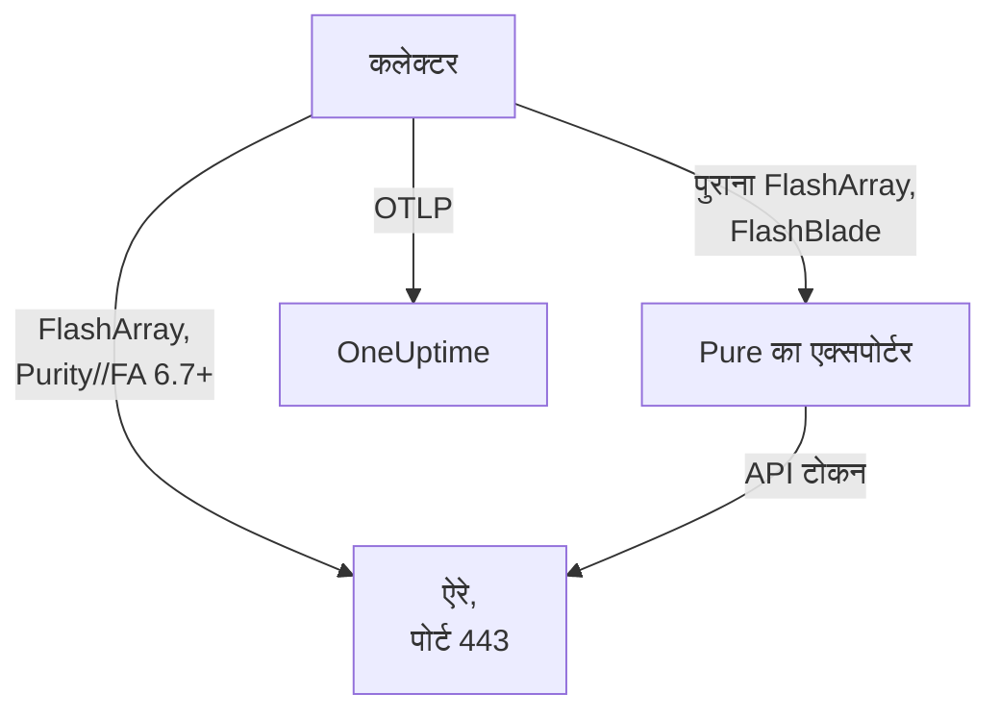

# स्टोरेज ऐरे एजेंट

OneUptime Storage Array एजेंट स्टोरेज ऐरे की निगरानी करता है: क्षमता और डेटा रिडक्शन, लेटेंसी, IOPS और बैंडविड्थ, वॉल्यूम, होस्ट, पॉड और रेप्लिकेशन, हार्डवेयर का स्वास्थ्य, फ़ाइल सिस्टम और बकेट। यह एक मानक OpenTelemetry Collector है, जो केवल-पढ़ने वाले उपयोगकर्ता के API टोकन से ऐरे के OpenMetrics एंडपॉइंट स्क्रैप करता है, हर मेट्रिक पर आपके ऐरे की पहचान लगाता है और उसे OneUptime को भेजता है। [स्टोरेज ऐरे मॉनिटर](/docs/monitor/storage-array-monitor) जो आता है उस पर अलर्ट करते हैं।

:::cards
- [एजेंट इंस्टॉल करें](#एजेंट-इंस्टॉल-करें): एक केवल-पढ़ने वाला उपयोगकर्ता, फिर इंस्टॉल स्क्रिप्ट या Docker Compose।
- [एजेंट क्या इकट्ठा करता है](#एजेंट-क्या-इकट्ठा-करता-है): हर एंडपॉइंट, और उससे बनने वाले पेज।
- [कई ऐरे की निगरानी](#कई-ऐरे-की-निगरानी): हर ऐरे के लिए एक एजेंट, एक ही मशीन पर।
- [समस्या निवारण](#समस्या-निवारण): एक डायग्नोस्टिक स्क्रिप्ट, और आम समस्याएँ।
:::

## यह कैसे काम करता है

Storage Arrays एक ऐसा उत्पाद है जो हर वेंडर के लिए एक ही तरह काम करता है। यह इन्हें सपोर्ट करता है:

| ऐरे | एजेंट इसे कैसे पढ़ता है | कलेक्टर कॉन्फ़िगरेशन |
| --- | --- | --- |
| **Pure Storage FlashArray**, Purity//FA 6.7 और बाद का | ऐरे का अपना OpenMetrics एंडपॉइंट (`https://<array>/metrics/...?namespace=purefa`): कलेक्टर के बगल में कुछ नहीं चलता | `otel-collector-config.yaml` (डिफ़ॉल्ट) |
| **Pure Storage FlashArray**, पुराना Purity//FA | Pure का FlashArray OpenMetrics एक्सपोर्टर, जिसे वही Compose फ़ाइल `pure-fa-exporter` सेवा के रूप में चलाती है | `otel-collector-config.flasharray-exporter.yaml` |
| **Pure Storage FlashBlade** | Pure का FlashBlade OpenMetrics एक्सपोर्टर, जिसे वही Compose फ़ाइल `pure-fb-exporter` सेवा के रूप में चलाती है | `otel-collector-config.flashblade.yaml` |

Pure Storage ने फ़रवरी 2026 में अपना नाम बदलकर **Everpure** कर लिया। FlashArray, FlashBlade और Purity के नाम वही रहे, और `purefa_*` और `purefb_*` मेट्रिक्स के भी, इसलिए इस पेज की हर बात दोनों में से किसी भी नाम से बेचे गए ऐरे पर लागू होती है।



एक एजेंट एक ऐरे की निगरानी करता है: हर ऐरे के लिए एक एजेंट चलाएँ ([कई ऐरे की निगरानी](#कई-ऐरे-की-निगरानी) देखें)। ऐरे अपने पहले डेटा के साथ खुद को रजिस्टर करता है, उस नाम से जिसे एजेंट हर मेट्रिक पर `storage.array.name` के रूप में लगाता है।

## शुरू करने से पहले

- Docker Compose v2 प्लगइन के साथ Docker Engine 20.10 या बाद का, ऐसी मशीन पर जो HTTPS (TCP 443) पर ऐरे के प्रबंधन इंटरफ़ेस तक पहुँच सके।
- ऐरे पर एक एडमिनिस्ट्रेटर खाता, ताकि बिल्ट-इन **readonly** भूमिका वाला एक उपयोगकर्ता और उसके लिए एक API टोकन बनाया जा सके।
- एक इंजेशन कुंजी। **प्रोजेक्ट सेटिंग्स → टेलीमेट्री और APM → इंजेशन कुंजियाँ** के अंतर्गत एक बनाएँ और उसका मान कॉपी करें।

### एजेंट कहाँ चलाएँ

एजेंट HTTPS पर ऐरे के प्रबंधन इंटरफ़ेस से बात करता है, इसलिए वह Docker वाली और TCP 443 पर प्रबंधन नेटवर्क तक रास्ते वाली किसी भी मशीन पर चल सकता है: एक निगरानी होस्ट, या एक छोटी प्रबंधन VM। ऐसी मशीन चुनें जिसका अपना स्टोरेज उस ऐरे पर न हो जिसकी वह निगरानी करती है: अगर ऐरे बंद हो जाए, तो आपकी निगरानी उसके साथ बंद नहीं होनी चाहिए। वैकल्पिक syslog लिसनर के लिए यह भी ज़रूरी है कि ऐरे syslog पोर्ट पर एजेंट तक पहुँच सके ([ऐरे का syslog भेजें](#वैकल्पिक-ऐरे-का-syslog-भेजें) देखें)।

## एजेंट इंस्टॉल करें

:::steps
### केवल-पढ़ने वाला उपयोगकर्ता और API टोकन बनाएँ

एजेंट सिर्फ़ पढ़ता है। उसे बिल्ट-इन **readonly** भूमिका वाला अपना उपयोगकर्ता दें, कभी भी कोई एडमिनिस्ट्रेटर नहीं, और उस उपयोगकर्ता के लिए एक API टोकन। टोकन **बिना समाप्ति के** बनाएँ, वरना जिस दिन टोकन की समय-सीमा खत्म होगी उसी दिन एजेंट रुक जाएगा।

:::tabs
@tab Purity CLI
एडमिनिस्ट्रेटर के रूप में FlashArray पर SSH करें। पहला कमांड नए उपयोगकर्ता का पासवर्ड पूछता है; दूसरा उसका API टोकन छापता है, जो एक UUID है:

```bash
pureadmin create --role readonly oneuptime
pureadmin create --api-token oneuptime
```
@tab FlashArray GUI
1. _Settings → Users and Policies_ खोलें (पुराने रिलीज़ में _Settings → Access_)।
2. **Users** पैनल के ⋮ मेनू से **Create User…** चुनें, उपयोगकर्ता का नाम `oneuptime` रखें और उसे readonly भूमिका दें।
3. नए उपयोगकर्ता के ⋮ मेनू से **Create API Token…** चुनें, **Expires In** खाली छोड़ें, और टोकन कॉपी करें।
@tab FlashBlade
इसी तरह **readonly** भूमिका वाला एक उपयोगकर्ता और उसके लिए एक API टोकन बनाएँ: FlashBlade GUI की उपयोगकर्ता सेटिंग्स में, या Purity//FB CLI में `pureadmin` से। बिना स्थानीय उपयोगकर्ताओं वाले रिलीज़ पर, किसी डायरेक्टरी सेवा (LDAP या Active Directory) का ऐसा खाता उपयोग करें जिसका समूह readonly भूमिका से मैप होता हो। FlashBlade API टोकन `T-` से शुरू होते हैं।
:::

### जाँचें कि FlashArray अपने मेट्रिक्स खुद देता है या नहीं

Pure नेटिव OpenMetrics एंडपॉइंट को **Purity//FA 6.7.0 और बाद के** लिए दस्तावेज़ित करता है (Pure के FlashArray एक्सपोर्टर की डेप्रिकेशन सूचना 6.6.11 और बाद का कहती है)। जानने का सबसे तेज़ तरीका है ऐरे से पूछना, उसी मशीन से जिस पर एजेंट चलेगा:

```bash
curl -k 'https://<array>/metrics/array?namespace=purefa' --header 'Authorization: Bearer <api-token>' | grep purefa_info
```

`purefa_info{...} 1` पंक्ति का अर्थ है कि ऐरे अपने मेट्रिक्स नेटिव रूप से देता है: डिफ़ॉल्ट कॉन्फ़िगरेशन उपयोग करें। `404` का अर्थ है कि नहीं देता: एक्सपोर्टर कॉन्फ़िगरेशन उपयोग करें, जो कलेक्टर के बगल में Pure का एक्सपोर्टर चलाता है। Pure ने वह एक्सपोर्टर डेप्रिकेट कर दिया है, इसलिए ऐरे अपग्रेड होते ही नेटिव कॉन्फ़िगरेशन पर जाएँ। FlashBlade हमेशा Pure के FlashBlade एक्सपोर्टर से होकर जाता है, इसलिए उसके लिए यह चरण छोड़ दें।

### एजेंट इंस्टॉल करें और शुरू करें

:::tabs
@tab install.sh
इंस्टॉल स्क्रिप्ट डाउनलोड करें और उसे उस मशीन पर चलाएँ जो एजेंट को होस्ट करेगी:

```bash
curl -sSL https://raw.githubusercontent.com/OneUptime/oneuptime/master/agents/StorageArrayAgent/install.sh -o install.sh
bash install.sh
```

स्क्रिप्ट पूछती है कि यह कौन-सा ऐरे है (नेटिव मेट्रिक्स देने वाला FlashArray, पुराने Purity//FA वाला FlashArray, या FlashBlade), फिर आपका OneUptime URL, इंजेशन कुंजी, ऐरे का नाम, ऐरे का प्रबंधन पता और केवल-पढ़ने वाले उपयोगकर्ता का API टोकन (बिना दिखाए पढ़ा जाता है)। यह `/opt/oneuptime-storage-array-agent` में इंस्टॉल करती है, Compose फ़ाइल और तीनों कलेक्टर कॉन्फ़िगरेशन डाउनलोड करती है, मेल खाते कॉन्फ़िगरेशन और Compose प्रोफ़ाइल के साथ `0600` अनुमति वाली एक `.env` फ़ाइल लिखती है, और Docker Compose से एजेंट शुरू करती है। यह हर मान को वैसे ही Docker Compose के लिए उद्धरण चिह्नों में रखती है जैसे आपने टाइप किया। इसे फिर से चलाने पर यह दोबारा पूछने के बजाय मौजूदा `.env` की हर चीज़ फिर से उपयोग करती है, और आपकी संपादित फ़ाइल को बदलने से पहले उसे `<file>.bak.<timestamp>` के रूप में रख लेती है।
@tab Docker Compose
`docker-compose.yml` और तीन `otel-collector-config*.yaml` फ़ाइलें [StorageArrayAgent डायरेक्टरी](https://github.com/OneUptime/oneuptime/tree/master/agents/StorageArrayAgent) से एक नए फ़ोल्डर में डाउनलोड करें:

```bash
curl -fsSLO https://raw.githubusercontent.com/OneUptime/oneuptime/master/agents/StorageArrayAgent/docker-compose.yml
curl -fsSLO https://raw.githubusercontent.com/OneUptime/oneuptime/master/agents/StorageArrayAgent/otel-collector-config.yaml
curl -fsSLO https://raw.githubusercontent.com/OneUptime/oneuptime/master/agents/StorageArrayAgent/otel-collector-config.flasharray-exporter.yaml
curl -fsSLO https://raw.githubusercontent.com/OneUptime/oneuptime/master/agents/StorageArrayAgent/otel-collector-config.flashblade.yaml
```

उनके बगल में एक `.env` फ़ाइल बनाएँ। इसमें API टोकन होता है, इसलिए इसे `chmod 600 .env` से निजी रखें। नेटिव मेट्रिक्स देने वाले FlashArray के लिए:

```bash title=".env"
ONEUPTIME_URL=YOUR_ONEUPTIME_URL
ONEUPTIME_TELEMETRY_INGESTION_KEY=YOUR_TELEMETRY_INGESTION_TOKEN
STORAGE_ARRAY_NAME=my-storage-array
STORAGE_SYSTEM=purestorage.flasharray
STORAGE_ARRAY_COLLECTOR_CONFIG=otel-collector-config.yaml
COMPOSE_PROFILES=
PURE_FA_ENDPOINT=fa-prod-01.example.com
PURE_FA_API_TOKEN=YOUR_READ_ONLY_API_TOKEN
PURE_FB_ENDPOINT=
PURE_FB_API_TOKEN=
STORAGE_ARRAY_INSECURE_SKIP_VERIFY=true
```

पुराने Purity//FA वाले FlashArray के लिए `STORAGE_ARRAY_COLLECTOR_CONFIG=otel-collector-config.flasharray-exporter.yaml` और `COMPOSE_PROFILES=flasharray-exporter` सेट करें। FlashBlade के लिए `STORAGE_SYSTEM=purestorage.flashblade`, `STORAGE_ARRAY_COLLECTOR_CONFIG=otel-collector-config.flashblade.yaml` और `COMPOSE_PROFILES=flashblade` सेट करें, और `PURE_FB_ENDPOINT` और `PURE_FB_API_TOKEN` भरें (`PURE_FA_*` जोड़ी के बजाय)। एजेंट शुरू करें:

```bash
docker compose up -d
```
:::

### जाँचें कि एजेंट चल रहा है

```bash
docker compose ps
docker logs -f oneuptime-storage-array-agent
```

`docker compose ps` कलेक्टर (`oneuptime-storage-array-agent`) और, एक्सपोर्टर कॉन्फ़िगरेशन के साथ, एक्सपोर्टर (`pure-fa-exporter` या `pure-fb-exporter`) दिखाता है। कलेक्टर शुरू होने के बाद उसके लॉग में यह पंक्ति दिखनी चाहिए:

```text
Everything is ready. Begin running and processing data.
```

### OneUptime में ऐरे ढूँढें

**उत्पाद → बुनियादी ढांचा → Storage Arrays → All Storage Arrays** खोलें। पहले स्क्रैप के बाद (लगभग एक मिनट) ऐरे अपनी क्षमता, परफ़ॉर्मेंस, खुले अलर्ट और हार्डवेयर के साथ वहाँ होता है। वॉल्यूम, होस्ट और पॉड 2 मिनट के भीतर आते हैं, FlashBlade के फ़ाइल सिस्टम और बकेट 5 मिनट के भीतर, और FlashArray की डायरेक्टरी 30 मिनट के भीतर।
:::

## एनवायरनमेंट वेरिएबल

इंस्टॉल स्क्रिप्ट इन्हें `/opt/oneuptime-storage-array-agent/.env` में लिखती है; Docker Compose इंस्टॉल इन्हें `.env` से पढ़ता है, जो `docker-compose.yml` के बगल में है। किसी एक को बदलने के बाद उस फ़ोल्डर में `docker compose up -d` चलाएँ।

| वेरिएबल | ज़रूरी | विवरण |
| --- | --- | --- |
| `ONEUPTIME_URL` | हाँ | आपका OneUptime URL, जैसे `https://oneuptime.com` या आपका सेल्फ़-होस्टेड इंस्टेंस। अगर इंस्टेंस सिर्फ़ HTTP पर है तो `http://` और उसका पोर्ट उपयोग करें। |
| `ONEUPTIME_TELEMETRY_INGESTION_KEY` | हाँ | **प्रोजेक्ट सेटिंग्स → टेलीमेट्री और APM → इंजेशन कुंजियाँ** से इंजेशन कुंजी। |
| `STORAGE_ARRAY_NAME` | हाँ | वह नाम जिससे ऐरे OneUptime में रजिस्टर होता है, हर मेट्रिक पर `storage.array.name` रिसोर्स एट्रिब्यूट के रूप में लगाया गया। इसे स्थिर रखें: बाद में बदलने से एक दूसरा ऐरे रजिस्टर होता है। इसके बिना कलेक्टर शुरू होने से इनकार करता है। |
| `STORAGE_SYSTEM` | नहीं | प्लेटफ़ॉर्म, `storage.system` रिसोर्स एट्रिब्यूट के रूप में लगाया गया: `purestorage.flasharray` या `purestorage.flashblade`। डिफ़ॉल्ट `purestorage.flasharray` है। |
| `STORAGE_ARRAY_COLLECTOR_CONFIG` | नहीं | साथ आने वाला कौन-सा कलेक्टर कॉन्फ़िगरेशन चलता है: `otel-collector-config.yaml` (FlashArray, नेटिव: डिफ़ॉल्ट), `otel-collector-config.flasharray-exporter.yaml` (पुराना FlashArray) या `otel-collector-config.flashblade.yaml` (FlashBlade)। |
| `COMPOSE_PROFILES` | नहीं | वह एक्सपोर्टर शुरू करता है जिसे चुना गया कॉन्फ़िगरेशन स्क्रैप करता है: नेटिव FlashArray कॉन्फ़िगरेशन के लिए खाली, बाकी दोनों के लिए `flasharray-exporter` या `flashblade`। |
| `PURE_FA_ENDPOINT` | FlashArray | FlashArray का प्रबंधन पता: होस्ट नाम या IP, `https://` के बिना। |
| `PURE_FA_API_TOKEN` | FlashArray | readonly भूमिका वाले FlashArray उपयोगकर्ता का API टोकन। |
| `PURE_FB_ENDPOINT` | FlashBlade | FlashBlade का प्रबंधन पता: होस्ट नाम या IP, `https://` के बिना। |
| `PURE_FB_API_TOKEN` | FlashBlade | readonly भूमिका वाले FlashBlade उपयोगकर्ता का API टोकन। |
| `STORAGE_ARRAY_INSECURE_SKIP_VERIFY` | नहीं | `true` नेटिव एंडपॉइंट पर ऐरे का सेल्फ़-साइन्ड सर्टिफ़िकेट स्वीकार करता है; `false` उसे सत्यापित करता है। डिफ़ॉल्ट `true` है। Pure के एक्सपोर्टर ऐरे का सर्टिफ़िकेट कभी सत्यापित नहीं करते, इसलिए यह उन पर लागू नहीं होता। |

## एजेंट कैसे स्क्रैप करता है

- **हर एंडपॉइंट के लिए एक स्क्रैप जॉब, और हर एक उतनी बार पढ़ा जाता है जितना उचित है।** FlashArray: `/metrics/array` हर 60 सेकंड; `/metrics/volumes`, `/metrics/hosts` और `/metrics/pods` हर 2 मिनट; `/metrics/directories` हर 30 मिनट, जो Pure की अपनी सलाह है, क्योंकि डायरेक्टरी का स्पेस निकालना ऐरे के लिए महँगा है। FlashBlade: `/metrics/array` हर 60 सेकंड; `/metrics/filesystems` और `/metrics/objectstore` हर 5 मिनट, फिर से Pure की इस सलाह के अनुसार कि फ़ाइल सिस्टम और ऑब्जेक्ट स्टोर एंडपॉइंट ऐरे से कम बार पढ़े जाएँ।
- **हर जॉब अपनी सीरीज़ पर `scrape_endpoint: <endpoint>` लेबल लगाता है।** हर एंडपॉइंट `purefa_info` या `purefb_info` भी एक्सपोर्ट करता है, इसलिए OneUptime जानता है कि कोई बैच किन फ़ैमिली की पूरी सूची है: इसी तरह हटाया गया वॉल्यूम, होस्ट, पॉड, फ़ाइल सिस्टम या बकेट बना रहने के बजाय इन्वेंटरी से निकल जाता है। लेबल वैसे ही रखें जैसे वे आते हैं।
- **प्रति-वॉल्यूम और प्रति-होस्ट लेटेंसी तीन आयाम रखती है।** हर वॉल्यूम और होस्ट अपनी लेटेंसी अधिकतम सोलह `dimension` में एक्सपोर्ट करता है। एक `metric_relabel_configs` नियम `usec_per_read_op`, `usec_per_write_op` और `usec_per_mirrored_write_op` रखता है और QoS दर सीमा, कतार, SAN और सेवा-समय का ब्योरा हटा देता है, जो बड़े ऐरे की सीरीज़ को कई गुना कर देता है। `purefa_array_performance_latency_usec` पर पूरे ऐरे का ब्योरा रखा जाता है। प्रति-वॉल्यूम ब्योरा भी रखने के लिए नियम हटा दें।
- **API टोकन एक Bearer टोकन है।** नेटिव कॉन्फ़िगरेशन इसे सीधे ऐरे को भेजता है; एक्सपोर्टर कॉन्फ़िगरेशन इसे सिर्फ़ Compose नेटवर्क पर एक्सपोर्टर को भेजते हैं, और एक्सपोर्टर के पोर्ट कभी प्रकाशित नहीं होते।
- **कोई `send_batch_max_size` नहीं।** OneUptime हर अनुरोध के एक पूरे स्क्रैप से इन्वेंटरी फिर से बनाता है, इसलिए साथ आने वाला `batch` प्रोसेसर किसी स्क्रैप को कभी कई एक्सपोर्ट में नहीं बाँटता। batch सेटिंग्स को वैसे ही रखें जैसी वे आती हैं।

## एजेंट क्या इकट्ठा करता है

Pure की सिमैंटिक कन्वेंशन FlashArray के नेटिव एंडपॉइंट और दोनों एक्सपोर्टर में साझा हैं। हर मान एक गेज है जिसे ऐरे खुद निकालता है (लेटेंसी प्रति ऑपरेशन माइक्रोसेकंड में, थ्रूपुट प्रति सेकंड), इसलिए किसी दर की गणना की ज़रूरत नहीं, और ऑब्जेक्ट के नाम **डेटापॉइंट लेबल** से तय होते हैं: वॉल्यूम, पॉड, डायरेक्टरी, फ़ाइल सिस्टम और बकेट के लिए `name`, होस्ट के लिए `host`, FlashArray हार्डवेयर के लिए `component_name`। एजेंट `storage.array.name` और `storage.system` रिसोर्स एट्रिब्यूट जोड़ता है, इसलिए OneUptime सब कुछ आपके ऐरे के अंतर्गत रखता है:

| एंडपॉइंट | मेट्रिक फ़ैमिली | OneUptime इनसे क्या बनाता है |
| --- | --- | --- |
| FlashArray `/metrics/array` | `purefa_info`, `purefa_alerts_open`, `purefa_array_space_*`, `purefa_array_performance_*`, `purefa_hw_component_status`, `purefa_hw_component_temperature_celsius`, `purefa_hw_controller_info`, `purefa_drive_capacity_bytes`, `purefa_network_interface_*` | ऐरे का नाम, Purity वर्शन और सिस्टम ID; क्षमता, उपयोग किया गया स्पेस और डेटा रिडक्शन; खुले अलर्ट की गिनती; ऐरे का स्वास्थ्य; **Hardware** पेज (कंपोनेंट, ड्राइव, कंट्रोलर, नेटवर्क इंटरफ़ेस) |
| FlashArray `/metrics/volumes` | `purefa_volume_performance_*`, `purefa_volume_space_*`, `purefa_volume_qos_*` | **वॉल्यूम** पेज: प्रोविज़न किया गया और भौतिक आकार, डेटा रिडक्शन, पढ़ने और लिखने की लेटेंसी, प्रति वॉल्यूम IOPS और बैंडविड्थ |
| FlashArray `/metrics/hosts` | `purefa_host_connectivity_info`, `purefa_host_connections_info`, `purefa_host_performance_*`, `purefa_host_space_*` | **होस्ट** पेज: कनेक्टिविटी (रिडंडेंट पाथ हैं या नहीं), जुड़े वॉल्यूम, प्रति होस्ट लेटेंसी, IOPS और बैंडविड्थ |
| FlashArray `/metrics/pods` | `purefa_pod_performance_*`, `purefa_pod_space_*`, `purefa_pod_replica_links_*`, `purefa_pod_mediator_status` | **Replication** पेज: ActiveCluster और ActiveDR पॉड, रेप्लिका लिंक की स्थिति और लैग |
| FlashArray `/metrics/directories` | `purefa_directory_performance_*`, `purefa_directory_space_*` | **Directories** पेज (FlashArray File Services) |
| FlashBlade `/metrics/array` | `purefb_info`, `purefb_alerts_open`, `purefb_array_space_*`, `purefb_array_performance_*`, `purefb_hardware_health` | FlashBlade का नाम, Purity वर्शन और सिस्टम ID; क्षमता और डेटा रिडक्शन; खुले अलर्ट की गिनती; ऐरे का स्वास्थ्य; **Hardware** पेज |
| FlashBlade `/metrics/filesystems` | `purefb_file_systems_space_*`, `purefb_file_systems_performance_*` | **File Systems** पेज: प्रोविज़न किया गया और उपयोग किया गया स्पेस, डेटा रिडक्शन, प्रति फ़ाइल सिस्टम लेटेंसी, IOPS और बैंडविड्थ |
| FlashBlade `/metrics/objectstore` | `purefb_buckets_space_*`, `purefb_buckets_quota_space_bytes`, `purefb_buckets_object_count`, `purefb_buckets_performance_*`, `purefb_object_store_accounts_*` | **Buckets** पेज: प्रति बकेट स्पेस, कोटा, ऑब्जेक्ट की गिनती और परफ़ॉर्मेंस, खाते के अनुसार समूहित |

ऐरे के **अवलोकन** पर उसका स्वास्थ्य **गंभीर** होता है जब तक वह कोई खुला गंभीर अलर्ट बताता है, या कोई हार्डवेयर कंपोनेंट, ड्राइव या कंट्रोलर जो गंभीर, विफल, गायब या अस्वस्थ हो; **Warning** जब तक वह कोई खुला चेतावनी अलर्ट बताता है, या कोई डिग्रेड या अज्ञात कंपोनेंट; और बाकी समय **OK**। मॉनिटर मानदंड में ऐरे के एट्रिब्यूट पर `resource.` प्रीफ़िक्स लगता है (`resource.storage.array.name`, `resource.storage.system`), जबकि डेटापॉइंट लेबल बिना प्रीफ़िक्स रहते हैं (`name`, `host`, `dimension`, `space`)।

## वैकल्पिक — ऐरे का syslog भेजें

डिफ़ॉल्ट रूप से एजेंट सिर्फ़ मेट्रिक्स भेजता है, इसलिए ऐरे का **लॉग** पेज खाली रहता है। ऐरे अपने अलर्ट और ऑडिट इवेंट syslog के रूप में आगे भेजते हैं, और साथ आने वाले हर कलेक्टर कॉन्फ़िगरेशन में कमेंट किया हुआ `syslog` रिसीवर जोड़ा है (पोर्ट 5514 पर TCP और UDP, RFC 3164), जो कमेंट की हुई `logs` पाइपलाइन से जुड़ा है, जो `storage.array.name` लगाती है ताकि लॉग आपके ऐरे पर पहुँचें।

:::steps
### रिसीवर चालू करें

आप जो कलेक्टर कॉन्फ़िगरेशन उपयोग करते हैं, उसमें दोनों `syslog/*` रिसीवर और `logs` पाइपलाइन को अनकमेंट करें। RFC 3164 टाइमस्टैम्प में कोई टाइम ज़ोन नहीं होता: जब तक ऐरे की घड़ी UTC पर न चलती हो, `location` को ऐरे के टाइम ज़ोन पर सेट करें।

### पोर्ट खोलें

`ports:` ब्लॉक को अनकमेंट करें (`docker-compose.yml` में), ताकि मशीन `5514/tcp` और `5514/udp` प्रकाशित करे, फिर `docker compose up -d` चलाएँ। मशीन के फ़ायरवॉल में ऐरे के प्रबंधन नेटवर्क के लिए पोर्ट खोलें।

### ऐरे को एजेंट की ओर इंगित करें

यह एडमिनिस्ट्रेटर के रूप में करें, केवल-पढ़ने वाले निगरानी उपयोगकर्ता के रूप में नहीं। FlashArray पर _Settings → System → Syslog Servers_ खोलें, `udp://<agent-host>:5514` (या `tcp://<agent-host>:5514`) जोड़ें और एक परीक्षण संदेश भेजें। FlashBlade पर उसकी syslog सेटिंग्स में उसी URI वाला एक syslog सर्वर जोड़ें। दोनों ऐरे `PROTOCOL://HOST:PORT` रूप स्वीकार करते हैं, अपने REST API (`syslog-servers`) से भी।
:::

एक syslog रिसीवर सिर्फ़ एक ट्रांसपोर्ट पर सुनता है, इसीलिए TCP और UDP दो रिसीवर हैं: अगर आपको सिर्फ़ एक चाहिए, तो दूसरे को कमेंट ही रहने दें। मानक कलेक्टर इमेज syslog को जैसा है वैसा पढ़ती है: किसी कस्टम इमेज की ज़रूरत नहीं।

## ऐरे पर प्रोजेक्ट लेबल लगाएँ

`oneuptime.label.` से शुरू होने वाला रिसोर्स एट्रिब्यूट स्टोरेज ऐरे पर एक प्रोजेक्ट लेबल बन जाता है: `oneuptime.label.<dimension>=<value>` लेबल `<dimension>:<value>` है। आप जो कलेक्टर कॉन्फ़िगरेशन उपयोग करते हैं, उसके `resource` प्रोसेसर में एट्रिब्यूट जोड़ें, `storage.array.name` के बगल में:

```yaml
processors:
  resource:
    attributes:
      # ...existing attributes...
      - key: oneuptime.label.team
        value: storage
        action: upsert
      - key: oneuptime.label.env
        value: production
        action: upsert
```

कलेक्टर अपना कॉन्फ़िगरेशन सिर्फ़ शुरू होते समय पढ़ता है: `docker compose restart oneuptime-storage-array-agent` चलाएँ। इसके बाद ऐरे `team:storage` और `env:production` लेबल दिखाता है। लेबल का मिलान अक्षरों के बड़े-छोटे होने की परवाह किए बिना होता है, इसलिए मौजूदा `Production` लेबल दोहराया नहीं जाता बल्कि फिर से उपयोग होता है, और एजेंट कभी वह लेबल नहीं हटाता जिसे किसी ने OneUptime में जोड़ा हो।

## कई ऐरे की निगरानी

एक एजेंट एक ऐरे पढ़ता है। एक ही मशीन से कई ऐरे की निगरानी के लिए, हर एक को अपने `.env` के साथ उसके अपने फ़ोल्डर में इंस्टॉल करें, जैसे `INSTALL_DIR=/opt/oneuptime-storage-array-agent-fa02 bash install.sh`, और हर एक को अपना `container_name` दें, उसकी `docker-compose.yml` में (जैसे `oneuptime-storage-array-agent-fa02`): दो कंटेनर एक नाम साझा नहीं कर सकते। फ़ोल्डर को डायग्नोस्टिक स्क्रिप्ट को `-d` से दें।

## systemd सेवा के रूप में चलाएँ

एजेंट को मशीन के साथ शुरू करने और विफल होने पर फिर से शुरू करने के लिए उसकी systemd यूनिट इंस्टॉल करें। यह मानती है कि एजेंट `/opt/oneuptime-storage-array-agent` में है, जहाँ इंस्टॉल स्क्रिप्ट उसे रखती है:

```bash
sudo curl -fsSL https://raw.githubusercontent.com/OneUptime/oneuptime/master/agents/StorageArrayAgent/systemd/oneuptime-storage-array-agent.service -o /etc/systemd/system/oneuptime-storage-array-agent.service
sudo systemctl daemon-reload
sudo systemctl enable --now oneuptime-storage-array-agent
```

## एजेंट अपग्रेड करना

एजेंट अपनी फ़ाइलों द्वारा पिन किए गए कलेक्टर वर्शन को अपने **एजेंट संस्करण** के रूप में बताता है। जब वह इस OneUptime रिलीज़ के पिन किए वर्शन से पुराना होता है, तो ऐरे के **अवलोकन** पर उसके बगल में एक चेतावनी चिह्न दिखता है। ये कमांड देखने के लिए उसे चुनें। जो एजेंट उसकी फ़ाइलों के वर्शन बताने से पहले इंस्टॉल हुआ था, वह इस तरह अपग्रेड होने तक कोई वर्शन नहीं दिखाता।

कलेक्टर इमेज `docker-compose.yml` में पिन है और उसके कॉन्फ़िगरेशन उसके बगल की फ़ाइलें हैं, इसलिए सिर्फ़ पुल करने से एजेंट आगे नहीं बढ़ता। `install.sh` फिर से चलाएँ: यह आपकी मौजूदा `.env` का हर मान दोबारा उपयोग करती है (कुछ भी फिर से नहीं पूछा जाता), `docker-compose.yml` और तीनों कलेक्टर कॉन्फ़िगरेशन ताज़ा करती है (आपकी संपादित फ़ाइल `<file>.bak.<timestamp>` के रूप में रखी जाती है), और एजेंट दोबारा बनाती है ताकि कलेक्टर अपना नया कॉन्फ़िगरेशन पढ़े। `/opt/oneuptime-storage-array-agent` के बाहर इंस्टॉल किए गए एजेंट को अपना फ़ोल्डर चाहिए: `INSTALL_DIR=<folder> bash install.sh`।

```bash
curl -sSL https://raw.githubusercontent.com/OneUptime/oneuptime/master/agents/StorageArrayAgent/install.sh -o install.sh
bash install.sh
```

इसके बजाय Docker Compose से इंस्टॉल किया था? एजेंट के फ़ोल्डर में Compose फ़ाइल और तीनों कलेक्टर कॉन्फ़िगरेशन फिर से डाउनलोड करें (और उनमें किए गए बदलाव फिर से करें), फिर इमेज पुल करें और एजेंट दोबारा बनाएँ:

```bash
curl -fsSLO https://raw.githubusercontent.com/OneUptime/oneuptime/master/agents/StorageArrayAgent/docker-compose.yml
curl -fsSLO https://raw.githubusercontent.com/OneUptime/oneuptime/master/agents/StorageArrayAgent/otel-collector-config.yaml
curl -fsSLO https://raw.githubusercontent.com/OneUptime/oneuptime/master/agents/StorageArrayAgent/otel-collector-config.flasharray-exporter.yaml
curl -fsSLO https://raw.githubusercontent.com/OneUptime/oneuptime/master/agents/StorageArrayAgent/otel-collector-config.flashblade.yaml
docker compose pull
docker compose up -d --force-recreate
```

## एजेंट अनइंस्टॉल करना

```bash
cd /opt/oneuptime-storage-array-agent
docker compose down
```

फिर, अगर अब ज़रूरत नहीं है, तो ऐरे पर केवल-पढ़ने वाला उपयोगकर्ता और उसका API टोकन हटा दें।

## समस्या निवारण

:::details पहले डायग्नोस्टिक स्क्रिप्ट चलाएँ
एजेंट एक स्क्रिप्ट, [`troubleshoot.sh`](https://github.com/OneUptime/oneuptime/blob/master/agents/StorageArrayAgent/troubleshoot.sh), के साथ आता है, जो पूरी शृंखला जाँचती है: कंटेनर रनटाइम; ऐरे एंडपॉइंट ठीक वैसे ही जैसे कलेक्टर उस तक पहुँचता है (नेटिव एंडपॉइंट या Pure का एक्सपोर्टर: DNS, TLS, क्या FlashArray में नेटिव एंडपॉइंट है भी, और क्या ऐरे API टोकन स्वीकार करता है, जिसे स्क्रिप्ट stdin पर curl को देती है); हर मेट्रिक पर लगा ऐरे का नाम; टोकन का आकार; कलेक्टर के अपने मेट्रिक्स; और क्या OneUptime इंजेशन कुंजी स्वीकार करता है। वह आखिरी जाँच सबसे अहम है। OneUptime गलत कुंजी को `401` के साथ अस्वीकार करता है (अक्षम कुंजी या ब्राउज़र कुंजी के लिए `422`), और कलेक्टर दोनों को स्थायी मानता है: वह बैच हटा देता है और एक `Exporting failed` त्रुटि लॉग करता है, जो कंटेनर के स्वस्थ रहते आसानी से छूट जाती है। स्क्रिप्ट एजेंट के नेटवर्क के भीतर से `GET <url>/otlp/v1/validate` पूछती है, ताकि सीधे `200` (मान्य) या `401` (अमान्य) मिले, और पुराने सर्वर पर `POST /fluentd/v1/logs` पर लौट जाती है।

```bash
curl -sSL https://raw.githubusercontent.com/OneUptime/oneuptime/master/agents/StorageArrayAgent/troubleshoot.sh -o troubleshoot.sh
bash troubleshoot.sh    # add -d <dir> if you installed outside /opt/oneuptime-storage-array-agent
```

यह सबसे संभावित कारण बताने वाले एक निष्कर्ष के साथ खत्म होती है।
:::

:::details OneUptime में कोई ऐरे नहीं दिखता
1. कलेक्टर के लॉग पढ़ें: `docker logs oneuptime-storage-array-agent`। `server returned HTTP status 401` का अर्थ है कि ऐरे ने API टोकन अस्वीकार कर दिया, `404` का अर्थ है कि FlashArray में कोई नेटिव एंडपॉइंट नहीं है, `x509` का अर्थ है कि ऐरे के सेल्फ़-साइन्ड सर्टिफ़िकेट के सामने TLS सत्यापन चालू है, `no such host` या `connection refused` का अर्थ है गलत `PURE_FA_ENDPOINT` या `PURE_FB_ENDPOINT`, और एक्सपोर्ट पर `401` का अर्थ है गलत इंजेशन कुंजी।
2. एजेंट के नेटवर्क से ऐरे से पूछें। कलेक्टर इमेज में न शेल है न curl, इसलिए उसके नेटवर्क के किसी कंटेनर से पूछें: `docker run --rm --network container:oneuptime-storage-array-agent curlimages/curl -sk -H 'Authorization: Bearer <api-token>' 'https://<array>/metrics/array?namespace=purefa'` को `purefa_*` पंक्तियाँ छापनी चाहिए।
3. जाँचें कि `STORAGE_ARRAY_NAME` सेट है: ऐरे उसके `storage.array.name` रिसोर्स एट्रिब्यूट से पाया जाता है, और इसके बिना कलेक्टर शुरू होने से इनकार करता है।
:::

:::details ऐरे डिस्कनेक्टेड दिखता है
जब OneUptime को किसी ऐरे से 15 मिनट तक कुछ नहीं मिलता, तो वह डिस्कनेक्टेड हो जाता है; OneUptime हर 5 मिनट में जाँच करता है, और जिस समय वह खुद डेटा नहीं पा रहा था, वह गिना नहीं जाता। जाँचें कि कलेक्टर चल रहा है (`docker compose ps`), उसके लॉग में कोई स्क्रैप या एक्सपोर्ट त्रुटि नहीं है, और मशीन अब भी ऐरे और आपके OneUptime URL तक पहुँचती है। अगला डेटा आते ही ऐरे फिर से कनेक्टेड हो जाता है।
:::

:::details FlashArray 404 लौटाता है
उसके Purity//FA में कोई नेटिव OpenMetrics एंडपॉइंट नहीं है। `install.sh` फिर से चलाएँ और पुराने Purity वाला विकल्प चुनें, या `STORAGE_ARRAY_COLLECTOR_CONFIG=otel-collector-config.flasharray-exporter.yaml` और `COMPOSE_PROFILES=flasharray-exporter` सेट करें (`.env` में) और `docker compose up -d` चलाएँ। ऐरे को Purity//FA 6.7 या बाद के पर अपग्रेड करने के बाद नेटिव कॉन्फ़िगरेशन पर वापस जाएँ और प्रोफ़ाइल हटा दें।
:::

:::details ऐरे API टोकन अस्वीकार करता है
जाँचें कि आपने उपयोगकर्ता का पासवर्ड नहीं, API टोकन चिपकाया है; कि उपयोगकर्ता अब भी मौजूद है और उसके पास readonly भूमिका है; और कि टोकन की समय-सीमा खत्म नहीं हुई है। एक नया टोकन बनाएँ (FlashArray पर `pureadmin create --api-token oneuptime`), उसे `.env` में रखें और `docker compose up -d` चलाएँ। Pure के एक्सपोर्टर के ज़रिए, अस्वीकार किया गया टोकन कलेक्टर के लॉग में एक्सपोर्टर से आए HTTP `400` के रूप में दिखता है, जिसकी बॉडी में `failed to login` लिखा होता है।
:::

:::details x509 या TLS त्रुटियाँ
ऐरे डिफ़ॉल्ट रूप से एक सेल्फ़-साइन्ड सर्टिफ़िकेट पेश करते हैं, जिस पर कोई Docker इमेज भरोसा नहीं करती। या तो `STORAGE_ARRAY_INSECURE_SKIP_VERIFY=true` सेट करें (निजी प्रबंधन नेटवर्क पर व्यावहारिक विकल्प), या ऐरे पर ऐसे CA का सर्टिफ़िकेट इंस्टॉल करें जिस पर कलेक्टर इमेज भरोसा करती है।
:::

:::details pure-fa-exporter या pure-fb-exporter रिज़ॉल्व नहीं होता
एक्सपोर्टर नहीं चल रहा: `COMPOSE_PROFILES` को `STORAGE_ARRAY_COLLECTOR_CONFIG` से मेल खाना चाहिए (FlashArray एक्सपोर्टर कॉन्फ़िगरेशन के लिए `flasharray-exporter`, FlashBlade कॉन्फ़िगरेशन के लिए `flashblade`)। `.env` ठीक करें और `docker compose up -d` चलाएँ; इसके बाद `docker compose ps` एक्सपोर्टर दिखाता है।
:::

:::details हटाए गए वॉल्यूम या होस्ट इन्वेंटरी में बने रहते हैं
OneUptime कोई ऑब्जेक्ट तब हटाता है जब उसके एंडपॉइंट के पूरे स्क्रैप में वह नहीं रहता, और इसे वह `scrape_endpoint` लेबल से पहचानता है। अगर आपने साथ आने वाले कलेक्टर कॉन्फ़िगरेशन को अपने कॉन्फ़िगरेशन से बदला है, तो उसके स्क्रैप जॉब पर `scrape_endpoint` लेबल बनाए रखें; वरना ऑब्जेक्ट सिर्फ़ तब इन्वेंटरी से निकलते हैं जब वे पुराने पड़ जाते हैं।
:::

:::details मेट्रिक्स गलत ऐरे के अंतर्गत पहुँचते हैं
OneUptime स्टोरेज ऐरे को उसके `storage.array.name` से रजिस्टर करता है, जिसे एजेंट `STORAGE_ARRAY_NAME` से लेता है। पहले डेटा के बाद इसे बदलने से पहले ऐरे का नाम नहीं बदलता, बल्कि एक दूसरा ऐरे बन जाता है।
:::

:::details एजेंट के बिना मेट्रिक्स भेजना
एजेंट एक मानक कलेक्टर कॉन्फ़िगरेशन है, इसलिए आपके पहले से चल रहे कलेक्टर भी यही काम कर सकते हैं: स्क्रैप जॉब और `resource` प्रोसेसर को साथ आने वाले कॉन्फ़िगरेशन से अपने कॉन्फ़िगरेशन में कॉपी करें। `storage.array.name` रिसोर्स एट्रिब्यूट ही OneUptime में ऐरे को रजिस्टर करता है, और `service.name` / `service.instance.id` को हटाना डेटा को किसी सेवा के अंतर्गत जाने से रोकता है: दोनों रखें, और `scrape_endpoint` लेबल भी रखें।
:::

## अगले कदम

:::cards
- [स्टोरेज ऐरे मॉनिटर](/docs/monitor/storage-array-monitor): अलर्ट, क्षमता, लेटेंसी, हार्डवेयर, होस्ट पाथ, रेप्लिकेशन और फ़ाइल सिस्टम पर अलर्ट करें।
- [VMware एजेंट](/docs/telemetry/vmware): इस ऐरे पर VMware चला रहे हैं? उसके डेटास्टोर और VM भी देखें।
- [होस्ट OpenTelemetry कलेक्टर](/docs/telemetry/host-otel-collector): ऐरे का उपयोग करने वाली मशीनों का ऑपरेटिंग सिस्टम वाला दृश्य।
:::
