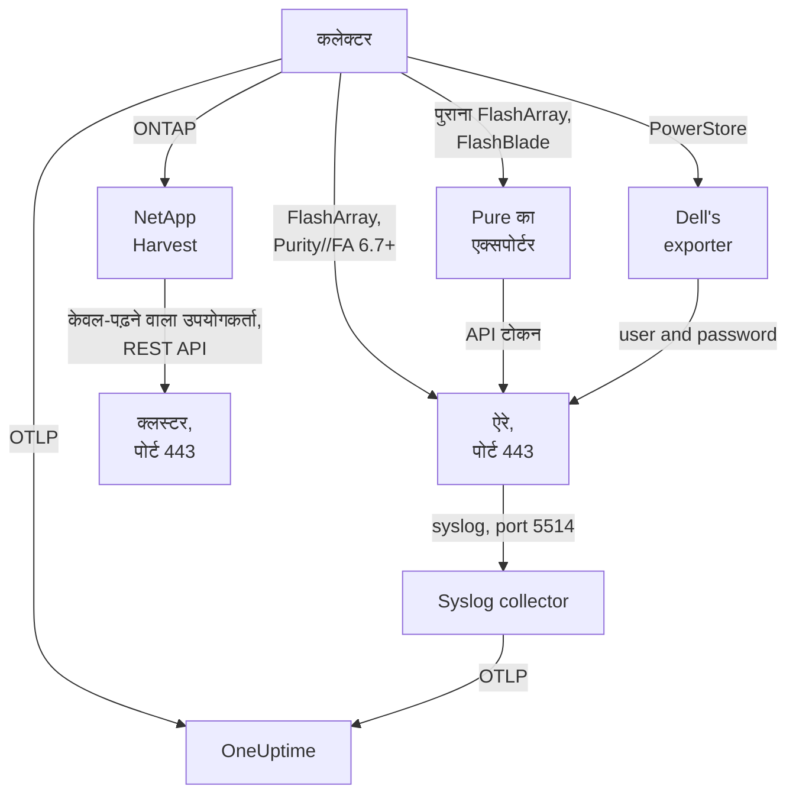

# स्टोरेज ऐरे एजेंट

OneUptime Storage Array एजेंट स्टोरेज ऐरे की निगरानी करता है: क्षमता और डेटा रिडक्शन, लेटेंसी, IOPS और बैंडविड्थ, वॉल्यूम, होस्ट, पॉड और रेप्लिकेशन, हार्डवेयर का स्वास्थ्य, फ़ाइल सिस्टम और बकेट, और NetApp ONTAP पर उसके एग्रीगेट, SVM, LUN और SnapMirror संबंध। यह एक मानक OpenTelemetry Collector है, जो केवल-पढ़ने वाले उपयोगकर्ता के API टोकन से ऐरे के OpenMetrics एंडपॉइंट स्क्रैप करता है (या, ONTAP के लिए, अपने बगल में चलने वाला NetApp का अपना Harvest एक्सपोर्टर), हर मेट्रिक पर आपके ऐरे की पहचान लगाता है और उसे OneUptime को भेजता है। [स्टोरेज ऐरे मॉनिटर](/docs/monitor/storage-array-monitor) जो आता है उस पर अलर्ट करते हैं।

:::cards
- [एजेंट इंस्टॉल करें](#एजेंट-इंस्टॉल-करें): एक केवल-पढ़ने वाला उपयोगकर्ता, फिर इंस्टॉल स्क्रिप्ट या Docker Compose।
- [Dell PowerScale](#dell-powerscale): क्लस्टर पर SNMP, हर नोड का पोल, और उसके पेज क्या दिखाते हैं।
- [एजेंट क्या इकट्ठा करता है](#एजेंट-क्या-इकट्ठा-करता-है): हर एंडपॉइंट, और उससे बनने वाले पेज।
- [कई ऐरे की निगरानी](#कई-ऐरे-की-निगरानी): हर ऐरे के लिए एक एजेंट, एक ही मशीन पर।
- [Dell PowerMax](#dell-powermax): कोई एजेंट नहीं: एक प्रोब Unisphere के पीछे हर ऐरे को पढ़ता है।
- [समस्या निवारण](#समस्या-निवारण): एक डायग्नोस्टिक स्क्रिप्ट, और आम समस्याएँ।
:::

## यह कैसे काम करता है

Storage Arrays एक ऐसा उत्पाद है जो हर वेंडर के लिए एक ही तरह काम करता है। यह इन्हें सपोर्ट करता है:

| ऐरे | `storage.system` | एजेंट इसे कैसे पढ़ता है | कलेक्टर कॉन्फ़िगरेशन |
| --- | --- | --- | --- |
| **Pure Storage FlashArray**, Purity//FA 6.7 और बाद का | `purestorage.flasharray` | ऐरे का अपना OpenMetrics एंडपॉइंट (`https://<array>/metrics/...?namespace=purefa`): कलेक्टर के बगल में कुछ नहीं चलता | `otel-collector-config.yaml` (डिफ़ॉल्ट) |
| **Pure Storage FlashArray**, पुराना Purity//FA | `purestorage.flasharray` | Pure का FlashArray OpenMetrics एक्सपोर्टर, जिसे वही Compose फ़ाइल `pure-fa-exporter` सेवा के रूप में चलाती है | `otel-collector-config.flasharray-exporter.yaml` |
| **Pure Storage FlashBlade** | `purestorage.flashblade` | Pure का FlashBlade OpenMetrics एक्सपोर्टर, जिसे वही Compose फ़ाइल `pure-fb-exporter` सेवा के रूप में चलाती है | `otel-collector-config.flashblade.yaml` |
| **Dell PowerStore** | `dell.powerstore` | Dell का PowerStore Metrics Exporter, जिसे वही Compose फ़ाइल `powerstore-exporter` सेवा के रूप में बनाती और चलाती है; क्लस्टर के अलर्ट syslog से उसकी `powerstore-syslog` सेवा पर आते हैं | `otel-collector-config.powerstore.yaml` |
| **NetApp ONTAP** 9.12.1 और बाद का (AFF, FAS, ASA, ONTAP Select, Cloud Volumes ONTAP), और **Amazon FSx for NetApp ONTAP** | `netapp.ontap` | [NetApp Harvest](https://github.com/NetApp/harvest) 26.11, जिसे वही Compose फ़ाइल `netapp-harvest` सेवा के रूप में चलाती है: यह केवल-पढ़ने वाले उपयोगकर्ता और पासवर्ड से क्लस्टर के REST API में लॉग इन करता है | `otel-collector-config.netapp-ontap.yaml` |
| **Dell PowerScale** (Isilon), OneFS 8.0 और बाद का | `dell.powerscale` | हर नोड SNMP पर (Dell का ISILON-MIB), कलेक्टर के अपने SNMP रिसीवर से: कलेक्टर के बगल में कुछ नहीं चलता | `otel-collector-config.powerscale.yaml` |

ONTAP का अपना कोई मेट्रिक्स एंडपॉइंट नहीं है, इसलिए एजेंट कलेक्टर के बगल में NetApp का ओपन-सोर्स एक्सपोर्टर, Harvest, चलाता है। Harvest क्लस्टर का REST API पढ़ता है और जो पढ़ा उसे Compose नेटवर्क पर देता है, हर सीरीज़ `netapp_<object>_<counter>` नाम से; कलेक्टर उसे स्क्रैप करता है और आगे भेजता है। Harvest क्लस्टर पर कभी कुछ नहीं लिखता, और NetApp को जाने वाली उसकी AutoSupport रिपोर्ट बंद रहती है।

**Dell PowerMax** (`dell.powermax`) को किसी एजेंट की ज़रूरत नहीं है: एक OneUptime प्रोब केवल-पढ़ने वाले खाते से वह हर ऐरे पढ़ता है जिसे कोई Unisphere for PowerMax प्रबंधित करता है। [Dell PowerMax](#dell-powermax) देखें।

Pure Storage ने फ़रवरी 2026 में अपना नाम बदलकर **Everpure** कर लिया। FlashArray, FlashBlade और Purity के नाम वही रहे, और `purefa_*` और `purefb_*` मेट्रिक्स के भी, इसलिए इस पेज की हर बात दोनों में से किसी भी नाम से बेचे गए ऐरे पर लागू होती है।

**Dell PowerScale** क्लस्टर को दूसरे तरीके से पढ़ा जाता है: एजेंट उसके हर नोड को SNMP पर पोल करता है, केवल-पढ़ने वाली कम्युनिटी या SNMPv3 उपयोगकर्ता के साथ और बिना API टोकन के। [Dell PowerScale](#dell-powerscale) SNMP चालू करने से लेकर उसके पेज क्या दिखाते हैं, सब बताता है; नीचे दिए इंस्टॉल चरण Pure Storage के लिए हैं।



एक एजेंट एक ऐरे की निगरानी करता है: हर ऐरे के लिए एक एजेंट चलाएँ ([कई ऐरे की निगरानी](#कई-ऐरे-की-निगरानी) देखें)। ऐरे अपने पहले डेटा के साथ खुद को रजिस्टर करता है, उस नाम से जिसे एजेंट हर मेट्रिक पर `storage.array.name` के रूप में लगाता है।

## शुरू करने से पहले

- Docker Compose v2 प्लगइन के साथ Docker Engine 20.10 या बाद का, ऐसी मशीन पर जो HTTPS (TCP 443) पर ऐरे के प्रबंधन इंटरफ़ेस तक पहुँच सके।
- ऐरे पर एक एडमिनिस्ट्रेटर खाता, ताकि बिल्ट-इन **readonly** भूमिका वाला एक उपयोगकर्ता और उसके लिए एक API टोकन बनाया जा सके। ONTAP पर एक क्लस्टर एडमिनिस्ट्रेटर (Amazon FSx for NetApp ONTAP पर `fsxadmin`), ताकि पासवर्ड वाला एक केवल-पढ़ने वाला REST उपयोगकर्ता बनाया जा सके।
- Dell PowerStore के लिए, एक x86-64 मशीन (Dell अपना एक्सपोर्टर केवल x86-64 के लिए बनाता है) और एजेंट के लिए एक PowerStore उपयोगकर्ता: देखें [Dell PowerStore](#dell-powerstore)।
- एक इंजेशन कुंजी। **प्रोजेक्ट सेटिंग्स → टेलीमेट्री और APM → इंजेशन कुंजियाँ** के अंतर्गत एक बनाएँ और उसका मान कॉपी करें।

### एजेंट कहाँ चलाएँ

एजेंट HTTPS पर ऐरे के प्रबंधन इंटरफ़ेस से बात करता है, इसलिए वह Docker वाली और TCP 443 पर प्रबंधन नेटवर्क तक रास्ते वाली किसी भी मशीन पर चल सकता है: एक निगरानी होस्ट, या एक छोटी प्रबंधन VM। ऐसी मशीन चुनें जिसका अपना स्टोरेज उस ऐरे पर न हो जिसकी वह निगरानी करती है: अगर ऐरे बंद हो जाए, तो आपकी निगरानी उसके साथ बंद नहीं होनी चाहिए। वैकल्पिक syslog लिसनर के लिए यह भी ज़रूरी है कि ऐरे syslog पोर्ट पर एजेंट तक पहुँच सके ([ऐरे का syslog भेजें](#वैकल्पिक-ऐरे-का-syslog-भेजें) देखें)।

## एजेंट इंस्टॉल करें

:::steps
### केवल-पढ़ने वाला उपयोगकर्ता और API टोकन बनाएँ

एजेंट सिर्फ़ पढ़ता है। उसे बिल्ट-इन **readonly** भूमिका वाला अपना उपयोगकर्ता दें, कभी भी कोई एडमिनिस्ट्रेटर नहीं, और उस उपयोगकर्ता के लिए एक API टोकन। टोकन **बिना समाप्ति के** बनाएँ, वरना जिस दिन टोकन की समय-सीमा खत्म होगी उसी दिन एजेंट रुक जाएगा।

:::tabs
@tab Purity CLI
एडमिनिस्ट्रेटर के रूप में FlashArray पर SSH करें। पहला कमांड नए उपयोगकर्ता का पासवर्ड पूछता है; दूसरा उसका API टोकन छापता है, जो एक UUID है:

```bash
pureadmin create --role readonly oneuptime
pureadmin create --api-token oneuptime
```
@tab FlashArray GUI
1. _Settings → Users and Policies_ खोलें (पुराने रिलीज़ में _Settings → Access_)।
2. **Users** पैनल के ⋮ मेनू से **Create User…** चुनें, उपयोगकर्ता का नाम `oneuptime` रखें और उसे readonly भूमिका दें।
3. नए उपयोगकर्ता के ⋮ मेनू से **Create API Token…** चुनें, **Expires In** खाली छोड़ें, और टोकन कॉपी करें।
@tab FlashBlade
इसी तरह **readonly** भूमिका वाला एक उपयोगकर्ता और उसके लिए एक API टोकन बनाएँ: FlashBlade GUI की उपयोगकर्ता सेटिंग्स में, या Purity//FB CLI में `pureadmin` से। बिना स्थानीय उपयोगकर्ताओं वाले रिलीज़ पर, किसी डायरेक्टरी सेवा (LDAP या Active Directory) का ऐसा खाता उपयोग करें जिसका समूह readonly भूमिका से मैप होता हो। FlashBlade API टोकन `T-` से शुरू होते हैं।
@tab ONTAP CLI
एडमिनिस्ट्रेटर के रूप में क्लस्टर के प्रबंधन पते पर SSH करें। पहला कमांड एक REST भूमिका बनाता है जो हर API पढ़ सकती है और कुछ नहीं; दूसरा एक HTTP उपयोगकर्ता बनाता है जिसके पास वह भूमिका है, और उसका पासवर्ड पूछता है:

```bash
security login rest-role create -role oneuptime-readonly -api /api -access readonly
security login create -user-or-group-name oneuptime -application http -authentication-method password -role oneuptime-readonly
```

एजेंट इसी उपयोगकर्ता और पासवर्ड से लॉग इन करता है। इसमें कोई API टोकन शामिल नहीं है।
@tab ONTAP System Manager
1. _Cluster → Settings → Users and Roles_ खोलें।
2. **Roles** के अंतर्गत **Add** चुनें, भूमिका का नाम `oneuptime-readonly` रखें, **REST API path** के रूप में `/api` दर्ज करें और **Read-Only** एक्सेस चुनें।
3. **Users** के अंतर्गत **Add** चुनें, उपयोगकर्ता का नाम `oneuptime` रखें, उसे नई भूमिका दें, **Password** के साथ **HTTP** लॉगिन विधि जोड़ें, और पासवर्ड सेट करें।
@tab Amazon FSx for NetApp ONTAP
`fsxadmin` के रूप में फ़ाइल सिस्टम के प्रबंधन एंडपॉइंट (उसका DNS नाम या IP, FSx कंसोल से) पर SSH करें, और FSx की पहले से तय केवल-पढ़ने वाली भूमिका के साथ उपयोगकर्ता बनाएँ। कमांड उसका पासवर्ड पूछता है:

```bash
security login create -user-or-group-name oneuptime -application http -authentication-method password -role fsxadmin-readonly
```

फ़ाइल सिस्टम का हार्डवेयर AWS चलाता है, इसलिए FSx डिस्क, शेल्फ़ या सेंसर के बारे में किसी के सवालों का जवाब नहीं देता: ऐरे का **हार्डवेयर** पेज उसके नोड और पोर्ट दिखाता है और यही बताता है।
:::

### जाँचें कि FlashArray अपने मेट्रिक्स खुद देता है या नहीं

Pure नेटिव OpenMetrics एंडपॉइंट को **Purity//FA 6.7.0 और बाद के** लिए दस्तावेज़ित करता है (Pure के FlashArray एक्सपोर्टर की डेप्रिकेशन सूचना 6.6.11 और बाद का कहती है)। जानने का सबसे तेज़ तरीका है ऐरे से पूछना, उसी मशीन से जिस पर एजेंट चलेगा:

```bash
curl -k 'https://<array>/metrics/array?namespace=purefa' --header 'Authorization: Bearer <api-token>' | grep purefa_info
```

`purefa_info{...} 1` पंक्ति का अर्थ है कि ऐरे अपने मेट्रिक्स नेटिव रूप से देता है: डिफ़ॉल्ट कॉन्फ़िगरेशन उपयोग करें। `404` का अर्थ है कि नहीं देता: एक्सपोर्टर कॉन्फ़िगरेशन उपयोग करें, जो कलेक्टर के बगल में Pure का एक्सपोर्टर चलाता है। Pure ने वह एक्सपोर्टर डेप्रिकेट कर दिया है, इसलिए ऐरे अपग्रेड होते ही नेटिव कॉन्फ़िगरेशन पर जाएँ। FlashBlade हमेशा Pure के FlashBlade एक्सपोर्टर से होकर जाता है, और ONTAP क्लस्टर NetApp Harvest से होकर, इसलिए उनके लिए यह चरण छोड़ दें।

### एजेंट इंस्टॉल करें और शुरू करें

हर OneUptime अपनी रिलीज़ की एजेंट इंस्टॉल स्क्रिप्ट और फ़ाइलें ख़ुद देता है: नीचे दिए कमांड उन्हें `https://oneuptime.com` से डाउनलोड करते हैं, इसलिए सेल्फ़-होस्टेड OneUptime पर इस पते को अपने URL से बदलें। इंस्टॉल स्क्रिप्ट पहले `install.sh` के रूप में सहेजी जाती है, ताकि आप उसे चलाने से पहले पढ़ सकें।

:::tabs
@tab install.sh
इंस्टॉल स्क्रिप्ट डाउनलोड करें और उसे उस मशीन पर चलाएँ जो एजेंट को होस्ट करेगी:

```bash
curl -fsSL https://oneuptime.com/install/storage-array-agent -o install.sh
bash install.sh
```

स्क्रिप्ट पूछती है कि यह कौन-सा ऐरे है (नेटिव मेट्रिक्स देने वाला FlashArray, पुराने Purity//FA वाला FlashArray, FlashBlade, या NetApp ONTAP क्लस्टर), फिर आपका OneUptime URL, इंजेशन कुंजी, ऐरे का नाम, ऐरे का प्रबंधन पता और केवल-पढ़ने वाले उपयोगकर्ता का API टोकन, या ONTAP के लिए केवल-पढ़ने वाले उपयोगकर्ता का नाम और पासवर्ड (बिना दिखाए पढ़ा जाता है)। यह `/opt/oneuptime-storage-array-agent` में इंस्टॉल करती है, Compose फ़ाइल, हर कलेक्टर कॉन्फ़िगरेशन और Harvest की चारों फ़ाइलें डाउनलोड करती है, मेल खाते कॉन्फ़िगरेशन और Compose प्रोफ़ाइल के साथ `0600` अनुमति वाली एक `.env` फ़ाइल लिखती है, और Docker Compose से एजेंट शुरू करती है। यह हर मान को वैसे ही Docker Compose के लिए उद्धरण चिह्नों में रखती है जैसे आपने टाइप किया। इसे फिर से चलाने पर यह दोबारा पूछने के बजाय मौजूदा `.env` की हर चीज़ फिर से उपयोग करती है, और आपकी संपादित फ़ाइल को बदलने से पहले उसे `<file>.bak.<timestamp>` के रूप में रख लेती है।
@tab Docker Compose
`docker-compose.yml` और तीन `otel-collector-config*.yaml` फ़ाइलें अपने OneUptime से एक नए फ़ोल्डर में डाउनलोड करें:

```bash
curl -fsSLO https://oneuptime.com/install/storage-array-agent/docker-compose.yml
curl -fsSLO https://oneuptime.com/install/storage-array-agent/otel-collector-config.yaml
curl -fsSLO https://oneuptime.com/install/storage-array-agent/otel-collector-config.flasharray-exporter.yaml
curl -fsSLO https://oneuptime.com/install/storage-array-agent/otel-collector-config.flashblade.yaml
```

उनके बगल में एक `.env` फ़ाइल बनाएँ। इसमें API टोकन होता है, इसलिए इसे `chmod 600 .env` से निजी रखें। नेटिव मेट्रिक्स देने वाले FlashArray के लिए:

```bash title=".env"
ONEUPTIME_URL=YOUR_ONEUPTIME_URL
ONEUPTIME_TELEMETRY_INGESTION_KEY=YOUR_TELEMETRY_INGESTION_TOKEN
STORAGE_ARRAY_NAME=my-storage-array
STORAGE_SYSTEM=purestorage.flasharray
STORAGE_ARRAY_COLLECTOR_CONFIG=otel-collector-config.yaml
COMPOSE_PROFILES=
PURE_FA_ENDPOINT=fa-prod-01.example.com
PURE_FA_API_TOKEN=YOUR_READ_ONLY_API_TOKEN
PURE_FB_ENDPOINT=
PURE_FB_API_TOKEN=
POWERSCALE_ENDPOINT=
POWERSCALE_SNMP_COMMUNITY=
STORAGE_ARRAY_INSECURE_SKIP_VERIFY=true
POWERSTORE_ENDPOINT=
POWERSTORE_PASSWORD=
POWERSTORE_USERNAME=
POWERSTORE_BULK_METRICS=
POWERSTORE_API_VERSION=
POWERSTORE_REQUEST_LIMIT=
POWERSTORE_SYSLOG_PORT=
STORAGE_ARRAY_AGENT_CONTAINER_NAME=oneuptime-storage-array-agent
```

Dell PowerStore के लिए `otel-collector-config.powerstore.yaml`, `powerstore-exporter.Dockerfile` और `powerstore-syslog.yaml` भी डाउनलोड करें, `STORAGE_SYSTEM=dell.powerstore`, `STORAGE_ARRAY_COLLECTOR_CONFIG=otel-collector-config.powerstore.yaml` और `COMPOSE_PROFILES=powerstore` सेट करें, और `POWERSTORE_ENDPOINT`, `POWERSTORE_USERNAME` और `POWERSTORE_PASSWORD` भरें, पासवर्ड सिंगल कोट्स में।

पुराने Purity//FA वाले FlashArray के लिए `STORAGE_ARRAY_COLLECTOR_CONFIG=otel-collector-config.flasharray-exporter.yaml` और `COMPOSE_PROFILES=flasharray-exporter` सेट करें। FlashBlade के लिए `STORAGE_SYSTEM=purestorage.flashblade`, `STORAGE_ARRAY_COLLECTOR_CONFIG=otel-collector-config.flashblade.yaml` और `COMPOSE_PROFILES=flashblade` सेट करें, और `PURE_FB_ENDPOINT` और `PURE_FB_API_TOKEN` भरें (`PURE_FA_*` जोड़ी के बजाय)।

NetApp ONTAP क्लस्टर या Amazon FSx for NetApp ONTAP के लिए ONTAP कॉन्फ़िगरेशन और Harvest की चारों फ़ाइलें भी डाउनलोड करें:

```bash
curl -fsSLO https://oneuptime.com/install/storage-array-agent/otel-collector-config.netapp-ontap.yaml
curl -fsSLO https://oneuptime.com/install/storage-array-agent/netapp-harvest.yml
curl -fsSLO https://oneuptime.com/install/storage-array-agent/netapp-harvest-rest.yaml
curl -fsSLO https://oneuptime.com/install/storage-array-agent/netapp-harvest-keyperf.yaml
curl -fsSLO https://oneuptime.com/install/storage-array-agent/netapp-harvest-restperf.yaml
```

और यह `.env` उपयोग करें। पासवर्ड को यहाँ की तरह एकल उद्धरण चिह्नों में रखें: तब Docker Compose उसे ठीक वैसा ही पढ़ता है जैसा लिखा है, उसमें जो भी हो। जिस पासवर्ड में `'` हो, वह इसके बजाय दोहरे उद्धरण चिह्नों में जाता है, जिसमें `\"`, `\\` और `$$` क्रमशः `"`, `\` और `$` की जगह लिखे जाते हैं:

```bash title=".env"
ONEUPTIME_URL=YOUR_ONEUPTIME_URL
ONEUPTIME_TELEMETRY_INGESTION_KEY=YOUR_TELEMETRY_INGESTION_TOKEN
STORAGE_ARRAY_NAME=ontap-prod-01
STORAGE_SYSTEM=netapp.ontap
STORAGE_ARRAY_COLLECTOR_CONFIG=otel-collector-config.netapp-ontap.yaml
COMPOSE_PROFILES=netapp-ontap
NETAPP_ONTAP_ENDPOINT=ontap-prod-01.example.com
NETAPP_ONTAP_USERNAME=oneuptime
NETAPP_ONTAP_PASSWORD='YOUR_READ_ONLY_USER_PASSWORD'
STORAGE_ARRAY_INSECURE_SKIP_VERIFY=true
STORAGE_ARRAY_AGENT_CONTAINER_NAME=oneuptime-storage-array-agent
```

एजेंट शुरू करें:

```bash
docker compose up -d
```
:::

### जाँचें कि एजेंट चल रहा है

```bash
docker compose ps
docker logs -f oneuptime-storage-array-agent
```

`docker compose ps` कलेक्टर (`oneuptime-storage-array-agent`) और, एक्सपोर्टर कॉन्फ़िगरेशन के साथ, एक्सपोर्टर (`pure-fa-exporter`, `pure-fb-exporter` या `netapp-harvest`) दिखाता है। कलेक्टर शुरू होने के बाद उसके लॉग में यह पंक्ति दिखनी चाहिए:

```text
Everything is ready. Begin running and processing data.
```

### OneUptime में ऐरे ढूँढें

**उत्पाद → बुनियादी ढांचा → स्टोरेज ऐरे → सभी स्टोरेज ऐरे** खोलें। पहले स्क्रैप के बाद (लगभग एक मिनट) ऐरे अपनी क्षमता, परफ़ॉर्मेंस, खुले अलर्ट और हार्डवेयर के साथ वहाँ होता है। वॉल्यूम, होस्ट और पॉड 2 मिनट के भीतर आते हैं, FlashBlade के फ़ाइल सिस्टम और बकेट 5 मिनट के भीतर, और FlashArray की डायरेक्टरी 30 मिनट के भीतर। ONTAP क्लस्टर तब दिखता है जब Harvest उसे पढ़ लेता है, और उसकी पूरी इन्वेंटरी लगभग 3 मिनट के भीतर, जितने अंतराल पर Harvest उसका कॉन्फ़िगरेशन पोल करता है। ऐरे का **टोपोलॉजी** पेज उसके होस्ट, वॉल्यूम, फ़ाइल सिस्टम और हार्डवेयर एक मैप पर दिखाता है: देखें [टोपोलॉजी](/docs/telemetry/topology#किसी-संसाधन-का-अपना-मैप-खोलें)।
:::

## Dell PowerStore

एजेंट Dell के PowerStore Metrics Exporter, रिलीज़ `powerstore-metrics-exporter_v1.0.3`, के ज़रिए PowerStore क्लस्टर पढ़ता है। Dell इसे इमेज नहीं, बाइनरी के रूप में प्रकाशित करता है, इसलिए `powerstore-exporter` सेवा पहली बार शुरू होने पर `powerstore-exporter.Dockerfile` से Dell की दस्तावेज़ित इमेज बनाती है और बाइनरी का SHA-256 जाँचती है; उस बिल्ड को एक बार `quay.io` और `github.com` चाहिए।

PowerStore में API टोकन नहीं होते, इसलिए Dell का एक्सपोर्टर उपयोगकर्ता नाम और पासवर्ड से लॉग इन करता है। PowerStore Manager में _Settings → Users_ के अंतर्गत केवल एजेंट के लिए एक लोकल उपयोगकर्ता जोड़ें, **Storage Operator** भूमिका के साथ: एक्सपोर्टर प्रदर्शन PowerStore के पाँच मिनट के बल्क मेट्रिक्स आर्काइव से पढ़ता है, जिसे वह खुद चालू करता है और जो PowerStoreOS 4.1 और बाद के संस्करणों में ज़रूरी है, और Dell का README कहता है कि Operator भूमिका इसे चालू नहीं कर सकती। पुराने PowerStoreOS पर, `POWERSTORE_BULK_METRICS=false` के साथ केवल-पढ़ने वाली **Operator** भूमिका काफ़ी है। पासवर्ड केवल एक्सपोर्टर `.env` से पढ़ता है।

Dell का एक्सपोर्टर कोई अलर्ट नहीं पढ़ता, इसलिए क्लस्टर अपने अलर्ट खुद भेजता है: `powerstore-syslog` सेवा पोर्ट 5514 पर, TCP और UDP से, उसका रिमोट syslog लेती है और हर लाइन को ऐरे के **लॉग** पेज पर रखती है, PowerStore के रिकॉर्ड को एट्रिब्यूट्स (`powerstore.alert.id`, `powerstore.alert.state`, `powerstore.event.code`) में और Dell के इवेंट कोड से निकली गंभीरता (`powerstore.alert.severity`) के साथ। PowerStore Manager में _Settings → Security → Remote Logging_ खोलें, इस मशीन को पोर्ट 5514 पर जोड़ें, और इसके फ़ायरवॉल में वह पोर्ट खोलें। पोर्ट 6514 पर TLS के ज़रिए syslog `powerstore-syslog.yaml` में बताया गया है।

Dell का एक्सपोर्टर न होस्ट रिपोर्ट करता है न रेप्लिकेशन सेशन, इसलिए इस संस्करण में दोनों में से कोई नहीं है।

## एनवायरनमेंट वेरिएबल

इंस्टॉल स्क्रिप्ट इन्हें `/opt/oneuptime-storage-array-agent/.env` में लिखती है; Docker Compose इंस्टॉल इन्हें `.env` से पढ़ता है, जो `docker-compose.yml` के बगल में है। किसी एक को बदलने के बाद उस फ़ोल्डर में `docker compose up -d` चलाएँ।

| वेरिएबल | ज़रूरी | विवरण |
| --- | --- | --- |
| `ONEUPTIME_URL` | हाँ | आपका OneUptime URL, जैसे `https://oneuptime.com` या आपका सेल्फ़-होस्टेड इंस्टेंस। अगर इंस्टेंस सिर्फ़ HTTP पर है तो `http://` और उसका पोर्ट उपयोग करें। |
| `ONEUPTIME_TELEMETRY_INGESTION_KEY` | हाँ | **प्रोजेक्ट सेटिंग्स → टेलीमेट्री और APM → इंजेशन कुंजियाँ** से इंजेशन कुंजी। |
| `STORAGE_ARRAY_NAME` | हाँ | वह नाम जिससे ऐरे OneUptime में रजिस्टर होता है, हर मेट्रिक पर `storage.array.name` रिसोर्स एट्रिब्यूट के रूप में लगाया गया। इसे स्थिर रखें: बाद में बदलने से एक दूसरा ऐरे रजिस्टर होता है। इसके बिना कलेक्टर शुरू होने से इनकार करता है। |
| `STORAGE_SYSTEM` | नहीं | प्लेटफ़ॉर्म, `storage.system` रिसोर्स एट्रिब्यूट के रूप में लगाया गया: `purestorage.flasharray`, `purestorage.flashblade` या `netapp.ontap`। डिफ़ॉल्ट `purestorage.flasharray` है। |
| `STORAGE_ARRAY_COLLECTOR_CONFIG` | नहीं | साथ आने वाला कौन-सा कलेक्टर कॉन्फ़िगरेशन चलता है: `otel-collector-config.yaml` (FlashArray, नेटिव: डिफ़ॉल्ट), `otel-collector-config.flasharray-exporter.yaml` (पुराना FlashArray), `otel-collector-config.flashblade.yaml` (FlashBlade) या `otel-collector-config.netapp-ontap.yaml` (ONTAP)। |
| `COMPOSE_PROFILES` | नहीं | वह एक्सपोर्टर शुरू करता है जिसे चुना गया कॉन्फ़िगरेशन स्क्रैप करता है: नेटिव FlashArray कॉन्फ़िगरेशन के लिए खाली, बाकी के लिए `flasharray-exporter`, `flashblade` या `netapp-ontap`। |
| `PURE_FA_ENDPOINT` | FlashArray | FlashArray का प्रबंधन पता: होस्ट नाम या IP, `https://` के बिना। |
| `PURE_FA_API_TOKEN` | FlashArray | readonly भूमिका वाले FlashArray उपयोगकर्ता का API टोकन। |
| `PURE_FB_ENDPOINT` | FlashBlade | FlashBlade का प्रबंधन पता: होस्ट नाम या IP, `https://` के बिना। |
| `PURE_FB_API_TOKEN` | FlashBlade | readonly भूमिका वाले FlashBlade उपयोगकर्ता का API टोकन। |
| `POWERSTORE_ENDPOINT` | PowerStore | PowerStore क्लस्टर का मैनेजमेंट पता: होस्ट नाम या IP, `https://` के बिना। |
| `POWERSTORE_USERNAME` | PowerStore | वह PowerStore उपयोगकर्ता जिसके रूप में Dell का एक्सपोर्टर लॉग इन करता है। |
| `POWERSTORE_PASSWORD` | PowerStore | उस उपयोगकर्ता का पासवर्ड। इसे केवल एक्सपोर्टर पढ़ता है। |
| `POWERSTORE_BULK_METRICS` | नहीं | `true` प्रदर्शन PowerStore के बल्क मेट्रिक्स आर्काइव से पढ़ता है; `false` हर ऑब्जेक्ट को एक-एक करके पढ़ता है। डिफ़ॉल्ट `true` है। |
| `POWERSTORE_API_VERSION` | नहीं | PowerStoreOS 3.6 और बाद के लिए `v3`, वरना `v1`। डिफ़ॉल्ट `v3` है। |
| `POWERSTORE_REQUEST_LIMIT` | नहीं | एक्सपोर्टर एक साथ क्लस्टर को कितने अनुरोध भेजता है। डिफ़ॉल्ट `16` है। |
| `POWERSTORE_SYSLOG_PORT` | नहीं | वह पोर्ट जिस पर यह मशीन क्लस्टर का syslog लेती है, TCP और UDP। डिफ़ॉल्ट `5514` है। |
| `NETAPP_ONTAP_ENDPOINT` | ONTAP | क्लस्टर का प्रबंधन पता (FSx पर, फ़ाइल सिस्टम का प्रबंधन एंडपॉइंट): होस्ट नाम या IP, `https://` के बिना। |
| `NETAPP_ONTAP_USERNAME` | ONTAP | केवल-पढ़ने वाला REST उपयोगकर्ता, जैसे `oneuptime`। |
| `NETAPP_ONTAP_PASSWORD` | ONTAP | उसका पासवर्ड। इसे सिर्फ़ Harvest पढ़ता है, ठीक वैसा ही जैसा लिखा है। |
| `POWERSCALE_NODES` | PowerScale | सभी नोड के पते, कॉमा से अलग किए हुए, कभी SmartConnect ज़ोन का नाम नहीं। इंस्टॉल स्क्रिप्ट इससे नीचे दिए पोल लिखती है। |
| `POWERSCALE_ENDPOINT` | PowerScale | वह नोड जिसके ज़रिए क्लस्टर का अपना स्वास्थ्य, क्षमता और कोटा पढ़े जाते हैं: `POWERSCALE_NODES` में पहला। |
| `POWERSCALE_SNMP_RECEIVERS` | PowerScale | कलेक्टर जो पोल चलाता है: `snmp/cluster`, `snmp/quotas`, फिर `snmp/node-1` और आगे, हर नोड के लिए एक। |
| `POWERSCALE_NODE_<n>` | PowerScale | नोड `<n>` का पता, `1` से `252` तक। IPv6 पता ब्रैकेट में जाता है, जैसे `[fd00::11]`। |
| `POWERSCALE_SNMP_VERSION` | नहीं | `v2c` या `v3`। डिफ़ॉल्ट `v2c` है। |
| `POWERSCALE_SNMP_COMMUNITY` | SNMP v2c | क्लस्टर की केवल-पढ़ने वाली कम्युनिटी। |
| `POWERSCALE_SNMP_USER` | SNMPv3 | क्लस्टर का SNMPv3 केवल-पढ़ने वाला उपयोगकर्ता। |
| `POWERSCALE_SNMP_SECURITY_LEVEL` | नहीं | `auth_priv`, `auth_no_priv` या `no_auth_no_priv`। डिफ़ॉल्ट `auth_priv` है। |
| `POWERSCALE_SNMP_AUTH_PROTOCOL` | नहीं | `MD5`, `SHA`, `SHA224`, `SHA256`, `SHA384` या `SHA512`, जैसा `isi snmp settings view` दिखाता है। डिफ़ॉल्ट `SHA` है। |
| `POWERSCALE_SNMP_AUTH_PASSWORD` | SNMPv3 | SNMPv3 उपयोगकर्ता का प्रमाणीकरण पासवर्ड। |
| `POWERSCALE_SNMP_PRIVACY_PROTOCOL` | नहीं | `DES`, `AES`, `AES192`, `AES256`, `AES192C` या `AES256C`। डिफ़ॉल्ट `AES` है। |
| `POWERSCALE_SNMP_PRIVACY_PASSWORD` | SNMPv3 | SNMPv3 उपयोगकर्ता का गोपनीयता पासवर्ड, `auth_priv` स्तर पर। |
| `STORAGE_ARRAY_INSECURE_SKIP_VERIFY` | नहीं | `true` नेटिव एंडपॉइंट पर और Harvest में ऐरे का सेल्फ़-साइन्ड सर्टिफ़िकेट स्वीकार करता है; `false` उसे सत्यापित करता है। डिफ़ॉल्ट `true` है। Pure के एक्सपोर्टर ऐरे का सर्टिफ़िकेट कभी सत्यापित नहीं करते, इसलिए यह उन पर लागू नहीं होता। |
| `STORAGE_ARRAY_AGENT_CONTAINER_NAME` | नहीं | एजेंट के कंटेनर का नाम। डिफ़ॉल्ट `oneuptime-storage-array-agent` है। उसी मशीन पर दूसरे ऐरे के एजेंट को अपना अलग नाम चाहिए: देखें [कई ऐरे की निगरानी](#कई-ऐरे-की-निगरानी)। अगर आप इसे सेट नहीं करते, तो इंस्टॉल स्क्रिप्ट नए एजेंट का नाम उसके फ़ोल्डर पर रखती है, और स्क्रिप्ट फिर से चलाने पर उसे बनाए रखती है। |

## एजेंट कैसे स्क्रैप करता है

- **हर एंडपॉइंट के लिए एक स्क्रैप जॉब, और हर एक उतनी बार पढ़ा जाता है जितना उचित है।** FlashArray: `/metrics/array` हर 60 सेकंड; `/metrics/volumes`, `/metrics/hosts` और `/metrics/pods` हर 2 मिनट; `/metrics/directories` हर 30 मिनट, जो Pure की अपनी सलाह है, क्योंकि डायरेक्टरी का स्पेस निकालना ऐरे के लिए महँगा है। FlashBlade: `/metrics/array` हर 60 सेकंड; `/metrics/filesystems` और `/metrics/objectstore` हर 5 मिनट, फिर से Pure की इस सलाह के अनुसार कि फ़ाइल सिस्टम और ऑब्जेक्ट स्टोर एंडपॉइंट ऐरे से कम बार पढ़े जाएँ।
- **हर जॉब अपनी सीरीज़ पर `scrape_endpoint: <endpoint>` लेबल लगाता है।** हर एंडपॉइंट `purefa_info` या `purefb_info` भी एक्सपोर्ट करता है, इसलिए OneUptime जानता है कि कोई बैच किन फ़ैमिली की पूरी सूची है: इसी तरह हटाया गया वॉल्यूम, होस्ट, पॉड, फ़ाइल सिस्टम या बकेट बना रहने के बजाय इन्वेंटरी से निकल जाता है। लेबल वैसे ही रखें जैसे वे आते हैं।
- **प्रति-वॉल्यूम और प्रति-होस्ट लेटेंसी तीन आयाम रखती है।** हर वॉल्यूम और होस्ट अपनी लेटेंसी अधिकतम सोलह `dimension` में एक्सपोर्ट करता है। एक `metric_relabel_configs` नियम `usec_per_read_op`, `usec_per_write_op` और `usec_per_mirrored_write_op` रखता है और QoS दर सीमा, क्यू, SAN और सेवा-समय का ब्योरा हटा देता है, जो बड़े ऐरे की सीरीज़ को कई गुना कर देता है। `purefa_array_performance_latency_usec` पर पूरे ऐरे का ब्योरा रखा जाता है। प्रति-वॉल्यूम ब्योरा भी रखने के लिए नियम हटा दें।
- **API टोकन एक Bearer टोकन है।** नेटिव कॉन्फ़िगरेशन इसे सीधे ऐरे को भेजता है; एक्सपोर्टर कॉन्फ़िगरेशन इसे सिर्फ़ Compose नेटवर्क पर एक्सपोर्टर को भेजते हैं, और एक्सपोर्टर के पोर्ट कभी प्रकाशित नहीं होते।
- **PowerStore हर 5 मिनट।** Dell का एक्सपोर्टर क्लस्टर के हर हिस्से को `/metrics/<cluster>/<part>` पर देता है: कॉन्फ़िग `cluster` को हर 60 सेकंड पढ़ता है, जो उसकी हार्टबीट है, और `appliance`, `capacity`, `hardware`, `port`, `volume`, `volumeGroup`, `nas` और `file` को हर 5 मिनट, क्योंकि PowerStore इन्हें पाँच मिनट के सैंपल में निकालता है।
- **कोई `send_batch_max_size` नहीं।** OneUptime हर अनुरोध के एक पूरे स्क्रैप से इन्वेंटरी फिर से बनाता है, इसलिए साथ आने वाला `batch` प्रोसेसर किसी स्क्रैप को कभी कई एक्सपोर्ट में नहीं बाँटता। batch सेटिंग्स को वैसे ही रखें जैसी वे आती हैं।
- **ONTAP: Harvest क्लस्टर को पोल करता है, कलेक्टर Harvest को स्क्रैप करता है।** Harvest क्लस्टर का कॉन्फ़िगरेशन और स्थिति हर 3 मिनट में, उसका परफ़ॉर्मेंस हर मिनट (लेटेंसी प्रति ऑपरेशन माइक्रोसेकंड में, ऑपरेशन और बाइट प्रति सेकंड) और उसके EMS इवेंट हर 3 मिनट में पढ़ता है, और हर चीज़ का नवीनतम मान `netapp-harvest:12990` पर देता है, जिसे कलेक्टर हर 60 सेकंड में `scrape_endpoint: harvest` लेबल के साथ स्क्रैप करता है। तीनों `netapp-harvest-*.yaml` फ़ाइलें Harvest को उतने तक सीमित रखती हैं जितना OneUptime पढ़ता है। Harvest की अपनी `netapp_metadata_*` सीरीज़ बताती हैं कि उसने किन ऑब्जेक्ट की पूरी सूची बनाई, इसलिए हटाया गया वॉल्यूम इन्वेंटरी से निकल जाता है, जबकि जिस ऑब्जेक्ट को Harvest पढ़ नहीं सका, वह अपनी पिछली गिनती बनाए रखता है। कलेक्टर Harvest के अपने बारे में लिए गए माप और प्रति-डिस्क परफ़ॉर्मेंस सीरीज़ हटा देता है, और हर SnapMirror संबंध के शेड्यूल को `netapp_snapmirror_schedule_seconds` में बदल देता है (घंटे भर वाला शेड्यूल 3600 है), जिससे SnapMirror Behind Schedule लैग की तुलना करता है।

## एजेंट क्या इकट्ठा करता है

Pure की सिमैंटिक कन्वेंशन FlashArray के नेटिव एंडपॉइंट और दोनों एक्सपोर्टर में साझा हैं; ONTAP की कन्वेंशन Harvest की हैं, जिनका वर्णन तालिका के बाद है। हर मान एक गेज है जिसे ऐरे खुद निकालता है (लेटेंसी प्रति ऑपरेशन माइक्रोसेकंड में, थ्रूपुट प्रति सेकंड), इसलिए किसी दर की गणना की ज़रूरत नहीं, और ऑब्जेक्ट के नाम **डेटापॉइंट लेबल** से तय होते हैं: वॉल्यूम, पॉड, डायरेक्टरी, फ़ाइल सिस्टम और बकेट के लिए `name`, होस्ट के लिए `host`, FlashArray हार्डवेयर के लिए `component_name`। एजेंट `storage.array.name` और `storage.system` रिसोर्स एट्रिब्यूट जोड़ता है, इसलिए OneUptime सब कुछ आपके ऐरे के अंतर्गत रखता है:

| एंडपॉइंट | मेट्रिक फ़ैमिली | OneUptime इनसे क्या बनाता है |
| --- | --- | --- |
| FlashArray `/metrics/array` | `purefa_info`, `purefa_alerts_open`, `purefa_array_space_*`, `purefa_array_performance_*`, `purefa_hw_component_status`, `purefa_hw_component_temperature_celsius`, `purefa_hw_controller_info`, `purefa_drive_capacity_bytes`, `purefa_network_interface_*` | ऐरे का नाम, Purity वर्शन और सिस्टम ID; क्षमता, उपयोग किया गया स्पेस और डेटा रिडक्शन; खुले अलर्ट की गिनती; ऐरे का स्वास्थ्य; **हार्डवेयर** पेज (कंपोनेंट, ड्राइव, कंट्रोलर, नेटवर्क इंटरफ़ेस) |
| FlashArray `/metrics/volumes` | `purefa_volume_performance_*`, `purefa_volume_space_*`, `purefa_volume_qos_*` | **वॉल्यूम** पेज: प्रोविज़न किया गया और भौतिक आकार, डेटा रिडक्शन, पढ़ने और लिखने की लेटेंसी, प्रति वॉल्यूम IOPS और बैंडविड्थ |
| FlashArray `/metrics/hosts` | `purefa_host_connectivity_info`, `purefa_host_connections_info`, `purefa_host_performance_*`, `purefa_host_space_*` | **होस्ट** पेज: कनेक्टिविटी (रिडंडेंट पाथ हैं या नहीं), जुड़े वॉल्यूम, प्रति होस्ट लेटेंसी, IOPS और बैंडविड्थ |
| FlashArray `/metrics/pods` | `purefa_pod_performance_*`, `purefa_pod_space_*`, `purefa_pod_replica_links_*`, `purefa_pod_mediator_status` | **रेप्लिकेशन** पेज: ActiveCluster और ActiveDR पॉड, रेप्लिका लिंक की स्थिति और लैग |
| FlashArray `/metrics/directories` | `purefa_directory_performance_*`, `purefa_directory_space_*` | **डायरेक्टरी** पेज (FlashArray File Services) |
| FlashBlade `/metrics/array` | `purefb_info`, `purefb_alerts_open`, `purefb_array_space_*`, `purefb_array_performance_*`, `purefb_hardware_health` | FlashBlade का नाम, Purity वर्शन और सिस्टम ID; क्षमता और डेटा रिडक्शन; खुले अलर्ट की गिनती; ऐरे का स्वास्थ्य; **हार्डवेयर** पेज |
| FlashBlade `/metrics/filesystems` | `purefb_file_systems_space_*`, `purefb_file_systems_performance_*` | **फ़ाइल सिस्टम** पेज: प्रोविज़न किया गया और उपयोग किया गया स्पेस, डेटा रिडक्शन, प्रति फ़ाइल सिस्टम लेटेंसी, IOPS और बैंडविड्थ |
| FlashBlade `/metrics/objectstore` | `purefb_buckets_space_*`, `purefb_buckets_quota_space_bytes`, `purefb_buckets_object_count`, `purefb_buckets_performance_*`, `purefb_object_store_accounts_*` | **बकेट** पेज: प्रति बकेट स्पेस, कोटा, ऑब्जेक्ट की गिनती और परफ़ॉर्मेंस, खाते के अनुसार समूहित |
| PowerStore `cluster`, `appliance`, `capacity` | `powerstore_cluster`, `powerstore_metro_*`, `powerstore_appliance`, `powerstore_perf_*`, `powerstore_cap_*` | क्लस्टर का नाम और स्थिति; **अप्लायंस** पेज: हर अप्लायंस की क्षमता, डेटा रिडक्शन, लेटेंसी, IOPS और बैंडविड्थ |
| PowerStore `hardware`, `port` | `powerstore_hardware_*`, `powerstore_wear_metrics_by_drive`, `powerstore_fc_port_*`, `powerstore_eth_port_*`, `powerstore_metricFcPort_*`, `powerstore_metricEthPort_*` | **हार्डवेयर** पेज: नोड, फ़ैन, पावर सप्लाई, बैटरी, ड्राइव और फ़्रंट-एंड पोर्ट, हर एक अपने अप्लायंस के साथ |
| PowerStore `volume`, `volumeGroup`, `nas`, `file` | `powerstore_volume_*`, `powerstore_metricVolume_*`, `powerstore_volumegroup_*`, `powerstore_metricVg_*`, `powerstore_nas_server_operational_status`, `powerstore_metricNas_*`, `powerstore_filesystem_*`, `powerstore_metricFilesystem_*` | **वॉल्यूम**, **वॉल्यूम समूह**, **NAS सर्वर** और **फ़ाइल सिस्टम** पेज |
| ONTAP, Harvest के ज़रिए | `netapp_cluster_*`, `netapp_node_*`, `netapp_aggr_*`, `netapp_svm_*`, `netapp_volume_*`, `netapp_lun_*`, `netapp_snapmirror_*` | क्लस्टर का नाम, रिलीज़ और UUID; उसकी क्षमता (उसके डेटा एग्रीगेट की क्षमता का योग) और डेटा रिडक्शन; **वॉल्यूम** पेज; **एग्रीगेट**, **SVM**, **LUN** और **SnapMirror** पेज, हर ऑब्जेक्ट का अपना पेज |
| ONTAP हार्डवेयर, Harvest के ज़रिए | `netapp_disk_*`, `netapp_shelf_*`, `netapp_environment_sensor_*`, `netapp_net_port_*`, `netapp_nic_*`, `netapp_fcp_*` | **हार्डवेयर** पेज: नोड, डिस्क, शेल्फ़ और उनकी पावर सप्लाई, पंखे, मॉड्यूल और सेंसर, नोड के सेंसर, और Ethernet और Fibre Channel पोर्ट |
| ONTAP की खुली समस्याएँ और इवेंट | `netapp_health_*`, `netapp_ems_events` | खुले अलर्ट की गिनती और **सक्रिय अलर्ट** कार्ड (ख़राब डिस्क, शेल्फ़ की ख़राबियाँ, HA टेकओवर, बंद पोर्ट, सिस्टम स्वास्थ्य अलर्ट), और EMS टेम्पलेट |
| PowerScale `snmp/cluster` | `powerscale_cluster_*`, `powerscale_ifs_*` | क्लस्टर का नाम, OneFS वर्शन, स्वास्थ्य और नोड की गिनती; `/ifs` की क्षमता; पूरे क्लस्टर में थ्रूपुट, नेटवर्क और CPU |
| PowerScale `snmp/quotas` | `powerscale_quota_*` | **कोटा** पेज: हर कोटा का उपयोग, उसकी सीमाएँ और वह उनके कितने करीब है |
| PowerScale `snmp/node-<n>` | `powerscale_node_*`, `powerscale_protocol_*`, `powerscale_drive_*`, `powerscale_fan_*`, `powerscale_temperature_*`, `powerscale_power_sensor_*`, `powerscale_interface_*`, `powerscale_chassis_*` | **नोड** पेज: हर नोड का स्वास्थ्य, CPU, थ्रूपुट और प्रोटोकॉल प्रदर्शन; **हार्डवेयर** पेज: उसकी ड्राइव, सेंसर और पोर्ट |

ONTAP पर हर सीरीज़ Harvest की है: ऑब्जेक्ट का नाम उसके लेबल से तय होता है (`volume` अपने `svm` के भीतर, `aggr`, `lun`, `node`, `disk`, `shelf`, और SnapMirror संबंध के लिए `destination_location`), स्थिति या तो 1 या 0 वाली `netapp_*_new_status` होती है या ऐसी `netapp_*_labels` सीरीज़ जिसके लेबल उसे बताते हैं, और हर खुली समस्या एक `netapp_health_*_alerts` सीरीज़ होती है जो समस्या के रहने तक मौजूद रहती है।

**सभी स्टोरेज ऐरे** का **स्वास्थ्य** कॉलम ऐरे के नवीनतम डेटा में ऐरे के अपने अलर्ट और हार्डवेयर को पढ़ता है: **गंभीर** जब तक वह कोई खुला गंभीर अलर्ट बताता है, या कोई हार्डवेयर कंपोनेंट, ड्राइव या कंट्रोलर जो गंभीर, विफल, गायब या अस्वस्थ हो; **चेतावनी** जब तक वह कोई खुला चेतावनी अलर्ट बताता है, या कोई डिग्रेड या अज्ञात कंपोनेंट; बाकी समय **OK**; और एजेंट डिस्कनेक्ट रहने तक **अज्ञात**। ऐरे का **अवलोकन** इससे ज़्यादा परखता है, जैसा अगला सेक्शन बताता है। मॉनिटर मानदंड में ऐरे के एट्रिब्यूट पर `resource.` प्रीफ़िक्स लगता है (`resource.storage.array.name`, `resource.storage.system`), जबकि डेटापॉइंट लेबल बिना प्रीफ़िक्स रहते हैं (`name`, `host`, `dimension`, `space`)।

PowerStore का स्वास्थ्य उसके हार्डवेयर का स्वास्थ्य है, क्योंकि उसके अलर्ट लॉग के रूप में आते हैं। एजेंट `powerstore_cap_physical_used_percent` और `powerstore_filesystem_logical_used_percent` खुद निकालता है, और नोड की स्थिति को Healthy रहने तक 1 पढ़ता है।

## ऐरे के पेज क्या दिखाते हैं

ऐरे का **अवलोकन** जिस पर ध्यान देने की ज़रूरत है उसके आधार पर उसका स्वास्थ्य, **स्वस्थ**, **प्रदर्शन में गिरावट** या **अस्वस्थ**, बताता है, और उसे **ध्यान देने की ज़रूरत** में सबसे ज़रूरी पहले रखकर सूचीबद्ध करता है, हर एक उस जगह से एक कदम दूर जहाँ देखना है:

- **ख़ुद ऐरे।** ऐरे का गंभीर स्तर से उठाया खुला अलर्ट गंभीर है, और चेतावनी स्तर वाले को देखने की ज़रूरत है। उपयोग योग्य क्षमता के 80% से ऊपर उसे देखने की ज़रूरत है, और 90% से ऊपर वह गंभीर है, जहाँ Capacity Above 80% और Capacity Above 90% अलर्ट चलते हैं। जिस FlashArray की औसत रीड या राइट लेटेंसी 5 ms से ज़्यादा हो, या जिस FlashBlade के रीड 10 ms से ज़्यादा लें, उसे देखने की ज़रूरत है।
- **हार्डवेयर।** जिस कंपोनेंट, ड्राइव, कंट्रोलर या नेटवर्क इंटरफ़ेस को ऐरे गंभीर, विफल, गायब या अस्वस्थ बताता है, वह गंभीर है: पुर्ज़ा बदले जाने तक रिडंडेंसी नहीं है। जिसे वह डिग्रेड, अज्ञात, अपरिचित या तैयार नहीं बताता, उसे देखने की ज़रूरत है। जो पुर्ज़े इंस्टॉल नहीं हैं, बंद हैं या इस्तेमाल में नहीं हैं, वे कभी सूची में नहीं आते।
- **होस्ट।** जो होस्ट अब दोनों कंट्रोलर से ऐरे तक नहीं पहुँचता, उसे देखने की ज़रूरत है, कारण के साथ: केवल एक कंट्रोलर से, असमान पथों से, या बिना किसी पथ के।
- **Pod।** जिस Pod के रेप्लिका लिंक को ऐरे अस्वस्थ बताता है, वह गंभीर है, और जो एक मिनट से ज़्यादा पीछे है, उसे देखने की ज़रूरत है।
- **फ़ाइल सिस्टम।** जिस FlashBlade फ़ाइल सिस्टम में प्रोविज़न किए आकार का 10% से कम बचा हो, उसे देखने की ज़रूरत है।
- **ONTAP क्लस्टर के अपने ऑब्जेक्ट।** जिस वॉल्यूम, एग्रीगेट या LUN को ONTAP ऑफ़लाइन बताता है, ख़राब डिस्क, त्रुटि वाला शेल्फ़ पुर्ज़ा, अपनी गंभीर सीमा पार कर चुका नोड सेंसर और बंद पड़ा पोर्ट गंभीर हैं; रुके हुए SVM, ख़राब पंखे या पावर सप्लाई वाले नोड और अपनी चेतावनी सीमा पार कर चुके सेंसर को देखने की ज़रूरत है, कारण ONTAP के अपने शब्दों में। जिस SnapMirror संबंध को ONTAP अस्वस्थ बताता है, वह गंभीर है, और जो अपने शेड्यूल के डेढ़ अंतराल से ज़्यादा पीछे है, उसे देखने की ज़रूरत है।

**होस्ट**, **रेप्लिकेशन** और **फ़ाइल सिस्टम** सूचियाँ उन्हीं नियमों से हर हिस्से की स्थिति बताती हैं, और कारण उसके नीचे, और ONTAP क्लस्टर की **वॉल्यूम**, **एग्रीगेट**, **SVM**, **LUN** और **SnapMirror** सूचियाँ भी, जिनकी हर पंक्ति अपना एक पेज खोलती है: उसकी स्थिति, किस पर ध्यान देने की ज़रूरत है, उस पर क्या खुला है, क्लस्टर के कौन से अलर्ट उस पर नज़र रखते हैं, ONTAP उसके बारे में क्या बताता है, और उसके चार्ट। हर प्लेटफ़ॉर्म के पेज उसी के शब्दों में बात करते हैं: ONTAP वॉल्यूम अपना SVM, अपना एग्रीगेट और यह दिखाता है कि वह कितना भरा है, और उसका पेज ONTAP की सीरीज़ के चार्ट दिखाता है। Amazon FSx for NetApp ONTAP पर **हार्डवेयर** पेज नोड और पोर्ट दिखाता है और बताता है कि डिस्क या शेल्फ़ क्यों नहीं हैं। होस्ट और फ़ाइल सिस्टम का अपना पेज बताता है कि उसमें किस पर ध्यान देने की ज़रूरत है और ऐरे के कौन से अलर्ट उस पर नज़र रखते हैं, बाकी को चालू करने के लिए एक कदम के साथ, और हर हिस्से का पेज, वॉल्यूम और बकेट का भी, बताता है कि उस पर क्या खुला है। एजेंट डिस्कनेक्ट रहने तक स्वास्थ्य **स्वास्थ्य: अज्ञात** दिखाता है: ऐरे की आख़िरी रिपोर्ट अब सच नहीं है। ऊपर की हर सीमा वही है जिस पर उसका अलर्ट टेम्पलेट चलता है, जैसा [स्टोरेज ऐरे मॉनिटर](/docs/monitor/storage-array-monitor) उन्हें सूचीबद्ध करता है।

PowerStore पर, **अप्लायंस**, **वॉल्यूम समूह** और **NAS सर्वर** टैब वे हिस्से दिखाते हैं जो केवल PowerStore में होते हैं, और **हार्डवेयर** पेज हर हिस्से का अप्लायंस बताता है, क्योंकि हर अप्लायंस अपने हिस्सों के नाम एक जैसे रखता है।

## वैकल्पिक — ऐरे का syslog भेजें

PowerStore का syslog कलेक्टर जैसा भेजा गया है वैसा ही चलता है (देखें [Dell PowerStore](#dell-powerstore)): यह सेक्शन Pure के ऐरे के लिए है।

डिफ़ॉल्ट रूप से एजेंट सिर्फ़ मेट्रिक्स भेजता है, इसलिए ऐरे का **लॉग** पेज खाली रहता है। ऐरे अपने अलर्ट और ऑडिट इवेंट syslog के रूप में आगे भेजते हैं, और साथ आने वाले हर कलेक्टर कॉन्फ़िगरेशन में कमेंट किया हुआ `syslog` रिसीवर जोड़ा है (पोर्ट 5514 पर TCP और UDP, RFC 3164), जो कमेंट की हुई `logs` पाइपलाइन से जुड़ा है, जो `storage.array.name` लगाती है ताकि लॉग आपके ऐरे पर पहुँचें।

:::steps
### रिसीवर चालू करें

आप जो कलेक्टर कॉन्फ़िगरेशन उपयोग करते हैं, उसमें दोनों `syslog/*` रिसीवर और `logs` पाइपलाइन को अनकमेंट करें। RFC 3164 टाइमस्टैम्प में कोई टाइम ज़ोन नहीं होता: जब तक ऐरे की घड़ी UTC पर न चलती हो, `location` को ऐरे के टाइम ज़ोन पर सेट करें।

### पोर्ट खोलें

`ports:` ब्लॉक को अनकमेंट करें (`docker-compose.yml` में), ताकि मशीन `5514/tcp` और `5514/udp` प्रकाशित करे, फिर `docker compose up -d` चलाएँ। मशीन के फ़ायरवॉल में ऐरे के प्रबंधन नेटवर्क के लिए पोर्ट खोलें।

### ऐरे को एजेंट की ओर इंगित करें

यह एडमिनिस्ट्रेटर के रूप में करें, केवल-पढ़ने वाले निगरानी उपयोगकर्ता के रूप में नहीं। FlashArray पर _Settings → System → Syslog Servers_ खोलें, `udp://<agent-host>:5514` (या `tcp://<agent-host>:5514`) जोड़ें और एक परीक्षण संदेश भेजें। FlashBlade पर उसकी syslog सेटिंग्स में उसी URI वाला एक syslog सर्वर जोड़ें। दोनों ऐरे `PROTOCOL://HOST:PORT` रूप स्वीकार करते हैं, अपने REST API (`syslog-servers`) से भी।
:::

एक syslog रिसीवर सिर्फ़ एक ट्रांसपोर्ट पर सुनता है, इसीलिए TCP और UDP दो रिसीवर हैं: अगर आपको सिर्फ़ एक चाहिए, तो दूसरे को कमेंट ही रहने दें। मानक कलेक्टर इमेज syslog को जैसा है वैसा पढ़ती है: किसी कस्टम इमेज की ज़रूरत नहीं।

## ऐरे पर प्रोजेक्ट लेबल लगाएँ

`oneuptime.label.` से शुरू होने वाला रिसोर्स एट्रिब्यूट स्टोरेज ऐरे पर एक प्रोजेक्ट लेबल बन जाता है: `oneuptime.label.<dimension>=<value>` लेबल `<dimension>:<value>` है। आप जो कलेक्टर कॉन्फ़िगरेशन उपयोग करते हैं, उसके `resource` प्रोसेसर में एट्रिब्यूट जोड़ें, `storage.array.name` के बगल में:

```yaml
processors:
  resource:
    attributes:
      # ...existing attributes...
      - key: oneuptime.label.team
        value: storage
        action: upsert
      - key: oneuptime.label.env
        value: production
        action: upsert
```

कलेक्टर अपना कॉन्फ़िगरेशन सिर्फ़ शुरू होते समय पढ़ता है: `docker compose restart oneuptime-storage-array-agent` चलाएँ। इसके बाद ऐरे `team:storage` और `env:production` लेबल दिखाता है। लेबल का मिलान अक्षरों के बड़े-छोटे होने की परवाह किए बिना होता है, इसलिए मौजूदा `Production` लेबल दोहराया नहीं जाता बल्कि फिर से उपयोग होता है, और एजेंट कभी वह लेबल नहीं हटाता जिसे किसी ने OneUptime में जोड़ा हो।

## कई ऐरे की निगरानी

एक एजेंट एक ऐरे पढ़ता है। एक ही मशीन से कई ऐरे की निगरानी के लिए, हर एक को उसकी अपनी `.env` और उसके अपने कंटेनर नाम के साथ उसके अपने फ़ोल्डर में इंस्टॉल करें, क्योंकि दो कंटेनर एक नाम साझा नहीं कर सकते: `INSTALL_DIR=/opt/oneuptime-storage-array-agent-fa02 STORAGE_ARRAY_AGENT_CONTAINER_NAME=oneuptime-storage-array-agent-fa02 bash install.sh`। `STORAGE_ARRAY_AGENT_CONTAINER_NAME` के बिना स्क्रिप्ट कंटेनर का नाम फ़ोल्डर के नाम पर रखती है, जो यहाँ वही नाम है। स्क्रिप्ट यह नाम उस एजेंट की `.env` में सहेज लेती है, इसलिए एजेंट अपग्रेड करने के लिए स्क्रिप्ट फिर से चलाने पर भी नाम बना रहता है, और जिस एजेंट का `container_name` आपने कभी `docker-compose.yml` में बदला था, वह वही नाम रखता है। Docker Compose के साथ, इसके बजाय `STORAGE_ARRAY_AGENT_CONTAINER_NAME` को हर एजेंट की `.env` में सेट करें। फ़ोल्डर को डायग्नोस्टिक स्क्रिप्ट को `-d` से दें।

दूसरे PowerStore एजेंट को भी अपना syslog पोर्ट चाहिए: `POWERSTORE_SYSLOG_PORT` को, जैसे `5515`, उसकी `.env` में सेट करें।

## systemd सेवा के रूप में चलाएँ

एजेंट को मशीन के साथ शुरू करने और विफल होने पर फिर से शुरू करने के लिए उसकी systemd यूनिट इंस्टॉल करें। यह मानती है कि एजेंट `/opt/oneuptime-storage-array-agent` में है, जहाँ इंस्टॉल स्क्रिप्ट उसे रखती है:

```bash
sudo curl -fsSL https://oneuptime.com/install/storage-array-agent/systemd/oneuptime-storage-array-agent.service -o /etc/systemd/system/oneuptime-storage-array-agent.service
sudo systemctl daemon-reload
sudo systemctl enable --now oneuptime-storage-array-agent
```

## एजेंट अपग्रेड करना

एजेंट अपनी फ़ाइलों द्वारा पिन किए गए कलेक्टर वर्शन को अपने **एजेंट संस्करण** के रूप में बताता है। जब वह इस OneUptime रिलीज़ के पिन किए वर्शन से पुराना होता है, तो ऐरे के **अवलोकन** पर उसके बगल में एक चेतावनी चिह्न दिखता है। ये कमांड देखने के लिए उसे चुनें। जो एजेंट उसकी फ़ाइलों के वर्शन बताने से पहले इंस्टॉल हुआ था, वह इस तरह अपग्रेड होने तक कोई वर्शन नहीं दिखाता।

कलेक्टर इमेज `docker-compose.yml` में पिन है और उसके कॉन्फ़िगरेशन उसके बगल की फ़ाइलें हैं, इसलिए सिर्फ़ पुल करने से एजेंट आगे नहीं बढ़ता। `install.sh` फिर से चलाएँ: यह आपकी मौजूदा `.env` का हर मान दोबारा उपयोग करती है (कुछ भी फिर से नहीं पूछा जाता), `docker-compose.yml`, हर कलेक्टर कॉन्फ़िगरेशन और Harvest की फ़ाइलें ताज़ा करती है (आपकी संपादित फ़ाइल `<file>.bak.<timestamp>` के रूप में रखी जाती है), और एजेंट दोबारा बनाती है ताकि कलेक्टर अपना नया कॉन्फ़िगरेशन पढ़े। `/opt/oneuptime-storage-array-agent` के बाहर इंस्टॉल किए गए एजेंट को अपना फ़ोल्डर चाहिए: `INSTALL_DIR=<folder> bash install.sh`। उसका कंटेनर नाम बना रहता है।

```bash
curl -fsSL https://oneuptime.com/install/storage-array-agent -o install.sh
bash install.sh
```

इसके बजाय Docker Compose से इंस्टॉल किया था? एजेंट के फ़ोल्डर में Compose फ़ाइल और कलेक्टर कॉन्फ़िगरेशन फिर से डाउनलोड करें (ONTAP के लिए ONTAP कॉन्फ़िगरेशन और Harvest की चारों फ़ाइलें भी, और उनमें किए गए बदलाव फिर से करें), फिर इमेज पुल करें और एजेंट दोबारा बनाएँ:

```bash
curl -fsSLO https://oneuptime.com/install/storage-array-agent/docker-compose.yml
curl -fsSLO https://oneuptime.com/install/storage-array-agent/otel-collector-config.yaml
curl -fsSLO https://oneuptime.com/install/storage-array-agent/otel-collector-config.flasharray-exporter.yaml
curl -fsSLO https://oneuptime.com/install/storage-array-agent/otel-collector-config.flashblade.yaml
curl -fsSLO https://oneuptime.com/install/storage-array-agent/otel-collector-config.powerstore.yaml
curl -fsSLO https://oneuptime.com/install/storage-array-agent/powerstore-exporter.Dockerfile
curl -fsSLO https://oneuptime.com/install/storage-array-agent/powerstore-syslog.yaml
curl -fsSLO https://oneuptime.com/install/storage-array-agent/otel-collector-config.netapp-ontap.yaml
curl -fsSLO https://oneuptime.com/install/storage-array-agent/netapp-harvest.yml
curl -fsSLO https://oneuptime.com/install/storage-array-agent/netapp-harvest-rest.yaml
curl -fsSLO https://oneuptime.com/install/storage-array-agent/netapp-harvest-keyperf.yaml
curl -fsSLO https://oneuptime.com/install/storage-array-agent/netapp-harvest-restperf.yaml
curl -fsSLO https://oneuptime.com/install/storage-array-agent/otel-collector-config.powerscale.yaml
docker compose pull
docker compose up -d --force-recreate
```

PowerStore एजेंट `otel-collector-config.powerstore.yaml`, `powerstore-exporter.Dockerfile` और `powerstore-syslog.yaml` भी फिर से डाउनलोड करता है; नई रिलीज़ जब उसका टैग बदलती है, तो `docker compose up` एक्सपोर्टर की इमेज फिर से बनाता है।

## एजेंट अनइंस्टॉल करना

```bash
cd /opt/oneuptime-storage-array-agent
docker compose down
```

फिर, अगर अब ज़रूरत नहीं है, तो ऐरे पर केवल-पढ़ने वाला उपयोगकर्ता और उसका API टोकन हटा दें। ONTAP पर `security login delete -user-or-group-name oneuptime -application http -authentication-method password` चलाएँ, फिर `security login rest-role delete -role oneuptime-readonly -api /api`।

PowerStore पर `docker compose --profile powerstore down` चलाएँ, ताकि एक्सपोर्टर और syslog कलेक्टर भी रुक जाएँ।

## Dell PowerMax

Dell PowerMax को किसी एजेंट की ज़रूरत नहीं है। एक OneUptime प्रोब हर 5 मिनट में केवल-पढ़ने वाले खाते से Unisphere for PowerMax के REST API में लॉग इन करता है, और वह हर ऐरे पढ़ता है जिसे वह Unisphere प्रबंधित करता है। हर ऐरे **स्टोरेज ऐरे** में अपने Symmetrix ID के नाम से दिखता है, जैसे `000220200269`, जिसे आप बदल सकते हैं। पासवर्ड एन्क्रिप्ट करके सहेजा जाता है, फिर कभी नहीं दिखाया जाता, और केवल उसी प्रोब को भेजा जाता है जिसे आप चुनते हैं।

- **Unisphere for PowerMax 10.1 या बाद का संस्करण**, जो PowerMaxOS 10 या 5978 पर चल रहे ऐरे प्रबंधित करता हो। Unisphere 10.3 से, केवल-पढ़ने वाला खाता पोर्ट और SRDF समूह भी देखता है।
- **ऐसा प्रोब जो TCP 8443 पर Unisphere तक पहुँचता हो**, आम तौर पर Unisphere के नेटवर्क में एक [कस्टम प्रोब](/docs/probe/custom-probe)। OneUptime Cloud पर साझा प्रोब को कभी स्टोरेज पासवर्ड नहीं मिलता, इसलिए अपने प्रोजेक्ट का अपना कोई प्रोब चुनें।
- **Monitor भूमिका वाला एक Unisphere उपयोगकर्ता**, हर उस ऐरे पर जिसे उसे पढ़ना है, और परफ़ॉर्मेंस के लिए **PerfMonitor** भूमिका। इसे इससे ज़्यादा कुछ नहीं चाहिए: OneUptime ऐरे में कभी कोई बदलाव नहीं करता।

:::steps
### केवल-पढ़ने वाला उपयोगकर्ता बनाएँ

Unisphere for PowerMax में, **Settings → Users and Groups** के अंतर्गत, एक स्थानीय उपयोगकर्ता बनाएँ या कोई डायरेक्टरी उपयोगकर्ता चुनें। उसे हर ऐरे पर **Monitor** भूमिका से, और परफ़ॉर्मेंस के लिए **PerfMonitor** से अधिकृत करें।

### जाँचें कि Unisphere परफ़ॉर्मेंस इकट्ठा करता है

**Settings → Performance → System Registrations** के अंतर्गत जाँचें कि हर ऐरे के लिए **Diagnostic** संग्रह चालू है: इसके बिना OneUptime ऐरे की इन्वेंटरी और अलर्ट दिखाता है, लेकिन परफ़ॉर्मेंस का कोई चार्ट नहीं बनाता। किसी स्टोरेज समूह को हर 5 सेकंड में देखने के लिए, उसे वहीं **Real Time** के लिए भी पंजीकृत करें, हर ऐरे पर अधिकतम 100।

### Unisphere कनेक्ट करें

**उत्पाद → बुनियादी ढांचा → स्टोरेज ऐरे → कनेक्शन** पर जाएँ और **Unisphere कनेक्ट करें** पर क्लिक करें। वह पता दर्ज करें जिस पर आप Unisphere खोलते हैं, जैसे `https://unisphere.example.com:8443`, फिर उपयोगकर्ता नाम और पासवर्ड, और प्रोब चुनें।

### कनेक्शन का परीक्षण करें

**कनेक्शन का परीक्षण करें** प्रोब से लॉग इन करवाता है और वह पढ़वाता है जो खाता देख सकता है: हर ऐरे, उसके स्टोरेज समूह और वॉल्यूम, और यह कि Unisphere उसका परफ़ॉर्मेंस इकट्ठा करता है या नहीं। Unisphere डिफ़ॉल्ट रूप से अपना प्रमाणपत्र खुद साइन करता है: परीक्षण उसे दिखाता है, और **इस प्रमाणपत्र पर भरोसा करें** उसका SHA-256 फ़िंगरप्रिंट फ़ॉर्म में डाल देता है। पहले फ़िंगरप्रिंट को Unisphere के अपने फ़िंगरप्रिंट से मिलाएँ, उदाहरण के लिए प्रोब की मशीन से `openssl s_client -connect unisphere.example.com:8443` चलाकर।

### नाम दें और कनेक्ट करें

कनेक्शन को नाम दें, या होस्ट नाम रहने दें, और **कनेक्ट करें** पर क्लिक करें। उसका पेज कुछ ही मिनटों में पहला संग्रह दिखाता है, और उसे मिला हर ऐरे, हर एक **स्टोरेज ऐरे** में अपने पेज से जुड़ा हुआ।
:::

प्रोब Unisphere के दस्तावेज़ीकृत REST एंडपॉइंट पढ़ता है: ऐरे, क्षमता, स्वास्थ्य, अलर्ट और पूल के लिए क्लासिक `/univmax/restapi`, और स्टोरेज समूहों, वॉल्यूम, डायरेक्टर, पोर्ट, SRDF समूहों और परफ़ॉर्मेंस के लिए बल्क `/univmax/rest/v1`। हर कॉल केवल पढ़ती है। जो कुछ वह पढ़ता है, उसे वह इन सीरीज़ के रूप में भेजता है, Unisphere के मिलीसेकंड को माइक्रोसेकंड और उसके MB प्रति सेकंड को बाइट प्रति सेकंड बनाकर:

| सीरीज़ | इनमें क्या है |
| --- | --- |
| `powermax_array_*` | ऐरे: उसका मॉडल और माइक्रोकोड, उपयोग-योग्य, उपयोग में और सब्सक्राइब की गई क्षमता, डेटा रिडक्शन, स्वास्थ्य स्कोर, Unisphere उसका परफ़ॉर्मेंस इकट्ठा करता है या नहीं, और उसके 5-मिनट वाले प्रतिक्रिया समय, IOPS, थ्रूपुट, कैश और व्यस्तता के आँकड़े |
| `powermax_alert_open` | Unisphere में ऐरे के लिए खुले हर अलर्ट के लिए एक सीरीज़, Minor और उससे ऊपर, जब तक कोई उसे स्वीकार या क्लियर न कर दे |
| `powermax_storage_group_*` | हर स्टोरेज समूह: उसकी क्षमता और वॉल्यूम, उसके 5-मिनट वाले प्रतिक्रिया समय, IOPS और थ्रूपुट, और रीयल-टाइम के लिए पंजीकृत होने पर उसके 5-सेकंड वाले आँकड़े |
| `powermax_volume_*` | स्टोरेज समूह का हर वॉल्यूम: उसकी क्षमता, और उसके स्टोरेज समूह के रीयल-टाइम के लिए पंजीकृत होने पर उसके आँकड़े |
| `powermax_srp_*` | हर स्टोरेज रिसोर्स पूल: उसकी क्षमता और प्रतिक्रिया समय |
| `powermax_director_*` | हर डायरेक्टर: उसकी भूमिका, स्थिति और व्यस्तता के आँकड़े, और जब तक वह ऑनलाइन नहीं है तब तक `powermax_director_offline` |
| `powermax_port_*` | हर पोर्ट: उसका प्रोटोकॉल, गति, लाइट लेवल और व्यस्तता के आँकड़े, और जब तक कोई ऐसा पोर्ट डाउन है जिस पर कोई निर्भर है तब तक `powermax_port_offline` |
| `powermax_srdf_group_*` | हर SRDF समूह: उसका रिमोट ऐरे और मोड, उसका लैग और थ्रूपुट, और जब तक वह सस्पेंड या ऑफ़लाइन है तब तक `powermax_srdf_group_not_healthy` |

- **हर 5 मिनट**, या किसी व्यस्त Unisphere पर कम बोझ डालने के लिए हर 10 मिनट (कनेक्शन के फ़ॉर्म में **और फ़ील्ड**): Unisphere हर 5 मिनट में परफ़ॉर्मेंस की गणना करता है।
- **केवल वे ऐरे जिन्हें Unisphere खुद प्रबंधित करता है।** SRDF के ज़रिए दिखने वाले रिमोट ऐरे कनेक्शन के पेज पर सूचीबद्ध होते हैं, और उन्हें उनकी अपनी साइट का Unisphere पढ़ता है: उसे भी कनेक्ट करें।
- **हर ऐरे पर अधिकतम 5,000 स्टोरेज समूह और 10,000 वॉल्यूम**, और हर संग्रह में 200 नए अलर्ट (बाकी अगले संग्रहों में आते हैं)। कोई सूची अधूरी रह जाए तो कनेक्शन का पेज यह बताता है।
- **Unisphere 10.1 और 10.2** केवल-पढ़ने वाले खाते को कोई पोर्ट या SRDF समूह नहीं दिखाते: प्रोब डायरेक्टर को एक-एक करके पढ़ता है, SRDF समूह स्टोरेज समूहों से लेता है, और यह बताता है।

## Dell PowerScale

एजेंट Dell PowerScale (Isilon) क्लस्टर को SNMP पर, Dell के ISILON-MIB से, कलेक्टर के अपने SNMP रिसीवर के साथ पढ़ता है: कोई API टोकन नहीं, और कलेक्टर के बगल में कुछ नहीं चलता। एक क्लस्टर एक स्टोरेज ऐरे है, और उसके नोड, कोटा, ड्राइव, सेंसर और पोर्ट उसकी इन्वेंटरी हैं।

- **हर नोड को उसके अपने पते पर पोल किया जाता है।** कोई नोड सिर्फ़ अपनी ड्राइव, सेंसर और पोर्ट के लिए SNMP का जवाब देता है, इसलिए एजेंट हर नोड को उस नेटवर्क पर उसके पते से पोल करता है जिस तक एजेंट पहुँचता है, कभी SmartConnect ज़ोन के नाम से नहीं, जो हर पोल को अपनी पसंद के किसी भी नोड को सौंप देता है। एक क्लस्टर में अधिकतम 252 नोड होते हैं।
- **क्लस्टर के अपने ऑब्जेक्ट एक बार, पहले नोड के ज़रिए पढ़े जाते हैं:** उसका स्वास्थ्य, क्षमता, थ्रूपुट, CPU और नोड की गिनती हर 60 सेकंड (`snmp/cluster`), और उसके SmartQuotas हर 5 मिनट (`snmp/quotas`)। हर नोड का स्वास्थ्य, CPU, प्रोटोकॉल प्रदर्शन (NFS, SMB, S3, HDFS और बाकी), ड्राइव, सेंसर और पोर्ट हर 60 सेकंड में उसी नोड से पढ़े जाते हैं (`snmp/node-<n>`)।
- **OneFS जो रीडिंग टेक्स्ट के रूप में या दूसरी इकाइयों में देता है** (सेंसर रीडिंग, प्रतिशत के दसवें हिस्से में CPU, बिट में थ्रूपुट), उन्हें कलेक्टर भेजने से पहले संख्याओं में बदल देता है, इसलिए हर चार्ट और टेम्पलेट एक सादा gauge पढ़ता है।

### क्लस्टर पर SNMP चालू करें

एडमिनिस्ट्रेटर के रूप में SSH से किसी भी नोड पर जाएँ: OneFS SNMP सेटिंग पूरे क्लस्टर पर लागू करता है। अगर क्लस्टर किसी दूसरे टूल के लिए पहले से SNMP का जवाब देता है, तो एजेंट को वही केवल-पढ़ने वाली कम्युनिटी या SNMPv3 उपयोगकर्ता दें और यह चरण छोड़ दें। वरना अपनी केवल-पढ़ने वाली कम्युनिटी के साथ SNMP सेवा और SNMP v2c चालू करें, OneFS की डिफ़ॉल्ट `I$ilonpublic` के साथ नहीं:

```bash
isi snmp settings modify --service yes
isi snmp settings modify --snmp-v1-v2c-access yes -c '<read-only-community>'
```

या SNMPv3 चालू करें, जो हर पोल को प्रमाणित और एन्क्रिप्ट करता है। OneFS में SNMPv3 का एक ही केवल-पढ़ने वाला उपयोगकर्ता होता है, जिसका नाम बदलने तक वह `general` है: उसे कम से कम आठ अक्षरों के, बिना स्पेस वाले पासवर्ड दें:

```bash
isi snmp settings modify --service yes
isi snmp settings modify --snmp-v3-access yes -u '<read-only-user>' --snmp-v3-password '<authentication-password>' --snmp-v3-priv-password '<privacy-password>'
```

`isi snmp settings view` सेटिंग दिखाता है, उपयोगकर्ता के प्रमाणीकरण और गोपनीयता प्रोटोकॉल के साथ। एजेंट की मशीन से हर नोड तक UDP 161 की अनुमति दें, और `isi network interfaces list` से नोड के पते सूचीबद्ध करें।

### PowerScale क्लस्टर पर एजेंट इंस्टॉल करें

PowerScale कॉन्फ़िगरेशन के साथ इंस्टॉल स्क्रिप्ट चलाएँ:

```bash
curl -fsSL https://oneuptime.com/install/storage-array-agent -o install.sh
STORAGE_ARRAY_COLLECTOR_CONFIG=otel-collector-config.powerscale.yaml bash install.sh
```

स्क्रिप्ट आपका OneUptime URL, इंजेशन कुंजी और क्लस्टर का नाम पूछती है, फिर सभी नोड के पते, कॉमा से अलग किए हुए, और SNMP वर्शन, फिर केवल-पढ़ने वाली कम्युनिटी, या SNMPv3 उपयोगकर्ता और उसके दो पासवर्ड, जिनमें से हर एक बिना दिखाए पढ़ा जाता है। जिस उपयोगकर्ता के प्रोटोकॉल SHA और AES नहीं हैं, उसे `POWERSCALE_SNMP_AUTH_PROTOCOL` और `POWERSCALE_SNMP_PRIVACY_PROTOCOL` चाहिए, `bash install.sh` से पहले, और बिना गोपनीयता वाले उपयोगकर्ता को `POWERSCALE_SNMP_SECURITY_LEVEL=auth_no_priv`। स्क्रिप्ट हर नोड के लिए एक पोल `.env` में लिखती है:

```bash title=".env"
STORAGE_SYSTEM=dell.powerscale
STORAGE_ARRAY_COLLECTOR_CONFIG=otel-collector-config.powerscale.yaml
POWERSCALE_ENDPOINT='10.20.0.11'
POWERSCALE_SNMP_COMMUNITY='YOUR_READ_ONLY_COMMUNITY'
POWERSCALE_SNMP_VERSION='v2c'
POWERSCALE_NODES='10.20.0.11,10.20.0.12,10.20.0.13'
POWERSCALE_SNMP_RECEIVERS='[snmp/cluster, snmp/quotas, snmp/node-1, snmp/node-2, snmp/node-3]'
POWERSCALE_NODE_1='10.20.0.11'
POWERSCALE_NODE_2='10.20.0.12'
POWERSCALE_NODE_3='10.20.0.13'
```

जब क्लस्टर में कोई नोड जुड़े, तो उसका पता `POWERSCALE_NODES` में जोड़ें, जो `.env` में है, और `install.sh` फिर से चलाएँ: यह उस नोड का पोल लिखती है और एजेंट दोबारा बनाती है। Docker Compose के साथ, `docker-compose.yml` और `otel-collector-config.powerscale.yaml` डाउनलोड करें, और ये पंक्तियाँ क्विक स्टार्ट की `.env` में रखें, उसकी `STORAGE_SYSTEM`, `STORAGE_ARRAY_COLLECTOR_CONFIG` और `POWERSCALE_*` पंक्तियों की जगह। `troubleshoot.sh` हर नोड से `snmpget` के ज़रिए क्लस्टर का नाम पूछती है, जब मशीन पर यह मौजूद हो।

### PowerScale के पेज क्या दिखाते हैं

क्लस्टर का **अवलोकन** अपना स्वास्थ्य OneFS के अपने स्वास्थ्य से लेता है, उसके नोड और कोटा गिनता है, और हर प्रोटोकॉल की लेटेंसी और लोड, थ्रूपुट, सबसे व्यस्त नोड और इस्तेमाल हुई क्षमता दिखाता है। **नोड** हर नोड को उसके स्वास्थ्य, मॉडल, OneFS वर्शन, CPU और थ्रूपुट के साथ दिखाता है; **कोटा** हर कोटा को इस बात के साथ दिखाता है कि वह अपनी सीमा का कितना उपयोग करता है, सबसे बड़ा पहले; **हार्डवेयर** हर नोड की ड्राइव, उसके पंखे और उसके तापमान व पावर सेंसर उनकी रीडिंग के साथ, और उसके पोर्ट दिखाता है। क्षमता `/ifs` की है, और OneFS वर्चुअल हॉट स्पेयर के लिए जो जगह बचाकर रखता है वह उपयोग में गिनी जाती है: वह लिखने के लिए उपलब्ध नहीं है।

### एजेंट अभी क्या नहीं पढ़ता

- **OneFS के इवेंट और उसके स्टोरेज पूल।** SNMP इनमें से कुछ भी नहीं ले जाता: ये OneFS API से आते हैं, जिसे एक OneUptime प्रोब पढ़ेगा ([#11249](https://github.com/OneUptime/oneuptime/issues/11249))। तब तक, इवेंट को SNMP ट्रैप के रूप में किसी [कस्टम प्रोब](/docs/probe/custom-probe) को भेजें, और क्लस्टर के नोड उसमें [नेटवर्क डिवाइस](/docs/monitor/network-device-monitor) के रूप में जोड़ें: ट्रैप UDP 162 पर आते हैं, और **SNMP ट्रैप प्राप्त (ट्रैप OID)** मानदंड उन पर अलर्ट करते हैं। SNMPv3 ट्रैप के लिए, नेटवर्क डिवाइस को क्लस्टर का SNMPv3 उपयोगकर्ता दें ([SNMPv3 ट्रैप और इन्फ़ॉर्म](/docs/monitor/network-device-monitor#snmpv3-ट्रैप-और-इन्फ़ॉर्म))। क्लस्टर पर चैनल बनाएँ और उसे एक अलर्ट भेजें:

```bash
isi event channels create oneuptime snmp --host <probe-address> --community '<trap-community>' --use-snmp-trap true
isi event alerts modify <alert> --channel oneuptime
```

- **डेटा रिडक्शन**, जिसे OneFS सिर्फ़ अपनी API पर बताता है, उसी प्रोब के साथ आएगा।

## समस्या निवारण

:::details पहले डायग्नोस्टिक स्क्रिप्ट चलाएँ
एजेंट एक स्क्रिप्ट, [`troubleshoot.sh`](https://oneuptime.com/install/storage-array-agent/troubleshoot.sh), के साथ आता है, जो पूरी शृंखला जाँचती है: कंटेनर रनटाइम; ऐरे एंडपॉइंट ठीक वैसे ही जैसे कलेक्टर उस तक पहुँचता है (नेटिव एंडपॉइंट या Pure का एक्सपोर्टर: DNS, TLS, क्या FlashArray में नेटिव एंडपॉइंट है भी, और क्या ऐरे API टोकन स्वीकार करता है, जिसे स्क्रिप्ट stdin पर curl को देती है); हर मेट्रिक पर लगा ऐरे का नाम; टोकन का आकार; कलेक्टर के अपने मेट्रिक्स; और क्या OneUptime इंजेशन कुंजी स्वीकार करता है। वह आखिरी जाँच सबसे अहम है। OneUptime गलत कुंजी को `401` के साथ अस्वीकार करता है (अक्षम कुंजी या ब्राउज़र कुंजी के लिए `422`), और कलेक्टर दोनों को स्थायी मानता है: वह बैच हटा देता है और एक `Exporting failed` त्रुटि लॉग करता है, जो कंटेनर के स्वस्थ रहते आसानी से छूट जाती है। स्क्रिप्ट एजेंट के नेटवर्क के भीतर से `GET <url>/otlp/v1/validate` पूछती है, ताकि सीधे `200` (मान्य) या `401` (अमान्य) मिले, और पुराने सर्वर पर `POST /fluentd/v1/logs` पर लौट जाती है।

```bash
curl -fsSL https://oneuptime.com/install/storage-array-agent/troubleshoot.sh -o troubleshoot.sh
bash troubleshoot.sh    # add -d <dir> if you installed outside /opt/oneuptime-storage-array-agent
```

यह सबसे संभावित कारण बताने वाले एक निष्कर्ष के साथ खत्म होती है।
:::

:::details OneUptime में कोई ऐरे नहीं दिखता
1. कलेक्टर के लॉग पढ़ें: `docker logs oneuptime-storage-array-agent`। `server returned HTTP status 401` का अर्थ है कि ऐरे ने API टोकन अस्वीकार कर दिया, `404` का अर्थ है कि FlashArray में कोई नेटिव एंडपॉइंट नहीं है, `x509` का अर्थ है कि ऐरे के सेल्फ़-साइन्ड सर्टिफ़िकेट के सामने TLS सत्यापन चालू है, `no such host` या `connection refused` का अर्थ है गलत `PURE_FA_ENDPOINT` या `PURE_FB_ENDPOINT`, और एक्सपोर्ट पर `401` का अर्थ है गलत इंजेशन कुंजी।
2. एजेंट के नेटवर्क से ऐरे से पूछें। कलेक्टर इमेज में न शेल है न curl, इसलिए उसके नेटवर्क के किसी कंटेनर से पूछें: `docker run --rm --network container:oneuptime-storage-array-agent curlimages/curl -sk -H 'Authorization: Bearer <api-token>' 'https://<array>/metrics/array?namespace=purefa'` को `purefa_*` पंक्तियाँ छापनी चाहिए।
3. जाँचें कि `STORAGE_ARRAY_NAME` सेट है: ऐरे उसके `storage.array.name` रिसोर्स एट्रिब्यूट से पाया जाता है, और इसके बिना कलेक्टर शुरू होने से इनकार करता है।
:::

:::details ऐरे डिस्कनेक्टेड दिखता है
जब OneUptime को किसी ऐरे से 15 मिनट तक कुछ नहीं मिलता, तो वह डिस्कनेक्टेड हो जाता है; OneUptime हर 5 मिनट में जाँच करता है, और जिस समय वह खुद डेटा नहीं पा रहा था, वह गिना नहीं जाता। जाँचें कि कलेक्टर चल रहा है (`docker compose ps`), उसके लॉग में कोई स्क्रैप या एक्सपोर्ट त्रुटि नहीं है, और मशीन अब भी ऐरे और आपके OneUptime URL तक पहुँचती है। अगला डेटा आते ही ऐरे फिर से कनेक्टेड हो जाता है।
:::

:::details FlashArray 404 लौटाता है
उसके Purity//FA में कोई नेटिव OpenMetrics एंडपॉइंट नहीं है। `install.sh` फिर से चलाएँ और पुराने Purity वाला विकल्प चुनें, या `STORAGE_ARRAY_COLLECTOR_CONFIG=otel-collector-config.flasharray-exporter.yaml` और `COMPOSE_PROFILES=flasharray-exporter` सेट करें (`.env` में) और `docker compose up -d` चलाएँ। ऐरे को Purity//FA 6.7 या बाद के पर अपग्रेड करने के बाद नेटिव कॉन्फ़िगरेशन पर वापस जाएँ और प्रोफ़ाइल हटा दें।
:::

:::details ऐरे API टोकन अस्वीकार करता है
जाँचें कि आपने उपयोगकर्ता का पासवर्ड नहीं, API टोकन चिपकाया है; कि उपयोगकर्ता अब भी मौजूद है और उसके पास readonly भूमिका है; और कि टोकन की समय-सीमा खत्म नहीं हुई है। एक नया टोकन बनाएँ (FlashArray पर `pureadmin create --api-token oneuptime`), उसे `.env` में रखें और `docker compose up -d` चलाएँ। Pure के एक्सपोर्टर के ज़रिए, अस्वीकार किया गया टोकन कलेक्टर के लॉग में एक्सपोर्टर से आए HTTP `400` के रूप में दिखता है, जिसकी बॉडी में `failed to login` लिखा होता है।
:::

:::details x509 या TLS त्रुटियाँ
ऐरे डिफ़ॉल्ट रूप से एक सेल्फ़-साइन्ड सर्टिफ़िकेट पेश करते हैं, जिस पर कोई Docker इमेज भरोसा नहीं करती। या तो `STORAGE_ARRAY_INSECURE_SKIP_VERIFY=true` सेट करें (निजी प्रबंधन नेटवर्क पर व्यावहारिक विकल्प), या ऐरे पर ऐसे CA का सर्टिफ़िकेट इंस्टॉल करें जिस पर कलेक्टर इमेज भरोसा करती है।
:::

:::details pure-fa-exporter, pure-fb-exporter या netapp-harvest रिज़ॉल्व नहीं होता
एक्सपोर्टर नहीं चल रहा: `COMPOSE_PROFILES` को `STORAGE_ARRAY_COLLECTOR_CONFIG` से मेल खाना चाहिए (FlashArray एक्सपोर्टर कॉन्फ़िगरेशन के लिए `flasharray-exporter`, FlashBlade कॉन्फ़िगरेशन के लिए `flashblade`, ONTAP कॉन्फ़िगरेशन के लिए `netapp-ontap`)। `.env` ठीक करें और `docker compose up -d` चलाएँ; इसके बाद `docker compose ps` एक्सपोर्टर दिखाता है।
:::

:::details ONTAP: Harvest लॉग इन नहीं कर पाता, या कोई ऑब्जेक्ट गायब है
Harvest का लॉग पढ़ें: `docker compose logs netapp-harvest`। `401` या `Unauthorized` का अर्थ है कि क्लस्टर ने उपयोगकर्ता या उसका पासवर्ड अस्वीकार कर दिया: जाँचें कि उपयोगकर्ता के पास **http** लॉगिन विधि और केवल-पढ़ने वाली REST भूमिका है (`security login show -user-or-group-name oneuptime`), `.env` ठीक करें और `docker compose up -d` चलाएँ। किसी एक ऑब्जेक्ट पर `403` या `not authorized` का अर्थ है कि भूमिका उस API तक नहीं पहुँचती; ऊपर वाली भूमिका पूरे `/api` तक पहुँचती है। Amazon FSx for NetApp ONTAP पर FSx डिस्क, शेल्फ़ और सेंसर के बारे में यही जवाब देता है, चाहे कोई भी पूछे: यह अपेक्षित है, और **हार्डवेयर** पेज यही बताता है। `connection refused` या `no such host` का अर्थ है गलत `NETAPP_ONTAP_ENDPOINT`: यह क्लस्टर का प्रबंधन पता है (FSx पर, प्रबंधन एंडपॉइंट), किसी नोड या SVM का नहीं। डायग्नोस्टिक स्क्रिप्ट भी यह सब जाँचती है।
:::

:::details PowerStore कुछ नहीं भेजता
`docker compose logs powerstore-exporter` से एक्सपोर्टर का लॉग पढ़ें: `401` का मतलब गलत उपयोगकर्ता नाम या पासवर्ड है, और `403` अगर `latest_five_min_metrics` पर मिले तो इसका मतलब है कि उपयोगकर्ता की भूमिका बल्क मेट्रिक्स आर्काइव चालू नहीं कर सकती (उसे **Storage Operator** दें, या 4.1 से पुराने PowerStoreOS पर `POWERSTORE_BULK_METRICS=false` सेट करें)। शुरू होने के बाद जवाब देने से पहले एक्सपोर्टर को एक मिनट चाहिए। **लॉग** पेज पर कोई अलर्ट नहीं: क्लस्टर की _Remote Logging_ सेटिंग, पोर्ट 5514 पर फ़ायरवॉल और `docker compose logs powerstore-syslog` जाँचें।
:::

:::details कोई PowerScale क्लस्टर या नोड कुछ नहीं भेजता
`Error scraping metrics` और साथ में `request timeout`, कलेक्टर के लॉग में, ऐसे नोड का नाम बताता है जो एजेंट की मशीन से SNMP का जवाब नहीं देता: एजेंट जिस वर्शन का इस्तेमाल करता है उसके लिए SNMP बंद है, कम्युनिटी या SNMPv3 उपयोगकर्ता क्लस्टर का नहीं है, या UDP 161 ब्लॉक है। `bash troubleshoot.sh` हर नोड से `snmpget` के ज़रिए पूछती है। जो नोड जवाब देता है लेकिन **नोड** में नहीं दिखता, वह `POWERSCALE_NODES` में नहीं है: उसे जोड़ें और `install.sh` फिर से चलाएँ।
:::

:::details हटाए गए वॉल्यूम या होस्ट इन्वेंटरी में बने रहते हैं
OneUptime कोई ऑब्जेक्ट तब हटाता है जब उसके एंडपॉइंट के पूरे स्क्रैप में वह नहीं रहता, और इसे वह `scrape_endpoint` लेबल से पहचानता है। अगर आपने साथ आने वाले कलेक्टर कॉन्फ़िगरेशन को अपने कॉन्फ़िगरेशन से बदला है, तो उसके स्क्रैप जॉब पर `scrape_endpoint` लेबल बनाए रखें; वरना ऑब्जेक्ट सिर्फ़ तब इन्वेंटरी से निकलते हैं जब वे पुराने पड़ जाते हैं।
:::

:::details मेट्रिक्स गलत ऐरे के अंतर्गत पहुँचते हैं
OneUptime स्टोरेज ऐरे को उसके `storage.array.name` से रजिस्टर करता है, जिसे एजेंट `STORAGE_ARRAY_NAME` से लेता है। पहले डेटा के बाद इसे बदलने से पहले ऐरे का नाम नहीं बदलता, बल्कि एक दूसरा ऐरे बन जाता है।
:::

:::details एजेंट के बिना मेट्रिक्स भेजना
एजेंट एक मानक कलेक्टर कॉन्फ़िगरेशन है, इसलिए आपके पहले से चल रहे कलेक्टर भी यही काम कर सकते हैं: स्क्रैप जॉब और `resource` प्रोसेसर को साथ आने वाले कॉन्फ़िगरेशन से अपने कॉन्फ़िगरेशन में कॉपी करें। `storage.array.name` रिसोर्स एट्रिब्यूट ही OneUptime में ऐरे को रजिस्टर करता है, और `service.name` / `service.instance.id` को हटाना डेटा को किसी सेवा के अंतर्गत जाने से रोकता है: दोनों रखें, और `scrape_endpoint` लेबल भी रखें।
:::

:::details कनेक्शन परीक्षण कहता है कि Unisphere के प्रमाणपत्र पर भरोसा नहीं है
Unisphere for PowerMax अपना प्रमाणपत्र खुद साइन करता है, जब तक किसी ने प्रमाणपत्र प्राधिकरण से जारी प्रमाणपत्र इंस्टॉल न किया हो। परीक्षण में दिखाए गए फ़िंगरप्रिंट को Unisphere के अपने फ़िंगरप्रिंट से मिलाएँ, फिर **इस प्रमाणपत्र पर भरोसा करें** पर क्लिक करें और दोबारा परीक्षण करें। जब Unisphere का प्रमाणपत्र नवीनीकृत होता है, तो संग्रह **सर्वर का प्रमाणपत्र बदल गया** के साथ तब तक रुका रहता है जब तक आप नए प्रमाणपत्र पर भरोसा नहीं करते: उससे पहले Unisphere को कुछ नहीं भेजा जाता।
:::

:::details कनेक्शन परीक्षण कहता है कि खाता ऐरे नहीं पढ़ सकता
Unisphere उस खाते को `403` लौटाता है जिसकी ऐरे पर कोई भूमिका नहीं है। **Settings → Users and Groups** के अंतर्गत उपयोगकर्ता को हर ऐरे पर **Monitor** भूमिका से, और परफ़ॉर्मेंस के लिए **PerfMonitor** से अधिकृत करें। जिस ऐरे पर खाते की कोई भूमिका नहीं है, वह कारण के साथ कनेक्शन के पेज पर सूचीबद्ध होता है, और बाकी पढ़े जाते हैं।
:::

:::details PowerMax कोई प्रतिक्रिया समय या IOPS नहीं दिखाता
Unisphere ऐरे का कोई परफ़ॉर्मेंस इकट्ठा नहीं करता, या खाते के पास **PerfMonitor** नहीं है: कनेक्शन का पेज बताता है कि इनमें से कौन सी बात है। **Settings → Performance → System Registrations** के अंतर्गत **Diagnostic** संग्रह चालू करें। किसी वॉल्यूम के आँकड़ों, और स्टोरेज समूह के हर 5 सेकंड वाले आँकड़ों के लिए ज़रूरी है कि स्टोरेज समूह वहीं **Real Time** के लिए भी पंजीकृत हो।
:::

## अगले कदम

:::cards
- [स्टोरेज ऐरे मॉनिटर](/docs/monitor/storage-array-monitor): अलर्ट, क्षमता, लेटेंसी, हार्डवेयर, होस्ट पाथ, रेप्लिकेशन और फ़ाइल सिस्टम पर अलर्ट करें।
- [VMware एजेंट](/docs/telemetry/vmware): इस ऐरे पर VMware चला रहे हैं? उसके डेटास्टोर और VM भी देखें।
- [होस्ट OpenTelemetry कलेक्टर](/docs/telemetry/host-otel-collector): ऐरे का उपयोग करने वाली मशीनों का ऑपरेटिंग सिस्टम वाला दृश्य।
:::
