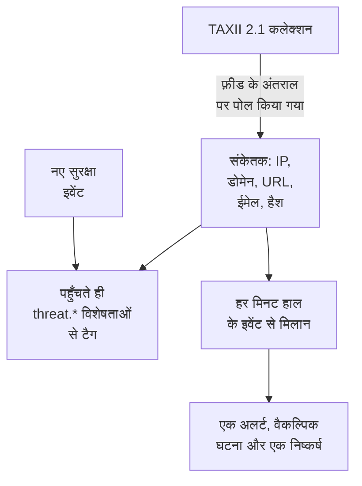

# थ्रेट इंटेलिजेंस (STIX/TAXII)

थ्रेट इंटेल फ़ीड ज्ञात हानिकारक IP पते, डोमेन, URL, ईमेल पते और फ़ाइल हैश OneUptime में लाती है, और बताती है कि कब आपके [सुरक्षा इवेंट](/docs/telemetry/security-events) में इनमें से कोई आता है। हर फ़ीड STIX 2.1 संकेतकों वाले एक TAXII 2.1 कलेक्शन की सदस्यता लेती है: आपका अपना MISP, OpenCTI या OpenTAXII सर्वर, या किसी प्रदाता का कलेक्शन। OneUptime अपनी कोई फ़ीड सामग्री नहीं देता: कलेक्शन आप लाते हैं, जैसे आप Sigma नियम लाते हैं।

:::cards
- [फ़ीड की सदस्यता लें](#फ़ीड-की-सदस्यता-लें): एक TAXII सर्वर, एक कलेक्शन और साइन इन करने का तरीका।
- [क्या इन्जेस्ट होता है](#क्या-इन्जेस्ट-होता-है): संकेतकों के वे पैटर्न जो OneUptime रखता है, और कितने समय तक।
- [मिलान कैसे मिलते हैं](#मिलान-कैसे-मिलते-हैं): इवेंट पहुँचते ही टैग किए जाते हैं, और हर मिनट मिलाए जाते हैं।
- [थ्रेट स्तर](#थ्रेट-स्तर): संकेतक का confidence गंभीरता कैसे बनता है।
:::

## यह कैसे काम करता है



## शुरू करने से पहले

- एक TAXII 2.1 सर्वर जो STIX 2.1 `indicator` ऑब्जेक्ट प्रकाशित करता है, और पोल किए जाने वाले कलेक्शन की ID। फ़ीड गुमनाम रूप से, bearer टोकन से, या HTTP बेसिक ऑथ से साइन इन करती है।
- जिन सर्वर को TLS क्लाइंट सर्टिफ़िकेट (म्यूचुअल TLS) चाहिए, जैसे CISA AIS, वे समर्थित नहीं हैं। MITRE का सार्वजनिक ATT&CK सर्वर संकेतक नहीं, तकनीकें और समूह प्रकाशित करता है, इसलिए उसकी ओर इशारा करने वाली फ़ीड खाली रहती है।
- फ़ीड बना सकने वाली भूमिका: Project Owner, Project Admin, Security Admin या Security Member। Security Viewer फ़ीड और संकेतक पढ़ सकता है। देखें [भूमिकाएँ](/docs/permissions/reference#भूमिकाएँ)।

## फ़ीड की सदस्यता लें

:::steps
### Threat Intel पर जाएँ

**उत्पाद → Security Events → Threat Intel** खोलें।

### फ़ीड बनाएँ

**Threat Intel Feed बनाएँ** पर क्लिक करें और इसके चार चरण भरें: **मूल जानकारी**, **TAXII Server**, **प्रमाणीकरण** और **मिलान होने पर** । फ़ील्ड नीचे की तालिका में हैं।

### पहला पोल जाँचें

एक-दो मिनट में फ़ीड की पंक्ति में **Last Polled** दिखता है, और **Last Poll Summary** बताता है कि पोल में क्या आया। संकेतक फ़ीड के नीचे **Indicators** तालिका में दिखते हैं।
:::

| फ़ील्ड | क्या डालें |
| --- | --- |
| **TAXII API Root URL** | सर्वर का TAXII 2.1 API रूट, जैसे `https://taxii.example.com/api1/`। कलेक्शन इसके अंदर पते से पहचाने जाते हैं। |
| **Collection ID** | वह कलेक्शन जो संकेतक प्रकाशित करता है। |
| **Poll Interval (Minutes)** | नए ऑब्जेक्ट कितनी बार लाने हैं: 1 से 1440 मिनट, डिफ़ॉल्ट रूप से 60। |
| **Minimum Confidence** | इससे कम STIX `confidence` वाले संकेतक छोड़ दिए जाते हैं: 0 से 100, और 0 सब कुछ रखता है। बिना confidence वाले संकेतक हमेशा पास होते हैं। |
| **API Token** | एक bearer टोकन, उस कलेक्शन के लिए जो उसे माँगता है। |
| **Basic Auth Username** और **Basic Auth Password** | उस कलेक्शन के लिए जो HTTP बेसिक ऑथ इस्तेमाल करता है। सार्वजनिक कलेक्शन के लिए दोनों और टोकन खाली छोड़ें। |
| **Create Alert on Match** | डिफ़ॉल्ट रूप से चालू: हर मेल खाने वाला संकेतक एक अलर्ट खोलता है। |
| **अलर्ट गंभीरता** | इस फ़ीड से खुलने वाले हर अलर्ट की गंभीरता। हर संकेतक का थ्रेट स्तर लेने के लिए इसे खाली छोड़ें। |
| **Create Incident on Match** | डिफ़ॉल्ट रूप से बंद। घटनाएँ ऑन-कॉल एस्केलेशन, SLA और स्टेटस पेज चलाती हैं, और संकेतक मिलानों के लिए आम तौर पर अलर्ट काफ़ी होते हैं। |
| **घटना गंभीरता** | **अलर्ट गंभीरता** जैसा, घटनाओं के लिए। |
| **Write Detection Finding on Match** | डिफ़ॉल्ट रूप से चालू: हर मिलान इवेंट स्ट्रीम में एक निष्कर्ष लिखता है। |

टोकन और पासवर्ड एन्क्रिप्ट किए जाते हैं और सहेजने के बाद फिर कभी नहीं दिखते। उन्हें बदलने के लिए फ़ीड की पंक्ति में **Update Credentials** चुनें और फिर **API Token (Bearer)**, **Basic Auth** या **Anonymous (clear stored credentials)** चुनें: आपका चुनाव फ़ीड का साइन-इन बदल देता है, इसलिए टोकन सहेजने से सहेजा गया पासवर्ड मिट जाता है, और उल्टा भी।

### फ़ीड कैसे पोल होती है

हर पोल TAXII के `added_after` कर्सर के ज़रिए पिछले पोल के बाद जोड़े गए ऑब्जेक्ट माँगता है, और 500 ऑब्जेक्ट वाले ज़्यादा से ज़्यादा 10 पेज पढ़ता है। इसलिए बड़ा कलेक्शन कई पोल में सिंक होता है: जब और पेज बाकी हों, तो **Last Poll Summary** बताता है। बड़े पहले सिंक को जल्दी पूरा करने के लिए, उसके बराबर आने तक **Poll Interval (Minutes)** को 1 तक कम करें।

पोल अपना परिचय यूज़र एजेंट `OneUptime/<version> (+https://oneuptime.com)` से देते हैं। अगर प्रदाता का फ़ायरवॉल `403` जवाब देता है, तो उनसे इसे अनुमति देने को कहें: कई फ़ायरवॉल ऐसे अनुरोध रोकते हैं जो किसी बेनाम स्क्रिप्ट जैसे दिखते हैं।

बंद की गई फ़ीड न पोल होती है, न उसका मिलान होता है। उसके पास पहले से मौजूद संकेतक, अपनी समय-सीमा खत्म होने तक, नए इवेंट को टैग करते रहते हैं।

## क्या इन्जेस्ट होता है

OneUptime वे STIX `indicator` ऑब्जेक्ट रखता है जिनका पैटर्न इनमें से किसी एक प्रकार पर सादी समानता है:

| प्रकार | उदाहरण पैटर्न |
| --- | --- |
| IPv4 पता (`ipv4-addr`) | `[ipv4-addr:value = '198.51.100.7']` |
| IPv6 पता (`ipv6-addr`) | `[ipv6-addr:value = '2001:db8::7']` |
| डोमेन नाम (`domain-name`) | `[domain-name:value = 'evil.example']` |
| URL (`url`) | `[url:value = 'http://evil.example/payload']` |
| ईमेल पता (`email-addr`) | `[email-addr:value = 'billing@evil.example']` |
| फ़ाइल हैश, SHA-256 (`file-hash-sha256`) | `[file:hashes.'SHA-256' = 'e3b0…b855']` |
| फ़ाइल हैश, SHA-1 (`file-hash-sha1`) | `[file:hashes.'SHA-1' = 'da39…0709']` |
| फ़ाइल हैश, MD5 (`file-hash-md5`) | `[file:hashes.MD5 = 'd41d…427e']` |

`OR` से जुड़ी तुलनाएँ, एक `[...]` के अंदर या कई में फैली हुई, ठीक हैं, और हर मान अपना अलग संकेतक बनता है:

```text
[domain-name:value = 'evil.example' OR domain-name:value = 'evil2.example']
[ipv4-addr:value = '198.51.100.7'] OR [url:value = 'http://evil.example/x']
```

कोई भी दूसरा पैटर्न, जिसमें `AND`, `FOLLOWEDBY`, `NOT`, `LIKE`, `MATCHES`, `WITHIN` जैसा कोई समय क्वालिफ़ायर, या कोई दूसरा ऑब्जेक्ट प्रकार हो, पूरा छोड़ दिया जाता है और **Last Poll Summary** में असमर्थित के रूप में गिना जाता है। `AND` पैटर्न के सिर्फ़ एक हिस्से का अनुवाद फ़ीड के लेखक के इरादे से कहीं ज़्यादा चीज़ों से मेल खाएगा।

### संकेतक कितने समय सक्रिय रहता है

- संकेतक अपने `valid_from` से अपने `valid_until` तक मेल खाता है। `valid_until` न हो, तो वह `valid_from` से 365 दिन तक सक्रिय रहता है, और उसे फिर से पोल करने से यह अवधि नहीं बढ़ती।
- रद्द किया गया संकेतक, या बीते समय के `valid_until` के साथ अपडेट किया गया संकेतक, अपडेट पोल होते ही मेल खाना बंद कर देता है। यही उस मान के साथ होता है जिसे प्रदाता अपडेट किए गए पैटर्न से हटा देता है।
- मान छोटे अक्षरों में सहेजे जाते हैं और अक्षरों के बड़े-छोटे होने की परवाह किए बिना मेल खाते हैं।

**Indicators** तालिका संकेतकों को वैसे दिखाती है जैसे वे सहेजे गए हैं, और **स्थिति** कॉलम में **सक्रिय**, **समय-सीमा खत्म** या **Revoked** दिखाती है। फिर से पोल किया गया संकेतक कुछ समय तक दो बार दिख सकता है, और समय-सीमा खत्म या रद्द पंक्ति तब तक सूची में रहती है जब तक स्टोरेज की सफ़ाई उसे हटा न दे, समय-सीमा खत्म होने के लगभग एक महीने बाद तक। मिलान हमेशा वैधता और रद्दीकरण जाँचता है, इसलिए ऐसी पंक्ति कभी मेल नहीं खाती।

## मिलान कैसे मिलते हैं

### इवेंट पहुँचते ही टैग किए जाते हैं

हर आने वाला सुरक्षा इवेंट, चाहे इन्जेस्ट API से आए या किसी कनेक्शन से, सहेजे जाने से पहले आपके सक्रिय संकेतकों से जाँचा जाता है। जब उसका कोई observable (इवेंट से लिए गए IP, होस्ट, डोमेन, हैश और उपयोगकर्ता) किसी संकेतक के मान के बराबर होता है, तो इवेंट पर ये विशेषताएँ लगाई जाती हैं:

| विशेषता | मान |
| --- | --- |
| `threat.matched` | टैग किए गए इवेंट पर हमेशा `"true"` |
| `threat.indicator_id` | STIX संकेतक की id |
| `threat.indicator_type` | संकेतक का प्रकार, जैसे `ipv4-addr` या `file-hash-sha256` |
| `threat.indicator_value` | मेल खाया मान, छोटे अक्षरों में |
| `threat.feed` / `threat.feed_id` | वह फ़ीड जिससे संकेतक आया |
| `threat.confidence` | संकेतक का STIX confidence |
| `threat.match_count` | इवेंट के कितने observable किसी संकेतक से मेल खाए |

जब कई संकेतक एक इवेंट से मेल खाते हैं, तो सबसे ज़्यादा confidence वाला ये मान भरता है। ये सामान्य विशेषताएँ हैं, इसलिए आप **इवेंट** में इन पर खोज सकते हैं, इनसे सुरक्षा इवेंट मॉनिटर फ़िल्टर कर सकते हैं, और इन्हें पहचान नियमों में इस्तेमाल कर सकते हैं:

```yaml title="threat-intel-logon.yml"
title: High-confidence indicator in a successful logon
level: critical
detection:
  selection:
    threat.matched: 'true'
    threat.confidence|gte: 80
    className: Authentication
    statusName: Success
  condition: selection
```

टैगिंग सिर्फ़ उन संकेतकों को जानती है जो इवेंट के पहुँचने के समय मौजूद हैं: इवेंट बाद में फिर कभी टैग नहीं होते।

### हर मिनट मिलान

हर मिनट, हर सक्षम फ़ीड के सक्रिय संकेतकों का मिलान उन इवेंट से होता है जिनका इवेंट समय फ़ीड की पिछली जाँच के बाद का है। इससे वह इंटेल पकड़ में आता है जो किसी इवेंट के टैग होने के बाद आया।

- पहली जाँच पिछले 15 मिनट कवर करती है। किसी रुकावट के बाद, अगली जाँच ज़्यादा से ज़्यादा पिछले 24 घंटे की भरपाई करती है।
- हर विंडो एक बार जाँची जाती है। अपनी विंडो जाँचे जाने के बाद आया इंटेल सिर्फ़ बाद के इवेंट पर लागू होता है।
- देर से आया इवेंट, जिसका समय पिछली जाँच से पहले का है, पहुँचने पर तब भी टैग होता है, लेकिन उसका मिलान नहीं होता।
- हर जाँच हर फ़ीड के ज़्यादा से ज़्यादा 100 संकेतक मानों का मिलान करती है: वे जो सबसे ज़्यादा इवेंट में दिखे।

### मिलान से क्या होता है

- `[Threat Intel] <feed name> — <indicator value>` शीर्षक वाला एक अलर्ट, जब तक वह खुला रहे, हर फ़ीड और मान के लिए एक। उसके सुलझने के बाद अगला मिलान नया अलर्ट खोलता है। अलर्ट अपने आप नहीं सुलझते।
- एक घटना, सिर्फ़ **Create Incident on Match** के साथ, उसी तरह डुप्लिकेट हटाकर।
- एक Threat Intel निष्कर्ष, **Write Detection Finding on Match** के साथ: `OneUptime Threat Intel` उत्पाद से एक `Detection Finding` इवेंट (OCSF क्लास 2004), जिसकी गंभीरता संकेतक का थ्रेट स्तर होती है, और जिसमें ये विशेषताएँ होती हैं:

| विशेषता | मान |
| --- | --- |
| `oneuptime.threat.feed_id` / `oneuptime.threat.feed_name` | फ़ीड |
| `oneuptime.threat.indicator_id` | STIX संकेतक की id |
| `oneuptime.threat.indicator_type` / `oneuptime.threat.indicator_value` | क्या मेल खाया |
| `oneuptime.threat.confidence` | संकेतक का confidence |
| `oneuptime.threat.match_count` | इस निष्कर्ष के पीछे कितने इवेंट हैं |

निष्कर्षों का खुद कभी मिलान नहीं होता, इसलिए एक मिलान दूसरा मिलान नहीं छेड़ सकता।

## थ्रेट स्तर

संकेतकों का कोई Sigma स्तर नहीं होता: इसके बजाय उनका STIX `confidence` एक थ्रेट स्तर तय करता है।

| संकेतक का confidence | थ्रेट स्तर |
| --- | --- |
| 90 से 100 | Critical |
| 70 से 89 | High |
| 40 से 69 | Medium |
| 1 से 39 | Low |
| बिना स्कोर (0 या मौजूद नहीं) | Medium |

बिना स्कोर वाला संकेतक Medium गिना जाता है: आख़िर किसी ने उसे फ़ीड में डालना चुना था। थ्रेट स्तर निष्कर्ष की गंभीरता है, और यह आपके प्रोजेक्ट की गंभीरताओं में से अलर्ट की गंभीरता इस क्रम में चुनता है:

1. फ़ीड की **अलर्ट गंभीरता** (या **घटना गंभीरता** ), अगर सेट हो: यह फ़ीड के हर मिलान पर लागू होती है।
2. थ्रेट स्तर के नाम वाली आपकी गंभीरता, जैसे High, अक्षरों के बड़े-छोटे होने की परवाह किए बिना।
3. रैंक के हिसाब से: Critical और High आपकी सबसे गंभीर गंभीरता लेते हैं, Medium और Low सबसे कम गंभीर।

थ्रेट स्तर हर संकेतक का होता है, फ़ीड का नहीं, इसलिए एक फ़ीड एक ही मिनट में एक Critical अलर्ट और एक Low अलर्ट खोल सकती है। **Minimum Confidence** उसी संख्या पर फ़िल्टर करता है: 70 का न्यूनतम सिर्फ़ High और Critical संकेतक रखता है, साथ में बिना स्कोर वाले, जो हमेशा पास होते हैं।

## किसी फ़ीड के मिलानों पर नज़र रखें

किसी फ़ीड की पंक्ति में **मॉनिटर बनाएं** कार्रवाई एक नया सुरक्षा इवेंट मॉनिटर खोलती है जो फ़ीड के निष्कर्ष गिनता है: इवेंट क्लास `Detection Finding`, `oneuptime.threat.feed_id` में फ़ीड की id से फ़िल्टर किया हुआ (कभी उसका नाम नहीं, जो नाम बदलने पर बदल जाएगा), पिछले एक घंटे पर। इसे मिलानों में अचानक उछाल के लिए, या किसी व्यस्त फ़ीड के शांत हो जाने के लिए इस्तेमाल करें।

## प्रतिधारण और बिलिंग

संकेतक कॉन्फ़िगरेशन हैं, टेलीमेट्री नहीं, और उनका बिल इन्जेस्ट किए गए डेटा के रूप में नहीं बनता। मिलान से लिखे गए निष्कर्ष सामान्य सुरक्षा इवेंट हैं, जिनका बिल बाकी की तरह बनता है और जो बाकी की तरह रखे जाते हैं: देखें [सुरक्षा इवेंट](/docs/telemetry/security-events#प्रतिधारण-और-बिलिंग)।

## समस्या निवारण

:::details पोल के बाद Last Error सेट है
`401` या `403`: क्रेडेंशियल गलत हैं या मौजूद नहीं हैं; उन्हें **Update Credentials** से बदलें। `403` का मतलब यह भी हो सकता है कि प्रदाता का फ़ायरवॉल यूज़र एजेंट को रोक रहा है। `404`: **TAXII API Root URL** जाँचें, जो आम तौर पर `/api1/` जैसे पथ पर खत्म होता है, और **Collection ID** भी। अगले सफल पोल पर त्रुटि हट जाती है।
:::

:::details फ़ीड पोल होती है, लेकिन कोई संकेतक नहीं दिखता
**Last Poll Summary** पढ़ें। कोई ऑब्जेक्ट नहीं आया: कलेक्शन खाली है या कोई संकेतक प्रकाशित नहीं करता। असमर्थित पैटर्न: प्रदाता ऐसी पैटर्न सुविधाएँ इस्तेमाल करता है जिन्हें यह पेज छोड़ी गई बताता है। न्यूनतम confidence से कम: **Minimum Confidence** घटाएँ। पहले से निष्क्रिय: प्रदाता ने ऐसे संकेतक भेजे जो पहले ही रद्द हो चुके थे या जिनकी समय-सीमा खत्म हो चुकी थी।
:::

:::details संकेतक मौजूद हैं, लेकिन कुछ मेल नहीं खाता
मिलान संकेतक के मान की तुलना इवेंट के observable से करता है, हर फ़ील्ड से नहीं: **इवेंट** में कोई ऐसा इवेंट खोलें जिसके मेल खाने की आपको उम्मीद थी, और जाँचें कि उसके observable में वह मान है। सिर्फ़ **सक्रिय** स्थिति वाले संकेतक मेल खाते हैं। फ़ीड पर **Last Match Error** जाँचें।
:::

:::details मिलान हुआ, लेकिन कोई अलर्ट नहीं खुला
**Create Alert on Match** बंद है, या उसी फ़ीड और मान का अलर्ट अभी भी खुला है, और बाद के मिलान उसी में जुड़ जाते हैं। किसी फ़ीड के अलर्ट खोलने के लिए प्रोजेक्ट में कम से कम एक अलर्ट गंभीरता होनी चाहिए।
:::

## अगले कदम

:::cards
- [सुरक्षा इवेंट](/docs/telemetry/security-events): इवेंट भेजें, उन्हें खोजें और पहचान नियम लिखें।
- [Google SecOps](/docs/integrations/google-secops): Chronicle की पहचान और इवेंट ले आएँ।
- [अनुमति संदर्भ](/docs/permissions/reference): Security भूमिकाएँ, और हर एक क्या कर सकती है।
:::
