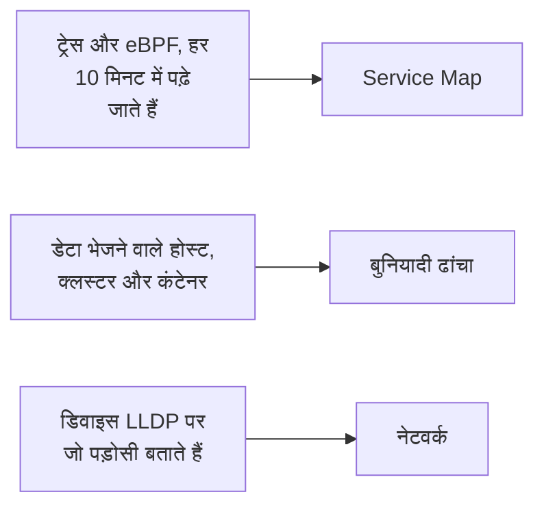

# टोपोलॉजी

टोपोलॉजी दिखाती है कि आपके सिस्टम कैसे जुड़े हैं: कौन-सी सेवाएं किन्हें कॉल करती हैं, क्या कहाँ चलता है, और आपके नेटवर्क डिवाइस कैसे केबल से जुड़े हैं। OneUptime इसे उसी टेलीमेट्री से बनाता है जो आप पहले से भेजते हैं, इसलिए हाथ से कुछ नहीं बनाना पड़ता, और यह एक नज़र में दिखाती है कि त्रुटियाँ और घटनाएं कहाँ हैं।

:::cards
- [टोपोलॉजी खोलें](#टोपोलॉजी-खोलें): एक ही पेज के तीन व्यू।
- [सेवा मैप पढ़ें](#सेवा-मैप-पढ़ें): कौन किसे कॉल करता है, और कॉल कितनी स्वस्थ हैं।
- [अपना इंफ्रास्ट्रक्चर देखें](#अपना-इंफ्रास्ट्रक्चर-देखें): हर सेवा कहाँ चलती है।
- [किसी संसाधन का अपना मैप खोलें](#किसी-संसाधन-का-अपना-मैप-खोलें): एक vCenter, क्लस्टर या होस्ट विस्तार से।
- [अपना नेटवर्क देखें](#अपना-नेटवर्क-देखें): डिवाइस और उनके लिंक, लाइव।
:::

## मैप कैसे बनता है

टोपोलॉजी का हर व्यू अलग तरह की टेलीमेट्री से बनता है:

- **केवल वही बनता है जो सक्रिय था।** कोई व्यू वे सेवाएं और संसाधन दिखाता है जिन्होंने समय सीमा में डेटा भेजा, और उसमें देखे गए कनेक्शन। चुप रहे संसाधनों को भी दिखाने के लिए **निष्क्रिय दिखाएँ** चालू करें।
- **कॉल हाल की एक अवधि में गिनी जाती हैं।** OneUptime हर 10 मिनट में सेवाओं के बीच कॉल खोजता है, और ट्रैफ़िक के आँकड़े पिछले 15 मिनट को कवर करते हैं, पूरी समय सीमा को नहीं।
- **नेटवर्क व्यू लाइव है।** यह आपके डिवाइस वैसे दिखाता है जैसे वे अभी जुड़े हैं, इसलिए इसकी कोई समय सीमा नहीं है।

## शुरू करने से पहले

- **आती हुई टेलीमेट्री।** सेवा मैप को ट्रेस चाहिए: देखें [OpenTelemetry](/docs/telemetry/open-telemetry)। इंफ्रास्ट्रक्चर व्यू को डेटा भेजने वाला कोई होस्ट या क्लस्टर चाहिए: देखें [Kubernetes एजेंट](/docs/telemetry/kubernetes-agent)। नेटवर्क व्यू को नेटवर्क डिवाइस चाहिए: देखें [नेटवर्क डिवाइस मॉनिटर](/docs/monitor/network-device-monitor)।
- **ऐसी भूमिका जो टेलीमेट्री पढ़े।** Project Owner, Project Admin, Project Member, Viewer, Telemetry Admin, Telemetry Member या Telemetry Viewer, या Read Telemetry Service अनुमति वाली कोई कस्टम भूमिका।

## टोपोलॉजी खोलें

**उत्पाद → अवलोकनीयता → टोपोलॉजी** पर जाएँ। **इन्वेंटरी → Topology Map** वही पेज खोलता है। यह **पिछला 1 दिन** के लिए **Service Map** पर खुलता है।

| व्यू | यह किस सवाल का जवाब देता है |
| --- | --- |
| **Service Map** | कौन-सी सेवाएं एक-दूसरे पर निर्भर हैं? |
| **बुनियादी ढांचा** | आपके इंफ्रास्ट्रक्चर में क्या कहाँ चलता है? |
| **नेटवर्क** | आपके नेटवर्क डिवाइस कैसे जुड़े हैं? |

टाइम पिकर के बगल में **निष्क्रिय दिखाएँ** वह भी जोड़ता है जिसने सीमा में डेटा नहीं भेजा, और रीफ़्रेश बटन व्यू को फिर से लोड करता है। **क्या दिखाया गया है · इस डेटा के बारे में** बताता है कि व्यू क्या दिखाता है और उसकी गणना कितनी बार होती है। एड्रेस बार आपका मौजूदा व्यू याद रखता है, इसलिए आपका साझा किया गया लिंक वही व्यू खोलता है।

## सेवा मैप पढ़ें

**Service Map** डेटा भेजने वाली हर सेवा दिखाता है, और वे डेटाबेस, API और मैसेज ब्रोकर भी जिन्हें वे कॉल करती हैं, भले ही वे अपनी टेलीमेट्री न भेजते हों। तीर कॉल करने वाले से कॉल पाने वाले की ओर जाते हैं, और मोटी रेखाएँ ज़्यादा अनुरोध ले जाती हैं। इसके ऊपर की गिनतियाँ बताती हैं कि यह कितनी सेवाएं, निर्भरताएँ और कनेक्शन दिखाता है, और कितनों पर ध्यान देने की ज़रूरत है।

हर सेवा अपनी स्थिति दिखाती है, जिसकी गणना पिछले 15 मिनट में उसे मिली कॉल से होती है:

| स्थिति | कब |
| --- | --- |
| **स्वस्थ** | मिली कॉल में से अधिकतम 1% विफल हुईं। |
| **Some errors** | 1% से ज़्यादा और 5% से कम विफल हुईं। |
| **High error rate** | 5% या उससे ज़्यादा विफल हुईं। |
| **Entry point** | इसे कोई कॉल नहीं मिली, लेकिन इसने कुछ कॉल कीं: जैसे वेब फ़्रंटएंड या शेड्यूल किया गया जॉब। |
| **No calls observed** | इसने न कोई कॉल की, न कोई कॉल पाई। |

किसी सक्रिय घटना या अलर्ट वाली सेवा इसके बजाय उनकी संख्या दिखाती है, और **Some errors** या **High error rate** वाली सेवा की तरह, उस पर ध्यान देने की ज़रूरत मानी जाती है।

:::steps
### ध्यान देने लायक सेवाएं खोजें

केवल वे सेवाएं और उनके सीधे कनेक्शन रखने के लिए **ध्यान देने की ज़रूरत** पर क्लिक करें, या मैप के ऊपर वाले बॉक्स में नाम से खोजें।

### कोई सेवा खोलें

किसी सेवा पर क्लिक करके पिछले 15 मिनट के उसके अनुरोध, त्रुटियाँ और औसत लेटेंसी देखें, उसकी **सक्रिय घटनाएं** और **सक्रिय अलर्ट** देखें, और **इस सेवा के ट्रेस** और उसके **इन्वेंटरी विवरण** के लिंक पाएँ।

### कोई कनेक्शन खोलें

किसी तीर पर क्लिक करके उसकी अनुरोध दर, त्रुटि दर और औसत लेटेंसी देखें। आपकी इंस्ट्रुमेंट की गई दो सेवाओं के बीच, इसमें कॉल, त्रुटियों और लेटेंसी का **History** भी होता है।
:::

**कनेक्शन लेबल** हर तीर पर एक आँकड़ा लिखता है: **अनुरोध दर**, **त्रुटि दर** या **औसत लेटेंसी**, या जब तक आप पॉइंटर न ले जाएँ तब तक कुछ नहीं। **तालिका** उन्हीं सेवाओं को उनके **अनुरोध**, **त्रुटि दर**, **औसत लेटेंसी** और **कनेक्शन** के साथ दिखाती है, और **मैप पर दिखाएँ** उनमें से एक को मैप पर दिखाता है।

## अपना इंफ्रास्ट्रक्चर देखें

**बुनियादी ढांचा** दिखाता है कि आपकी सेवाएं कहाँ चलती हैं: क्लस्टर, होस्ट, पॉड, कंटेनर और डेटा भेजने वाले दूसरे संसाधन। एक ही वर्कलोड की रेप्लिका एक प्रविष्टि में समूहित होती हैं, और आप अंदर देखने के लिए कुछ भी खोल सकते हैं।

- **अपने तरीके से देखें।** इसे **सूची** या **मानचित्र** के रूप में दिखाएँ, अपने पूरे इंफ्रास्ट्रक्चर से लेकर एक पॉड तक। इसके ऊपर की गिनतियाँ बताती हैं कि यह कितने संसाधन और वर्कलोड दिखाता है, कितनी सेवाओं को जगह दे सकता है, और कितने चुप संसाधन छोड़ देता है।
- **कोई संसाधन खोजें।** उसे नाम से खोजें, और उसका पेज खोलने के लिए **विवरण देखें** पर क्लिक करें।
- **व्यू के बीच जाएँ।** किसी संसाधन पर दिखी सेवा **Service Map** पर खुलती है, और जिन संसाधनों पर कोई सेवा चलती है वे **बुनियादी ढांचा** पर खुलते हैं।

## किसी संसाधन का अपना मैप खोलें

vCenter, Kubernetes क्लस्टर, होस्ट, Docker या Podman होस्ट, Docker Swarm, Proxmox या Ceph क्लस्टर और स्टोरेज ऐरे, हर एक का अपना **टोपोलॉजी** पेज है। यह उस एक संसाधन को उसकी अपनी इन्वेंटरी से विस्तार से दिखाता है: क्या किसके अंदर है, हर हिस्सा उसकी स्थिति के रंग में, और हर खुली घटना और अलर्ट उसी हिस्से पर जिससे वह जुड़ा है।

- **ध्यान देने वाली चीज़ें खोजें।** **ध्यान देने की ज़रूरत** केवल समस्या वाले हिस्से और हर एक तक का रास्ता रखता है, और खोज संसाधन में कहीं भी किसी हिस्से को ढूंढ लेती है।
- **नज़दीक से देखें।** कोई हिस्सा क्या है और उसके अपने पेज का लिंक देखने के लिए उस पर क्लिक करें, और केवल वही हिस्सा, उसके अंदर की चीज़ें और उससे जुड़ी चीज़ें दिखाने के लिए **इस पर फ़ोकस करें** पर क्लिक करें।
- **दोनों तरफ़ जाएँ।** **टोपोलॉजी में खोलें** संसाधन को **बुनियादी ढांचा** पर खोलता है, और वहाँ उसका **vCenter टोपोलॉजी खोलें**, **क्लस्टर टोपोलॉजी खोलें**, **होस्ट टोपोलॉजी खोलें** या **स्टोरेज ऐरे टोपोलॉजी खोलें** बटन वापस ले जाता है।

## अपना नेटवर्क देखें

**नेटवर्क** आपके नेटवर्क डिवाइस का लाइव मैप है, जो उन पड़ोसियों से बनता है जिन्हें वे LLDP पर, और Cisco डिवाइस पर CDP पर, बताते हैं। इसमें टाइम पिकर नहीं है: कनेक्शन अपने आप रीफ़्रेश होते हैं।

अगर आप डिवाइस को साइटों में समूहित करते हैं, तो व्यू आपकी साइटों पर खुलता है: एक चुनें, या **All devices** पर जाएँ। **Map options** मैप को व्यवस्थित करता है और चुनता है कि उसमें क्या शामिल हो, और **PDF निर्यात करें** आपको दिख रहा मैप सहेजता है। नेटवर्क डिवाइस के पेज भी यही मैप दिखाते हैं: देखें [नेटवर्क टोपोलॉजी](/docs/monitor/network-device-monitor#नेटवर्क-टोपोलॉजी)।

## समस्या निवारण

:::details सेवा मैप सेवाएं दिखाता है लेकिन कोई कनेक्शन नहीं
OneUptime हर 10 मिनट में आपके ट्रेस में सेवाओं के बीच कॉल खोजता है। उसे कॉल तब दिखती है जब कोई अनुरोध ट्रेस संदर्भ, यानी `traceparent` हेडर, एक इंस्ट्रुमेंट की गई सेवा से अगली तक ले जाता है, जैसा OpenTelemetry के HTTP और gRPC इंस्ट्रुमेंटेशन करते हैं; जब कोई सेवा अपने कॉल किए गए डेटाबेस और API के लिए क्लाइंट स्पैन भेजती है; या जब Kubernetes एजेंट eBPF के साथ चलता है।
:::

:::details मेरी हटाई हुई सेवा अब भी मैप पर है
उसने समय सीमा के भीतर डेटा भेजा था। छोटी सीमा चुनें, या तब तक रुकें जब तक उसकी आख़िरी टेलीमेट्री सीमा से बाहर न हो जाए। **निष्क्रिय दिखाएँ** चालू होने पर, मैप वह भी दिखाता है जिसने डेटा भेजना बंद कर दिया।
:::

:::details मैप कहता है कि उसका केवल एक हिस्सा दिखाया गया है
बहुत बड़ा प्रोजेक्ट मैप की सीमाओं तक पहुँच जाता है, और एक सूचना बताती है कि वह कितने संसाधन या कनेक्शन दिखाता है। उसका पढ़ने लायक हिस्सा दिखाने के लिए कोई सेवा खोजें, या तालिका में **मैप पर दिखाएँ** इस्तेमाल करें।
:::

## अगले कदम

:::cards
- [सेवा कैटलॉग](/docs/telemetry/services): एक सेवा के बारे में सब कुछ।
- [ट्रेस एक्सप्लोरर](/docs/telemetry/traces-explorer): हर तीर के पीछे के अनुरोध।
- [इन्वेंटरी अवलोकन](/docs/inventory/overview): मैप पर दिखने वाला हर संसाधन।
- [नेटवर्क डिवाइस मॉनिटर](/docs/monitor/network-device-monitor): अपने नेटवर्क को मैप पर लाएँ।
:::
