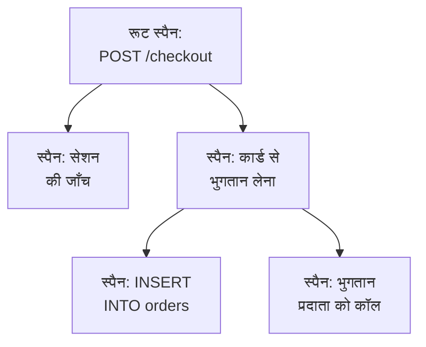

# ट्रेस एक्सप्लोरर

ट्रेस एक्सप्लोरर उन अनुरोधों को ढूँढता है जो आपकी सेवाओं से होकर गुज़रे: धीमे वाले, विफल वाले, किसी एक ग्राहक के खाते को छूने वाले। अपनी सेवाओं के भेजे स्पैन खोजें और फ़िल्टर करें, फिर किसी ट्रेस को खोलकर अनुरोध का हर कदम वॉटरफ़ॉल, फ़्लेम ग्राफ़ या सेवा मैप के रूप में देखें।

:::cards
- [अनुरोध ढूँढना](#अनुरोध-ढूँढना): स्पैन खोजें, फिर सेवा, स्थिति या प्रकार से फ़िल्टर करें।
- [ट्रेस पढ़ना](#ट्रेस-पढ़ना): समय कहाँ गया, और कौन-सा कदम विफल हुआ।
- [अपने स्पैन का चार्ट बनाना](#अपने-स्पैन-का-चार्ट-बनाना): अनुरोधों की गिनती और प्रतिक्रिया समय, आपके हिसाब से समूहित।
- [ट्रेस इनसाइट्स](#ट्रेस-इनसाइट्स): त्रुटि दर, लेटेंसी और सबसे धीमे अनुरोध।
:::

## ट्रेस और स्पैन

ट्रेस आपके सिस्टम से गुज़रता हुआ एक अनुरोध है। उसका हर कदम, जैसे कोई HTTP हैंडलर, कोई डेटाबेस क्वेरी या किसी दूसरी सेवा को कॉल, एक स्पैन है, और स्पैन उन स्पैन के अंदर नेस्ट होते हैं जिन्होंने उन्हें शुरू किया। ट्रेस का पहला स्पैन, जिसका कोई पैरेंट नहीं होता, उसका रूट स्पैन है: अनुरोध का प्रवेश बिंदु।

एक्सप्लोरर की हर पंक्ति एक स्पैन है, इसलिए व्यस्त सेवा सूची को अपनी डेटाबेस क्वेरी और आंतरिक कॉल से भर देती है। हर अनुरोध के लिए एक पंक्ति दिखाने के लिए साइडबार में **स्पैन श्रेणी** के तहत **Root spans** चुनें।

एक्सप्लोरर में चार टैब हैं:

| टैब | यह किसलिए है |
| --- | --- |
| **दर्शक** | स्पैन खोजें और फ़िल्टर करें, और उनके ट्रेस खोलें। यह पिछले एक घंटे पर खुलता है, नए पहले, हर पेज पर 50 स्पैन। |
| **इनसाइट्स** | हर सेवा के अनुरोध दर, त्रुटि दर और लेटेंसी, और वे अनुरोध जिन्हें देखना चाहिए। |
| **सेटअप गाइड** | अपनी किसी इंजेशन कुंजी से OpenTelemetry के ज़रिए ट्रेस कैसे भेजें। |
| **सेटिंग्स** | स्पैन आने पर उनके साथ क्या होता है: **पाइपलाइन**, **ड्रॉप फ़िल्टर**, **स्क्रब नियम** और **रिकॉर्डिंग नियम**। |

## शुरू करने से पहले

- **आते हुए ट्रेस।** अपनी सेवाओं को [OpenTelemetry](/docs/telemetry/open-telemetry) से इंस्ट्रूमेंट करें। **सेटअप गाइड** टैब आपकी भाषा का कोड दिखाता है।
- **टेलीमेट्री पढ़ सकने वाली भूमिका।** Project Owner, Project Admin, Project Member, Viewer, Telemetry Admin, Telemetry Member या Telemetry Viewer, या Read Telemetry Service Traces अनुमति वाली कस्टम भूमिका। उसका दायरा तय करता है कि आप किसके स्पैन देखते हैं: देखें [टेलीमेट्री](/docs/permissions/index#टेलीमेट्री)।

## अनुरोध ढूँढना

:::steps
### दर्शक खोलें

**उत्पाद → अवलोकनीयता → ट्रेस** पर जाएँ। **दर्शक** पिछले एक घंटे के स्पैन नए पहले के क्रम में दिखाता है, हर एक उसकी स्थिति, सेवा, नाम और अवधि के साथ।

### समय सीमा चुनें

टाइम पिकर में एक सीमा चुनें, या किसी उछाल पर ज़ूम इन करने के लिए सूची के ऊपर वाले चार्ट पर खींचें। वापस ज़ूम आउट करने के लिए चार्ट पर डबल-क्लिक करें। देखें [समय सीमा पर ज़ूम इन करना](/docs/telemetry/charts-and-time-ranges)।

### खोजें

एक क्वेरी लिखें और Enter दबाएँ, जैसे `service:checkout status:error duration:>500`। अकेले शब्द स्पैन के नामों में खोजते हैं, और `@key:value` किसी विशेषता में खोजता है, जैसे `@http.route:/orders`। देखें [खोज सिंटैक्स](/docs/telemetry/search-syntax#ट्रेस)।

### फ़िल्टर से छाँटें

किसी मान को चिप के रूप में जोड़ने के लिए **फ़िल्टर** साइडबार में उस पर क्लिक करें। साइडबार **सेवा**, स्पैन भेजने वाले होस्ट, क्लस्टर या दूसरे संसाधन, **स्थिति**, **स्पैन श्रेणी**, **अपवाद है**, **स्पैन प्रकार**, **स्पैन नाम**, **Service Instance** और **होस्ट नाम** से फ़िल्टर करता है।

### स्पैन खोलें

किसी पंक्ति को फैलाने के लिए उस पर क्लिक करें: उसकी विशेषताएं, और उसके दर्ज किए लॉग और अपवाद। पूरा ट्रेस खोलने के लिए **See full trace** पर क्लिक करें।
:::

आपकी खोज, आपके चिप और समय सीमा पेज के पते में रहते हैं, इसलिए रीफ़्रेश, बुकमार्क या साझा किया गया लिंक वही स्पैन खोलता है।

## ट्रेस पढ़ना

ट्रेस का पेज अनुरोध की संख्याओं से शुरू होता है:

| संख्या | यह क्या है |
| --- | --- |
| अवधि | पूरे अनुरोध में कितना समय लगा। |
| स्पैन | ट्रेस में कितने स्पैन हैं। |
| सेवाएं | अनुरोध कितनी सेवाओं से गुज़रा। |
| त्रुटियाँ | कितने स्पैन त्रुटि स्थिति के साथ ख़त्म हुए। सिर्फ़ उन्हें दिखाने के लिए इस पर क्लिक करें। |
| गहराई | नेस्ट किए गए स्पैन की सबसे गहरी शृंखला। |

उनके नीचे, चार व्यू में से एक चुनें:

| व्यू | यह क्या दिखाता है |
| --- | --- |
| **Waterfall** | हर स्पैन एक टाइमलाइन पर, उस स्पैन के नीचे नेस्ट किया हुआ जिसने उसे शुरू किया। अनुरोध की अवधि तय करने वाली स्पैन की शृंखला को उभारने के लिए **Critical path** चालू करें। |
| **फ़्लेम ग्राफ़** | वही ट्री, एक के ऊपर एक रखी पट्टियों के रूप में, जहाँ सबसे चौड़ी पट्टियों ने सबसे ज़्यादा समय लिया। |
| **Service map** | वे सेवाएं जिनसे अनुरोध गुज़रा, और उनके बीच की कॉल। |
| **Operations** | हर सेवा और स्पैन नाम के लिए एक पंक्ति, उसकी कॉल, त्रुटियों, ख़ुद के समय और कुल समय के साथ। किसी एक ही पैरेंट स्पैन से 10 या ज़्यादा बार कॉल किया गया ऑपरेशन चिह्नित होता है: अक्सर यह कोई N+1 क्वेरी या ऐसा लूप होता है जिसे बैच किया जा सकता था। |

किसी भी व्यू में किसी स्पैन पर क्लिक करके उसका पैनल खोलें, जिसमें उसकी विशेषताओं, इवेंट, लॉग, अपवाद और लिंक के टैब होते हैं, और अगर हो तो उसकी प्रोफ़ाइल या LLM कॉल का भी। व्यू के बगल वाले खोज बॉक्स से (`/` दबाएँ) ट्रेस के स्पैन को नाम, ID या सेवा से खोजें, और सिर्फ़ विफल स्पैन रखने के लिए **Errors only** चालू करें।

बड़ा ट्रेस एक बार में 500 स्पैन लोड करता है। और लोड करने के लिए, या सभी के लिए, ट्रेस के नीचे वाले बटन पर क्लिक करें।

> [!TIP]
> **Fix performance with AI** ट्रेस में कोई जाना-पहचाना प्रदर्शन पैटर्न ढूँढता है: कोई N+1 क्वेरी, ज़्यादातर समय लेने वाला कोई एक स्पैन, या एक के बाद एक की गई ऐसी कॉल जो साथ-साथ चल सकती थीं। एक मिलने पर यह एक AI कार्य शुरू करता है जो उसे ठीक करने के लिए एक pull request खोलता है। देखें [सुधार कार्य](/docs/ai/ai-agent)।

## अपने स्पैन का चार्ट बनाना

सूची के ऊपर वाला चार्ट समय के साथ स्पैन की संख्या दिखाता है, स्थिति के अनुसार बँटी हुई। इसके बजाय उनका औसत, मीडियन (P50) या P95 प्रतिक्रिया समय दिखाने के लिए चार्ट के हेडर में कोई दूसरा माप चुनें।

और ज़्यादा के लिए, सूची को **स्पैन** से **Analytics** पर बदलें। टाइम सीरीज़, टॉप सूची या टेबल चुनें; अनुरोधों की गिनती, त्रुटियों की गिनती या प्रतिक्रिया समय (औसत, P50, P90, P95, P99, न्यूनतम या अधिकतम) मापें; और स्पैन नाम, सेवा, स्थिति, स्पैन प्रकार या किसी भी विशेषता के अनुसार समूह बनाएँ, फिर किसी दूसरे फ़ील्ड के अनुसार। टॉप सूची या टेबल शीर्ष 5 से 100 समूह दिखाती है।

## देखते रहना, सहेजना और साझा करना

- लाइव अपडेट चालू करने के लिए सूची के ऊपर **रोका गया** पर क्लिक करें। तब बटन **Live** दिखाता है, और सूची हर 10 सेकंड में नए स्पैन जाँचती है। रोकने के लिए फिर से क्लिक करें।
- **Saved Views** एक खोज, उसके फ़िल्टर और समय सीमा को एक नाम के तहत प्रोजेक्ट में सबके लिए रखता है। सहेजे गए व्यू वैसे ही काम करते हैं जैसे [लॉग एक्सप्लोरर](/docs/telemetry/logs-explorer#व्यू-सहेजना) में।
- **लॉग** और **मेट्रिक्स** बटन उन एक्सप्लोरर को उसी समय अवधि के लिए खोलते हैं, आपकी फ़िल्टरिंग का उतना हिस्सा साथ लेकर जितना वे इस्तेमाल कर सकते हैं। जो वह साथ नहीं ले जा सकता, उसे देखने के लिए बटन पर पॉइंटर ले जाएँ।

## ट्रेस इनसाइट्स

**इनसाइट्स** टैब किसी समय सीमा के अनुरोधों का सार देता है:

- अनुरोधों की संख्या, त्रुटि दर, और P50, P95 और P99 लेटेंसी;
- आपकी सेवाओं की हेल्थ टेबल, त्रुटि दर के अनुसार क्रम में, ताकि ध्यान माँगने वाली सेवाएं पहले आएँ;
- सबसे हाल के विफल अनुरोध, और सबसे धीमे अनुरोध।

टाइम पिकर के बगल वाले ड्रॉपडाउन से इसे कुछ सेवाओं तक सीमित करें।

## स्पैन आने पर उनके साथ क्या होता है

**सेटिंग्स** टैब में वे नियम हैं जो OneUptime आते हुए स्पैन पर लागू करता है, जैसा वह लॉग के लिए करता है। ये उसके बाद आने वाले स्पैन पर लागू होते हैं, पहले से सहेजे गए स्पैन पर नहीं।

| नियम | यह क्या करता है |
| --- | --- |
| **ड्रॉप फ़िल्टर** | जो स्पैन आप नहीं रखना चाहते उन्हें छोड़ दें, या उनका एक नमूना रखें। |
| **स्क्रब नियम** | स्पैन की विशेषताओं में संवेदनशील डेटा छिपाएँ। |
| **पाइपलाइन** | स्पैन बदलें और समृद्ध करें: हर पाइपलाइन एक फ़िल्टर से स्पैन चुनती है, फिर अपने प्रोसेसर क्रम से चलाती है। |
| **रिकॉर्डिंग नियम** | हर मिनट स्पैन की गिनती, त्रुटियों की गिनती और अवधि को नए मेट्रिक्स में बदलें। देखें [लॉग रिकॉर्डिंग नियम](/docs/telemetry/log-recording-rules)। |

## समस्या निवारण

:::details ट्रेस कहता है कि कोई स्पैन नहीं मिला
स्पैन आमतौर पर अनुरोध ख़त्म होने के एक मिनट के भीतर आ जाते हैं। फिर से जाँचने के लिए ट्रेस के पेज पर **रिफ्रेश** पर क्लिक करें।
:::

:::details कुछ स्पैन वॉटरफ़ॉल के सबसे ऊपरी स्तर पर हैं
वे ऐसे पैरेंट स्पैन का नाम लेते हैं जो OneUptime को नहीं मिला, अक्सर इसलिए कि पैरेंट लिखने वाली सेवा अभी OneUptime को ट्रेस नहीं भेजती। उस सेवा को भी इंस्ट्रूमेंट करें।
:::

:::details सूची में अनुरोधों से कहीं ज़्यादा पंक्तियाँ हैं
हर पंक्ति एक स्पैन है, अनुरोध नहीं। हर अनुरोध के लिए एक पंक्ति दिखाने के लिए साइडबार में **स्पैन श्रेणी** के तहत **Root spans** चुनें।
:::

## अगले कदम

:::cards
- [खोज सिंटैक्स](/docs/telemetry/search-syntax): वे सभी फ़िल्टर जो खोज बॉक्स समझता है।
- [ट्रेस मॉनिटर](/docs/monitor/traces-monitor): विफल या धीमे अनुरोधों पर अलर्ट पाएँ।
- [अपवाद ट्रैकिंग](/docs/telemetry/exceptions): आपके स्पैन की दर्ज की गई त्रुटियों को छाँटें।
- [लॉग एक्सप्लोरर](/docs/telemetry/logs-explorer): किसी अनुरोध की लिखी लॉग पंक्तियाँ पढ़ें।
:::
