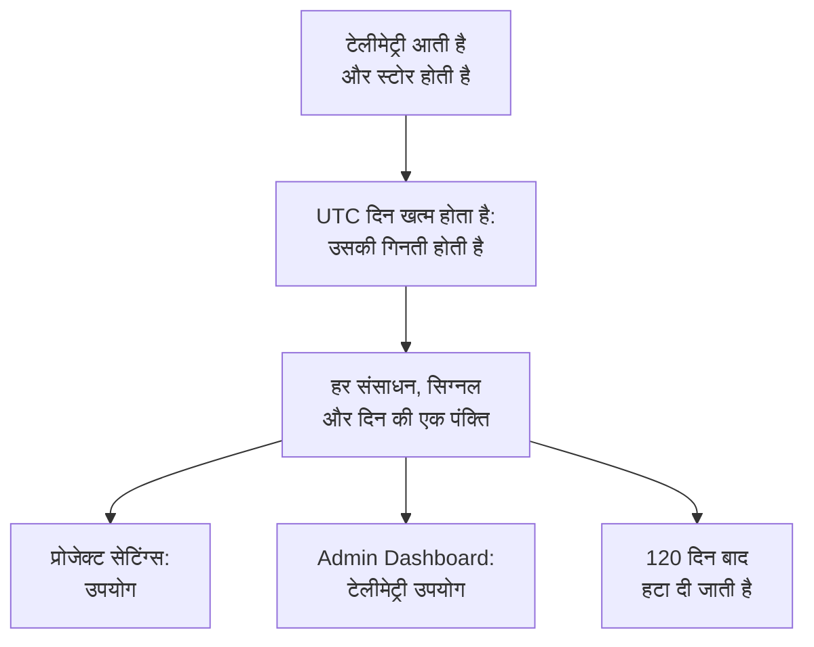

# टेलीमेट्री उपयोग

देखें कि हर प्रोजेक्ट, और उसमें हर सेवा या संसाधन, कितनी टेलीमेट्री भेजता है: लॉग, मेट्रिक्स, ट्रेस, अपवाद, प्रोफ़ाइल, सेशन रीप्ले और सुरक्षा इवेंट। उपयोग हर OneUptime इंस्टॉलेशन पर गिना जाता है, बिलिंग के साथ या उसके बिना, ताकि आप ClickHouse से क्वेरी किए बिना पता लगा सकें कि आपका स्टोरेज किस चीज़ से भर रहा है।

:::cards
- [उपयोग कैसे गिना जाता है](#उपयोग-कैसे-गिना-जाता-है): दिन में एक बार, हर संसाधन और सिग्नल के लिए।
- [किसी प्रोजेक्ट का उपयोग देखें](#किसी-प्रोजेक्ट-का-उपयोग-देखें): प्रोजेक्ट सेटिंग्स → टेलीमेट्री और APM → उपयोग।
- [हर प्रोजेक्ट का उपयोग देखें](#हर-प्रोजेक्ट-का-उपयोग-देखें): Admin Dashboard, इंस्टेंस व्यवस्थापक के लिए।
- [उपयोग कितने समय तक रखा जाता है](#उपयोग-कितने-समय-तक-रखा-जाता-है): 120 दिन, जब तक आप इसे न बदलें।
:::

## उपयोग कैसे गिना जाता है

दिन में एक बार, UTC में किसी दिन के खत्म होने के बाद, OneUptime गिनता है कि हर प्रोजेक्ट के हर संसाधन ने उस दिन हर सिग्नल के लिए क्या भेजा, और गिनती को हर संसाधन, सिग्नल और दिन की एक पंक्ति के रूप में रखता है।



- **दिन खत्म होने के बाद ही गिना जाता है।** हर दिन अगले दिन लगभग 08:00 UTC तक गिन लिया जाता है, इसलिए आज का उपयोग कल दिखता है। जो दिन गिना नहीं जा सका, उसे एक हफ़्ते तक फिर से आज़माया जाता है।
- **आकार स्टोर किया गया आकार है।** हर सिग्नल को उन पंक्तियों के आकार के रूप में गिना जाता है जिनमें वह स्टोर होता है, कंप्रेशन से पहले। सेशन रीप्ले को उन बाइट्स के रूप में गिना जाता है जो रिकॉर्डर ने अपलोड किए।
- **अपवाद अलग से दिखाए जाते हैं।** स्पैन और लॉग से दर्ज किए गए अपवादों का अपना कुल, अपना कॉलम और चार्ट में अपना हिस्सा होता है, और **ट्रेस** स्पैन गिनता है। उनकी अपनी कोई पंक्ति नहीं होती: हर ट्रेस पंक्ति बताती है कि उसमें से कितना हिस्सा अपवादों का था। जो दिन अपवादों को अलग दिखाए जाने से पहले गिना गया था, उसमें वे अब भी पहले की तरह **ट्रेस** के अंदर हैं।
- **प्रोफ़ाइल में उनके सैंपल शामिल हैं।**
- **OneUptime की अपनी टेलीमेट्री नहीं गिनी जाती।** मॉनिटर, अलर्ट, घटना और SLO की रीडिंग, डेटा ऑब्ज़र्वेबिलिटी की रीडिंग और सेशन रीप्ले बजट मेट्रिक्स OneUptime खुद लिखता है।
- **OneUptime Cloud पर, टेलीमेट्री का बिल इन्हीं पंक्तियों से बनता है।** बिना बिलिंग वाले इंस्टॉलेशन पर, उपयोग बिना किसी लागत के गिना जाता है, और उसके लिए कुछ भी चार्ज नहीं किया जाता, भले ही बाद में बिलिंग चालू की जाए।
- **अपवादों का बिल ट्रेस के हिस्से के रूप में बनता है।** OneUptime Cloud पर, ट्रेस का बिल उनके स्पैन और उनके अपवादों के लिए एक साथ, ट्रेस की कीमत पर बनता है, जैसा हमेशा से होता आया है। अपवादों को अलग दिखाने से आपके बिल में कुछ भी नहीं बदलता, और उनके लिए कभी दो बार चार्ज नहीं किया जाता।
- **बजट उपयोग से अलग गिना जाता है।** [इंजेशन बजट](/docs/telemetry/ingestion-budgets) टेलीमेट्री को आते ही, डीकंप्रेस करके गिनता है, इसलिए वह किसी दिन की टेलीमेट्री को उसी दिन रोक सकता है। जब कोई बजट सेट हो, तो यह पेज आज के बजट के साथ खुलता है। अपवादों का अपना कोई बजट नहीं होता: वे उन ट्रेस या लॉग के बजट में गिने जाते हैं जिनमें वे आते हैं।

## शुरू करने से पहले

- **ऐसी भूमिका जो प्रोजेक्ट की टेलीमेट्री पढ़ती हो।** प्रोजेक्ट स्वामी, प्रोजेक्ट एडमिन, प्रोजेक्ट सदस्य, दर्शक, टेलीमेट्री एडमिन, टेलीमेट्री सदस्य या टेलीमेट्री दर्शक, या बिलिंग भूमिकाओं में से कोई एक। भूमिका पूरे प्रोजेक्ट तक पहुँचनी चाहिए: कुछ लेबल तक सीमित भूमिका उपयोग नहीं दिखाती।
- **प्रोजेक्ट में टेलीमेट्री।** उपयोग उस टेलीमेट्री के लिए गिना जाता है जो प्रोजेक्ट की [इंजेशन कुंजियाँ](/docs/telemetry/ingestion-keys) भेजती हैं।

## किसी प्रोजेक्ट का उपयोग देखें

:::steps
### उपयोग खोलें

**प्रोजेक्ट सेटिंग्स → टेलीमेट्री और APM → उपयोग** पर जाएँ। साइड मेनू में **टेलीमेट्री और APM** शुरुआत में सिमटा रहता है: इसे खोलने के लिए इस पर क्लिक करें।

### समय सीमा चुनें

पेज **पिछले 30 दिन** पर खुलता है। **टेलीमेट्री उपयोग** कार्ड के ऊपर दाईं ओर वाले बॉक्स में **पिछले 7 दिन** या **पिछले 90 दिन** चुनें। समय सीमा कल पर खत्म होती है, यानी उस सबसे नए दिन पर जिसकी गिनती हो चुकी है।

### पता करें कि क्या बढ़ा

**संसाधन के हिसाब से उपयोग** कार्ड उस समय सीमा में कुछ भी भेजने वाली हर सेवा और संसाधन को दिखाता है, सबसे ज़्यादा भेजने वाले पहले। किसी कॉलम के हिसाब से छाँटने के लिए उसके शीर्षक पर क्लिक करें, और किसी संसाधन का पेज खोलने के लिए उसके नाम पर।
:::

पेज पर तीन कार्ड हैं:

| कार्ड | यह क्या दिखाता है |
| --- | --- |
| **टेलीमेट्री उपयोग** | समय सीमा का **कुल**, हर सिग्नल का कुल, और हर दिन का एक चार्ट, जिसमें उस दिन के सिग्नल एक के ऊपर एक रखे होते हैं। |
| **संसाधन के हिसाब से उपयोग** | हर **संसाधन** उसके प्रकार के साथ, हर सिग्नल के लिए एक कॉलम, **कुल** और **रखने की अवधि**, यानी उसकी टेलीमेट्री कितने समय तक रखी जाती है। |
| **टेलीमेट्री उपयोग इतिहास** | हर उत्पाद, संसाधन और दिन के लिए एक पंक्ति, **उत्पाद**, **दिन** और **सेवा** के फ़िल्टर के साथ। **ट्रेस** वाली पंक्ति अपने स्पैन और अपवादों को एक साथ रखती है, जैसे ट्रेस का बिल बनता है, और **इंजेस्ट किया गया डेटा (GB में)** के नीचे बताती है कि उसमें से कितना हिस्सा अपवादों का था। |

जिस टेलीमेट्री ने किसी सेवा का नाम नहीं दिया, वह **अज्ञात सेवा** के रूप में दिखती है। जो संसाधन तब से हटा दिया गया है, या जिसके प्रकार को आपकी भूमिका नहीं पढ़ती, वह अपने प्रकार और अपनी ID की शुरुआत से दिखता है।

## कौन क्या देखता है

| भूमिका | क्या देखती है |
| --- | --- |
| प्रोजेक्ट स्वामी, प्रोजेक्ट एडमिन, बिलिंग एडमिन, बिलिंग सदस्य, बिलिंग दर्शक, Manage Billing | हर संसाधन ने कितना भेजा और उसे कितने समय तक रखा जाता है, और OneUptime Cloud पर उसकी लागत क्या रही |
| प्रोजेक्ट सदस्य, दर्शक, टेलीमेट्री एडमिन, टेलीमेट्री सदस्य, टेलीमेट्री दर्शक | हर संसाधन ने कितना भेजा और उसे कितने समय तक रखा जाता है |

उपयोग की लागत केवल OneUptime Cloud पर दिखती है: बिना बिलिंग वाला इंस्टॉलेशन इसके लिए कुछ भी चार्ज नहीं करता। कीमतों के लिए देखें [बिलिंग और उपयोग](/docs/configuration/billing#उपयोग-इतिहास)।

## हर प्रोजेक्ट का उपयोग देखें

सेल्फ़-होस्टेड इंस्टॉलेशन पर, इंस्टेंस व्यवस्थापक Admin Dashboard में हर प्रोजेक्ट का उपयोग देखता है:

:::steps
### टेलीमेट्री उपयोग खोलें

Admin Dashboard में मेनू खोलें और **टेलीमेट्री उपयोग** पर क्लिक करें। सूची उस समय सीमा में कुछ भी भेजने वाला हर प्रोजेक्ट दिखाती है, सबसे ज़्यादा भेजने वाले पहले, हर सिग्नल के लिए एक कॉलम और **कुल** के साथ।

### सबसे ज़्यादा भेजने वाले प्रोजेक्ट ढूँढें

कार्ड के ऊपर दाईं ओर एक समय सीमा चुनें, और किसी कॉलम के हिसाब से छाँटने के लिए उसके शीर्षक पर क्लिक करें: **कुल**, कोई सिग्नल, या नाम के लिए **प्रोजेक्ट**।

### कोई प्रोजेक्ट खोलें

किसी प्रोजेक्ट के नाम पर क्लिक करें। Admin Dashboard में **परियोजनाएँ** के अंतर्गत उसका **टेलीमेट्री उपयोग** पेज उसका उपयोग दिन, सिग्नल और संसाधन के हिसाब से वैसे ही दिखाता है, जैसे उसके सदस्य उसे देखते हैं।
:::

## उपयोग कितने समय तक रखा जाता है

उपयोग 120 दिन तक रखा जाता है, जब तक आप इसे न बदलें, बिलिंग चालू हो या बंद। यह बताता है कि उपयोग की गिनतियाँ कितने समय तक रखी जाती हैं, खुद टेलीमेट्री नहीं: उसके लिए देखें [डेटा प्रतिधारण](/docs/telemetry/data-retention)।

:::steps
### डेटा प्रतिधारण खोलें

Admin Dashboard में, **सेटिंग्स → डेटा प्रतिधारण** पर जाएँ।

### दिनों की संख्या सेट करें

**टेलीमेट्री उपयोग प्रतिधारण** कार्ड पर, **टेलीमेट्री उपयोग प्रतिधारण संपादित करें** पर क्लिक करें, **टेलीमेट्री उपयोग प्रतिधारण (दिन)** में 30 से 1095 तक की संख्या डालें, और **परिवर्तन सहेजें** पर क्लिक करें। 120 दिन के लिए इसे खाली छोड़ें।
:::

उससे पुराना उपयोग दिन में एक बार हटाया जाता है। प्रतिधारण कभी 30 दिन से कम नहीं होता: जिस दिन की गिनती हो चुकी है, वह कभी हटाकर दोबारा नहीं गिना जाता।

## API से उपयोग पढ़ें

`GET /api/telemetry-usage/project` UTC दिनों की किसी समय सीमा में किसी एक प्रोजेक्ट का उपयोग लौटाता है, जैसा पेज उसे दिखाता है। इसे ऐसी [API कुंजी](/docs/permissions/index#api-कुंजियाँ) से कॉल करें जिसके पास ऊपर की भूमिकाओं में से कोई एक हो:

```bash
curl 'https://oneuptime.com/api/telemetry-usage/project?startDay=2026-10-01&endDay=2026-10-31' \
  -H "ApiKey: $ONEUPTIME_API_KEY"
```

`startDay` और `endDay` दिन हैं जो `YYYY-MM-DD` के रूप में लिखे जाते हैं, दोनों शामिल, और समय सीमा 1095 दिन तक लंबी हो सकती है। जवाब में कुल, हर दिन सिग्नल के हिसाब से और हर संसाधन सिग्नल के हिसाब से होते हैं, GB में, और लागत केवल तब जब बिलिंग चालू हो और कुंजी बिलिंग पढ़ती हो। अपवाद `Exceptions` में होते हैं, जो `Traces` से अलग है, और जो दिन अपवादों को अलग दिखाए जाने से पहले गिना गया था, उसमें वे `Traces` के अंदर होते हैं।

## समस्या निवारण

:::details उपयोग पेज कहता है: अभी तक कोई टेलीमेट्री उपयोग नहीं
कोई दिन UTC में खत्म होने के बाद, अगले दिन लगभग 08:00 UTC तक गिना जाता है: जिस प्रोजेक्ट ने आज भेजना शुरू किया, उसका पहला दिन कल दिखेगा। जाँचें कि प्रोजेक्ट को एक्सप्लोरर में टेलीमेट्री मिल रही है।
:::

:::details संख्याएँ मेरी ClickHouse डिस्क से बड़ी हैं
उपयोग कंप्रेशन से पहले पंक्तियों का आकार है। ClickHouse जो स्टोर करता है उसे कंप्रेस करता है, इसलिए वह जितनी डिस्क इस्तेमाल करता है वह कई गुना छोटी होती है।
:::

:::details कोई संसाधन अपने प्रकार और एक ID से दिखता है
संसाधन टेलीमेट्री भेजने के बाद हटा दिया गया है, या आपकी भूमिका उस प्रकार के संसाधन को नहीं पढ़ती। उसका उपयोग फिर भी गिना जाता है।
:::

:::details ट्रेस उस दिन घट गया जिस दिन अपवाद दिखाई दिए
अपवाद पहले **ट्रेस** के अंदर गिने जाते थे। जिस पहले दिन अपवाद अलग गिने गए, उस दिन से **ट्रेस** स्पैन गिनता है और **अपवाद** अपवादों को गिनता है। दोनों मिलकर वही हैं जो पहले **ट्रेस** था, और ट्रेस का बिल इसी पर बनता है।
:::

## अगले कदम

:::cards
- [ड्रॉप फ़िल्टर और स्क्रब नियम](/docs/telemetry/drop-filters-and-scrub-rules): वह टेलीमेट्री स्टोर करना बंद करें जिसकी आपको ज़रूरत नहीं है।
- [डेटा प्रतिधारण](/docs/telemetry/data-retention): टेलीमेट्री उतने समय तक रखें जितनी ज़रूरत हो, उससे ज़्यादा नहीं।
- [बिलिंग और उपयोग](/docs/configuration/billing): OneUptime Cloud पर टेलीमेट्री की लागत क्या है।
- [इंजेशन कुंजियाँ](/docs/telemetry/ingestion-keys): अपने प्रोजेक्ट में टेलीमेट्री भेजें।
- [इंजेशन बजट](/docs/telemetry/ingestion-budgets): सीमित करें कि कोई प्रोजेक्ट एक दिन में हर सिग्नल का कितना भेजता है।
:::
