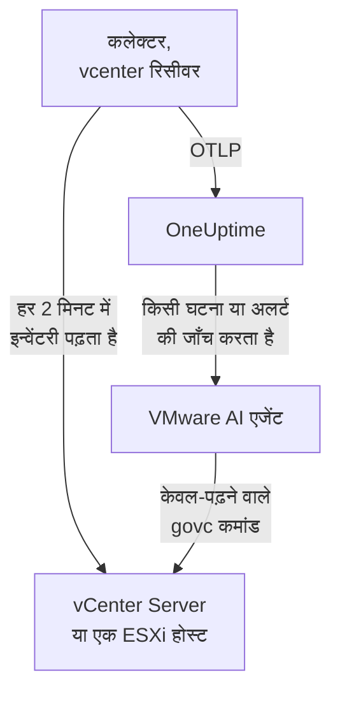

# VMware एजेंट

OneUptime VMware एजेंट VMware vSphere की निगरानी करता है: vCenter Server, ESXi होस्ट, वर्चुअल मशीनें, डेटास्टोर, क्लस्टर, रिसोर्स पूल और vSAN। यह एक मानक OpenTelemetry Collector है, जिसका [`vcenter` रिसीवर](https://github.com/open-telemetry/opentelemetry-collector-contrib/tree/main/receiver/vcenterreceiver) केवल-पढ़ने वाले उपयोगकर्ता से vSphere API पढ़ता है, हर मेट्रिक पर आपके vCenter का नाम लगाता है और उसे OneUptime को भेजता है: vCenter पर कोई प्लगइन नहीं, और VM के भीतर कुछ भी नहीं। [VMware मॉनिटर](/docs/monitor/vmware-monitor) आने वाले डेटा पर अलर्ट करते हैं।

:::cards
- [एजेंट इंस्टॉल करें](#एजेंट-इंस्टॉल-करें): एक केवल-पढ़ने वाला उपयोगकर्ता, फिर इंस्टॉल स्क्रिप्ट, Docker Compose या systemd।
- [एजेंट क्या एकत्र करता है](#एजेंट-क्या-इकट्ठा-करता-है): हर vSphere ऑब्जेक्ट, उसकी पहचान और उसके मेट्रिक्स।
- [AI एजेंट](#ai-एजेंट): जाँच के दौरान OneUptime AI को vCenter पढ़ने दें।
- [समस्या निवारण](#समस्या-निवारण): एक डायग्नोस्टिक स्क्रिप्ट, और आम समस्याएँ।
:::

## यह कैसे काम करता है

एक एजेंट एक vSphere एंडपॉइंट की निगरानी करता है: एक **vCenter Server**, जो अपने प्रबंधित हर डेटासेंटर, क्लस्टर और होस्ट को कवर करता है, या एक **स्टैंडअलोन ESXi होस्ट**, जिसे कोई vCenter प्रबंधित नहीं करता। हर vCenter के लिए एक एजेंट चलाएँ। कलेक्टर हर संग्रह में एक बार पूरी इन्वेंटरी से गुज़रता है (डिफ़ॉल्ट रूप से हर 2 मिनट में) और हर ऑब्जेक्ट के लिए एक रिसोर्स भेजता है। वही Compose फ़ाइल उसके बगल में OneUptime AI के लिए VMware AI एजेंट भी चलाती है। Docker नहीं चलाना चाहते? वही कलेक्टर, उसी कॉन्फ़िगरेशन के साथ, किसी भी Linux मशीन पर systemd सेवा के रूप में भी चलता है।



vCenter अपने पहले डेटा के साथ, उस नाम के अंतर्गत खुद को रजिस्टर करता है जिसे एजेंट हर मेट्रिक पर `vmware.vcenter.name` के रूप में लगाता है। एजेंट चलाए बिना vCenter की निगरानी के लिए [एजेंट के बिना VMware](/docs/telemetry/vmware-agentless) देखें: आपकी कोई एक प्रोब केवल-पढ़ने वाले खाते से वही डेटा एकत्र करती है।

## शुरू करने से पहले

- Docker Compose v2 प्लगइन के साथ Docker Engine 20.10 या बाद का, या Docker के बिना इंस्टॉल करने के लिए systemd 235 या बाद वाली एक Linux मशीन (x86_64 या arm64)। दोनों ही स्थितियों में मशीन को HTTPS (TCP 443) पर vCenter तक पहुँचना चाहिए।
- vCenter Server या ESXi 7.0 या बाद का: रिसीवर vSphere 7 और 8 को सपोर्ट करता है।
- एक खाता जो vSphere उपयोगकर्ता बना सके और शीर्ष-स्तर के vCenter ऑब्जेक्ट पर उसे कोई भूमिका दे सके।
- एक इंजेशन कुंजी। **प्रोजेक्ट सेटिंग्स → टेलीमेट्री और APM → इंजेशन कुंजियाँ** के अंतर्गत एक बनाएँ और उसका मान कॉपी करें।

### एजेंट कहाँ चलाएँ

एजेंट HTTPS पर vCenter से बात करता है, इसलिए उसे उसके पास चलाने की ज़रूरत नहीं है, और आदर्श रूप से उसे न तो vCenter Server Appliance पर चलना चाहिए और न ही उस क्लस्टर की किसी VM में जिसकी वह निगरानी करता है: अगर वह क्लस्टर बंद हो जाए, तो आपकी निगरानी भी उसके साथ बंद हो जाती है। अलग हार्डवेयर पर एक छोटी प्रबंधन VM, एक निगरानी होस्ट, या कोई भी मशीन जो Docker चलाती हो (या Docker के बिना, systemd वाली कोई भी Linux मशीन) और TCP 443 पर vCenter तक पहुँचती हो, सही जगह है। वैकल्पिक syslog लिसनर के लिए यह भी ज़रूरी है कि ESXi होस्ट syslog पोर्ट पर एजेंट तक पहुँच सकें ([ESXi syslog भेजें](#वैकल्पिक-esxi-syslog-भेजें) देखें)।

## एजेंट इंस्टॉल करें

:::steps
### केवल-पढ़ने वाला vSphere उपयोगकर्ता बनाएँ

एजेंट सिर्फ़ पढ़ता है: इन्वेंटरी, परफ़ॉर्मेंस काउंटर और vSAN आँकड़े। उसे बिल्ट-इन **Read-Only** भूमिका वाला अपना खाता दें, कभी भी कोई एडमिनिस्ट्रेटर नहीं।

:::tabs
@tab vSphere Client
1. खाता बनाएँ: _Menu → Administration → Single Sign On → Users and Groups_ खोलें, `vsphere.local` डोमेन (या अपना पहचान स्रोत) चुनें, **Add** पर क्लिक करें, उपयोगकर्ता का नाम `oneuptime` रखें और पासवर्ड सेट करें। तब उपयोगकर्ता `oneuptime@vsphere.local` होता है।
2. भूमिका दें: _Hosts and Clusters_ इन्वेंटरी में शीर्ष-स्तर का **vCenter Server** ऑब्जेक्ट चुनें, **Permissions** टैब खोलें, **Add** पर क्लिक करें, उपयोगकर्ता चुनें, भूमिका को **Read-Only** पर सेट करें, और **Propagate to children** पर टिक करें।
@tab govc
एडमिनिस्ट्रेटर क्रेडेंशियल वाली मशीन से:

```bash
govc sso.user.create -p 'a-strong-password' -R ReadOnly oneuptime
govc permissions.set -principal oneuptime@vsphere.local -role ReadOnly -propagate=true /
```
@tab PowerCLI
एडमिनिस्ट्रेटर के रूप में vCenter से जुड़े सत्र से:

```powershell
New-SsoPersonUser -UserName oneuptime -Password 'a-strong-password'
New-VIPermission -Entity (Get-Folder -NoRecursion) -Principal 'VSPHERE.LOCAL\oneuptime' -Role ReadOnly -Propagate:$true
```
@tab ESXi Host Client
स्टैंडअलोन ESXi होस्ट (बिना vCenter) के लिए, उपयोगकर्ता को _Host → Manage → Security & Users → Users_ के अंतर्गत बनाएँ और _Host → Manage → Security & Users → Permissions_ के अंतर्गत उसे Read-Only भूमिका दें। या होस्ट के शेल में `esxcli system account add` चलाएँ, फिर `esxcli system permission set --id oneuptime --role ReadOnly`।
:::

> [!IMPORTANT]
> प्रसार वह हिस्सा है जो लोग चूक जाते हैं। रिसीवर डेटासेंटर, क्लस्टर, होस्ट, VM, डेटास्टोर और रिसोर्स पूल से गुज़रता है, और हर वह ऑब्जेक्ट जिसे उपयोगकर्ता नहीं देख सकता, चुपचाप छोड़ दिया जाता है। vCenter ऑब्जेक्ट पर प्रसार के _बिना_ दी गई Read-Only भूमिका से खाली इन्वेंटरी और शून्यों से भरा डैशबोर्ड मिलता है।

### एजेंट इंस्टॉल करें और शुरू करें

:::tabs
@tab install.sh
इंस्टॉल स्क्रिप्ट डाउनलोड करें और उसे उस मशीन पर चलाएँ जो एजेंट को होस्ट करेगी:

```bash
curl -sSL https://raw.githubusercontent.com/OneUptime/oneuptime/master/agents/VMwareAgent/install.sh -o install.sh
bash install.sh
```

स्क्रिप्ट आपका OneUptime URL, इंजेशन कुंजी, vCenter का नाम, vCenter एंडपॉइंट और केवल-पढ़ने वाले क्रेडेंशियल पूछती है (पासवर्ड बिना दिखाए पढ़ती है), और यह भी कि क्या AI एजेंट सुधार लागू कर सकता है (अगर हाँ, तो उसका अपना vSphere उपयोगकर्ता और वे VM जिन्हें उसे कभी नहीं बदलना चाहिए)। यह `/opt/oneuptime-vmware-agent` में इंस्टॉल करती है, `0600` अनुमति वाली एक `.env` फ़ाइल लिखती है, और Docker Compose से एजेंट शुरू करती है। यह हर मान को वैसे ही Docker Compose के लिए उद्धरण चिह्नों में रखती है जैसे आपने टाइप किया, इसलिए `$`, `#`, स्पेस या उद्धरण चिह्नों वाला पासवर्ड वैसे ही काम करता है जैसे टाइप किया गया। स्क्रिप्ट को फिर से चलाने पर वह दोबारा पूछने के बजाय मौजूदा `.env` की हर चीज़ फिर से उपयोग करती है, और इसी तरह आप [एजेंट अपग्रेड करते हैं](#एजेंट-अपग्रेड-करना)।
@tab Docker Compose
[VMwareAgent डायरेक्टरी](https://github.com/OneUptime/oneuptime/tree/master/agents/VMwareAgent) से `docker-compose.yml` और `otel-collector-config.yaml` एक नए फ़ोल्डर में डाउनलोड करें, फिर उनके बगल में एक `.env` फ़ाइल बनाएँ। इसमें पासवर्ड होता है, इसलिए इसे `chmod 600 .env` से निजी रखें:

```bash title=".env"
ONEUPTIME_URL=YOUR_ONEUPTIME_URL
ONEUPTIME_TELEMETRY_INGESTION_KEY=YOUR_TELEMETRY_INGESTION_TOKEN
VMWARE_VCENTER_NAME=my-vcenter
VCENTER_ENDPOINT=https://vcsa.example.com
VCENTER_USERNAME=oneuptime@vsphere.local
VCENTER_PASSWORD=a-strong-password
VCENTER_INSECURE_SKIP_VERIFY=true
VCENTER_COLLECTION_INTERVAL=2m
```

`$`, `#`, स्पेस या उद्धरण चिह्नों वाला पासवर्ड सिंगल कोट्स में जाता है ([vCenter लॉगिन अस्वीकार करता है](#समस्या-निवारण) देखें)। एजेंट शुरू करें:

```bash
docker compose up -d
```
@tab systemd
एजेंट को Docker की ज़रूरत नहीं है: यह एक OpenTelemetry Collector बाइनरी और एक कॉन्फ़िगरेशन फ़ाइल है। systemd 235 या बाद वाली Linux मशीन (x86_64 या arm64; Ubuntu 18.04, Debian 10, RHEL 8 या नया) पर, एजेंट द्वारा पिन किया गया `otelcol-contrib` रिलीज़, उसी `otel-collector-config.yaml` के साथ, systemd सेवा के रूप में चलाएँ। इसके लिए एजेंट जो यूनिट देता है, [`oneuptime-vmware-agent-native.service`](https://github.com/OneUptime/oneuptime/blob/master/agents/VMwareAgent/systemd/oneuptime-vmware-agent-native.service), कलेक्टर को एक अस्थायी, बिना विशेषाधिकार वाले उपयोगकर्ता के रूप में चलाती है, बिना capabilities के और बिना किसी ऐसी जगह के जहाँ वह लिख सके।

कलेक्टर, कॉन्फ़िगरेशन और यूनिट डाउनलोड करें, और उन्हें `/opt/oneuptime-vmware-agent` में इंस्टॉल करें:

```bash
cd "$(mktemp -d)"
VERSION=0.161.0   # the collector release the agent pins
ARCH=$(uname -m | sed 's/x86_64/amd64/;s/aarch64/arm64/')
curl -fL -o otelcol-contrib.tar.gz \
  https://github.com/open-telemetry/opentelemetry-collector-releases/releases/download/v${VERSION}/otelcol-contrib_${VERSION}_linux_${ARCH}.tar.gz
curl -fsSLO https://raw.githubusercontent.com/OneUptime/oneuptime/master/agents/VMwareAgent/otel-collector-config.yaml
curl -fsSL -o oneuptime-vmware-agent.service \
  https://raw.githubusercontent.com/OneUptime/oneuptime/master/agents/VMwareAgent/systemd/oneuptime-vmware-agent-native.service

sudo install -d -m 0755 /opt/oneuptime-vmware-agent
sudo tar --no-same-owner --preserve-permissions -xzf otelcol-contrib.tar.gz -C /opt/oneuptime-vmware-agent otelcol-contrib
sudo install -m 0644 otel-collector-config.yaml /opt/oneuptime-vmware-agent/otel-collector-config.yaml
sudo install -m 0644 oneuptime-vmware-agent.service /etc/systemd/system/oneuptime-vmware-agent.service
```

सेटिंग्स `/opt/oneuptime-vmware-agent/.env` में जाती हैं: वही वेरिएबल जो Docker इंस्टॉल की `.env` में हैं। इसमें पासवर्ड होता है, इसलिए इसे खोलने से पहले सिर्फ़ root के पढ़ने लायक बनाएँ:

```bash
sudo touch /opt/oneuptime-vmware-agent/.env
sudo chmod 600 /opt/oneuptime-vmware-agent/.env
sudoedit /opt/oneuptime-vmware-agent/.env
```

इसमें यह डालें:

```bash
ONEUPTIME_URL=YOUR_ONEUPTIME_URL
ONEUPTIME_TELEMETRY_INGESTION_KEY=YOUR_TELEMETRY_INGESTION_TOKEN
VMWARE_VCENTER_NAME=my-vcenter
VCENTER_ENDPOINT=https://vcsa.example.com
VCENTER_USERNAME="oneuptime@vsphere.local"
VCENTER_PASSWORD="a-strong-password"
VCENTER_INSECURE_SKIP_VERIFY=true
VCENTER_COLLECTION_INTERVAL=2m
```

इस फ़ाइल को शेल नहीं, systemd पढ़ता है: उपयोगकर्ता नाम और पासवर्ड को डबल कोट्स में रखें, हर `\` को `\\` और हर `"` को `\"` लिखें — `DOMAIN\user` बन जाता है `"DOMAIN\\user"` —, जबकि `$`, `#`, `'` और स्पेस जैसे हैं वैसे ही जाते हैं। यही वह रूप है जिसे हर systemd वर्शन एक जैसा पढ़ता है; पुराने वर्शन (उदाहरण के लिए RHEL 8 वाला) सिंगल कोट्स के अंदर भी बैकस्लैश हटा देते हैं। फिर एजेंट शुरू करें, और उसे हर बूट पर शुरू होने दें:

```bash
sudo systemctl daemon-reload
sudo systemctl enable oneuptime-vmware-agent
sudo systemctl restart oneuptime-vmware-agent
```

यह इंस्टॉल सिर्फ़ कलेक्टर चलाता है: [AI एजेंट](#ai-एजेंट) केवल कंटेनर इमेज के रूप में आता है। हर vCenter के लिए एक एजेंट चलाएँ: अगर आप Docker इंस्टॉल से हट रहे हैं, तो पहले वहाँ `docker compose down` चलाएँ, वरना हर मेट्रिक दो बार आएगा।
:::

### इंस्टॉलेशन सत्यापित करें

जाँचें कि एजेंट चल रहा है, और कलेक्टर के लॉग पढ़ें:

```bash
docker compose ps
docker logs -f oneuptime-vmware-agent
```

systemd से इंस्टॉल किया था? तो सेवा और उसका जर्नल जाँचें:

```bash
systemctl status oneuptime-vmware-agent --no-pager
sudo journalctl -u oneuptime-vmware-agent -f
```

कलेक्टर शुरू होने के बाद उसके लॉग में यह पंक्ति दिखनी चाहिए:

```text
Everything is ready. Begin running and processing data.
```

### OneUptime में vCenter ढूँढें

जब तक पूरी इन्वेंटरी से पहली बार गुज़रना पूरा न हो, कुछ नहीं भेजा जाता, इसलिए एक संग्रह अंतराल (डिफ़ॉल्ट रूप से 2 मिनट) इंतज़ार करें। फिर **उत्पाद → बुनियादी ढांचा → VMware → सभी vCenter** खोलें: vCenter वहाँ अपने डेटासेंटर, क्लस्टर, ESXi होस्ट, वर्चुअल मशीनों, डेटास्टोर और रिसोर्स पूल के साथ मौजूद है।
:::

## एनवायरनमेंट वेरिएबल

Docker Compose इन्हें `.env` से पढ़ता है, जो `docker-compose.yml` के बगल में है; systemd इंस्टॉल इन्हें `/opt/oneuptime-vmware-agent/.env` से पढ़ता है, और उसकी यूनिट वही डिफ़ॉल्ट देती है।

| वेरिएबल | ज़रूरी | विवरण |
| --- | --- | --- |
| `ONEUPTIME_URL` | हाँ | आपका OneUptime URL, जैसे `https://oneuptime.com` या आपका सेल्फ़-होस्टेड इंस्टेंस। अगर इंस्टेंस सिर्फ़ HTTP पर है तो `http://` और उसका पोर्ट उपयोग करें। |
| `ONEUPTIME_TELEMETRY_INGESTION_KEY` | हाँ | **प्रोजेक्ट सेटिंग्स → टेलीमेट्री और APM → इंजेशन कुंजियाँ** से इंजेशन कुंजी। |
| `VMWARE_VCENTER_NAME` | हाँ | OneUptime में vCenter का नाम, हर मेट्रिक पर `vmware.vcenter.name` रिसोर्स एट्रिब्यूट के रूप में लगाया गया। इसे स्थिर रखें: बाद में बदलने से एक दूसरा vCenter रजिस्टर होता है। डिफ़ॉल्ट `vmware-vcenter` है। |
| `VCENTER_ENDPOINT` | हाँ | vCenter Server या स्टैंडअलोन ESXi होस्ट का स्कीम और होस्ट, `/sdk` के **बिना**, जैसे `https://vcsa.example.com`। |
| `VCENTER_USERNAME` | हाँ | Read-Only भूमिका वाला vSphere उपयोगकर्ता, जैसे `oneuptime@vsphere.local` (या Active Directory पहचान स्रोत के लिए `DOMAIN\user`)। |
| `VCENTER_PASSWORD` | हाँ | उस उपयोगकर्ता का पासवर्ड। अगर उसमें `$`, `#`, स्पेस या उद्धरण चिह्न हों, तो Docker इंस्टॉल की `.env` में उसे सिंगल कोट्स में रखें (`install.sh` यह आपके लिए करती है), और systemd इंस्टॉल की फ़ाइल में डबल कोट्स में ([समस्या निवारण](#समस्या-निवारण) देखें)। |
| `VCENTER_INSECURE_SKIP_VERIFY` | नहीं | `true` vCenter का डिफ़ॉल्ट सेल्फ़-साइन्ड (VMCA) सर्टिफ़िकेट स्वीकार करता है; `false` TLS सत्यापन चालू रखता है। डिफ़ॉल्ट `false` है। |
| `VCENTER_COLLECTION_INTERVAL` | नहीं | पूरी इन्वेंटरी कितनी बार पढ़ी जाती है। बहुत बड़े vCenter के लिए इसे `5m` या `10m` तक बढ़ाएँ। डिफ़ॉल्ट `2m` है। |

AI एजेंट की अपनी सेटिंग्स [AI एजेंट](#ai-एजेंट) के अंतर्गत हैं।

## एजेंट क्या इकट्ठा करता है

हर `VCENTER_COLLECTION_INTERVAL` पर रिसीवर पूरी vSphere इन्वेंटरी से गुज़रता है और हर ऑब्जेक्ट के लिए एक OpenTelemetry रिसोर्स भेजता है। हर ऑब्जेक्ट की पहचान उसके **रिसोर्स एट्रिब्यूट** में होती है — `vcenter.datacenter.name`, `vcenter.cluster.name`, `vcenter.host.name`, `vcenter.vm.name` / `vcenter.vm.id`, `vcenter.datastore.name`, `vcenter.resource_pool.name` / `vcenter.resource_pool.inventory_path` — और एजेंट उसके ऊपर `vmware.vcenter.name` जोड़ता है, इसलिए OneUptime सब कुछ आपके vCenter के अंतर्गत रखता है:

| vSphere ऑब्जेक्ट | पहचान (रिसोर्स एट्रिब्यूट) | मेट्रिक्स |
| --- | --- | --- |
| डेटासेंटर | `vcenter.datacenter.name` | `vcenter.datacenter.cluster.count`, `vcenter.datacenter.host.count`, `vcenter.datacenter.vm.count`, `vcenter.datacenter.datastore.count`, `vcenter.datacenter.disk.space`, `vcenter.datacenter.cpu.limit`, `vcenter.datacenter.memory.limit` |
| क्लस्टर | + `vcenter.cluster.name` | `vcenter.cluster.cpu.effective`, `vcenter.cluster.cpu.limit`, `vcenter.cluster.memory.effective`, `vcenter.cluster.memory.limit`, `vcenter.cluster.host.count`, `vcenter.cluster.vm.count`, `vcenter.cluster.vm_template.count`, `vcenter.cluster.vsan.*` (थ्रूपुट, ऑपरेशन, लेटेंसी, कंजेशन) |
| ESXi होस्ट | + `vcenter.host.name` (और `vcenter.cluster.name` जब होस्ट किसी क्लस्टर में हो) | `vcenter.host.cpu.usage` / `.capacity` / `.utilization` / `.reserved`, `vcenter.host.memory.usage` / `.utilization` / `.capacity`, `vcenter.host.disk.latency.avg` / `.latency.max` / `.throughput`, `vcenter.host.network.usage` / `.throughput` / `.packet.rate` / `.packet.drop.rate` / `.packet.error.rate`, `vcenter.host.vsan.*` |
| वर्चुअल मशीन | + `vcenter.host.name`, `vcenter.vm.name`, `vcenter.vm.id` (इंस्टेंस UUID); `vcenter.resource_pool.*` या `vcenter.virtual_app.*` | `vcenter.vm.disk.usage`, `vcenter.vm.disk.utilization`, `vcenter.vm.memory.usage` / `.utilization` / `.ballooned` / `.swapped` / `.swapped_ssd`; केवल चालू VM: `vcenter.vm.cpu.usage`, `vcenter.vm.cpu.readiness`, `vcenter.vm.cpu.utilization`, `vcenter.vm.disk.latency.avg` / `.latency.max` / `.throughput`, `vcenter.vm.network.*`, `vcenter.vm.vsan.*` |
| VM टेम्पलेट | `vcenter.vm_template.name`, `vcenter.vm_template.id` | केवल `vcenter.vm.disk.usage` |
| डेटास्टोर | + `vcenter.datastore.name` | `vcenter.datastore.disk.usage`, `vcenter.datastore.disk.utilization` |
| रिसोर्स पूल | + `vcenter.resource_pool.name`, `vcenter.resource_pool.inventory_path` | `vcenter.resource_pool.cpu.usage` / `.cpu.shares`, `vcenter.resource_pool.memory.usage` / `.memory.shares` / `.memory.ballooned` / `.memory.swapped` / `.memory.granted` |

गिनती और क्षमता वाले मेट्रिक्स **डेटापॉइंट एट्रिब्यूट** पर बँटते हैं, और ठीक इन्हीं से आप मॉनिटर मानदंडों में फ़िल्टर और समूह बनाते हैं:

| एट्रिब्यूट | मान | किन पर होता है |
| --- | --- | --- |
| `direction` | डिस्क के लिए `read` / `write`, नेटवर्क के लिए `transmitted` / `received` | डिस्क लेटेंसी और थ्रूपुट, नेटवर्क थ्रूपुट और पैकेट दरें |
| `disk_state` | `available` / `used` | `vcenter.datastore.disk.usage`, `vcenter.vm.disk.usage`, `vcenter.datacenter.disk.space` |
| `status` | `red` / `yellow` / `green` / `gray` (vSphere में ऑब्जेक्ट की समग्र स्थिति) | `vcenter.datacenter.cluster.count` / `.host.count` / `.vm.count` |
| `power_state` | होस्ट: `on` / `off` / `standby` / `unknown`; VM: `on` / `off` / `suspended` / `unknown` | `vcenter.datacenter.host.count` / `.vm.count`, `vcenter.cluster.vm.count` |
| `effective` | `true` / `false` (स्ट्रिंग के रूप में संग्रहीत) | `vcenter.cluster.host.count` |
| `object` | NIC, डिस्क या vCPU इंस्टेंस (जैसे `vmnic0`) | होस्ट और VM की हर डिवाइस की डिस्क और नेटवर्क सीरीज़ |
| `cpu_reservation_type` | `total` / `used` | `vcenter.host.cpu.reserved` |
| `type` | मेमोरी: `guest` / `host` / `overhead`, `private` / `shared`; vSAN: `read` / `write` / `unmap` | रिसोर्स पूल मेमोरी सीरीज़, vSAN लेटेंसी और ऑपरेशन |

इकाइयाँ रिसीवर की अपनी OTLP इकाइयाँ हैं, जिन्हें OneUptime दिखाने के लिए स्केल करता है: CPU उपयोग और क्षमता के लिए `MHz`, उपयोग दर और CPU रेडीनेस के लिए `%`, होस्ट, VM और रिसोर्स पूल की मेमोरी के लिए `MiBy`, क्लस्टर और डेटासेंटर की मेमोरी और सारी डिस्क जगह के लिए `By`, होस्ट और VM की डिस्क लेटेंसी के लिए `ms`, और vSAN लेटेंसी के लिए `us` (माइक्रोसेकंड)। मॉनिटर मानदंडों में पहचान वाले एट्रिब्यूट `resource.` प्रीफ़िक्स लेते हैं (`resource.vcenter.host.name`, `resource.vmware.vcenter.name`), जबकि डेटापॉइंट एट्रिब्यूट बिना प्रीफ़िक्स रहते हैं (`disk_state`, `power_state`, `status`)।

`vcenter.host.memory.capacity` अपस्ट्रीम में डिफ़ॉल्ट रूप से बंद है; साथ आने वाला कॉन्फ़िगरेशन इसे चालू करता है, क्योंकि OneUptime होस्ट मेमोरी उपयोग दर के लिए इससे भाग देता है। `otel-collector-config.yaml` में एक टिप्पणी बाकी वैकल्पिक मेट्रिक्स की सूची देती है (`vcenter.vm.cpu.time`, `vcenter.vm.memory.granted`, `vcenter.host.memory.active`, `vcenter.host.memory.ballooned`, `vcenter.host.memory.granted`, `vcenter.vm.network.broadcast.packet.rate`, `vcenter.vm.network.multicast.packet.rate`): इनमें से किसी को भी इसी तरह चालू करें।

### VM की पावर स्थिति

रिसीवर किसी VM की पावर स्थिति का कोई मेट्रिक नहीं भेजता। वह `vcenter.vm.cpu.*` **सिर्फ़ चालू VM के लिए** भेजता है, इसलिए OneUptime हर संग्रह में आई चीज़ों से स्थिति का अनुमान लगाता है: जिस VM ने CPU मेट्रिक्स भेजे, वह **Powered on** है; जिसने सिर्फ़ मेमोरी और डिस्क उपयोग भेजा, वह **Powered off** है (या निलंबित: vSphere यहाँ दोनों में फ़र्क़ नहीं करता)। VM टेम्पलेट की कोई पावर स्थिति नहीं होती। यह **एक बार में पूरा संग्रह** पढ़ता है, इसीलिए साथ आने वाले `batch` प्रोसेसर में बड़ा `send_batch_size` है और जानबूझकर कोई `send_batch_max_size` नहीं है: दो एक्सपोर्ट में बँटा संग्रह इन्वेंटरी की गिनतियों को शून्य कर देगा और VM को "बंद" कर देगा। batch सेटिंग्स को वैसे ही रखें जैसी वे आती हैं।

## OneUptime में vCenter


**अवलोकन** पेज सबसे पहले इस सवाल का जवाब देता है कि "क्या यह vCenter स्वस्थ है": प्रभावी होस्ट, क्षमता के अनुसार भारित होस्ट CPU और मेमोरी, सबसे भरा डेटास्टोर, और किसी VM का सबसे खराब CPU रेडी समय। जब कुछ खराब होता है, तो यह ज़िम्मेदार ऑब्जेक्ट का नाम बताता है, ताकि आपको खोजना न पड़े।

### ESXi होस्ट


### वर्चुअल मशीनें


बंद वर्चुअल मशीनें और टेम्पलेट भी सूची में आते हैं। vCenter सिर्फ़ चालू VM के CPU काउंटर भेजता है, इसलिए उनके CPU कॉलम भ्रामक शून्य के बजाय N/A दिखाते हैं।

### डेटास्टोर


## वैकल्पिक — ESXi syslog भेजें

डिफ़ॉल्ट रूप से एजेंट सिर्फ़ मेट्रिक्स भेजता है, इसलिए vCenter का **लॉग** पेज खाली रहता है। ESXi होस्ट (और खुद vCenter) अपना syslog किसी भी लिसनर को भेज सकते हैं, और साथ आने वाली `otel-collector-config.yaml` में कमेंट किया हुआ `syslog` रिसीवर जोड़ा है (पोर्ट 5514 पर TCP और UDP, RFC 3164: ESXi का अपना फ़ॉर्मैट), जो कमेंट की हुई `logs` पाइपलाइन से जुड़ा है, जो `vmware.vcenter.name` लगाती है ताकि लॉग आपके vCenter पर पहुँचें।

:::steps
### रिसीवर चालू करें

दोनों `syslog/*` रिसीवर और `logs` पाइपलाइन को अनकमेंट करें (`otel-collector-config.yaml` में)।

### पोर्ट खोलें

`ports:` ब्लॉक को अनकमेंट करें (`docker-compose.yml` में), ताकि मशीन `5514/tcp` और `5514/udp` प्रकाशित करे, फिर `docker compose up -d` चलाएँ। systemd के साथ प्रकाशित करने को कोई पोर्ट नहीं है, क्योंकि कलेक्टर मशीन पर ही सुनता है: इसके बजाय `sudo systemctl restart oneuptime-vmware-agent` चलाएँ। मशीन के फ़ायरवॉल में ESXi प्रबंधन नेटवर्क के लिए पोर्ट खोलें।

### हर ESXi होस्ट को एजेंट की ओर इंगित करें

vSphere Client में होस्ट चुनें, _Configure → System → Advanced System Settings_ खोलें, `Syslog.global.logHost` संपादित करें और उसे `udp://<agent-host>:5514` पर सेट करें (या `tcp://<agent-host>:5514`; कई लक्ष्यों को कॉमा से अलग करें)। फिर _Configure → System → Firewall → Edit → syslog_ के अंतर्गत बाहर जाने वाले ट्रैफ़िक की अनुमति दें। या हर होस्ट पर `esxcli` से:

```bash
esxcli system syslog config set --loghost='udp://<agent-host>:5514'
esxcli system syslog reload
esxcli network firewall ruleset set --ruleset-id=syslog --enabled=true
```

PowerCLI से, पूरे क्लस्टर पर: `Get-VMHost | Get-AdvancedSetting -Name Syslog.global.logHost | Set-AdvancedSetting -Value 'udp://<agent-host>:5514' -Confirm:$false`।
:::

एक syslog रिसीवर सिर्फ़ एक ट्रांसपोर्ट पर सुनता है, इसीलिए TCP और UDP दो रिसीवर हैं: अगर आपको सिर्फ़ एक चाहिए, तो दूसरे को कमेंट ही रहने दें। TLS syslog (`ssl://`) के लिए TLS को एजेंट के आगे समाप्त करें; रिसीवर खुद सादा TCP और UDP बोलता है। मानक कलेक्टर इमेज syslog को जैसा है वैसा पढ़ती है: किसी कस्टम इमेज की ज़रूरत नहीं।

## vCenter पर प्रोजेक्ट लेबल लगाएँ

`oneuptime.label.` से शुरू होने वाला रिसोर्स एट्रिब्यूट vCenter पर एक प्रोजेक्ट लेबल बन जाता है: `oneuptime.label.<dimension>=<value>` लेबल `<dimension>:<value>` है। एट्रिब्यूट को `resource` प्रोसेसर में जोड़ें (`otel-collector-config.yaml` में), `vmware.vcenter.name` के बगल में:

```yaml
processors:
  resource:
    attributes:
      # ...existing attributes...
      - key: oneuptime.label.team
        value: platform
        action: upsert
      - key: oneuptime.label.env
        value: production
        action: upsert
```

कलेक्टर अपना कॉन्फ़िगरेशन सिर्फ़ शुरू होते समय पढ़ता है: `docker compose restart oneuptime-vmware-agent` चलाएँ, या systemd के साथ `sudo systemctl restart oneuptime-vmware-agent`। इसके बाद vCenter `team:platform` और `env:production` लेबल दिखाता है। लेबल का मिलान अक्षरों के बड़े-छोटे होने की परवाह किए बिना होता है, इसलिए मौजूदा `Production` लेबल दोहराया नहीं जाता बल्कि फिर से उपयोग होता है, और एजेंट कभी वह लेबल नहीं हटाता जिसे किसी ने OneUptime में जोड़ा हो।

## systemd सेवा के रूप में चलाएँ

Docker इंस्टॉल भी systemd के अंतर्गत चल सकता है, ताकि वह मशीन के साथ शुरू हो और विफल होने पर फिर से शुरू हो। उसकी यूनिट Docker Compose को लपेटती है और मानती है कि एजेंट `/opt/oneuptime-vmware-agent` में है, जहाँ इंस्टॉल स्क्रिप्ट उसे रखती है:

```bash
sudo curl -fsSL https://raw.githubusercontent.com/OneUptime/oneuptime/master/agents/VMwareAgent/systemd/oneuptime-vmware-agent.service -o /etc/systemd/system/oneuptime-vmware-agent.service
sudo systemctl daemon-reload
sudo systemctl enable --now oneuptime-vmware-agent
```

Docker के बिना वाला इंस्टॉल पहले से ही अपनी यूनिट वाली एक systemd सेवा है।

## एजेंट अपग्रेड करना

एजेंट अपनी फ़ाइलों द्वारा पिन किए गए कलेक्टर वर्शन को अपने **एजेंट संस्करण** के रूप में बताता है। जब वह इस OneUptime रिलीज़ के पिन किए वर्शन से पुराना होता है, तो उसके बगल में एक चेतावनी चिह्न दिखता है, vCenter के **अवलोकन** पेज पर और **सभी vCenter** सूची में। ये कमांड देखने के लिए उसे चुनें। जो एजेंट उसकी फ़ाइलों के वर्शन बताने से पहले इंस्टॉल हुआ था, वह इस तरह अपग्रेड होने तक कोई वर्शन नहीं दिखाता।

कलेक्टर `docker-compose.yml` में पिन है (या Docker के बिना, आपके डाउनलोड किए रिलीज़ से) और उसका कॉन्फ़िगरेशन उसके बगल की एक फ़ाइल है, इसलिए सिर्फ़ पुल करने से एजेंट आगे नहीं बढ़ता:

:::tabs
@tab install.sh
`install.sh` फिर से चलाएँ: यह आपकी मौजूदा `.env` का हर मान दोबारा उपयोग करती है (कुछ भी फिर से नहीं पूछा जाता), `docker-compose.yml` और `otel-collector-config.yaml` ताज़ा करती है, और एजेंट दोबारा बनाती है ताकि कलेक्टर अपना नया कॉन्फ़िगरेशन पढ़े।

```bash
curl -sSL https://raw.githubusercontent.com/OneUptime/oneuptime/master/agents/VMwareAgent/install.sh -o install.sh
bash install.sh
```
@tab Docker Compose
एजेंट के फ़ोल्डर में दोनों फ़ाइलें फिर से डाउनलोड करें (और उनमें किए गए बदलाव फिर से करें), फिर इमेज पुल करें और एजेंट दोबारा बनाएँ:

```bash
curl -fsSLO https://raw.githubusercontent.com/OneUptime/oneuptime/master/agents/VMwareAgent/docker-compose.yml
curl -fsSLO https://raw.githubusercontent.com/OneUptime/oneuptime/master/agents/VMwareAgent/otel-collector-config.yaml
docker compose pull
docker compose up -d --force-recreate
```
@tab systemd
इंस्टॉल कमांड फिर से चलाएँ: वे इस OneUptime द्वारा पिन किया गया रिलीज़ नवीनतम `otel-collector-config.yaml` और यूनिट के साथ डाउनलोड करते हैं, और आपकी `.env` को जैसी है वैसी छोड़ देते हैं (कॉन्फ़िगरेशन में किए गए बदलाव फिर से करें)। फिर सेवा फिर से शुरू करें:

```bash
cd "$(mktemp -d)"
VERSION=0.161.0   # the collector release the agent pins
ARCH=$(uname -m | sed 's/x86_64/amd64/;s/aarch64/arm64/')
curl -fL -o otelcol-contrib.tar.gz \
  https://github.com/open-telemetry/opentelemetry-collector-releases/releases/download/v${VERSION}/otelcol-contrib_${VERSION}_linux_${ARCH}.tar.gz
curl -fsSLO https://raw.githubusercontent.com/OneUptime/oneuptime/master/agents/VMwareAgent/otel-collector-config.yaml
curl -fsSL -o oneuptime-vmware-agent.service \
  https://raw.githubusercontent.com/OneUptime/oneuptime/master/agents/VMwareAgent/systemd/oneuptime-vmware-agent-native.service

sudo install -d -m 0755 /opt/oneuptime-vmware-agent
sudo tar --no-same-owner --preserve-permissions -xzf otelcol-contrib.tar.gz -C /opt/oneuptime-vmware-agent otelcol-contrib
sudo install -m 0644 otel-collector-config.yaml /opt/oneuptime-vmware-agent/otel-collector-config.yaml
sudo install -m 0644 oneuptime-vmware-agent.service /etc/systemd/system/oneuptime-vmware-agent.service
sudo systemctl daemon-reload
sudo systemctl restart oneuptime-vmware-agent
```
:::

## एजेंट अनइंस्टॉल करना

:::tabs
@tab Docker Compose
```bash
cd /opt/oneuptime-vmware-agent
docker compose down
```
@tab systemd
```bash
sudo systemctl disable --now oneuptime-vmware-agent
sudo rm /etc/systemd/system/oneuptime-vmware-agent.service
sudo systemctl daemon-reload
sudo rm -r /opt/oneuptime-vmware-agent
```
:::

फिर, अगर अब ज़रूरत नहीं है, तो vCenter में `oneuptime` उपयोगकर्ता की अनुमति हटाएँ, और अगर आपने AI एजेंट का अपना उपयोगकर्ता बनाया था तो उसे भी।

## AI एजेंट

एजेंट की `docker-compose.yml` **VMware AI एजेंट** भी चलाती है, `oneuptime-vmware-ai-agent` (इमेज `oneuptime/resource-ai-agent:release`)। जब OneUptime AI इस vCenter पर किसी घटना या अलर्ट की जाँच करता है, तो वह इसके ज़रिए केवल-पढ़ने वाले `govc` कमांड चलाता है — `govc vm.info web-01`, `govc events -n 50 /DC/vm/web-01`, `govc metric.sample -n 12 /DC/vm/web-01 cpu.usage.average` — और, सिर्फ़ आपकी अनुमति होने पर, सुधार लागू करता है, जैसे किसी VM को फिर से चालू करना। यह कलेक्टर की तरह `VMWARE_VCENTER_NAME` नाम वाले vCenter के रूप में रजिस्टर होता है, और OneUptime में vCenter के **एआई → AI एजेंट** पेज पर दिखता है।

- **AI जाँच डिफ़ॉल्ट रूप से चालू है।** एजेंट के कनेक्ट होते ही OneUptime AI इस vCenter की घटनाओं और अलर्ट की जाँच इसके साथ करता है, और vCenter का **अवलोकन** पेज एजेंट की स्थिति दिखाता है। रोकने के लिए, जहाँ एजेंट चलता है वहाँ `ONEUPTIME_AI_INVESTIGATION=false` सेट करें (AI एजेंट पेज पर **AI क्या कर सकता है** के अंतर्गत **बदलें** तरीका दिखाता है), या एजेंट को छोड़ दें।
- **vSphere भूमिका ही पक्की सीमा है।** जाँच कलेक्टर के **Read-Only** उपयोगकर्ता (`VCENTER_USERNAME` / `VCENTER_PASSWORD`) से लॉग इन करती है, जो पढ़ सकता है और कुछ नहीं। सुधारों के लिए AI एजेंट का अपना एक उपयोगकर्ता चाहिए, जिसकी भूमिका VM को चालू, बंद और रीसेट कर सके (`VirtualMachine.Interact.PowerOn`, `PowerOff` और `Reset`), जो सिर्फ़ उन फ़ोल्डरों पर दी गई हो जिन्हें AI सुधार सकता है, और `ONEUPTIME_AI_VCENTER_USERNAME` / `ONEUPTIME_AI_VCENTER_PASSWORD` के रूप में सेट हो।
- यह **केवल-पढ़ने वाला** है, जब तक आप `ONEUPTIME_AI_ALLOW_WRITES=true` सेट न करें; `ONEUPTIME_AI_WRITE_TARGETS` (VM और होस्ट नाम या इन्वेंटरी पथ) सीमित करता है कि कोई सुधार किसे छू सकता है। यह कभी उस VM को नहीं बदलता जिसका नाम `VCENTER_ENDPOINT` के होस्ट पर है — आम तौर पर vCenter अप्लायंस — और अप्लायंस को सिर्फ़ उसी नाम से पहचानता है: जब `VCENTER_ENDPOINT` एक IP पता हो, या अप्लायंस की VM का कोई और नाम हो, तो उस VM को, उस VM के साथ जिस पर एजेंट चलता है, `ONEUPTIME_AI_PROTECTED_TARGETS` में रखें। `ONEUPTIME_AI_FIXES` (उसी `.env` में) बताता है कि सुधार कैसे चलते हैं — `ask-for-approval` (हर एक को कोई व्यक्ति स्वीकृत करता है), `automatic` या `bypass-approval` — और AI एजेंट पेज इसे केवल-पढ़ने के रूप में दिखाता है ([AI क्या कर सकता है, एजेंट द्वारा तय](/docs/ai/infrastructure-ai-agents#what-ai-may-do-set-by-the-agent))।
- सत्यापन छोड़ने के बजाय vCenter के सर्टिफ़िकेट को सत्यापित करने के लिए, उसका CA कंटेनर में माउंट करें और `VCENTER_CA_FILE` सेट करें; कई डेटासेंटर वाले vCenter पर `GOVC_DATACENTER` सेट करें।
- यह बिना capabilities के UID 1000 के रूप में चलता है, और कभी गेस्ट ऑपरेशन, स्नैपशॉट, `esxcli` या ऐसा कुछ नहीं चलाता जो VM बनाए या नष्ट करे। अगर आप OneUptime AI का उपयोग नहीं करते, तो `oneuptime-vmware-ai-agent` सेवा को `docker-compose.yml` से हटा दें।
- Docker के बिना वाले इंस्टॉल में कोई AI एजेंट नहीं है: वह केवल कंटेनर इमेज के रूप में आता है। एक जोड़ने के लिए, उसे vCenter तक पहुँचने वाली किसी भी मशीन पर Docker से चलाएँ — `docker-compose.yml` डाउनलोड करें, उसके बगल में एक `.env` लिखें जिसमें `/opt/oneuptime-vmware-agent/.env` की सेटिंग्स हों, उसी तरह सिंगल कोट्स में जैसे Docker Compose चाहता है, और `docker compose up -d oneuptime-vmware-ai-agent` से सिर्फ़ AI एजेंट शुरू करें (कलेक्टर नहीं, जो पहले से चल रहा है)।

यह क्या चला सकता है, सुधार कैसे काम करते हैं और इसकी समस्याएँ कैसे हल करें: [Infrastructure AI Agents](/docs/ai/infrastructure-ai-agents#vmware-vcenter)। सुधार भूमिका के सटीक कमांड एजेंट के README में हैं।

## समस्या निवारण

:::details पहले डायग्नोस्टिक स्क्रिप्ट चलाएँ
एजेंट एक स्क्रिप्ट, [`troubleshoot.sh`](https://github.com/OneUptime/oneuptime/blob/master/agents/VMwareAgent/troubleshoot.sh), के साथ आता है, जो पूरी शृंखला जाँचती है: कंटेनर रनटाइम, क्या vCenter जवाब देता है और क्रेडेंशियल स्वीकार करता है, हर मेट्रिक पर लगा vCenter नाम, टोकन का आकार, कलेक्टर के अपने मेट्रिक्स, और क्या OneUptime इंजेशन कुंजी स्वीकार करता है। वह आखिरी जाँच सबसे अहम है। OneUptime गलत कुंजी को `401` के साथ अस्वीकार करता है (अक्षम कुंजी या ब्राउज़र कुंजी के लिए `422`), और कलेक्टर दोनों को स्थायी मानता है: वह बैच हटा देता है और एक `Exporting failed` त्रुटि लॉग करता है, जो कंटेनर के स्वस्थ रहते आसानी से छूट जाती है। स्क्रिप्ट एजेंट के नेटवर्क के भीतर से `GET <url>/otlp/v1/validate` पूछती है, ताकि सीधे `200` (मान्य) या `401` (अमान्य) मिले, पुराने सर्वर पर `POST /fluentd/v1/logs` पर लौट जाती है, और इसी तरह `<VCENTER_ENDPOINT>/sdk/vimServiceVersions.xml` भी माँगती है, ताकि DNS, फ़ायरवॉल और TLS की विफलताएँ ठीक वैसे ही दिखें जैसे कलेक्टर उनसे टकराता है।

```bash
curl -sSL https://raw.githubusercontent.com/OneUptime/oneuptime/master/agents/VMwareAgent/troubleshoot.sh -o troubleshoot.sh
bash troubleshoot.sh    # add -d <dir> if you installed outside /opt/oneuptime-vmware-agent
```

यह सबसे संभावित कारण बताने वाले एक निष्कर्ष के साथ खत्म होती है।
:::

:::details Docker के बिना इंस्टॉल किया गया
डायग्नोस्टिक स्क्रिप्ट को Docker चाहिए। उसके बिना कलेक्टर मशीन पर ही चलता है, इसलिए वही शृंखला सीधे जाँचें: सेवा और उसका लॉग, कलेक्टर के अपने नेटवर्क पथ पर vCenter का API, क्या OneUptime इंजेशन कुंजी स्वीकार करता है (`"valid":true` के साथ `"keyType":"Server"`), और कलेक्टर के अपने काउंटर, जिन्हें वह `127.0.0.1:8890` पर देता है, `8888` पर नहीं, ताकि वह किसी दूसरे कलेक्टर के बगल में चल सके:

```bash
systemctl status oneuptime-vmware-agent --no-pager
sudo journalctl -u oneuptime-vmware-agent -n 100 --no-pager
curl -sk https://<vcenter-host>/sdk/vimServiceVersions.xml
curl -s -H "x-oneuptime-token: <key>" https://<oneuptime-host>/otlp/v1/validate
curl -s http://127.0.0.1:8890/metrics | grep -E 'otelcol_(receiver_accepted|exporter_sent|exporter_send_failed)_metric_points'
```

लॉग कंटेनर के लॉग की तरह ही पढ़ा जाता है, इसलिए नीचे की प्रविष्टियाँ लागू होती हैं। बार-बार फिर से शुरू होने वाली सेवा कारण लॉग करती है: `Failed with result 'resources'` का अर्थ है कि systemd `/opt/oneuptime-vmware-agent/.env` नहीं पढ़ सकता, और `cannot unmarshal the configuration` या `requires positive value` का अर्थ है कि उसमें कोई मान ऐसा नहीं है जिसे कलेक्टर स्वीकार करे। systemd `.env` को अपने नियमों से पढ़ता है, और पुराने वर्शन (उदाहरण के लिए RHEL 8 वाला) सिंगल कोट्स के अंदर भी बैकस्लैश हटा देते हैं: उपयोगकर्ता नाम और पासवर्ड को डबल कोट्स में रखें, हर `\` को `\\` और हर `"` को `\"` लिखें, यही एक रूप है जिसे हर वर्शन वैसे ही पढ़ता है जैसा लिखा गया है। चूँकि कलेक्टर मशीन के CA स्टोर पर भरोसा करता है, आप TLS सत्यापन चालू रख सकते हैं: vCenter का रूट सर्टिफ़िकेट (`.0` फ़ाइलें, `certs/lin/` के अंतर्गत, `https://<vcenter>/certs/download.zip` में) `/usr/local/share/ca-certificates/` में `.crt` नाम से जोड़ें और Debian और Ubuntu पर `update-ca-certificates` चलाएँ, या `/etc/pki/ca-trust/source/anchors/` में जोड़ें और RHEL पर `update-ca-trust` चलाएँ, फिर सेवा फिर से शुरू करें।
:::

:::details OneUptime में कोई vCenter नहीं दिखता
1. कलेक्टर के लॉग पढ़ें: `docker logs oneuptime-vmware-agent`। लॉगिन त्रुटि (`incorrect user name or password`, `InvalidLogin`) का अर्थ है गलत क्रेडेंशियल, `x509: certificate signed by unknown authority` का अर्थ है कि सेल्फ़-साइन्ड सर्टिफ़िकेट के सामने TLS सत्यापन चालू है, `connection refused` या `no such host` का अर्थ है गलत `VCENTER_ENDPOINT`, और एक्सपोर्ट पर `401` का अर्थ है गलत इंजेशन कुंजी।
2. जाँचें कि vCenter एजेंट के नेटवर्क से जवाब देता है। कलेक्टर इमेज में न शेल है न curl, इसलिए उसके नेटवर्क के किसी कंटेनर से पूछें: `docker run --rm --network container:oneuptime-vmware-agent curlimages/curl -sk https://<vcenter-host>/sdk/vimServiceVersions.xml` को एक XML दस्तावेज़ छापना चाहिए जिसमें `urn:vim25` का नाम हो।
3. जाँचें कि `VMWARE_VCENTER_NAME` सेट है: vCenter उसके `vmware.vcenter.name` रिसोर्स एट्रिब्यूट से पाया जाता है।
4. एक संग्रह अंतराल इंतज़ार करें: जब तक पूरी इन्वेंटरी से पहली बार गुज़रना पूरा न हो, कुछ नहीं भेजा जाता।
:::

:::details vCenter डिस्कनेक्टेड दिखता है
जब OneUptime को किसी vCenter से 15 मिनट तक कुछ नहीं मिलता, तो वह डिस्कनेक्टेड हो जाता है; OneUptime हर 5 मिनट में जाँच करता है, और जिस समय वह खुद डेटा नहीं पा रहा था, वह गिना नहीं जाता। जाँचें कि कलेक्टर चल रहा है, उसके लॉग में कोई एक्सपोर्ट त्रुटि नहीं है, और कोई संग्रह `VCENTER_COLLECTION_INTERVAL` के भीतर पूरा हो जाता है (नीचे बड़ी इन्वेंटरी वाली प्रविष्टि देखें)। अगला डेटा आते ही vCenter फिर से कनेक्टेड हो जाता है।
:::

:::details x509 या TLS त्रुटियाँ
vCenter अप्लायंस अपने VMCA द्वारा जारी सर्टिफ़िकेट पेश करते हैं, जिस पर कोई Docker इमेज भरोसा नहीं करती। या तो `VCENTER_INSECURE_SKIP_VERIFY=true` सेट करें (निजी प्रबंधन नेटवर्क पर व्यावहारिक विकल्प), या vCenter के मशीन सर्टिफ़िकेट को ऐसे CA के सर्टिफ़िकेट से बदलें जिस पर कलेक्टर इमेज भरोसा करती है। एंडपॉइंट को `http://` URL की ओर **न** इंगित करें: vCenter अपना API सिर्फ़ HTTPS पर देता है।
:::

:::details vCenter लॉगिन अस्वीकार करता है (401 या InvalidLogin)
पूरा प्रिंसिपल उपयोग करें — `oneuptime@vsphere.local`, या Active Directory पहचान स्रोत के लिए `DOMAIN\user` / `user@domain.example` — और जाँचें कि पासवर्ड `.env` में कैसे लिखा है। Docker Compose v2 बिना कोट्स और डबल कोट्स वाले मानों में `$VAR` संदर्भों को विस्तारित करता है, और स्पेस के बाद आने वाले `#` को टिप्पणी की शुरुआत मानता है, इसलिए `$`, `#`, स्पेस या उद्धरण चिह्नों वाला पासवर्ड सिंगल कोट्स में होना चाहिए — `VCENTER_PASSWORD='p@ss$word'` —, और `install.sh` यही लिखती है। जिस पासवर्ड में खुद सिंगल कोट हो, वह डबल कोट्स में जाता है, जिसमें हर `$` को `$$` लिखा जाता है और `"` / `\` को बैकस्लैश से एस्केप किया जाता है। लॉक हुआ खाता (बहुत ज़्यादा विफल प्रयास) सही पासवर्ड को भी अस्वीकार करता है: _Administration → Single Sign On → Users and Groups_ जाँचें।
:::

:::details होस्ट दिखते हैं लेकिन कोई VM, डेटास्टोर या क्लस्टर नहीं (NoPermission)
Read-Only भूमिका vCenter ऑब्जेक्ट पर **Propagate to children** के बिना दी गई थी, या vCenter रूट से संकरे किसी ऑब्जेक्ट पर। जिन ऑब्जेक्ट को उपयोगकर्ता नहीं देख सकता, वे चुपचाप छोड़ दिए जाते हैं। प्रसार चालू करके शीर्ष-स्तर के vCenter ऑब्जेक्ट पर अनुमति ठीक करें; अगला संग्रह इन्वेंटरी भर देता है।
:::

:::details हर VM बंद दिखता है
किसी VM की पावर स्थिति का अनुमान उन `vcenter.vm.cpu.*` डेटापॉइंट से लगाया जाता है जो उसी संग्रह में आते हैं जिसमें उसके मेमोरी और डिस्क डेटापॉइंट ([VM की पावर स्थिति](#vm-की-पावर-स्थिति) देखें)। अगर आपने `batch` प्रोसेसर बदला और `send_batch_max_size` जोड़ा, तो बड़ी इन्वेंटरी कई एक्सपोर्ट में बँट जाती है और CPU डेटापॉइंट बाकी से अलग अनुरोध में पहुँचते हैं: साथ आने वाली batch सेटिंग्स वापस रखें।
:::

:::details बड़ी इन्वेंटरी: धीमे संग्रह, vpxd.stats.maxQueryMetrics त्रुटियाँ
हर संग्रह पूरी इन्वेंटरी से गुज़रता है और ऑब्जेक्ट के हर बैच के लिए एक परफ़ॉर्मेंस क्वेरी करता है। हज़ारों VM वाले vCenter के लिए:

- `VCENTER_COLLECTION_INTERVAL` को `5m` या `10m` तक बढ़ाएँ। अंतराल से ज़्यादा समय लेने वाला संग्रह छोड़ दिया जाता है, ओवरलैप नहीं होता, इसलिए बहुत छोटा अंतराल सिर्फ़ खाली जगहें छोड़ता है।
- रिसीवर हर परफ़ॉर्मेंस क्वेरी में अधिकतम `max_query_metrics: 256` एंटिटी माँगता है। vCenter इसे `vpxd.stats.maxQueryMetrics` से सीमित करता है (vCenter 7 और 8 में डिफ़ॉल्ट रूप से 256)। अगर किसी एडमिनिस्ट्रेटर ने इसे घटाया हो, तो कलेक्टर `The maximum number of performance metrics per query exceeded` लॉग करता है: `max_query_metrics` को (`otel-collector-config.yaml` में) उसी के अनुसार घटाएँ, या _vCenter → Configure → Advanced Settings_ के अंतर्गत vCenter सेटिंग बढ़ाएँ।
- कलेक्टर की मेमोरी पर नज़र रखें: साथ आने वाला `memory_limiter` 512 MiB की अनुमति देता है। अगर लॉग कहे कि लिमिटर डेटा गिरा रहा है, तो `limit_mib` बढ़ाएँ (और कंटेनर को ज़्यादा मेमोरी दें)।
:::

:::details स्टैंडअलोन ESXi होस्ट की निगरानी (बिना vCenter)
`VCENTER_ENDPOINT` को होस्ट की ओर ही इंगित करें (`https://esxi01.example.com`), Read-Only भूमिका वाले किसी स्थानीय ESXi उपयोगकर्ता के साथ। एक होस्ट जो कुछ जानता है, सब एकत्र होता है: होस्ट, उसकी VM, डेटास्टोर और रिसोर्स पूल। स्टैंडअलोन होस्ट में कोई डेटासेंटर या क्लस्टर ऑब्जेक्ट नहीं होता, इसलिए वे पेज खाली रहते हैं, और उसमें vCenter REST API भी नहीं होता, इसलिए डायग्नोस्टिक स्क्रिप्ट क्रेडेंशियल जाँच को अनिर्णायक बताती है (वहाँ जवाब कलेक्टर के लॉग में होता है)।
:::

:::details मेट्रिक्स गलत vCenter के अंतर्गत पहुँचते हैं
OneUptime किसी vCenter को उसके `vmware.vcenter.name` से रजिस्टर करता है, जिसे एजेंट `VMWARE_VCENTER_NAME` से लेता है। पहले डेटा के बाद इसे बदलने से पहले vCenter का नाम बदलने के बजाय एक दूसरा vCenter बन जाता है।
:::

:::details एजेंट के बिना मेट्रिक्स भेजना
vSphere का अपना कोई OpenTelemetry पुश नहीं है, इसलिए एजेंट (या `vcenter` रिसीवर वाला कोई भी OpenTelemetry Collector) ही अंदर आने का रास्ता है। अगर आप पहले से कलेक्टर चलाते हैं, तो यह एजेंट चलाने के बजाय उनमें से किसी एक में `vcenter` रिसीवर जोड़ें: `vcenter` रिसीवर और `resource` प्रोसेसर को साथ आने वाली `otel-collector-config.yaml` से अपने कॉन्फ़िगरेशन में कॉपी करें। `vmware.vcenter.name` रिसोर्स एट्रिब्यूट ही OneUptime में vCenter को रजिस्टर करता है, और `service.name` / `service.instance.id` को हटाने से डेटा किसी सेवा के अंतर्गत नहीं रखा जाता: दोनों रखें।
:::

## अगले कदम

:::cards
- [VMware मॉनिटर](/docs/monitor/vmware-monitor): होस्ट, VM, डेटास्टोर, क्लस्टर, डेटासेंटर और vSAN पर अलर्ट करें।
- [एजेंट के बिना VMware](/docs/telemetry/vmware-agentless): इसके बजाय किसी प्रोब को vCenter एकत्र करने दें।
- [Infrastructure AI Agents](/docs/ai/infrastructure-ai-agents): VMware AI एजेंट क्या चला सकता है, और सुधार कैसे काम करते हैं।
- [होस्ट OpenTelemetry कलेक्टर](/docs/telemetry/host-otel-collector): VM के अंदर, या एजेंट की मशीन का ऑपरेटिंग सिस्टम स्तर का दृश्य।
:::
