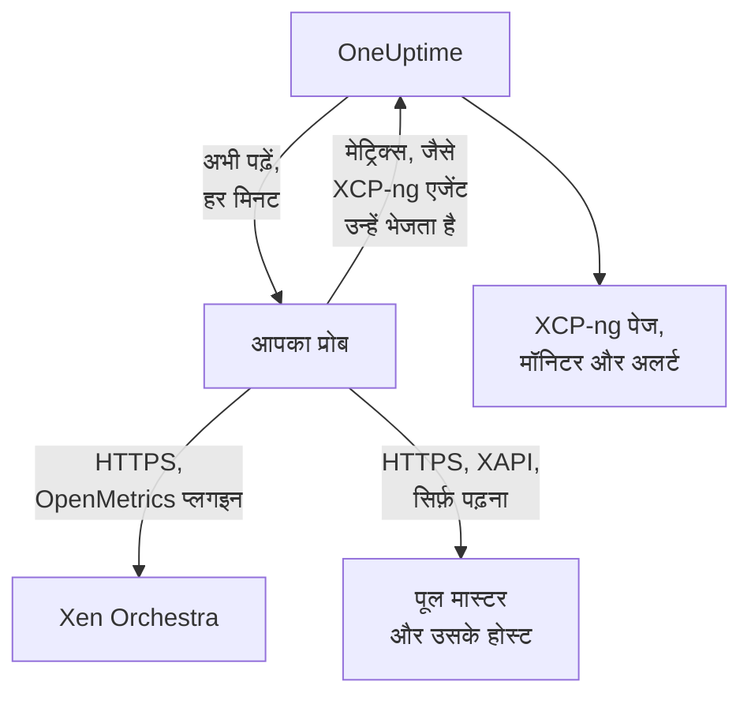

# एजेंट के बिना XCP-ng

कुछ भी इंस्टॉल किए बिना XCP-ng पूल की निगरानी करें: एक OneUptime प्रोब उन्हें पढ़ता है, या तो उन्हें संभालने वाले Xen Orchestra के ज़रिए, या बिना Xen Orchestra वाले पूल के लिए सीधे पूल के मास्टर पर XAPI से। हर पूल को वही पेज, [XCP-ng मॉनिटर](/docs/monitor/xcp-ng-monitor) और टेम्पलेट मिलते हैं जो [XCP-ng एजेंट](/docs/telemetry/xcp-ng) के भेजे पूल को मिलते हैं। इंस्टॉल करने, अपग्रेड करने या चालू रखने के लिए कोई एजेंट नहीं है।

:::cards
- [शुरू करने से पहले](#शुरू-करने-से-पहले): Xen Orchestra या पूल तक पहुँचने वाला प्रोब, और केवल पढ़ने की पहुँच।
- [Xen Orchestra कनेक्ट करें](#xen-orchestra-कनेक्ट-करें): जिन पूल को वह संभालता है, वे सब एक कनेक्शन से।
- [बिना Xen Orchestra वाला पूल कनेक्ट करें](#बिना-xen-orchestra-वाला-पूल-कनेक्ट-करें): एक पूल, उसके मास्टर से पढ़ा गया।
- [समस्या निवारण](#समस्या-निवारण): हर संदेश का मतलब और उसे क्या ठीक करता है।
:::

## यह कैसे काम करता है

हर मिनट प्रोब हर कनेक्शन को पढ़ता है और जो पढ़ा वह OneUptime को भेजता है:

- **Xen Orchestra**: प्रोब प्लगइन के रहस्य से Xen Orchestra का OpenMetrics प्लगइन पढ़ता है, ठीक वैसे ही जैसे XCP-ng एजेंट पढ़ता है, इसलिए Xen Orchestra का संभाला हर पूल उन्हीं सीरीज़ के साथ आता है।
- **किसी पूल का XAPI**: प्रोब पूल मास्टर में लॉग इन करता है और वही रीड करता है जो Xen Orchestra का प्लगइन खुद करता है: पूल के रिकॉर्ड, और हर चालू होस्ट के मेट्रिक्स, उसी होस्ट से पढ़े गए। वह उन्हें उन्हीं सीरीज़ में बदलता है जो प्लगइन देता है, इसलिए पूल ठीक वैसे ही पढ़ा जाता है जैसे Xen Orchestra के ज़रिए। वह पूल के XAPI संदेश भी, जैसे क्रैश हुआ VM या HA द्वारा खोया गया होस्ट, पूल की फ़ीड पर डालता है।

एजेंट के पूल की तरह, हर पूल अपनी पहली रीड पर अपने UUID से रजिस्टर होता है, और **XCP-ng → सभी पूल** में दिखता है।

## कनेक्ट करने का कौन-सा तरीका

| | प्रोब से Xen Orchestra | प्रोब से पूल का XAPI | XCP-ng एजेंट |
|---|---|---|---|
| आप क्या चलाते हैं | पहले से चल रहा प्रोब, या नया प्रोब | पहले से चल रहा प्रोब, या नया प्रोब | एजेंट, अपनी अलग मशीन पर |
| यह क्या पढ़ता है | हर वह पूल जिसे Xen Orchestra संभालता है | एक पूल | हर वह पूल जिसे Xen Orchestra संभालता है |
| इसे क्या चाहिए | OpenMetrics प्लगइन का रहस्य, और वैकल्पिक केवल पढ़ने वाला API टोकन | पूल का खाता: root, या read-only भूमिका वाला Active Directory उपयोगकर्ता | OpenMetrics प्लगइन का रहस्य |
| रहस्य कहाँ रखे जाते हैं | OneUptime में एन्क्रिप्टेड, सिर्फ़ प्रोब को भेजे जाते हैं | OneUptime में एन्क्रिप्टेड, सिर्फ़ प्रोब को भेजे जाते हैं | एजेंट की `.env` फ़ाइल में |
| पूल की फ़ीड पर XAPI संदेश | शामिल नहीं | शामिल | शामिल नहीं |

तीनों एक जैसी सीरीज़ भेजते हैं। एक समय में एक पूल को इनमें से एक ही पढ़ता है, ताकि कोई भी पढ़े, उसका इतिहास एक ही रेखा बना रहे।

## शुरू करने से पहले

- **ऐसा प्रोब जो TCP 443 पर पते तक पहुँचता हो।** आम तौर पर यह उसी नेटवर्क का [कस्टम प्रोब](/docs/probe/custom-probe) होता है। OneUptime Cloud पर साझा प्रोब को कभी XCP-ng रहस्य नहीं मिलते, इसलिए अपना प्रोब जोड़ें। सेल्फ़-होस्टेड इंस्टेंस पर इंस्टेंस के अपने प्रोब भी पढ़ सकते हैं।
- **Xen Orchestra के लिए:** OpenMetrics प्लगइन चालू वाला Xen Orchestra 6.9 या बाद का संस्करण: [OpenMetrics प्लगइन चालू करें](/docs/telemetry/xcp-ng#openmetrics-प्लगइन-चालू-करें) का पालन करें और उसका रहस्य कॉपी करें। वैकल्पिक रूप से, बिल्ट-इन **Read only** भूमिका वाले Xen Orchestra उपयोगकर्ता का API टोकन: OneUptime जाँचता है कि वह सिर्फ़ पढ़ता है, और उसके समाप्त होने से पहले आपको चेतावनी देता है।
- **बिना Xen Orchestra वाले पूल के लिए:** XCP-ng 8.2 या बाद का संस्करण, और उसके मास्टर का पता। XAPI की भूमिकाएँ सिर्फ़ Active Directory उपयोगकर्ताओं पर लागू होती हैं, इसलिए उसका एकमात्र स्थानीय खाता, `root`, पूल में सब कुछ बदल सकता है। केवल पढ़ने की पहुँच के लिए, पूल को Active Directory से जोड़ें और किसी उपयोगकर्ता को `read-only` भूमिका दें।

> [!IMPORTANT]
> पूल को Xen Orchestra के ज़रिए या उसके XAPI के ज़रिए कनेक्ट करें, दोनों से नहीं: किसी पूल को पढ़ने वाला दूसरा कनेक्शन उसे पहले वाले पर छोड़ देता है।

## Xen Orchestra कनेक्ट करें

:::steps
### कनेक्शन खोलें
OneUptime में **XCP-ng → कनेक्शन** खोलें और **XCP-ng कनेक्ट करें** पर क्लिक करें।

### Xen Orchestra चुनें
**क्या पढ़ना है** में **Xen Orchestra** चुनें। **Xen Orchestra का पता** दर्ज करें, वह पता जिस पर आप इसे ब्राउज़र में खोलते हैं, जैसे `https://xo.example.com`, और वह प्रोब चुनें जो उस तक पहुँचता है।

### प्लगइन का रहस्य दर्ज करें
**OpenMetrics रहस्य** पेस्ट करें। अगर आपके पास केवल पढ़ने वाले उपयोगकर्ता का **API टोकन** है, तो उसे भी जोड़ें।

### कनेक्शन का परीक्षण करें और प्रमाणपत्र पर भरोसा करें
**कनेक्शन का परीक्षण करें** पर क्लिक करें। Xen Orchestra अपना प्रमाणपत्र खुद साइन करता है, इसलिए परीक्षण उसे दिखाता है: उसका फ़िंगरप्रिंट जाँचें, फिर **इस प्रमाणपत्र पर भरोसा करें** पर क्लिक करें। नतीजे में Xen Orchestra के दिए पूल, उनके होस्ट, VM और स्टोरेज रिपॉजिटरी के साथ दिखते हैं।

### नाम दें और कनेक्ट करें
नाम डिफ़ॉल्ट रूप से Xen Orchestra का होस्ट नाम होता है, और उसका पढ़ा हर पूल इसे दिखाता है। **XCP-ng कनेक्ट करें** पर क्लिक करें, और कनेक्शन का पेज खुल जाता है।
:::

## बिना Xen Orchestra वाला पूल कनेक्ट करें

:::steps
### कनेक्शन से शुरू करें
OneUptime में **XCP-ng → कनेक्शन** खोलें और **XCP-ng कनेक्ट करें** पर क्लिक करें।

### पूल चुनें
**क्या पढ़ना है** में **Xen Orchestra के बिना पूल** चुनें। **पूल मास्टर का पता** दर्ज करें, जैसे `https://10.0.0.10`, और वह प्रोब चुनें जो उस तक पहुँचता है।

### खाता दर्ज करें
**उपयोगकर्ता नाम** और **पासवर्ड** दर्ज करें: `root`, या read-only भूमिका वाला Active Directory उपयोगकर्ता, अपने डोमेन के साथ लिखा हुआ, जैसे `EXAMPLE\oneuptime`।

### कनेक्शन का परीक्षण करें और मास्टर के प्रमाणपत्र पर भरोसा करें
**कनेक्शन का परीक्षण करें** पर क्लिक करें। हर XCP-ng होस्ट अपना प्रमाणपत्र खुद साइन करता है, इसलिए परीक्षण मास्टर का प्रमाणपत्र दिखाता है: उसका फ़िंगरप्रिंट जाँचें, फिर **इस प्रमाणपत्र पर भरोसा करें** पर क्लिक करें। नतीजा बताता है कि मास्टर कौन-सा XCP-ng चलाता है और खाता क्या पढ़ सकता है, और खाता पूल बदल सकता हो तो आपको चेतावनी देता है।

### पूल को नाम दें और कनेक्ट करें
**XCP-ng कनेक्ट करें** पर क्लिक करें, और कनेक्शन का पेज खुल जाता है।
:::

कनेक्शन का पेज दिखाता है कि उसका पढ़ना कहाँ तक पहुँचा। एक मिनट के भीतर शुरू होने वाली पहली रीड तक यह **जाँच हो रही है** दिखाता है, फिर **इकट्ठा हो रहा है**, और यह जो पूल पढ़ता है वे **यह जो पूल पढ़ता है** में दिखते हैं।

अगर 20 मिनट तक कोई प्रोब कनेक्शन के लिए नहीं आता, क्योंकि वह ऑफ़लाइन है या बहुत पुराना है, तो पेज **इकट्ठा नहीं हो रहा** दिखाता है और यह बताता है। जब कोई प्रोब कनेक्शन नहीं पढ़ सकता, तो यह तुरंत **इकट्ठा नहीं हो रहा** दिखाता है और बताता है कि क्या बदलना है: कोई रहस्य, उपयोगकर्ता नाम या पासवर्ड नहीं है, इसे पढ़ने के लिए कोई प्रोब सेट नहीं है, इसका प्रोब इसे नहीं पढ़ सकता (OneUptime Cloud का साझा प्रोब, या किसी दूसरे प्रोजेक्ट का), या इसके प्रोब का कनेक्शन टूटा है।

## वे पूल जिन्हें एजेंट पहले से भेजता है

XCP-ng एजेंट का रजिस्टर किया पूल उसे पढ़ने वाला पहला कनेक्शन ले लेता है: उसका इतिहास एक रेखा के रूप में आगे चलता है, और पूल की फ़ीड बताती है कि एजेंट रोका जा सकता है।

> [!WARNING]
> जैसे ही कोई प्रोब इसके पूल पढ़ने लगे, XCP-ng एजेंट रोक दें। जब तक दोनों चलते हैं, हर मेट्रिक दो बार आता है।

वापस जाने के लिए, पूल का **सेटिंग्स** पेज खोलें। उसका **डेटा संग्रह** कार्ड, प्रोब के पढ़े पूल के लिए **XCP-ng एजेंट इस्तेमाल करें**, और एजेंट के भेजे पूल के लिए **प्रोब से इकट्ठा करें** देता है। एजेंट पर वापस किया गया पूल उसी के पास रहता है, कनेक्शन चाहे कुछ भी पढ़े।

## प्रमाणपत्र

प्रोब कभी प्रमाणपत्र की जाँच नहीं छोड़ता। हर कनेक्शन पूरा TLS हैंडशेक करता है, और फिर:

- अगर कोई भरोसेमंद प्रमाणपत्र नहीं है, तो प्रमाणपत्र आपके दर्ज पते के लिए ऐसे प्राधिकरण से आना चाहिए जिस पर प्रोब की मशीन भरोसा करती है;
- अगर कोई भरोसेमंद प्रमाणपत्र है, तो पते को ठीक वही प्रमाणपत्र दिखाना होगा, जिसे उसके SHA-256 फ़िंगरप्रिंट से पहचाना जाता है, चाहे प्रमाणपत्र पर कोई भी नाम हो। Xen Orchestra का अपना प्रमाणपत्र कोई पता नहीं बताता, और इसी तरह उस पर भरोसा किया जाता है।

फ़िंगरप्रिंट जाँचने के लिए, प्रोब की मशीन से `openssl s_client -connect xo.example.com:443 </dev/null | openssl x509 -noout -fingerprint -sha256` चलाएँ, और इसे खुद प्रमाणपत्र से मिलाएँ: पूल मास्टर पर `openssl x509 -noout -fingerprint -sha256 -in /etc/xensource/xapi-ssl.pem`।

पूल के लिए, आप मास्टर के प्रमाणपत्र पर भरोसा करते हैं। पूल खुद बताता है कि उसका हर होस्ट कौन-सा प्रमाणपत्र देता है, और प्रोब हर दूसरे होस्ट को उसी प्रमाणपत्र से बाँधकर पढ़ता है। जब कोई दूसरा होस्ट मास्टर बनता है, तो प्रोब सिर्फ़ ऐसे होस्ट तक जाता है जिसकी पूल ने अपनी पिछली रीड में पुष्टि की थी। जब कोई प्रमाणपत्र बदलता है, तो पढ़ना **प्रमाणपत्र बदल गया** के साथ रुक जाता है और नया प्रमाणपत्र दिखता है: जब तक आप कनेक्शन के पेज पर उस पर भरोसा नहीं करते, कुछ नहीं भेजा जाता।

## सहेजे गए रहस्य

रहस्य, टोकन और पासवर्ड एन्क्रिप्टेड और सिर्फ़ लिखने लायक हैं: कोई उन्हें वापस नहीं पढ़ सकता, और API उन्हें कभी नहीं लौटाता। वे सिर्फ़ उस प्रोब को भेजे जाते हैं जो कनेक्शन पढ़ता है, और वह उन्हें मेमोरी में रखता है।

सहेजा गया रहस्य सिर्फ़ उसी पते पर, उसी प्रोब के ज़रिए और उसी प्रमाणपत्र को भेजा जाता है जिनके लिए उसे दर्ज किया गया था। **कनेक्शन संपादित करें** में पता, प्रोब या भरोसेमंद प्रमाणपत्र बदलने पर उसे फिर से दर्ज करना होता है, ताकि कनेक्शन संपादित कर सकने वाला कोई भी उसे कहीं और न भेज सके, और फिर से दर्ज न किया गया सहेजा API टोकन भुला दिया जाता है। सहेजे पते पर प्रोब को मिले प्रमाणपत्र पर भरोसा करने से वे बने रहते हैं। **API टोकन हटाएँ** टोकन को OneUptime से हटा देता है: उसे Xen Orchestra में भी रद्द करें।

## API टोकन

API टोकन वैकल्पिक है: मेट्रिक्स प्लगइन के रहस्य के ज़रिए आते हैं। टोकन होने पर, हर रीड उसे घंटे में ज़्यादा से ज़्यादा एक बार जाँचती है:

- **यह सिर्फ़ पढ़ता है।** जिस टोकन का उपयोगकर्ता व्यवस्थापक है, या जिसकी भूमिका कुछ भी बदल सकती है, वह परीक्षण में विफल होता है और कनेक्शन के पेज पर समस्या के रूप में दिखता है। OneUptime सिर्फ़ केवल पढ़ने वाले टोकन रखता है।
- **यह वह पढ़ता है जो OneUptime को चाहिए।** जिस सूची को उपयोगकर्ता नहीं पढ़ सकता, उसके जवाब में Xen Orchestra खाली सूची देता है, इसलिए टोकन को अलार्म, संदेश और बैकअप लॉग पढ़ने होंगे। बिल्ट-इन **Read only** भूमिका तीनों पढ़ती है।
- **यह कब समाप्त होता है।** Xen Orchestra टोकन को उसी पल भूल जाता है जब वह समाप्त होता है। दो हफ़्ते पहले, कनेक्शन का पेज और उसके पढ़े हर पूल की फ़ीड यह बताते हैं। उसी उपयोगकर्ता के लिए नया टोकन बनाएँ और उसे **कनेक्शन संपादित करें** में दर्ज करें।

## संदर्भ

| सेटिंग | डिफ़ॉल्ट | टिप्पणियाँ |
|---|---|---|
| हर बार पढ़ें | 1 मिनट | 1 से 60 मिनट। हर मिनट XCP-ng एजेंट से मेल खाता है; बड़े Xen Orchestra पर बोझ कम करने के लिए उसे कम बार पढ़ें। |
| एक साथ रीड | हर प्रोब पर 4 | अपने अंतराल से धीमी रीड छोड़ दी जाती है, कभी जमा नहीं होती। |
| सबसे बड़ी रीड | लगभग 48 MiB | बड़े Xen Orchestra के लिए XCP-ng एजेंट चाहिए। |
| XAPI संदेश | हर रीड में 200 | पूल कनेक्ट होने के पल से, हर एक एक बार पहुँचाया जाता है, सबसे पुराना पहले। |
| कनेक्शन परीक्षण | शुरू होने के लिए 90 सेकंड | जिस परीक्षण को समय पर कोई प्रोब नहीं उठाता, या जो 150 सेकंड से ज़्यादा चलता है, उसे विफल माना जाता है। |

## समस्या निवारण

:::details प्रमाणपत्र भरोसेमंद नहीं है
Xen Orchestra और XCP-ng होस्ट डिफ़ॉल्ट रूप से अपने प्रमाणपत्र खुद साइन करते हैं। दिखाए गए फ़िंगरप्रिंट को प्रमाणपत्र से मिलाएँ, फिर **इस प्रमाणपत्र पर भरोसा करें** पर क्लिक करें।
:::

:::details प्रमाणपत्र बदल गया
जब तक आप नए प्रमाणपत्र पर भरोसा नहीं करते, कुछ नहीं भेजा जाता। अगर आपने इसे नवीनीकृत किया है, तो नया फ़िंगरप्रिंट जाँचें, उस पर भरोसा करें, और **कनेक्शन संपादित करें** में रहस्य फिर से दर्ज करें।
:::

:::details Xen Orchestra ने रहस्य अस्वीकार कर दिया
Xen Orchestra में **Settings → Plugins → openmetrics** से रहस्य फिर से कॉपी करें, और उसे **कनेक्शन संपादित करें** में दर्ज करें।
:::

:::details OpenMetrics प्लगइन जवाब नहीं देता
Xen Orchestra में **Settings → Plugins** के तहत **openmetrics** लोड करें, और **Auto-load** चालू करें ताकि रीस्टार्ट के बाद यह लौट आए।
:::

:::details इस Xen Orchestra में OpenMetrics प्लगइन नहीं है
प्लगइन के लिए Xen Orchestra 6.9 या बाद का संस्करण, और Xen Orchestra Appliance पर Premium लाइसेंस चाहिए। उसके बिना, हर पूल को इसके बजाय उसके XAPI से कनेक्ट करें।
:::

:::details कोई पूल कनेक्ट नहीं है
Xen Orchestra कोई कनेक्टेड पूल नहीं बताता। Xen Orchestra में अपने पूल जोड़ें या फिर से कनेक्ट करें, फिर दोबारा परीक्षण करें।
:::

:::details API टोकन Xen Orchestra को बदल सकता है
OneUptime सिर्फ़ केवल पढ़ने वाले टोकन रखता है। ऐसे उपयोगकर्ता के लिए टोकन बनाएँ जिसके पास बिल्ट-इन **Read only** भूमिका की प्रति हो, और कोई दूसरी भूमिका न हो।
:::

:::details API टोकन अलार्म, संदेश या बैकअप नहीं पढ़ सकता
टोकन के उपयोगकर्ता को Xen Orchestra की बिल्ट-इन **Read only** भूमिका की प्रति दें, जो तीनों पढ़ती है।
:::

:::details API टोकन समाप्त हो गया
Xen Orchestra में केवल पढ़ने वाले उपयोगकर्ता के लिए नया टोकन बनाएँ, और उसे **कनेक्शन संपादित करें** में दर्ज करें। इस बीच मेट्रिक्स आते रहते हैं।
:::

:::details XAPI ने लॉग इन अस्वीकार कर दिया
उपयोगकर्ता नाम और पासवर्ड जाँचें। Active Directory उपयोगकर्ता अपने डोमेन के साथ लिखा जाता है, जैसे `EXAMPLE\oneuptime`।
:::

:::details यह होस्ट पूल मास्टर नहीं है
पूल का कोई सदस्य अपने मास्टर के पते के साथ जवाब देता है, जो संदेश में दिया होता है। वह पता दर्ज करें, और फिर से परीक्षण करें।
:::

:::details खाता पूल नहीं पढ़ सकता
Active Directory उपयोगकर्ता को पूल पर read-only भूमिका दें, या ऐसा खाता इस्तेमाल करें जिसके पास यह हो।
:::

:::details प्रोब को कोई जवाब नहीं मिलता
प्रोब का नेटवर्क TCP 443 पर पते तक नहीं पहुँच सकता। फ़ायरवॉल में इसकी अनुमति दें, या उसी नेटवर्क का कोई प्रोब चुनें।
:::

:::details प्रोब ने इसे नहीं उठाया
प्रोब ऑफ़लाइन है, या XCP-ng रीड से पुराना OneUptime संस्करण चलाता है। **कस्टम प्रोब** तालिका में जाँचें कि वह कनेक्ट है, और उसे अपडेट करें।
:::

:::details यह कनेक्शन प्रोब से पढ़ने के लिए बहुत बड़ा है
इसके मेट्रिक्स प्रोब के एक अपलोड की सीमा से बड़े हैं। इसके लिए [XCP-ng एजेंट](/docs/telemetry/xcp-ng) इस्तेमाल करें।
:::

## आगे के कदम

:::cards
- [XCP-ng मॉनिटर](/docs/monitor/xcp-ng-monitor): पूल, होस्ट, VM और स्टोरेज रिपॉजिटरी पर अलर्ट करें।
- [कस्टम प्रोब](/docs/probe/custom-probe): पूल के नेटवर्क में प्रोब चलाएँ।
- [XCP-ng एजेंट](/docs/telemetry/xcp-ng): इसके बजाय एजेंट से Xen Orchestra पढ़ें।
:::
