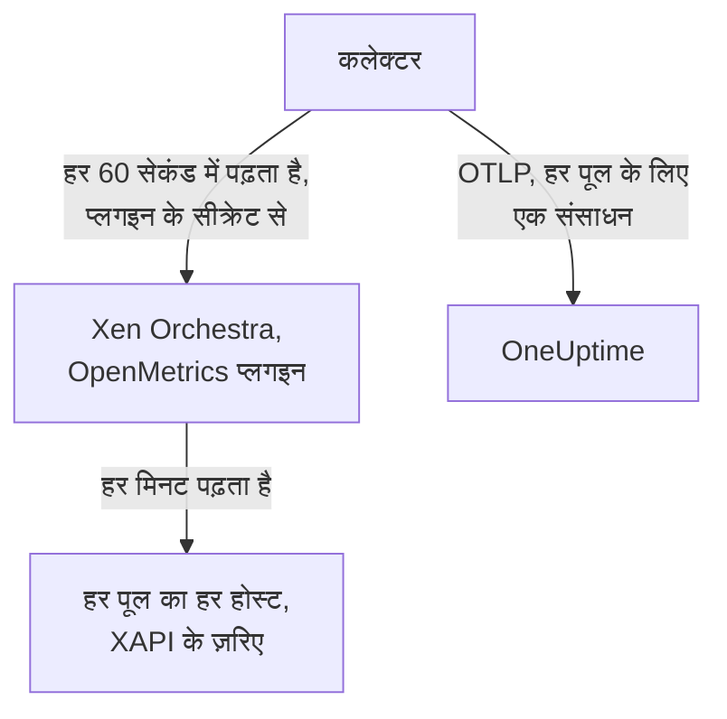

# XCP-ng एजेंट

OneUptime का XCP-ng एजेंट उन XCP-ng पूल की निगरानी करता है जिन्हें एक Xen Orchestra प्रबंधित करता है: उनके होस्ट, VM, स्टोरेज रिपॉजिटरी और वर्चुअल डिस्क। यह एक मानक OpenTelemetry Collector है जो प्लगइन के सीक्रेट से Xen Orchestra के अपने OpenMetrics प्लगइन को पढ़ता है और जो पढ़ता है उसे OneUptime को भेजता है, जहाँ हर पूल अपनी इन्वेंटरी के साथ दिखता है। किसी पूल या Xen Orchestra का कोई पासवर्ड कभी एजेंट तक नहीं पहुँचता। [XCP-ng मॉनिटर](/docs/monitor/xcp-ng-monitor) आने वाले डेटा पर अलर्ट करते हैं।

:::cards
- [एजेंट इंस्टॉल करें](#एजेंट-इंस्टॉल-करें): प्लगइन चालू करें, फिर इंस्टॉल स्क्रिप्ट या Docker Compose का उपयोग करें।
- [Xen Orchestra का सर्टिफ़िकेट](#xen-orchestra-का-सर्टिफ़िकेट): एजेंट Xen Orchestra पर कैसे भरोसा करता है, जाँच को कभी छोड़े बिना।
- [एजेंट क्या इकट्ठा करता है](#एजेंट-क्या-इकट्ठा-करता-है): प्लगइन की हर सीरीज़, और वे काउंटर जो असल में दरें हैं।
- [समस्या निवारण](#समस्या-निवारण): एक डायग्नोस्टिक स्क्रिप्ट, और आम समस्याएँ।
:::

## आपको क्या मिलता है

- **हर पूल अलग से।** Xen Orchestra जिस भी पूल को प्रबंधित करता है, वह OneUptime में एक XCP-ng पूल बनता है, जिसे उसके XAPI UUID से पहचाना जाता है और वही नाम दिया जाता है जो Xen Orchestra देता है। एक Xen Orchestra के पीछे के दो पूल दो पूल हैं, और OneUptime में पूल का नाम बदलना सुरक्षित है: टेलीमेट्री उसके UUID से जुड़ती है।
- **उसकी इन्वेंटरी।** पूल के होस्ट, VM, स्टोरेज रिपॉजिटरी और वर्चुअल डिस्क, उनकी स्थिति और उनके मेट्रिक्स के साथ। कंट्रोल डोमेन (dom0) VM के रूप में रिपोर्ट होते हैं, और पूल के पेज उन्हें तब तक छिपाते हैं जब तक आप उन्हें दिखाने को न कहें।
- **हर Xen Orchestra के लिए एक एजेंट।** प्लगइन हर वह पूल देता है जिससे उसका Xen Orchestra जुड़ा है, इसलिए एक एजेंट उन सबको पढ़ता है, और बाद में जुड़ा पूल अगली रीडिंग में दिखता है।

## यह कैसे काम करता है

एजेंट एक कंटेनर है जिसे आप एक मशीन पर Docker Compose से चलाते हैं: एक मानक OpenTelemetry Collector, जिसमें OneUptime की अपनी कोई इमेज नहीं है। हर 60 सेकंड में यह Xen Orchestra से `/openmetrics/metrics` माँगता है, प्लगइन के सीक्रेट को Bearer टोकन के रूप में भेजकर, Xen Orchestra के अपने पते और सर्टिफ़िकेट पर। प्लगइन XAPI के ज़रिए हर होस्ट के मेट्रिक्स 60 सेकंड के रिज़ॉल्यूशन पर पढ़ता है। कलेक्टर पूल की सीरीज़ रखता है, उन्हें पूल के हिसाब से समूहित करता है और OTLP पर OneUptime को भेजता है।



हर पूल अपने पहले डेटा के साथ खुद को पंजीकृत करता है, उस UUID के तहत जिसे एजेंट उसकी सीरीज़ पर `xcp_ng.pool.id` के रूप में लगाता है, और उस नाम के साथ जो Xen Orchestra उसे देता है, `xcp_ng.pool.name`। Xen Orchestra में बिना नाम वाले पूल का नाम "Pool" और उसके UUID की शुरुआत होता है, जब तक आप उसका नाम न बदलें।

## शुरू करने से पहले

- Xen Orchestra 6.9 या बाद का, उन पूल से जुड़ा जिनकी आप निगरानी करना चाहते हैं, अपने OpenMetrics प्लगइन के साथ। Xen Orchestra Appliance (XOA) पर प्लगइन को Premium लाइसेंस चाहिए; सोर्स से बना Xen Orchestra इसे शामिल करता है।
- Docker Compose v2 प्लगइन के साथ Docker Engine 20.10 या बाद का, `curl` और `openssl`, ऐसी मशीन पर जो HTTPS पर Xen Orchestra तक पहुँचती है।
- Xen Orchestra पर एक सर्टिफ़िकेट जो उस पते का नाम लेता है जिससे एजेंट जुड़ता है। Xen Orchestra अपने लिए जो सेल्फ़-साइन्ड सर्टिफ़िकेट बनाता है वह किसी का नाम नहीं लेता, इसलिए कोई भी मौजूदा TLS क्लाइंट उसे जाँच नहीं सकता, और सोर्स से बना Xen Orchestra तब तक सादा HTTP देता है जब तक आप उसे सर्टिफ़िकेट न दें: देखें [Xen Orchestra का सर्टिफ़िकेट](#xen-orchestra-का-सर्टिफ़िकेट)।
- एक इंजेशन कुंजी। **प्रोजेक्ट सेटिंग्स → टेलीमेट्री और APM → इंजेशन कुंजियाँ** के अंतर्गत एक बनाएँ और उसका मान कॉपी करें।
- उस मशीन से आपके OneUptime URL तक आउटबाउंड HTTPS।

### समर्थित संस्करण

| | समर्थित | क्यों |
| --- | --- | --- |
| Xen Orchestra | 6.9 या बाद का, OpenMetrics प्लगइन `xo-server-openmetrics` 1.9 के साथ | प्लगइन Xen Orchestra के रीस्टार्ट होने पर भी अपना सीक्रेट रखता है, पढ़ने के दौरान मेमोरी लीक के सुधार शामिल करता है और वह हर सीरीज़ देता है जिसे पूल के पेज पढ़ते हैं: होस्ट और VM की स्थिति, स्टोरेज रिपॉजिटरी और वर्चुअल डिस्क। पुराना प्लगइन रीस्टार्ट पर नया सीक्रेट बना सकता था, जिससे एजेंट तब तक बाहर रहता जब तक कोई उसे फिर से कॉपी न करे। |
| XCP-ng | 8.3 LTS | Vates इसे 30 नवंबर 2028 तक सपोर्ट करता है। XCP-ng 8.2 का जीवनकाल 16 सितंबर 2025 को समाप्त हो गया। |
| XenServer | अभी आज़माया नहीं गया | Xen Orchestra अपने प्रबंधित XenServer पूल को उन्हीं सीरीज़ के साथ रिपोर्ट करता है, इसलिए यह काम करना चाहिए, पर अभी तक किसी ने इसे OneUptime के साथ नहीं आज़माया है। |

### एजेंट कहाँ चलाएँ

एजेंट HTTPS पर Xen Orchestra से बात करता है, इसलिए यह Docker वाली और वहाँ तक रास्ते वाली किसी भी मशीन पर चल सकता है: Xen Orchestra की अपनी मशीन, कोई मॉनिटरिंग होस्ट या कोई छोटा प्रबंधन VM। ऐसी मशीन चुनना बेहतर है जिसका VM निगरानी वाले पूल पर न चलता हो: जब कोई पूल डाउन हो, तो आपकी निगरानी उसके साथ डाउन नहीं होनी चाहिए। एक एजेंट एक Xen Orchestra पढ़ता है; कई के लिए देखें [कई Xen Orchestra पढ़ना](#कई-xen-orchestra-पढ़ना)।

## OpenMetrics प्लगइन चालू करें

एजेंट हर पूल को Xen Orchestra के OpenMetrics प्लगइन के ज़रिए, प्लगइन के सीक्रेट से पढ़ता है।

:::steps
### प्लगइन चालू करें

Xen Orchestra में *Settings → Plugins* खोलें, **openmetrics** ढूँढें और उसे चालू करें। पहली बार शुरू होने पर यह एक सीक्रेट बनाता है, और Xen Orchestra उसे रीस्टार्ट के बीच बनाए रखता है।

### उसका सीक्रेट कॉपी करें

प्लगइन की सेटिंग्स खोलें और उसका **Prometheus secret** कॉपी करें: आप इसे अगले चरण में एजेंट को देंगे। आप वहाँ अपना खुद का सीक्रेट भी टाइप करके सहेज सकते हैं। इसे निजी रखें: जिसके पास यह है वह हर पूल के मेट्रिक्स पढ़ सकता है।

### जाँचें कि यह जवाब देता है

प्लगइन Xen Orchestra के अपने पते पर और उसके अपने सर्टिफ़िकेट के साथ `/openmetrics/metrics` पर जवाब देता है, और केवल उस अनुरोध का जो उसका सीक्रेट भेजता है। उसकी स्वास्थ्य जाँच को सीक्रेट नहीं चाहिए, इसलिए केवल यह एक अनुरोध `-k` से सर्टिफ़िकेट जाँच छोड़ सकता है; एजेंट ऐसा कभी नहीं करता:

```bash
curl -k https://xo.example.com/openmetrics/health
```

जब तक प्लगइन चल रहा है, यह `{"status":"ok"}` लौटाता है। `404` का मतलब है कि प्लगइन चालू नहीं है।
:::

## एजेंट इंस्टॉल करें

:::steps
### एजेंट इंस्टॉल करें और शुरू करें

हर OneUptime अपनी रिलीज़ की एजेंट इंस्टॉल स्क्रिप्ट और फ़ाइलें ख़ुद देता है: नीचे दिए कमांड उन्हें `https://oneuptime.com` से डाउनलोड करते हैं, इसलिए सेल्फ़-होस्टेड OneUptime पर इस पते को अपने URL से बदलें। इंस्टॉल स्क्रिप्ट पहले `install.sh` के रूप में सहेजी जाती है, ताकि आप उसे चलाने से पहले पढ़ सकें।

:::tabs
@tab install.sh
इंस्टॉल स्क्रिप्ट डाउनलोड करें और उसे उस मशीन पर चलाएँ जो एजेंट को होस्ट करेगी:

```bash
curl -fsSL https://oneuptime.com/install/xcp-ng-agent -o install.sh
bash install.sh
```

स्क्रिप्ट आपसे आपका OneUptime URL, इंजेशन कुंजी, Xen Orchestra का पता जैसे आप उसे ब्राउज़र में खोलते हैं (जैसे `https://xo.example.com` या `https://10.0.0.5:8443`), प्लगइन का सीक्रेट (टाइप करते समय नहीं दिखता) और यह पूछती है कि OneUptime में इस Xen Orchestra को क्या कहा जाए। फिर यह Xen Orchestra का सर्टिफ़िकेट पढ़ती है: जिस सर्टिफ़िकेट पर यह मशीन पहले से भरोसा करती है उसे उसके CA बंडल से जाँचा जाता है; कोई भी दूसरा उसके SHA-256 फ़िंगरप्रिंट के साथ दिखाया जाता है, और फ़िंगरप्रिंट को Xen Orchestra की मशीन वाले फ़िंगरप्रिंट से मिलाने के बाद आप उस सर्टिफ़िकेट और किसी दूसरे पर नहीं, भरोसा करने के लिए **y** जवाब देते हैं। यह जाँच को कभी बंद नहीं करती। अंत में, कुछ भी इंस्टॉल करने से पहले यह सीक्रेट से प्लगइन से उसके मेट्रिक्स माँगती है और Xen Orchestra द्वारा रिपोर्ट किए गए पूल के नाम बताती है। यह `/opt/oneuptime-xcp-ng-agent` में इंस्टॉल करती है, `0600` अनुमतियों के साथ एक `.env` फ़ाइल और `xo-ca.pem` लिखती है, यानी वे सर्टिफ़िकेट जिन पर एजेंट Xen Orchestra के लिए भरोसा करता है, और Docker Compose से एजेंट शुरू करती है। स्क्रिप्ट फिर से चलाने पर यह दोबारा पूछने के बजाय उस `.env` में सब कुछ फिर से इस्तेमाल करती है; इसी तरह आप [एजेंट अपग्रेड करते हैं](#एजेंट-अपग्रेड-करना)।
@tab Docker Compose
अपने OneUptime से `docker-compose.yml` और `otel-collector-config.yaml` एक नए फ़ोल्डर में डाउनलोड करें:

```bash
mkdir oneuptime-xcp-ng-agent && cd oneuptime-xcp-ng-agent
curl -fsSLO https://oneuptime.com/install/xcp-ng-agent/docker-compose.yml
curl -fsSLO https://oneuptime.com/install/xcp-ng-agent/otel-collector-config.yaml
```

उनके बगल में एक `.env` फ़ाइल बनाएं। इसमें प्लगइन का सीक्रेट होता है, इसलिए `chmod 600 .env` से इसे निजी रखें:

```bash title=".env"
ONEUPTIME_URL=YOUR_ONEUPTIME_URL
ONEUPTIME_TELEMETRY_INGESTION_KEY=YOUR_TELEMETRY_INGESTION_TOKEN
XO_SCHEME=https
XO_ADDRESS=xo.example.com
XO_OPENMETRICS_SECRET='your-plugin-secret'
XO_NAME='Xen Orchestra'
XO_TLS_SERVER_NAME=
```

`XO_ADDRESS` Xen Orchestra का `host` या `host:port` है, बिना `https://` के। प्लगइन के सीक्रेट को सिंगल कोट्स में रखें और उसमें हर `$` को `$$` लिखें: कलेक्टर मान को एक बार और पढ़ता है और `$` को किसी वेरिएबल की शुरुआत समझेगा। जिस सीक्रेट में `'` हो उसे सिंगल कोट्स में नहीं रखा जा सकता: इसे इंस्टॉल स्क्रिप्ट को लिखने दें, या Xen Orchestra में दूसरा सीक्रेट चुनें।

फिर Xen Orchestra का सर्टिफ़िकेट `xo-ca.pem` के रूप में `docker-compose.yml` के बगल में सहेजें: एजेंट Xen Orchestra को इसी फ़ाइल से जाँचता है, किसी और से नहीं। Xen Orchestra के अपने सर्टिफ़िकेट पर भरोसा करने के लिए, उसे पढ़ें और इस्तेमाल से पहले उसका फ़िंगरप्रिंट Xen Orchestra की मशीन वाले फ़िंगरप्रिंट से मिलाएँ:

```bash
openssl s_client -connect xo.example.com:443 -servername xo.example.com </dev/null 2>/dev/null \
  | openssl x509 -out xo-ca.pem
openssl x509 -in xo-ca.pem -noout -fingerprint -sha256
```

अगर सर्टिफ़िकेट आपके अपने CA ने जारी किया है, तो इसके बजाय उस CA का सर्टिफ़िकेट `xo-ca.pem` में कॉपी करें; अगर किसी सार्वजनिक CA ने जारी किया है, तो इस मशीन का CA बंडल कॉपी करें (`cp /etc/ssl/certs/ca-certificates.crt xo-ca.pem`)। एजेंट शुरू करें:

```bash
docker compose up -d
```
:::

### जाँचें कि एजेंट चल रहा है

```bash
docker compose ps
docker logs -f oneuptime-xcp-ng-agent
```

`docker compose ps` कलेक्टर `oneuptime-xcp-ng-agent` दिखाता है। शुरू होने के बाद उसके लॉग में यह पंक्ति दिखनी चाहिए:

```text
Everything is ready. Begin running and processing data.
```

### OneUptime में पूल ढूँढें

**उत्पाद → बुनियादी ढांचा → XCP-ng → सभी पूल** खोलें। Xen Orchestra द्वारा रिपोर्ट किया गया हर पूल पहली रीडिंग के लगभग एक मिनट बाद, उस नाम से जो Xen Orchestra उसे देता है, अपने होस्ट, VM और स्टोरेज के साथ दिखता है। उसका **टोपोलॉजी** पेज उन्हें एक नक्शे के रूप में बनाता है: देखें [टोपोलॉजी](/docs/telemetry/topology#किसी-संसाधन-का-अपना-मैप-खोलें)।
:::

## Xen Orchestra का सर्टिफ़िकेट

एजेंट हर रीडिंग पर Xen Orchestra का सर्टिफ़िकेट जाँचता है, `xo-ca.pem` से और किसी चीज़ से नहीं, और जाँच कभी नहीं छोड़ता: प्लगइन का सीक्रेट हर अनुरोध के साथ जाता है। `xo-ca.pem` में तीन में से एक चीज़ होती है:

- **Xen Orchestra का अपना सर्टिफ़िकेट**, उसके SHA-256 फ़िंगरप्रिंट से पिन किया हुआ (`XO_TLS_FINGERPRINT`): एजेंट उस सर्टिफ़िकेट पर भरोसा करता है और किसी दूसरे पर नहीं।
- **उसे जारी करने वाला CA** (`XO_CA_FILE`), आपके अपने CA के सर्टिफ़िकेट के लिए।
- **इस मशीन का CA बंडल**, ऐसे सर्टिफ़िकेट के लिए जिस पर यह मशीन पहले से भरोसा करती है, जैसे किसी सार्वजनिक CA का।

हर हाल में, सर्टिफ़िकेट को उस पते का नाम लेना चाहिए जिससे एजेंट जुड़ता है। एजेंट उन नामों को जाँचता है जिनके लिए सर्टिफ़िकेट जारी हुआ है, यानी उसके सब्जेक्ट अल्टरनेटिव नेम (subject alternative names), जैसा हर मौजूदा TLS क्लाइंट करता है, और कभी सब्जेक्ट को नहीं। Xen Orchestra अपने लिए जो सेल्फ़-साइन्ड सर्टिफ़िकेट बनाता है वह किसी का नाम नहीं लेता, इसलिए एजेंट उस पर भरोसा नहीं कर सकता, पिन हो या नहीं, और `x509: certificate is not valid for any names` से विफल होता है; इंस्टॉल स्क्रिप्ट ऐसे सर्टिफ़िकेट पर रुक जाती है और कारण बताती है।

### Xen Orchestra को ऐसा सर्टिफ़िकेट दें जो उसके पते का नाम ले

अपने CA या किसी सार्वजनिक CA का सर्टिफ़िकेट इस्तेमाल करें, या Xen Orchestra की मशीन पर एक सेल्फ़-साइन्ड सर्टिफ़िकेट बनाएं जो Xen Orchestra के पते का नाम ले, उसके नाम और पते को सब्जेक्ट अल्टरनेटिव नेम में रखकर:

```bash
sudo mkdir -p /etc/ssl/xo
sudo openssl req -x509 -newkey rsa:2048 -nodes -days 825 \
  -subj "/CN=xo.example.com" \
  -addext "subjectAltName=DNS:xo.example.com,IP:10.0.0.5" \
  -keyout /etc/ssl/xo/key.pem -out /etc/ssl/xo/cert.pem
```

xo-server के HTTPS लिसनर को इन दोनों फ़ाइलों की ओर इंगित करें, जिन्हें वह उपयोगकर्ता पढ़ सके जिसके रूप में xo-server चलता है (डिफ़ॉल्ट रूप से root), एक अलग कॉन्फ़िगरेशन फ़ाइल में: XOA पर `/etc/xo-server/config.httpscert.toml`, या सोर्स से बने Xen Orchestra के लिए xo-server की `config.toml` के बगल में। Xen Orchestra के लिसनर क्रमांकित हैं, और दूसरा, `http.listen.1`, उसका HTTPS लिसनर है:

```toml
[http.listen.1]
port = 443
cert = '/etc/ssl/xo/cert.pem'
key = '/etc/ssl/xo/key.pem'
```

फिर `systemctl restart xo-server` से xo-server को रीस्टार्ट करें, और एजेंट इंस्टॉल करें, या इंस्टॉल स्क्रिप्ट फिर से चलाएँ: यह नया सर्टिफ़िकेट पढ़ती है और जाँचने के लिए उसका फ़िंगरप्रिंट दिखाती है। या Xen Orchestra को खुद Let's Encrypt सर्टिफ़िकेट माँगने दें, जैसा XOA कर सकता है (Xen Orchestra का दस्तावेज़ीकरण देखें): उस पर सार्वजनिक रूप से भरोसा किया जाता है, इसलिए एजेंट को कोई सेटिंग नहीं चाहिए। अगर सर्टिफ़िकेट Xen Orchestra को `XO_ADDRESS` के पते से अलग किसी नाम से बताता है, तो `XO_TLS_SERVER_NAME` को उस नाम पर सेट करें; इंस्टॉल स्क्रिप्ट जब कर सकती है तब इसे सर्टिफ़िकेट से भर देती है।

जब पिन किया हुआ सर्टिफ़िकेट नवीनीकृत होता है, तो एजेंट तब तक Xen Orchestra पढ़ना बंद कर देता है जब तक वह नए पर भरोसा न करे। इंस्टॉल स्क्रिप्ट फिर से चलाएँ: यह नया फ़िंगरप्रिंट दिखाती है और रुक जाती है, कुछ नहीं बदलती। उस फ़िंगरप्रिंट को Xen Orchestra की मशीन पर जाँचें, फिर उसके साथ स्क्रिप्ट एक बार और चलाएँ: `XO_TLS_FINGERPRINT=<new fingerprint> bash install.sh`। Docker Compose से इंस्टॉल किया हो, तो `xo-ca.pem` फिर से लिखें और `docker compose up -d --force-recreate` चलाएँ।

## एनवायरनमेंट वेरिएबल

इंस्टॉल स्क्रिप्ट इन्हें `/opt/oneuptime-xcp-ng-agent/.env` में लिखती है; Docker Compose इंस्टॉलेशन इन्हें `.env` से पढ़ता है, जो `docker-compose.yml` के बगल में है। कोई वेरिएबल बदलने के बाद उस फ़ोल्डर में `docker compose up -d` चलाएँ।

| वेरिएबल | ज़रूरी | विवरण |
| --- | --- | --- |
| `ONEUPTIME_URL` | हाँ | आपका OneUptime URL, जैसे `https://oneuptime.com` या आपका सेल्फ़-होस्टेड इंस्टेंस। अगर इंस्टेंस सिर्फ़ HTTP पर है तो `http://` और उसका पोर्ट उपयोग करें। |
| `ONEUPTIME_TELEMETRY_INGESTION_KEY` | हाँ | **प्रोजेक्ट सेटिंग्स → टेलीमेट्री और APM → इंजेशन कुंजियाँ** से इंजेशन कुंजी। |
| `XO_URL` | इंस्टॉल स्क्रिप्ट | Xen Orchestra का पता जैसे आप उसे ब्राउज़र में खोलते हैं, जैसे `https://xo.example.com` या `https://10.0.0.5:8443`। इंस्टॉल स्क्रिप्ट इससे `XO_SCHEME` और `XO_ADDRESS` निकालती है। |
| `XO_SCHEME` | नहीं | `https`, डिफ़ॉल्ट। `http` केवल लैब में: तब सीक्रेट नेटवर्क पर बिना एन्क्रिप्शन के जाता है। |
| `XO_ADDRESS` | हाँ | Xen Orchestra का `host` या `host:port`, बिना स्कीम के। |
| `XO_OPENMETRICS_SECRET` | हाँ | OpenMetrics प्लगइन का सीक्रेट, Bearer टोकन के रूप में भेजा जाता है। इसमें हर `$` को `$$` लिखा जाता है। |
| `XO_NAME` | नहीं | OneUptime में इस Xen Orchestra का नाम, जिसे यह जिस हर पूल को पढ़ता है उस पर `xen_orchestra.name` के रूप में सेट किया जाता है और हर पूल की **सेटिंग्स** में दिखाया जाता है। डिफ़ॉल्ट रूप से Xen Orchestra का पता। |
| `XO_TLS_FINGERPRINT` | इंस्टॉल स्क्रिप्ट | Xen Orchestra के अपने सर्टिफ़िकेट का SHA-256 फ़िंगरप्रिंट, जैसा `openssl x509 -fingerprint -sha256` उसे दिखाता है, कोलन वैकल्पिक, जब एजेंट उस सर्टिफ़िकेट पर भरोसा करता है और किसी दूसरे पर नहीं। इंस्टॉल स्क्रिप्ट उससे मेल न खाने वाला सर्टिफ़िकेट अस्वीकार करती है। |
| `XO_CA_FILE` | इंस्टॉल स्क्रिप्ट | Xen Orchestra का सर्टिफ़िकेट जारी करने वाला CA बंडल; इंस्टॉल स्क्रिप्ट सर्टिफ़िकेट को उससे जाँचती है और उसे `xo-ca.pem` में कॉपी करती है। |
| `XO_TLS_SERVER_NAME` | नहीं | वह नाम जिससे Xen Orchestra का सर्टिफ़िकेट जाँचा जाता है, जब `XO_ADDRESS` ऐसा पता हो जिसका सर्टिफ़िकेट नाम नहीं लेता। खाली: `XO_ADDRESS` का होस्ट। |

## एजेंट क्या इकट्ठा करता है

हर मिनट एजेंट प्लगइन को पढ़ता है, जो XAPI के ज़रिए हर होस्ट के राउंड-रॉबिन डेटाबेस 60 सेकंड के रिज़ॉल्यूशन पर पढ़ता है। यह `xcp_*` सीरीज़ रखता है और हर सीरीज़ के पूल को उस संसाधन पर ले जाता है जिस पर उन्हें भेजता है, `xcp_ng.pool.id` (पूल का UUID, जो कभी नहीं बदलता) और `xcp_ng.pool.name` के रूप में:

| श्रेणी | सीरीज़ |
| --- | --- |
| पूल | `xcp_pool_connected`, जब तक Xen Orchestra पूल से जुड़ा है तब तक मौजूद |
| होस्ट | `xcp_host_status` (उसकी पावर स्थिति, और क्या वह सक्षम है), `xcp_host_uptime_seconds`, `xcp_host_cpu_average`, `xcp_host_cpu_core_usage`, `xcp_host_load`, `xcp_host_load_average`, `xcp_host_memory_*`, `xcp_host_running_vcpus`, हर फ़िज़िकल इंटरफ़ेस के लिए `xcp_host_network_*`, हर स्टोरेज रिपॉजिटरी के लिए `xcp_host_disk_*`, `xcp_host_power_consumption_watts` |
| VM | `xcp_vm_status`, `xcp_vm_uptime_seconds`, `xcp_vm_cpu_usage`, `xcp_vm_cpu_core_usage`, `xcp_vm_runstate_*` (CPU प्रतिस्पर्धा), `xcp_vm_memory_*`, हर इंटरफ़ेस के लिए `xcp_vm_network_*`, हर डिस्क के लिए `xcp_vm_disk_*`, `xcp_vm_power_consumption_watts` |
| स्टोरेज | `xcp_sr_physical_size_bytes`, `xcp_sr_physical_usage_bytes`, `xcp_sr_virtual_size_bytes`, `xcp_vdi_virtual_size_bytes`, `xcp_vdi_physical_usage_bytes` |
| XOSTOR | `xcp_xostor_*`, XOSTOR चलाने वाले पूल पर |

कंट्रोल डोमेन `is_control_domain="true"` वाले VM के रूप में रिपोर्ट होते हैं। Xen Orchestra की हर सीरीज़ अपना नाम और अपने लेबल रखती है, जैसे `uuid`, `host_name`, `vm_name`, `sr_name` और `tags`; [XCP-ng मॉनिटर](/docs/monitor/xcp-ng-monitor#इकट्ठा-किए-गए-मेट्रिक्स) उन सबका नाम देता है।

### वे काउंटर जो दरें हैं

Xen Orchestra आठ थ्रूपुट सीरीज़ को काउंटर के रूप में टाइप करता है और उन्हें `_total` नाम देता है, जबकि हर एक में XAPI की प्रति सेकंड दर होती है: `xcp_host_network_receive_bytes_total`, `xcp_host_network_transmit_bytes_total`, `xcp_vm_network_receive_bytes_total`, `xcp_vm_network_transmit_bytes_total`, `xcp_vm_network_receive_errors_total`, `xcp_vm_network_transmit_errors_total`, `xcp_vm_disk_read_bytes_total` और `xcp_vm_disk_write_bytes_total`। काउंटर के रूप में पढ़ने पर नेटवर्क और डिस्क थ्रूपुट का हर चार्ट गलत होगा: घटती दर काउंटर रीसेट के रूप में पढ़ी जाती है। एजेंट का `transform/xcp-ng-rates` प्रोसेसर उन्हें बिना बदले नामों और मानों के गेज बना देता है, ताकि OneUptime उन्हें उन दरों के रूप में रखे जो वे हैं, बाइट या त्रुटियाँ प्रति सेकंड में। OneUptime आपके खुद कॉन्फ़िगर किए कलेक्टर से अब भी काउंटर के रूप में आने वाली किसी भी सीरीज़ को भी बदलता है।

### OneUptime क्या जोड़ता है

OneUptime हर पूल का डेटा आते ही उसके लिए चार 0/1 सीरीज़ निकालता है, जिन्हें अलर्ट टेम्पलेट पढ़ते हैं:

| सीरीज़ | 1 जब तक |
| --- | --- |
| `xcp_ng.host.running` | Xen Orchestra होस्ट को Running रिपोर्ट करता है; Halted होने या स्थिति Unknown होने पर 0 |
| `xcp_ng.host.enabled` | होस्ट सक्षम है; रखरखाव मोड में या इवैक्युएशन के दौरान 0, जब XAPI उस पर कोई VM शुरू नहीं करता |
| `xcp_ng.vm.running` | VM Running है; Halted, Paused या Suspended होने पर 0 |
| `xcp_ng.vm.stopped_after_running` | पिछले 24 घंटों में चला कोई VM Halted या Paused है |

यह हर पॉइंट पर `xcp_ng.scope` (`pool`, `host`, `vm`, `sr`, `vdi` या `xostor`) और `xcp_ng.id` (उस ऑब्जेक्ट का UUID) भी लगाता है, जिन पर मॉनिटर और डैशबोर्ड फ़िल्टर करते हैं: देखें [संसाधन पहचान](/docs/monitor/xcp-ng-monitor#संसाधन-पहचान)।

### एजेंट क्या नहीं रखता

- Xen Orchestra की अपनी प्रोसेस सीरीज़ (`xo_*`), जो किसी पूल की नहीं हैं, और कलेक्टर की अपनी रीडिंग सीरीज़।
- होस्ट की पावर जिसे Xen Orchestra IPMI पर पढ़ता है: प्लगइन वह रीडिंग उसके पूल के बिना भेजता है, इसलिए वह भी किसी पूल की नहीं है। हर VM का अनुमानित हिस्सा, `xcp_vm_power_consumption_watts`, रखा जाता है।

## पूल के पेज क्या दिखाते हैं

**उत्पाद → बुनियादी ढांचा → XCP-ng → सभी पूल** से कोई पूल खोलें। उसके मेन्यू में ये हैं:

| पेज | यह क्या दिखाता है |
| --- | --- |
| **अवलोकन** | पूल का स्वास्थ्य और जिस पर ध्यान देने की ज़रूरत है, उसके होस्ट, VM और स्टोरेज, उसके सबसे व्यस्त VM और होस्ट, और वह Xen Orchestra जिससे उसे पढ़ा जाता है, एजेंट के संस्करण के साथ। |
| **होस्ट**, **VM**, **स्टोरेज** | हर होस्ट, VM और स्टोरेज रिपॉजिटरी, हर एक का अपना पेज और चार्ट। **VM** कंट्रोल डोमेन को तब तक छिपाता है जब तक आप दिखाने को न कहें, और स्टोरेज रिपॉजिटरी का पेज उसकी वर्चुअल डिस्क दिखाता है। |
| **टोपोलॉजी** | पूल, उसके होस्ट, हर होस्ट पर VM और वे स्टोरेज रिपॉजिटरी जिनका वे उपयोग करते हैं, एक नक्शे के रूप में। |
| **संसाधन उपयोग** | समय के साथ पूल के होस्ट, VM, स्टोरेज, डिस्क और नेटवर्क के चार्ट, हर होस्ट, VM या स्टोरेज रिपॉजिटरी के लिए एक रेखा। |
| **सुझाव** | चालू करने लायक [अलर्ट टेम्पलेट](/docs/monitor/xcp-ng-monitor#तैयार-अलर्ट-टेम्पलेट), हर एक एक मॉनिटर। |
| **मेट्रिक्स**, **लॉग** | एक्सप्लोरर में पूल की हर सीरीज़, उसी तक सीमित। एजेंट केवल मेट्रिक्स भेजता है, इसलिए **लॉग** केवल वे लॉग दिखाता है जो आप पूल के `xcp_ng.pool.id` के साथ भेजते हैं। |
| **घटनाएं**, **अलर्ट**, **अनुसूचित रखरखाव** | वे जिनमें पूल का नाम है। |
| **फ़ीड** | OneUptime में पूल के साथ क्या हुआ: वह कब जोड़ा, बदला, संग्रहीत या बहाल किया गया, उसके मालिक कौन हैं, और उस पर चले स्वामी और लेबल नियम। |
| **मालिक** | किसे उसके बारे में बताया जाता है, हाथ से या स्वामी नियमों से। |
| **सेटिंग्स** | उसका नाम, वह Xen Orchestra जिससे उसे पढ़ा जाता है, वहाँ उसका नाम और एजेंट का संस्करण, साथ ही उसकी टेलीमेट्री कितने समय तक रखी जाती है। |
| **दस्तावेज़ीकरण** | यह सेटअप, आपके URL और कुंजी पहले से भरे हुए। |

पूल का **अवलोकन** उस आधार पर उसका स्वास्थ्य बताता है जिस पर ध्यान देने की ज़रूरत है, **स्वस्थ**, **प्रदर्शन में गिरावट** या **अस्वस्थ**, और उसे **ध्यान देने की ज़रूरत** के अंतर्गत सबसे ज़रूरी पहले दिखाता है:

- **गंभीर:** Halted होस्ट, या ऐसी स्थिति वाला होस्ट जिसे Xen Orchestra तय नहीं कर सकता (Unknown); 95% से ज़्यादा भरी स्टोरेज रिपॉजिटरी, जहाँ VM अब लिख नहीं सकते।
- **देखने लायक:** अक्षम होस्ट, रखरखाव मोड में या इवैक्युएशन के दौरान; Halted या Paused VM जो पिछले 24 घंटों में चला था; 90% से ज़्यादा भरी स्टोरेज रिपॉजिटरी, जहाँ Storage Repository Near Full अलर्ट ट्रिगर होता है, या थिन प्रोविज़निंग से अपने आकार से ज़्यादा आवंटित।

सस्पेंड किया गया VM (Suspended) जानबूझकर सस्पेंड किया गया है और कभी नहीं गिना जाता, न ही वह VM जिसे किसी ने एक दिन से चलते नहीं देखा, न कोई कंट्रोल डोमेन। ISO लाइब्रेरी और हटाने योग्य मीडिया में VM डिस्क नहीं होतीं, इसलिए पूल के स्टोरेज आँकड़े उन्हें छोड़ देते हैं।

जब Xen Orchestra 15 मिनट तक किसी पूल की रिपोर्ट करना बंद कर देता है, तो पूल **डिस्कनेक्टेड** हो जाता है, और उसके पेज वही रखते हैं जो उसने आख़िरी बार रिपोर्ट किया था। जो होस्ट, VM, स्टोरेज रिपॉजिटरी या वर्चुअल डिस्क अब Xen Orchestra की रिपोर्ट में नहीं दिखती, वह 15 मिनट बाद इन्वेंटरी से हट जाती है; VM को रोकने से वह कभी नहीं हटता।

## पूल को प्रोजेक्ट लेबल से टैग करें

`oneuptime.label.` से शुरू होने वाला संसाधन एट्रिब्यूट एजेंट द्वारा पढ़े जाने वाले हर पूल पर प्रोजेक्ट लेबल बन जाता है: `oneuptime.label.<dimension>=<value>` लेबल `<dimension>:<value>` है। एट्रिब्यूट को `resource` प्रोसेसर में जोड़ें, जो `otel-collector-config.yaml` में है, `oneuptime.agent.version` के बगल में:

```yaml
processors:
  resource:
    attributes:
      # ...existing attributes...
      - key: oneuptime.label.team
        value: platform
        action: upsert
      - key: oneuptime.label.env
        value: production
        action: upsert
```

कलेक्टर अपना कॉन्फ़िगरेशन केवल शुरू होने पर पढ़ता है: `docker compose restart oneuptime-xcp-ng-agent` चलाएँ। तब पूल `team:platform` और `env:production` लेबल दिखाते हैं। लेबल की तुलना केस को अनदेखा करके होती है, इसलिए मौजूदा लेबल `Production` दोहराए जाने के बजाय फिर से इस्तेमाल होता है, और एजेंट OneUptime में किसी के जोड़े गए लेबल को कभी नहीं हटाता। इंस्टॉल स्क्रिप्ट फिर से चलाने पर संपादित `otel-collector-config.yaml` बदल दी जाती है और आपकी फ़ाइल उसके बगल में `otel-collector-config.yaml.bak.<timestamp>` के रूप में रखी जाती है।

## कई Xen Orchestra पढ़ना

एक एजेंट एक Xen Orchestra और उसके प्रबंधित हर पूल को पढ़ता है। उसी मशीन से दूसरा Xen Orchestra पढ़ने के लिए, दूसरा एजेंट उसके अपने फ़ोल्डर में उसकी अपनी `.env` के साथ इंस्टॉल करें, जैसे `INSTALL_DIR=/opt/oneuptime-xcp-ng-agent-lab bash install.sh`, और उसे उसका अपना `container_name` दें, उसकी `docker-compose.yml` में (जैसे `oneuptime-xcp-ng-agent-lab`): दो कंटेनर एक नाम साझा नहीं कर सकते। हर एक को उसका अपना `XO_NAME` दें, ताकि हर पूल की **सेटिंग्स** बताएं कि कौन-सा Xen Orchestra उसे पढ़ता है, और डायग्नोस्टिक स्क्रिप्ट को फ़ोल्डर `-d` से दें।

कभी भी दो एजेंट को एक ही पूल को उन दो Xen Orchestra के ज़रिए न पढ़ने दें जो दोनों उसे प्रबंधित करते हैं: अपने UUID से वह OneUptime में एक पूल है, और उसकी रिपोर्ट दो बार होगी।

## systemd सेवा के रूप में चलाएँ

एजेंट को मशीन के साथ शुरू करने और विफल होने पर फिर से शुरू करने के लिए, उसकी systemd यूनिट इंस्टॉल करें। यह मानती है कि एजेंट `/opt/oneuptime-xcp-ng-agent` में है, जहाँ इंस्टॉल स्क्रिप्ट उसे रखती है:

```bash
sudo curl -fsSL https://oneuptime.com/install/xcp-ng-agent/systemd/oneuptime-xcp-ng-agent.service -o /etc/systemd/system/oneuptime-xcp-ng-agent.service
sudo systemctl daemon-reload
sudo systemctl enable --now oneuptime-xcp-ng-agent
```

## एजेंट अपग्रेड करना

एजेंट वह कलेक्टर संस्करण, जिसे उसकी फ़ाइलें पिन करती हैं, अपने **एजेंट संस्करण** के रूप में हर पूल के **अवलोकन** और **सेटिंग्स** पर रिपोर्ट करता है। जब वह इस OneUptime रिलीज़ द्वारा पिन किए गए संस्करण से पुराना हो, तो उसके बगल में एक चेतावनी चिह्न दिखता है। ये कमांड देखने के लिए उसे चुनें।

कलेक्टर इमेज `docker-compose.yml` में पिन है और उसका कॉन्फ़िगरेशन बगल की एक फ़ाइल है, इसलिए केवल पुल करने से एजेंट आगे नहीं बढ़ता। `install.sh` फिर से चलाएँ: यह आपकी मौजूदा `.env` का हर मान फिर से इस्तेमाल करती है (कुछ भी दोबारा नहीं पूछा जाता), Xen Orchestra का सर्टिफ़िकेट उसी तरह जाँचती है, `docker-compose.yml` और `otel-collector-config.yaml` को नया करती है (आपकी संपादित फ़ाइल `<file>.bak.<timestamp>` के रूप में रखी जाती है), इमेज पुल करती है और एजेंट को फिर से बनाती है, ताकि कलेक्टर अपना नया कॉन्फ़िगरेशन पढ़े। `/opt/oneuptime-xcp-ng-agent` के बाहर इंस्टॉल किए गए एजेंट को उसका फ़ोल्डर चाहिए: `INSTALL_DIR=<folder> bash install.sh`।

```bash
curl -fsSL https://oneuptime.com/install/xcp-ng-agent -o install.sh
bash install.sh
```

इसके बजाय Docker Compose से इंस्टॉल किया था? एजेंट के फ़ोल्डर में दोनों फ़ाइलें फिर से डाउनलोड करें (और उनमें किए अपने बदलाव दोबारा करें), फिर इमेज पुल करें और एजेंट को फिर से बनाएं। आपकी `.env` और `xo-ca.pem` बनी रहती हैं:

```bash
curl -fsSLO https://oneuptime.com/install/xcp-ng-agent/docker-compose.yml
curl -fsSLO https://oneuptime.com/install/xcp-ng-agent/otel-collector-config.yaml
docker compose pull
docker compose up -d --force-recreate
```

## एजेंट अनइंस्टॉल करना

```bash
cd /opt/oneuptime-xcp-ng-agent
docker compose down
```

फिर, अगर कोई और उसे नहीं पढ़ता, तो Xen Orchestra में OpenMetrics प्लगइन बंद करें।

## समस्या निवारण

:::details पहले डायग्नोस्टिक स्क्रिप्ट चलाएँ
एजेंट के साथ एक स्क्रिप्ट आती है, [`troubleshoot.sh`](https://oneuptime.com/install/xcp-ng-agent/troubleshoot.sh), जो पूरी श्रृंखला को उसी क्रम में जाँचती है जिसमें डेटा चलता है: कंटेनर; एजेंट के अपने नेटवर्क से Xen Orchestra का पता; प्लगइन की स्वास्थ्य जाँच; `xo-ca.pem` के विरुद्ध Xen Orchestra का सर्टिफ़िकेट, और क्या पिन किया हुआ सर्टिफ़िकेट अब भी वही है जो वह दिखाता है; प्लगइन का सीक्रेट; Xen Orchestra द्वारा रिपोर्ट किए गए पूल; इंजेशन कुंजी का स्वरूप; कलेक्टर के अपने मेट्रिक्स; और क्या OneUptime इंजेशन कुंजी स्वीकार करता है। आख़िरी जाँच सबसे अहम है। OneUptime गलत कुंजी को `401` से अस्वीकार करता है (अक्षम कुंजी या ब्राउज़र कुंजी के लिए `422`), और कलेक्टर दोनों को स्थायी मानता है: वह बैच हटा देता है और एक ही `Exporting failed` त्रुटि लॉग करता है, जिसे कंटेनर के स्वस्थ रहते हुए चूकना आसान है। स्क्रिप्ट एजेंट के नेटवर्क से `GET <url>/otlp/v1/validate` को कॉल करती है ताकि तुरंत `200` (मान्य) या `401` (अमान्य) मिले, और पुराने सर्वरों पर `POST /fluentd/v1/logs` पर लौटती है। यह सीक्रेट या कुंजी कभी नहीं छापती।

```bash
curl -fsSL https://oneuptime.com/install/xcp-ng-agent/troubleshoot.sh -o troubleshoot.sh
bash troubleshoot.sh    # add -d <dir> if you installed outside /opt/oneuptime-xcp-ng-agent
```

यह सबसे संभावित कारण बताने वाले एक निष्कर्ष के साथ खत्म होती है।
:::

:::details Xen Orchestra सीक्रेट अस्वीकार करता है (401)
कलेक्टर `server returned HTTP status 401 Unauthorized` लॉग करता है। *Settings → Plugins → openmetrics* से सीक्रेट फिर से कॉपी करें, `XO_OPENMETRICS_SECRET` को, जो `.env` में है, उस पर सेट करें, सिंगल कोट्स में और हर `$` को `$$` लिखकर, और एजेंट के फ़ोल्डर में `docker compose up -d` चलाएँ। 6.8 से पहले Xen Orchestra रीस्टार्ट पर नया सीक्रेट बना सकता था: उसे अपग्रेड करें।
:::

:::details प्लगइन जवाब नहीं देता (404, 500, 502 या 503)
Xen Orchestra जवाब देता है, पर उसका OpenMetrics प्लगइन नहीं। *Settings → Plugins → openmetrics* के अंतर्गत प्लगइन चालू करें, और जाँचें कि Xen Orchestra 6.9 या बाद का है। XOA को प्लगइन के लिए Premium लाइसेंस चाहिए। जब तक प्लगइन चल रहा है, `/openmetrics/health` बिना सीक्रेट के `{"status":"ok"}` लौटाता है।
:::

:::details सर्टिफ़िकेट त्रुटियाँ
- `x509: certificate is not valid for any names`: सर्टिफ़िकेट किसी पते का नाम नहीं लेता, जैसे Xen Orchestra का अपना सेल्फ़-साइन्ड सर्टिफ़िकेट। [Xen Orchestra को ऐसा सर्टिफ़िकेट दें जो उसके पते का नाम ले](#xen-orchestra-को-ऐसा-सर्टिफ़िकेट-दें-जो-उसके-पते-का-नाम-ले)।
- `x509: certificate is valid for <names>, not <address>`: उन नामों में से किसी एक से जुड़ें, या `XO_TLS_SERVER_NAME` को उनमें से किसी एक पर सेट करें।
- `x509: cannot validate certificate for <IP> because it doesn't contain any IP SANs`: `XO_ADDRESS` एक IP पता है जिसका सर्टिफ़िकेट नाम नहीं लेता। `XO_TLS_SERVER_NAME` को ऐसे नाम पर सेट करें जिसका वह नाम लेता है, या इंस्टॉल स्क्रिप्ट फिर से चलाएँ, जो यह करती है।
- `x509: certificate signed by unknown authority`: `xo-ca.pem` में न यह सर्टिफ़िकेट है और न उसे जारी करने वाला CA। सर्टिफ़िकेट नवीनीकृत हुआ है, या फ़ाइल में कोई दूसरा है: Xen Orchestra की मशीन पर नया फ़िंगरप्रिंट जाँचें और उसके साथ इंस्टॉल स्क्रिप्ट चलाएँ, `XO_TLS_FINGERPRINT=<new fingerprint> bash install.sh`, या फ़ाइल फिर से लिखें।
- `unable to read CA cert`: `xo-ca.pem` नहीं है या पढ़ी नहीं जा सकती। इंस्टॉल स्क्रिप्ट फिर से चलाएँ।
:::

:::details रीडिंग का समय समाप्त हो जाता है (context deadline exceeded)
Xen Orchestra को मेट्रिक्स इकट्ठा करने में 50 सेकंड से ज़्यादा लगे, जो एजेंट की सीमा है, इसलिए वह रीडिंग कुछ नहीं भेजती: अक्सर उसके किसी पूल का कोई होस्ट उसे जवाब नहीं देता। Xen Orchestra में पूल के होस्ट जाँचें; एजेंट एक मिनट बाद फिर से पढ़ता है।
:::

:::details कोई पूल डिस्कनेक्टेड है
जब किसी पूल के लिए 15 मिनट तक कुछ नहीं पढ़ा गया हो, तो OneUptime उसे डिस्कनेक्टेड चिह्नित करता है; OneUptime हर 5 मिनट में जाँचता है, और जिस समय वह खुद डेटा नहीं पा रहा था वह नहीं गिना जाता।

1. अगर इस Xen Orchestra के सभी पूल डिस्कनेक्टेड हैं, तो एजेंट जाँचें: एजेंट के फ़ोल्डर में `docker compose ps` और `docker logs oneuptime-xcp-ng-agent`।
2. अगर केवल एक है, तो Xen Orchestra अब उसकी रिपोर्ट नहीं करता: Xen Orchestra में *Settings → Servers* के अंतर्गत पूल का सर्वर जुड़ा होना चाहिए। पूल के होस्ट, VM और स्टोरेज वैसे ही रहते हैं जैसे Xen Orchestra ने आख़िरी बार उनकी रिपोर्ट की थी।
:::

:::details कोई पूल गायब है
Xen Orchestra केवल उन्हीं पूल की रिपोर्ट करता है जिनसे वह जुड़ा है, और एजेंट केवल उसी Xen Orchestra को पढ़ता है। Xen Orchestra में *Settings → Servers* के अंतर्गत पूल का सर्वर जोड़ें; पूल अगली रीडिंग में OneUptime में दिखता है। किसी दूसरे Xen Orchestra द्वारा प्रबंधित पूल को उस Xen Orchestra के बगल में अपना एजेंट चाहिए।
:::

:::details थ्रूपुट चार्ट गलत दिखते हैं
दरें रखने वाली आठ `_total` सीरीज़ को OneUptime तक गेज के रूप में पहुँचना चाहिए। अगर आपने साथ आई `otel-collector-config.yaml` को अपनी फ़ाइल से बदल दिया है, तो उसमें `transform/xcp-ng-rates` प्रोसेसर रखें। उन्हें जैसी हैं वैसे पढ़ें, बाइट या त्रुटियाँ प्रति सेकंड में: उनकी प्रति सेकंड दर, दर की दर होगी।
:::

:::details एजेंट के बिना मेट्रिक्स भेजना
एजेंट कलेक्टर का एक मानक कॉन्फ़िगरेशन है, इसलिए आपका पहले से चल रहा कलेक्टर वही काम कर सकता है: साथ आए कॉन्फ़िगरेशन से रीडिंग जॉब और प्रोसेसर अपने कॉन्फ़िगरेशन में कॉपी करें। संसाधन एट्रिब्यूट `xcp_ng.pool.id` हर पूल को OneUptime में पंजीकृत करता है, `groupbyattrs` प्रोसेसर हर पूल को एक संसाधन बनाता है, और `service.name` और `service.instance.id` हटाने से डेटा किसी सेवा के अंतर्गत नहीं जाता: तीनों रखें, और `transform/xcp-ng-rates` भी।
:::

## प्लगइन अभी क्या कवर नहीं करता

Xen Orchestra का OpenMetrics प्लगइन मेट्रिक्स देता है, इसलिए XCP-ng पूल में आप जिन चीज़ों पर नज़र रखते हैं उनमें से कुछ अभी उसमें नहीं हैं:

- XOSTOR के अलावा **अलार्म**, **HA स्थिति**, **पूल मास्टर**, **छूटे पैच**, **बैकअप** और **स्नैपशॉट**, और होस्ट के फ़िज़िकल इंटरफ़ेस (PIF) की **लिंक स्थिति**। ये Xen Orchestra के REST API से आते हैं, [#10997](https://github.com/OneUptime/oneuptime/issues/10997) में।
- **बिना Xen Orchestra वाले पूल**, या ऐसे XOA के पीछे के पूल जिसके पास प्लगइन के लिए ज़रूरी Premium लाइसेंस नहीं है: इन्हें सीधे XAPI से पढ़ा जाता है, [#10999](https://github.com/OneUptime/oneuptime/issues/10999) में।
- **बिना एजेंट के जुड़ना**, OneUptime प्रोब से, जैसा VMware के साथ हो सकता है: [#10996](https://github.com/OneUptime/oneuptime/issues/10996)।

## अगले चरण

:::cards
- [XCP-ng मॉनिटर](/docs/monitor/xcp-ng-monitor): पूल, होस्ट, VM और स्टोरेज रिपॉजिटरी के लिए अलर्ट।
- [Proxmox एजेंट](/docs/telemetry/proxmox): उसी तरह Proxmox VE क्लस्टर की निगरानी करें।
- [होस्ट OpenTelemetry कलेक्टर](/docs/telemetry/host-otel-collector): आपके VM के अंदर से ऑपरेटिंग सिस्टम का दृश्य।
:::
