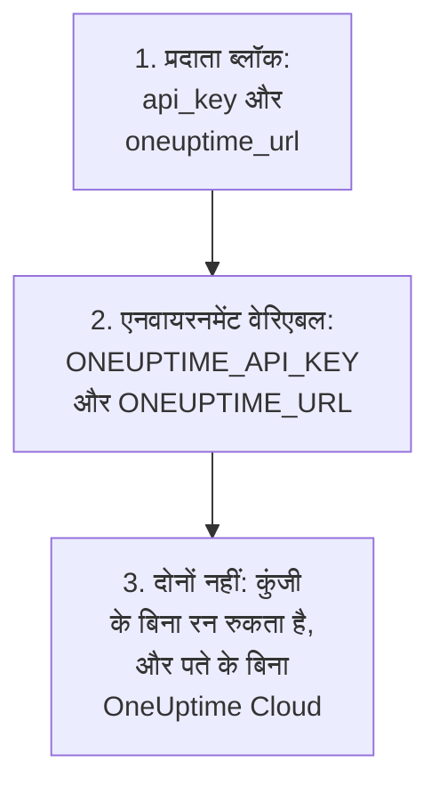
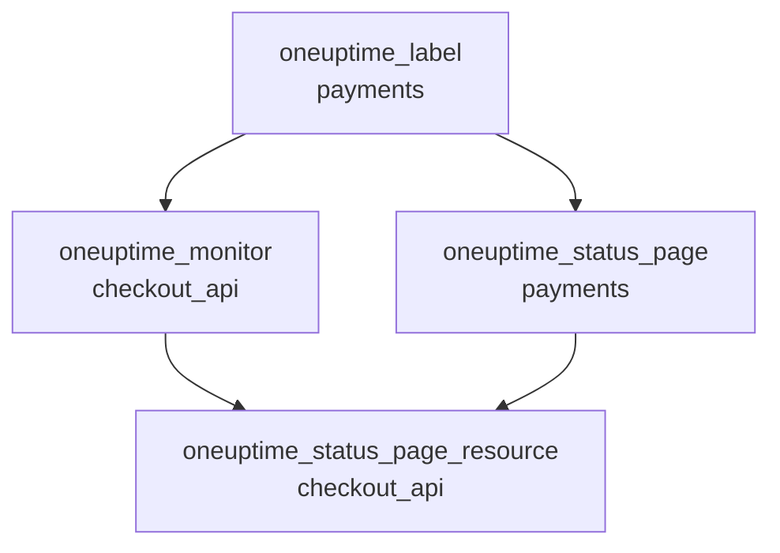

# संपूर्ण गाइड

यह गाइड आपके पहले apply के बाद की बातें बताती है: प्रदाता अपनी API कुंजी कैसे ढूँढता है, एक या कई प्रोजेक्ट के लिए कॉन्फ़िगरेशन कैसे व्यवस्थित करें, संसाधन एक-दूसरे का संदर्भ कैसे देते हैं, जिन रिकॉर्ड को आप प्रबंधित नहीं करते उन्हें कैसे पढ़ें, state को सुरक्षित कैसे रखें, और अपग्रेड कैसे करें। प्रदाता पहली बार इस्तेमाल कर रहे हैं? [त्वरित प्रारंभ](/docs/terraform/quick-start) से शुरू करें।

:::cards
- [प्रदाता को कॉन्फ़िगर करें](#प्रदाता-को-कॉन्फ़िगर-करें): API कुंजी और पता, और प्रदाता उन्हें कहाँ से पढ़ता है।
- [कॉन्फ़िगरेशन व्यवस्थित करें](#कॉन्फ़िगरेशन-व्यवस्थित-करें): फ़ाइलें, प्रोजेक्ट, और एक ब्लॉक से कई संसाधन।
- [जो पहले से है उसे पढ़ें](#जो-पहले-से-है-उसे-पढ़ें): डेटा स्रोत, और खोज कैसे मेल खाती है।
- [state को सुरक्षित रखें](#state-को-सुरक्षित-रखें): एक रिमोट बैकएंड, और क्या कभी कमिट नहीं करना है।
:::

## प्रदाता को कॉन्फ़िगर करें

प्रदाता दो सेटिंग्स लेता है। हर एक प्रदाता ब्लॉक से आती है, नहीं तो किसी एनवायरनमेंट वेरिएबल से:

| सेटिंग | एनवायरनमेंट वेरिएबल | जब दोनों में से कोई सेट न हो |
| --- | --- | --- |
| `api_key` | `ONEUPTIME_API_KEY` | कुछ भी प्लान होने से पहले प्रदाता रुक जाता है: `Missing API Key` |
| `oneuptime_url` | `ONEUPTIME_URL` | `https://oneuptime.com`, यानी OneUptime Cloud |



`oneuptime_url` आपके OneUptime का पता है, `/api` के बिना: पते में स्कीम न हो तो प्रदाता `https://` जोड़ता है, और अंत में `/api`। `api_key` संवेदनशील है, इसलिए Terraform उसे कभी प्रिंट नहीं करता।

कुंजी उस प्रोजेक्ट की API कुंजी होनी चाहिए जिसे आप प्रबंधित करते हैं, और उसे आपके कॉन्फ़िगरेशन के हर तरह के रिकॉर्ड को बनाने, पढ़ने, बदलने और हटाने की अनुमति होनी चाहिए: [प्रोजेक्ट की API कुंजी बनाएँ](/docs/terraform/quick-start#प्रोजेक्ट-की-api-कुंजी-बनाएँ) देखें। स्व-होस्टेड OneUptime की मास्टर API कुंजी किसी प्रोजेक्ट की नहीं होती, इसलिए उससे किया गया निर्माण `ProjectId required` के साथ विफल होता है।

### प्रदाता को उसकी कुंजी दें

:::tabs
@tab एनवायरनमेंट वेरिएबल
```bash
export ONEUPTIME_API_KEY="<your-api-key>"
# Only on a self-hosted OneUptime:
export ONEUPTIME_URL="https://oneuptime.example.com"
```

```hcl title="main.tf"
provider "oneuptime" {}
```
@tab Terraform वेरिएबल
```hcl title="variables.tf"
variable "oneuptime_api_key" {
  description = "API key of the OneUptime project"
  type        = string
  sensitive   = true
}

provider "oneuptime" {
  api_key = var.oneuptime_api_key
}
```

```hcl title="terraform.tfvars"
oneuptime_api_key = "<your-api-key>"
```
:::

एनवायरनमेंट वेरिएबल कुंजी को हर फ़ाइल से बाहर रखता है। वेरिएबल फ़ाइल आपकी अपनी मशीन पर सुविधाजनक है: `terraform.tfvars` को `.gitignore` में जोड़ें। पाइपलाइन में, फ़ाइल लिखने के बजाय `TF_VAR_oneuptime_api_key` सेट करें।

### इसे CI/CD में चलाएँ

जॉब को कुंजी एक सीक्रेट के रूप में, `ONEUPTIME_API_KEY` एनवायरनमेंट वेरिएबल में दें:

:::tabs
@tab GitHub Actions
```yaml title=".github/workflows/oneuptime.yml"
name: OneUptime
on:
  push:
    branches: [main]

jobs:
  apply:
    runs-on: ubuntu-latest
    env:
      ONEUPTIME_API_KEY: ${{ secrets.ONEUPTIME_API_KEY }}
    steps:
      - uses: actions/checkout@v4
      - uses: hashicorp/setup-terraform@v3
      - run: terraform init -input=false
      - run: terraform plan -input=false -out=tfplan
      - run: terraform apply -input=false tfplan
```
@tab GitLab CI
```yaml title=".gitlab-ci.yml"
apply:
  image:
    name: hashicorp/terraform:latest
    entrypoint: [""]
  rules:
    - if: $CI_COMMIT_BRANCH == $CI_DEFAULT_BRANCH
  script:
    - terraform init -input=false
    - terraform plan -input=false -out=tfplan
    - terraform apply -input=false tfplan
```
:::

GitHub में, सीक्रेट को **Settings → Secrets and variables → Actions** में जोड़ें; GitLab में, उसी नाम का एक मास्क किया हुआ CI/CD वेरिएबल जोड़ें। state को [रिमोट बैकएंड](#state-को-सुरक्षित-रखें) में रखें, ताकि हर रन उसी state से शुरू हो जो पिछला रन छोड़ गया था।

## कॉन्फ़िगरेशन व्यवस्थित करें

एक व्यवस्था जो अच्छी तरह काम करती है:

```text
oneuptime/
├── main.tf          # the terraform and provider blocks
├── variables.tf     # input variables
├── outputs.tf       # the IDs other configurations need
├── shared.tf        # labels, teams and monitor statuses
├── monitors.tf      # monitors and monitor groups
├── status-pages.tf  # status pages and their domains
└── on-call.tf       # on-call policies and escalation rules
```

- **हर प्रोजेक्ट के लिए एक कॉन्फ़िगरेशन।** एक API कुंजी एक प्रोजेक्ट की होती है, इसलिए एक कॉन्फ़िगरेशन स्वाभाविक रूप से एक प्रोजेक्ट प्रबंधित करता है।
- **साझा रिकॉर्ड एक ही बार।** लेबल, टीमें और मॉनिटर स्थितियाँ एक फ़ाइल में परिभाषित करें, और बाकी हर जगह उनके पते से उनका संदर्भ दें।

### कई प्रोजेक्ट प्रबंधित करें

एक कॉन्फ़िगरेशन से एक से ज़्यादा प्रोजेक्ट प्रबंधित करने के लिए, हर प्रोजेक्ट के लिए प्रदाता को एक उपनाम दें, हर एक उस प्रोजेक्ट की कुंजी के साथ। कोई संसाधन `provider` से बताता है कि वह कौन-सा उपनाम इस्तेमाल करता है:

```hcl
provider "oneuptime" {
  alias   = "production"
  api_key = var.production_api_key
}

provider "oneuptime" {
  alias   = "staging"
  api_key = var.staging_api_key
}

resource "oneuptime_label" "staging_critical" {
  provider = oneuptime.staging

  name  = "critical"
  color = "#FF5733"
}
```

ऊपर की तरह, `production_api_key` और `staging_api_key` को `sensitive` चिह्नित वेरिएबल के रूप में घोषित करें।

### एक ब्लॉक से कई संसाधन

`for_each` किसी map की हर प्रविष्टि के लिए एक संसाधन बनाता है। ये मॉनिटर अपने मानदंड साझा करते हैं और केवल नाम और पते में अलग हैं:

```hcl
variable "websites" {
  type = map(string)
  default = {
    homepage = "https://example.com"
    docs     = "https://docs.example.com"
  }
}

resource "oneuptime_monitor" "website" {
  for_each = var.websites

  name                = "Website: ${each.key}"
  monitor_type        = "Website"
  monitoring_interval = "*/5 * * * *"

  monitor_steps = [{
    monitor_destination      = each.value
    monitor_destination_type = "URL"

    criteria = [
      {
        name                  = "Offline"
        filter_condition      = "Any"
        change_monitor_status = true
        monitor_status_id     = data.oneuptime_monitor_status.offline.id

        filters = [
          {
            check_on    = "Is Online"
            filter_type = "False"
          }
        ]
      }
    ]
  }]
}
```

map में एक साइट जोड़ें, और अगला apply उसका मॉनिटर बना देता है। एक हटाएँ, और वह उसे हटा देता है।

## दूसरे संसाधनों का संदर्भ दें

जो संसाधन किसी दूसरे संसाधन के एट्रिब्यूट का नाम लेता है, वह उस पर निर्भर होता है, और Terraform इन्हीं संदर्भों से काम का क्रम तय करता है। यहाँ लेबल सबसे पहले बनता है और सबसे बाद में हटता है, क्योंकि मॉनिटर और स्थिति पृष्ठ उसका नाम लेते हैं:



```hcl
resource "oneuptime_label" "payments" {
  name        = "payments"
  description = "Payment infrastructure"
  color       = "#2ECC71"
}

resource "oneuptime_monitor" "checkout_api" {
  name         = "Checkout API"
  description  = "Availability of the checkout API"
  monitor_type = "Manual"
  labels       = [oneuptime_label.payments.id]
}

resource "oneuptime_status_page" "payments" {
  name                  = "Payments Status"
  page_title            = "Payments Status"
  is_public_status_page = true
  labels                = [oneuptime_label.payments.id]
}

resource "oneuptime_status_page_resource" "checkout_api" {
  status_page_id = oneuptime_status_page.payments.id
  monitor_id     = oneuptime_monitor.checkout_api.id
  display_name   = "Checkout API"
}
```

आपको `depends_on` की ज़रूरत शायद ही पड़ती है: इसे केवल उस क्रम के लिए जोड़ें जिसे Terraform एट्रिब्यूट से नहीं देख सकता। `labels` जैसी ID की सूचियाँ सेट होती हैं, इसलिए उनका क्रम बदलने से कुछ नहीं बदलता।

## जो पहले से है उसे पढ़ें

हर संसाधन का उसी नाम का एक डेटा स्रोत होता है। डेटा स्रोत ऐसा रिकॉर्ड पढ़ता है जिसे यह कॉन्फ़िगरेशन प्रबंधित नहीं करता, जो डैशबोर्ड में या किसी दूसरे कॉन्फ़िगरेशन से बना हो, ताकि आप उसे अपने नियंत्रण में लिए बिना उसका संदर्भ दे सकें।

```hcl
data "oneuptime_label" "critical" {
  name = "critical"
}

data "oneuptime_monitor_status" "offline" {
  is_offline_state = true
}

data "oneuptime_status_page" "main" {
  id = "5f8a1b2c-3d4e-4f6a-8b9c-0d1e2f3a4b5c"
}

resource "oneuptime_monitor" "database" {
  name         = "Database Health"
  monitor_type = "Manual"
  labels       = [data.oneuptime_label.critical.id]
}
```

खोज कैसे मेल खाती है:

| आप सेट करते हैं | यह खोजता है | त्रुटियाँ |
| --- | --- | --- |
| `id` | उस ID वाला रिकॉर्ड | `Not Found`, जब किसी रिकॉर्ड का वह ID न हो |
| कोई दूसरे सादे आर्ग्युमेंट, एक या ज़्यादा | वह इकलौता रिकॉर्ड जो उन सबसे मेल खाता है | `Not Found`, जब कोई मेल न खाए, `Ambiguous Match`, जब एक से ज़्यादा मेल खाएँ |
| `id` और कोई दूसरा आर्ग्युमेंट, या कुछ भी नहीं | कुछ नहीं | `Invalid Lookup` |

सादे आर्ग्युमेंट टेक्स्ट, संख्याएँ और सही या गलत होते हैं: कोई नाम, कोई प्राथमिकता, `is_offline_state` जैसा कोई फ़्लैग। सूचियों, JSON मानों, टाइमस्टैम्प और सीक्रेट से खोज नहीं की जा सकती। किसी रिकॉर्ड को केवल पढ़ने के बजाय अपने नियंत्रण में लेने के लिए, उसे [import करें](/docs/terraform/importing-resources)।

## state को सुरक्षित रखें

Terraform की state में वह सब कुछ के ID और एट्रिब्यूट होते हैं जिसे वह प्रबंधित करता है, सीक्रेट समेत। इसे ऐसे रिमोट बैकएंड में रखें जो इसे लॉक करता हो, ताकि पूरी टीम एक ही state साझा करे और दो रन इसे कभी एक साथ न लिखें। कोई भी मानक बैकएंड काम करता है, उदाहरण के लिए एक S3 बकेट:

```hcl
terraform {
  backend "s3" {
    bucket       = "my-terraform-state"
    key          = "oneuptime/production.tfstate"
    region       = "us-east-1"
    encrypt      = true
    use_lockfile = true
  }
}
```

`use_lockfile` के लिए Terraform 1.10 या OpenTofu 1.10, या बाद का संस्करण चाहिए। उनसे पहले, S3 बैकएंड एक DynamoDB टेबल (`dynamodb_table`) से लॉक करता है।

- **state को कभी हाथ से संपादित न करें।** `terraform state mv` और `terraform state rm` इस्तेमाल करें।
- **`terraform.tfstate`, या जिस `.tfvars` फ़ाइल में कोई सीक्रेट हो, उसे कभी कमिट न करें।**

## ड्रिफ़्ट, और क्या इसका कारण नहीं बनता

`terraform plan` OneUptime की तुलना आपके कॉन्फ़िगरेशन से करता है, और जो अलग है उसे सूचीबद्ध करता है। कुछ अंतर कभी नहीं दिखाए जाते:

- **समय की तुलना क्षणों के रूप में होती है।** `2030-06-01T02:00:00Z` और उसी क्षण को लिखने का सर्वर का तरीका बराबर हैं।
- **सर्वर जो डिफ़ॉल्ट जोड़ता है**, किसी मॉनिटर के चरणों में या किसी JSON मान में, वे आपके लिखे से अंतर नहीं हैं।
- **जो सर्वर अपडेट रखता है**, जैसे किसी मॉनिटर की मौजूदा स्थिति, वह भी अंतर नहीं है।

लेकिन जो मान आप हर रन पर गणना करते हैं, वह अंतर है: `timestamp()` हर रन पर नया समय देता है, इसलिए प्लान उसे हमेशा दिखाता है। इसके बजाय तय समय लिखें:

```hcl
resource "oneuptime_scheduled_maintenance_event" "database_upgrade" {
  title       = "Database upgrade"
  description = "Planned PostgreSQL upgrade"
  starts_at   = "2030-06-01T02:00:00Z"
  ends_at     = "2030-06-01T04:00:00Z"
}
```

## प्रदाता को अपग्रेड करें

:::steps
### रिलीज़ नोट्स पढ़ें

[Terraform Registry](https://registry.terraform.io/providers/oneuptime/oneuptime) और [प्रदाता की GitHub रिलीज़](https://github.com/OneUptime/terraform-provider-oneuptime/releases) बताती हैं कि क्या बदला।

### संस्करण की शर्त बढ़ाएँ

`{{TERRAFORM_PROVIDER_VERSION}}` पहले से हर {{TERRAFORM_PROVIDER_MAJOR}}.x रिलीज़ लेता है। नए मेजर संस्करण के लिए नई शर्त चाहिए।

### नया संस्करण डाउनलोड करें

```bash
terraform init -upgrade
```

### लागू करने से पहले प्लान बनाएँ

`terraform plan` चलाएँ, और तभी लागू करें जब वह खाली हो या वही बदलाव दिखाए जिनकी आप उम्मीद करते हैं।
:::

स्व-होस्टेड OneUptime पर, पहले OneUptime को अपग्रेड करें और उसके बाद प्रदाता को: प्रदाता आपके OneUptime से नया नहीं होना चाहिए। [स्व-होस्टेड सेटअप](/docs/terraform/self-hosted) देखें।

## अगले कदम

:::cards
- [मॉनिटर चरण](/docs/terraform/monitor-steps): तय करें कि मॉनिटर क्या जाँचता है और हर नतीजे का क्या मतलब है।
- [उदाहरण](/docs/terraform/examples): आम संसाधनों के लिए इस्तेमाल को तैयार कॉन्फ़िगरेशन।
- [संसाधन आयात करना](/docs/terraform/importing-resources): डैशबोर्ड में बनाई चीज़ों को Terraform के तहत लाएँ।
- [समस्या निवारण](/docs/terraform/troubleshooting): आम त्रुटियाँ, और उन्हें कैसे ठीक करें।
:::
