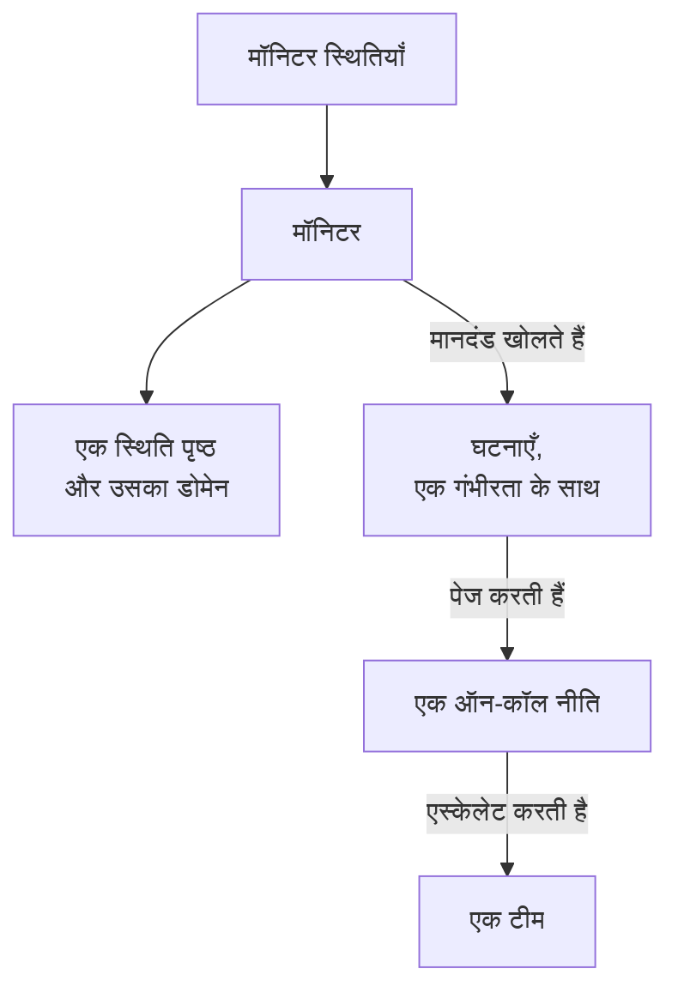

# उदाहरण

उन संसाधनों के लिए इस्तेमाल को तैयार कॉन्फ़िगरेशन जिनसे ज़्यादातर प्रोजेक्ट शुरू होते हैं। हर ब्लॉक नीचे दिए प्रदाता सेटअप के ऊपर जैसा है वैसा ही लागू होता है, और ज़्यादातर प्रदाता के एंड-टू-एंड टेस्ट से आते हैं, जो हर बदलाव पर उन्हें असली OneUptime पर लागू करते हैं।

:::cards
- [मॉनिटर](#मॉनिटर): वेबसाइट, API, ping, पोर्ट, SSL प्रमाणपत्र, heartbeat और मैन्युअल मॉनिटर।
- [स्थिति पृष्ठ](#स्थिति-पृष्ठ): एक समूह और एक मॉनिटर वाला स्थिति पृष्ठ, और एक कस्टम डोमेन।
- [टीमें और ऑन-कॉल](#टीमें-और-ऑन-कॉल): एक टीम, और उसे पेज करने वाली एक ऑन-कॉल नीति।
- [घटनाएँ और रखरखाव](#घटनाएँ-और-रखरखाव): गंभीरताएँ, स्थितियाँ, घोषित की गई एक घटना और एक रखरखाव अवधि।
:::



## प्रदाता सेटअप

हर उदाहरण यही सेटअप मानकर चलता है, जिसमें API कुंजी `ONEUPTIME_API_KEY` एनवायरनमेंट वेरिएबल में है:

```hcl title="main.tf"
terraform {
  required_providers {
    oneuptime = {
      source  = "oneuptime/oneuptime"
      version = "{{TERRAFORM_PROVIDER_VERSION}}"
    }
  }
}

provider "oneuptime" {
  # On a self-hosted OneUptime, add your OneUptime's address:
  # oneuptime_url = "https://oneuptime.example.com"
}
```

## लेबल

लेबल रिकॉर्ड को छाँटते और फ़िल्टर करते हैं। ज़्यादातर संसाधन `labels` में लेबल ID का एक सेट लेते हैं:

```hcl
resource "oneuptime_label" "production" {
  name        = "production"
  description = "Production infrastructure"
  color       = "#FF5733"
}
```

## मॉनिटर

नीचे के मॉनिटर अपनी स्थिति उन तीन स्थितियों से सेट करते हैं जिनसे हर प्रोजेक्ट शुरू होता है, जिन्हें डेटा स्रोतों से पढ़ा जाता है:

```hcl
data "oneuptime_monitor_status" "operational" {
  name = "Operational"
}

data "oneuptime_monitor_status" "degraded" {
  name = "Degraded"
}

data "oneuptime_monitor_status" "offline" {
  name = "Offline"
}
```

हर मॉनिटर के `monitor_steps` बताते हैं कि वह क्या जाँचता है और हर नतीजे को कैसे परखा जाता है: [मॉनिटर चरण](/docs/terraform/monitor-steps) हर एट्रिब्यूट को समझाता है।

### वेबसाइट मॉनिटर

साइट जवाब न दे तो offline, 200 से जवाब दे तो online। एंड-टू-एंड टेस्ट `35-monitor-with-steps` इन जाँचों वाला एक मॉनिटर लागू करता है:

```hcl
resource "oneuptime_monitor" "website" {
  name                = "Website"
  description         = "Homepage availability and status code"
  monitor_type        = "Website"
  monitoring_interval = "*/5 * * * *"
  labels              = [oneuptime_label.production.id]

  monitor_steps = [{
    monitor_destination      = "https://example.com"
    monitor_destination_type = "URL"
    request_type             = "GET"

    criteria = [
      {
        name                  = "Offline"
        description           = "The website does not respond"
        filter_condition      = "Any"
        change_monitor_status = true
        monitor_status_id     = data.oneuptime_monitor_status.offline.id

        filters = [
          {
            check_on    = "Is Online"
            filter_type = "False"
          }
        ]
      },
      {
        name                  = "Online"
        description           = "The website responds with 200"
        filter_condition      = "All"
        change_monitor_status = true
        monitor_status_id     = data.oneuptime_monitor_status.operational.id

        filters = [
          {
            check_on    = "Is Online"
            filter_type = "True"
          },
          {
            check_on    = "Response Status Code"
            filter_type = "Equal To"
            value       = "200"
          }
        ]
      }
    ]
  }]
}
```

### API मॉनिटर

हेडर और JSON बॉडी के साथ एक `POST`, जवाब धीमा होने पर degraded। एंड-टू-एंड टेस्ट `35-monitor-with-steps` इसी जैसा एक API मॉनिटर लागू करता है:

```hcl
resource "oneuptime_monitor" "orders_api" {
  name         = "Orders API"
  description  = "Health check of the orders API"
  monitor_type = "API"

  monitor_steps = [{
    monitor_destination      = "https://api.example.com/v1/health"
    monitor_destination_type = "URL"
    request_type             = "POST"
    request_headers = {
      "Content-Type" = "application/json"
      "Accept"       = "application/json"
    }
    request_body = jsonencode({ check = "health" })

    criteria = [
      {
        name                  = "Offline"
        description           = "The API does not answer, or answers with an error"
        filter_condition      = "Any"
        change_monitor_status = true
        monitor_status_id     = data.oneuptime_monitor_status.offline.id

        filters = [
          {
            check_on    = "Is Online"
            filter_type = "False"
          },
          {
            check_on    = "Response Status Code"
            filter_type = "Greater Than Or Equal To"
            value       = "500"
          }
        ]
      },
      {
        name                  = "Slow"
        description           = "The API takes more than two seconds"
        filter_condition      = "All"
        change_monitor_status = true
        monitor_status_id     = data.oneuptime_monitor_status.degraded.id

        filters = [
          {
            check_on    = "Response Time (in ms)"
            filter_type = "Greater Than"
            value       = "2000"
          }
        ]
      },
      {
        name                  = "Online"
        description           = "The API answers in time"
        filter_condition      = "All"
        change_monitor_status = true
        monitor_status_id     = data.oneuptime_monitor_status.operational.id

        filters = [
          {
            check_on    = "Is Online"
            filter_type = "True"
          }
        ]
      }
    ]
  }]
}
```

### Ping मॉनिटर

Ping मॉनिटर URL के बजाय होस्टनेम या IP पता लेता है:

```hcl
resource "oneuptime_monitor" "gateway" {
  name         = "Gateway"
  description  = "The gateway answers ping"
  monitor_type = "Ping"

  monitor_steps = [{
    monitor_destination      = "gateway.example.com"
    monitor_destination_type = "Hostname"

    criteria = [
      {
        name                  = "Unreachable"
        filter_condition      = "Any"
        change_monitor_status = true
        monitor_status_id     = data.oneuptime_monitor_status.offline.id

        filters = [
          {
            check_on    = "Is Online"
            filter_type = "False"
          }
        ]
      },
      {
        name                  = "Reachable"
        filter_condition      = "All"
        change_monitor_status = true
        monitor_status_id     = data.oneuptime_monitor_status.operational.id

        filters = [
          {
            check_on    = "Is Online"
            filter_type = "True"
          }
        ]
      }
    ]
  }]
}
```

### पोर्ट मॉनिटर

पोर्ट मॉनिटर जाँचने के लिए `port` जोड़ता है, संख्या के रूप में:

```hcl
resource "oneuptime_monitor" "database_port" {
  name         = "Database port"
  description  = "PostgreSQL accepts connections"
  monitor_type = "Port"

  monitor_steps = [{
    monitor_destination      = "db.example.com"
    monitor_destination_type = "Hostname"
    port                     = 5432

    criteria = [
      {
        name                  = "Closed"
        filter_condition      = "Any"
        change_monitor_status = true
        monitor_status_id     = data.oneuptime_monitor_status.offline.id

        filters = [
          {
            check_on    = "Is Online"
            filter_type = "False"
          }
        ]
      },
      {
        name                  = "Open"
        filter_condition      = "All"
        change_monitor_status = true
        monitor_status_id     = data.oneuptime_monitor_status.operational.id

        filters = [
          {
            check_on    = "Is Online"
            filter_type = "True"
          }
        ]
      }
    ]
  }]
}
```

### SSL प्रमाणपत्र मॉनिटर

प्रमाणपत्र मान्य न हो तो offline, 14 दिन या उससे कम में समाप्त होने वाला हो तो degraded, जैसा डैशबोर्ड में कोई नया SSL प्रमाणपत्र मॉनिटर होता है:

```hcl
resource "oneuptime_monitor" "certificate" {
  name         = "example.com certificate"
  description  = "The TLS certificate of example.com"
  monitor_type = "SSL Certificate"

  monitor_steps = [{
    monitor_destination      = "https://example.com"
    monitor_destination_type = "URL"

    criteria = [
      {
        name                  = "Not valid"
        description           = "Expired, self-signed, untrusted or not reachable"
        filter_condition      = "Any"
        change_monitor_status = true
        monitor_status_id     = data.oneuptime_monitor_status.offline.id

        filters = [
          {
            check_on    = "Is Not A Valid Certificate"
            filter_type = "True"
          }
        ]
      },
      {
        name                  = "Expires soon"
        description           = "Valid, and expires in 14 days or less"
        filter_condition      = "All"
        change_monitor_status = true
        monitor_status_id     = data.oneuptime_monitor_status.degraded.id

        filters = [
          {
            check_on    = "Is Valid Certificate"
            filter_type = "True"
          },
          {
            check_on    = "Expires In Days"
            filter_type = "Less Than Or Equal To"
            value       = "14"
          }
        ]
      },
      {
        name                  = "Valid"
        filter_condition      = "All"
        change_monitor_status = true
        monitor_status_id     = data.oneuptime_monitor_status.operational.id

        filters = [
          {
            check_on    = "Is Valid Certificate"
            filter_type = "True"
          }
        ]
      }
    ]
  }]
}
```

### मैन्युअल मॉनिटर

मैन्युअल मॉनिटर कुछ नहीं जाँचता: उसकी स्थिति आप ख़ुद सेट करते हैं। उसे `monitor_steps` की ज़रूरत नहीं होती:

```hcl
resource "oneuptime_monitor" "payment_provider" {
  name         = "Payment provider"
  description  = "Set by hand during the provider's incidents"
  monitor_type = "Manual"
}
```

### Heartbeat मॉनिटर

आने वाले अनुरोध वाला मॉनिटर अनुरोध भेजने के बजाय उनका इंतज़ार करता है: यहाँ, एक बैकअप जॉब जो हर रात रिपोर्ट करता है। 25 घंटे तक कोई अनुरोध न आने पर यह offline हो जाता है:

```hcl
resource "oneuptime_monitor" "nightly_backup" {
  name         = "Nightly backup"
  description  = "The backup job sends a heartbeat when it finishes"
  monitor_type = "Incoming Request"

  monitor_steps = [{
    criteria = [
      {
        name                  = "No heartbeat"
        filter_condition      = "Any"
        change_monitor_status = true
        monitor_status_id     = data.oneuptime_monitor_status.offline.id

        filters = [
          {
            check_on    = "Incoming Request"
            filter_type = "Not Recieved In Minutes"
            value       = "1500"
          }
        ]
      },
      {
        name                  = "Heartbeat received"
        filter_condition      = "All"
        change_monitor_status = true
        monitor_status_id     = data.oneuptime_monitor_status.operational.id

        filters = [
          {
            check_on    = "Incoming Request"
            filter_type = "Recieved In Minutes"
            value       = "1500"
          }
        ]
      }
    ]
  }]
}

output "nightly_backup_heartbeat_key" {
  value     = oneuptime_monitor.nightly_backup.incoming_request_secret_key
  sensitive = true
}
```

जॉब अपना अनुरोध `https://oneuptime.com/heartbeat/YOUR_SECRET_KEY` पर भेजता है, उस कुंजी के साथ जिसे `terraform output -raw nightly_backup_heartbeat_key` प्रिंट करता है: [आने वाले अनुरोध मॉनिटर](/docs/monitor/incoming-request-monitor) देखें। सर्वर मॉनिटर का एजेंट भी इसी तरह, `server_monitor_secret_key` से साइन इन करता है।

### मॉनिटर समूह

मॉनिटर समूह मॉनिटरों के एक सेट को एक ही स्थिति के साथ दिखाता है:

```hcl
resource "oneuptime_monitor_group" "storefront" {
  name        = "Storefront"
  description = "Everything the shop needs"
}

resource "oneuptime_monitor_group_resource" "website" {
  monitor_group_id = oneuptime_monitor_group.storefront.id
  monitor_id       = oneuptime_monitor.website.id
}

resource "oneuptime_monitor_group_resource" "orders_api" {
  monitor_group_id = oneuptime_monitor_group.storefront.id
  monitor_id       = oneuptime_monitor.orders_api.id
}
```

## स्थिति पृष्ठ

### एक समूह और एक मॉनिटर वाला स्थिति पृष्ठ

स्थिति पृष्ठ संसाधन दिखाता है, और उन्हें समूहों में बाँट सकता है। एंड-टू-एंड टेस्ट `42-status-page-resources` यह सेटअप लागू करता है:

```hcl
resource "oneuptime_status_page" "public" {
  name                  = "Public Status"
  description           = "Customer-facing status page"
  page_title            = "System Status"
  page_description      = "Check our system status and incident history"
  is_public_status_page = true
}

resource "oneuptime_status_page_group" "services" {
  status_page_id = oneuptime_status_page.public.id
  name           = "Services"
}

resource "oneuptime_status_page_resource" "website" {
  status_page_id       = oneuptime_status_page.public.id
  status_page_group_id = oneuptime_status_page_group.services.id
  monitor_id           = oneuptime_monitor.website.id
  display_name         = "Website"
}
```

### एक कस्टम डोमेन

तीन संसाधन साथ काम करते हैं: आपके प्रोजेक्ट का एक डोमेन, स्थिति पृष्ठ, और स्थिति पृष्ठ का डोमेन जो दोनों को जोड़ता है। `full_domain` और CNAME सत्यापन टोकन सर्वर भरता है: उन्हें सेट न करें। एंड-टू-एंड टेस्ट `12-status-page-domain` और `25-status-page-with-domain` यह सेटअप लागू करते हैं:

```hcl
resource "oneuptime_domain" "company" {
  domain = "example.com"
}

resource "oneuptime_status_page_domain" "status" {
  domain_id      = oneuptime_domain.company.id
  status_page_id = oneuptime_status_page.public.id
  subdomain      = "status"
}

output "status_page_address" {
  # The subdomain and the domain, such as status.example.com.
  value = oneuptime_status_page_domain.status.full_domain
}
```

नए डोमेन को DNS सत्यापन पास करना होता है, तभी स्थिति पृष्ठ उस पर जवाब देता है।

## टीमें और ऑन-कॉल

### एक टीम और उसके सदस्य

```hcl
resource "oneuptime_team" "sre" {
  name        = "SRE"
  description = "Site reliability engineering"
}

variable "alice_user_id" {
  description = "Alice's user ID, the last part of the address of her page under Users"
  type        = string
}

resource "oneuptime_team_member" "alice" {
  team_id = oneuptime_team.sre.id
  user_id = var.alice_user_id
}
```

जो व्यक्ति पहले से प्रोजेक्ट में है, वह तुरंत टीम में शामिल हो जाता है। बाकी सभी को आमंत्रण मिलता है, और स्वीकार करते ही वे टीम में होते हैं। एंड-टू-एंड टेस्ट `33-team-crud` यह टीम लागू करता है।

### किसी टीम को पेज करने वाली ऑन-कॉल नीति

नीति का पहला नियम टीम को पेज करता है, और जब कोई स्वीकार नहीं करता, तो नीति अधिकतम दो बार फिर से शुरू होती है:

```hcl
resource "oneuptime_on_call_policy" "primary" {
  name                                             = "Primary on-call"
  description                                      = "First line for production incidents"
  repeat_policy_if_no_one_acknowledges             = true
  repeat_policy_if_no_one_acknowledges_no_of_times = 2
}

resource "oneuptime_escalation_rule" "first_line" {
  on_call_duty_policy_id    = oneuptime_on_call_policy.primary.id
  name                      = "Page the SRE team"
  description               = "Moves on after 5 minutes without an acknowledgement"
  order                     = 1
  escalate_after_in_minutes = 5
}

resource "oneuptime_team_on_call_duty_escalation_rule" "sre" {
  on_call_duty_policy_id                 = oneuptime_on_call_policy.primary.id
  on_call_duty_policy_escalation_rule_id = oneuptime_escalation_rule.first_line.id
  team_id                                = oneuptime_team.sre.id
}
```

किसी मॉनिटर के मानदंड अपनी खोली घटनाओं पर `on_call_policy_ids` से नीति को पेज करते हैं: [घटनाएँ और अलर्ट](/docs/terraform/monitor-steps#घटनाएँ-और-अलर्ट) देखें।

## घटनाएँ और रखरखाव

### गंभीरताएँ और स्थितियाँ

गंभीरताएँ किसी घटना के प्रभाव को श्रेणी देती हैं, और स्थितियाँ उसके जीवन के चरण हैं। `order` वह जगह है जहाँ हर एक सूची में आता है:

```hcl
resource "oneuptime_incident_severity" "sev1" {
  name        = "SEV-1"
  description = "Full outage, all hands"
  color       = "#E74C3C"
  order       = 1
}

resource "oneuptime_incident_state" "mitigated" {
  name        = "Mitigated"
  description = "Impact contained, fix in progress"
  color       = "#F39C12"
  order       = 3
}
```

`oneuptime_alert_severity` और `oneuptime_alert_state` अलर्ट के लिए इसी तरह काम करते हैं। एंड-टू-एंड टेस्ट `03-incident-severity` और `04-incident-state` इन्हें लागू करते हैं।

### घटना घोषित करें

आमतौर पर घटनाएँ मॉनिटर खोलते हैं, पर घटना भी एक संसाधन है, जो game day के लिए ठीक बैठता है। यह एक असली घटना है, इसलिए अभ्यास को अपने स्थिति पृष्ठों से दूर रखें:

```hcl
resource "oneuptime_incident" "drill" {
  title                     = "Disaster recovery drill"
  description               = "A game day: we fail over the database"
  incident_severity_id      = oneuptime_incident_severity.sev1.id
  is_visible_on_status_page = false

  should_status_page_subscribers_be_notified_on_incident_created = false
}
```

एंड-टू-एंड टेस्ट `28-incident-crud` एक घटना लागू करता है।

### निर्धारित रखरखाव

तय समय वाली एक रखरखाव अवधि, जो आपके स्थिति पृष्ठों पर दिखती है:

```hcl
resource "oneuptime_scheduled_maintenance_event" "database_upgrade" {
  title                       = "Database maintenance"
  description                 = "Planned PostgreSQL upgrade: writes pause briefly"
  starts_at                   = "2030-06-01T02:00:00Z"
  ends_at                     = "2030-06-01T04:00:00Z"
  is_visible_on_status_page   = true
  monitors                    = [oneuptime_monitor.website.id]
  change_monitor_status_to_id = data.oneuptime_monitor_status.degraded.id
}
```

समय RFC 3339 में होते हैं, और उसी क्षण को दूसरे तरीके से लिखना कोई बदलाव नहीं है। एंड-टू-एंड टेस्ट `30-scheduled-maintenance-crud` रखरखाव इवेंट लागू करता है।

इवेंट चलने के दौरान उसके मॉनिटर को किसी स्थिति में रखने के लिए, उन्हें `monitors` से जोड़ें और `change_monitor_status_to_id` को अपनी किसी मॉनिटर स्थिति पर सेट करें: इवेंट शुरू होने पर मॉनिटर उस स्थिति में चले जाते हैं, और ख़त्म होने पर वापस चालू स्थिति में आ जाते हैं। इवेंट शुरू होने तक Terraform `change_monitor_status_to_id` को उसी जगह बदलता है। इवेंट शुरू होने के बाद उसके मॉनिटर पहले से उस स्थिति में होते हैं, और उसे बदलने वाला apply “Change Monitor Status to can no longer be changed: this event has already started.” के साथ विफल होता है।

## प्रोब

आपका अपना प्रोब आपके नेटवर्क से जाँच चलाता है। उसकी कुंजी वह सीक्रेट है जिससे प्रोब साइन इन करता है, इसलिए उसे एक वेरिएबल में दें:

```hcl
variable "probe_key" {
  description = "The key the probe signs in with"
  type        = string
  sensitive   = true
}

resource "oneuptime_probe" "eu_west" {
  key           = var.probe_key
  name          = "EU West"
  description   = "Probe in our eu-west-1 network"
  probe_version = "1.0.0"

  should_auto_enable_probe_on_new_monitors = true
}
```

प्रोब को `PROBE_ID` को प्रोब के `id` पर और `PROBE_KEY` को कुंजी पर सेट करके चलाएँ: [कस्टम प्रोब](/docs/probe/custom-probe) देखें। एंड-टू-एंड टेस्ट `23-probe-crud` प्रोब लागू करता है।

## अगले कदम

:::cards
- [मॉनिटर चरण](/docs/terraform/monitor-steps): किसी मॉनिटर की जाँचों और मानदंडों का हर एट्रिब्यूट।
- [संसाधन आयात करना](/docs/terraform/importing-resources): डैशबोर्ड में बनाई चीज़ों को Terraform के तहत लाएँ।
- [संपूर्ण गाइड](/docs/terraform/complete-guide): डेटा स्रोत, state, CI/CD और अपग्रेड।
:::
