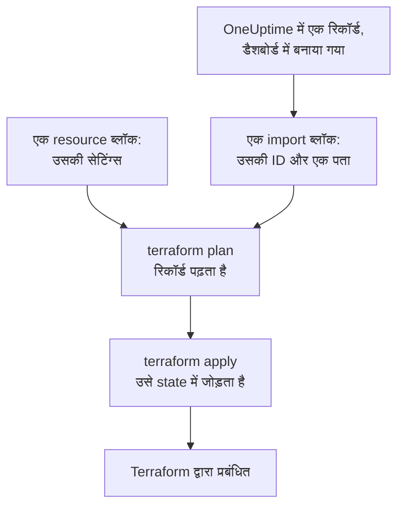
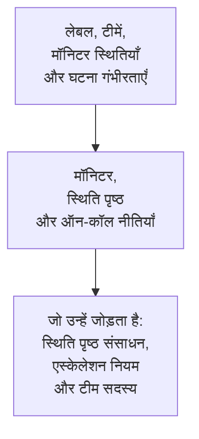

# संसाधन आयात करना

Terraform से OneUptime प्रबंधित करने के लिए आपको शुरू से शुरुआत नहीं करनी पड़ती। आपके पास पहले से मौजूद मॉनिटर, स्थिति पृष्ठ, टीमें और दूसरे रिकॉर्ड आयात करें, और उसके बाद Terraform उन्हें जैसे वे हैं वैसे ही प्रबंधित करता है। आयात केवल पढ़ता है: जब तक आप प्लान किया गया कोई बदलाव लागू नहीं करते, OneUptime में कुछ नहीं बदलता।

:::cards
- [आयात कैसे काम करता है](#आयात-कैसे-काम-करता-है): आयात क्या पढ़ता है, और आप क्या लिखते हैं।
- [एक संसाधन आयात करें](#एक-संसाधन-आयात-करें): डैशबोर्ड में उसके पेज से, चार चरणों में।
- [कई संसाधन आयात करें](#कई-संसाधन-आयात-करें): पूरी सूची के लिए import ब्लॉक, और वह कॉन्फ़िगरेशन जो Terraform आपके लिए लिखता है।
- [किसी संसाधन का प्रबंधन बंद करें](#किसी-संसाधन-का-प्रबंधन-बंद-करें): उसे हटाए बिना डैशबोर्ड को लौटा दें।
:::

## आयात कैसे काम करता है

आयात OneUptime में पहले से मौजूद किसी रिकॉर्ड को आपके कॉन्फ़िगरेशन के एक `resource` ब्लॉक से जोड़ता है। आप रिकॉर्ड की ID और उस पते के साथ एक `import` ब्लॉक लिखते हैं जहाँ रिकॉर्ड जाना है। अगला `terraform plan` रिकॉर्ड को उसकी ID से पढ़ता है और दिखाता है कि वह आयात होगा, साथ में रिकॉर्ड और आपके कॉन्फ़िगरेशन के बीच का हर अंतर भी। `terraform apply` उसे Terraform की state में जोड़ता है, और उसके बाद रिकॉर्ड का प्रबंधन वैसे ही होता है जैसे Terraform द्वारा बनाई गई किसी भी चीज़ का।



`resource` ब्लॉक ऐसे लिखें कि वह वही बताए जो रिकॉर्ड पहले से है। जहाँ दोनों अलग हों, वहाँ प्लान आयात और एक बदलाव दिखाता है, और उसे लागू करने से OneUptime में रिकॉर्ड बदल जाता है।

### क्या आयात किया जा सकता है

प्रदाता के हर संसाधन को उसकी ID से आयात किया जा सकता है, सिवाय `oneuptime_file` के: OneUptime API किसी फ़ाइल को वापस नहीं पढ़ सकता, इसलिए प्रदाता `Import Not Supported` जवाब देता है। डेटा स्रोत कभी आयात नहीं होते। किसी रिकॉर्ड को प्रबंधित किए बिना अपने कॉन्फ़िगरेशन में इस्तेमाल करने के लिए, उसे इसके बजाय [डेटा स्रोत](/docs/terraform/complete-guide#जो-पहले-से-है-उसे-पढ़ें) से पढ़ें।

## शुरू करने से पहले

- **Terraform 1.5 या उसके बाद का, या OpenTofu 1.6 या उसके बाद का।** इस पेज के `import` ब्लॉक को इन संस्करणों की ज़रूरत है। पुराना Terraform [कमांड लाइन](#कमांड-लाइन-से-आयात-करें) से आयात करता है।
- **एक API कुंजी जो वह पढ़ सके जिसे आप आयात करते हैं।** आयात हर रिकॉर्ड को प्रदाता की कुंजी से पढ़ता है, और बाद में उसे प्रबंधित करने के लिए उसे बदलने और हटाने की अनुमतियाँ भी चाहिए। [प्रोजेक्ट API कुंजी बनाएँ](/docs/terraform/quick-start#प्रोजेक्ट-की-api-कुंजी-बनाएँ) देखें।
- **आपके कॉन्फ़िगरेशन में प्रदाता**, जिसे [त्वरित प्रारंभ](/docs/terraform/quick-start#terraform-को-oneuptime-की-ओर-इंगित-करें) की तरह सेट किया गया हो।

## एक संसाधन आयात करें

डैशबोर्ड उस संसाधन का कॉन्फ़िगरेशन उसके `import` ब्लॉक के साथ लिख देता है जिसे आप देख रहे हैं, इसलिए आपको शायद ही कभी इसे हाथ से लिखना पड़ता है।

:::steps
### संसाधन का Terraform पेज खोलें

डैशबोर्ड में मॉनिटर, स्थिति पृष्ठ या कोई दूसरा संसाधन खोलें। उसके साइड मेन्यू में **डेवलपर** खोलें, फिर **Terraform**।

### उसका कॉन्फ़िगरेशन कॉपी करें

पेज संसाधन की मौजूदा सेटिंग्स से उसका `resource` ब्लॉक लिखता है, और उसकी ID के साथ एक `import` ब्लॉक। दोनों को एक `.tf` फ़ाइल में रखें:

```hcl title="status-pages.tf"
resource "oneuptime_status_page" "public_status" {
  name       = "Public Status"
  page_title = "Acme Status"

  # Secrets are not shown here: master_password, embedded_overall_status_token.
  # Terraform leaves them as they are in OneUptime.
}

import {
  to = oneuptime_status_page.public_status
  id = "68a1b2c3-d4e5-4f6a-8b9c-0d1e2f3a4b02"
}
```

यह वे सेटिंग्स लिखता है जो डिफ़ॉल्ट से अलग हैं, और हर ID के बाद की टिप्पणी उस रिकॉर्ड का नाम बताती है जिसकी ओर वह इशारा करती है। सीक्रेट कभी नहीं दिखाए जाते: संसाधन को जिनकी ज़रूरत है वे `sensitive` चिह्नित वेरिएबल से पढ़े जाते हैं, और टिप्पणी उनके नाम बताती है जिन्हें यह छोड़ देता है।

### प्लान करें

`terraform plan` चलाएँ। यह `Plan: 1 to import, 0 to add, 0 to change, 0 to destroy.` पर खत्म होता है: Terraform को रिकॉर्ड मिल गया, और आपका कॉन्फ़िगरेशन उससे मेल खाता है।

### लागू करें

`terraform apply` चलाएँ। स्थिति पृष्ठ अब Terraform की state में है, और अगला प्लान `No changes.` जवाब देता है। फिर आप `import` ब्लॉक हटा सकते हैं, या उसे इस नोट के रूप में रख सकते हैं कि संसाधन कहाँ से आया: संसाधन के प्रबंधित होने के बाद वह कुछ नहीं करता।
:::

### ब्लॉक खुद लिखें

डैशबोर्ड के बिना, दोनों ब्लॉक खुद लिखें। `resource` ब्लॉक उन एट्रिब्यूट से शुरू करें जिनकी संसाधन को ज़रूरत है, और `terraform plan` चलाएँ। जहाँ आपका कॉन्फ़िगरेशन रिकॉर्ड से अलग है, वहाँ प्लान आयात के बगल में बदलाव दिखाता है:

```text
  # oneuptime_label.critical will be updated in-place
  # (imported from "68a1b2c3-d4e5-4f6a-8b9c-0d1e2f3a4b03")
  ~ resource "oneuptime_label" "critical" {
      ~ color = "#FF5733" -> "#000000"
    }

Plan: 1 to import, 0 to add, 1 to change, 0 to destroy.
```

रिकॉर्ड का मान अपने कॉन्फ़िगरेशन में कॉपी करें (यहाँ `color = "#FF5733"`), और तब तक फिर से प्लान करें जब तक प्लान आयात दिखाए और कोई बदलाव न दिखाए। रिकॉर्ड की ID तीन जगहों पर मिलती है:

| कहाँ | कैसे |
| --- | --- |
| संसाधन का पेज | उसका विवरण कार्ड एक **ID** पंक्ति पर खत्म होता है। पूरी ID कॉपी करने के लिए ID पर, या उसके बगल के कॉपी बटन पर क्लिक करें। |
| एड्रेस बार | ID सूची के नाम के बाद आती है: `/dashboard/<project-id>/monitors/<monitor-id>`। |
| API | हर रिकॉर्ड अपनी ID `_id` में रखता है। |

## कई संसाधन आयात करें

किसी एक प्रकार के सभी मॉनिटर, स्थिति पृष्ठ या दूसरे संसाधन आयात करने के लिए, उनकी सूची से शुरू करें।

:::steps
### सूची का Terraform पेज खोलें

सूची खोलें, फिर उसके साइड मेन्यू में **डेवलपर** और **Terraform**, उदाहरण के लिए **मॉनिटर → डेवलपर → Terraform**।

### import ब्लॉक कॉपी करें

पेज हर रिकॉर्ड (पहले 100) के लिए एक `import` ब्लॉक लिखता है, जिसका पता रिकॉर्ड के नाम से बनता है। उन्हें एक अलग फ़ाइल में रखें, जैसे `imports.tf`:

```hcl title="imports.tf"
import {
  to = oneuptime_monitor.homepage
  id = "68a1b2c3-d4e5-4f6a-8b9c-0d1e2f3a4b01"
}

import {
  to = oneuptime_monitor.checkout_api
  id = "68a1b2c3-d4e5-4f6a-8b9c-0d1e2f3a4b05"
}
```

### Terraform को कॉन्फ़िगरेशन लिखने दें

प्लान को उस कॉन्फ़िगरेशन के फ़ाइल नाम के साथ चलाएँ जो Terraform लिखेगा। फ़ाइल अभी मौजूद नहीं होनी चाहिए: Terraform केवल नई फ़ाइल में लिखता है।

```bash
terraform plan -generate-config-out=monitors.tf
```

Terraform हर रिकॉर्ड पढ़ता है और हर उस `import` ब्लॉक के लिए एक `resource` ब्लॉक लिखता है जिसका कोई ब्लॉक नहीं है। वह चेतावनी देता है कि कॉन्फ़िगरेशन बनाना प्रायोगिक है, इसलिए उसने जो लिखा है उसे पढ़ें।

### जाँचें और लागू करें

नई फ़ाइल में, दूसरे रिकॉर्ड की ID को उनके संसाधनों के संदर्भों से बदलें, जैसे `labels = [oneuptime_label.critical.id]`, ताकि Terraform जाने कि किस क्रम में काम करना है। `terraform plan` तब तक चलाएँ जब तक वह केवल आयात न दिखाए, फिर `terraform apply`।
:::

### पूरा प्रोजेक्ट

किसी प्रोजेक्ट को सूची-दर-सूची आयात करें, उन रिकॉर्ड से शुरू करते हुए जिनका दूसरे संदर्भ देते हैं। तब हर संसाधन ब्लॉक अपने से पहले वालों का संदर्भ ID के बजाय पते से दे सकता है:



वे रिकॉर्ड जिनके साथ हर प्रोजेक्ट शुरू होता है, जैसे उसकी मॉनिटर स्थितियाँ और घटना गंभीरताएँ, अक्सर आयात करने के बजाय डेटा स्रोतों से पढ़ना बेहतर होता है: तब Terraform उनका संदर्भ दे सकता है, लेकिन उन्हें कभी बदलता या हटाता नहीं। प्रोजेक्ट तब आयात हो जाता है जब `terraform plan` जवाब देता है `No changes.`

## कमांड लाइन से आयात करें

`terraform import` एक बार में एक संसाधन आयात करता है, और Terraform और OpenTofu के हर संस्करण पर काम करता है। पहले `resource` ब्लॉक लिखें, फिर ब्लॉक के पते और रिकॉर्ड की ID के साथ कमांड चलाएँ:

```bash
terraform import oneuptime_status_page.public_status 68a1b2c3-d4e5-4f6a-8b9c-0d1e2f3a4b02
terraform import oneuptime_label.critical 68a1b2c3-d4e5-4f6a-8b9c-0d1e2f3a4b03
terraform import oneuptime_team.sre 68a1b2c3-d4e5-4f6a-8b9c-0d1e2f3a4b04
```

हर कमांड `Import successful!` पर खत्म होती है। `import` ब्लॉक के विपरीत, यह कमांड state को तुरंत लिखती है, पहले जाँचने के लिए कोई प्लान दिए बिना: इसके बाद `terraform plan` चलाएँ, और अपना कॉन्फ़िगरेशन तब तक बदलें जब तक प्लान जवाब न दे `No changes.`

## किसी संसाधन का प्रबंधन बंद करें

किसी संसाधन को हटाए बिना डैशबोर्ड को लौटाने के लिए, उसके `resource` ब्लॉक को एक `removed` ब्लॉक से बदलें जो रिकॉर्ड को रखता है:

```hcl
removed {
  from = oneuptime_team.sre

  lifecycle {
    destroy = false
  }
}
```

प्लान बताता है कि टीम अब Terraform द्वारा प्रबंधित नहीं होगी, और कुछ भी नष्ट नहीं करता। इसे लागू करें, फिर `removed` ब्लॉक हटा दें। `destroy = false` वाले `removed` ब्लॉक के लिए Terraform 1.7 या उसके बाद का, या OpenTofu 1.10 या उसके बाद का संस्करण चाहिए। पुराने संस्करण पर, इसके बजाय `terraform state rm oneuptime_team.sre` चलाएँ।

> [!WARNING]
> `resource` ब्लॉक हटाने से अगले apply पर OneUptime में उसका रिकॉर्ड हट जाता है। Terraform में, `destroy = false` के बिना `removed` ब्लॉक भी यही करता है: हमेशा `lifecycle` ब्लॉक लिखें।

## जानने योग्य बातें

- **आयात कुछ नहीं बदलता, लेकिन अगला apply बदलता है।** ऐसा प्लान लागू करने से जो आयात के बगल में बदलाव दिखाता है, OneUptime में रिकॉर्ड बदल जाता है। पहले प्लान को केवल आयात दिखाने लायक बनाएँ।
- **सीक्रेट वापस नहीं पढ़े जाते।** वह सीक्रेट जिसे OneUptime कभी वापस नहीं भेजता, जैसे मॉनिटर सीक्रेट का `secret_value`, आयात के बाद state में नहीं होता। अगर आपका कॉन्फ़िगरेशन उसे सेट करता है, तो पहला प्लान उसे बदलाव के रूप में दिखाता है, और उसे लागू करने से सीक्रेट फिर से लिखा जाता है।
- **हर रिकॉर्ड के लिए एक कॉन्फ़िगरेशन।** दो कॉन्फ़िगरेशन में आयात किया गया रिकॉर्ड हर apply पर उसी पर लौटा दिया जाता है जो उनमें से हर एक कहता है।
- **आयात किए गए रिकॉर्ड प्रबंधित रिकॉर्ड हैं।** `terraform destroy` उन्हें OneUptime से हटा देता है, Terraform द्वारा बनाए गए रिकॉर्ड की तरह।

## समस्या निवारण

:::details संदेश “Cannot import non-existent remote object”
किसी रिकॉर्ड की वह ID नहीं है, या प्रदाता की API कुंजी उसे नहीं पढ़ सकती: OneUptime दोनों का जवाब एक जैसा देता है। ID जाँचें, और यह भी कि कुंजी उस तरह के रिकॉर्ड पढ़ सकती है।
:::

:::details संदेश “Import Not Supported”
`oneuptime_file` अकेला ऐसा संसाधन है जिसे आयात नहीं किया जा सकता। उसे छोड़ दें, और इसके बजाय Terraform को एक नई फ़ाइल बनाने दें।
:::

:::details संदेश “Invalid ID format”
ID किसी रिकॉर्ड की ID नहीं है, उदाहरण के लिए कोई नाम है। आयात ID लेता है, जो `68a1b2c3-d4e5-4f6a-8b9c-0d1e2f3a4b02` जैसा UUID होता है: इसे संसाधन के पेज से कॉपी करें।
:::

:::details संदेश “Target generated file already exists”
`-generate-config-out` ऐसी फ़ाइल का नाम देता है जो पहले से मौजूद है। नई फ़ाइल का नाम दें, या फ़ाइल की सामग्री कहीं और ले जाकर उसे हटा दें।
:::

:::details संदेश “Resource already managed by Terraform”
`terraform import` को ऐसा पता मिला जो पहले से state में है। रिकॉर्ड को किसी दूसरे पते पर आयात करें, या `terraform state list` से जाँचें कि उस पते पर क्या है।
:::

## अगले कदम

:::cards
- [संपूर्ण गाइड](/docs/terraform/complete-guide): डेटा स्रोत, संसाधनों के बीच संदर्भ, और state।
- [मॉनिटर चरण](/docs/terraform/monitor-steps): आयात किया गया मॉनिटर क्या जाँचता है, उसे पढ़ें और बदलें।
- [उदाहरण](/docs/terraform/examples): आम संसाधनों के लिए इस्तेमाल के लिए तैयार कॉन्फ़िगरेशन।
- [समस्या निवारण](/docs/terraform/troubleshooting): आम त्रुटियाँ और उन्हें ठीक करने का तरीका।
:::
