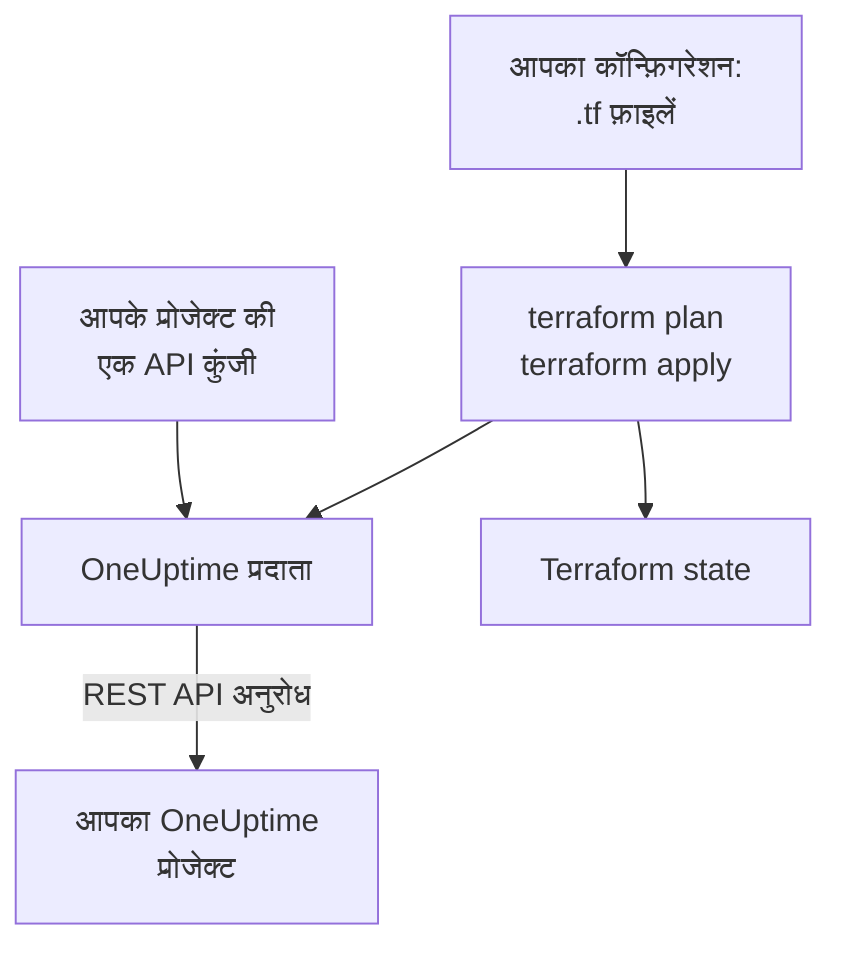

# Terraform अवलोकन

OneUptime Terraform प्रदाता आपके OneUptime प्रोजेक्ट को कोड के रूप में प्रबंधित करता है। मॉनिटर, स्थिति पृष्ठ, ऑन-कॉल नीतियाँ, टीमें, लेबल और अपने प्रोजेक्ट के बाकी रिकॉर्ड `.tf` फ़ाइलों में लिखें, `terraform plan` से देखें कि क्या बदलेगा, और `terraform apply` से बदलाव लागू करें। यह OneUptime Cloud और स्व-होस्टेड OneUptime दोनों के साथ काम करता है, और Terraform के साथ-साथ OpenTofu के साथ भी।

:::cards
- [प्रदाता कैसे काम करता है](#प्रदाता-कैसे-काम-करता-है): आपका कॉन्फ़िगरेशन, प्लान, और उनके पीछे के API अनुरोध।
- [प्रदाता इंस्टॉल करें](#प्रदाता-इंस्टॉल-करें): प्रदाता ब्लॉक, और कौन-सा संस्करण चुनें।
- [डैशबोर्ड से लिखवाएँ](#डैशबोर्ड-से-लिखवाएँ): जो आपके पास पहले से है, उसके लिए कॉन्फ़िगरेशन और import ब्लॉक।
- [आप क्या प्रबंधित कर सकते हैं](#आप-क्या-प्रबंधित-कर-सकते-हैं): संसाधन, डेटा स्रोत, और उनके एट्रिब्यूट कैसे लिखे जाते हैं।
:::

## प्रदाता कैसे काम करता है

प्रदाता एक प्लगइन है जिसे Terraform एक रजिस्ट्री से डाउनलोड करता है। `terraform apply` पर यह प्लान के हर बदलाव को OneUptime REST API के एक अनुरोध में बदलता है, जो आपके प्रोजेक्ट की एक API कुंजी से किया जाता है। Terraform ने जो बनाया है, उसे अपनी state में रखता है, इसलिए अगला प्लान केवल वही दिखाता है जो तब से बदला है।



एक API कुंजी एक प्रोजेक्ट की होती है और तय करती है कि Terraform उसमें क्या पढ़ और बदल सकता है, इसलिए एक कॉन्फ़िगरेशन एक प्रोजेक्ट को प्रबंधित करता है। कई प्रोजेक्ट प्रबंधित करने के लिए, हर प्रोजेक्ट के लिए प्रदाता को एक [उपनाम](/docs/terraform/complete-guide#कई-प्रोजेक्ट-प्रबंधित-करें) दें।

## शुरू करने से पहले

- **Terraform 1.5 या बाद का, या OpenTofu 1.6 या बाद का।** डैशबोर्ड जो `import` ब्लॉक लिखता है, उन्हें इन संस्करणों की ज़रूरत होती है।
- **आपके प्रोजेक्ट की एक API कुंजी।** [त्वरित प्रारंभ](/docs/terraform/quick-start#प्रोजेक्ट-की-api-कुंजी-बनाएँ) दिखाता है कि **प्रोजेक्ट सेटिंग्स → उन्नत → API कुंजियाँ** में इसे कैसे बनाएँ।
- **OneUptime Cloud पर, Growth प्लान या उससे ऊपर।** प्रोजेक्ट की API कुंजियाँ केवल उसी पर काम करती हैं।

## प्रदाता इंस्टॉल करें

प्रदाता को किसी `.tf` फ़ाइल में जोड़ें। `terraform init` इसे Terraform Registry से डाउनलोड करता है, और `tofu init` OpenTofu Registry से:

```hcl title="main.tf"
terraform {
  required_providers {
    oneuptime = {
      source  = "oneuptime/oneuptime"
      version = "{{TERRAFORM_PROVIDER_VERSION}}"
    }
  }
}

provider "oneuptime" {
  # The API key comes from the ONEUPTIME_API_KEY environment variable.
  # On a self-hosted OneUptime, add your OneUptime's address:
  # oneuptime_url = "https://oneuptime.example.com"
}
```

कुंजी को अपनी फ़ाइलों से बाहर रखें: Terraform चलाने से पहले इसे export करें, या `sensitive` चिह्नित वेरिएबल में दें। [संपूर्ण गाइड](/docs/terraform/complete-guide#प्रदाता-को-कॉन्फ़िगर-करें) प्रदाता को उसकी कुंजी और पता देने के सभी तरीके बताती है।

### संस्करण चुनें

प्रदाता के संस्करण OneUptime के संस्करणों के साथ चलते हैं: प्रदाता {{TERRAFORM_PROVIDER_MAJOR}}.x, OneUptime {{TERRAFORM_PROVIDER_MAJOR}}.x से बनता है। ऊपर की शर्त `{{TERRAFORM_PROVIDER_VERSION}}` सबसे नई {{TERRAFORM_PROVIDER_MAJOR}}.x रिलीज़ लेती है, जो OneUptime Cloud के लिए सही है। स्व-होस्टेड OneUptime पर, वह सबसे नया प्रदाता इस्तेमाल करें जो आपके OneUptime से नया न हो: [स्व-होस्टेड सेटअप](/docs/terraform/self-hosted) दिखाता है कि उसे कैसे पिन करें।

## डैशबोर्ड से लिखवाएँ

जो संसाधन आपके पास पहले से है, उसे हाथ से लिखने की ज़रूरत नहीं है। OneUptime डैशबोर्ड के हर संसाधन (मॉनिटर, स्थिति पृष्ठ, वर्कफ़्लो, ऑन-कॉल नीति और बाकी) के साइड मेन्यू में एक **डेवलपर** सेक्शन होता है, जो खोलने तक सिमटा रहता है। उसका **Terraform** पेज आपके अपने प्रोजेक्ट से भरा कॉन्फ़िगरेशन आपके लिए लिख देता है।

:::steps
### संसाधन खोलें

वह मॉनिटर, स्थिति पृष्ठ या दूसरा संसाधन खोलें जिसे आप Terraform से प्रबंधित कराना चाहते हैं।

### उसका Terraform पेज खोलें

साइड मेन्यू में **डेवलपर** खोलें, फिर **Terraform**।

### कॉन्फ़िगरेशन कॉपी करें

पेज संसाधन की मौजूदा सेटिंग्स से उसका कॉन्फ़िगरेशन लिखता है, एक `import` ब्लॉक के साथ। हर ID के बाद की टिप्पणी उस रिकॉर्ड का नाम बताती है जिसकी ओर वह इशारा करती है (`incident_severity_id = "..." # Critical Incident`)।

### प्लान बनाएँ और लागू करें

`terraform plan` चलाएँ: यह दिखाता है कि संसाधन import हो रहा है और बदलने को कुछ नहीं है। इसे लागू करें, और उसके बाद से Terraform संसाधन को प्रबंधित करता है।
:::

कॉन्फ़िगरेशन के नीचे, **इसे आगे बढ़ाएँ** में वह सब है जो लोग अक्सर संसाधन के साथ जोड़ते हैं, उसके पते से उसका संदर्भ देते हुए: किसी घटना के लिए एक मालिक टीम, किसी स्थिति पृष्ठ के लिए मॉनिटरों का एक समूह, किसी ऑन-कॉल नीति के लिए एक एस्केलेशन नियम।

सूची वाले पेजों (उदाहरण के लिए **घटनाएं** या **मॉनिटर**) में भी यही सेक्शन होता है। वहाँ **Terraform** पेज आपके प्रोजेक्ट के अपने रिकॉर्ड से, ज़्यादातर लोगों के भरे जाने वाले फ़ील्ड के साथ एक नया संसाधन लिखता है: आपकी किसी गंभीरता वाली घटना, या ऐसा मॉनिटर जिसमें डैशबोर्ड में नए मॉनिटर को मिलने वाले मानदंड हों और जो आपकी स्थितियों से जुड़ा हो। यह तैयार **आम सेटअप** देता है (एक समूह और एक मॉनिटर वाला स्थिति पृष्ठ, किसी टीम को पेज करने वाली ऑन-कॉल नीति, साप्ताहिक ऑन-कॉल रोटेशन), और आपके पास पहले से मौजूद हर संसाधन (पहले 100) के लिए एक `import` ब्लॉक, जो `terraform plan -generate-config-out` के लिए तैयार है। दोनों पेज आपके OneUptime के लिए प्रदाता ब्लॉक भी देते हैं: सही `oneuptime_url`, और आपके OneUptime से मेल खाती संस्करण शर्त।

इन पेजों पर सीक्रेट कभी नहीं दिखाए जाते। जब कॉन्फ़िगरेशन को किसी सीक्रेट की ज़रूरत होती है (उदाहरण के लिए किसी मॉनिटर का `Authorization` हेडर), तो वह उसे `sensitive` चिह्नित Terraform वेरिएबल से पढ़ता है। जिन सीक्रेट की ज़रूरत नहीं है, वे छोड़ दिए जाते हैं, और Terraform उन्हें OneUptime में जैसे हैं वैसे ही रहने देता है।

उसी सेक्शन में संसाधन के लिए `curl` कमांड वाला एक **API** पेज है, और एक **AI सहायक** पेज, जो Claude, GitHub Copilot या Cursor को [MCP सर्वर](/docs/ai/mcp-server) से जोड़ता है।

## आप क्या प्रबंधित कर सकते हैं

OneUptime API से जिस भी तरह का रिकॉर्ड बनाया जा सकता है, उसके लिए प्रदाता में `oneuptime_<name>` नाम का एक संसाधन है। ज़्यादातर कॉन्फ़िगरेशन इन्हीं से शुरू होते हैं:

| संसाधन | यह क्या है |
| --- | --- |
| `oneuptime_monitor` | एक मॉनिटर: वेबसाइट, API, ping, पोर्ट, SSL प्रमाणपत्र, सर्वर, आने वाला अनुरोध, मैन्युअल और हर दूसरा प्रकार |
| `oneuptime_monitor_status` | एक मॉनिटर स्थिति, जैसे Operational, Degraded या Offline |
| `oneuptime_monitor_group` | मॉनिटरों का एक समूह, जो एक ही स्थिति के साथ दिखता है |
| `oneuptime_status_page` | एक सार्वजनिक या निजी स्थिति पृष्ठ |
| `oneuptime_status_page_domain` | किसी स्थिति पृष्ठ का कस्टम डोमेन |
| `oneuptime_domain` | आपके प्रोजेक्ट का एक डोमेन, जो स्थिति पृष्ठों के लिए सत्यापित है |
| `oneuptime_label` | रिकॉर्ड को छाँटने और फ़िल्टर करने के लिए एक लेबल |
| `oneuptime_team`, `oneuptime_team_member` | एक टीम, और उसमें कौन है |
| `oneuptime_on_call_policy`, `oneuptime_escalation_rule` | एक ऑन-कॉल नीति, और वे नियम जिन्हें वह क्रम से पेज करती है |
| `oneuptime_incident`, `oneuptime_incident_severity`, `oneuptime_incident_state` | घटनाएँ, उनकी गंभीरताएँ और उनकी स्थितियाँ |
| `oneuptime_alert`, `oneuptime_alert_severity`, `oneuptime_alert_state` | अलर्ट, उनकी गंभीरताएँ और उनकी स्थितियाँ |
| `oneuptime_scheduled_maintenance_event` | एक निर्धारित रखरखाव अवधि |
| `oneuptime_probe` | आपका अपना प्रोब, जो आपके नेटवर्क से जाँच करता है |

[Terraform Registry](https://registry.terraform.io/providers/oneuptime/oneuptime/latest/docs) हर संसाधन को उसके हर एट्रिब्यूट के साथ सूचीबद्ध करती है।

### जो पहले से है उसे पढ़ें

हर संसाधन का उसी नाम का एक डेटा स्रोत होता है, जैसे `data "oneuptime_label"`। डेटा स्रोत ऐसा रिकॉर्ड पढ़ता है जिसे यह कॉन्फ़िगरेशन प्रबंधित नहीं करता, उदाहरण के लिए डैशबोर्ड में बना रिकॉर्ड। उसे उसके `id` से खोजें, या उसके दूसरे सादे आर्ग्युमेंट से: आप जो भी आर्ग्युमेंट सेट करें, वह मेल खाना चाहिए, और उन सबसे ठीक एक ही रिकॉर्ड मेल खा सकता है।

```hcl
data "oneuptime_monitor_status" "offline" {
  name = "Offline"
}

# Any plain argument works. Set several, and all of them must match.
data "oneuptime_monitor_status" "offline_state" {
  is_offline_state = true
}
```

कोई मेल न होना, या एक से ज़्यादा मेल होना, एक त्रुटि है, खाली या मनमाना जवाब नहीं। नियम [संपूर्ण गाइड](/docs/terraform/complete-guide#जो-पहले-से-है-उसे-पढ़ें) में हैं।

### नाम बदले गए संसाधन

संसाधनों के नाम IoT और vCenter जैसे शब्दों को पूरा रखते हैं: `oneuptime_iot_fleet` और `oneuptime_vcenter`, जहाँ पुराने प्रदाताओं में `oneuptime_io_t_fleet` और `oneuptime_v_center` थे (और उनके लेबल नियमों, मालिकों और फ़ीड के लिए भी यही)। पुराने नाम अब भी अप्रचलित उपनामों के रूप में काम करते हैं, और जो प्लान उनमें से किसी का इस्तेमाल करता है, वह यह बताता है। बदलने के लिए, अपने कॉन्फ़िगरेशन में संसाधन का नाम बदलें और एक `moved` ब्लॉक जोड़ें, और Terraform मौजूदा संसाधन को बदलने के बजाय उसे बनाए रखता है:

```hcl
# Was: resource "oneuptime_io_t_fleet" "factory"
resource "oneuptime_iot_fleet" "factory" {
  name = "Factory floor"
}

moved {
  from = oneuptime_io_t_fleet.factory
  to   = oneuptime_iot_fleet.factory
}
```

किसी संसाधन को दूसरे प्रकार में ले जाने के लिए Terraform 1.8 या बाद का चाहिए। पुराने इंजन पर, अभी पुराना नाम रखें: वह काम करता रहता है।

## एट्रिब्यूट कैसे लिखे जाते हैं

एट्रिब्यूट OneUptime API का पालन करते हैं, snake_case में:

| मान का प्रकार | आप इसे कैसे लिखते हैं | उदाहरण |
| --- | --- | --- |
| टेक्स्ट, संख्याएँ, सही या गलत | जैसे हैं वैसे | `is_public_status_page = false` |
| किसी दूसरे रिकॉर्ड का संदर्भ | उसका ID, आमतौर पर किसी दूसरे संसाधन का `id` | `incident_severity_id = oneuptime_incident_severity.sev1.id` |
| संदर्भों की सूची | ID का एक सेट, जिसके क्रम से कोई फ़र्क नहीं पड़ता | `labels = [oneuptime_label.critical.id]` |
| रंग, डोमेन और दूसरे लिपटे मान | उनका सादा मान | `color = "#FF5733"` |
| तारीख और समय | RFC 3339 टेक्स्ट | `starts_at = "2030-06-01T02:00:00Z"` |
| किसी मॉनिटर की जाँचें | टाइप किए गए नेस्टेड एट्रिब्यूट: [मॉनिटर चरण](/docs/terraform/monitor-steps) देखें | `monitor_steps = [{ ... }]` |
| दूसरी संरचित सेटिंग्स | JSON, `jsonencode()` से लिखा हुआ | `log_monitor = jsonencode({ ... })` |

दो तरह के मान सर्वर के होते हैं, और उन्हें आप छोड़ देते हैं:

- **किसी संसाधन के भीतर के ID.** किसी मॉनिटर के चरणों और मानदंडों, और उनके घटना और अलर्ट टेम्पलेट के ID सर्वर देता है और हर apply में बनाए रखता है, ताकि घटनाएँ उन मानदंडों की ओर इशारा करती रहें जिन्होंने उन्हें खोला।
- **जो सर्वर अपडेट रखता है.** किसी मॉनिटर की मौजूदा स्थिति, या उसे आख़िरी heartbeat कब मिला, `terraform plan` और `terraform apply` के अंत के बीच बदल सकता है। जो कुछ आपने सेट नहीं किया, उसके लिए प्रदाता प्लान किया गया मान रखता है, और अगला refresh सर्वर का मान पढ़ता है, इसलिए इससे न तो कोई apply विफल होता है और न ही यह बदलाव के रूप में दिखता है।

## मदद पाएँ

- बग और फ़ीचर अनुरोध: [github.com/OneUptime/oneuptime/issues](https://github.com/OneUptime/oneuptime/issues)।
- प्रदाता [OneUptime की मुख्य रिपॉज़िटरी](https://github.com/OneUptime/oneuptime) में मौजूद OneUptime OpenAPI विनिर्देश से बनाया जाता है। प्रकाशित प्रदाता रिपॉज़िटरी केवल पढ़ने के लिए है, इसलिए समस्याएँ मुख्य रिपॉज़िटरी में रिपोर्ट करें।

## अगले कदम

:::cards
- [त्वरित प्रारंभ](/docs/terraform/quick-start): एक API कुंजी बनाएँ और दस मिनट में अपने पहले संसाधन लागू करें।
- [संपूर्ण गाइड](/docs/terraform/complete-guide): प्रमाणीकरण, प्रोजेक्ट की संरचना, डेटा स्रोत, state और अपग्रेड।
- [मॉनिटर चरण](/docs/terraform/monitor-steps): तय करें कि मॉनिटर क्या जाँचता है और हर नतीजे का क्या मतलब है।
- [उदाहरण](/docs/terraform/examples): आम संसाधनों के लिए इस्तेमाल को तैयार कॉन्फ़िगरेशन।
- [संसाधन आयात करना](/docs/terraform/importing-resources): डैशबोर्ड में बनाई चीज़ों को Terraform के तहत लाएँ।
:::
