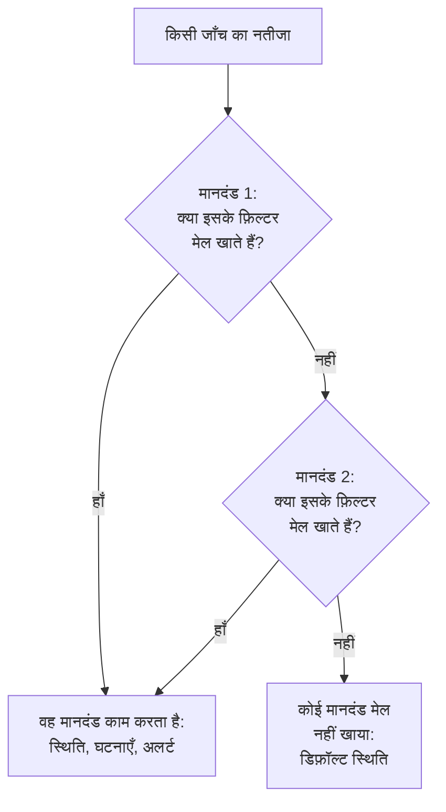
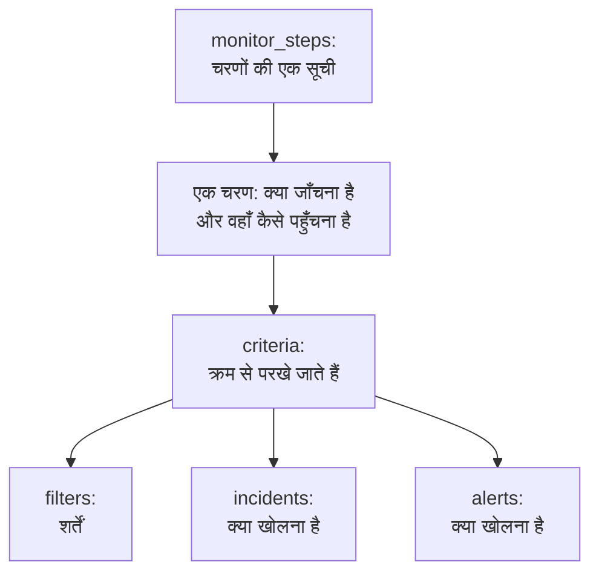

# मॉनिटर चरण

`monitor_steps`, `oneuptime_monitor` का वह एट्रिब्यूट है जो बताता है कि मॉनिटर क्या जाँचता है और हर नतीजे को कैसे परखा जाता है: जाँचने का पता, भेजने का अनुरोध, और वे मानदंड जो किसी नतीजे को मॉनिटर स्थिति, घटना या अलर्ट में बदलते हैं। यह पेज इसके हर हिस्से को समझाता है।

:::cards
- [जाँच को कैसे परखा जाता है](#जाँच-को-कैसे-परखा-जाता-है): क्रम से मानदंड, और पहला जो मेल खाता है।
- [चरण लिखें](#चरण-लिखें): उनका ढाँचा, एक पूरा उदाहरण, और मानों के दो नियम।
- [फ़िल्टर संदर्भ](#फ़िल्टर-संदर्भ): फ़िल्टर क्या जाँच सकता है, और कैसे तुलना करता है।
- [आम गलतियाँ](#आम-गलतियाँ): सबसे ज़्यादा क्या गलत होता है, और उसका हल।
:::

## जाँच को कैसे परखा जाता है

हर जाँच एक नतीजा देती है: किसी प्रोब का जवाब, किसी स्क्रिप्ट का लौटाया मान, या वह टेलीमेट्री जिसे जाँच पढ़ती है। फिर चरण के मानदंड उसे अपने क्रम में परखते हैं। जिस पहले मानदंड के फ़िल्टर मेल खाते हैं, वही तय करता है कि क्या होगा: वह मॉनिटर की स्थिति बदल सकता है, घटनाएँ खोल सकता है और अलर्ट खोल सकता है। उस जाँच के लिए उसके बाद के मानदंड नहीं देखे जाते।



इसलिए मानदंडों का क्रम मायने रखता है: अलर्ट करने वाले मानदंड पहले रखें, सबसे गंभीर सबसे पहले, और स्वस्थ वाला सबसे आख़िर में। [मानदंड के एट्रिब्यूट](#मानदंड-के-एट्रिब्यूट) बताता है कि क्यों, और एकमात्र अपवाद क्या है।

## चरण लिखें

`monitor_steps` टाइप किए गए ऑब्जेक्ट की एक सूची है जो सीधे HCL में लिखी जाती है। इसमें न `jsonencode()` है, न `{_type, value}` रैपर, न camelCase कुंजी, और न लिखने को कोई ID: प्रदाता आपके HCL को API के फ़ॉर्मैट में बदलता है, और सर्वर हर चरण, मानदंड, घटना टेम्पलेट और अलर्ट टेम्पलेट को उसका ID देता है। सर्वर हर apply में वे ID बनाए रखता है, हर मानदंड और टेम्पलेट को उसी से मिलाकर जिसकी जगह वह लेता है, नाम से, नहीं तो स्थान से, ताकि प्रोब के नतीजे अपने चरण के साथ रहें और घटनाएँ उन मानदंडों की ओर इशारा करती रहें जिन्होंने उन्हें खोला।



सबसे छोटा उपयोगी चरण एक पता जाँचता है और उसमें एक फ़िल्टर वाला एक मानदंड होता है:

```hcl
resource "oneuptime_monitor" "example" {
  name         = "Example"
  description  = "The smallest monitor_steps"
  monitor_type = "Website"

  monitor_steps = [{
    monitor_destination      = "https://example.com"
    monitor_destination_type = "URL"
    request_type             = "GET"

    criteria = [
      {
        name             = "Check if online"
        description      = "The website responds"
        filter_condition = "All"

        filters = [
          {
            check_on    = "Is Online"
            filter_type = "True"
          }
        ]
      }
    ]
  }]
}
```

`monitor_steps` में हर जगह दो नियम लागू होते हैं:

- **जो इस्तेमाल नहीं करते, उसे छोड़ दें।** जो एट्रिब्यूट आप सेट नहीं करते, वह API को नहीं भेजा जाता। प्लेसहोल्डर के रूप में कभी `[]`, `{}` या `""` न लिखें: प्रदाता खाली स्ट्रिंग, सूचियाँ और map अस्वीकार करता है, ताकि मान का न होना हमेशा "सेट नहीं" का मतलब हो।
- **फ़िल्टर के मान स्ट्रिंग होते हैं।** फ़िल्टर का `value` एक स्ट्रिंग है, संख्या होने पर भी: `value = "200"`, न कि `value = 200`। `port` जैसी संख्यात्मक सेटिंग्स संख्याएँ होती हैं।

:::details प्रदाता 1.x से आना, जहाँ monitor_steps JSON था
प्रदाता 1.x में, `monitor_steps` एक JSON स्ट्रिंग थी जो `jsonencode({ _type = "MonitorSteps", value = { ... } })` से लिखी जाती थी। इसे इस पेज के टाइप किए गए एट्रिब्यूट के रूप में फिर से लिखें: `_type` और `value` रैपर हटाएँ, camelCase कुंजियों को snake_case में लिखें (`monitorDestination` बन जाता है `monitor_destination` और `monitor_destination_type`, `filterCondition` बन जाता है `filter_condition`, `checkOn` बन जाता है `check_on`), और हर `id` हटा दें। अब सारे ID सर्वर देता है, जिससे issue [#2291](https://github.com/OneUptime/oneuptime/issues/2291) के हार्ड-कोड किए गए रैंडम ID भी ख़त्म हो जाते हैं। JSON स्ट्रिंग के रूप में सहेजी गई state अपने-आप अपग्रेड नहीं होती: नया कॉन्फ़िगरेशन लागू करें।
:::

### एक पूरा उदाहरण

यह वेबसाइट मॉनिटर वही जाँचता है जो प्रदाता के एंड-टू-एंड टेस्ट का वेबसाइट मॉनिटर जाँचता है (टेस्ट `35-monitor-with-steps`): साइट जवाब न दे तो offline, 200 से जवाब दे तो online।

```hcl
resource "oneuptime_monitor_status" "operational" {
  name                 = "Operational"
  description          = "Monitor is operational"
  color                = "#2ecc71"
  priority             = 1
  is_operational_state = true
}

resource "oneuptime_monitor_status" "offline" {
  name                 = "Offline"
  description          = "Monitor is offline"
  color                = "#e74c3c"
  priority             = 3
  is_operational_state = false
}

resource "oneuptime_monitor" "website" {
  name         = "Website"
  description  = "Website monitor with explicit steps"
  monitor_type = "Website"

  monitor_steps = [{
    monitor_destination      = "https://example.com" # what to check
    monitor_destination_type = "URL"                 # URL, Hostname or IP
    request_type             = "GET"                 # the HTTP method

    criteria = [ # judged in order: the first match decides
      {
        name                  = "Offline"
        description           = "Check if website is offline"
        filter_condition      = "Any"
        change_monitor_status = true
        create_incidents      = false
        create_alerts         = false
        monitor_status_id     = oneuptime_monitor_status.offline.id

        filters = [
          {
            check_on    = "Is Online"
            filter_type = "False"
          }
        ]
      },
      {
        name                  = "Online"
        description           = "Check if website is online"
        filter_condition      = "All" # All: every filter, Any: at least one
        change_monitor_status = true
        create_incidents      = false
        create_alerts         = false
        monitor_status_id     = oneuptime_monitor_status.operational.id

        filters = [
          {
            check_on    = "Is Online"
            filter_type = "True"
          },
          {
            check_on    = "Response Status Code"
            filter_type = "Equal To"
            value       = "200" # a string, even for a number
          }
        ]
      }
    ]
  }]
}
```

कोई मानदंड किसी स्थिति का संदर्भ उसके संसाधन से देता है, जैसे यहाँ `oneuptime_monitor_status.offline.id` करता है, या आपके प्रोजेक्ट में पहले से मौजूद स्थिति का संदर्भ किसी [डेटा स्रोत](/docs/terraform/complete-guide#जो-पहले-से-है-उसे-पढ़ें) से देता है।

## चरण के एट्रिब्यूट

`monitor_steps` की हर प्रविष्टि जाँचने की एक चीज़ है:

| एट्रिब्यूट | प्रकार | किसके द्वारा इस्तेमाल | टिप्पणियाँ |
| --- | --- | --- | --- |
| `monitor_destination` | string | वेबसाइट, API, Ping, IP, पोर्ट, SSL प्रमाणपत्र, NTP | जाँचने का URL, होस्टनेम या IP पता। `monitor_destination_type` ज़रूरी है। |
| `monitor_destination_type` | string | वही | `URL`, `Hostname` या `IP`, जैसा मॉनिटर का प्रकार लेता है: वेबसाइट, API और SSL प्रमाणपत्र मॉनिटर के लिए URL; Ping, IP, पोर्ट और NTP मॉनिटर के लिए होस्टनेम या IP पता। |
| `port` | number | पोर्ट, NTP | जाँचने का TCP पोर्ट, जैसे `443`। NTP के लिए, वह UDP पोर्ट जिस पर टाइम सर्वर जवाब देता है: सेट न होने पर `123`। |
| `request_type` | string | वेबसाइट, API | HTTP मेथड: `GET`, `POST`, `PUT`, `DELETE`, `HEAD` या `PATCH`। सेट न होने पर सर्वर `GET` इस्तेमाल करता है। |
| `request_headers` | map(string) | वेबसाइट, API | भेजने के हेडर: `{ "Accept" = "application/json" }`। |
| `request_body` | string | API | अनुरोध का बॉडी, टेक्स्ट के रूप में। |
| `do_not_follow_redirects` | bool | वेबसाइट, API | रीडायरेक्ट का पालन करने के बजाय पहले जवाब पर रुकें। |
| `allow_self_signed_certificates` | bool | वेबसाइट, API | स्व-हस्ताक्षरित TLS प्रमाणपत्र स्वीकार करें। |
| `tls_client_certificate` | string | वेबसाइट, API | म्यूचुअल TLS के लिए क्लाइंट प्रमाणपत्र: PEM, या `{{monitorSecrets.name}}` संदर्भ। |
| `tls_client_key` | string (संवेदनशील) | वेबसाइट, API | क्लाइंट प्रमाणपत्र की निजी कुंजी। इसे प्रमाणपत्र के साथ सेट करें। |
| `tls_client_key_passphrase` | string (संवेदनशील) | वेबसाइट, API | निजी कुंजी का पासफ़्रेज़। |
| `request_timeout_in_ms` | number | प्रोब द्वारा की जाने वाली जाँचें | एक प्रयास कितनी देर ले सकता है, मिलीसेकंड में। प्रोब 60000 से ऊपर के किसी भी मान को घटाकर 60000 कर देता है। |
| `retry_count` | number | प्रोब द्वारा की जाने वाली जाँचें | पहला प्रयास विफल होने के बाद के पुनःप्रयास: `0` एक बार जाँचता है, `3` अधिकतम चार बार। प्रोब 3 से ऊपर के किसी भी मान को घटाकर 3 कर देता है। |
| `custom_code` | string | Custom JavaScript Code, Synthetic | वह स्क्रिप्ट जिसे चरण चलाता है। |
| `screen_size_types` | list(string) | Synthetic | `Mobile`, `Tablet` और `Desktop`। |
| `browser_types` | list(string) | Synthetic | `Chromium` और `Firefox`। |
| `retry_count_on_error` | number | Synthetic | स्क्रिप्ट विफल होने पर पुनःप्रयास: `0` इसे एक बार चलाता है। |
| `criteria` | list (आवश्यक) | सभी | हर नतीजे को कैसे परखा जाता है: [मानदंड के एट्रिब्यूट](#मानदंड-के-एट्रिब्यूट) देखें। |

### हर मॉनिटर प्रकार की सेटिंग्स

जिन मॉनिटर प्रकारों में पते से ज़्यादा सेट करना होता है, वे अपनी सेटिंग्स (लॉग क्वेरी, डेटाबेस कनेक्शन, निगरानी करने का क्लस्टर) अपने ख़ुद के एट्रिब्यूट में रखते हैं, `jsonencode()` से लिखे कच्चे JSON के रूप में: `log_monitor`, `trace_monitor`, `llm_monitor`, `metric_monitor`, `exception_monitor`, `profile_monitor`, `dns_monitor`, `domain_monitor`, `dnssec_monitor`, `sql_monitor`, `database_monitor`, `external_status_page_monitor`, `network_device_monitor`, `kubernetes_monitor`, `docker_monitor`, `docker_swarm_monitor`, `host_monitor`, `podman_monitor`, `proxmox_monitor`, `vmware_monitor`, `ceph_monitor`, `storage_array_monitor`, `iot_monitor` और `probe_status_monitor`।

इनका JSON डैशबोर्ड वाला ही होता है, कुंजियाँ camelCase में। इसके भीतर ID वैसे ही लिखा जाता है जैसे API लिखता है: `{ _type = "ObjectID", value = "..." }`। एक Logs मॉनिटर जो किसी एक सेवा की त्रुटियाँ गिनता है:

```hcl
resource "oneuptime_service" "checkout" {
  name = "checkout"
}

resource "oneuptime_monitor" "checkout_errors" {
  name         = "Checkout errors"
  monitor_type = "Logs"

  monitor_steps = [{
    log_monitor = jsonencode({
      attributes          = {}
      body                = "error"
      severityTexts       = ["Error"]
      telemetryServiceIds = [{ _type = "ObjectID", value = oneuptime_service.checkout.id }]
      lastXSecondsOfLogs  = 300
    })

    criteria = [
      {
        name             = "Errors found"
        filter_condition = "Any"

        filters = [
          {
            check_on    = "Log Count"
            filter_type = "Greater Than"
            value       = "0"
          }
        ]
      }
    ]
  }]
}
```

> [!TIP]
> यह JSON सही पाने का सबसे आसान तरीका: डैशबोर्ड में मॉनिटर सेट करें, फिर उसका **डेवलपर** सेक्शन और **Terraform** खोलें। पेज मॉनिटर के `monitor_steps` लिखता है, `jsonencode()` समेत।

## मानदंड के एट्रिब्यूट

`criteria` की हर प्रविष्टि एक नियम है: जब इसके फ़िल्टर मेल खाते हैं, तो वह करें जो यह कहता है।

मानदंड ऊपर से परखे जाते हैं, और पहला मेल खाने वाला तय करता है, इसलिए अलर्ट करने वाले मानदंड पहले रखें, सबसे गंभीर सबसे पहले (गंभीर, फिर चेतावनी), और स्वस्थ वाला सबसे आख़िर में। सबसे ऊपर स्वस्थ मानदंड रखना ऐसा मॉनिटर बनाने का सबसे आम तरीका है जो कभी अलर्ट नहीं करता: `Is Online` का `True` होना, या किसी मेट्रिक मान का `Greater Than` `0` होना जैसा व्यापक नियम लगभग हर जाँच से मेल खाता है, और उसके नीचे के मानदंड कभी देखे ही नहीं जाते। आख़िर में रखने पर यह तभी मेल खाता है जब ऊपर का कोई मेल न खाया हो, और यही आप चाहते हैं।

समूहित मेट्रिक मॉनिटर ही एकमात्र अपवाद हैं। जब किसी मेट्रिक मॉनिटर की क्वेरी समूहित होती है (`metric_monitor` के JSON में `metricViewConfig.queryConfigs[].metricQueryData.groupByAttributeKeys` पर `groupByAttributeKeys` सेट हो), तो मॉनिटर हर समूह (हर होस्ट, कंटेनर या माउंट पॉइंट) के लिए एक अलर्ट या घटना खोलता है, और हर मानदंड परखा जाता है, इसलिए एक ही जाँच में एक गंभीर मानदंड और एक चेतावनी वाला मानदंड अलग-अलग होस्ट के लिए ट्रिगर हो सकते हैं। जो होस्ट दोनों को तोड़ता है, उसे फिर भी केवल एक बार पेज किया जाता है, पहले मेल खाने वाले मानदंड से, इसलिए सबसे गंभीर अब भी पहले जाता है। [मेट्रिक्स मॉनिटर](/docs/monitor/metrics-monitor) देखें।

| एट्रिब्यूट | प्रकार | यह क्या है |
| --- | --- | --- |
| `name` | string (आवश्यक) | वह नाम जो डैशबोर्ड दिखाता है। |
| `description` | string | वह विवरण जो डैशबोर्ड दिखाता है। |
| `filter_condition` | string (आवश्यक) | `All`: हर फ़िल्टर को मेल खाना चाहिए। `Any`: एक काफ़ी है। |
| `filters` | list (आवश्यक) | शर्तें, कम से कम एक: [फ़िल्टर संदर्भ](#फ़िल्टर-संदर्भ) देखें। |
| `change_monitor_status` | bool | क्या मेल होने पर मॉनिटर की स्थिति बदलती है। |
| `monitor_status_id` | string | उस `oneuptime_monitor_status` का ID जिसमें बदलना है। इसे तब सेट करें जब `change_monitor_status` `true` हो। |
| `create_incidents` | bool | क्या मेल होने पर घटनाएँ खुलती हैं। |
| `incidents` | list | खोली जाने वाली घटनाएँ। इसे छोड़ दें, जब तक `create_incidents = true` न हो। |
| `create_alerts` | bool | क्या मेल होने पर अलर्ट खुलते हैं। |
| `alerts` | list | खोले जाने वाले अलर्ट। इसे छोड़ दें, जब तक `create_alerts = true` न हो। |
| `is_enabled` | bool | सेट न होने पर सर्वर पर `true`। किसी मानदंड को रखते हुए उससे न परखने के लिए `false` सेट करें। |
| `incident_grouping` | string (JSON) | केवल आने वाले अनुरोध मॉनिटर: अनुरोध में मिले हर मान के लिए एक घटना, जैसे `jsonencode({ groupByJSONPath = "..." })`। |
| `open_for_every_email` | bool | केवल आने वाले ईमेल मॉनिटर: `true` होने पर, एक बार में एक नहीं, बल्कि मेल खाने वाले हर ईमेल के लिए एक घटना (और अलर्ट) खुलती है। |

### घटनाएँ और अलर्ट

`incidents` की कोई प्रविष्टि `title` और `description` (दोनों आवश्यक), `incident_severity_id`, `auto_resolve_incident`, `remediation_notes`, `on_call_policy_ids`, `label_ids`, `owner_team_ids`, `owner_user_ids`, `show_incident_on_status_page` और `is_private` लेती है। `alerts` की कोई प्रविष्टि यही लेती है, `alert_severity_id` और `auto_resolve_alert` के साथ, और `show_incident_on_status_page` के बिना।

यह मानदंड मॉनिटर को offline चिह्नित करता है, ऑन-कॉल नीति को पेज करने वाली एक घटना खोलता है, और साइट वापस आने पर उसे हल कर देता है:

```hcl
criteria = [
  {
    name                  = "Offline"
    description           = "The site is unreachable"
    filter_condition      = "Any"
    change_monitor_status = true
    monitor_status_id     = oneuptime_monitor_status.offline.id
    create_incidents      = true

    filters = [
      {
        check_on    = "Is Online"
        filter_type = "False"
      }
    ]

    incidents = [
      {
        title                 = "Website is down"
        description           = "The website did not respond to the probe."
        incident_severity_id  = oneuptime_incident_severity.critical.id
        auto_resolve_incident = true
        on_call_policy_ids    = [oneuptime_on_call_policy.primary.id]
      }
    ]
  }
]
```

## फ़िल्टर संदर्भ

किसी फ़िल्टर में `check_on` (क्या देखना है), `filter_type` (कैसे तुलना करनी है) और `value` (किससे तुलना करनी है, स्ट्रिंग के रूप में; `True` और `False` जैसी सही-या-गलत जाँचों के लिए इसे छोड़ दें) होते हैं।

कोई फ़िल्टर आख़िरी जाँच के बजाय समय की एक अवधि को भी परख सकता है: `evaluate_over_time = true` सेट करें, अवधि की लंबाई `evaluate_over_time_minutes` में, और `evaluate_over_time_type` में यह कि अवधि को कैसे पढ़ा जाए: `Average`, `Sum`, `Maximum Value`, `Minimum Value`, `All Values` या `Any Value`।

`All Values` का मतलब है कि अवधि की हर जाँच ने नियम तोड़ा, इसलिए यह तभी मेल खाता है जब अवधि डेटा से भर चुकी हो: अभी बना मॉनिटर अपनी पहली जाँच पर मेल खाने के बजाय अपनी अवधि भरने का इंतज़ार करता है। इसे मॉनिटर के `monitoring_interval` से कम से कम दोगुनी अवधि दें; नहीं तो अवधि में एक ही जाँच होती है, और "सभी मान" का मतलब वही हो जाता है जो "कोई भी मान" का। `Any Value` जानबूझकर नियम तोड़ने वाली एक जाँच पर मेल खाता है।

`evaluate_over_time_no_data_policy` बताता है कि जब तक अवधि में पर्याप्त डेटा न हो, तब तक फ़िल्टर क्या करता है: `Ignore` (डिफ़ॉल्ट) मेल नहीं खाता, `Trigger` गायब डेटा को विफलता मानता है, जैसे heartbeat करता है, और `Treat As Zero` अवधि की तुलना एक अकेले शून्य के रूप में करता है।

### फ़िल्टर क्या जाँच सकता है

हर मॉनिटर प्रकार में सबसे ज़्यादा इस्तेमाल होने वाले `check_on` मान। डैशबोर्ड का मानदंड संपादक यही मान देता है, और सभी को सूचीबद्ध करता है:

| मॉनिटर प्रकार | `check_on` मान |
| --- | --- |
| वेबसाइट / API | `Is Online`, `Response Time (in ms)`, `Response Status Code`, `Response Body`, `Response Header`, `Response Header Value`, `JavaScript Expression`, `Is Request Timeout` |
| Ping / IP | `Is Online`, `Response Time (in ms)`, `Packet Loss (in %)`, `Jitter (in ms)`, `Is Request Timeout` |
| पोर्ट | `Is Online`, `Response Time (in ms)` (डैशबोर्ड का कुल कनेक्शन समय), `Port DNS Lookup Time (in ms)`, `Port TCP Connect Time (in ms)`, `Is Request Timeout` |
| SSL प्रमाणपत्र | `Is Valid Certificate`, `Is Not A Valid Certificate`, `Is Self Signed Certificate`, `Is Expired Certificate`, `Expires In Days`, `Expires In Hours` |
| आने वाला अनुरोध | `Incoming Request`, `Request Body`, `Request Header`, `Request Header Value`, `JavaScript Expression` |
| आने वाला ईमेल | `Email Received`, `Email Subject`, `Email From Address`, `Email To Address`, `Email Body` |
| सर्वर | `Is Online`, `CPU Usage (in %)`, `Memory Usage (in %)`, `Disk Usage (in %)` (`disk_path` के साथ), `Server Process Name` |
| लॉग | `Log Count` |
| ट्रेस | `Span Count` |
| अपवाद | `Exception Count` |
| प्रोफ़ाइल | `Profile Count` |
| AI / LLM | `Bad AI Answers (in %)`, `Bad AI Answers`, `AI Answers` |
| मेट्रिक्स | `Metric Value` (मेट्रिक फ़िल्टर `metric_monitor_options` JSON ले सकते हैं) |
| कस्टम कोड / Synthetic | `Result Value` (लौटाए गए डेटा के किसी एक फ़ील्ड की तुलना कर सकता है, जिसका नाम `custom_code_monitor_options` JSON में होता है, जैसे `jsonencode({ resultValuePath = "status" })` — नीचे देखें), `Error`, `Execution Time (in ms)` |
| DNS | `DNS Is Online`, `DNS Response Time (in ms)`, `DNS Record Value`, `DNS Record Exists` |
| डोमेन | `Domain Expires In Days`, `Domain Is Expired`, `Domain Registrar`, `Domain Name Server` |
| DNSSEC | `DNSSEC Chain Is Valid`, `DNSSEC DS Record Exists At Parent`, `DNSSEC Signature Expires In Days` |
| SQL क्वेरी | `SQL Is Online`, `SQL Query Row Count`, `SQL Query Scalar Value` |
| डेटाबेस हेल्थ | `Database Is Online`, `Database Metric` (`database_monitor_options` JSON के साथ जो सीरीज़ का नाम बताता है, जैसे `jsonencode({ metricType = "oneuptime.monitor.database.connections.used.percent" })`), `Database Collection Error` |
| बाहरी स्थिति पृष्ठ | `External Status Page Is Online`, `External Status Page Active Incidents`, `External Status Page Component Status` |
| NTP | `NTP Is Online`, `NTP Is Synchronized`, `NTP Stratum`, `NTP Clock Offset (in ms)`, `NTP Response Time (in ms)`, `NTP Root Dispersion (in ms)` (`NTP Is Online` और `NTP Is Synchronized` कोई `value` नहीं लेते) |
| नेटवर्क डिवाइस (SNMP) | `SNMP Device Is Online` (यह ping या SNMP का जवाब देता है), `SNMP Walk Is Succeeding` (false जब यह जवाब देता है पर walk नहीं किया जा सकता), `SNMP OID Value` (SNMP फ़िल्टर `snmp_monitor_options` JSON ले सकते हैं) |

### फ़िल्टर कैसे तुलना करता है

| प्रकार | `filter_type` मान |
| --- | --- |
| सही या गलत | `True`, `False` |
| संख्याएँ | `Equal To`, `Not Equal To`, `Greater Than`, `Less Than`, `Greater Than Or Equal To`, `Less Than Or Equal To` |
| टेक्स्ट | `Contains`, `Not Contains`, `Starts With`, `Ends With`, `Is Empty`, `Is Not Empty` |
| Heartbeat | `Recieved In Minutes`, `Not Recieved In Minutes` (वैसे ही लिखे गए जैसे API लिखता है) |
| सर्वर प्रोसेस | `Is Executing`, `Is Not Executing` |
| स्क्रिप्ट | `Evaluates To True` |
| विसंगतियाँ, मेट्रिक्स, लॉग और ट्रेस के लिए | `Anomalously High`, `Anomalously Low`, `Anomalous` |

एक फ़िल्टर जो तब मेल खाता है जब कोई SSL प्रमाणपत्र 14 दिन या उससे कम में समाप्त होने वाला हो:

```hcl
filters = [
  {
    check_on    = "Expires In Days"
    filter_type = "Less Than Or Equal To"
    value       = "14"
  }
]
```

प्रदाता प्लान बनाते समय `check_on`, `filter_type` और दूसरी तय सूचियाँ जाँचता है, इसलिए कोई टाइपो API को कुछ भी भेजे जाने से पहले ही विफल हो जाता है। ये मान डैशबोर्ड के मानदंड संपादक के विकल्पों के लिए API के नाम हैं।

### किसी स्क्रिप्ट के नतीजे के एक फ़ील्ड की तुलना

किसी कस्टम कोड मॉनिटर या Synthetic मॉनिटर की स्क्रिप्ट `data` लौटाती है, और `Result Value` फ़िल्टर उसकी तुलना करता है। जब `data` कोई ऑब्जेक्ट या ऐरे हो, तो `custom_code_monitor_options` उसके उस एक फ़ील्ड का नाम बताता है जिसकी तुलना करनी है: डैशबोर्ड के Result Value फ़िल्टर का **फ़ील्ड पथ**। नेस्टेड फ़ील्ड के लिए डॉट और ऐरे आइटम के लिए `[n]` इस्तेमाल करें, और पूरे मान की तुलना के लिए एट्रिब्यूट छोड़ दें:

```hcl
monitor_steps = [{
  custom_code = <<-EOT
    const response = await axios.get("https://api.example.com/health");
    // For example { status: "UP", checks: [{ name: "db", latency: 12 }] }
    return { data: response.data };
  EOT

  criteria = [
    {
      name             = "Unhealthy"
      filter_condition = "Any"
      filters = [
        {
          check_on                    = "Result Value"
          filter_type                 = "Not Equal To"
          value                       = "UP"
          custom_code_monitor_options = jsonencode({ resultValuePath = "status" })
        },
        {
          check_on                    = "Result Value"
          filter_type                 = "Greater Than"
          value                       = "500"
          custom_code_monitor_options = jsonencode({ resultValuePath = "checks[0].latency" })
        }
      ]
    }
  ]
}]
```

`Greater Than` और दूसरी संख्या वाली शर्तें केवल ऐसे फ़ील्ड से मेल खाती हैं जो संख्या हो, और लौटाए गए डेटा में मौजूद न होने वाला फ़ील्ड केवल `Is Empty` से मेल खाता है। पथ और शर्तें कैसे काम करती हैं, इसके लिए [लौटाए गए डेटा पर अलर्ट](/docs/monitor/custom-code-monitor#लौटाए-गए-डेटा-पर-अलर्ट) देखें।

## आम गलतियाँ

1. **खाली प्लेसहोल्डर।** `incidents = []`, `request_headers = {}` और `description = ""` अस्वीकार किए जाते हैं: इसके बजाय एट्रिब्यूट छोड़ दें।
2. **जहाँ स्ट्रिंग चाहिए वहाँ संख्या।** फ़िल्टर का `value` एक स्ट्रिंग है, संख्या होने पर भी: `value = "200"`। `port`, `retry_count`, `request_timeout_in_ms` और `evaluate_over_time_minutes` जैसी संख्यात्मक सेटिंग्स संख्याएँ लेती हैं।
3. **गलत गंतव्य प्रकार।** खाली होस्टनेम के साथ `monitor_destination_type = "URL"`, या पूरे URL के साथ `Hostname`, जाँच को विफल कर देता है। वेबसाइट और API मॉनिटर URL लेते हैं; Ping, IP और पोर्ट मॉनिटर होस्टनेम या IP पते लेते हैं।
4. **स्थिति के बिना स्थिति बदलना।** `monitor_status_id` के बिना `change_monitor_status = true` मेल खाता है, पर उसके पास बदलने को कोई स्थिति नहीं होती।
5. **ID.** `monitor_steps` की किसी प्रविष्टि में `id` एट्रिब्यूट नहीं होता। अगर आप पुराने JSON से आ रहे हैं, तो उन्हें हटा दें: ID सर्वर देता है।
6. **हाथ से लिखा JSON।** `log_monitor` और दूसरी सेटिंग्स `jsonencode()` से लिखें, ताकि Terraform उन्हें कोट करे और JSON हर बार एक ही तरह लिखे। `metric_monitor` के लिए, वह पूरा ऑब्जेक्ट दें जो डैशबोर्ड लिखता है: सर्वर उसे सामान्य कर देता है।

## जब कोई मानदंड मेल नहीं खाता

जो जाँच किसी भी मानदंड से मेल नहीं खाती, वह मॉनिटर को उसकी डिफ़ॉल्ट स्थिति में डाल देती है: प्रोजेक्ट की चालू स्थिति, वही जो डैशबोर्ड किसी नए मॉनिटर के लिए चुनता है। उसकी खुली घटनाएँ, जिनके मानदंडों ने स्वतः हल चुना था, भी हल हो जाती हैं। हर नतीजा ख़ुद तय करने के लिए, सूची को एक व्यापक स्वस्थ मानदंड पर ख़त्म करें, जैसा इस पेज के उदाहरण करते हैं।

## बिना चरणों वाला मॉनिटर

`monitor_steps` वैकल्पिक है, पर इसके बिना बने मॉनिटर के पास नतीजा परखने के लिए कोई मानदंड नहीं होता: प्रोब बिना चरणों वाले मॉनिटर को छोड़ देते हैं, और वह उसी स्थिति में रहता है जिसमें उसने शुरुआत की थी। आपकी state एट्रिब्यूट को खाली रखती है, और प्लान साफ़ रहता है। मैन्युअल मॉनिटर को कभी चरणों की ज़रूरत नहीं होती: उसकी स्थिति आप ख़ुद सेट करते हैं। हर दूसरे प्रकार को कुछ भी जाँचने के लिए कम से कम एक चरण चाहिए।

## वायर फ़ॉर्मैट

प्रदाता के पीछे, API अब भी अपना JSON बोलता है, जिसमें हर जटिल ऑब्जेक्ट `{_type, value}` के रूप में लिपटा होता है:

```json
{
  "_type": "MonitorSteps",
  "value": {
    "monitorStepsInstanceArray": [
      {
        "_type": "MonitorStep",
        "value": {
          "monitorDestination": { "_type": "URL", "value": "https://example.com" },
          "requestType": "GET",
          "monitorCriteria": {
            "_type": "MonitorCriteria",
            "value": { "monitorCriteriaInstanceArray": [ { "_type": "MonitorCriteriaInstance", "value": { "...": "..." } } ] }
          }
        }
      }
    ]
  }
}
```

प्रदाता लिखते समय इसे आपके HCL से बनाता है, और इसे वापस HCL में पढ़ता है, सर्वर जो प्रबंधित करता है (ID और उसके जोड़े डिफ़ॉल्ट) उसे छोड़ते हुए। इससे आपका सामना तभी होता है जब आप ख़ुद API के जवाब पढ़ते हैं, उदाहरण के लिए किसी ऐसी स्क्रिप्ट में जो `monitorSteps` पढ़ती है।

## अगले कदम

:::cards
- [उदाहरण](/docs/terraform/examples): इस्तेमाल को तैयार Ping, पोर्ट, SSL प्रमाणपत्र और API मॉनिटर।
- [संपूर्ण गाइड](/docs/terraform/complete-guide): डेटा स्रोत, state और अपग्रेड।
- [मेट्रिक्स मॉनिटर](/docs/monitor/metrics-monitor): मेट्रिक क्वेरी, समूहन और विसंगतियाँ।
- [समस्या निवारण](/docs/terraform/troubleshooting): जिसमें किसी मॉनिटर पर apply के बाद असंगत नतीजा भी शामिल है।
:::
