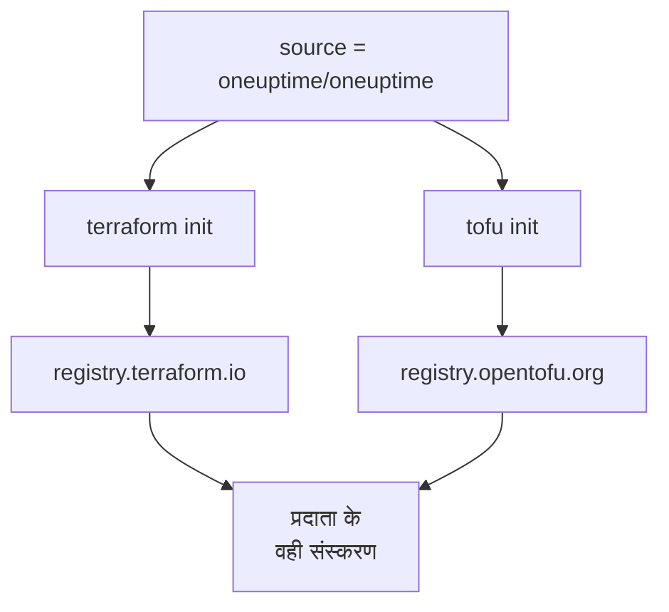

# OpenTofu

OneUptime प्रदाता [OpenTofu](https://opentofu.org) के साथ वैसे ही काम करता है जैसे Terraform के साथ। यह [OpenTofu Registry](https://search.opentofu.org/provider/oneuptime/oneuptime/latest) पर प्रकाशित होता है, और हर रिलीज़ प्रकाशित होने से पहले दोनों के तहत वही एंड-टू-एंड परीक्षण पास करती है। आपका कॉन्फ़िगरेशन नहीं बदलता: जहाँ भी ये दस्तावेज़ `terraform` चलाते हैं, वहाँ `tofu` चलाएँ।

:::cards
- [OpenTofu के साथ प्रदाता इस्तेमाल करें](#opentofu-के-साथ-प्रदाता-इस्तेमाल-करें): वही कॉन्फ़िगरेशन, `tofu` के साथ चलाया गया।
- [Terraform से क्या अलग है](#terraform-से-क्या-अलग-है): रजिस्ट्री, लॉक फ़ाइलें, `.tofu` फ़ाइलें और संस्करण।
- [कॉन्फ़िगरेशन को OpenTofu पर ले जाएँ](#कॉन्फ़िगरेशन-को-opentofu-पर-ले-जाएँ): मौजूदा कॉन्फ़िगरेशन को चार चरणों में बदलें।
- [एक दोबारा इस्तेमाल होने वाला मॉड्यूल](#एक-दोबारा-इस्तेमाल-होने-वाला-मॉड्यूल): एक सेवा के लिए मॉनिटर, एक ऑन-कॉल नीति और एक स्थिति पृष्ठ।
:::

## OpenTofu के साथ प्रदाता इस्तेमाल करें

आपको OpenTofu 1.6 या उसके बाद का संस्करण चाहिए। प्रदाता को वैसे ही घोषित करें जैसे Terraform के लिए करते:

```hcl title="main.tf"
terraform {
  required_providers {
    oneuptime = {
      source  = "oneuptime/oneuptime"
      version = "{{TERRAFORM_PROVIDER_VERSION}}"
    }
  }
}

provider "oneuptime" {
  # The API key comes from the ONEUPTIME_API_KEY environment variable.
  # On a self-hosted OneUptime, add your OneUptime's address:
  # oneuptime_url = "https://oneuptime.example.com"
}
```

फिर इसे `tofu` के साथ चलाएँ:

```bash
export ONEUPTIME_API_KEY="<your-api-key>"
tofu init
tofu plan
tofu apply
```

`tofu init` प्रदाता को OpenTofu Registry से डाउनलोड करता है। [त्वरित प्रारंभ](/docs/terraform/quick-start), [संपूर्ण गाइड](/docs/terraform/complete-guide), [मॉनिटर चरण](/docs/terraform/monitor-steps), [उदाहरण](/docs/terraform/examples) और [संसाधन आयात करना](/docs/terraform/importing-resources) में सब कुछ जैसा है वैसा लागू होता है, और डैशबोर्ड के **Terraform** पेज जो कॉन्फ़िगरेशन लिखते हैं वह बिना बदलाव के काम करता है।

### स्रोत पते में रजिस्ट्री न लिखें

`source = "oneuptime/oneuptime"` किसी रजिस्ट्री का नाम नहीं लेता, इसलिए हर इंजन इसे अपनी रजिस्ट्री से पढ़ता है:



होस्टनाम न लिखें। होस्टनाम लिखने पर हर इंजन उसी रजिस्ट्री का इस्तेमाल करता है: `registry.terraform.io/oneuptime/oneuptime` के साथ, OpenTofu भी Terraform Registry से डाउनलोड करता है, और Terraform OpenTofu Registry की कॉपी को `authentication signature from unknown issuer` के साथ अस्वीकार कर देता है।

## Terraform से क्या अलग है

| विषय | OpenTofu के तहत |
| --- | --- |
| रजिस्ट्री | `oneuptime/oneuptime` का मतलब `registry.opentofu.org/oneuptime/oneuptime` है, जो Terraform Registry वाले संस्करण ही प्रकाशित करती है। |
| हस्ताक्षर | `tofu init` बताता है कि हस्ताक्षर सत्यापन छोड़ दिया गया: OpenTofu Registry के पास इस प्रदाता की कोई हस्ताक्षर कुंजी नहीं है, इसलिए OpenTofu डाउनलोड को रजिस्ट्री के checksum से जाँचता है। |
| `terraform` ब्लॉक | `terraform` ही रहता है: यह भाषा का हिस्सा है, और OpenTofu इसे जैसा है वैसा पढ़ता है। |
| `.tofu` फ़ाइलें | OpenTofu 1.8 और उसके बाद के संस्करण `.tofu` फ़ाइलें भी पढ़ते हैं, और उस `.tf` फ़ाइल को छोड़ देते हैं जिसके साथ उसी नाम की `.tofu` फ़ाइल हो। Terraform केवल `.tf` फ़ाइलें पढ़ता है। |
| `required_version` | OpenTofu के संस्करण 1.6.0 से शुरू होते हैं, इसलिए Terraform के लिए लिखा गया `>= 1.5.0` हर OpenTofu को स्वीकार करता है। |
| लॉक फ़ाइल | `registry.opentofu.org/oneuptime/oneuptime` का नाम लेती है। इंजन बदलने से वह प्रविष्टि फिर से लिखी जाती है: बदलाव commit करें। |
| State | OpenTofu Terraform की लिखी state को जैसी है वैसी पढ़ता है। |
| वेरिएबल | `TF_VAR_name` OpenTofu के तहत भी वेरिएबल सेट करता है। |
| CLI कॉन्फ़िगरेशन फ़ाइल | `~/.tofurc` या `~/.terraformrc`, या वह फ़ाइल जिसका नाम `TF_CLI_CONFIG_FILE` देता है। |
| `removed` ब्लॉक | उसके `lifecycle` ब्लॉक के लिए OpenTofu 1.10 या उसके बाद का संस्करण चाहिए। उसके बिना, OpenTofu संसाधन को भूल जाता है और रिकॉर्ड रखता है, जबकि Terraform उसे नष्ट कर देता है। |
| नाम बदले गए संसाधन प्रकार पर जाना | `oneuptime_io_t_fleet` से `oneuptime_iot_fleet` तक, या दूसरे नाम बदले गए प्रकारों के बीच, `moved` ब्लॉक के लिए OpenTofu 1.12 या उसके बाद का संस्करण चाहिए। |

## कॉन्फ़िगरेशन को OpenTofu पर ले जाएँ

Terraform द्वारा प्रबंधित कॉन्फ़िगरेशन अपनी state के साथ, जैसा है वैसा, OpenTofu पर चला जाता है:

:::steps
### OpenTofu इंस्टॉल करें

OpenTofu इंस्टॉल करें: प्रदाता के लिए 1.6 काफ़ी है, और 1.12 या उसके बाद का संस्करण किसी संसाधन को नाम बदले गए प्रकार पर भी ले जाता है, जैसे `oneuptime_io_t_fleet` से `oneuptime_iot_fleet` पर।

### tofu के साथ इनिशियलाइज़ करें

कॉन्फ़िगरेशन के फ़ोल्डर में, `tofu init` चलाएँ। यह प्रदाता को OpenTofu Registry से डाउनलोड करता है, और बताता है कि उसने लॉक फ़ाइल बदली: प्रदाता की प्रविष्टि अब OpenTofu Registry का नाम लेती है।

### प्लान करें

`tofu plan` चलाएँ। यह Terraform की छोड़ी हुई state पढ़ता है, और जवाब देता है `No changes.`

### लॉक फ़ाइल commit करें

`.terraform.lock.hcl` commit करें, और अब से कॉन्फ़िगरेशन को `tofu` के साथ चलाएँ, CI में भी।
:::

## एक दोबारा इस्तेमाल होने वाला मॉड्यूल

OneUptime रिपॉज़िटरी में [`Examples/opentofu/`](https://github.com/OneUptime/oneuptime/tree/master/Examples/opentofu) में चलाने के लिए तैयार कॉन्फ़िगरेशन हैं, और एक मॉड्यूल जो एक सेवा सेट करता है: आपके दिए हर पते के लिए एक वेबसाइट मॉनिटर, उसके बनाए हर चीज़ पर एक लेबल, एक एस्केलेशन नियम वाली ऑन-कॉल नीति, और मॉनिटर की सूची दिखाने वाला एक स्थिति पृष्ठ। यह सादा HCL है, इसलिए Terraform के तहत भी काम करता है।

```hcl title="main.tf"
module "storefront" {
  source = "github.com/OneUptime/terraform-provider-oneuptime//modules/monitoring-and-incident-response?ref=vX.Y.Z"

  service_name          = "storefront"
  status_page_is_public = true

  monitors = {
    homepage = { url = "https://example.com" }
    checkout = { url = "https://example.com/checkout" }
    api      = { url = "https://api.example.com/health", expected_status_code = "204" }
  }
}
```

`vX.Y.Z` को किसी प्रकाशित प्रदाता संस्करण से बदलें, जैसे [प्रदाता की रिलीज़](https://github.com/OneUptime/terraform-provider-oneuptime/releases) में सबसे नया: मॉड्यूल प्रदाता के साथ प्रकाशित होता है, और उसकी रिपॉज़िटरी हर रिलीज़ के साथ बदलती है।

मॉड्यूल मॉनिटर स्थितियाँ या घटना गंभीरताएँ नहीं बनाता। यह उन्हें नाम से खोजता है जिनके साथ हर प्रोजेक्ट शुरू होता है: `Operational`, `Offline` और `Critical Incident`। अगर आपके प्रोजेक्ट ने उनके नाम बदले हैं, तो `operational_monitor_status_name`, `offline_monitor_status_name` या `incident_severity_name` सेट करें।

इसका एस्केलेशन नियम तब तक किसी को पेज नहीं करता जब तक आप न बताएँ कि किसे: मॉड्यूल के आउटपुट के साथ इसमें एक टीम जोड़ें:

```hcl title="main.tf"
resource "oneuptime_team" "storefront" {
  name = "Storefront"
}

resource "oneuptime_team_on_call_duty_escalation_rule" "storefront" {
  on_call_duty_policy_id                 = module.storefront.on_call_policy_id
  on_call_duty_policy_escalation_rule_id = module.storefront.escalation_rule_id
  team_id                                = oneuptime_team.storefront.id
}
```

## अगले कदम

:::cards
- [त्वरित प्रारंभ](/docs/terraform/quick-start): API कुंजी बनाएँ और अपने पहले संसाधन लागू करें।
- [रजिस्ट्री उपयोग](/docs/terraform/registry): संस्करण कैसे क्रमांकित होते हैं, और लॉक फ़ाइल।
- [स्व-होस्टेड सेटअप](/docs/terraform/self-hosted): आपका अपना OneUptime, और ऑफ़लाइन मशीनों के लिए मिरर।
- [समस्या निवारण](/docs/terraform/troubleshooting): आम त्रुटियाँ और उन्हें ठीक करने का तरीका।
:::
