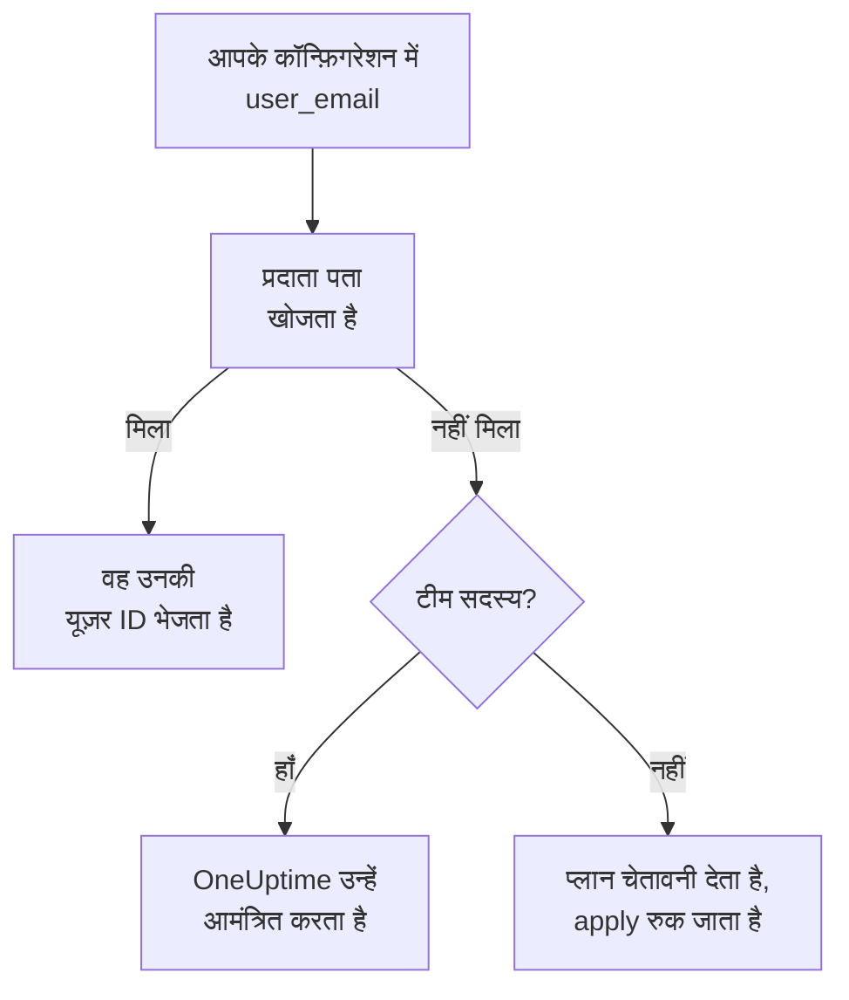

# लोग और टीमें

अपने प्रोजेक्ट में कौन है, इसे अपने Terraform कॉन्फ़िगरेशन में रखें: टीमें और उनके सदस्य, कौन ऑन-कॉल है, और किसका क्या है। हर व्यक्ति को उनके ईमेल पते से बताएँ: प्रदाता उन्हें ढूँढ लेता है, और प्रोजेक्ट में नए हर व्यक्ति को आमंत्रित करता है।

:::cards
- [लोगों को ईमेल पते से बताएँ](#लोगों-को-ईमेल-पते-से-बताएँ): हर यूज़र ID के बगल वाला एट्रिब्यूट।
- [किसी को शामिल करें](#किसी-को-शामिल-करें): किसी को आमंत्रित करें, और उन्हें एक टीम, ऑन-कॉल की बारियाँ और कुछ ऐसा दें जिसके वे स्वामी हों।
- [किसी को विदा करें](#किसी-को-विदा-करें): किसी को हटाएँ, और वह जो OneUptime उनके साथ हटाता है।
- [पहले से मौजूद सदस्यों को आयात करें](#पहले-से-मौजूद-सदस्यों-को-आयात-करें): उनकी टीम और उनके पते से।
:::

## यह कैसे काम करता है

प्रदाता उस पते को API कुंजी के प्रोजेक्ट के लोगों में खोजता है: उसके सदस्यों में, और उसमें आमंत्रित लोगों में। जिस व्यक्ति को वह पाता है, उसकी ID वह API को भेजता है। ऐसे पते से बताया गया टीम सदस्य जो प्रोजेक्ट में किसी के पास नहीं है, उसकी जगह उस पते को आमंत्रित करता है।



केवल API कुंजी का अपना प्रोजेक्ट खोजा जाता है। उसके बाहर का कोई भी कभी नहीं मिलता, और प्रदाता यह नहीं जान सकता कि किसी पते का कहीं और खाता है या नहीं।

## शुरू करने से पहले

- **एक API कुंजी जो प्रोजेक्ट की टीमें पढ़ सके।** प्रदाता उन्हीं के ज़रिए लोगों को ढूँढता है।
- **किसी नए को जोड़ने के लिए, एक कुंजी जो लोगों को आमंत्रित कर सके।** [लोगों को आमंत्रित करना](/docs/permissions/inviting-people) देखें।

## लोगों को ईमेल पते से बताएँ

किसी व्यक्ति को बताने वाला हर संसाधन उनकी यूज़र ID के बगल में उनका ईमेल पता भी लेता है। दोनों में से एक दें:

| यूज़र ID | ईमेल पता |
| --- | --- |
| `user_id` | `user_email` |
| `owner_users` | `owner_user_emails` |
| `assigned_to_user_id` | `assigned_to_user_email` |
| `override_user_id` | `override_user_email` |

पता बड़े और छोटे अक्षरों की परवाह किए बिना मिलता है, और state में वैसे ही रखा जाता है जैसे आपने लिखा। यूज़र ID भर दी जाती है, ताकि दूसरे संसाधन उसका संदर्भ दे सकें।

## किसी को शामिल करें

यह कॉन्फ़िगरेशन Alice को, जो प्रोजेक्ट में नई है, एक टीम में जोड़ता है, उसे पहले दिन से ऑन-कॉल की बारियाँ देता है, और Bob को, जो पहले से प्रोजेक्ट में है, एक मॉनिटर का स्वामी बनाता है:

```hcl title="people.tf"
resource "oneuptime_team" "sre" {
  name        = "SRE"
  description = "Site reliability engineering"
}

# New to the project: OneUptime invites her.
resource "oneuptime_team_member" "alice" {
  team_id    = oneuptime_team.sre.id
  user_email = "alice@example.com"
}

resource "oneuptime_on_call_policy_schedule" "weekly" {
  name     = "SRE weekly"
  timezone = "UTC"
}

resource "oneuptime_on_call_schedule_layer" "weekly" {
  on_call_duty_policy_schedule_id = oneuptime_on_call_policy_schedule.weekly.id
  name                            = "Weekly"
  starts_at                       = "2030-01-07T09:00:00Z"
  hand_off_time                   = "2030-01-14T09:00:00Z"
}

# Named through her membership, so she is invited first.
resource "oneuptime_on_call_schedule_layer_user" "alice" {
  on_call_duty_policy_schedule_id       = oneuptime_on_call_policy_schedule.weekly.id
  on_call_duty_policy_schedule_layer_id = oneuptime_on_call_schedule_layer.weekly.id
  user_id                               = oneuptime_team_member.alice.user_id
}

resource "oneuptime_monitor" "api" {
  name         = "Public API"
  monitor_type = "Manual"
}

# In the project already: named by his address.
resource "oneuptime_monitor_user_owner" "api" {
  monitor_id = oneuptime_monitor.api.id
  user_email = "bob@example.com"
}
```

`terraform apply` Alice को ईमेल से आमंत्रित करता है, जैसे डैशबोर्ड से भेजा गया आमंत्रण करता है। अगर उसका खाता नहीं है, तो OneUptime उसके लिए एक खाता बनाता है। जब तक वह स्वीकार नहीं करती, `has_accepted_invitation` `false` रहता है, और उसका स्वीकार करना प्लान में कोई बदलाव नहीं है। जो पहले से प्रोजेक्ट में है, वह नई टीम में तुरंत शामिल हो जाता है।

इस कॉन्फ़िगरेशन से आमंत्रित किसी व्यक्ति को ऑन-कॉल पर रखने या स्वामी बनाने के लिए, `user_id = oneuptime_team_member.<name>.user_id` से उनकी सदस्यता का संदर्भ दें: तब Terraform उन्हें कहीं और बताने से पहले आमंत्रित करता है। ऐसा पता जो प्रोजेक्ट में किसी के पास नहीं है, प्लान में चेतावनी है, और apply में त्रुटि।

## किसी को ढूँढें

डेटा स्रोत `oneuptime_user` किसी को `email`, `name` या `id` से ढूँढता है, और उनकी यूज़र ID, उनका नाम, वे शामिल हुए हैं या नहीं, और वे जिन टीमों में हैं, पढ़ता है:

```hcl
data "oneuptime_user" "alice" {
  email = "alice@example.com"
}

output "alice_teams" {
  value = data.oneuptime_user.alice.team_ids
}
```

## किसी को विदा करें

व्यक्ति की सदस्यताएँ अपने कॉन्फ़िगरेशन से हटाएँ और उसे लागू करें। प्रोजेक्ट की अपनी आख़िरी टीम से बाहर होते ही वे प्रोजेक्ट से बाहर हो जाते हैं, और OneUptime उन्हें हर ऑन-कॉल शेड्यूल, एस्केलेशन नियम और ओवरराइड से हटा देता है, और उनकी चीज़ों से भी: सब कुछ, सिवाय उन घटनाओं, अलर्ट और रखरखाव इवेंट के जो ख़त्म हो चुके हैं। उन्हें बताने वाले ब्लॉक उसी बदलाव में हटाएँ, नहीं तो अगला प्लान उन्हें ऐसे व्यक्ति के लिए फिर से बना देता है जो अब प्रोजेक्ट में नहीं है।

उनका OneUptime खाता उनका ही रहता है: वे केवल प्रोजेक्ट छोड़ते हैं। जिस टीम को एक सदस्य रखना ही है, वह स्वीकार कर चुके अपने आख़िरी सदस्य को जाने नहीं देती।

## पहले से मौजूद सदस्यों को आयात करें

कोई भी स्क्रीन किसी सदस्यता की ID नहीं दिखाती, इसलिए उसे उसकी टीम की ID और व्यक्ति के पते से आयात करें:

```bash
terraform import oneuptime_team_member.alice 6b1d1c2e-4f3a-4b5c-8d6e-7f8091a2b3c4/alice@example.com
```

पता वैसा ही रहता है जैसा आपने लिखा, इसलिए उसे वैसे ही लिखें जैसे आपके कॉन्फ़िगरेशन में है। सदस्यता की अपनी ID से भी वह आयात होती है, और तब पता OneUptime से छोटे अक्षरों में पढ़ा जाता है।

स्वामी और ऑन-कॉल पंक्तियाँ भी इसी तरह आयात होती हैं, उससे जिसकी वे हैं। किसी मॉनिटर का स्वामी मॉनिटर की ID और व्यक्ति के पते से आयात होता है। जो पंक्ति किसी टीम या शेड्यूल का नाम लेती है, जैसे स्वामी टीम या वह टीम जिसे कोई एस्केलेशन नियम बुलाता है, वह दोनों ID से आयात होती है:

```bash
terraform import oneuptime_monitor_user_owner.api 68a1b2c3-d4e5-4f6a-8b9c-0d1e2f3a4b01/bob@example.com
terraform import oneuptime_escalation_rule_team.sre 68a1b2c3-d4e5-4f6a-8b9c-0d1e2f3a4b06/6b1d1c2e-4f3a-4b5c-8d6e-7f8091a2b3c4
```

## जब कोई अपना पता बदलता है

जो व्यक्ति OneUptime में अपना पता बदलता है, वह Terraform के लिए वही व्यक्ति रहता है: जब तक आप नया पता नहीं लिखते, कुछ नहीं बदलता, और तब केवल `user_email` बदलता है।

## समस्या निवारण

:::details प्लान कहता है कि कोई पता अभी इस प्रोजेक्ट में नहीं है
प्रोजेक्ट में, या उसमें आमंत्रित लोगों में, किसी के पास वह पता नहीं है। पहले उन्हें एक `oneuptime_team_member` से आमंत्रित करें। अगर वह सदस्यता उसी कॉन्फ़िगरेशन में है, तो पते की जगह `user_id = oneuptime_team_member.<name>.user_id` से उसका संदर्भ दें। अगर उन्होंने OneUptime में अपना पता बदला है, तो नया पता इस्तेमाल करें।
:::

:::details apply कहता है कि यूज़र को इस टीम में पहले ही आमंत्रित किया जा चुका है
वह व्यक्ति पहले से टीम में है। उस सदस्यता को बनाने की जगह आयात करें, जैसे [पहले से मौजूद सदस्यों को आयात करें](#पहले-से-मौजूद-सदस्यों-को-आयात-करें) में।
:::

## अगले कदम

:::cards
- [संसाधन आयात करना](/docs/terraform/importing-resources): अपने प्रोजेक्ट के बाकी हिस्से को भी Terraform के अंतर्गत लाएँ।
- [लोगों को आमंत्रित करना](/docs/permissions/inviting-people): OneUptime में आमंत्रण कैसे काम करते हैं।
- [उदाहरण](/docs/terraform/examples): आम संसाधनों के लिए उपयोग के लिए तैयार कॉन्फ़िगरेशन।
:::
