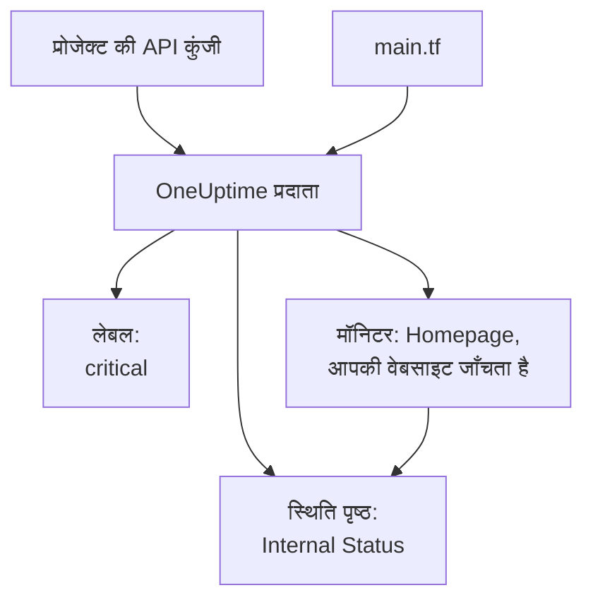

# त्वरित प्रारंभ

यह गाइड आपको लगभग दस मिनट में शून्य से Terraform द्वारा प्रबंधित OneUptime प्रोजेक्ट तक ले जाती है। आप एक API कुंजी बनाते हैं, Terraform को अपने प्रोजेक्ट की ओर इंगित करते हैं, और एक लेबल, आपकी वेबसाइट जाँचने वाला एक मॉनिटर, और उसे दिखाने वाला एक निजी स्थिति पृष्ठ लागू करते हैं। फिर आप उनमें से एक को बदलते हैं और सफ़ाई करते हैं।

:::cards
- [शुरू करने से पहले](#शुरू-करने-से-पहले): Terraform, एक प्रोजेक्ट, और API कुंजियों वाला प्लान।
- [अपने पहले संसाधन बनाएँ](#अपने-पहले-संसाधन-बनाएँ): API कुंजी से लागू किए गए प्लान तक, छह चरणों में।
- [संसाधन बदलें](#संसाधन-बदलें): कॉन्फ़िगरेशन संपादित करें, प्लान बनाएँ और लागू करें।
- [समस्या निवारण](#समस्या-निवारण): वे त्रुटियाँ जिन पर पहली बार चलाना रुक सकता है।
:::



## शुरू करने से पहले

- **Terraform 1.5 या बाद का, या OpenTofu 1.6 या बाद का।** OpenTofu के साथ, जहाँ भी यह गाइड `terraform` चलाती है, वहाँ `tofu` चलाएँ।
- **एक OneUptime प्रोजेक्ट**, [oneuptime.com](https://oneuptime.com) पर या आपके अपने OneUptime पर, जिसमें आप API कुंजियाँ बना सकते हैं।
- **OneUptime Cloud पर, Growth प्लान या उससे ऊपर।** प्रोजेक्ट की API कुंजियाँ केवल उसी पर काम करती हैं।

## अपने पहले संसाधन बनाएँ

:::steps
### प्रोजेक्ट की API कुंजी बनाएँ

OneUptime डैशबोर्ड में **प्रोजेक्ट सेटिंग्स → उन्नत → API कुंजियाँ** खोलें और **API कुंजी बनाएँ** पर क्लिक करें। इसे एक **नाम** दें, जैसे `terraform`, और **एक्सेस** में **प्रोजेक्ट एडमिन** चुनें: Terraform हर तरह का वह रिकॉर्ड बनाता, पढ़ता, बदलता और हटाता है जिसे वह प्रबंधित करता है, और **प्रोजेक्ट एडमिन** यह सब कर सकता है। सीमित कुंजी के लिए **अनुमतियाँ बाद में चुनें** चुनें और कुंजी के पेज पर केवल वे अनुमतियाँ जोड़ें जिनकी आपको ज़रूरत है।

कुंजी आज से एक साल बाद समाप्त होती है। कोई दूसरी तारीख चुनने के लिए, बनाने से पहले **और फ़ील्ड** खोलें, या बाद में कुंजी के पेज पर तारीख बदलें। कुंजी बनने के बाद उसका पेज खुलता है: **API कुंजी विवरण** कार्ड से **API कुंजी** कॉपी करें।

### कुंजी को Terraform के लिए उपलब्ध कराएँ

कुंजी को उस शेल के `ONEUPTIME_API_KEY` एनवायरनमेंट वेरिएबल में रखें जिसमें आप Terraform चलाते हैं, ताकि वह कभी किसी फ़ाइल में न पहुँचे:

:::tabs
@tab Linux
```bash
export ONEUPTIME_API_KEY="<your-api-key>"
```
@tab macOS
```bash
export ONEUPTIME_API_KEY="<your-api-key>"
```
@tab Windows
```powershell
$env:ONEUPTIME_API_KEY = "<your-api-key>"
```
:::

### Terraform को OneUptime की ओर इंगित करें

एक खाली फ़ोल्डर बनाएँ, और उसमें `main.tf` नाम की एक फ़ाइल:

```hcl title="main.tf"
terraform {
  required_providers {
    oneuptime = {
      source  = "oneuptime/oneuptime"
      version = "{{TERRAFORM_PROVIDER_VERSION}}"
    }
  }
}

provider "oneuptime" {
  # The API key comes from ONEUPTIME_API_KEY.
  # On a self-hosted OneUptime, add your OneUptime's address:
  # oneuptime_url = "https://oneuptime.example.com"
}
```

स्व-होस्टेड OneUptime पर, प्रदाता का संस्करण चुनने से पहले [स्व-होस्टेड सेटअप](/docs/terraform/self-hosted) पढ़ें।

### अपने संसाधनों का वर्णन करें

ये ब्लॉक `main.tf` में जोड़ें। ये उन मॉनिटर स्थितियों में से दो को पढ़ते हैं जिनसे हर प्रोजेक्ट शुरू होता है, और एक लेबल, हर पाँच मिनट में `https://example.com` जाँचने वाला एक मॉनिटर (वहाँ अपनी वेबसाइट डालें), और मॉनिटर दिखाने वाला एक निजी स्थिति पृष्ठ बनाते हैं:

```hcl title="main.tf"
data "oneuptime_monitor_status" "operational" {
  name = "Operational"
}

data "oneuptime_monitor_status" "offline" {
  name = "Offline"
}

resource "oneuptime_label" "critical" {
  name        = "critical"
  description = "Resources that page on-call when down"
  color       = "#FF5733"
}

resource "oneuptime_monitor" "homepage" {
  name                = "Homepage"
  description         = "Checks that the homepage responds"
  monitor_type        = "Website"
  monitoring_interval = "*/5 * * * *"
  labels              = [oneuptime_label.critical.id]

  monitor_steps = [{
    monitor_destination      = "https://example.com"
    monitor_destination_type = "URL"
    request_type             = "GET"

    criteria = [
      {
        name                  = "Offline"
        description           = "The homepage does not respond"
        filter_condition      = "Any"
        change_monitor_status = true
        monitor_status_id     = data.oneuptime_monitor_status.offline.id

        filters = [
          {
            check_on    = "Is Online"
            filter_type = "False"
          }
        ]
      },
      {
        name                  = "Online"
        description           = "The homepage responds"
        filter_condition      = "All"
        change_monitor_status = true
        monitor_status_id     = data.oneuptime_monitor_status.operational.id

        filters = [
          {
            check_on    = "Is Online"
            filter_type = "True"
          }
        ]
      }
    ]
  }]
}

resource "oneuptime_status_page" "internal" {
  name                  = "Internal Status"
  description           = "Status of our internal services"
  page_title            = "Service Status"
  is_public_status_page = false
}

resource "oneuptime_status_page_resource" "homepage" {
  status_page_id = oneuptime_status_page.internal.id
  monitor_id     = oneuptime_monitor.homepage.id
  display_name   = "Homepage"
}

output "monitor_id" {
  value = oneuptime_monitor.homepage.id
}
```

मॉनिटर के `monitor_steps` बताते हैं कि वह क्या जाँचता है और हर नतीजे का क्या मतलब है: हर जाँच के बाद, मेल खाने वाला पहला मानदंड उसकी स्थिति तय करता है। [मॉनिटर चरण](/docs/terraform/monitor-steps) हर हिस्से को समझाता है।

### प्लान बनाएँ और लागू करें

:::tabs
@tab Terraform
```bash
terraform init
terraform plan
terraform apply
```
@tab OpenTofu
```bash
tofu init
tofu plan
tofu apply
```
:::

`init` प्रदाता डाउनलोड करता है। प्लान `Plan: 4 to add, 0 to change, 0 to destroy.` पर ख़त्म होता है। इसे लागू करने के लिए `yes` टाइप करें; पूरा होने पर Terraform नए मॉनिटर का ID प्रिंट करता है।

### डैशबोर्ड जाँचें

OneUptime डैशबोर्ड में:

- **मॉनिटर** `critical` लेबल के साथ `Homepage` दिखाता है। उसकी पहली जाँच कुछ ही मिनटों में आ जाती है।
- **स्थिति पृष्ठ** `Internal Status` दिखाता है, जो `Homepage` दिखाता है।
- **प्रोजेक्ट सेटिंग्स → बेसिक → लेबल** आपके चुने रंग में `critical` दिखाता है।

`terraform plan` फिर से चलाएँ। यह `No changes.` जवाब देता है: OneUptime में ठीक वही है जो कॉन्फ़िगरेशन कहता है।
:::

## संसाधन बदलें

कॉन्फ़िगरेशन बदलें, डैशबोर्ड नहीं। `main.tf` में लेबल का `color` `"#2ECC71"` पर सेट करें, फिर प्लान बनाएँ और लागू करें:

```bash
terraform plan
terraform apply
```

प्लान `Plan: 0 to add, 1 to change, 0 to destroy.` पर ख़त्म होता है: लेबल अपनी जगह पर बदला जाता है। Terraform द्वारा प्रबंधित किसी संसाधन में कोई डैशबोर्ड से जो बदलाव करता है, वह अगले प्लान में दिखता है, और उसे लागू करने पर कॉन्फ़िगरेशन वाली स्थिति वापस आ जाती है।

## सफ़ाई करें

अगर यह केवल आज़माइश थी, तो कॉन्फ़िगरेशन ने जो बनाया है उसे हटा दें:

```bash
terraform destroy
```

यह लेबल, मॉनिटर, स्थिति पृष्ठ और उसका संसाधन हटा देता है। दोनों मॉनिटर स्थितियाँ बनी रहती हैं: डेटा स्रोत उन्हें केवल पढ़ते हैं।

## समस्या निवारण

:::details संदेश “Missing API Key”
प्रदाता को कोई API कुंजी नहीं मिली। जिस शेल में आप Terraform चलाते हैं, उसमें `ONEUPTIME_API_KEY` export करें, या प्रदाता ब्लॉक में `api_key` सेट करें, और कमांड फिर से चलाएँ।
:::

:::details संदेश “the OneUptime API returned status 400: Invalid API Key”
कुंजी गलत टाइप हुई है, समाप्त हो गई है या हटा दी गई है, या वह उस OneUptime के बजाय किसी दूसरे OneUptime की है जिसकी ओर `oneuptime_url` इशारा करता है। कुंजी उसके पेज से फिर कॉपी करें, या नई बनाएँ।
:::

:::details संदेश “the OneUptime API returned status 402: API keys need the Growth plan”
OneUptime Cloud पर, प्रोजेक्ट की API कुंजियाँ केवल Growth प्लान या उससे ऊपर काम करती हैं। **प्रोजेक्ट सेटिंग्स → बिलिंग और चालान → बिलिंग** में प्रोजेक्ट को अपग्रेड करें, और वही कुंजी फिर से काम करने लगती है।
:::

:::details संदेश “the OneUptime API returned status 422: You do not have permissions to create Monitor”
कुंजी के पास उस तरह के रिकॉर्ड की कोई अनुमति नहीं है। कुंजी के पेज पर उसे **प्रोजेक्ट एडमिन** दें, या वह अनुमति जिसका संदेश में नाम है।
:::

:::details संदेश “No monitor status matches {name = "Offline"}”
आपके प्रोजेक्ट की मॉनिटर स्थितियों के नाम दूसरे हैं। **मॉनिटर → सेटिंग्स → मॉनिटर स्थिति** में दिखने वाले नाम इस्तेमाल करें, या इसके बजाय `is_offline_state = true` से स्थिति खोजें।
:::

## अगले कदम

:::cards
- [संपूर्ण गाइड](/docs/terraform/complete-guide): प्रमाणीकरण, प्रोजेक्ट की संरचना, डेटा स्रोत, state और अपग्रेड।
- [मॉनिटर चरण](/docs/terraform/monitor-steps): तय करें कि मॉनिटर क्या जाँचता है और हर नतीजे का क्या मतलब है।
- [उदाहरण](/docs/terraform/examples): आम संसाधनों के लिए इस्तेमाल को तैयार कॉन्फ़िगरेशन।
- [संसाधन आयात करना](/docs/terraform/importing-resources): डैशबोर्ड में बनाई चीज़ों को Terraform के तहत लाएँ।
:::
