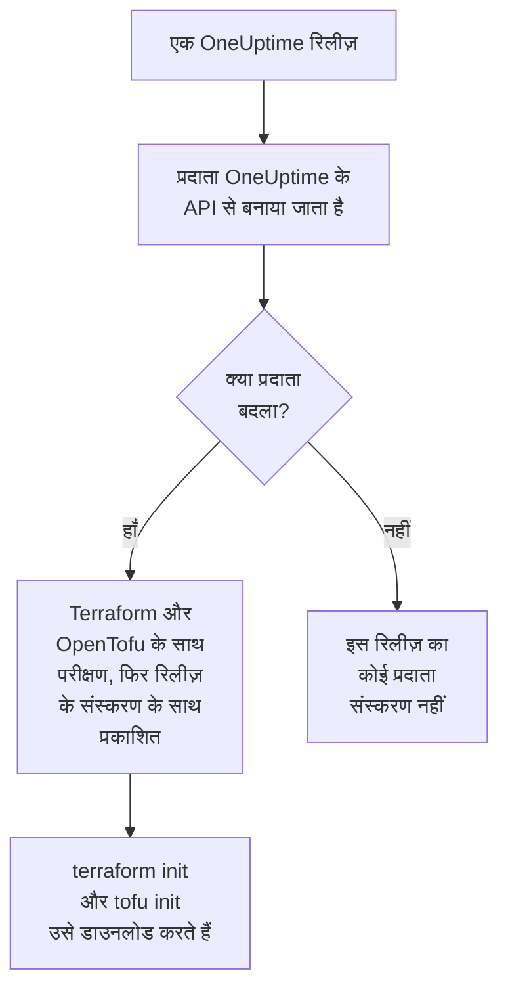

# रजिस्ट्री उपयोग

OneUptime प्रदाता [Terraform Registry](https://registry.terraform.io/providers/oneuptime/oneuptime) और [OpenTofu Registry](https://search.opentofu.org/provider/oneuptime/oneuptime/latest) पर प्रकाशित होता है। `terraform init` और `tofu init` उसे वहीं से डाउनलोड करते हैं: हाथ से कुछ भी इंस्टॉल नहीं करना पड़ता। यह पेज बताता है कि क्या प्रकाशित होता है, संस्करण कैसे क्रमांकित होते हैं, और नए संस्करण पर कैसे जाएँ।

:::cards
- [क्या प्रकाशित होता है](#क्या-प्रकाशित-होता-है): हर प्लेटफ़ॉर्म के लिए प्रदाता, उसका संदर्भ, और उसके संस्करण।
- [संस्करण कैसे क्रमांकित होते हैं](#संस्करण-कैसे-क्रमांकित-होते-हैं): प्रदाता का संस्करण वह OneUptime रिलीज़ है जिसने उसे प्रकाशित किया।
- [लॉक फ़ाइल](#लॉक-फ़ाइल): वह संस्करण और checksum जो हर मशीन इंस्टॉल करती है।
- [नए संस्करण पर जाएँ](#नए-संस्करण-पर-जाएँ): पढ़ें कि क्या बदला, उसे डाउनलोड करें, और प्लान करें।
:::

## क्या प्रकाशित होता है

हर OneUptime रिलीज़ OneUptime के अपने API से प्रदाता बनाती है। जब प्रदाता बदला होता है, तो रिलीज़ उसे, रिलीज़ के संस्करण के तहत, Terraform और OpenTofu दोनों के साथ उसके एंड-टू-एंड परीक्षण पास होने के बाद प्रकाशित करती है:



| क्या | कहाँ |
| --- | --- |
| प्रदाता, Linux, macOS, Windows, FreeBSD, OpenBSD और Solaris के लिए | `terraform init` और `tofu init` द्वारा डाउनलोड किया जाता है, OneUptime द्वारा हस्ताक्षरित checksum के साथ |
| हर संसाधन और डेटा स्रोत का संदर्भ, उसके हर एट्रिब्यूट के साथ | रजिस्ट्री के दस्तावेज़, उत्पाद के अनुसार समूह में: मॉनिटर, स्थिति पृष्ठ, घटनाएँ, ऑन-कॉल और बाकी |
| OpenTofu के साथ प्रदाता इस्तेमाल करने की गाइड | रजिस्ट्री की गाइड |
| हर संस्करण, सबसे नया पहले | रजिस्ट्री की संस्करण सूची |

संदर्भ बताता है कि हर एट्रिब्यूट क्या है। ये दस्तावेज़ दिखाते हैं कि उन्हें साथ में कैसे इस्तेमाल करें: [Terraform अवलोकन](/docs/terraform/index) से शुरू करें।

## संस्करण कैसे क्रमांकित होते हैं

प्रदाता का संस्करण उस OneUptime रिलीज़ का संस्करण है जिसने उसे प्रकाशित किया: प्रदाता {{TERRAFORM_PROVIDER_MAJOR}}.0.20 OneUptime {{TERRAFORM_PROVIDER_MAJOR}}.0.20 के साथ आया। जिस रिलीज़ का प्रदाता नहीं बदला वह कोई प्रकाशित नहीं करती, इसलिए संस्करणों में अंतराल होते हैं, और एक सटीक संस्करण बताने वाली बाधा ऐसा संस्करण बता सकती है जो मौजूद नहीं है। इसके बजाय एक सीमा लिखें:

| आप इस्तेमाल करते हैं | बाधा | Terraform इंस्टॉल करता है |
| --- | --- | --- |
| OneUptime Cloud | `{{TERRAFORM_PROVIDER_VERSION}}` | सबसे नया {{TERRAFORM_PROVIDER_MAJOR}}.x प्रदाता |
| स्व-होस्टेड OneUptime | आपके OneUptime के संस्करण पर खत्म होने वाली सीमा, जैसे `>= {{TERRAFORM_PROVIDER_MAJOR}}.0, <= {{TERRAFORM_PROVIDER_MAJOR}}.0.40` | सबसे नया प्रदाता जो आपके OneUptime से नया न हो |

स्व-होस्टेड OneUptime पर, आपके OneUptime से नया प्रदाता ऐसी सेटिंग्स भेज सकता है जो आपके OneUptime में अभी नहीं हैं: [स्व-होस्टेड सेटअप](/docs/terraform/self-hosted#प्रदाता-संस्करण-चुनें) दिखाता है कि उसकी सीमा कैसे लिखें।

```hcl title="main.tf"
terraform {
  required_providers {
    oneuptime = {
      source  = "oneuptime/oneuptime"
      version = "{{TERRAFORM_PROVIDER_VERSION}}"
    }
  }
}
```

स्रोत पता किसी रजिस्ट्री का नाम नहीं लेता: Terraform इसे Terraform Registry से पढ़ता है, और OpenTofu OpenTofu Registry से, जो वही संस्करण प्रकाशित करती हैं।

## लॉक फ़ाइल

`terraform init` उसके चुने हुए संस्करण, और उसके डाउनलोड के checksum, `.terraform.lock.hcl` में दर्ज करता है। उस फ़ाइल को commit करें: तब हर मशीन और हर CI रन ठीक वही संस्करण इंस्टॉल करता है, जब तक आप कोई दूसरा न चुनें। checksum उन सभी प्लेटफ़ॉर्म को कवर करते हैं जिन्हें रजिस्ट्री प्रकाशित करती है, इसलिए एक लॉक फ़ाइल Linux, macOS और Windows मशीनों के लिए समान रूप से काम करती है।

```hcl title=".terraform.lock.hcl"
provider "registry.terraform.io/oneuptime/oneuptime" {
  version     = "{{TERRAFORM_PROVIDER_MAJOR}}.0.20"
  constraints = "{{TERRAFORM_PROVIDER_VERSION}}"
  hashes = [
    "h1:...",
    "zh:...",
  ]
}
```

लॉक फ़ाइल रजिस्ट्री का नाम लेती है। OpenTofu `registry.opentofu.org/oneuptime/oneuptime` लिखता है जहाँ Terraform `registry.terraform.io/oneuptime/oneuptime` लिखता है, इसलिए इंजन बदलने से लॉक फ़ाइल बदल जाती है: `init` प्रविष्टि बदल देता है, और आपसे बदलाव commit करने को कहता है।

## नए संस्करण पर जाएँ

:::steps
### पढ़ें कि क्या बदला

[OneUptime की रिलीज़](https://github.com/OneUptime/oneuptime/releases) बताती हैं कि हर रिलीज़ ने क्या बदला, प्रदाता समेत। [प्रदाता की रिलीज़](https://github.com/OneUptime/terraform-provider-oneuptime/releases) पिछली रिलीज़ के बाद के बदलावों से लिंक करती हैं।

### उसे डाउनलोड करें

```bash
terraform init -upgrade
```

`init -upgrade` आपकी बाधा जिस सबसे नए संस्करण की अनुमति देती है उसे लेता है, उसे दिखाता है, और `.terraform.lock.hcl` अपडेट करता है। बाधा `{{TERRAFORM_PROVIDER_VERSION}}` हर {{TERRAFORM_PROVIDER_MAJOR}}.x रिलीज़ लेती है; नए मुख्य संस्करण के लिए नई बाधा चाहिए।

### लागू करने से पहले प्लान करें

`terraform plan` चलाएँ, और केवल तब लागू करें जब वह खाली हो या वही बदलाव दिखाए जिनकी आप उम्मीद करते हैं। अपडेट की गई लॉक फ़ाइल commit करें।
:::

स्व-होस्टेड OneUptime पर, पहले OneUptime अपग्रेड करें, फिर प्रदाता की सीमा का अंत बढ़ाएँ।

## कोड कहाँ है

प्रदाता [मुख्य OneUptime रिपॉज़िटरी](https://github.com/OneUptime/oneuptime) में OneUptime API से बनाया जाता है, और हर संस्करण उस रिलीज़ से बनता है जिसने उसे प्रकाशित किया। उसकी अपनी रिपॉज़िटरी, [OneUptime/terraform-provider-oneuptime](https://github.com/OneUptime/terraform-provider-oneuptime), में वही है जो जनरेटर ने लिखा, इसलिए बदलाव मुख्य रिपॉज़िटरी में किए जाते हैं: समस्याओं की रिपोर्ट, दस्तावेज़ों की समस्याओं समेत, [github.com/OneUptime/oneuptime/issues](https://github.com/OneUptime/oneuptime/issues) पर करें।

## अगले कदम

:::cards
- [स्व-होस्टेड सेटअप](/docs/terraform/self-hosted): आपके अपने OneUptime के लिए संस्करण सीमा, और ऑफ़लाइन मशीनों के लिए मिरर।
- [OpenTofu](/docs/terraform/opentofu): वही प्रदाता और कॉन्फ़िगरेशन, `tofu` के साथ।
- [संपूर्ण गाइड](/docs/terraform/complete-guide): प्रमाणीकरण, प्रोजेक्ट की संरचना, डेटा स्रोत, state और अपग्रेड।
- [समस्या निवारण](/docs/terraform/troubleshooting): आम त्रुटियाँ और उन्हें ठीक करने का तरीका।
:::
