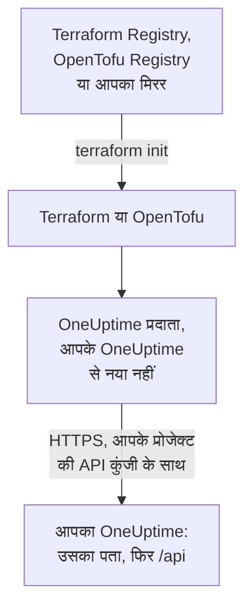

# स्व-होस्टेड सेटअप

प्रदाता आपके अपने OneUptime के साथ वैसे ही काम करता है जैसे OneUptime Cloud के साथ: वही संसाधन, वही एट्रिब्यूट और वही प्रोजेक्ट API कुंजियाँ। आपको खुद जो सेट करना है: आपके OneUptime का पता, उससे मेल खाने वाला प्रदाता संस्करण, और जहाँ ज़रूरत हो, इंटरनेट पहुँच के बिना मशीनों के लिए एक मिरर और किसी निजी प्रमाणपत्र प्राधिकरण पर भरोसा।

:::cards
- [प्रदाता को अपने OneUptime की ओर करें](#प्रदाता-को-अपने-oneuptime-की-ओर-करें): उसका पता, और आपके प्रोजेक्ट की एक API कुंजी।
- [प्रदाता संस्करण चुनें](#प्रदाता-संस्करण-चुनें): सबसे नया प्रदाता जो आपके OneUptime से नया न हो।
- [इंटरनेट पहुँच के बिना](#इंटरनेट-पहुँच-के-बिना): प्रदाता को अपने नेटवर्क में मिरर करें।
- [TLS और प्रमाणपत्र](#tls-और-प्रमाणपत्र): निजी प्रमाणपत्र प्राधिकरण, प्रॉक्सी और सादा HTTP।
:::



## प्रदाता को अपने OneUptime की ओर करें

`oneuptime_url` को उस पते पर सेट करें जिस पर आप डैशबोर्ड खोलते हैं: स्कीम और होस्ट, बिना पाथ के। जब पते में स्कीम नहीं होती तो प्रदाता `https://` जोड़ता है, और अंत में `/api`, इसलिए `https://oneuptime.example.com` हर अनुरोध `https://oneuptime.example.com/api` पर भेजता है।

```hcl title="main.tf"
terraform {
  required_providers {
    oneuptime = {
      source  = "oneuptime/oneuptime"
      version = "{{TERRAFORM_PROVIDER_MATCHING}}"
    }
  }
}

provider "oneuptime" {
  oneuptime_url = "https://oneuptime.example.com"
  # The API key comes from the ONEUPTIME_API_KEY environment variable.
}
```

पता इसके बजाय `ONEUPTIME_URL` एनवायरनमेंट वेरिएबल से भी आ सकता है, ताकि एक कॉन्फ़िगरेशन कई इंस्टॉलेशन की ओर इशारा कर सके:

```bash
export ONEUPTIME_URL="https://oneuptime.example.com"
export ONEUPTIME_API_KEY="<your-api-key>"
```

पता वह होस्ट है जिस पर आपका इंस्टॉलेशन चलता है: Docker Compose के साथ `config.env` में `HOST` और `HTTP_PROTOCOL`, और Helm चार्ट के values में `host` और `httpProtocol`।

कुंजी उस प्रोजेक्ट की API कुंजी है जिसे आप प्रबंधित करते हैं, जो आपके OneUptime के डैशबोर्ड में **प्रोजेक्ट सेटिंग्स → उन्नत → API कुंजियाँ** के तहत बनाई जाती है, जैसे OneUptime Cloud पर। स्व-होस्टेड OneUptime की मास्टर API कुंजी किसी प्रोजेक्ट की नहीं होती, इसलिए उससे किया गया निर्माण `ProjectId required` के साथ विफल होता है।

> [!TIP]
> आपका OneUptime यह ब्लॉक आपके लिए लिखता है। डैशबोर्ड में कोई भी संसाधन या सूची खोलें, फिर उसके साइड मेन्यू में **डेवलपर** और **Terraform**: वह जो प्रदाता ब्लॉक दिखाता है उसमें आपके OneUptime का पता होता है, और उससे मेल खाने वाली संस्करण सीमा।

## प्रदाता संस्करण चुनें

सबसे नया प्रकाशित प्रदाता इस्तेमाल करें जो आपके OneUptime से नया न हो। प्रदाता के संस्करण OneUptime के संस्करणों का पालन करते हैं: प्रदाता बदलने वाली OneUptime रिलीज़ उसे रिलीज़ के अपने संस्करण नंबर के तहत प्रकाशित करती है, और आपके OneUptime से नया प्रदाता ऐसी सेटिंग्स भेज सकता है जो आपके OneUptime में अभी नहीं हैं।

इसलिए ऐसी सीमा लिखें जो आपके OneUptime के संस्करण पर खत्म हो, जैसा डैशबोर्ड करता है। ऊपर का ब्लॉक `{{TERRAFORM_PROVIDER_MATCHING}}` लेता है, उस OneUptime के लिए सीमा जिससे ये दस्तावेज़ आते हैं: जब आप इन्हें अपने OneUptime पर पढ़ते हैं, तो वह सीमा आपकी है। नहीं तो, अपना संस्करण लिखें:

:::steps
### अपने OneUptime का संस्करण पता करें

अपने OneUptime से पूछें:

```bash
curl https://oneuptime.example.com/version
```

जवाब JSON होता है, जैसे `{"version":"{{TERRAFORM_PROVIDER_MAJOR}}.0.40","commit":"..."}`। मास्टर एडमिन के रूप में, आप एडमिन डैशबोर्ड के हेडर में संस्करण लेबल भी खोल सकते हैं: देखें [अपना वर्तमान संस्करण पता करें](/docs/installation/upgrading#अपना-वर्तमान-संस्करण-पता-करें)।

### इसे सीमा में लिखें

सीमा मुख्य संस्करण से शुरू होती है और आपके संस्करण पर खत्म होती है। OneUptime {{TERRAFORM_PROVIDER_MAJOR}}.0.40 के लिए:

```hcl title="main.tf"
terraform {
  required_providers {
    oneuptime = {
      source  = "oneuptime/oneuptime"
      version = ">= {{TERRAFORM_PROVIDER_MAJOR}}.0, <= {{TERRAFORM_PROVIDER_MAJOR}}.0.40"
    }
  }
}
```

Terraform सीमा में सबसे नया प्रदाता लेता है। जिस OneUptime रिलीज़ ने प्रदाता नहीं बदला वह कोई प्रकाशित नहीं करती, और सीमा उन संस्करणों को छोड़ देती है जो मौजूद नहीं हैं।

### प्रदाता डाउनलोड करें

`terraform init` चलाएँ। यह इंस्टॉल किया गया संस्करण दिखाता है और उसे `.terraform.lock.hcl` में दर्ज करता है।
:::

अपग्रेड करते समय, पहले OneUptime अपग्रेड करें। फिर सीमा का अंत उसके नए संस्करण तक बढ़ाएँ, और `terraform init -upgrade` चलाएँ।

## इंटरनेट पहुँच के बिना

जब Terraform चलाने वाली मशीनें रजिस्ट्री तक नहीं पहुँच सकतीं, तो प्रदाता को एक बार अपने नेटवर्क में कॉपी करें, और Terraform को उस कॉपी की ओर करें।

:::steps
### प्रदाता को मिरर करें

इंटरनेट पहुँच वाली किसी मशीन पर, आपके कॉन्फ़िगरेशन वाले फ़ोल्डर में, हर उस प्लेटफ़ॉर्म के लिए प्रदाता डाउनलोड करें जिस पर आपकी मशीनें चलती हैं। `-platform` के बिना, कमांड केवल अपने प्लेटफ़ॉर्म के लिए प्रदाता डाउनलोड करती है:

:::tabs
@tab Terraform
```bash
terraform providers mirror -platform=linux_amd64 -platform=darwin_arm64 /srv/terraform-mirror
```
@tab OpenTofu
```bash
tofu providers mirror -platform=linux_amd64 -platform=darwin_arm64 /srv/terraform-mirror
```
:::

फ़ोल्डर में प्रदाता रजिस्ट्री के पते के तहत होता है, जैसे `registry.terraform.io/oneuptime/oneuptime/`। इसे अपने नेटवर्क में कॉपी करें।

### Terraform को मिरर की ओर करें

एक CLI कॉन्फ़िगरेशन फ़ाइल लिखें जो OneUptime प्रदाता को फ़ोल्डर से इंस्टॉल करे, और बाकी सब हमेशा की तरह:

:::tabs
@tab Terraform
```hcl title="mirror.tfrc"
provider_installation {
  filesystem_mirror {
    path    = "/srv/terraform-mirror"
    include = ["registry.terraform.io/oneuptime/oneuptime"]
  }
  direct {
    exclude = ["registry.terraform.io/oneuptime/oneuptime"]
  }
}
```
@tab OpenTofu
```hcl title="mirror.tfrc"
provider_installation {
  filesystem_mirror {
    path    = "/srv/terraform-mirror"
    include = ["registry.opentofu.org/oneuptime/oneuptime"]
  }
  direct {
    exclude = ["registry.opentofu.org/oneuptime/oneuptime"]
  }
}
```
:::

इसका नाम `TF_CLI_CONFIG_FILE` में दें, जिसे Terraform और OpenTofu दोनों पढ़ते हैं: `export TF_CLI_CONFIG_FILE=/etc/terraform/mirror.tfrc`।

### इनिशियलाइज़ करें

`terraform init` चलाएँ: यह प्रदाता को मिरर से इंस्टॉल करता है। यह चेतावनी देता है कि लॉक फ़ाइल में अब केवल इस प्लेटफ़ॉर्म के checksum हैं। उन्हें हर प्लेटफ़ॉर्म के लिए दर्ज करने के लिए, इंटरनेट पहुँच वाली मशीन पर उन्हीं `-platform` विकल्पों के साथ `terraform providers lock` चलाएँ, और `.terraform.lock.hcl` को अपने कॉन्फ़िगरेशन के साथ commit करें।
:::

हर बार संस्करण सीमा बढ़ाने पर फिर से मिरर करें।

## TLS और प्रमाणपत्र

प्रदाता आपके OneUptime के प्रमाणपत्र को Terraform चलाने वाली मशीन के ट्रस्ट स्टोर से जाँचता है, और जाँच छोड़ने की कोई सेटिंग नहीं है। जब प्रमाणपत्र किसी निजी प्रमाणपत्र प्राधिकरण से आता है, तो उस प्राधिकरण को Terraform चलाने वाली हर मशीन और CI रनर के ट्रस्ट स्टोर में जोड़ें:

:::tabs
@tab Debian / Ubuntu
```bash
sudo cp my-ca.crt /usr/local/share/ca-certificates/
sudo update-ca-certificates
```
@tab RHEL / Fedora
```bash
sudo cp my-ca.crt /etc/pki/ca-trust/source/anchors/
sudo update-ca-trust
```
:::

Linux पर, जहाँ आप ट्रस्ट स्टोर नहीं बदल सकते, जैसे किसी CI कंटेनर में, `SSL_CERT_FILE` को ऐसी फ़ाइल पर सेट करें जिसमें आपका प्राधिकरण और सार्वजनिक प्राधिकरण हों। macOS और Windows पर, प्राधिकरण को सिस्टम के प्रमाणपत्र स्टोर में जोड़ें।

- **प्रॉक्सी।** प्रदाता अपने अनुरोध `HTTPS_PROXY` के प्रॉक्सी के ज़रिए भेजता है, सिवाय `NO_PROXY` के होस्ट के। OneUptime के आगे के रिवर्स प्रॉक्सी को हर `/api` पाथ और `APIKey` हेडर बिना बदले आगे भेजना चाहिए।
- **सादा HTTP।** परीक्षण इंस्टॉलेशन के लिए `http://` पता काम करता है। API कुंजी हर अनुरोध के साथ जाती है, इसलिए बाकी सबके लिए HTTPS इस्तेमाल करें।

## समस्या निवारण

:::details संदेश “x509: certificate signed by unknown authority”
Terraform चलाने वाली मशीन आपके OneUptime के प्रमाणपत्र पर भरोसा नहीं करती: [TLS और प्रमाणपत्र](#tls-और-प्रमाणपत्र) में दिखाए अनुसार अपना प्रमाणपत्र प्राधिकरण जोड़ें।
:::

:::details संदेश “invalid character '<' looking for beginning of value”
API के बजाय एक वेब पेज ने जवाब दिया: `oneuptime_url` में पाथ है, या किसी प्रॉक्सी ने जवाब दिया। इसे केवल अपने OneUptime के पते पर सेट करें।
:::

:::details संदेश “no available releases match the given constraints”
कोई भी प्रकाशित प्रदाता संस्करण बाधा से मेल नहीं खाता, उदाहरण के लिए ऐसी बाधा जो एक ऐसा संस्करण बताती है जिसे OneUptime ने कभी प्रकाशित नहीं किया। [प्रदाता संस्करण चुनें](#प्रदाता-संस्करण-चुनें) में दिखाए अनुसार एक सीमा लिखें।
:::

:::details संदेश “ProjectId required”
कुंजी मास्टर API कुंजी है, जो किसी प्रोजेक्ट की नहीं है। **प्रोजेक्ट सेटिंग्स → उन्नत → API कुंजियाँ** के तहत प्रोजेक्ट की API कुंजी बनाएँ।
:::

[समस्या निवारण](/docs/terraform/troubleshooting) में बाकी त्रुटियाँ हैं, और हर एक का मतलब।

## अगले कदम

:::cards
- [त्वरित प्रारंभ](/docs/terraform/quick-start): API कुंजी बनाएँ और अपने पहले संसाधन लागू करें।
- [रजिस्ट्री उपयोग](/docs/terraform/registry): प्रदाता कहाँ प्रकाशित होता है, और संस्करण कैसे क्रमांकित होते हैं।
- [समस्या निवारण](/docs/terraform/troubleshooting): आम त्रुटियाँ और उन्हें ठीक करने का तरीका।
- [अपग्रेड करना](/docs/installation/upgrading): प्रदाता की सीमा बढ़ाने से पहले अपना OneUptime अपग्रेड करें।
:::
