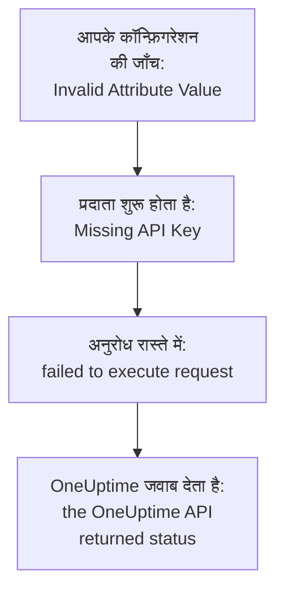

# समस्या निवारण

Terraform ने जो संदेश दिखाया, या आपने जो होते देखा, उसे नीचे की तालिका में खोजें: हर पंक्ति उसके समाधान तक ले जाती है। तालिका के बाद के खंड हर त्रुटि को समझाते हैं, उनके स्रोत के अनुसार समूह में।

:::cards
- [अपनी त्रुटि खोजें](#अपनी-त्रुटि-खोजें): इस पेज का हर संदेश और लक्षण, और उसका समाधान।
- [API कुंजियाँ, अनुमतियाँ और प्लान](#api-कुंजियाँ-अनुमतियाँ-और-प्लान): जब OneUptime प्रदाता की कुंजी अस्वीकार करता है।
- [प्लान जो स्थिर नहीं होते](#प्लान-जो-स्थिर-नहीं-होते): बार-बार लौटने वाले बदलाव, और state छोड़ने वाले संसाधन।
- [स्व-होस्टेड OneUptime से कनेक्ट करना](#स्व-होस्टेड-oneuptime-से-कनेक्ट-करना): पता, प्रमाणपत्र और प्रॉक्सी।
:::

## अपनी त्रुटि खोजें

| संदेश या लक्षण | क्या करें |
| --- | --- |
| `Missing API Key` | प्रदाता को उसकी कुंजी दें: देखें [`Missing API Key` या `Invalid API Key`](#missing-api-key-या-invalid-api-key) |
| `Invalid API Key` | कुंजी फिर से कॉपी करें, या नई बनाएँ: देखें [`Missing API Key` या `Invalid API Key`](#missing-api-key-या-invalid-api-key) |
| `ProjectId required` | मास्टर कुंजी के बजाय प्रोजेक्ट की API कुंजी इस्तेमाल करें: देखें [`ProjectId required`](#projectid-required) |
| `You do not have permissions to create Monitor` | कुंजी को वह अनुमति दें जिसका संदेश में नाम है: देखें [कुंजी में एक अनुमति की कमी है](#कुंजी-में-एक-अनुमति-की-कमी-है) |
| `API keys need the Growth plan` | प्रोजेक्ट को वापस Growth प्लान पर ले जाएँ: देखें [भुगतान आवश्यक](#भुगतान-आवश्यक) |
| किसी एक संसाधन या एक सेटिंग के लिए `402` | प्लान अपग्रेड करें, या सेटिंग को उसके डिफ़ॉल्ट पर छोड़ दें: देखें [भुगतान आवश्यक](#भुगतान-आवश्यक) |
| `This project has been blocked` | किसी मास्टर एडमिन से प्रोजेक्ट अनब्लॉक करने को कहें: देखें [ब्लॉक किया गया प्रोजेक्ट](#ब्लॉक-किया-गया-प्रोजेक्ट) |
| `references records that are not in this project` | अपने ही प्रोजेक्ट के रिकॉर्ड की ID इस्तेमाल करें: देखें [दूसरे प्रोजेक्ट की ID](#दूसरे-प्रोजेक्ट-की-id) |
| डेटा स्रोत से `Not Found` या `Ambiguous Match` | खोज के आर्ग्युमेंट ठीक करें: देखें [खोजें जिन्हें कुछ नहीं मिलता या कई मिलते हैं](#खोजें-जिन्हें-कुछ-नहीं-मिलता-या-कई-मिलते-हैं) |
| `Cannot import non-existent remote object` | ID और कुंजी की अनुमतियाँ जाँचें: देखें [संसाधन आयात करना](/docs/terraform/importing-resources#समस्या-निवारण) |
| `Provider produced inconsistent result after apply` | प्रदाता अपग्रेड करें: देखें [apply के बाद असंगत परिणाम](#apply-के-बाद-असंगत-परिणाम) |
| प्लान ऐसा संसाधन बनाता है जो आपने नहीं जोड़ा | कुंजी अब उसे नहीं पढ़ सकती, और OneUptime ने `404` जवाब दिया: कुंजी को पढ़ने की पहुँच लौटाएँ, फिर `terraform import` से संसाधन आयात करें: देखें [कोई संसाधन state छोड़ देता है, और अगला apply उसे फिर से बनाता है](#कोई-संसाधन-state-छोड़-देता-है-और-अगला-apply-उसे-फिर-से-बनाता-है) |
| apply के बाद कोई `priority` या `order` बदल जाता है | हर एक को ऐसा नंबर दें जो किसी और के पास न हो: देखें [खिसकने वाली प्राथमिकता या क्रम](#खिसकने-वाली-प्राथमिकता-या-क्रम) |
| `Invalid Configuration for Read-Only Attribute` | एट्रिब्यूट को कॉन्फ़िगरेशन से हटाएँ: देखें [केवल-पढ़ने वाले एट्रिब्यूट](#केवल-पढ़ने-वाले-एट्रिब्यूट) |
| `has been renamed to` | `moved` ब्लॉक के साथ संसाधन प्रकार का नाम बदलें: देखें [नाम बदला गया संसाधन प्रकार](#नाम-बदला-गया-संसाधन-प्रकार) |
| Terraform से बना मॉनिटर कभी अपनी जाँचें नहीं दिखाता | OneUptime अपग्रेड करें: देखें [चरण ID से पहले बने मॉनिटर](#चरण-id-से-पहले-बने-मॉनिटर) |
| `must contain at least 1 elements` | एट्रिब्यूट को खाली रखने के बजाय छोड़ दें: देखें [खाली मान](#खाली-मान) |
| `.tf` फ़ाइल में डैशबोर्ड से JSON | इसे HCL के रूप में लिखें: देखें [डैशबोर्ड से JSON](#डैशबोर्ड-से-json) |
| `no available releases match the given constraints` | एक सटीक संस्करण के बजाय संस्करण सीमा इस्तेमाल करें: देखें [ऐसा संस्करण जो कभी प्रकाशित नहीं हुआ](#ऐसा-संस्करण-जो-कभी-प्रकाशित-नहीं-हुआ) |
| `x509: certificate signed by unknown authority` | अपने प्रमाणपत्र प्राधिकरण पर भरोसा करें: देखें [प्रमाणपत्र](#प्रमाणपत्र) |
| `invalid character '<' looking for beginning of value` | `oneuptime_url` को सीधे अपने OneUptime की ओर करें: देखें [API के बजाय एक वेब पेज](#api-के-बजाय-एक-वेब-पेज) |
| `connection refused` या `Client.Timeout exceeded` | पता, नेटवर्क और कोई भी प्रॉक्सी जाँचें: देखें [विफल होने वाले कनेक्शन](#विफल-होने-वाले-कनेक्शन) |

## त्रुटि कैसे पढ़ें

त्रुटि उस चरण का नाम बताती है जो विफल हुआ, और उसका संदेश बताता है कि वह कहाँ से आई:



- कोई त्रुटि जो किसी भी अनुरोध से पहले आती है, जैसे `Invalid Attribute Value`, आपके कॉन्फ़िगरेशन के बारे में है: प्रदाता OneUptime से बात करने से पहले उसकी जाँच करता है।
- `failed to execute request` का मतलब है कि अनुरोध को कभी जवाब नहीं मिला: देखें [स्व-होस्टेड OneUptime से कनेक्ट करना](#स्व-होस्टेड-oneuptime-से-कनेक्ट-करना)।
- `the OneUptime API returned status` OneUptime का जवाब है: स्टेटस और उसके बाद का संदेश बताते हैं कि OneUptime ने क्या अस्वीकार किया।

प्रदाता बताता है कि वह क्या कर रहा था: बदलाव के लिए `Unable to create monitor` और `Unable to update monitor`, और संसाधन पढ़ते समय `Unable to parse label response`। जिस पढ़ने को OneUptime अस्वीकार करता है, उसकी रिपोर्ट `Parse Error` सारांश के साथ होती है, लेकिन उसके बाद का संदेश OneUptime का जवाब है, पार्सिंग की समस्या नहीं।

## API कुंजियाँ, अनुमतियाँ और प्लान

### `Missing API Key` या `Invalid API Key`

`Missing API Key` प्रदाता को कोई भी अनुरोध करने से पहले रोक देता है: न तो प्रदाता ब्लॉक में `api_key` सेट है और न ही `ONEUPTIME_API_KEY` एनवायरनमेंट वेरिएबल। जिस शेल में आप Terraform चलाते हैं उसमें वेरिएबल export करें, या कुंजी को `sensitive` चिह्नित वेरिएबल में पास करें।

`Invalid API Key` उस कुंजी के लिए OneUptime का जवाब है जिसे वह नहीं जानता: गलत टाइप की गई, समाप्त या हटाई गई कुंजी, या किसी ऐसे दूसरे OneUptime की कुंजी जिसकी ओर `oneuptime_url` इशारा नहीं करता। कुंजी को **प्रोजेक्ट सेटिंग्स → उन्नत → API कुंजियाँ** के तहत उसके पेज से फिर कॉपी करें, या नई बनाएँ।

### `ProjectId required`

प्रदाता को उस प्रोजेक्ट की API कुंजी चाहिए जिसे वह प्रबंधित करता है: प्रोजेक्ट वहीं से आता है। स्व-होस्टेड OneUptime की मास्टर API कुंजी किसी प्रोजेक्ट की नहीं होती, इसलिए उससे किया गया हर निर्माण `ProjectId required` के साथ विफल होता है। [प्रोजेक्ट API कुंजी बनाएँ](/docs/terraform/quick-start#प्रोजेक्ट-की-api-कुंजी-बनाएँ) की तरह प्रोजेक्ट की API कुंजी बनाएँ, और इसके बजाय उसे इस्तेमाल करें।

### कुंजी में एक अनुमति की कमी है

`You do not have permissions to create Monitor` और इस तरह के संदेश स्टेटस `422` के साथ आते हैं: कुंजी उस तरह के रिकॉर्ड के साथ वह काम नहीं कर सकती। वे उन अनुमतियों के नाम बताते हैं जो इसकी इजाज़त देंगी। **प्रोजेक्ट सेटिंग्स → उन्नत → API कुंजियाँ** के तहत कुंजी का पेज खोलें और उसे उनमें से एक दें, या **प्रोजेक्ट एडमिन**। आयात को केवल पढ़ने की अनुमति चाहिए।

### भुगतान आवश्यक

- **हर अनुरोध पर 402 Payment Required** — `API keys need the Growth plan...`: OneUptime Cloud पर, प्रोजेक्ट **Growth** से नीचे है, और उससे नीचे प्रोजेक्ट की API कुंजियाँ - प्रदाता की कुंजी भी - काम करना बंद कर देती हैं। जब तक प्रोजेक्ट वापस Growth पर नहीं आता, प्रदाता की हर कॉल अस्वीकार होती है, `terraform plan` भी; फिर वही कुंजी दोबारा काम करती है, और आपके कॉन्फ़िगरेशन में कुछ बदलना नहीं पड़ता। **प्रोजेक्ट सेटिंग्स → बिलिंग और चालान → बिलिंग** में अपग्रेड करें, या तब तक डैशबोर्ड में प्रोजेक्ट प्रबंधित करें। देखें [अपने प्लान से नीचे API कुंजियाँ और SCIM](/docs/api-reference/api-reference#अपने-प्लान-से-नीचे-api-कुंजियाँ-और-scim)।
- **402 Payment Required** — आप अपने OneUptime प्लान की किसी सीमा तक पहुँच गए हैं, या कॉन्फ़िगरेशन ऐसी सेटिंग चालू करता है जो आपके प्लान में शामिल नहीं है (निजी स्थिति पृष्ठ, ईमेल रिपोर्ट, सार्वजनिक डैशबोर्ड, IP अनुमति सूची...), चाहे `terraform apply` संसाधन को उसके साथ बनाए या बाद में बदले। Terraform OneUptime का संदेश जैसा है वैसा दिखाता है। प्लान अपग्रेड करें, या कॉन्फ़िगरेशन छोटा करें।

ऐसी सेटिंग को उसके डिफ़ॉल्ट पर लौटाना, जो सुविधा को बंद कर देता है, हर प्लान पर काम करता है, इसलिए भुगतान वाली सुविधाएँ बंद करने वाला कॉन्फ़िगरेशन ट्रायल खत्म होने या प्लान घटने के बाद भी लागू होता है।

यही बात उन संसाधनों पर लागू होती है जिन्हें आपका प्लान बेचता है और जिन्हें प्रोजेक्ट प्लान घटने के बाद भी रखता है - SSO प्रदाता, SCIM कनेक्शन, API कुंजियाँ, ऑन-कॉल शेड्यूल, और Slack और Microsoft Teams के नियम और सारांश: प्लान से नीचे (जब तक प्रोजेक्ट अब भी Growth पर है, जिसकी प्रदाता की अपनी API कुंजी को ज़रूरत है), प्रोजेक्ट के पास पहले से मौजूद संसाधन अब भी पढ़े जा सकते हैं (इसलिए `terraform plan` और `import` काम करते हैं), हटाए जा सकते हैं (इसलिए उन्हें कॉन्फ़िगरेशन से हटाना, या `terraform destroy`, लागू होता है), और जहाँ उनमें `is_enabled` एट्रिब्यूट है वहाँ बंद किए जा सकते हैं। उन्हें बनाना, बदलना या फिर से चालू करना अब भी 402 जवाब देता है।

आपके प्लान द्वारा बेचे जाने वाले दूसरे संसाधनों, जैसे टेम्पलेट, कस्टम फ़ील्ड और मॉनिटर समूह, को पढ़े जाने के लिए भी प्लान चाहिए, इसलिए उन्हें रिफ़्रेश करने वाला प्लान 402 जवाब देता है; फिर भी उन्हें हटाया जा सकता है, उदाहरण के लिए `terraform destroy -refresh=false` से।

Growth से नीचे किसी API कुंजी की अनुमतियाँ एक-एक करके नहीं हटाई जातीं, क्योंकि ब्लॉक करने वाली अनुमति हटाने से कुंजी को ज़्यादा पहुँच मिल जाएगी: अनुमति संसाधनों पर `terraform state rm` चलाएँ, फिर कुंजी नष्ट करें, और उसकी अनुमतियाँ उसके साथ चली जाती हैं।

### ब्लॉक किया गया प्रोजेक्ट

`This project has been blocked. Please contact your administrator.` स्टेटस `403` के साथ आता है: किसी मास्टर एडमिन ने प्रोजेक्ट को ब्लॉक किया है, और जब तक वे उसे अनब्लॉक नहीं करते, मास्टर एडमिन के अलावा कोई भी उसमें काम नहीं कर सकता, प्रोजेक्ट की API कुंजियाँ भी नहीं।

## रिकॉर्ड और खोजें

### दूसरे प्रोजेक्ट की ID

किसी संसाधन में दी गई हर ID - किसी मॉनिटर के लेबल, किसी स्थिति पृष्ठ समूह का स्थिति पृष्ठ, किसी नेटवर्क डिवाइस की साइट, किसी एस्केलेशन नियम की टीमें - उस प्रोजेक्ट का रिकॉर्ड होनी चाहिए जिसकी आपकी API कुंजी है। दूसरे प्रोजेक्ट के रिकॉर्ड की ID, ऐसी ID जो मौजूद नहीं है, और ऐसे रिकॉर्ड की ID जिसे कुंजी नहीं पढ़ सकती, सबको एक ही जवाब मिलता है, जिसमें फ़ील्ड और ID का नाम होता है:

```text
This network device references records that are not in this project: Network Site "…". Please pick values from this project and try again.
```

आमतौर पर इसका मतलब है कि कोई ID दूसरे प्रोजेक्ट के कॉन्फ़िगरेशन या state से कॉपी की गई थी, या रिकॉर्ड Terraform के बाहर हटा दिया गया। शाब्दिक ID के बजाय उसी कॉन्फ़िगरेशन में उसके संसाधन या किसी डेटा स्रोत (`oneuptime_label.critical.id`) के ज़रिए रिकॉर्ड का संदर्भ दें, और फिर से लागू करें। उपयोगकर्ता के रूप में नामित व्यक्ति प्रोजेक्ट का सदस्य होना चाहिए।

### खोजें जिन्हें कुछ नहीं मिलता या कई मिलते हैं

डेटा स्रोत ठीक एक रिकॉर्ड खोजता है, या प्लान को रोक देता है। `Not Found` बताता है कि किसी रिकॉर्ड का वह `id` नहीं है, या कोई भी आपके सेट किए गए आर्ग्युमेंट से मेल नहीं खाता; `Ambiguous Match` बताता है कि कई मेल खाते हैं। आर्ग्युमेंट ठीक करें, खोज को एक तक सीमित करने के लिए और आर्ग्युमेंट सेट करें, या रिकॉर्ड को `id` से खोजें। [जो पहले से है उसे पढ़ें](/docs/terraform/complete-guide#जो-पहले-से-है-उसे-पढ़ें) में नियम दिए गए हैं।

## प्लान जो स्थिर नहीं होते

### apply के बाद असंगत परिणाम

`Provider produced inconsistent result after apply` का मतलब है कि प्रदाता ने जो मान प्लान किए थे, उससे अलग मान लौटाए। पुराने प्रदाता ऐसा उन मानों के साथ करते थे जिन्हें सर्वर तय करता है: `monitor_steps` के अंदर सर्वर द्वारा जोड़े गए डिफ़ॉल्ट, ऐसे टाइमस्टैम्प जिन्हें सर्वर दूसरे तरीके से लिखता था, `probe_version` जैसे लिपटे हुए मान, और ऐसे एट्रिब्यूट जिन्हें सर्वर अपडेट रखता है, जैसे किसी आने वाले अनुरोध मॉनिटर को पिछली बार हार्टबीट कब मिली। जब API दशमलव संख्या को टेक्स्ट के रूप में भेजता था, तो वे उसे null पढ़ते थे, इसलिए स्थिति पृष्ठ बार रंग नियम का हर apply `uptime_percent_greater_than_or_equal_to` पर विफल होता था। मौजूदा प्रदाता इन सबको संभालते हैं: टाइमस्टैम्प की तुलना समय-बिंदुओं के रूप में होती है, लेबल सूचियाँ सेट हैं, संख्याएँ वैसे ही वापस पढ़ी जाती हैं जैसे आपने लिखीं, और जो एट्रिब्यूट आपने सेट नहीं किया वह अपना प्लान किया गया मान तब तक रखता है जब तक अगला रिफ़्रेश सर्वर का मान न पढ़ ले।

:::steps
1. प्रदाता अपग्रेड करें: प्रदाता की आवश्यकता में `version = "{{TERRAFORM_PROVIDER_VERSION}}"` रखें, और `terraform init -upgrade` चलाएँ।
2. फिर से लागू करें। विफल apply ने जिस संसाधन को tainted चिह्नित छोड़ा, वह एक बार बदला जाता है, और उसके बाद प्लान खाली रहते हैं। इसके बजाय संसाधन को जैसा है वैसा रखने के लिए, पहले उसके पते से चिह्न हटाएँ: `terraform untaint oneuptime_status_page_history_chart_bar_color.operational`।
:::

अगर मौजूदा प्रदाता अब भी इसी तरह विफल होता है, तो इसकी रिपोर्ट [github.com/OneUptime/oneuptime/issues](https://github.com/OneUptime/oneuptime/issues) पर करें, साथ में प्रदाता का संस्करण, संसाधन प्रकार, विफल होने वाला सबसे छोटा `resource` ब्लॉक, और पूरी त्रुटि। त्रुटि उस एट्रिब्यूट का नाम बताती है जिसका मान बदला, और भेजने के लिए यही सबसे उपयोगी चीज़ है।

### कोई संसाधन state छोड़ देता है, और अगला apply उसे फिर से बनाता है

ID से पढ़ने पर `404` जवाब मिलता है, उस रिकॉर्ड के लिए भी जो मौजूद नहीं है और उसके लिए भी जिसे API कुंजी नहीं पढ़ सकती: API ऐसे रिकॉर्ड के बारे में कुछ नहीं कहता जिसे वह आपको नहीं दिखाता। Terraform रिफ़्रेश के समय `404` को Terraform के बाहर हटाया गया संसाधन मानता है। वह संसाधन को state से हटा देता है, और अगला `terraform apply` उसे फिर से बनाता है, उस संसाधन के बगल में जो अब भी मौजूद है।

ऐसा तब होता है जब किसी संसाधन को प्रबंधित करने वाली कुंजी उसे अब नहीं पढ़ सकती: उसकी पढ़ने की अनुमति उन लेबल तक सीमित कर दी गई जो संसाधन पर नहीं हैं, या उन संसाधनों तक जिनकी मालिक उसकी टीमें हैं, या कोई ब्लॉक संसाधन को उससे छीन लेता है - या संसाधन के लेबल या मालिक बदल गए।

**प्लान करने से पहले:**

- कुंजी जिन संसाधन प्रकारों को प्रबंधित करती है, उनमें से हर एक के लिए उसे ऐसी पढ़ने की अनुमति दें जो उसके प्रबंधित हर संसाधन तक पहुँचे: **सभी** दायरे में, या उन लेबल तक सीमित जो उन संसाधनों पर हैं। कुंजी की अपडेट और हटाने की अनुमतियाँ केवल उसी तक पहुँचती हैं जिसे वह पढ़ सकती है।
- लागू करने से पहले प्लान पढ़ें: बनाए जाने के लिए प्लान किया गया ऐसा संसाधन जो आपने नहीं जोड़ा, वह संसाधन है जिसे कुंजी अब नहीं पढ़ सकती।

**जब state पहले ही कोई संसाधन खो चुकी हो:** कुंजी को उसकी पढ़ने की पहुँच लौटाएँ, फिर लागू करने के बजाय संसाधन को [आयात](/docs/terraform/importing-resources) करें, ताकि Terraform दूसरा बनाने के बजाय मौजूदा संसाधन को अपना ले। अगर कोई प्रति पहले ही बन चुकी है, तो जो आप नहीं चाहते उसे हटा दें।

### खिसकने वाली प्राथमिकता या क्रम

मॉनिटर स्थितियाँ, घटना और अलर्ट की स्थितियाँ और गंभीरताएँ, और दूसरी सूचियाँ जिन्हें आप डैशबोर्ड में क्रम में रखते हैं, हर नंबर एक ही बार रखती हैं। जो नंबर किसी और के पास नहीं है, वह जैसा लिखा है वैसा रहता है। जो नंबर किसी और के पास पहले से है, वह ले लिया जाता है, और बीच में आने वाले एक स्थान नीचे खिसक जाते हैं, जैसे डैशबोर्ड में खींचने पर होता है। इसलिए एक ही नंबर के साथ कॉन्फ़िगर किए गए दो आइटम हर apply पर जगह बदलते हैं।

हर एक को उनके बीच अंतर के साथ अपना नंबर दें, जैसे `101`, `102` और `103`, और Terraform जिन्हें प्रबंधित करता है उनका क्रम Terraform में बदलें, डैशबोर्ड में खींचकर नहीं।

### केवल-पढ़ने वाले एट्रिब्यूट

`Invalid Configuration for Read-Only Attribute` प्लान को तब रोकता है जब कॉन्फ़िगरेशन ऐसा एट्रिब्यूट सेट करता है जिसे केवल OneUptime लिखता है। रिकॉर्ड किसने बनाया, और किसने उसे आर्काइव, हल या स्वीकार किया, यह अनुरोध से दर्ज होता है: साइन-इन किया हुआ व्यक्ति, और API कुंजी से किए गए अनुरोध के लिए कोई नहीं, और Terraform इसी तरह साइन इन करता है। इसलिए `created_by_user_id`, और `_by_user_id` पर खत्म होने वाला हर दूसरा एट्रिब्यूट, किसी संसाधन या डेटा स्रोत से पढ़ा जा सकता है, लेकिन सेट नहीं किया जा सकता। यही बात `archived_at` पर लागू होती है: `is_archived` सेट करने से दर्ज होता है कि संसाधन कब आर्काइव हुआ, और उसे बिना बदलाव के फिर से लागू करने पर वह समय बना रहता है। एट्रिब्यूट को संसाधन ब्लॉक से हटाएँ; संसाधन में और कुछ नहीं बदलता।

### नाम बदला गया संसाधन प्रकार

`has been renamed to` चेतावनी देता है कि किसी संसाधन प्रकार का नया नाम है। संसाधन प्रकार अब IoT और vCenter जैसे शब्दों को पूरा रखते हैं: `oneuptime_iot_fleet` और `oneuptime_vcenter`, जहाँ पुराने प्रदाता उन्हें तोड़ देते थे (`oneuptime_io_t_fleet`, `oneuptime_v_center`)। पुराने नाम अप्रचलित उपनामों के रूप में काम करते रहते हैं। कुछ भी बदले बिना स्विच करने के लिए, अपने कॉन्फ़िगरेशन में संसाधन का नाम बदलें और Terraform को बताएँ कि वह स्थानांतरित हुआ:

```hcl
resource "oneuptime_iot_fleet" "factory" {
  name = "Factory floor"
}

moved {
  from = oneuptime_io_t_fleet.factory
  to   = oneuptime_iot_fleet.factory
}
```

तब `terraform plan` स्थानांतरण दिखाता है और कोई दूसरा बदलाव नहीं। संसाधन प्रकारों के बीच स्थानांतरण के लिए Terraform 1.8 या उसके बाद का, या OpenTofu 1.12 या उसके बाद का संस्करण चाहिए; पुराने संस्करण पर, पुराना नाम रखें, जो काम करता रहता है। डेटा स्रोतों के नाम भी इसी तरह बदले गए: नाम बदलें, और कुछ नहीं।

### चरण ID से पहले बने मॉनिटर

मॉनिटर के चरणों के अंदर की ID - हर चरण, मानदंड, और घटना और अलर्ट टेम्पलेट की - सर्वर देता है। पुराने OneUptime संस्करण केवल मानदंडों को ID देते थे, और हर लेखन पर उनका नया सेट, इसलिए API के ज़रिए लिखा गया मॉनिटर, जैसा कि प्रदाता द्वारा बनाया गया हर मॉनिटर था, बिना ID वाले चरण के साथ सहेजा जाता था। उसके प्रोब उसे अब भी जाँचते थे और उसकी स्थिति अब भी बदलती थी, लेकिन मॉनिटर का पेज उसकी जाँचें नहीं ढूँढ पाता था, उसकी घटनाएँ अपने आप हल नहीं हो पाती थीं, और `monitor_steps` बदलने वाला हर `terraform apply` खुली घटनाओं को उनके मानदंडों से अलग कर देता था।

मौजूदा OneUptime इनमें से हर एक को बनाते समय ID देता है, हर apply पर उन्हें बनाए रखता है, और अपग्रेड होने पर मौजूदा मॉनिटरों की छूटी हुई ID भर देता है। आपके कॉन्फ़िगरेशन में कुछ नहीं बदलता: लिखने के लिए अब भी कोई ID नहीं है। पुराने व्यवहार ने जिस घटना को खुला छोड़ा, वह मॉनिटर की अगली रिकवरी पर बंद हो जाती है, बशर्ते उसे खोलने वाला मानदंड अब भी मौजूद हो; जिस घटना का मानदंड किसी पहले के apply ने बदल दिया, उसे एक बार हाथ से हल करना होगा।

## कॉन्फ़िगरेशन जिसे प्रदाता अस्वीकार करता है

### खाली मान

प्रदाता `monitor_steps` और उसके हिस्सों में खाली सूची, मैप या टेक्स्ट अस्वीकार करता है, जैसे `monitor_steps = []`, `request_headers = {}` या `request_body = ""`:

```text
Attribute monitor_steps list must contain at least 1 elements, got: 0
```

इसके बजाय एट्रिब्यूट को छोड़ दें: जो एट्रिब्यूट मौजूद नहीं है वह सेट नहीं है। [मॉनिटर चरण](/docs/terraform/monitor-steps) बताता है कि हर हिस्सा क्या लेता है।

### डैशबोर्ड से JSON

डैशबोर्ड और API किसी संसाधन के लिए जो JSON दिखाते हैं, वह API द्वारा भेजी गई चीज़ है, Terraform कॉन्फ़िगरेशन नहीं: Terraform में एट्रिब्यूट नाम snake_case होते हैं, मान अलग तरह से लिखे जाते हैं, और कई फ़ील्ड सर्वर के होते हैं। `.tf` फ़ाइल में चिपकाने पर यह काम नहीं करता।

- संसाधन को अपनाने के लिए, [उसे आयात करें](/docs/terraform/importing-resources): डैशबोर्ड का **Terraform** पेज आपके लिए कॉन्फ़िगरेशन लिखता है।
- नया लिखने के लिए, [उदाहरण](/docs/terraform/examples) से शुरू करें।
- मॉनिटर के चरणों के लिए, वह टाइप किया हुआ `monitor_steps` एट्रिब्यूट लिखें जिसका वर्णन [मॉनिटर चरण](/docs/terraform/monitor-steps) करता है: `{_type, value}` रैपर हटाएँ, camelCase कुंजियों को snake_case में लिखें, और हर `id` छोड़ दें।

## संस्करण और रजिस्ट्री

### ऐसा संस्करण जो कभी प्रकाशित नहीं हुआ

`no available releases match the given constraints` का मतलब है कि कोई भी प्रकाशित संस्करण संस्करण बाधा से मेल नहीं खाता। हर OneUptime रिलीज़ प्रदाता प्रकाशित नहीं करती: जिस रिलीज़ का प्रदाता नहीं बदला वह कोई प्रकाशित नहीं करती, इसलिए एक सटीक संस्करण बताने वाली बाधा ऐसा संस्करण बता सकती है जो मौजूद ही नहीं है। इसके बजाय एक सीमा इस्तेमाल करें:

```hcl
terraform {
  required_providers {
    oneuptime = {
      source  = "oneuptime/oneuptime"
      version = "{{TERRAFORM_PROVIDER_VERSION}}"
    }
  }
}
```

स्व-होस्टेड OneUptime पर, सीमा को अपने OneUptime के संस्करण पर रोकें, जैसा [स्व-होस्टेड सेटअप](/docs/terraform/self-hosted#प्रदाता-संस्करण-चुनें) दिखाता है। [रजिस्ट्री उपयोग](/docs/terraform/registry#संस्करण-कैसे-क्रमांकित-होते-हैं) समझाता है कि संस्करण कैसे क्रमांकित होते हैं।

## स्व-होस्टेड OneUptime से कनेक्ट करना

### प्रमाणपत्र

`x509: certificate signed by unknown authority` का मतलब है कि Terraform चलाने वाली मशीन आपके OneUptime द्वारा प्रस्तुत प्रमाणपत्र पर भरोसा नहीं करती, आमतौर पर किसी निजी प्रमाणपत्र प्राधिकरण का प्रमाणपत्र। प्रदाता उसे उस मशीन के ट्रस्ट स्टोर से जाँचता है। Terraform चलाने वाली हर मशीन और CI रनर पर अपना प्रमाणपत्र प्राधिकरण वहाँ जोड़ें: देखें [TLS और प्रमाणपत्र](/docs/terraform/self-hosted#tls-और-प्रमाणपत्र)। जाँच छोड़ने की कोई सेटिंग नहीं है।

### API के बजाय एक वेब पेज

`invalid character '<' looking for beginning of value` का मतलब है कि जहाँ प्रदाता API की उम्मीद कर रहा था वहाँ एक वेब पेज ने जवाब दिया: `oneuptime_url` में होस्ट के बाद कोई पाथ है, जैसे `/dashboard`, या OneUptime के आगे के किसी प्रॉक्सी ने जवाब दिया। `oneuptime_url` को केवल अपने OneUptime के पते पर सेट करें, जैसे `https://oneuptime.example.com`: प्रदाता `/api` खुद जोड़ता है।

### विफल होने वाले कनेक्शन

`connection refused`, `no such host` या `Client.Timeout exceeded` के साथ `failed to execute request` का मतलब है कि कोई जवाब वापस नहीं आया। जाँचें कि पता और पोर्ट सही हैं और वहाँ से पहुँच में हैं जहाँ Terraform चलता है, और अगर मशीन प्रॉक्सी के ज़रिए इंटरनेट तक पहुँचती है तो `HTTPS_PROXY` सेट करें। प्रदाता हर जवाब के लिए 60 सेकंड तक इंतज़ार करता है। जब कोई जवाब नहीं आता, या जवाब `429`, `502`, `503` या `504` होता है, तो वह पढ़ने या हटाने की तीन बार तक कोशिश करता है, लेकिन बनाने या बदलने की कभी नहीं: इस तरह बनाना विफल होने के बाद, फिर से लागू करने से पहले डैशबोर्ड में देख लें, कहीं वह बन न गया हो।

## और विवरण पाएँ

प्रदाता अपनी चेतावनियाँ Terraform के लॉग में लिखता है। उन्हें देखने के लिए कमांड को `TF_LOG_PROVIDER=WARN` के साथ चलाएँ, और उन्हें फ़ाइल में रखने के लिए `TF_LOG_PATH` के साथ:

```bash
TF_LOG_PROVIDER=WARN TF_LOG_PATH=terraform.log terraform plan
```

`OneUptime rejected a column in the select; dropping it and retrying` ऐसे कॉलम का नाम बताता है जिसे OneUptime ने प्रदाता की कुंजी को नहीं भेजा, आमतौर पर किसी अनुमति की कमी के कारण। वह एट्रिब्यूट state में खाली रहता है, इसलिए वह हर प्लान में बदलाव के रूप में दिख सकता है।

## अब भी अटके हैं?

[github.com/OneUptime/oneuptime/issues](https://github.com/OneUptime/oneuptime/issues) पर एक issue खोलें, साथ में प्रदाता का संस्करण (`terraform version` इसे `init` के बाद दिखाता है), संसाधन ब्लॉक, और पूरी त्रुटि। प्रदाता OneUptime कोड से बनता है, इसलिए उसके issue मुख्य रिपॉज़िटरी में रखे जाते हैं।

## अगले कदम

:::cards
- [संसाधन आयात करना](/docs/terraform/importing-resources): डैशबोर्ड में बनाई गई चीज़ों को अपनाएँ, और आयात की त्रुटियाँ ठीक करें।
- [स्व-होस्टेड सेटअप](/docs/terraform/self-hosted): आपके अपने OneUptime का पता, संस्करण और प्रमाणपत्र।
- [संपूर्ण गाइड](/docs/terraform/complete-guide): प्रमाणीकरण, डेटा स्रोत, state और अपग्रेड।
- [मॉनिटर चरण](/docs/terraform/monitor-steps): मॉनिटर की जाँचों का हर एट्रिब्यूट।
:::
