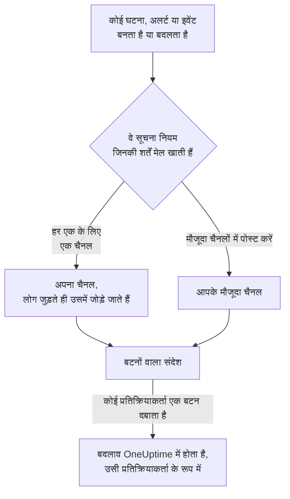

# Mattermost

OneUptime को अपने Mattermost सर्वर से कनेक्ट करें, ताकि घटनाएं, अलर्ट, एपिसोड, अनुसूचित रखरखाव, मॉनिटर और ऑन-कॉल अपडेट आपके चैनलों में पोस्ट हों, हर घटना को अपना चैनल मिले, और प्रतिक्रियाकर्ता Mattermost छोड़े बिना स्वीकार कर सकें, सुलझा सकें, नोट जोड़ सकें और स्थिति बदल सकें।

:::cards
- [Mattermost कनेक्ट करें](#mattermost-कनेक्ट-करें): OneUptime के लिए एक बॉट खाता बनाएं, फिर उसके टोकन से प्रोजेक्ट कनेक्ट करें।
- [अपना खाता कनेक्ट करें](#अपना-mattermost-खाता-कनेक्ट-करें): अपना Mattermost खाता अपने OneUptime खाते से लिंक करें।
- [सूचना नियम](#सूचना-नियम): तय करें कि कौन-से इवेंट कहाँ पोस्ट हों, और किन्हें अपना चैनल मिले।
- [Mattermost से कार्रवाई करना](#mattermost-से-घटनाओं-अलर्ट-और-इवेंट-पर-कार्रवाई-करना): OneUptime के संदेशों के बटन।
- [नेटवर्क और सेल्फ़-होस्टिंग](#नेटवर्क-और-सेल्फ़-होस्टिंग): हर सर्वर को किन चीज़ों तक पहुँच पाना चाहिए।
:::

## यह कैसे काम करता है

यह दो कनेक्शनों से काम करता है:

- **प्रोजेक्ट का कनेक्शन**, जो एक बार बनता है: आपके Mattermost सर्वर पर एक बॉट खाता, उस टीम में जिसमें OneUptime पोस्ट करता है। यह संदेश पोस्ट करता है, चैनल बनाता है और उनमें लोगों को जोड़ता है।
- **हर व्यक्ति का अपना कनेक्शन**: उस व्यक्ति का Mattermost खाता उसके OneUptime खाते से लिंक। बटन उसी व्यक्ति के रूप में, प्रोजेक्ट में उसकी अनुमतियों के साथ काम करते हैं।

एक Mattermost टीम एक से ज़्यादा प्रोजेक्ट से कनेक्ट हो सकती है, जैसे प्रोडक्शन और स्टेजिंग। कोई बटन उस रिकॉर्ड के प्रोजेक्ट में काम करता है जिसके बारे में उसका संदेश है।

## शुरू करने से पहले

- **ऐसी भूमिका जो प्रोजेक्ट को कनेक्ट कर सके:** **प्रोजेक्ट स्वामी**, **प्रोजेक्ट एडमिन** या **प्रोजेक्ट सदस्य**। डिस्कनेक्ट करने के लिए **प्रोजेक्ट स्वामी** या **प्रोजेक्ट एडमिन** चाहिए।
- **एक Mattermost सर्वर**, जिस पर आप बॉट खाता बना सकें, या कोई Mattermost एडमिन जो आपके लिए उसे बना सके। Mattermost Cloud और सेल्फ़-होस्टेड Mattermost, दोनों काम करते हैं।
- सूचना नियमों और सारांशों के लिए **OneUptime Cloud पर Growth प्लान**।

Mattermost के लिए OneUptime को अपने सर्वर पर कुछ भी सेट करने की ज़रूरत नहीं है: हर प्रोजेक्ट अपना Mattermost सर्वर और बॉट खाता खुद लाता है।

## Mattermost कनेक्ट करें

:::steps
### Mattermost में बॉट खाता बनाएं

Mattermost में **System Console** > **Integrations** > **Bot Accounts** खोलें और पक्का करें कि **Enable Bot Account Creation** चालू है। फिर **Integrations** > **Bot Accounts** > **Add Bot Account** पर जाएं, उसका नाम `oneuptime` रखें, और सहेजें। Mattermost बॉट का एक्सेस टोकन केवल एक बार दिखाता है: उसे कॉपी कर लें।

### बॉट को अपनी टीम में जोड़ें

बॉट को उस टीम में जोड़ें जिसमें OneUptime को पोस्ट करना है, वैसे ही जैसे आप किसी व्यक्ति को जोड़ते हैं: **Main Menu** > **Invite People**, और `@oneuptime` को आमंत्रित करें। OneUptime केवल उसी टीम में चैनल बनाता है और पोस्ट करता है।

### प्रोजेक्ट कनेक्ट करें

OneUptime में **प्रोजेक्ट सेटिंग्स** > **वर्कस्पेस** > **Mattermost** पर जाएं और **Mattermost से कनेक्ट करें** पर क्लिक करें। अपने सर्वर का पता, जैसे `https://chat.example.com`, और बॉट का एक्सेस टोकन दर्ज करें। कुछ भी सहेजने से पहले OneUptime आपके सर्वर से टोकन की जाँच करता है। अगर बॉट एक से ज़्यादा टीमों में है, तो OneUptime पूछता है कि किस टीम में पोस्ट करना है। जब तक कोई वर्कस्पेस कनेक्ट नहीं होता, घटनाएं, अलर्ट, अनुसूचित रखरखाव, मॉनिटर और ऑन-कॉल मेन्यू के **वर्कस्पेस** सेक्शन में **कोई वर्कस्पेस कनेक्ट करें** रहता है, जो भी यहीं ले आता है।

### सूचना नियम जोड़ें

**घटनाएं** > **वर्कस्पेस** > **Mattermost** पर जाएं, और एक नियम बनाएं। उदाहरण के लिए, ऐसा नियम जो हर नई घटना के लिए उस पर काम कर रहे सभी लोगों के साथ एक Mattermost चैनल बनाए। [सूचना नियम](#सूचना-नियम) देखें।
:::

बॉट का एक्सेस टोकन केवल OneUptime सर्वर पर रखा जाता है, प्रोजेक्ट के बाकी सीक्रेट के साथ एन्क्रिप्ट करके, और फिर कभी नहीं दिखाया जाता। सर्वर का पता, टीम और बॉट का उपयोगकर्ता नाम Mattermost सेटिंग्स पेज पर प्रोजेक्ट के सभी लोगों को दिखाए जाते हैं।

एक प्रोजेक्ट एक Mattermost टीम से कनेक्ट होता है। उसे किसी दूसरी टीम या दूसरे सर्वर पर ले जाने के लिए, पहले उसे डिस्कनेक्ट करें: **प्रोजेक्ट सेटिंग्स** > **वर्कस्पेस** > **Mattermost**, फिर **⋯** > **Mattermost डिस्कनेक्ट करें**। डिस्कनेक्ट करने से हर सदस्य का अपना Mattermost खाता भी डिस्कनेक्ट हो जाता है। आपके सूचना नियम और सारांश दोबारा कनेक्ट करने के लिए रखे जाते हैं।

## अपना Mattermost खाता कनेक्ट करें

Mattermost में ऐसा कोई साइन-इन नहीं है जिस पर OneUptime आपको भेज सके, इसलिए OneUptime का बॉट इसके बजाय आपके Mattermost खाते को एक लिंक वाला डायरेक्ट मैसेज भेजता है:

:::steps
1. **उपयोगकर्ता सेटिंग्स** > **वर्कस्पेस** > **Mattermost** पर जाएं। OneUptime आपके ईमेल पते वाला Mattermost खाता ढूँढता है। अगर उसे मिल जाता है, तो **@your-username को लिंक भेजें** पर क्लिक करें। अगर नहीं, तो **मुझे लिंक भेजें** पर क्लिक करें और अपना Mattermost उपयोगकर्ता नाम दर्ज करें।
2. Mattermost में OneUptime बॉट का डायरेक्ट मैसेज खोलें, और **Connect my account** पर क्लिक करें।
3. लिंक OneUptime खोलता है, जो आपका खाता कनेक्ट कर देता है।
:::

लिंक उसी ब्राउज़र में खोलें जिसमें आपने उसे माँगा था: वह केवल वहीं, केवल एक बार, और केवल 15 मिनट तक काम करता है। इससे साबित होता है कि लिंक माँगने वाले व्यक्ति के पास दोनों खाते हैं, इसलिए कोई भी किसी और का Mattermost खाता कनेक्ट नहीं कर सकता। अगर आपने लिंक नहीं माँगा था, तो उसे अनदेखा करें: जब तक वह लिंक माँगने वाले ब्राउज़र में नहीं खोला जाता, कुछ भी कनेक्ट नहीं होता।

आपके खाते का कनेक्शन इसी प्रोजेक्ट का है। उसी Mattermost टीम से कनेक्ट किसी दूसरे प्रोजेक्ट में, उसे वहाँ भी कनेक्ट करें।

## सूचना नियम

सूचना नियम बताता है कि कौन-से इवेंट Mattermost में पोस्ट हों, और कहाँ। हर प्रोडक्ट के अपने नियम होते हैं, उसके मेन्यू में **वर्कस्पेस** > **Mattermost** के नीचे: **घटनाएं** (**घटना एपिसोड** और **सारांश** टैब के साथ), **अलर्ट** (**अलर्ट एपिसोड** और **सारांश** के साथ), **अनुसूचित रखरखाव**, **मॉनिटर**, **ऑन-कॉल ड्यूटी** और **सुरक्षा इवेंट**। ये Slack के नियमों की तरह ही काम करते हैं: शर्तों, गंतव्यों और चैनल में कौन शामिल होता है, इसके लिए [सूचना नियम](/docs/workspace-connections/slack#सूचना-नियम) देखें।

नियम जो चैनल बनाता है, उसका नाम उसके रिकॉर्ड पर रखा जाता है: घटना INC-42 को `inc-42` मिलता है। Mattermost छोटे अक्षर, अंक, `-` और `_` लेता है, 64 वर्णों तक, और नाम किसी अक्षर या अंक से शुरू और ख़त्म होना चाहिए; नियम का फ़ॉर्म टाइप करते समय ही नाम दिखाता है। अगर उस नाम का चैनल पहले से है, जैसे कोई संग्रहीत चैनल, तो OneUptime `-2`, `-3` और आगे जोड़ता है। निजी घटना, अलर्ट या एपिसोड को निजी चैनल मिलता है।

किसी मौजूदा चैनल में पोस्ट करने के लिए, उसका नाम वैसे दर्ज करें जैसा वह उसके पते में दिखता है, जैसे `chat.example.com/team/channels/incidents` के लिए `incidents`, या उसका डिस्प्ले नाम। OneUptime किसी सार्वजनिक चैनल में पहली बार पोस्ट करते समय खुद ही उसमें शामिल हो जाता है। किसी निजी चैनल में कोई नियम पोस्ट करे, उससे पहले Mattermost में बॉट को उस चैनल में जोड़ें।

लोग किसी नियम के चैनल में अपने कनेक्ट किए गए Mattermost खाते से शामिल होते हैं, नहीं तो उस Mattermost खाते से जिसमें उनका ईमेल पता है, जब आपका सर्वर बॉट को ईमेल पते दिखाता है (**System Console** > **Site Configuration** > **Users and Teams** > **Show Email Address**)। OneUptime जिन्हें नहीं जोड़ सका, उनके नाम चैनल में एक ही संदेश में बताता है, साथ में उनका खाता कनेक्ट करने का लिंक भी।

किसी नियम की पंक्ति में **परीक्षण नियम** उस नियम का एक परीक्षण संदेश उसके बताए गए चैनलों में पोस्ट करता है, जैसे वह Slack के लिए करता है।

OneUptime के संदेश अपने उद्धृत पाठ से किसी को सूचित नहीं करते: जिस नाम या विवरण में `@channel`, `@here` या `@someone` हो, वह जैसा लिखा है वैसा ही दिखता है, और किसी को पिंग नहीं करता।

## Mattermost से घटनाओं, अलर्ट और इवेंट पर कार्रवाई करना

OneUptime के संदेशों में बटन होते हैं, और कम लोगों को चाहिए होने वाली कार्रवाइयों के लिए एक **More actions** मेन्यू। हर एक आपके रूप में, प्रोजेक्ट में आपकी अनुमतियों के साथ काम करता है, और ऐसे संदेश में जवाब देता है जिसे केवल आप देखते हैं।

| रिकॉर्ड | बटन और मेन्यू |
| --- | --- |
| **घटना** | **Acknowledge**, **Resolve**, **Add Note**, और मेन्यू में **Change Severity** और **Change State** |
| **अलर्ट** | **Acknowledge**, **Resolve**, **Add Note**, **Change State**, **Execute On-Call Policy** |
| **घटना एपिसोड, अलर्ट एपिसोड** | **Acknowledge**, **Resolve**, **Add Note**, **Change State**, **Execute On-Call Policy** |
| **अनुसूचित रखरखाव** | **Mark as Ongoing**, **Mark as Complete**, **Add Note**, **Change State** |

**Add Note**, **Change State**, **Change Severity** और **Execute On-Call Policy** Mattermost में एक फ़ॉर्म खोलते हैं। किसी घटना या अनुसूचित रखरखाव इवेंट पर नोट सार्वजनिक हो सकता है, जो स्थिति पृष्ठ पर दिखता है, या निजी; किसी निजी घटना पर नोट हमेशा निजी होता है, और किसी अलर्ट पर भी हमेशा निजी। बाकी हर चीज़ के लिए, हर संदेश में एक लिंक भी होता है जो उसका रिकॉर्ड OneUptime में खोलता है।

अगर आपका Mattermost खाता अभी कनेक्ट नहीं है, तो बटन यह बताता है, साथ में **उपयोगकर्ता सेटिंग्स** > **वर्कस्पेस** > **Mattermost** का लिंक भी। अपना खाता कनेक्ट करें, फिर बटन दोबारा दबाएँ।

हर बार बटन दबाए जाने पर यह **प्रोजेक्ट सेटिंग्स** > **सूचनाएं** > **सूचना लॉग** में **वर्कस्पेस** टैब पर दर्ज होता है, साथ में यह भी कि किसने दबाया।

## नेटवर्क और सेल्फ़-होस्टिंग

दो सर्वर एक-दूसरे से बात करते हैं:

- **OneUptime आपके Mattermost सर्वर को अनुरोध भेजता है**, पोस्ट करने, चैनल बनाने और लोगों को जोड़ने के लिए। OneUptime Cloud पर, आपका Mattermost सर्वर इंटरनेट से पहुँच योग्य होना चाहिए। सेल्फ़-होस्टेड OneUptime किसी निजी नेटवर्क पर Mattermost सर्वर तक तभी पहुँच सकता है, जब उसका ऑपरेटर `ALLOW_PRIVATE_NETWORK_WEBHOOKS` या `PRIVATE_NETWORK_WEBHOOK_ALLOWLIST` से निजी पतों की अनुमति दे। OneUptime कभी अपनी ही मशीन के किसी पते या किसी क्लाउड मेटाडेटा पते को अनुरोध नहीं भेजता, और कभी किसी रीडायरेक्ट का पालन नहीं करता।
- **आपका Mattermost सर्वर OneUptime को अनुरोध भेजता है**, जब कोई बटन दबाता है या फ़ॉर्म भेजता है: `https://<your OneUptime>/api/mattermost/interactive` और `/api/mattermost/dialog`। अगर OneUptime का पता निजी है, तो Mattermost में उसका होस्ट **System Console** > **Environment** > **Developer** > **Allow untrusted internal connections to** में जोड़ें, नहीं तो बटन काम नहीं करेंगे।

OneUptime का पोस्ट किया हर बटन उस Mattermost टीम के लिए एक हस्ताक्षर रखता है जिसमें वह पोस्ट किया गया था, और बटन दबाने पर इसकी जाँच होती है: OneUptime के हस्ताक्षर के बिना आया क्लिक, या किसी दूसरी टीम से भेजा गया क्लिक, कुछ नहीं करता।

## समस्या निवारण

| आपको क्या दिखता है | क्या करें |
| --- | --- |
| **Mattermost did not accept the access token** | बॉट का टोकन फिर से कॉपी करें। Mattermost उसे केवल एक बार दिखाता है: ज़रूरत हो तो **Integrations** > **Bot Accounts** में एक नया टोकन बनाएं। |
| **The bot account is not a member of any team** | Mattermost में बॉट को अपनी टीम में जोड़ें, फिर दोबारा कनेक्ट करें। |
| **OneUptime could not reach the Mattermost server** | पता जाँचें, और यह भी कि OneUptime उस तक पहुँच सकता है। [नेटवर्क और सेल्फ़-होस्टिंग](#नेटवर्क-और-सेल्फ़-होस्टिंग) देखें। |
| **The bot is not a member of the private Mattermost channel** | Mattermost में बॉट को उस चैनल में जोड़ें। |
| कोई बटन कुछ नहीं करता, या Mattermost कहता है कि वह कार्रवाई पूरी नहीं कर सका | Mattermost, OneUptime तक नहीं पहुँच पा रहा है। [नेटवर्क और सेल्फ़-होस्टिंग](#नेटवर्क-और-सेल्फ़-होस्टिंग) देखें। |
| आपके लिंक वाला कोई डायरेक्ट मैसेज नहीं आता | उपयोगकर्ता नाम जाँचें, और यह भी कि बॉट ऐसी टीम में है जिसमें आप हैं। |
