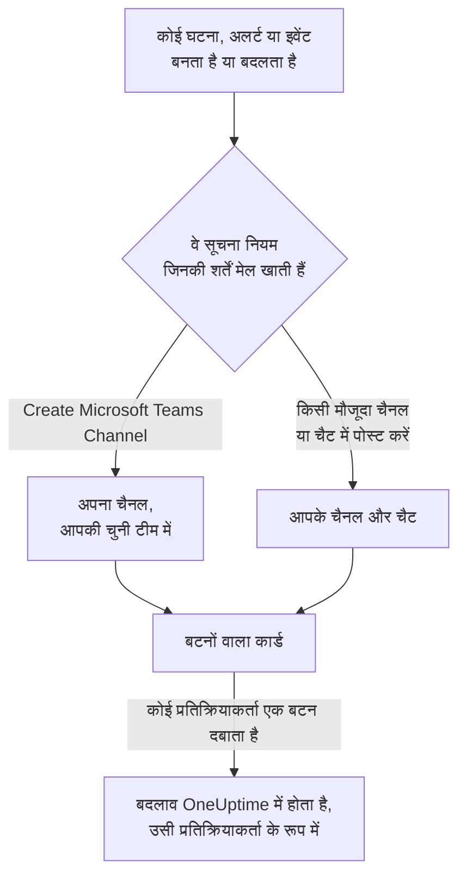

# Microsoft Teams

OneUptime को Microsoft Teams से कनेक्ट करें, ताकि घटनाएं, अलर्ट, एपिसोड, अनुसूचित रखरखाव, मॉनिटर और ऑन-कॉल अपडेट आपके चैनलों और चैट में पोस्ट हों, हर घटना को अपना चैनल मिले, और प्रतिक्रियाकर्ता Teams से ही काम कर सकें: स्वीकार करना, सुलझाना, नोट जोड़ना, ऑन-कॉल को पेज करना, घटनाएं घोषित करना और OneUptime AI से पूछना।

:::cards
- [Microsoft Teams कनेक्ट करें](#microsoft-teams-कनेक्ट-करें): एडमिन की सहमति, आपका साइन-इन, और हर टीम में ऐप।
- [सूचना नियम](#सूचना-नियम): तय करें कि कौन-से इवेंट कहाँ पोस्ट हों, और किन्हें अपना चैनल मिले।
- [OneUptime बॉट से बात करना](#oneuptime-बॉट-से-बात-करना): बॉट के साथ चैट में कमांड, सवाल और फ़ॉर्म।
- [Microsoft Teams से घटनाओं, अलर्ट और इवेंट पर कार्रवाई करना](#microsoft-teams-से-घटनाओं-अलर्ट-और-इवेंट-पर-कार्रवाई-करना): OneUptime के कार्ड के बटन।
:::

## यह कैसे काम करता है

यह तीन चीज़ों से काम करता है:

- **प्रोजेक्ट का कनेक्शन**, जो एक बार बनता है: Microsoft 365 का कोई एडमिनिस्ट्रेटर आपके संगठन के लिए OneUptime ऐप को सहमति देता है।
- **हर उस टीम में OneUptime ऐप** जिसमें आप सूचनाएं चाहते हैं। Microsoft बॉट को केवल उसी टीम में पोस्ट करने देता है जिसमें उसे जोड़ा गया हो।
- **हर व्यक्ति का अपना कनेक्शन**: उस व्यक्ति का Microsoft Teams खाता उसके OneUptime खाते से लिंक। बटन, कमांड और प्रतिक्रियाएं उसी व्यक्ति के रूप में, प्रोजेक्ट में उसकी अनुमतियों के साथ काम करती हैं।

## शुरू करने से पहले

- **ऐसी भूमिका जो प्रोजेक्ट को कनेक्ट कर सके:** **Project Owner**, **Project Admin** या **Project Member**। ऐप अनइंस्टॉल करने के लिए **Project Owner** या **Project Admin** चाहिए।
- **Microsoft 365 का एक एडमिनिस्ट्रेटर**, जो पूरे संगठन के लिए एक बार एडमिन की सहमति दे।
- सूचना नियमों और सारांशों के लिए **OneUptime Cloud पर Growth प्लान**। [Growth प्लान से नीचे सूचना नियम](#growth-प्लान-से-नीचे-सूचना-नियम) देखें।
- **सेल्फ़-होस्टेड सर्वर पर,** पहले उसके लिए सेट किया गया Teams बॉट। [Microsoft Teams एकीकरण](/docs/self-hosted/microsoft-teams-integration) देखें।

## Microsoft Teams कनेक्ट करें

:::steps
### एडमिन की सहमति दें

**प्रोजेक्ट सेटिंग्स** > **वर्कस्पेस** > **Microsoft Teams** पर जाएं और **एडमिन सहमति प्रदान करें** पर क्लिक करें। Microsoft 365 का कोई एडमिनिस्ट्रेटर साइन इन करता है और संगठन के लिए OneUptime ऐप को अनुमति देता है। इसके बाद कार्ड **Admin Consent Completed** दिखाता है। जब तक कोई वर्कस्पेस कनेक्ट नहीं होता, घटनाएं, अलर्ट, अनुसूचित रखरखाव, मॉनिटर और ऑन-कॉल मेन्यू के **वर्कस्पेस** सेक्शन में **Slack या Teams कनेक्ट करें** रहता है, जो भी यहीं ले आता है।

### अपना खाता कनेक्ट करें

**Connect with Microsoft Teams** पर क्लिक करें और अपने कार्य खाते से साइन इन करें। OneUptime आपके संगठन की टीमें पढ़ता है; **टीमें देखें** उन्हें सूचीबद्ध करता है।

### हर टीम में OneUptime ऐप जोड़ें (ज़रूरी)

केवल अपना खाता कनेक्ट करना काफ़ी नहीं है। Microsoft OneUptime बॉट को केवल उसी टीम में पोस्ट करने देता है जिसमें उसे जोड़ा गया हो, इसलिए हर उस टीम के लिए यह करें जिसमें आप सूचनाएं चाहते हैं:

- Microsoft Teams में, **टीम के नाम** (चैनल के नाम के नहीं) के बगल वाले "..." पर क्लिक करें।
- **Manage team** > **Apps** > **More apps** चुनें, **OneUptime** खोजें और **Add** पर क्लिक करें।

OneUptime Cloud पर, **Teams Store खोलें** Microsoft Teams स्टोर में ऐप खोलता है, जहाँ **Add to a team** वही करता है। सेल्फ़-होस्टेड सर्वर पर, इसके बजाय **ऐप मैनिफेस्ट Zip डाउनलोड करें** से मिला पैकेज इंस्टॉल करें: केवल उसी में आपके सर्वर का बॉट होता है। अगर कोई परीक्षण सूचना बताती है कि OneUptime ऐप टीम में इंस्टॉल नहीं है, तो यही चरण छूट गया था।

### बाकी सभी को कनेक्ट करें

हर व्यक्ति **उपयोगकर्ता सेटिंग्स** > **वर्कस्पेस** > **Microsoft Teams** में **Connect my account with Microsoft Teams** से अपना Microsoft Teams खाता लिंक करता है, ताकि वह खुद के रूप में घटनाओं पर कार्रवाई कर सके और डायरेक्ट मैसेज पा सके। प्रोजेक्ट के Microsoft Teams से कनेक्ट होते ही यह सेक्शन दिखने लगता है।

### सूचना नियम जोड़ें

**घटनाएं** > **वर्कस्पेस** > **Microsoft Teams** पर जाएं। **वर्कस्पेस** सेक्शन केवल वे चैट वर्कस्पेस दिखाता है जिन्हें आपके प्रोजेक्ट ने कनेक्ट किया है, इसलिए **Microsoft Teams** कनेक्ट होने के बाद वहाँ दिखता है। एक नियम बनाएं, जैसे ऐसा नियम जो घटना बनने पर किसी Teams चैनल में पोस्ट करे, फिर उसकी पंक्ति में **परीक्षण नियम** पर क्लिक करें।
:::

> [!NOTE]
> अपने लिए OneUptime इंस्टॉल करना, या उसे किसी चैट में जोड़ना, एक अलग इंस्टॉलेशन है और इससे वह किसी टीम के चैनलों में पोस्ट नहीं कर पाता। **निजी चैनलों** के लिए ऐप को चैनल में ही जोड़ना होता है: चैनल खोलें > "..." > **Manage channel** > **Apps** > **Add an app**। **साझा चैनलों** में सूचनाएं नहीं आ सकतीं: Microsoft Teams साझा चैनलों में बॉट का समर्थन नहीं करता।

## सूचना नियम

सूचना नियम बताता है कि कौन-से इवेंट Microsoft Teams में पोस्ट हों, और कहाँ। हर प्रोडक्ट के अपने नियम होते हैं, उसके मेन्यू में **वर्कस्पेस** > **Microsoft Teams** के नीचे:

| प्रोडक्ट | उसके **Microsoft Teams** पेज के टैब |
| --- | --- |
| **घटनाएं** | **घटनाएं**, **घटना एपिसोड**, **Summary** |
| **अलर्ट** | **अलर्ट**, **अलर्ट एपिसोड**, **Summary** |
| **अनुसूचित रखरखाव** | नियमों की एक सूची |
| **मॉनिटर** | नियमों की एक सूची |
| **ऑन-कॉल ड्यूटी** | नियमों की एक सूची |

नियम बनाना चार चरणों में होता है:

| चरण | आप क्या सेट करते हैं |
| --- | --- |
| **बेसिक** | **नियम नाम** और **नियम विवरण**। |
| **शर्तें** | नियम किन इवेंट के लिए चलता है, जैसे गंभीरता, स्थिति, लेबल, मॉनिटर या शीर्षक के शब्दों के आधार पर। बिना शर्तों के यह हर इवेंट के लिए चलता है। दो या अधिक शर्तों पर **मिलान शर्त** बताता है कि सभी का मेल खाना ज़रूरी है या किसी एक का। |
| **गंतव्य** | यह कहाँ पोस्ट करता है: आपकी चुनी टीम का कोई मौजूदा चैनल, आपकी चुनी चैट, आपकी चुनी टीम में बनाया गया नया चैनल, या इनमें से कोई भी एक साथ। |
| **Video Call** | केवल घटनाएं और अलर्ट: हर एक के लिए एक कॉल शुरू करें। [वीडियो कॉल](/docs/workspace-connections/video-calls) देखें। |

नियम जो चैनल बनाता है, उसका नाम **New Microsoft Teams Channel Name** के बाद रिकॉर्ड की संख्या जोड़कर रखा जाता है, जैसे `oneuptime-incident-42`, और केवल बनाया गया चैनल ही उन लोगों को पाता है जिन्हें नियम आमंत्रित करता है। निजी घटना, अलर्ट या एपिसोड को निजी चैनल मिलता है। रिकॉर्ड का हर बाद का अपडेट — स्थिति का बदलाव, नोट, नया मालिक — उसके चैनलों और चैट में पोस्ट होता है।

**प्रोजेक्ट सेटिंग्स** > **वर्कस्पेस** > **Microsoft Teams** आपकी टीमों के वे चैनल जिन्हें OneUptime देख सकता है, और वे चैट जिनमें उसे जोड़ा गया है, सूचीबद्ध करता है, हर एक के बगल में **परीक्षण भेजें** के साथ। कोई चैट तब दिखती है जब Microsoft Teams में OneUptime ऐप को उसमें जोड़ा जाता है; **Refresh Chats** नई चैट और उनके मौजूदा नाम ले आता है।

## किसी नियम का परीक्षण

नियम की पंक्ति में **परीक्षण नियम** उस नियम का एक परीक्षण संदेश उसके बताए गए चैनलों में पोस्ट करता है, ताकि आप उसे आते देख सकें। अगर नियम हर इवेंट के लिए एक चैनल बनाता है, तो परीक्षण भी एक चैनल बनाता है और नियम के लोगों को उसमें आमंत्रित करता है।

**प्रोजेक्ट सेटिंग्स** > **वर्कस्पेस** > **Microsoft Teams** में किसी चैनल के बगल वाले **परीक्षण भेजें** की तरह, इसके लिए सूचना नियम बनाने की अनुमति चाहिए: **Project Owner**, **Project Admin**, **Project Member**, **Settings Admin**, **Settings Member**, या किसी कस्टम भूमिका में **Create Workspace Notification Rule** और **Read Workspace Notification Rule**। जो केवल नियम देख सकता है, जैसे **Viewer**, उसके लिए **परीक्षण नियम** लॉक रहता है, और उसका टूलटिप बताता है कि क्या चाहिए; API उसके परीक्षण को "You do not have permission to send test notifications in this project." के साथ अस्वीकार करता है। OneUptime Cloud पर नियम का परीक्षण करने के लिए, नियम जोड़ने की तरह, **Growth** प्लान चाहिए।

OneUptime Cloud पर किसी चैनल या चैट के बगल वाले **परीक्षण भेजें** के लिए भी **Growth** प्लान चाहिए, क्योंकि चैनल में पोस्ट करना वही है जो नियम और सारांश करते हैं। किसी सारांश पर **अभी परीक्षण भेजें** के लिए सारांश बनाने की अनुमति (किसी कस्टम भूमिका में **Create Workspace Notification Summary** और **Read Workspace Notification Summary**) और OneUptime Cloud पर **Growth** प्लान चाहिए; बाकी सभी के लिए यह लॉक रहता है, और उसका टूलटिप बताता है कि क्या चाहिए। केवल-पढ़ने की पहुँच के साथ कनेक्ट किया गया MCP क्लाइंट कोई परीक्षण नहीं भेज सकता।

## सारांश

**घटनाएं** > **वर्कस्पेस** > **Microsoft Teams** (और **अलर्ट**) का **Summary** टैब आपके बताए चैनलों में एक नियमित सारांश पोस्ट करता है: कितनी घटनाएं या अलर्ट हुए, उन्हें कितनी जल्दी स्वीकार किया गया और सुलझाया गया, और लिंक के साथ एक सूची। नया सारांश हर हफ़्ते जाता है और पिछले 7 दिनों को शामिल करता है। **पहली रिपोर्ट इस समय भेजें** खाली छोड़ दें, तो पहला सारांश अगले हफ़्ते, दिन या महीने की शुरुआत में 09:00 बजे जाता है; फ़ॉर्म बताता है कि कब।

सारांश अपने **टाइमज़ोन** की घड़ी के हिसाब से जाता है, जो शुरू में आपका टाइम ज़ोन होता है। यह वहाँ पूरे साल दिन का वही समय बनाए रखता है: बर्लिन में 09:00 पर सेट किया गया सारांश डेलाइट सेविंग टाइम के लिए घड़ियाँ बदलने के बाद भी बर्लिन में 09:00 पर ही जाता है, और उसके संदेश की तारीखें भी बर्लिन की होती हैं। API से `timezone` को IANA टाइम ज़ोन नाम के रूप में भेजें, जैसे `Europe/Berlin`। बिना टाइम ज़ोन के बनाया गया सारांश अपने बनाने वाले की प्रोफ़ाइल का टाइम ज़ोन लेता है, या जब कोई API कुंजी उसे बनाती है तो UTC।

सारांश के फ़ॉर्म में चार चरण हैं: **मूल जानकारी** (उसका नाम, चैनल और उनका **टीम का नाम**), **अनुसूची**, **सामग्री** (**क्या शामिल करें**) और **फ़िल्टर** (वह किन घटनाओं या अलर्ट को गिनता है)।

## Growth प्लान से नीचे सूचना नियम

OneUptime Cloud पर सूचना नियम और सारांश **Growth** प्लान और उससे ऊपर में हैं। उससे नीचे का प्रोजेक्ट अपने मौजूदा नियम और सारांश रखता है, और वे Microsoft Teams में पोस्ट करते रहते हैं। इसलिए हर प्रोडक्ट (घटनाएं, अलर्ट, अनुसूचित रखरखाव, ऑन-कॉल ड्यूटी, मॉनिटर) का **Microsoft Teams** पेज प्लान की सूचना और उसके नीचे उनकी सूची दिखाता है (**अभी भी सेट अप किए गए सूचना नियम**, **अभी भी सेट अप किए गए सारांश**): किसी नियम को हटाएं, या किसी सारांश को बंद करें या हटाएं। नियम और सारांश जोड़ने या बदलने के लिए **Growth** चाहिए।

## Microsoft Teams में पेज होना

जब आप ऑन-कॉल हों तब डायरेक्ट मैसेज से पेज होने के लिए, Microsoft Teams को अपनी सूचना विधियों में से एक के रूप में जोड़ें:

:::steps
1. अपना Microsoft Teams खाता कनेक्ट करें ([Microsoft Teams कनेक्ट करें](#microsoft-teams-कनेक्ट-करें) देखें)।
2. **उपयोगकर्ता सेटिंग्स** > **सूचना विधियां** पर जाएं, **Workspace Apps** टैब खोलें और **Add Microsoft Teams Account** पर क्लिक करें।
3. उसकी पंक्ति में **Send Test Message** पर क्लिक करें। संदेश आपकी Microsoft Teams चैट में आता है।
:::

जोड़ते ही यह आपके ऑन-कॉल नियमों में शामिल हो जाता है, इसलिए उसके बाद से पेज आप तक Microsoft Teams में पहुँचते हैं। इसे कौन-से पेज मिलें, यह **उपयोगकर्ता सेटिंग्स** > **ऑन-कॉल नियम** में बदलें।

## संदेशों को नोट के रूप में सहेजना

OneUptime ने किसी घटना, अलर्ट, एपिसोड या अनुसूचित रखरखाव इवेंट के लिए जो चैनल बनाया है, उसमें किसी संदेश या जवाब पर प्रतिक्रिया दें, और OneUptime उसे उस रिकॉर्ड पर नोट के रूप में सहेजता है। वह एक मिनट के अंदर प्रतिक्रिया पकड़ लेता है और थ्रेड में जवाब देकर पुष्टि करता है:

| प्रतिक्रिया | किस रूप में सहेजा जाता है |
| --- | --- |
| 📌 या 📍 | एक निजी नोट, जिसे केवल आपकी टीम देखती है |
| 📣 या 📢 | एक सार्वजनिक नोट, जो स्थिति पृष्ठ पर दिखता है। केवल घटनाएं और अनुसूचित रखरखाव इवेंट। |

नोट आपके रूप में, आपकी अनुमतियों के साथ सहेजा जाता है, इसलिए आपका अपना Microsoft Teams खाता कनेक्ट होना चाहिए, और OneUptime ऐप टीम में होना चाहिए।

## OneUptime बॉट से बात करना

बॉट को निजी चैट में संदेश भेजें, या किसी चैनल या ग्रुप चैट में OneUptime को @मेंशन करें: वहाँ वह केवल मेंशन किए जाने पर जवाब देता है।

| संदेश | बॉट क्या करता है |
| --- | --- |
| `help` | बताता है कि वह क्या-क्या कर सकता है। |
| `ask <question>`, या सामान्य भाषा में कोई भी सवाल | OneUptime AI आपके लॉग, ट्रेस, मेट्रिक, घटनाओं और मॉनिटरों के बारे में जवाब देता है, उदाहरण के लिए "अभी कौन-से मॉनिटर डाउन हैं?"। जवाब केवल पढ़ते हैं। |
| `create incident [title]` | घटना का फ़ॉर्म खोलता है, शीर्षक भरा हुआ। |
| `create maintenance [title]` | अनुसूचित रखरखाव का फ़ॉर्म खोलता है, शीर्षक भरा हुआ। |
| `show active incidents`, `show active alerts` | बताता है कि अभी क्या खुला है। |
| `show scheduled maintenance`, `show ongoing maintenance` | आने वाले, या चल रहे, रखरखाव इवेंट सूचीबद्ध करता है। |

OneUptime AI से पूछने के लिए प्रोजेक्ट के लिए AI चालू होना चाहिए। [AI से पूछें](/docs/ai/ask-ai) देखें।

## Microsoft Teams से घटनाएं और रखरखाव बनाना

OneUptime बॉट को `create incident` या `create maintenance` लिखने से, लिखने वाले व्यक्ति के लिए एक फ़ॉर्म खुलता है, चाहे निजी चैट हो, चैनल हो या ग्रुप चैट। इसे उसी व्यक्ति के रूप में भरा जाता है: उस OneUptime खाते के रूप में जिससे उसका Microsoft Teams खाता कनेक्ट है ([Microsoft Teams कनेक्ट करें](#microsoft-teams-कनेक्ट-करें) देखें), प्रोजेक्ट में उस खाते की अनुमतियों के साथ। जिसका खाता कनेक्ट नहीं है, या जिसका OneUptime खाता अब प्रोजेक्ट का सदस्य नहीं है, उसे फ़ॉर्म के बजाय बताया जाता है कि क्या करना है।

- **कौन इनका उपयोग कर सकता है।** वे लोग जो OneUptime में घटना घोषित कर सकते हैं या अनुसूचित रखरखाव इवेंट बना सकते हैं: घटना के लिए **Project Owner**, **Project Admin**, **Project Member**, **Incident Admin** और **Incident Member** (किसी कस्टम भूमिका में **Create Incident**), और इवेंट के लिए **Scheduled Maintenance Admin** और **Scheduled Maintenance Member** (**Create Scheduled Maintenance**)। बाकी सभी को यह बताया जाता है, और कोई फ़ॉर्म नहीं मिलता।
- **फ़ॉर्म क्या देता है।** हर सूची — गंभीरताएं, मॉनिटर, मॉनिटर स्थितियाँ, ऑन-कॉल नीतियां और लेबल — में वही होता है जो फ़ॉर्म मांगने वाला व्यक्ति पढ़ सकता है, जैसे OneUptime में वही सूची, और कार्ड के "not shown" नोट केवल उन्हीं को गिनते हैं: कुछ लेबल तक सीमित भूमिका के साथ, वे मॉनिटर और ऑन-कॉल नीतियां जिन पर वे लेबल हैं। जो सूची वह बिल्कुल नहीं पढ़ सकता, वह छोड़ दी जाती है। संग्रहीत ऑन-कॉल नीतियां कभी नहीं दी जातीं।
- **फ़ॉर्म किसे चुन सकता है।** चैनल या ग्रुप चैट में वहाँ मौजूद कोई भी फ़ॉर्म सबमिट कर सकता है, और वह उसी के रूप में, उसकी अपनी अनुमतियों के साथ सबमिट होता है जो उसे सबमिट करता है। घटना या इवेंट उन्हीं अनुमतियों के साथ बनता है और उसी व्यक्ति के नाम दर्ज होता है। ऐसा मॉनिटर, ऑन-कॉल नीति, लेबल, गंभीरता या स्थिति जिसे वह नहीं पढ़ सकता, या किसी दूसरे प्रोजेक्ट का, ऐसे अस्वीकार किया जाता है जैसे वह प्रोजेक्ट में हो ही नहीं, और कुछ नहीं बनता: बॉट जवाब देता है "One of the values you picked ... is not available in this project any more. Please pick it again."

किसी घटना, अलर्ट या एपिसोड पर **Execute On-Call Policy** भी इसी तरह काम करता है: इसके लिए ऑन-कॉल नीति चलाने की अनुमति (**Project Owner**, **Project Admin**, **Project Member**, **On-Call Admin** और **On-Call Member**, या किसी कस्टम भूमिका में **Create On-Call Duty Policy Execution Log**) और उस घटना, अलर्ट या एपिसोड को पढ़ने की अनुमति चाहिए, और यह वे सक्रिय ऑन-कॉल नीतियां देता है जिन्हें वह व्यक्ति पढ़ सकता है। कार्ड से किसी मॉनिटर या ऑन-कॉल नीति को देखना भी उसे बटन दबाने वाले व्यक्ति के रूप में पढ़ता है।

## Microsoft Teams से घटनाओं, अलर्ट और इवेंट पर कार्रवाई करना

OneUptime के कार्ड के बटन उन्हें दबाने वाले व्यक्ति के रूप में काम करते हैं, चाहे निजी चैट हो, चैनल हो या ग्रुप चैट: उस OneUptime खाते के रूप में जिससे उसका Microsoft Teams खाता कनेक्ट है, प्रोजेक्ट में उस खाते की अनुमतियों के साथ। किसी घटना, अलर्ट या एपिसोड पर **Acknowledge**, **Resolve**, **Change State**, **Add Note** और **Execute On-Call Policy**, और किसी अनुसूचित रखरखाव इवेंट पर **Mark as Ongoing**, **Mark as Complete**, **Change State** और **Add Note**, हर एक वही बदलाव करता है जो OneUptime में वही कार्रवाई करती है, और वह वहाँ उसी व्यक्ति के नाम दर्ज होता है: रिकॉर्ड की स्थिति टाइमलाइन और फ़ीड दिखाती हैं कि उसकी स्थिति किसने बदली, और नोट उसी का होता है। प्रतिक्रिया के साथ किसी संदेश से सहेजा गया नोट भी इसी तरह पोस्ट होता है।

- **कौन इनका उपयोग कर सकता है।** वे लोग जो OneUptime में वही बदलाव कर सकते हैं। किसी घटना को स्वीकार करने, सुलझाने या उसकी स्थिति बदलने के लिए उसकी स्थिति बदलने की अनुमति चाहिए: **Project Owner**, **Project Admin**, **Project Member**, **Incident Admin** और **Incident Member**, या किसी कस्टम भूमिका में **Create Incident State Timeline**। अलर्ट, एपिसोड या अनुसूचित रखरखाव इवेंट के लिए उसी के प्रकार की वैसी ही अनुमति चाहिए (उदाहरण के लिए **Create Alert State Timeline**), और नोट के लिए उस प्रकार का नोट पोस्ट करने की अनुमति चाहिए। OneUptime के स्थिति पैनल की तरह, ये घटना या अलर्ट को खुद संपादित करने की अनुमति नहीं मांगते। बाकी सभी को यह बताया जाता है, और कुछ नहीं बदलता।
- **कौन-से रिकॉर्ड।** वे जिन्हें वह व्यक्ति पढ़ सकता है, जैसे OneUptime में: कुछ लेबल तक सीमित भूमिका के साथ, वे घटनाएं, अलर्ट, एपिसोड और इवेंट जिन पर वे लेबल हैं। किसी दूसरे रिकॉर्ड पर, या किसी दूसरे प्रोजेक्ट के रिकॉर्ड पर बटन का जवाब यह मिलता है कि रिकॉर्ड "was not found in this project, or you do not have access to it.", और कुछ नहीं बदलता। OneUptime Cloud पर, ऐसा बदलाव जो प्रोजेक्ट के प्लान में शामिल नहीं है, ज़रूरी प्लान बताते हुए अस्वीकार किया जाता है।
- **Change State क्या देता है।** वे स्थितियाँ जिन्हें वह व्यक्ति पढ़ सकता है और जिनमें रिकॉर्ड आगे जा सकता है, प्रोजेक्ट के क्रम में: उसकी मौजूदा स्थिति से पहले की कोई नहीं, एपिसोड के लिए भी वैसे ही जैसे घटना, अलर्ट या अनुसूचित रखरखाव इवेंट के लिए, क्योंकि स्थिति बदलने से रिकॉर्ड कभी अपनी सूची में ऊपर वापस नहीं जाता ([क्रम एक असली बाधा है, दिखावे की पसंद नहीं](/docs/incidents/states-and-severities#क्रम-एक-असली-बाधा-है-दिखावे-की-पसंद-नहीं) देखें)। जब वह एक भी नहीं पढ़ सकता, तो बॉट कहता है "No incident states are available to you in this project. Ask a project admin for access to them."; जब रिकॉर्ड उस आखिरी स्थिति में है जहाँ तक वह पहुँच सकता है, तो वह कहता है "There is no later state to move this incident to."। दोनों में से कोई भी खाली कार्ड नहीं दिखाता।
- **Escalate.** कार्ड का **Escalate** उस घटना, अलर्ट या एपिसोड के लिए, जिसके बारे में कार्ड है, अपनी ऑन-कॉल नीति चलाता है, उसे दबाने वाले व्यक्ति के रूप में, **Execute On-Call Policy** जैसी ही अनुमतियों के साथ। जो कार्ड इनमें से किसी के बारे में नहीं है, उसका जवाब "This on-call policy can only be executed for an incident, an alert or an episode. Open the record you are paging about and use Execute On-Call Policy there." होता है, और किसी को पेज नहीं किया जाता।

## डिस्कनेक्ट करना

- **Disconnect** केवल आपका अपना Microsoft Teams खाता अनलिंक करता है, और साथ में आपकी Microsoft Teams सूचना विधि हटा देता है।
- **प्रोजेक्ट सेटिंग्स** > **वर्कस्पेस** > **Microsoft Teams** पर **Uninstall OneUptime from Microsoft Teams** प्रोजेक्ट को डिस्कनेक्ट करता है। OneUptime Microsoft Teams में पोस्ट करना बंद कर देता है, और **वर्कस्पेस** मेन्यू उसे दिखाना बंद कर देते हैं। सूचना नियम और सारांश दोबारा कनेक्ट करने के लिए रखे जाते हैं।

> [!WARNING]
> अनइंस्टॉल करने से प्रोजेक्ट के हर सदस्य का अपना Microsoft Teams खाता भी अनलिंक हो जाता है, और Microsoft Teams सूचना विधियां और उनका उपयोग करने वाले ऑन-कॉल नियम हट जाते हैं। एक प्रोजेक्ट एक Microsoft 365 संगठन से कनेक्ट होता है: उसे किसी दूसरे संगठन में ले जाने के लिए, पहले अनइंस्टॉल करें।

## समस्या निवारण

:::details कोई परीक्षण कहता है कि OneUptime ऐप टीम में इंस्टॉल नहीं है
Microsoft ने पोस्ट अस्वीकार कर दी, क्योंकि बॉट उस टीम में नहीं है। ऐप को टीम में जोड़ें ([Microsoft Teams कनेक्ट करें](#microsoft-teams-कनेक्ट-करें) देखें), या निजी चैनल के लिए, चैनल में ही। एक टीम में जोड़ने से दूसरी टीमों के लिए कुछ नहीं होता।
:::

:::details Microsoft Teams कनेक्ट नहीं हुआ
जब Microsoft आपको बिना कनेक्शन के वापस भेजता है, तो जिस पेज से आपने शुरू किया था वह **Microsoft Teams कनेक्ट नहीं हुआ** दिखाता है, और एक वाक्य कारण बताता है: आपके पास अनुमति नहीं है, लिंक पहले ही उपयोग हो चुका है या समाप्त हो गया है, आपने किसी दूसरे Microsoft 365 संगठन में साइन इन किया, या आपके संगठन में अभी कोई टीम नहीं है। हर वाक्य और उसके लिए क्या करना है, इसके लिए [कनेक्ट करना पूरा नहीं हुआ](/docs/self-hosted/microsoft-teams-integration#कनेक्ट-करना-पूरा-नहीं-हुआ) देखें।
:::

:::details बॉट कहता है कि मेरा खाता कनेक्ट नहीं है
इसे **उपयोगकर्ता सेटिंग्स** > **वर्कस्पेस** > **Microsoft Teams** में **Connect my account with Microsoft Teams** से लिंक करें, उस संगठन में साइन इन करके जिससे प्रोजेक्ट कनेक्ट है। किसी दूसरे संगठन का गेस्ट खाता वही खाता नहीं है।
:::

:::details सेल्फ़-होस्टेड सर्वर पर हर सूचना विफल होती है
आपकी टीमों में इंस्टॉल किया गया Teams ऐप वही पैकेज होना चाहिए जो आपके सर्वर ने बनाया है, और Microsoft का आपके सर्वर के बॉट एंडपॉइंट तक पहुँच पाना ज़रूरी है। [Microsoft Teams एकीकरण](/docs/self-hosted/microsoft-teams-integration#समस्या-निवारण) का समस्या निवारण देखें।
:::

## अगले कदम

:::cards
- [Slack](/docs/workspace-connections/slack): Slack में वही सूचनाएं और कार्रवाइयाँ।
- [वीडियो कॉल](/docs/workspace-connections/video-calls): हर घटना को एक कॉल दें, जो उसके अपडेट के साथ पोस्ट हो।
- [Microsoft Teams एकीकरण](/docs/self-hosted/microsoft-teams-integration): सेल्फ़-होस्टेड सर्वर पर Teams बॉट सेट करें।
- [घटना घोषित करना](/docs/incidents/declaring-incidents): घटना शुरू होने के सभी तरीके, और उस समय क्या चलता है।
:::
