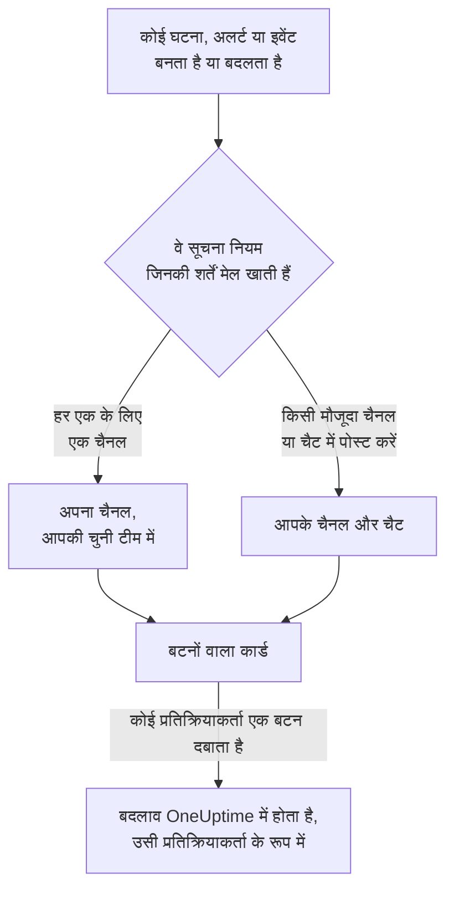

# Microsoft Teams

OneUptime को Microsoft Teams से कनेक्ट करें, ताकि घटनाएं, अलर्ट, एपिसोड, अनुसूचित रखरखाव, मॉनिटर और ऑन-कॉल अपडेट आपके चैनलों और चैट में पोस्ट हों, हर घटना को अपना चैनल मिले, और प्रतिक्रियाकर्ता Teams से ही काम कर सकें: स्वीकार करना, सुलझाना, नोट जोड़ना, ऑन-कॉल को पेज करना, घटनाएं घोषित करना और OneUptime AI से पूछना।

:::cards
- [Microsoft Teams कनेक्ट करें](#microsoft-teams-कनेक्ट-करें): एडमिन की सहमति, आपका साइन-इन, और हर टीम में ऐप।
- [सभी से कनेक्ट करने को कहना](#सभी-से-कनेक्ट-करने-को-कहना): जिन सदस्यों ने अपना खाता कनेक्ट नहीं किया है, उन सभी को एक साथ संदेश भेजें।
- [सूचना नियम](#सूचना-नियम): तय करें कि कौन-से इवेंट कहाँ पोस्ट हों, और किन्हें अपना चैनल मिले।
- [OneUptime बॉट से बात करना](#oneuptime-बॉट-से-बात-करना): बॉट के साथ चैट में कमांड, सवाल और फ़ॉर्म।
- [ऑन-कॉल टैग](#ऑन-कॉल-टैग): किसी टीम के टैग को ऑन-कॉल लोगों के बराबर रखें, और उसे पेज करें।
- [Microsoft Teams से घटनाओं, अलर्ट और इवेंट पर कार्रवाई करना](#microsoft-teams-से-घटनाओं-अलर्ट-और-इवेंट-पर-कार्रवाई-करना): OneUptime के कार्ड के बटन।
:::

## यह कैसे काम करता है

यह तीन चीज़ों से काम करता है:

- **प्रोजेक्ट का कनेक्शन**, जो एक बार बनता है: Microsoft 365 का कोई एडमिनिस्ट्रेटर आपके संगठन के लिए OneUptime ऐप को सहमति देता है।
- **हर उस टीम में OneUptime ऐप** जिसमें आप सूचनाएं चाहते हैं। Microsoft बॉट को केवल उसी टीम में पोस्ट करने देता है जिसमें उसे जोड़ा गया हो।
- **हर व्यक्ति का अपना कनेक्शन**: उस व्यक्ति का Microsoft Teams खाता उसके OneUptime खाते से लिंक। बटन, कमांड और प्रतिक्रियाएं उसी व्यक्ति के रूप में, प्रोजेक्ट में उसकी अनुमतियों के साथ काम करती हैं।

एक Microsoft 365 संगठन एक से ज़्यादा प्रोजेक्ट से कनेक्ट हो सकता है, जैसे प्रोडक्शन और स्टेजिंग। किसी कार्ड का बटन उस प्रोजेक्ट में काम करता है जिसके लिए कार्ड भेजा गया था, जैसे उस घटना का प्रोजेक्ट जिसके बारे में कार्ड है। बॉट को भेजा गया संदेश उस चैनल के प्रोजेक्ट में काम करता है जिसमें वह भेजा गया है, जैसे किसी घटना का चैनल, नहीं तो उस एकमात्र प्रोजेक्ट में जिसमें भेजने वाले का Microsoft Teams खाता कनेक्ट है। जब इनसे पता नहीं चलता, तो बॉट भेजने वाले से पूछता है कि उसका मतलब किस प्रोजेक्ट से है, जिन प्रोजेक्ट में वह है उनमें से हर एक के लिए एक बटन के साथ, और उसके चुनते ही उसी प्रोजेक्ट में आगे बढ़ता है। OneUptime AI के साथ बातचीत में यह चुनाव आगे के सवालों के लिए तब तक बना रहता है जब तक बिना किसी सवाल के एक घंटा न बीत जाए।

## शुरू करने से पहले

- **ऐसी भूमिका जो प्रोजेक्ट को कनेक्ट कर सके:** **प्रोजेक्ट स्वामी**, **प्रोजेक्ट एडमिन** या **प्रोजेक्ट सदस्य**। ऐप अनइंस्टॉल करने के लिए **प्रोजेक्ट स्वामी** या **प्रोजेक्ट एडमिन** चाहिए।
- **Microsoft 365 का एक एडमिनिस्ट्रेटर**, जो पूरे संगठन के लिए एक बार एडमिन की सहमति दे।
- सूचना नियमों और सारांशों के लिए **OneUptime Cloud पर Growth प्लान**। [Growth प्लान से नीचे सूचना नियम](#growth-प्लान-से-नीचे-सूचना-नियम) देखें।
- **सेल्फ़-होस्टेड सर्वर पर,** पहले उसके लिए सेट किया गया Teams बॉट। [Microsoft Teams एकीकरण](/docs/self-hosted/microsoft-teams-integration) देखें।

## Microsoft Teams कनेक्ट करें

:::steps
### एडमिन की सहमति दें

**प्रोजेक्ट सेटिंग्स** > **वर्कस्पेस** > **Microsoft Teams** पर जाएं और **एडमिन सहमति प्रदान करें** पर क्लिक करें। Microsoft 365 का कोई एडमिनिस्ट्रेटर साइन इन करता है और संगठन के लिए OneUptime ऐप को अनुमति देता है। इसके बाद कार्ड **Admin Consent Completed** दिखाता है। जब तक कोई वर्कस्पेस कनेक्ट नहीं होता, घटनाएं, अलर्ट, अनुसूचित रखरखाव, मॉनिटर और ऑन-कॉल मेन्यू के **वर्कस्पेस** सेक्शन में **Slack या Teams कनेक्ट करें** रहता है, जो भी यहीं ले आता है।

### अपना खाता कनेक्ट करें

**Connect with Microsoft Teams** पर क्लिक करें और अपने कार्य खाते से साइन इन करें। OneUptime आपके संगठन की टीमें पढ़ता है; **टीमें देखें** उन्हें सूचीबद्ध करता है।

### हर टीम में OneUptime ऐप जोड़ें (ज़रूरी)

केवल अपना खाता कनेक्ट करना काफ़ी नहीं है। Microsoft OneUptime बॉट को केवल उसी टीम में पोस्ट करने देता है जिसमें उसे जोड़ा गया हो, इसलिए हर उस टीम के लिए यह करें जिसमें आप सूचनाएं चाहते हैं:

- Microsoft Teams में, **टीम के नाम** (चैनल के नाम के नहीं) के बगल वाले "..." पर क्लिक करें।
- **Manage team** > **Apps** > **More apps** चुनें, **OneUptime** खोजें और **Add** पर क्लिक करें।

OneUptime Cloud पर, **Teams Store खोलें** Microsoft Teams स्टोर में ऐप खोलता है, जहाँ **Add to a team** वही करता है। सेल्फ़-होस्टेड सर्वर पर, इसके बजाय **ऐप मैनिफेस्ट Zip डाउनलोड करें** से मिला पैकेज इंस्टॉल करें: केवल उसी में आपके सर्वर का बॉट होता है। अगर कोई परीक्षण सूचना बताती है कि OneUptime ऐप टीम में इंस्टॉल नहीं है, तो यही चरण छूट गया था।

### बाकी सभी को कनेक्ट करें

हर व्यक्ति **उपयोगकर्ता सेटिंग्स** > **वर्कस्पेस** > **Microsoft Teams** में **Connect my account with Microsoft Teams** से अपना Microsoft Teams खाता लिंक करता है, ताकि वह खुद के रूप में घटनाओं पर कार्रवाई कर सके और डायरेक्ट मैसेज पा सके। प्रोजेक्ट के Microsoft Teams से कनेक्ट होते ही यह सेक्शन दिखने लगता है। पूरी टीम को एक साथ कनेक्ट करवाने के लिए, [सभी से कनेक्ट करने को कहना](#सभी-से-कनेक्ट-करने-को-कहना) देखें।

### सूचना नियम जोड़ें

**घटनाएं** > **वर्कस्पेस** > **Microsoft Teams** पर जाएं। **वर्कस्पेस** सेक्शन केवल वे चैट वर्कस्पेस दिखाता है जिन्हें आपके प्रोजेक्ट ने कनेक्ट किया है, इसलिए **Microsoft Teams** कनेक्ट होने के बाद वहाँ दिखता है। एक नियम बनाएं, जैसे ऐसा नियम जो घटना बनने पर किसी Teams चैनल में पोस्ट करे, फिर उसकी पंक्ति में **परीक्षण नियम** पर क्लिक करें।
:::

> [!NOTE]
> अपने लिए OneUptime इंस्टॉल करना, या उसे किसी चैट में जोड़ना, एक अलग इंस्टॉलेशन है और इससे वह किसी टीम के चैनलों में पोस्ट नहीं कर पाता। **निजी चैनलों** के लिए ऐप को चैनल में ही जोड़ना होता है: चैनल खोलें > "..." > **Manage channel** > **Apps** > **Add an app**। **साझा चैनलों** में सूचनाएं नहीं आ सकतीं: Microsoft Teams साझा चैनलों में बॉट का समर्थन नहीं करता।

## सभी से कनेक्ट करने को कहना

कोई भी किसी और का Microsoft Teams खाता कनेक्ट नहीं कर सकता, एडमिन भी नहीं: हर व्यक्ति खुद अपने खाते में साइन इन करता है। पूरी टीम को कनेक्ट करवाने के लिए, **प्रोजेक्ट सेटिंग्स** > **वर्कस्पेस** > **Microsoft Teams** पर कोई **प्रोजेक्ट स्वामी** या **प्रोजेक्ट एडमिन** एक साथ सभी से कहता है। **Members' Microsoft Teams accounts** कार्ड बताता है कि कितने सदस्य कनेक्ट कर चुके हैं। **Ask everyone to connect** से OneUptime बॉट हर उस सदस्य को, जिसने अभी तक कनेक्ट नहीं किया है, एक संदेश भेजता है, जिसमें **Connect Microsoft Teams account** बटन होता है, जो एक क्लिक में उसका खाता कनेक्ट कर देता है।

- **किसे संदेश मिलता है।** प्रोजेक्ट का हर वह सदस्य जिसने अपना Microsoft Teams खाता कनेक्ट नहीं किया है और जो किसी ऐसी टीम में है जिसमें OneUptime ऐप जोड़ा गया है; वहाँ उसे उसके ईमेल पते या यूज़र प्रिंसिपल नेम (UPN) से ढूँढा जाता है। जिससे पिछले 24 घंटों में कहा जा चुका है, उससे दोबारा नहीं कहा जाता, इसलिए अगले दिन फिर से कहने पर सिर्फ़ उन्हीं लोगों को याद दिलाया जाता है जिन्होंने अब तक कनेक्ट नहीं किया है।
- **कार्ड क्या बताता है।** संदेश भेजे जाने के दौरान कितने संदेश जा चुके हैं, फिर किसने कहा और कितने सदस्यों को संदेश मिला। जिन सदस्यों को OneUptime नहीं ढूँढ सका, उनके नाम कार्ड पर दिए जाते हैं: ऐप को उनकी टीम में जोड़ें, या उनसे कहें कि वे **उपयोगकर्ता सेटिंग्स** > **वर्कस्पेस** > **Microsoft Teams** में खुद कनेक्ट करें।
- **बटन क्या कनेक्ट करता है।** उसे दबाने और साइन इन करने वाले व्यक्ति का Microsoft Teams खाता, उसी के अपने OneUptime खाते से। किसी और को आगे भेजा गया संदेश उस सदस्य के लिए कुछ भी कनेक्ट नहीं करता जिसे वह भेजा गया था।

## सूचना नियम

सूचना नियम बताता है कि कौन-से इवेंट Microsoft Teams में पोस्ट हों, और कहाँ। हर प्रोडक्ट के अपने नियम होते हैं, उसके मेन्यू में **वर्कस्पेस** > **Microsoft Teams** के नीचे:

| प्रोडक्ट | उसके **Microsoft Teams** पेज के टैब |
| --- | --- |
| **घटनाएं** | **घटनाएं**, **घटना एपिसोड**, **सारांश** |
| **अलर्ट** | **अलर्ट**, **अलर्ट एपिसोड**, **सारांश** |
| **अनुसूचित रखरखाव** | नियमों की एक सूची |
| **मॉनिटर** | नियमों की एक सूची |
| **ऑन-कॉल ड्यूटी** | नियमों की एक सूची |

नियम बनाना चार चरणों में होता है:

| चरण | आप क्या सेट करते हैं |
| --- | --- |
| **बेसिक** | **नियम नाम** और **नियम विवरण**। |
| **शर्तें** | नियम किन इवेंट के लिए है, जैसे गंभीरता, स्थिति, लेबल, मॉनिटर या शीर्षक के शब्दों के आधार पर। शर्तें इवेंट बनने पर और OneUptime के उसके बारे में हर अपडेट पोस्ट करने पर फिर से जाँची जाती हैं, इसलिए स्वीकार की गई घटनाओं का नियम घटना स्वीकार होते ही काम करता है। नया नियम हर इवेंट के लिए होता है, जैसे **सभी घटनाएं**। इसे सीमित करने के लिए **केवल शर्तों से मेल खाने वाली घटनाएं** चुनें और शर्तें जोड़ें। दो या अधिक शर्तों पर **मिलान शर्त** बताता है कि सभी का मेल खाना ज़रूरी है या किसी एक का। |
| **गंतव्य** | यह कहाँ पोस्ट करता है: आपकी चुनी टीम का कोई मौजूदा चैनल, आपकी चुनी चैट, आपकी चुनी टीम में हर घटना (या अलर्ट, एपिसोड, इवेंट, मॉनिटर या ऑन-कॉल नीति) के लिए बनाया गया चैनल, या इनमें से कोई भी एक साथ। चरण के नीचे **यह नियम क्या करता है** नियम के कार्ड की तरह इसे वाक्यों में बताता है। |
| **Video Call** | केवल घटनाएं और अलर्ट: हर एक के लिए एक कॉल शुरू करें। [वीडियो कॉल](/docs/workspace-connections/video-calls) देखें। |

नियम जो चैनल बनाता है, उसका नाम उसके रिकॉर्ड पर रखा जाता है: घटना INC-42 को `inc-42` मिलता है, अलर्ट ALT-7 को `alt-7`, और बिना संख्या उपसर्ग वाले प्रोजेक्ट में घटना 42 को `incident-42`। **चैनल नाम उपसर्ग** में लिखा पाठ नाम के आगे लगता है, इसलिए `prod-` से `prod-inc-42` बनता है, और फ़ॉर्म टाइप करते समय ही नाम दिखाता है। अनुसूचित रखरखाव इवेंट के लिए उपसर्ग उसके संख्या उपसर्ग की जगह लेता है: SM-5 को `sm-5` मिलता है, और `maint-` से `maint-5` बनता है। OneUptime अक्षर, अंक, स्पेस, `-` और `_` रखता है, Microsoft Teams की 50 वर्णों की सीमा तक। अगर टीम में उस नाम का चैनल पहले से है, जैसे किसी दूसरे प्रोजेक्ट का या पिछले 30 दिनों में हटाया गया चैनल, तो OneUptime `-2`, `-3` और आगे जोड़ता है।

नियम अपना चैनल तब बनाता है जब कोई इवेंट पहली बार उससे मेल खाता है: इवेंट बनने पर, या बाद में, जब कोई अपडेट उसे मेल में ले आए और वह अभी खुला हो। स्वीकार की गई घटनाओं का नियम घटना स्वीकार होने पर चैनल बनाता है। Microsoft Teams किसी टीम के चैनल टीम के हर व्यक्ति को दिखाता है, इसलिए OneUptime किसी चैनल में एक-एक करके किसी को नहीं जोड़ता: आपकी चुनी टीम का हर व्यक्ति उसे खोल सकता है, जैसा नियम फ़ॉर्म **चैनल में कौन शामिल होता है** के नीचे बताता है। निजी घटना, अलर्ट या एपिसोड को निजी चैनल मिलता है, जिसे सिर्फ़ उसके सदस्य देखते हैं; लोगों को Microsoft Teams में जोड़ें।

जो भी ऑन-कॉल है, उसे शामिल करने के लिए, **ऑन-कॉल लोगों को मेंशन करें** के नीचे उनके ऑन-कॉल शेड्यूल चुनें। चैनल बनने पर OneUptime उसमें, रिकॉर्ड के पहले संदेश के ठीक बाद, एक संदेश पोस्ट करता है जो उन शेड्यूल में ऑन-कॉल लोगों को @मेंशन करता है, ताकि Microsoft Teams उन्हें सूचित करे। किसी को पेज नहीं किया जाता। OneUptime टीम में हर व्यक्ति को उस Microsoft Teams खाते से ढूँढता है जिसे उसने OneUptime से कनेक्ट किया है, नहीं तो उसके ईमेल पते से। जो व्यक्ति टीम में नहीं है, वह उसके चैनल नहीं खोल सकता, इसलिए इसके बजाय संदेश में उसका नाम वजह के साथ लिखा जाता है। निजी चैनल को सिर्फ़ उसके सदस्य खोल सकते हैं, इसलिए ऑन-कॉल लोगों को Microsoft Teams में उसमें जोड़ें।

रिकॉर्ड का हर बाद का अपडेट — स्थिति का बदलाव, नोट, नया मालिक — उसके चैनलों में पोस्ट होता है, और जब तक नियमों की शर्तें मेल खाती हैं, उसके नियमों में बताए गए मौजूदा चैनलों और चैट में भी। OneUptime किसी Microsoft Teams चैनल को संग्रहित नहीं कर सकता, इसलिए रिकॉर्ड खत्म होने पर भी नियम का चैनल बना रहता है; उसे Microsoft Teams में संग्रहित करें या हटाएं।

जिस घटना, अलर्ट, एपिसोड या अनुसूचित रखरखाव इवेंट का अपना चैनल होता है, उसके OneUptime पेज के हेडर में, स्थिति बटनों के बगल में, **Microsoft Teams में खोलें** होता है। यह उस चैनल को एक नए टैब में, Microsoft Teams ऐप या ब्राउज़र में खोलता है। जिस रिकॉर्ड के अपने दो चैनल हों, वह बटन के नीचे दोनों को सूचीबद्ध करता है। जिस रिकॉर्ड के चैनल Slack और Microsoft Teams दोनों में हों, उसमें इसके बजाय एक ही **चैनल खोलें** बटन होता है, जो सभी को सूचीबद्ध करता है। आपके नियम जिन मौजूदा चैनलों और चैट में पोस्ट करते हैं, वे नहीं दिए जाते।

रिकॉर्ड के पेज पर एक **Microsoft Teams चैनल** कार्ड भी होता है, जो बताता है कि चैनल कौन खोल सकता है: टीम में हर कोई, या निजी चैनल के लिए उसके सदस्य, जिन्हें उसके मालिक Microsoft Teams में जोड़ते हैं। OneUptime यह नहीं बदलता कि Microsoft Teams चैनल में कौन है। Slack चैनल के लिए, कार्ड बताता है कि उसमें कौन है और लोगों को जोड़ता है: देखें [किसी रिकॉर्ड के चैनल में कौन है](/docs/workspace-connections/slack#किसी-रिकॉर्ड-के-चैनल-में-कौन-है)।

चैनल और चैट पढ़ने लायक बने रहते हैं: हर अपडेट एक बार पोस्ट होता है, और रिकॉर्ड की पहली स्थिति उसी कार्ड में होती है जो रिकॉर्ड की घोषणा करता है, किसी अलग कार्ड में नहीं। ऑन-कॉल नीति का हर रन एक ही कार्ड है, जिसे एस्केलेशन आगे बढ़ने के साथ संपादित किया जाता है: किसे पेज किया गया, कितनी बार और कैसे, किसे नहीं और क्यों, और किसने स्वीकार किया। नया कार्ड तभी पोस्ट होता है जब किसी को कुछ करना हो: कोई एस्केलेशन नियम किसी तक नहीं पहुंचा, या रन बिना किसी के स्वीकार किए ख़त्म हो गया। रिकॉर्ड के मालिकों या स्थिति पृष्ठ के सब्सक्राइबर को सूचित किया गया, यह OneUptime में उसकी फ़ीड में रहता है।

**प्रोजेक्ट सेटिंग्स** > **वर्कस्पेस** > **Microsoft Teams** आपकी टीमों के वे चैनल जिन्हें OneUptime देख सकता है, और वे चैट जिनमें उसे जोड़ा गया है, सूचीबद्ध करता है, हर एक के बगल में **परीक्षण भेजें** के साथ। कोई चैट तब दिखती है जब Microsoft Teams में OneUptime ऐप को उसमें जोड़ा जाता है; **Refresh Chats** नई चैट और उनके मौजूदा नाम ले आता है।

## किसी नियम का परीक्षण

नियम की पंक्ति में **परीक्षण नियम** उस नियम का एक परीक्षण संदेश उसके बताए गए चैनलों में पोस्ट करता है, ताकि आप उसे आते देख सकें। अगर नियम हर इवेंट के लिए एक चैनल बनाता है, तो परीक्षण भी एक चैनल बनाता है और नियम के लोगों को उसमें आमंत्रित करता है।

**प्रोजेक्ट सेटिंग्स** > **वर्कस्पेस** > **Microsoft Teams** में किसी चैनल के बगल वाले **परीक्षण भेजें** की तरह, इसके लिए सूचना नियम बनाने की अनुमति चाहिए: **प्रोजेक्ट स्वामी**, **प्रोजेक्ट एडमिन**, **प्रोजेक्ट सदस्य**, **सेटिंग्स एडमिन**, **सेटिंग्स सदस्य**, या किसी कस्टम भूमिका में **Create Workspace Notification Rule** और **Read Workspace Notification Rule**। जो केवल नियम देख सकता है, जैसे **दर्शक**, उसके लिए **परीक्षण नियम** लॉक रहता है, और उसका टूलटिप बताता है कि क्या चाहिए; API उसके परीक्षण को "You do not have permission to send test notifications in this project." के साथ अस्वीकार करता है। OneUptime Cloud पर नियम का परीक्षण करने के लिए, नियम जोड़ने की तरह, **Growth** प्लान चाहिए।

OneUptime Cloud पर किसी चैनल या चैट के बगल वाले **परीक्षण भेजें** के लिए भी **Growth** प्लान चाहिए, क्योंकि चैनल में पोस्ट करना वही है जो नियम और सारांश करते हैं। किसी सारांश पर **अभी परीक्षण भेजें** के लिए सारांश बनाने की अनुमति (किसी कस्टम भूमिका में **Create Workspace Notification Summary** और **Read Workspace Notification Summary**) और OneUptime Cloud पर **Growth** प्लान चाहिए; बाकी सभी के लिए यह लॉक रहता है, और उसका टूलटिप बताता है कि क्या चाहिए। केवल-पढ़ने की पहुँच के साथ कनेक्ट किया गया MCP क्लाइंट कोई परीक्षण नहीं भेज सकता।

## सारांश

**घटनाएं** > **वर्कस्पेस** > **Microsoft Teams** (और **अलर्ट**) का **सारांश** टैब आपके बताए चैनलों में एक नियमित सारांश पोस्ट करता है: कितनी घटनाएं या अलर्ट हुए, उन्हें कितनी जल्दी स्वीकार किया गया और सुलझाया गया, और लिंक के साथ एक सूची। नया सारांश हर हफ़्ते जाता है और पिछले 7 दिनों को शामिल करता है। **पहली रिपोर्ट इस समय भेजें** खाली छोड़ दें, तो पहला सारांश अगले हफ़्ते, दिन या महीने की शुरुआत में 09:00 बजे जाता है; फ़ॉर्म बताता है कि कब।

सारांश अपने **टाइमज़ोन** की घड़ी के हिसाब से जाता है, जो शुरू में आपका टाइम ज़ोन होता है। यह वहाँ पूरे साल दिन का वही समय बनाए रखता है: बर्लिन में 09:00 पर सेट किया गया सारांश डेलाइट सेविंग टाइम के लिए घड़ियाँ बदलने के बाद भी बर्लिन में 09:00 पर ही जाता है, और उसके संदेश की तारीखें भी बर्लिन की होती हैं। API से `timezone` को IANA टाइम ज़ोन नाम के रूप में भेजें, जैसे `Europe/Berlin`। बिना टाइम ज़ोन के बनाया गया सारांश अपने बनाने वाले की प्रोफ़ाइल का टाइम ज़ोन लेता है, या जब कोई API कुंजी उसे बनाती है तो UTC।

सारांश के फ़ॉर्म में चार चरण हैं: **मूल जानकारी** (उसका नाम, चैनल और उनका **टीम का नाम**), **अनुसूची**, **सामग्री** (**क्या शामिल करें**) और **फ़िल्टर** (वह किन घटनाओं या अलर्ट को गिनता है)।

## Growth प्लान से नीचे सूचना नियम

OneUptime Cloud पर सूचना नियम और सारांश **Growth** प्लान और उससे ऊपर में हैं। उससे नीचे का प्रोजेक्ट अपने मौजूदा नियम और सारांश रखता है, और वे Microsoft Teams में पोस्ट करते रहते हैं। इसलिए हर प्रोडक्ट (घटनाएं, अलर्ट, अनुसूचित रखरखाव, ऑन-कॉल ड्यूटी, मॉनिटर) का **Microsoft Teams** पेज प्लान की सूचना और उसके नीचे उनकी सूची दिखाता है (**अभी भी सेट अप किए गए सूचना नियम**, **अभी भी सेट अप किए गए सारांश**): किसी नियम को हटाएं, या किसी सारांश को बंद करें या हटाएं। नियम और सारांश जोड़ने या बदलने के लिए **Growth** चाहिए।

## Microsoft Teams में पेज होना

जब आप ऑन-कॉल हों तब डायरेक्ट मैसेज से पेज होने के लिए, Microsoft Teams को अपनी सूचना विधियों में से एक के रूप में जोड़ें:

:::steps
1. अपना Microsoft Teams खाता कनेक्ट करें ([Microsoft Teams कनेक्ट करें](#microsoft-teams-कनेक्ट-करें) देखें)।
2. **उपयोगकर्ता सेटिंग्स** > **सूचना विधियां** पर जाएं, **Workspace Apps** टैब खोलें और **Add Microsoft Teams Account** पर क्लिक करें।
3. उसकी पंक्ति में **Send Test Message** पर क्लिक करें। संदेश आपकी Microsoft Teams चैट में आता है।
:::

जोड़ते ही यह आपके ऑन-कॉल नियमों में शामिल हो जाता है, इसलिए उसके बाद से पेज आप तक Microsoft Teams में पहुँचते हैं। इसे कौन-से पेज मिलें, यह **उपयोगकर्ता सेटिंग्स** > **ऑन-कॉल नियम** में बदलें।

## संदेशों को नोट के रूप में सहेजना

OneUptime ने किसी घटना, अलर्ट, एपिसोड या अनुसूचित रखरखाव इवेंट के लिए जो चैनल बनाया है, उसमें किसी संदेश या जवाब पर प्रतिक्रिया दें, और OneUptime उसे उस रिकॉर्ड पर नोट के रूप में सहेजता है। वह एक मिनट के अंदर प्रतिक्रिया पकड़ लेता है और थ्रेड में जवाब देकर पुष्टि करता है:

| प्रतिक्रिया | किस रूप में सहेजा जाता है |
| --- | --- |
| 📌 या 📍 | एक निजी नोट, जिसे केवल आपकी टीम देखती है |
| 📣 या 📢 | एक सार्वजनिक नोट, जो स्थिति पृष्ठ पर दिखता है। केवल घटनाएं और अनुसूचित रखरखाव इवेंट। निजी घटना पर, एक निजी नोट, और पुष्टि बताती है कि क्यों। |

नोट संदेश को वैसा ही रखता है जैसा Microsoft Teams ने उसे दिखाया था: उसकी फ़ॉर्मैटिंग, लिंक और कोड, उसमें ज़िक्र किए गए लोग उनके नाम से, और उसकी फ़ाइलें और तस्वीरें उनके लिंक के रूप में। सार्वजनिक नोट में फ़ाइलें और तस्वीरें नहीं होतीं, क्योंकि वे केवल आपकी टीम के लिए खुलती हैं।

नोट उसी के शब्द होते हैं जिसने संदेश लिखा था: अगर उसका Microsoft Teams खाता कनेक्ट है तो उसका OneUptime नाम, वरना वह नाम जो Teams दिखाता है। निजी नोट टाइमलाइन में उसी समय पर रखा जाता है जब संदेश पोस्ट हुआ था, चाहे वह कितनी भी देर बाद सहेजा जाए। सार्वजनिक नोट उसी समय पर रखा जाता है जब उसे सहेजा जाता है, यानी जब स्थिति पृष्ठ उसे दिखाता है। टाइमलाइन बताती है कि उसे किसने सहेजा। नोट वापस चैनल में पोस्ट नहीं किया जाता, जहाँ संदेश पहले से मौजूद है।

नोट आपके रूप में, आपकी अनुमतियों के साथ सहेजा जाता है, और OneUptime ऐप टीम में होना चाहिए। अगर आपका Microsoft Teams खाता अभी कनेक्ट नहीं है, तो OneUptime आपका ज़िक्र करने वाले जवाब में उसे कनेक्ट करने को कहता है, एक बटन के साथ जो कनेक्ट करते ही संदेश सहेज देता है।

## OneUptime बॉट से बात करना

बॉट को निजी चैट में संदेश भेजें, या किसी चैनल या ग्रुप चैट में OneUptime को @मेंशन करें: वहाँ वह केवल मेंशन किए जाने पर जवाब देता है।

| संदेश | बॉट क्या करता है |
| --- | --- |
| `help` | बताता है कि वह क्या-क्या कर सकता है। |
| `incident [title or number]` | घटना का फ़ॉर्म खोलता है, शीर्षक भरा हुआ। किसी घटना का नंबर, जैसे `42` या `INC-42`, इसके बजाय वह घटना दिखाता है: [Microsoft Teams से किसी घटना का प्रबंधन करना](#microsoft-teams-से-किसी-घटना-का-प्रबंधन-करना) देखें। |
| `maintenance [title]` | अनुसूचित रखरखाव का फ़ॉर्म खोलता है, शीर्षक भरा हुआ। |
| `oncall` | बताता है कि जो भी ऑन-कॉल शेड्यूल आप देख सकते हैं, उनमें अभी कौन ऑन-कॉल है, कब तक, और अगला कौन है। |
| `page [who] [message]` | आपके मैसेज के बारे में उन लोगों को पेज करता है जिन्हें आप @मेंशन करते हैं, या एक कार्ड भेजता है जिसमें आप चुनते हैं कि किसे पेज करना है। [Microsoft Teams से किसी को पेज करना](#microsoft-teams-से-किसी-को-पेज-करना) देखें। |
| `ask [question]`, या सामान्य भाषा में कोई भी सवाल | OneUptime AI आपके लॉग, ट्रेस, मेट्रिक, घटनाओं और मॉनिटरों के बारे में जवाब देता है, उदाहरण के लिए "अभी कौन-से मॉनिटर डाउन हैं?"। जवाब केवल पढ़ते हैं। |
| `show active incidents`, `show active alerts` | बताता है कि अभी क्या खुला है। |
| `show scheduled maintenance`, `show ongoing maintenance` | आने वाले, या चल रहे, रखरखाव इवेंट सूचीबद्ध करता है। |

`show` सूचियों को छोड़कर, ये वही शब्द हैं जो Slack में `/oneuptime` के बाद आते हैं; `create incident` और `create maintenance` भी काम करते रहते हैं। OneUptime AI से पूछने के लिए आपका अपना Microsoft Teams खाता कनेक्ट होना और प्रोजेक्ट के लिए AI चालू होना चाहिए। अगर आपका खाता कनेक्ट नहीं है, तो बॉट हर थ्रेड या चैट में एक बार आपसे उसे कनेक्ट करने को कहता है, **Connect Microsoft Teams account** बटन के साथ। [AI से पूछें](/docs/ai/ask-ai) देखें।

## Microsoft Teams में आपका होम

OneUptime बॉट को `home` लिखें, और वह आपके होम से जवाब देता है: एक कार्ड जो दिखाता है कि प्रोजेक्ट में क्या हो रहा है, उतना जितना आप देख सकते हैं।

- **आपका ऑन-कॉल।** वे ऑन-कॉल शेड्यूल जिनमें आप अभी ऑन-कॉल हैं, और कब तक, नहीं तो आपकी अगली शिफ़्ट।
- **क्या खुला है।** सबसे नई खुली घटनाएं और अलर्ट जिन्हें आप पढ़ सकते हैं, हर एक के साथ OneUptime में उसके पेज का लिंक।
- **इसके बटन।** **Declare incident** और **Page someone** वैसे ही जवाब देते हैं जैसे `incident` और `page`, **Who's on call** वैसे ही जैसे `oncall`, और **Refresh** कार्ड को उसी जगह फिर से पढ़ता है।

जब आप OneUptime ऐप को अपने लिए जोड़ते हैं, तो बॉट तुरंत आपको आपका होम भेजता है। होम और `show` सूचियां आपके रूप में पढ़ती हैं, इसलिए उन्हें आपका अपना कनेक्ट किया हुआ Microsoft Teams खाता चाहिए: जब तक वह कनेक्ट नहीं होता, बॉट **Connect Microsoft Teams account** बटन के साथ जवाब देता है। **उपयोगकर्ता सेटिंग्स** > **वर्कस्पेस** > **Microsoft Teams** में **Microsoft Teams में OneUptime खोलें** ऐप को Teams में खोलता है।

जब ऐप किसी टीम में जोड़ा जाता है, तो बॉट वहाँ नमस्ते कहता है: उससे सवाल कैसे पूछें, और टीम के चैनलों में पोस्ट करने वाला सूचना नियम कहाँ जोड़ें।

## Microsoft Teams से घटनाएं और रखरखाव बनाना

OneUptime बॉट को `incident` या `maintenance` लिखने से, लिखने वाले व्यक्ति के लिए एक फ़ॉर्म खुलता है, चाहे निजी चैट हो, चैनल हो या ग्रुप चैट। इसे उसी व्यक्ति के रूप में भरा जाता है: उस OneUptime खाते के रूप में जिससे उसका Microsoft Teams खाता कनेक्ट है ([Microsoft Teams कनेक्ट करें](#microsoft-teams-कनेक्ट-करें) देखें), प्रोजेक्ट में उस खाते की अनुमतियों के साथ। जिसका खाता कनेक्ट नहीं है, या जिसका OneUptime खाता अब प्रोजेक्ट का सदस्य नहीं है, उसे फ़ॉर्म के बजाय, उसका ज़िक्र करने वाले जवाब में, बताया जाता है कि क्या करना है।

- **कौन इनका उपयोग कर सकता है।** वे लोग जो OneUptime में घटना घोषित कर सकते हैं या अनुसूचित रखरखाव इवेंट बना सकते हैं: घटना के लिए **प्रोजेक्ट स्वामी**, **प्रोजेक्ट एडमिन**, **प्रोजेक्ट सदस्य**, **घटना एडमिन** और **घटना सदस्य** (किसी कस्टम भूमिका में **Create Incident**), और इवेंट के लिए **अनुसूचित रखरखाव एडमिन** और **अनुसूचित रखरखाव सदस्य** (**Create Scheduled Maintenance**)। बाकी सभी को यह बताया जाता है, और कोई फ़ॉर्म नहीं मिलता।
- **फ़ॉर्म क्या देता है।** हर सूची — गंभीरताएं, मॉनिटर, मॉनिटर स्थितियाँ, ऑन-कॉल नीतियां और लेबल — में वही होता है जो फ़ॉर्म मांगने वाला व्यक्ति पढ़ सकता है, जैसे OneUptime में वही सूची, और कार्ड के "not shown" नोट केवल उन्हीं को गिनते हैं: कुछ लेबल तक सीमित भूमिका के साथ, वे मॉनिटर और ऑन-कॉल नीतियां जिन पर वे लेबल हैं। जो सूची वह बिल्कुल नहीं पढ़ सकता, वह छोड़ दी जाती है। संग्रहीत ऑन-कॉल नीतियां कभी नहीं दी जातीं।
- **फ़ॉर्म किसे चुन सकता है।** चैनल या ग्रुप चैट में वहाँ मौजूद कोई भी फ़ॉर्म सबमिट कर सकता है, और वह उसी के रूप में, उसकी अपनी अनुमतियों के साथ सबमिट होता है जो उसे सबमिट करता है। घटना या इवेंट उन्हीं अनुमतियों के साथ बनता है और उसी व्यक्ति के नाम दर्ज होता है। ऐसा मॉनिटर, ऑन-कॉल नीति, लेबल, गंभीरता या स्थिति जिसे वह नहीं पढ़ सकता, या किसी दूसरे प्रोजेक्ट का, ऐसे अस्वीकार किया जाता है जैसे वह प्रोजेक्ट में हो ही नहीं, और कुछ नहीं बनता: बॉट जवाब देता है "One of the values you picked ... is not available in this project any more. Please pick it again."

किसी घटना, अलर्ट या एपिसोड पर **Execute On-Call Policy** भी इसी तरह काम करता है: इसके लिए ऑन-कॉल नीति चलाने की अनुमति (**प्रोजेक्ट स्वामी**, **प्रोजेक्ट एडमिन**, **प्रोजेक्ट सदस्य**, **ऑन-कॉल एडमिन** और **ऑन-कॉल सदस्य**, या किसी कस्टम भूमिका में **Create On-Call Duty Policy Execution Log**) और उस घटना, अलर्ट या एपिसोड को पढ़ने की अनुमति चाहिए, और यह वे सक्रिय ऑन-कॉल नीतियां देता है जिन्हें वह व्यक्ति पढ़ सकता है। कार्ड से किसी मॉनिटर या ऑन-कॉल नीति को देखना भी उसे बटन दबाने वाले व्यक्ति के रूप में पढ़ता है।

## Microsoft Teams से किसी को पेज करना

किसी चैनल या ग्रुप चैट में, `@OneUptime page @Nawaz Dhandala The checkout API is throwing 500s` Nawaz को तुरंत पेज करता है। OneUptime एक अलर्ट बनाता है जिसका शीर्षक आपका मैसेज होता है, और जिन लोगों को आप @मेंशन करते हैं, उनमें से हर किसी को उसके अपने ऑन-कॉल नियमों के अनुसार फ़ोन कॉल, SMS, पुश नोटिफ़िकेशन या ईमेल मिलता है, जब तक कोई अलर्ट को स्वीकार नहीं कर लेता।

- **किसे तुरंत पेज किया जाता है।** वे लोग जिन्हें आप @मेंशन करते हैं, और वे लोग जो उन शेड्यूल में ऑन-कॉल हैं जिन्हें आपका @मेंशन किया गया टैग फ़ॉलो करता है (देखें [ऑन-कॉल टैग](#ऑन-कॉल-टैग)), जब उनके बाद कोई मैसेज हो। OneUptime किसी व्यक्ति को उस OneUptime खाते से पहचानता है जिससे उसका Microsoft Teams खाता कनेक्ट है, नहीं तो Microsoft Teams में उसके ईमेल पते से। प्रोजेक्ट से बाहर के किसी को पेज नहीं किया जाता।
- **बाकी सब पर एक कार्ड आता है।** अगर किसी को @मेंशन नहीं किया गया, जैसे बॉट के साथ निजी चैट में, कोई मैसेज नहीं है, कोई ऐसा टैग है जो आपको दिखने वाले किसी ऑन-कॉल शेड्यूल को फ़ॉलो नहीं करता, या कोई ऐसा व्यक्ति है जिसे OneUptime पहचान नहीं सकता, तो बॉट **Page someone** कार्ड के साथ जवाब देता है, जिसमें आपका लिखा हुआ भरा होता है, और वह बताता है कि किसे नहीं चुन सका। लोग, कोई टीम, कोई ऑन-कॉल शेड्यूल, जो उस समय उसमें ऑन-कॉल व्यक्ति को पेज करता है, या कोई ऑन-कॉल नीति, जो अपने एस्केलेशन नियमों से पेज करती है, चुनें और उसे सबमिट करें। बातचीत में कोई भी कार्ड को अपने रूप में सबमिट कर सकता है। पेज हो जाने के बाद कार्ड हटा दिया जाता है, ताकि कोई उससे दो बार पेज न करे।
- **यह कहाँ दिखता है।** बातचीत पेज को एक ही कार्ड के रूप में दिखाती है, जो अपडेट होता रहता है: किसे और कैसे पेज किया गया, और किसने स्वीकार किया। जहाँ बॉट इसे पोस्ट नहीं कर सकता, वहाँ उसका जवाब बताता है कि किसे पेज किया गया, अलर्ट के लिंक के साथ।
- **कौन पेज कर सकता है।** हर वह व्यक्ति जो ऑन-कॉल नीति चला भी सकता है और अलर्ट बना भी सकता है: **प्रोजेक्ट स्वामी**, **प्रोजेक्ट एडमिन** और **प्रोजेक्ट सदस्य**, या **अलर्ट सदस्य** के साथ **ऑन-कॉल सदस्य** (किसी कस्टम भूमिका में **Create On-Call Duty Policy Execution Log** और **Create Alert**)। लोगों, किसी टीम या किसी शेड्यूल को सीधे पेज करने के लिए, जब पेज के पीछे कोई ऑन-कॉल नीति न हो, प्रोजेक्ट की हर ऑन-कॉल नीति तक पहुँच भी चाहिए। बाकी सभी को एक जवाब में यह बताया जाता है, और किसी को पेज नहीं किया जाता। OneUptime Cloud पर पेज करने के लिए Growth प्लान चाहिए: उससे नीचे, OneUptime बताता है कि कौन-सा प्लान चाहिए, और किसी को पेज नहीं किया जाता।

## ऑन-कॉल टैग

किसी Microsoft Teams टैग, जैसे `@Payments on-call`, को एक या ज़्यादा ऑन-कॉल शेड्यूल में अभी ऑन-कॉल लोगों के बराबर रखें, ताकि उसकी टीम का कोई भी उसे @मेंशन करके उन तक पहुँच सके। OneUptime हर हैंड-ऑफ़ और ओवरराइड पर टैग के सदस्य बदलता है, और हर 15 मिनट में उसे जाँचता है।

:::steps
### किसी टैग को शेड्यूल से कनेक्ट करें

**ऑन-कॉल ड्यूटी** > **ऑन-कॉल अनुसूची** में शेड्यूल खोलें। उसके **Microsoft Teams टैग** कार्ड में **टैग कनेक्ट करें** पर क्लिक करें, टीम चुनें, और टैग का नाम लिखें: इस नाम वाला टीम का टैग, या OneUptime का बनाया नया टैग। उसके सदस्य तुरंत ऑन-कॉल लोगों से बदल दिए जाते हैं।

### उसे सेकंडरी शेड्यूल से भी कनेक्ट करें

ऐसे टैग के लिए जिसमें प्राइमरी और सेकंडरी दोनों ऑन-कॉल लोग हों, उसी टैग को सेकंडरी शेड्यूल के पेज पर भी कनेक्ट करें। एक टैग कितने भी शेड्यूल फ़ॉलो कर सकता है।
:::

- **कार्ड क्या दिखाता है।** हर टैग में अभी कौन है, उसकी टीम, वह और किन शेड्यूल को फ़ॉलो करता है, और क्या वह **अप टू डेट** है। किसी टैग में सिर्फ़ उसकी टीम के लोग हो सकते हैं: जो ऑन-कॉल व्यक्ति टीम में नहीं है, उसका नाम वजह के साथ दिखता है।
- **कोई ऑन-कॉल नहीं।** OneUptime टैग से सभी को तब तक हटा देता है जब तक कोई ऑन-कॉल न हो। नए टैग के लिए टीम से किसी का ऑन-कॉल होना ज़रूरी है, क्योंकि Microsoft Teams खाली टैग नहीं बनाता।
- **टैग को पेज करना।** `@OneUptime page @Payments on-call The checkout API is down` उन लोगों को पेज करता है जो टैग के फ़ॉलो किए गए शेड्यूल में ऑन-कॉल हैं। देखें [Microsoft Teams से किसी को पेज करना](#microsoft-teams-से-किसी-को-पेज-करना)।
- **Microsoft 365 को क्या चाहिए।** टैग बदलने के लिए ऐप की `TeamworkTag.ReadWrite.All` अनुमति चाहिए, जिसे Microsoft 365 एडमिन **प्रोजेक्ट सेटिंग्स** > **वर्कस्पेस** > **Microsoft Teams** में **एडमिन सहमति प्रदान करें** से देता है। अगर आपके संगठन ने तब सहमति दी थी जब OneUptime टैग नहीं संभाल सकता था, तो एक बार फिर सहमति दें।
- **कौन कनेक्ट कर सकता है।** वे भूमिकाएँ जो शेड्यूल बदल सकती हैं: **प्रोजेक्ट स्वामी**, **प्रोजेक्ट एडमिन**, **प्रोजेक्ट सदस्य**, **ऑन-कॉल एडमिन** और **ऑन-कॉल सदस्य**, या किसी कस्टम भूमिका में **Edit On-Call Duty Policy Schedule**। OneUptime Cloud पर कनेक्ट करने के लिए **Growth** प्लान चाहिए।
- **डिस्कनेक्ट करने पर।** OneUptime टैग को बदलना बंद कर देता है। टैग और उसके सदस्य Microsoft Teams में जैसे हैं वैसे ही रहते हैं।

## Microsoft Teams से किसी घटना का प्रबंधन करना

किसी घटना के कार्ड में चार बटन होते हैं, **Acknowledge Incident**, **Resolve Incident**, **Add Note** और **View Incident**, और बाकी उसके मेन्यू में, तीन बिंदुओं वाले बटन में:

| मेन्यू आइटम | यह क्या करता है |
| --- | --- |
| **Change Severity** | घटना की गंभीरता तय करता है। |
| **Change Incident State** | घटना को किसी बाद की स्थिति में ले जाता है। |
| **Assign Role** | किसी को घटना में कोई भूमिका देता है, जैसे **Incident Commander**। एक ही व्यक्ति वाली भूमिका उसी के पास चली जाती है। |
| **Page Someone** | घटना के बारे में लोगों, किसी टीम, किसी शेड्यूल में अभी ऑन-कॉल व्यक्ति, या किसी ऑन-कॉल नीति को पेज करता है, जब तक कोई उसे स्वीकार न कर ले। |
| **Edit Custom Fields** | घटना के कस्टम फ़ील्ड सेट करता है, हर एक उसमें भरा हुआ जो घटना में है। खाली छोड़ा गया फ़ील्ड साफ़ हो जाता है। |

बॉट को लिखा गया `incident 42` घटना 42, इन बटनों और उसके मेन्यू के साथ जवाब देता है। नंबर वैसे ही लिखें जैसे OneUptime उसे दिखाता है: `42`, `#42` या `INC-42`। किसी घटना के अपने चैनल में, अकेला `incident` वही घटना दिखाता है।

- **कौन इनका उपयोग कर सकता है।** वे लोग जो OneUptime में वही बदलाव कर सकते हैं, जैसे Slack में: [Slack से किसी घटना का प्रबंधन करना](/docs/workspace-connections/slack#slack-से-किसी-घटना-का-प्रबंधन-करना) देखें। हर आइटम एक कार्ड से जवाब देता है, जो वैसे भरा होता है जैसे उसे दबाने वाला व्यक्ति घटना देख सकता है। बातचीत में कोई भी व्यक्ति कार्ड सबमिट कर सकता है, अपने रूप में, अपनी अनुमतियों के साथ।
- **क्या होता है।** बदलाव उस व्यक्ति के रूप में होता है जिसने कार्ड सबमिट किया, जैसे OneUptime में, और घटना की फ़ीड बताती है कि क्या बदला। बॉट यह एक ऐसे जवाब में बताता है जो उस व्यक्ति का उल्लेख करता है, और कार्ड हटा देता है, ताकि कोई उसे दो बार सबमिट न करे। **Page Someone** बताता है कि किसे पेज किया गया, या किसी को क्यों नहीं; जो घटना पहले से हल हो चुकी है वह किसी को पेज नहीं करती।
- **Microsoft Teams कहाँ अलग है।** कार्ड किसी फ़ील्ड के नीचे यह नहीं बता सकता कि क्या गलत है: जो मान फ़िट नहीं होता वह एक जवाब में बताया जाता है, और कार्ड ठीक करके फिर से सबमिट करने के लिए बना रहता है। तारीख़ और समय वाला फ़ील्ड एक दिन और एक समय होता है, आपके अपने समय क्षेत्र में। Teams का पुराना क्लाइंट मेन्यू को और बटनों के रूप में दिखाता है। `incident 42` बातचीत में जवाब देता है, जहाँ उसमें मौजूद हर कोई घटना देख सकता है।
- **मेन्यू से पहले भेजे गए कार्ड।** उनमें **Execute On-Call Policy** बटन बना रहता है, और वह काम करता रहता है: **Page Someone** भी किसी ऑन-कॉल नीति को पेज करता है। अलर्ट और एपिसोड अपना बटन रखते हैं।

## Microsoft Teams से घटनाओं, अलर्ट और इवेंट पर कार्रवाई करना

OneUptime के कार्ड के बटन उन्हें दबाने वाले व्यक्ति के रूप में काम करते हैं, चाहे निजी चैट हो, चैनल हो या ग्रुप चैट: उस OneUptime खाते के रूप में जिससे उसका Microsoft Teams खाता कनेक्ट है, प्रोजेक्ट में उस खाते की अनुमतियों के साथ। किसी घटना, अलर्ट या एपिसोड पर **Acknowledge**, **Resolve**, **Change State**, **Add Note** और **Execute On-Call Policy**, और किसी अनुसूचित रखरखाव इवेंट पर **Mark as Ongoing**, **Mark as Complete**, **Change State** और **Add Note**, हर एक वही बदलाव करता है जो OneUptime में वही कार्रवाई करती है, और वह वहाँ उसी व्यक्ति के नाम दर्ज होता है: रिकॉर्ड की स्थिति टाइमलाइन और फ़ीड दिखाती हैं कि उसकी स्थिति किसने बदली, और नोट उसी का होता है। प्रतिक्रिया के साथ किसी संदेश से सहेजा गया नोट भी इसी तरह पोस्ट होता है।

- **कौन इनका उपयोग कर सकता है।** वे लोग जो OneUptime में वही बदलाव कर सकते हैं। किसी घटना को स्वीकार करने, सुलझाने या उसकी स्थिति बदलने के लिए उसकी स्थिति बदलने की अनुमति चाहिए: **प्रोजेक्ट स्वामी**, **प्रोजेक्ट एडमिन**, **प्रोजेक्ट सदस्य**, **घटना एडमिन** और **घटना सदस्य**, या किसी कस्टम भूमिका में **Create Incident State Timeline**। अलर्ट, एपिसोड या अनुसूचित रखरखाव इवेंट के लिए उसी के प्रकार की वैसी ही अनुमति चाहिए (उदाहरण के लिए **Create Alert State Timeline**), और नोट के लिए उस प्रकार का नोट पोस्ट करने की अनुमति चाहिए। OneUptime के स्थिति पैनल की तरह, ये घटना या अलर्ट को खुद संपादित करने की अनुमति नहीं मांगते। बाकी सभी को यह बताया जाता है, और कुछ नहीं बदलता।
- **कौन-से रिकॉर्ड।** वे जिन्हें वह व्यक्ति पढ़ सकता है, जैसे OneUptime में: कुछ लेबल तक सीमित भूमिका के साथ, वे घटनाएं, अलर्ट, एपिसोड और इवेंट जिन पर वे लेबल हैं। किसी दूसरे रिकॉर्ड पर बटन वजह बताता है, और कुछ नहीं बदलता: ऐसी घटना पर जहाँ तक उसकी भूमिका नहीं पहुँचती, "your access in this project does not include this incident. Ask a project admin for access to it."; ऐसी निजी घटना पर जिसका वह स्वामी नहीं है, "this incident is private, so only its owners and the project's owners and admins can see it. Ask one of them to add you as an owner."; और तब से हटाई गई घटना पर, "the incident was not found. It may have been deleted." OneUptime Cloud पर, ऐसा बदलाव जो प्रोजेक्ट के प्लान में शामिल नहीं है, ज़रूरी प्लान बताते हुए अस्वीकार किया जाता है।
- **Change State क्या देता है।** वे स्थितियाँ जिन्हें वह व्यक्ति पढ़ सकता है और जिनमें रिकॉर्ड आगे जा सकता है, प्रोजेक्ट के क्रम में: उसकी मौजूदा स्थिति से पहले की कोई नहीं, एपिसोड के लिए भी वैसे ही जैसे घटना, अलर्ट या अनुसूचित रखरखाव इवेंट के लिए, क्योंकि स्थिति बदलने से रिकॉर्ड कभी अपनी सूची में ऊपर वापस नहीं जाता ([क्रम एक असली बाधा है, दिखावे की पसंद नहीं](/docs/incidents/states-and-severities#क्रम-एक-असली-बाधा-है-दिखावे-की-पसंद-नहीं) देखें)। जब वह एक भी नहीं पढ़ सकता, तो बॉट कहता है "No incident states are available to you in this project. Ask a project admin for access to them."; जब रिकॉर्ड उस आखिरी स्थिति में है जहाँ तक वह पहुँच सकता है, तो वह कहता है "There is no later state to move this incident to."। दोनों में से कोई भी खाली कार्ड नहीं दिखाता।
- **निजी घटना पर Add Note।** निजी घटना पर सार्वजनिक नोट नहीं जोड़े जा सकते, इसलिए उसका कार्ड नोट प्रकार नहीं पूछता और एक निजी नोट जोड़ता है। उसके निजी होने से पहले भेजा गया कार्ड भी निजी नोट जोड़ता है, और यह बताता है। [निजी घटनाओं पर केवल निजी नोट](/docs/incidents/notes-owners-and-feed#निजी-घटनाओं-पर-केवल-निजी-नोट) देखें।
- **Escalate.** कार्ड का **Escalate** उस घटना, अलर्ट या एपिसोड के लिए, जिसके बारे में कार्ड है, अपनी ऑन-कॉल नीति चलाता है, उसे दबाने वाले व्यक्ति के रूप में, **Execute On-Call Policy** जैसी ही अनुमतियों के साथ। जो कार्ड इनमें से किसी के बारे में नहीं है, उसका जवाब "This on-call policy can only be executed for an incident, an alert or an episode. Open the record you are paging about and use Execute On-Call Policy there." होता है, और किसी को पेज नहीं किया जाता।
- **व्यक्ति को जवाब कहाँ मिलता है।** उसी बातचीत में, चैनल में कार्ड के थ्रेड में, ऐसे जवाब में जो उसका ज़िक्र करता है, ताकि Microsoft Teams उसे सूचना दे। बहुत देर से दबाया गया बटन बताता है कि पहले किसने और कब किया, जैसे "Incident INC-2 was already acknowledged by Simon Lee at 6:07 PM."
- **अगर उसका खाता कनेक्ट नहीं है।** जवाब उससे खाता कनेक्ट करने को कहता है, **Connect Microsoft Teams account** बटन के साथ। यह बटन OneUptime में उसकी अपनी Microsoft Teams सेटिंग्स खोलता है और ज़रूरत हो तो OneUptime में साइन इन करने के बाद एक ही कदम में खाता कनेक्ट करता है। फिर OneUptime उसके रूप में वह पूरा करता है जो उसने दबाया था, और उसी बातचीत में जवाब देता है; फ़ॉर्म खोलने वाले बटन या किसी कमांड के लिए यह उससे उसे फिर से दबाने या टाइप करने को कहता है। बटन एक बार, 30 मिनट तक, और सिर्फ़ उसी Microsoft खाते के लिए काम करता है जिसने उसे दबाया।

## डिस्कनेक्ट करना

- **डिस्कनेक्ट करें** केवल आपका अपना Microsoft Teams खाता अनलिंक करता है, और साथ में आपकी Microsoft Teams सूचना विधि हटा देता है।
- **प्रोजेक्ट सेटिंग्स** > **वर्कस्पेस** > **Microsoft Teams** पर **Uninstall OneUptime from Microsoft Teams** प्रोजेक्ट को डिस्कनेक्ट करता है। OneUptime Microsoft Teams में पोस्ट करना बंद कर देता है, और **वर्कस्पेस** मेन्यू उसे दिखाना बंद कर देते हैं। सूचना नियम और सारांश दोबारा कनेक्ट करने के लिए रखे जाते हैं।

> [!WARNING]
> अनइंस्टॉल करने से प्रोजेक्ट के हर सदस्य का अपना Microsoft Teams खाता भी अनलिंक हो जाता है, और Microsoft Teams सूचना विधियां और उनका उपयोग करने वाले ऑन-कॉल नियम हट जाते हैं। एक प्रोजेक्ट एक Microsoft 365 संगठन से कनेक्ट होता है: उसे किसी दूसरे संगठन में ले जाने के लिए, पहले अनइंस्टॉल करें।

## समस्या निवारण

:::details कोई परीक्षण कहता है कि OneUptime ऐप टीम में इंस्टॉल नहीं है
Microsoft ने पोस्ट अस्वीकार कर दी, क्योंकि बॉट उस टीम में नहीं है। ऐप को टीम में जोड़ें ([Microsoft Teams कनेक्ट करें](#microsoft-teams-कनेक्ट-करें) देखें), या निजी चैनल के लिए, चैनल में ही। एक टीम में जोड़ने से दूसरी टीमों के लिए कुछ नहीं होता।
:::

:::details Microsoft Teams कनेक्ट नहीं हुआ
जब Microsoft आपको बिना कनेक्शन के वापस भेजता है, तो जिस पेज से आपने शुरू किया था वह **Microsoft Teams कनेक्ट नहीं हुआ** दिखाता है, और एक वाक्य कारण बताता है: आपके पास अनुमति नहीं है, लिंक पहले ही उपयोग हो चुका है या समाप्त हो गया है, आपने किसी दूसरे Microsoft 365 संगठन में साइन इन किया, या आपके संगठन में अभी कोई टीम नहीं है। हर वाक्य और उसके लिए क्या करना है, इसके लिए [कनेक्ट करना पूरा नहीं हुआ](/docs/self-hosted/microsoft-teams-integration#कनेक्ट-करना-पूरा-नहीं-हुआ) देखें।
:::

:::details बॉट कहता है कि मेरा खाता कनेक्ट नहीं है
एक ही कदम में कनेक्ट करने के लिए बॉट के जवाब में **Connect Microsoft Teams account** दबाएँ, या इसे **उपयोगकर्ता सेटिंग्स** > **वर्कस्पेस** > **Microsoft Teams** में **Connect my account with Microsoft Teams** से लिंक करें। दोनों ही तरह से आप उस संगठन में साइन इन करते हैं जिससे प्रोजेक्ट कनेक्ट है, और अगर आप वहाँ गेस्ट हैं तो गेस्ट के रूप में। अगर आप गेस्ट हैं और पहले अपने संगठन का खाता कनेक्ट कर चुके हैं, तो इसे फिर से कनेक्ट करें।
:::

:::details सेल्फ़-होस्टेड सर्वर पर हर सूचना विफल होती है
आपकी टीमों में इंस्टॉल किया गया Teams ऐप वही पैकेज होना चाहिए जो आपके सर्वर ने बनाया है, और Microsoft का आपके सर्वर के बॉट एंडपॉइंट तक पहुँच पाना ज़रूरी है। [Microsoft Teams एकीकरण](/docs/self-hosted/microsoft-teams-integration#समस्या-निवारण) का समस्या निवारण देखें।
:::

## अगले कदम

:::cards
- [Slack](/docs/workspace-connections/slack): Slack में वही सूचनाएं और कार्रवाइयाँ।
- [वीडियो कॉल](/docs/workspace-connections/video-calls): हर घटना को एक कॉल दें, जो उसके अपडेट के साथ पोस्ट हो।
- [Microsoft Teams एकीकरण](/docs/self-hosted/microsoft-teams-integration): सेल्फ़-होस्टेड सर्वर पर Teams बॉट सेट करें।
- [घटना घोषित करना](/docs/incidents/declaring-incidents): घटना शुरू होने के सभी तरीके, और उस समय क्या चलता है।
:::
