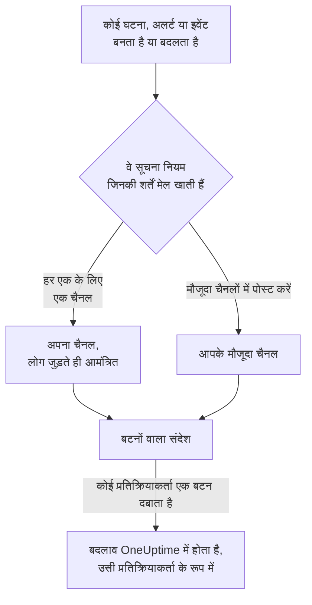

# Slack

OneUptime को Slack से कनेक्ट करें, ताकि घटनाएं, अलर्ट, एपिसोड, अनुसूचित रखरखाव, मॉनिटर और ऑन-कॉल अपडेट आपके चैनलों में पोस्ट हों, हर घटना को अपना चैनल मिले, और प्रतिक्रियाकर्ता Slack छोड़े बिना काम कर सकें: स्वीकार करना, सुलझाना, नोट जोड़ना, ऑन-कॉल को पेज करना और घटनाएं घोषित करना।

:::cards
- [Slack कनेक्ट करें](#slack-कनेक्ट-करें): अपने वर्कस्पेस में OneUptime इंस्टॉल करें, फिर अपना खाता लिंक करें।
- [सभी से कनेक्ट करने को कहना](#सभी-से-कनेक्ट-करने-को-कहना): जिन सदस्यों ने अपना खाता कनेक्ट नहीं किया है, उन सभी को एक साथ संदेश भेजें।
- [सूचना नियम](#सूचना-नियम): तय करें कि कौन-से इवेंट कहाँ पोस्ट हों, और किन्हें अपना चैनल मिले।
- [किसी रिकॉर्ड के चैनल में कौन है](#किसी-रिकॉर्ड-के-चैनल-में-कौन-है): रिकॉर्ड के पेज से देखें कि उसमें कौन है, उससे जुड़ें और लोगों को जोड़ें।
- [/oneuptime कमांड](#oneuptime-कमांड): घटनाएं घोषित करें, रखरखाव शेड्यूल करें, देखें कि कौन ऑन-कॉल है और AI से पूछें।
- [ऑन-कॉल उपयोगकर्ता समूह](#ऑन-कॉल-उपयोगकर्ता-समूह): किसी उपयोगकर्ता समूह को ऑन-कॉल लोगों के बराबर रखें, और उसे पेज करें।
- [Slack से घटनाओं, अलर्ट और इवेंट पर कार्रवाई करना](#slack-से-घटनाओं-अलर्ट-और-इवेंट-पर-कार्रवाई-करना): OneUptime के संदेशों के बटन।
:::

## यह कैसे काम करता है

यह दो कनेक्शनों से काम करता है:

- **प्रोजेक्ट का कनेक्शन**, जो एक बार बनता है: आपके Slack वर्कस्पेस में इंस्टॉल किया गया OneUptime ऐप। यह संदेश पोस्ट करता है, चैनल बनाता है और लोगों को आमंत्रित करता है।
- **हर व्यक्ति का अपना कनेक्शन**: उस व्यक्ति का Slack खाता उसके OneUptime खाते से लिंक। बटन, कमांड और इमोजी प्रतिक्रियाएं उसी व्यक्ति के रूप में, प्रोजेक्ट में उसकी अनुमतियों के साथ काम करती हैं।

एक Slack वर्कस्पेस एक से ज़्यादा प्रोजेक्ट से कनेक्ट हो सकता है, जैसे प्रोडक्शन और स्टेजिंग। कोई बटन या फ़ॉर्म उस रिकॉर्ड के प्रोजेक्ट में काम करता है जिसके बारे में वह है। कोई कमांड या OneUptime को भेजा गया संदेश उस चैनल के प्रोजेक्ट में काम करता है जिसमें वह लिखा गया है, जैसे किसी घटना का चैनल, नहीं तो उस एकमात्र प्रोजेक्ट में जिसमें आपका Slack खाता कनेक्ट है। जब इनसे पता नहीं चलता, तो OneUptime पूछता है कि आपका मतलब किस प्रोजेक्ट से है, जिन प्रोजेक्ट में आप हैं उनमें से हर एक के लिए एक बटन के साथ, और आपके चुनते ही उसी प्रोजेक्ट में आगे बढ़ता है। OneUptime AI के साथ बातचीत में आपका चुनाव बाकी थ्रेड के लिए बना रहता है।

## शुरू करने से पहले

- **ऐसी भूमिका जो प्रोजेक्ट को कनेक्ट कर सके:** **प्रोजेक्ट स्वामी**, **प्रोजेक्ट एडमिन** या **प्रोजेक्ट सदस्य**। ऐप अनइंस्टॉल करने के लिए **प्रोजेक्ट स्वामी** या **प्रोजेक्ट एडमिन** चाहिए।
- **एक Slack वर्कस्पेस**, जिसमें आप ऐप इंस्टॉल कर सकें।
- सूचना नियमों और सारांशों के लिए **OneUptime Cloud पर Growth प्लान**। [Growth प्लान से नीचे सूचना नियम](#growth-प्लान-से-नीचे-सूचना-नियम) देखें।
- **सेल्फ़-होस्टेड सर्वर पर,** पहले उसके लिए सेट किया गया Slack ऐप। [Slack एकीकरण](/docs/self-hosted/slack-integration) देखें।

## Slack कनेक्ट करें

:::steps
### अपने Slack वर्कस्पेस में OneUptime इंस्टॉल करें

**प्रोजेक्ट सेटिंग्स** > **वर्कस्पेस** > **Slack** पर जाएं और **Connect with Slack** पर क्लिक करें। वर्कस्पेस चुनें और OneUptime को अनुमति दें। Slack आपको उसी पेज पर वापस भेजता है, जो अब उस वर्कस्पेस का नाम दिखाता है जिससे प्रोजेक्ट कनेक्ट है। जब तक कोई वर्कस्पेस कनेक्ट नहीं होता, घटनाएं, अलर्ट, अनुसूचित रखरखाव, मॉनिटर और ऑन-कॉल मेन्यू के **वर्कस्पेस** सेक्शन में **Slack या Teams कनेक्ट करें** रहता है, जो भी यहीं ले आता है।

### अपना Slack खाता कनेक्ट करें

ऐप इंस्टॉल करने से इंस्टॉल करने वाले का खाता लिंक हो जाता है। बाकी सभी लोग **उपयोगकर्ता सेटिंग्स** > **वर्कस्पेस** > **Slack** में **Connect my account with Slack** से अपना Slack खाता लिंक करते हैं, ताकि वे खुद के रूप में घटनाओं पर कार्रवाई कर सकें और डायरेक्ट मैसेज पा सकें। प्रोजेक्ट के Slack से कनेक्ट होते ही यह सेक्शन दिखने लगता है। पूरी टीम को एक साथ कनेक्ट करवाने के लिए, [सभी से कनेक्ट करने को कहना](#सभी-से-कनेक्ट-करने-को-कहना) देखें।

### सूचना नियम जोड़ें

**घटनाएं** > **वर्कस्पेस** > **Slack** पर जाएं। **वर्कस्पेस** सेक्शन केवल वे चैट वर्कस्पेस दिखाता है जिन्हें आपके प्रोजेक्ट ने कनेक्ट किया है, इसलिए **Slack** कनेक्ट होने के बाद वहाँ दिखता है। एक नियम बनाएं, जैसे ऐसा नियम जो हर नई घटना के लिए उस पर काम कर रहे सभी लोगों के साथ एक Slack चैनल बनाए: पेज किए गए लोग, घटना कमांडर और मालिक। [सूचना नियम](#सूचना-नियम) देखें।

### नियम का परीक्षण करें

नियम की पंक्ति में **परीक्षण नियम** पर क्लिक करें। नियम में बताए गए चैनलों में एक परीक्षण संदेश आता है। [किसी नियम का परीक्षण](#किसी-नियम-का-परीक्षण) देखें।
:::

## सभी से कनेक्ट करने को कहना

कोई भी किसी और का Slack खाता कनेक्ट नहीं कर सकता, एडमिन भी नहीं: हर व्यक्ति खुद अपने खाते में साइन इन करता है। पूरी टीम को कनेक्ट करवाने के लिए, **प्रोजेक्ट सेटिंग्स** > **वर्कस्पेस** > **Slack** पर कोई **प्रोजेक्ट स्वामी** या **प्रोजेक्ट एडमिन** एक साथ सभी से कहता है। **Members' Slack accounts** कार्ड बताता है कि कितने सदस्य कनेक्ट कर चुके हैं। **Ask everyone to connect** हर उस सदस्य को, जिसने अभी तक कनेक्ट नहीं किया है, Slack में OneUptime की ओर से एक डायरेक्ट मैसेज भेजता है, जिसमें **Connect Slack account** बटन होता है, जो एक क्लिक में उसका खाता कनेक्ट कर देता है।

- **किसे संदेश मिलता है।** प्रोजेक्ट का हर वह सदस्य जिसने अपना Slack खाता कनेक्ट नहीं किया है; Slack में उसे उसके ईमेल पते से ढूँढा जाता है। जिससे पिछले 24 घंटों में कहा जा चुका है, उससे दोबारा नहीं कहा जाता, इसलिए अगले दिन फिर से कहने पर सिर्फ़ उन्हीं लोगों को याद दिलाया जाता है जिन्होंने अब तक कनेक्ट नहीं किया है।
- **कार्ड क्या बताता है।** संदेश भेजे जाने के दौरान कितने संदेश जा चुके हैं, फिर किसने कहा और कितने सदस्यों को संदेश मिला। जिन सदस्यों को OneUptime उनके ईमेल पते से Slack में नहीं ढूँढ सका, उनके नाम कार्ड पर दिए जाते हैं: वे **उपयोगकर्ता सेटिंग्स** > **वर्कस्पेस** > **Slack** में खुद कनेक्ट करते हैं।
- **बटन क्या कनेक्ट करता है।** उसे दबाने और साइन इन करने वाले व्यक्ति का Slack खाता, उसी के अपने OneUptime खाते से। किसी और को आगे भेजा गया संदेश उस सदस्य के लिए कुछ भी कनेक्ट नहीं करता जिसे वह भेजा गया था।

## सूचना नियम

सूचना नियम बताता है कि कौन-से इवेंट Slack में पोस्ट हों, और कहाँ। हर प्रोडक्ट के अपने नियम होते हैं, उसके मेन्यू में **वर्कस्पेस** > **Slack** के नीचे:

| प्रोडक्ट | उसके **Slack** पेज के टैब |
| --- | --- |
| **घटनाएं** | **घटनाएं**, **घटना एपिसोड**, **सारांश** |
| **अलर्ट** | **अलर्ट**, **अलर्ट एपिसोड**, **सारांश** |
| **अनुसूचित रखरखाव** | नियमों की एक सूची |
| **मॉनिटर** | नियमों की एक सूची |
| **ऑन-कॉल ड्यूटी** | नियमों की एक सूची |

नियम बनाना चार चरणों में होता है:

| चरण | आप क्या सेट करते हैं |
| --- | --- |
| **बेसिक** | **नियम नाम** और **नियम विवरण**। |
| **शर्तें** | नियम किन इवेंट के लिए है, जैसे गंभीरता, स्थिति, लेबल, मॉनिटर या शीर्षक के शब्दों के आधार पर। शर्तें इवेंट बनने पर और OneUptime के उसके बारे में हर अपडेट पोस्ट करने पर फिर से जाँची जाती हैं, इसलिए स्वीकार की गई घटनाओं का नियम घटना स्वीकार होते ही काम करता है। नया नियम हर इवेंट के लिए होता है, जैसे **सभी घटनाएं**। इसे सीमित करने के लिए **केवल शर्तों से मेल खाने वाली घटनाएं** चुनें और शर्तें जोड़ें। दो या अधिक शर्तों पर **मिलान शर्त** बताता है कि सभी का मेल खाना ज़रूरी है या किसी एक का। |
| **गंतव्य** | यह कहाँ पोस्ट करता है: चैनलों के नामों के साथ **मौजूदा चैनलों में पोस्ट करें**, चैनल में शामिल होने वालों के साथ **हर घटना के लिए एक चैनल बनाएं** (या अलर्ट, एपिसोड, इवेंट, मॉनिटर या ऑन-कॉल नीति के लिए), या दोनों। चरण के नीचे **यह नियम क्या करता है** नियम के कार्ड की तरह इसे वाक्यों में बताता है। |
| **Video Call** | केवल घटनाएं और अलर्ट: हर एक के लिए एक कॉल शुरू करें। [वीडियो कॉल](/docs/workspace-connections/video-calls) देखें। |

नियम जो चैनल बनाता है, उसका नाम उसके रिकॉर्ड पर रखा जाता है: घटना INC-42 को `inc-42` मिलता है, अलर्ट ALT-7 को `alt-7`, और बिना संख्या उपसर्ग वाले प्रोजेक्ट में घटना 42 को `incident-42`। **चैनल नाम उपसर्ग** में लिखा पाठ नाम के आगे लगता है, इसलिए `prod-` से `prod-inc-42` बनता है, और फ़ॉर्म टाइप करते समय ही नाम दिखाता है। अनुसूचित रखरखाव इवेंट के लिए उपसर्ग उसके संख्या उपसर्ग की जगह लेता है: SM-5 को `sm-5` मिलता है, और `maint-` से `maint-5` बनता है। Slack छोटे अक्षर, अंक, `-` और `_` लेता है, 80 वर्णों तक। अगर उस नाम का चैनल पहले से है, जैसे किसी दूसरे प्रोजेक्ट का या कोई संग्रहीत चैनल, तो OneUptime `-2`, `-3` और आगे जोड़ता है।

नियम अपना चैनल तब बनाता है जब कोई इवेंट पहली बार उससे मेल खाता है: इवेंट बनने पर, या बाद में, जब कोई अपडेट उसे मेल में ले आए और वह अभी खुला हो। स्वीकार की गई घटनाओं का नियम घटना स्वीकार होने पर चैनल बनाता है। निजी घटना, अलर्ट या एपिसोड को निजी चैनल मिलता है।

**चैनल में कौन शामिल होता है** बताता है कि नियम अपने चैनल में किसे जोड़ता है, हर व्यक्ति को रिकॉर्ड से जुड़ते ही, सिर्फ़ चैनल बनने पर नहीं: **ऑन-कॉल उत्तरदाता, जैसे-जैसे उन्हें पेज किया जाता है**, **घटना कमांडर और अन्य घटना भूमिकाएं, जैसे-जैसे वे सौंपी जाती हैं** (घटनाएं और घटना एपिसोड) और **मालिक, जैसे-जैसे उन्हें जोड़ा जाता है**, नए नियम में सभी चुने हुए, और **इन्हें भी आमंत्रित करें** के लोग, टीमें और ऑन-कॉल शेड्यूल चैनल बनने पर। घटना कमांडर आम तौर पर तब सौंपा जाता है जब कोई पहली बार घटना स्वीकार करता है, और तभी उसके चैनल में शामिल होता है। घटना भूमिकाओं का अपना बॉक्स आने से पहले सहेजा गया नियम उन्हें तब जोड़ता है जब वह मालिकों या ऑन-कॉल उत्तरदाताओं को जोड़ता है, और उसका बॉक्स चुना हुआ दिखता है। जिस मौजूदा चैनल में नियम पोस्ट करता है, उसमें किसी को नहीं जोड़ा जाता।

**इन्हें भी आमंत्रित करें** में किसी ऑन-कॉल शेड्यूल के लिए, चैनल बनने पर उसमें जो भी ऑन-कॉल हो, जैसा शेड्यूल के पेज पर दिखता है, वह शामिल होता है और उसे पेज नहीं किया जाता। कुछ ही घटनाओं के चैनलों में लोगों को जोड़ने के लिए, दूसरे नियम को वे शर्तें, वे लोग और पहले नियम वाला ही **चैनल नाम उपसर्ग** दें: जो नियम किसी घटना से उसका चैनल बनते समय मेल खाते हैं, वे उसी चैनल को साझा करते हैं, और हर नियम अपने लोग जोड़ता है।

रिकॉर्ड का हर बाद का अपडेट — स्थिति का बदलाव, नोट, नया मालिक — उसके चैनलों में पोस्ट होता है, और जब तक नियमों की शर्तें मेल खाती हैं, उसके नियमों में बताए गए मौजूदा चैनलों में भी। **घटना सुलझने पर चैनल संग्रहित करें** चालू होने पर, या अलर्ट, एपिसोड, इवेंट, मॉनिटर और ऑन-कॉल नीतियों के लिए उसके जैसा स्विच चालू होने पर, जिस नियम ने चैनल बनाया वह रिकॉर्ड के सुलझने, पूरा होने या हटने पर उसे संग्रहित करता है, चाहे तब उसकी शर्तें कुछ भी कहें। जो घटना, अलर्ट या एपिसोड पहले से सुलझा हुआ बनाया गया हो, उसे अपना चैनल नहीं मिलता; उसका बनने का संदेश फिर भी आपके नियमों में बताए गए चैनलों में जाता है। [पहले से स्वीकार या सुलझी हुई घोषित](/docs/incidents/declaring-incidents#पहले-से-स्वीकार-या-सुलझी-हुई-घोषित) देखें।

जिस घटना, अलर्ट, एपिसोड या अनुसूचित रखरखाव इवेंट का अपना चैनल होता है, उसके OneUptime पेज के हेडर में, स्थिति बटनों के बगल में, **Slack में खोलें** होता है। यह उस चैनल को एक नए टैब में, Slack ऐप या ब्राउज़र में खोलता है। जिस रिकॉर्ड के अपने दो चैनल हों, वह बटन के नीचे दोनों को सूचीबद्ध करता है। जिस रिकॉर्ड के चैनल Slack और Microsoft Teams दोनों में हों, उसमें इसके बजाय एक ही **चैनल खोलें** बटन होता है, जो सभी को सूचीबद्ध करता है। आपके नियम जिन मौजूदा चैनलों में पोस्ट करते हैं, वे नहीं दिए जाते।

चैनल पढ़ने लायक बना रहता है: हर अपडेट एक बार पोस्ट होता है, और रिकॉर्ड की पहली स्थिति उसी संदेश में होती है जो रिकॉर्ड की घोषणा करता है, किसी अलग संदेश में नहीं। ऑन-कॉल नीति का हर रन एक ही संदेश है, जिसे एस्केलेशन आगे बढ़ने के साथ संपादित किया जाता है: किसे पेज किया गया, कितनी बार और कैसे, किसे नहीं और क्यों, और किसने स्वीकार किया। नया संदेश तभी पोस्ट होता है जब किसी को कुछ करना हो: कोई एस्केलेशन नियम किसी तक नहीं पहुंचा, या रन बिना किसी के स्वीकार किए ख़त्म हो गया। जिस व्यक्ति का Slack खाता OneUptime से जुड़ा नहीं है, उसे उस Slack खाते के ज़रिए जोड़ा जाता है जिसमें उसका ईमेल पता है। जिसे OneUptime इन दोनों में से किसी भी तरह नहीं ढूँढ पाता, या जो Slack में मेहमान है, उसे चैनल में नहीं जोड़ा जा सकता; OneUptime यह हर चैनल में एक बार कहता है, एक ही संदेश में जो उन सभी के नाम बताता है और सूची बढ़ने पर संपादित होता है। उन्हें उस संदेश का **Connect Slack account** लिंक भेजें, ताकि वे एक ही कदम में अपना खाता जोड़ सकें। रिकॉर्ड के मालिकों या स्थिति पृष्ठ के सब्सक्राइबर को सूचित किया गया, यह OneUptime में उसकी फ़ीड में रहता है।

**प्रोजेक्ट सेटिंग्स** > **वर्कस्पेस** > **Slack** उन चैनलों की सूची दिखाता है जिन्हें OneUptime देख सकता है, हर एक के बगल में **परीक्षण भेजें** के साथ। OneUptime किसी सार्वजनिक चैनल में पहली बार पोस्ट करते समय खुद ही उसमें शामिल हो जाता है। निजी चैनल तभी सूची में दिखता है, और उसमें पोस्ट किया जा सकता है, जब Slack में OneUptime ऐप को उसमें आमंत्रित किया गया हो।

## किसी रिकॉर्ड के चैनल में कौन है

जिस घटना, अलर्ट, एपिसोड या अनुसूचित रखरखाव इवेंट का अपना Slack चैनल होता है, उसके OneUptime पेज पर **Slack चैनल** कार्ड होता है। कार्ड चैनल को एक लिंक के रूप में दिखाता है जो उसे Slack में खोलता है, यह बताता है कि वह निजी है या नहीं, और उसमें कौन है, सबसे पहले आप। कार्ड से, बिना Slack एडमिन के:

- **चैनल से जुड़ें** आपको जोड़ता है, जब आप चैनल में नहीं हैं।
- **लोगों को जोड़ें** प्रोजेक्ट के लोगों और टीमों की सूची खोलता है: किसी व्यक्ति को चुनें तो वह जुड़ जाता है, या किसी टीम को चुनें तो उसके सभी लोग जुड़ जाते हैं।

उन्हें OneUptime का ऐप जोड़ता है, वैसे ही जैसे वह किसी नियम के चैनल में लोगों को जोड़ता है। ऐप अपने बनाए चैनलों में बना रहता है, इसलिए यह उस निजी चैनल के लिए भी काम करता है जिसे सब छोड़ चुके हैं।

- **लोगों को कौन जोड़ सकता है।** जो रिकॉर्ड को संपादित कर सकता है: किसी घटना के लिए **प्रोजेक्ट स्वामी**, **प्रोजेक्ट एडमिन**, **प्रोजेक्ट सदस्य**, **घटना एडमिन** और **घटना सदस्य**, या किसी कस्टम भूमिका में **Edit Incident**, और किसी अलर्ट, एपिसोड या इवेंट के लिए वही अनुमति (जैसे **Edit Alert**)। बाकी सभी देखते हैं कि चैनल में कौन है, और उसमें कैसे पहुँचें।
- **किसे जोड़ा जा सकता है।** जिसे OneUptime Slack में ढूँढ सके: उसके कनेक्ट किए गए Slack खाते से, नहीं तो उस ईमेल पते से जो Slack के पास उसके लिए है। कार्ड उन लोगों के नाम और कारण बताता है जिन्हें वह नहीं जोड़ सका, जैसे कोई मेहमान जिसे Slack चैनल से बाहर रखता है।
- **क्या दर्ज होता है।** किसे जोड़ा गया, और किसने जोड़ा, यह रिकॉर्ड की फ़ीड में (**चैनल सदस्य जोड़ा गया**) और **प्रोजेक्ट सेटिंग्स** > **सूचनाएं** > **सूचना लॉग** में **वर्कस्पेस** टैब पर दर्ज होता है।
- **किसी को हटाना।** OneUptime सिर्फ़ जोड़ता है: किसी को चैनल से हटाना हो तो Slack में हटाएँ।

## किसी नियम का परीक्षण

नियम की पंक्ति में **परीक्षण नियम** उस नियम का एक परीक्षण संदेश उसके बताए गए चैनलों में पोस्ट करता है, ताकि आप उसे आते देख सकें। अगर नियम हर इवेंट के लिए एक चैनल बनाता है, तो परीक्षण भी एक चैनल बनाता है और नियम के लोगों को उसमें आमंत्रित करता है।

**प्रोजेक्ट सेटिंग्स** > **वर्कस्पेस** > **Slack** में किसी चैनल के बगल वाले **परीक्षण भेजें** की तरह, इसके लिए सूचना नियम बनाने की अनुमति चाहिए: **प्रोजेक्ट स्वामी**, **प्रोजेक्ट एडमिन**, **प्रोजेक्ट सदस्य**, **सेटिंग्स एडमिन**, **सेटिंग्स सदस्य**, या किसी कस्टम भूमिका में **Create Workspace Notification Rule** और **Read Workspace Notification Rule**। जो केवल नियम देख सकता है, जैसे **दर्शक**, उसके लिए **परीक्षण नियम** लॉक रहता है, और उसका टूलटिप बताता है कि क्या चाहिए; API उसके परीक्षण को "You do not have permission to send test notifications in this project." के साथ अस्वीकार करता है। OneUptime Cloud पर नियम का परीक्षण करने के लिए, नियम जोड़ने की तरह, **Growth** प्लान चाहिए।

OneUptime Cloud पर किसी चैनल के बगल वाले **परीक्षण भेजें** के लिए भी **Growth** प्लान चाहिए, क्योंकि चैनल में पोस्ट करना वही है जो नियम और सारांश करते हैं। किसी सारांश पर **अभी परीक्षण भेजें** के लिए सारांश बनाने की अनुमति (किसी कस्टम भूमिका में **Create Workspace Notification Summary** और **Read Workspace Notification Summary**) और OneUptime Cloud पर **Growth** प्लान चाहिए; बाकी सभी के लिए यह लॉक रहता है, और उसका टूलटिप बताता है कि क्या चाहिए। केवल-पढ़ने की पहुँच के साथ कनेक्ट किया गया MCP क्लाइंट कोई परीक्षण नहीं भेज सकता।

## सारांश

**घटनाएं** > **वर्कस्पेस** > **Slack** (और **अलर्ट**) का **सारांश** टैब आपके बताए चैनलों में एक नियमित सारांश पोस्ट करता है: कितनी घटनाएं या अलर्ट हुए, उन्हें कितनी जल्दी स्वीकार किया गया और सुलझाया गया, और लिंक के साथ एक सूची। नया सारांश हर हफ़्ते जाता है और पिछले 7 दिनों को शामिल करता है। **पहली रिपोर्ट इस समय भेजें** खाली छोड़ दें, तो पहला सारांश अगले हफ़्ते, दिन या महीने की शुरुआत में 09:00 बजे जाता है; फ़ॉर्म बताता है कि कब।

सारांश अपने **टाइमज़ोन** की घड़ी के हिसाब से जाता है, जो शुरू में आपका टाइम ज़ोन होता है। यह वहाँ पूरे साल दिन का वही समय बनाए रखता है: बर्लिन में 09:00 पर सेट किया गया सारांश डेलाइट सेविंग टाइम के लिए घड़ियाँ बदलने के बाद भी बर्लिन में 09:00 पर ही जाता है, और उसके संदेश की तारीखें भी बर्लिन की होती हैं। API से `timezone` को IANA टाइम ज़ोन नाम के रूप में भेजें, जैसे `Europe/Berlin`। बिना टाइम ज़ोन के बनाया गया सारांश अपने बनाने वाले की प्रोफ़ाइल का टाइम ज़ोन लेता है, या जब कोई API कुंजी उसे बनाती है तो UTC।

सारांश के फ़ॉर्म में चार चरण हैं: **मूल जानकारी** (उसका नाम और चैनल), **अनुसूची**, **सामग्री** (**क्या शामिल करें**) और **फ़िल्टर** (वह किन घटनाओं या अलर्ट को गिनता है)।

## Growth प्लान से नीचे सूचना नियम

OneUptime Cloud पर सूचना नियम और सारांश **Growth** प्लान और उससे ऊपर में हैं। उससे नीचे का प्रोजेक्ट अपने मौजूदा नियम और सारांश रखता है, और वे Slack में पोस्ट करते रहते हैं। इसलिए हर प्रोडक्ट (घटनाएं, अलर्ट, अनुसूचित रखरखाव, ऑन-कॉल, मॉनिटर) का **Slack** पेज प्लान की सूचना और उसके नीचे उनकी सूची दिखाता है (**अभी भी सेट अप किए गए सूचना नियम**, **अभी भी सेट अप किए गए सारांश**): किसी नियम को हटाएं, या किसी सारांश को बंद करें या हटाएं। नियम और सारांश जोड़ने या बदलने के लिए **Growth** चाहिए।

## Slack में पेज होना

जब आप ऑन-कॉल हों तब डायरेक्ट मैसेज से पेज होने के लिए, Slack को अपनी सूचना विधियों में से एक के रूप में जोड़ें:

:::steps
1. अपना Slack खाता कनेक्ट करें ([Slack कनेक्ट करें](#slack-कनेक्ट-करें) देखें)।
2. **उपयोगकर्ता सेटिंग्स** > **सूचना विधियां** पर जाएं, **Workspace Apps** टैब खोलें और **Add Slack Account** पर क्लिक करें।
3. उसकी पंक्ति में **Send Test Message** पर क्लिक करें। संदेश आपके Slack डायरेक्ट मैसेज में आता है।
:::

जोड़ते ही यह आपके ऑन-कॉल नियमों में शामिल हो जाता है, इसलिए उसके बाद से पेज आप तक Slack में पहुँचते हैं। इसे कौन-से पेज मिलें, यह **उपयोगकर्ता सेटिंग्स** > **ऑन-कॉल नियम** में बदलें।

## संदेशों को नोट के रूप में सहेजना

किसी घटना, अलर्ट, एपिसोड या अनुसूचित रखरखाव इवेंट के चैनल में किसी संदेश पर प्रतिक्रिया दें, और OneUptime उसे उस रिकॉर्ड पर नोट के रूप में सहेजता है, फिर थ्रेड में जवाब देकर पुष्टि करता है:

| प्रतिक्रिया | किस रूप में सहेजा जाता है |
| --- | --- |
| 📌 पिन इमोजी, या Slack का अपना **Pin to channel** | एक निजी नोट, जिसे केवल आपकी टीम देखती है |
| 📢 मेगाफ़ोन या लाउडस्पीकर इमोजी | एक सार्वजनिक नोट, जो स्थिति पृष्ठ पर दिखता है। केवल घटनाएं और अनुसूचित रखरखाव इवेंट। निजी घटना पर, एक निजी नोट, और पुष्टि बताती है कि क्यों। |

नोट संदेश को वैसा ही रखता है जैसा Slack ने उसे दिखाया था: उसकी फ़ॉर्मैटिंग, लिंक और कोड, उसमें ज़िक्र किए गए लोग और चैनल उनके नाम से, और उसकी फ़ाइलें और तस्वीरें उनके लिंक के रूप में। सार्वजनिक नोट में फ़ाइलें और तस्वीरें नहीं होतीं, क्योंकि वे केवल आपकी टीम के लिए खुलती हैं।

नोट उसी के शब्द होते हैं जिसने संदेश लिखा था: अगर उसका Slack खाता कनेक्ट है तो उसका OneUptime नाम, वरना वह नाम जो Slack दिखाता है। निजी नोट टाइमलाइन में उसी समय पर रखा जाता है जब संदेश पोस्ट हुआ था, चाहे वह कितनी भी देर बाद सहेजा जाए। सार्वजनिक नोट उसी समय पर रखा जाता है जब उसे सहेजा जाता है, यानी जब स्थिति पृष्ठ उसे दिखाता है। टाइमलाइन बताती है कि उसे किसने सहेजा। नोट वापस चैनल में पोस्ट नहीं किया जाता, जहाँ संदेश पहले से मौजूद है।

नोट आपके रूप में, आपकी अनुमतियों के साथ सहेजा जाता है। अगर आपका Slack खाता अभी कनेक्ट नहीं है, तो OneUptime आपसे ऐसे संदेश में उसे कनेक्ट करने को कहता है जो केवल आप देखते हैं, एक बटन के साथ जो कनेक्ट करते ही संदेश सहेज देता है। कितने भी लोग प्रतिक्रिया दें, एक संदेश केवल एक बार सहेजा जाता है।

## /oneuptime कमांड

Slack में OneUptime का एक ही कमांड है, `/oneuptime`। इसके बाद आप जो शब्द लिखते हैं, वह बताता है कि क्या करना है; इसके बाद लिखी कोई भी दूसरी बात OneUptime AI के लिए सवाल है।

| कमांड | यह क्या करता है |
| --- | --- |
| `/oneuptime help` | कमांड की सूची उदाहरणों के साथ दिखाता है। |
| `/oneuptime incident [title or number]` | घटना का फ़ॉर्म खोलता है, शीर्षक भरा हुआ। किसी घटना का नंबर, जैसे `42` या `INC-42`, इसके बजाय वह घटना दिखाता है: [Slack से किसी घटना का प्रबंधन करना](#slack-से-किसी-घटना-का-प्रबंधन-करना) देखें। |
| `/oneuptime maintenance [title]` | अनुसूचित रखरखाव का फ़ॉर्म खोलता है, शीर्षक भरा हुआ। |
| `/oneuptime oncall` | बताता है कि जो भी ऑन-कॉल शेड्यूल आप देख सकते हैं, उनमें अभी कौन ऑन-कॉल है, कब तक, और अगला कौन है। |
| `/oneuptime page [who] [message]` | आपके मैसेज के बारे में उन लोगों को पेज करता है जिन्हें आप @मेंशन करते हैं, या एक फ़ॉर्म खोलता है जिसमें आप चुनते हैं कि किसे पेज करना है। [Slack से किसी को पेज करना](#slack-से-किसी-को-पेज-करना) देखें। |
| `/oneuptime ask [question]`, या कोई भी सवाल | OneUptime AI आपके लॉग, ट्रेस, मेट्रिक, घटनाओं और मॉनिटरों के बारे में जवाब देता है। |

`help` और `oncall` के जवाब ऐसे संदेश हैं जिन्हें कमांड के नीचे सिर्फ़ आप देखते हैं। अगर पहला शब्द किसी कमांड की गलत वर्तनी जैसा दिखे, जैसे `incidnet`, तो उसे OneUptime AI का जवाब नहीं, उससे मिलती-जुलती कमांड मिलती है। घटना और रखरखाव के फ़ॉर्म आपके रूप में काम करते हैं: [Slack से घटनाएं और रखरखाव बनाना](#slack-से-घटनाएं-और-रखरखाव-बनाना) देखें।

> [!NOTE]
> `/oneuptime incident` और `/oneuptime maintenance`, `/incident` और `/maintenance` की जगह लेते हैं, जो दूसरे Slack ऐप्स के इसी नाम के कमांड से टकरा सकते थे। किसी पुराने मैनिफ़ेस्ट से बना Slack ऐप उन्हें तब तक रखता है, और वे वही फ़ॉर्म खोलते हैं, जब तक ऐप अपडेट नहीं होता: [पुराने मैनिफ़ेस्ट से बने ऐप](/docs/self-hosted/slack-integration#पुराने-मैनिफ़ेस्ट-से-बने-ऐप) देखें।

## Slack में OneUptime का होम

Slack के साइडबार में **Apps** के नीचे OneUptime खोलें: उसका **Home** टैब दिखाता है कि प्रोजेक्ट में क्या हो रहा है, उतना जितना आप देख सकते हैं, और हर बार खोलने पर वह फिर से पढ़ा जाता है।

- **आपका ऑन-कॉल।** वे ऑन-कॉल शेड्यूल जिनमें आप अभी ऑन-कॉल हैं, और कब तक, नहीं तो आपकी अगली शिफ़्ट।
- **क्या खुला है।** सबसे नई खुली घटनाएं और अलर्ट जिन्हें आप पढ़ सकते हैं, हर एक के साथ OneUptime में उसके पेज का लिंक।
- **इसके बटन।** **Declare incident**, **Schedule maintenance** और **Page someone** वही फ़ॉर्म खोलते हैं जो `/oneuptime incident`, `/oneuptime maintenance` और `/oneuptime page` खोलते हैं, और **Who's on call** वैसे ही जवाब देता है जैसे `/oneuptime oncall`।

होम आपके रूप में पढ़ता है, इसलिए उसे आपका अपना कनेक्ट किया हुआ Slack खाता चाहिए। जब तक वह कनेक्ट नहीं होता, होम में **Connect Slack account** बटन रहता है, और कनेक्ट करते ही वह आपको आपका होम दिखाता है।

जब कोई OneUptime को किसी चैनल में जोड़ता है, तो वह वहाँ एक अभिवादन पोस्ट करता है: उससे सवाल कैसे पूछें, और चैनल में पोस्ट करने वाला सूचना नियम कहाँ जोड़ें। जब आप पहली बार उसका **Messages** टैब खोलते हैं, तो वह वहाँ आपका स्वागत करता है: वह Slack में क्या करता है, और शुरुआत कैसे करें।

## Slack से OneUptime AI से पूछना

अपने लॉग, ट्रेस, मेट्रिक, घटनाओं और मॉनिटरों के बारे में सामान्य भाषा में पूछें। किसी चैनल में OneUptime को @मेंशन करें, या उसे डायरेक्ट मैसेज भेजें, और वह थ्रेड में जवाब देता है। `/oneuptime ask which monitors are down?` अपना जवाब चैनल में पोस्ट करता है। दोनों के लिए आपका अपना Slack खाता कनेक्ट होना और प्रोजेक्ट के लिए AI चालू होना चाहिए। Slack में जवाब केवल पढ़ते हैं: कुछ बदलने के लिए बटनों का उपयोग करें। [AI से पूछें](/docs/ai/ask-ai) देखें।

OneUptime केवल उसी का जवाब देता है जो उसे संबोधित हो।

- **अपनी बातचीत में बस जवाब दें।** किसी चैनल में, थ्रेड में नहीं, पूछा गया आपका सवाल उसके नीचे के थ्रेड में एक बातचीत शुरू करता है: और पूछने के लिए वहीं जवाब दें, OneUptime को फिर से मेंशन किए बिना; कोई और उसे मेंशन करके बातचीत में शामिल होता है।
- **किसी भी दूसरे थ्रेड में OneUptime को मेंशन करें।** जैसे किसी घटना के मैसेज के नीचे वाले थ्रेड में, हर बार उसे मेंशन करें: वहाँ लोग एक-दूसरे को जो लिखते हैं, उसका कोई जवाब नहीं मिलता।
- **अगर आपका Slack खाता कनेक्ट नहीं है।** OneUptime हर बातचीत में एक बार आपसे उसे कनेक्ट करने को कहता है, ऐसे मैसेज में जिसे सिर्फ़ आप देखते हैं, **Connect Slack account** बटन के साथ।

## Slack से घटनाएं और रखरखाव बनाना

`/oneuptime incident` और `/oneuptime maintenance` एक फ़ॉर्म खोलते हैं जिसे आप भरते हैं और खुद के रूप में सबमिट करते हैं: उस OneUptime खाते के रूप में जिससे आपका Slack खाता कनेक्ट है ([Slack कनेक्ट करें](#slack-कनेक्ट-करें) देखें), प्रोजेक्ट में उस खाते की अनुमतियों के साथ। अगर आपका Slack खाता कनेक्ट नहीं है, या आपका OneUptime खाता अब प्रोजेक्ट का सदस्य नहीं है, तो OneUptime वहीं, जहाँ आपने कमांड चलाई, ऐसे मैसेज में बताता है जिसे सिर्फ़ आप देखते हैं कि क्या करना है, और कोई फ़ॉर्म नहीं खुलता। **Create New Incident** और **Create Scheduled Event** शॉर्टकट वही फ़ॉर्म खोलते हैं।

- **कौन इनका उपयोग कर सकता है।** वे लोग जो OneUptime में घटना घोषित कर सकते हैं या अनुसूचित रखरखाव इवेंट बना सकते हैं: घटना के लिए **प्रोजेक्ट स्वामी**, **प्रोजेक्ट एडमिन**, **प्रोजेक्ट सदस्य**, **घटना एडमिन** और **घटना सदस्य** (किसी कस्टम भूमिका में **Create Incident**), और इवेंट के लिए **अनुसूचित रखरखाव एडमिन** और **अनुसूचित रखरखाव सदस्य** (**Create Scheduled Maintenance**)। बाकी सभी को वहीं यह बताया जाता है जहाँ उन्होंने इसे चलाया, और कोई फ़ॉर्म नहीं खुलता।
- **फ़ॉर्म क्या देता है।** हर सूची — गंभीरताएं, मॉनिटर, मॉनिटर स्थितियाँ, ऑन-कॉल नीतियां और लेबल — में वही होता है जो आप पढ़ सकते हैं, जैसे OneUptime में वही सूची: कुछ लेबल तक सीमित भूमिका के साथ, वे मॉनिटर और ऑन-कॉल नीतियां जिन पर वे लेबल हैं। जो सूची आप बिल्कुल नहीं पढ़ सकते, वह फ़ॉर्म से हटा दी जाती है। संग्रहीत ऑन-कॉल नीतियां कभी नहीं दी जातीं।
- **फ़ॉर्म किसे चुन सकता है।** घटना या इवेंट आपकी अपनी अनुमतियों के साथ बनता है और आपके नाम दर्ज होता है। ऐसा मॉनिटर, ऑन-कॉल नीति, लेबल, गंभीरता या स्थिति जिसे आप नहीं पढ़ सकते, या किसी दूसरे प्रोजेक्ट का, ऐसे अस्वीकार किया जाता है जैसे वह प्रोजेक्ट में हो ही नहीं, भले ही फ़ॉर्म आपकी पहुँच बदलने से पहले खोला गया हो, और कुछ नहीं बनता। OneUptime चैनल में, ऐसे मैसेज में जिसे सिर्फ़ आप देखते हैं, इसका कारण बताता है।

किसी घटना, अलर्ट या एपिसोड पर **Execute On-Call Policy** भी इसी तरह काम करता है: इसके लिए ऑन-कॉल नीति चलाने की अनुमति (**प्रोजेक्ट स्वामी**, **प्रोजेक्ट एडमिन**, **प्रोजेक्ट सदस्य**, **ऑन-कॉल एडमिन** और **ऑन-कॉल सदस्य**, या किसी कस्टम भूमिका में **Create On-Call Duty Policy Execution Log**) और उस घटना, अलर्ट या एपिसोड को पढ़ने की अनुमति चाहिए, और यह वे सक्रिय ऑन-कॉल नीतियां देता है जिन्हें आप पढ़ सकते हैं।

## Slack से किसी को पेज करना

`/oneuptime page @nawaz The checkout API is throwing 500s` Nawaz को तुरंत पेज करता है। OneUptime एक अलर्ट बनाता है जिसका शीर्षक आपका मैसेज होता है, और जिन लोगों को आप @मेंशन करते हैं, उनमें से हर किसी को उसके अपने ऑन-कॉल नियमों के अनुसार फ़ोन कॉल, SMS, पुश नोटिफ़िकेशन या ईमेल मिलता है, जब तक कोई अलर्ट को स्वीकार नहीं कर लेता।

- **किसे तुरंत पेज किया जाता है।** वे लोग जिन्हें आप @मेंशन करते हैं, और वे लोग जो उन शेड्यूल में ऑन-कॉल हैं जिन्हें आपका @मेंशन किया गया उपयोगकर्ता समूह फ़ॉलो करता है (देखें [ऑन-कॉल उपयोगकर्ता समूह](#ऑन-कॉल-उपयोगकर्ता-समूह)), जब उनके बाद कोई मैसेज हो। OneUptime किसी व्यक्ति को उस OneUptime खाते से पहचानता है जिससे उसका Slack खाता कनेक्ट है, नहीं तो उस ईमेल पते से जो Slack के पास उसके लिए है। प्रोजेक्ट से बाहर के किसी को पेज नहीं किया जाता।
- **बाकी सब कुछ एक फ़ॉर्म खोलता है।** अगर किसी को @मेंशन नहीं किया गया, कोई मैसेज नहीं है, `@here` है, कोई ऐसा उपयोगकर्ता समूह है जो आपको दिखने वाले किसी ऑन-कॉल शेड्यूल को फ़ॉलो नहीं करता, या कोई ऐसा व्यक्ति है जिसे OneUptime पहचान नहीं सकता, तो **Page someone** फ़ॉर्म खुलता है, जिसमें आपका लिखा हुआ भरा होता है, और वह बताता है कि किसे नहीं चुन सका। लोग, कोई टीम, कोई ऑन-कॉल शेड्यूल, जो उस समय उसमें ऑन-कॉल व्यक्ति को पेज करता है, या कोई ऑन-कॉल नीति, जो अपने एस्केलेशन नियमों से पेज करती है, चुनें और उसे सबमिट करें। आप जो नाम सबसे पहले लिखते हैं, जैसे `/oneuptime page Primary The disk is full` में, वह उसी नाम का शेड्यूल, टीम या नीति चुनता है।
- **यह कहाँ दिखता है।** चैनल पेज को एक ही मैसेज के रूप में दिखाता है, जो अपडेट होता रहता है: किसे और कैसे पेज किया गया, और किसने स्वीकार किया। जहाँ OneUptime पोस्ट नहीं कर सकता, जैसे किसी ऐसे निजी चैनल में जिसमें उसे आमंत्रित नहीं किया गया, वहाँ एक मैसेज जिसे सिर्फ़ आप देखते हैं बताता है कि किसे पेज किया गया, अलर्ट के लिंक के साथ।
- **कौन पेज कर सकता है।** हर वह व्यक्ति जो ऑन-कॉल नीति चला भी सकता है और अलर्ट बना भी सकता है: **प्रोजेक्ट स्वामी**, **प्रोजेक्ट एडमिन** और **प्रोजेक्ट सदस्य**, या **अलर्ट सदस्य** के साथ **ऑन-कॉल सदस्य** (किसी कस्टम भूमिका में **Create On-Call Duty Policy Execution Log** और **Create Alert**)। लोगों, किसी टीम या किसी शेड्यूल को सीधे पेज करने के लिए, जब पेज के पीछे कोई ऑन-कॉल नीति न हो, प्रोजेक्ट की हर ऑन-कॉल नीति तक पहुँच भी चाहिए। बाकी सभी को वहीं बताया जाता है जहाँ उन्होंने कमांड चलाई, और किसी को पेज नहीं किया जाता। OneUptime Cloud पर पेज करने के लिए Growth प्लान चाहिए: उससे नीचे, OneUptime बताता है कि कौन-सा प्लान चाहिए, और किसी को पेज नहीं किया जाता।

## ऑन-कॉल उपयोगकर्ता समूह

किसी Slack उपयोगकर्ता समूह, जैसे `@payments-oncall`, को एक या ज़्यादा ऑन-कॉल शेड्यूल में अभी ऑन-कॉल लोगों के बराबर रखें, ताकि कोई भी उसे @मेंशन करके उन तक पहुँच सके। OneUptime हर हैंड-ऑफ़ और ओवरराइड पर समूह के सदस्य बदलता है, और हर 15 मिनट में उसे जाँचता है।

:::steps
### किसी उपयोगकर्ता समूह को शेड्यूल से कनेक्ट करें

**ऑन-कॉल ड्यूटी** > **ऑन-कॉल अनुसूची** में शेड्यूल खोलें। उसके **Slack उपयोगकर्ता समूह** कार्ड में **उपयोगकर्ता समूह कनेक्ट करें** पर क्लिक करें, फिर अपने वर्कस्पेस का कोई उपयोगकर्ता समूह चुनें, या नाम और हैंडल के साथ **नया उपयोगकर्ता समूह बनाएँ** चुनें। उसके सदस्य तुरंत ऑन-कॉल लोगों से बदल दिए जाते हैं।

### उसे सेकंडरी शेड्यूल से भी कनेक्ट करें

ऐसे समूह के लिए जिसमें प्राइमरी और सेकंडरी दोनों ऑन-कॉल लोग हों, उसी समूह को सेकंडरी शेड्यूल के पेज पर भी कनेक्ट करें। एक समूह कितने भी शेड्यूल फ़ॉलो कर सकता है।
:::

- **कार्ड क्या दिखाता है।** हर समूह में अभी कौन है, वह और किन शेड्यूल को फ़ॉलो करता है, और क्या वह **अप टू डेट** है। जो ऑन-कॉल व्यक्ति समूह में नहीं डाला जा सकता, उसका नाम वजह के साथ दिखता है: OneUptime किसी व्यक्ति को उसके कनेक्टेड Slack खाते से, नहीं तो उस ईमेल पते से ढूँढता है जो Slack के पास उसके लिए है, और Slack मेहमानों को उपयोगकर्ता समूहों से बाहर रखता है।
- **कोई ऑन-कॉल नहीं।** Slack खाली उपयोगकर्ता समूह नहीं रख सकता, इसलिए OneUptime समूह को तब तक बंद कर देता है जब तक कोई ऑन-कॉल न हो, फिर उसे दोबारा चालू कर देता है।
- **समूह को पेज करना।** `/oneuptime page @payments-oncall The checkout API is down` उन लोगों को पेज करता है जो समूह के फ़ॉलो किए गए शेड्यूल में ऑन-कॉल हैं। देखें [Slack से किसी को पेज करना](#slack-से-किसी-को-पेज-करना)।
- **Slack को क्या चाहिए।** उपयोगकर्ता समूह Slack के पेड प्लान में हैं, और कोई वर्कस्पेस सिर्फ़ अपने मालिकों और एडमिन को उन्हें बदलने दे सकता है: कार्ड बताता है कि मामला कौन-सा है, और क्या करना है। अगर Slack तब कनेक्ट हुआ था जब OneUptime उपयोगकर्ता समूह नहीं संभाल सकता था, तो उसे **प्रोजेक्ट सेटिंग्स** > **वर्कस्पेस** > **Slack** में एक बार फिर से कनेक्ट करें।
- **कौन कनेक्ट कर सकता है।** वे भूमिकाएँ जो शेड्यूल बदल सकती हैं: **प्रोजेक्ट स्वामी**, **प्रोजेक्ट एडमिन**, **प्रोजेक्ट सदस्य**, **ऑन-कॉल एडमिन** और **ऑन-कॉल सदस्य**, या किसी कस्टम भूमिका में **Edit On-Call Duty Policy Schedule**। OneUptime Cloud पर कनेक्ट करने के लिए **Growth** प्लान चाहिए।
- **डिस्कनेक्ट करने पर।** OneUptime समूह को बदलना बंद कर देता है। समूह और उसके सदस्य Slack में जैसे हैं वैसे ही रहते हैं।

## Slack से किसी घटना का प्रबंधन करना

किसी घटना के संदेश में चार बटन होते हैं, **Acknowledge Incident**, **Resolve Incident**, **Add Note** और **View Incident**, और बाकी उसके मेन्यू में, उनके बाद तीन बिंदुओं वाले बटन में:

| मेन्यू आइटम | यह क्या करता है |
| --- | --- |
| **Change Severity** | घटना की गंभीरता तय करता है। |
| **Change Incident State** | घटना को किसी बाद की स्थिति में ले जाता है। |
| **Assign Role** | किसी को घटना में कोई भूमिका देता है, जैसे **Incident Commander**। एक ही व्यक्ति वाली भूमिका उसी के पास चली जाती है। |
| **Page Someone** | घटना के बारे में लोगों, किसी टीम, किसी शेड्यूल में अभी ऑन-कॉल व्यक्ति, या किसी ऑन-कॉल नीति को पेज करता है, जब तक कोई उसे स्वीकार न कर ले। |
| **Edit Custom Fields** | घटना के कस्टम फ़ील्ड सेट करता है, हर एक उसमें भरा हुआ जो घटना में है। खाली छोड़ा गया फ़ील्ड साफ़ हो जाता है। |

`/oneuptime incident 42` घटना 42 को, इन बटनों और उसके मेन्यू के साथ, एक ऐसे संदेश में दिखाता है जिसे सिर्फ़ आप देखते हैं। नंबर वैसे ही लिखें जैसे OneUptime उसे दिखाता है: `42`, `#42` या `INC-42`। किसी घटना के अपने चैनल में, अकेला `/oneuptime incident` वही घटना दिखाता है।

- **कौन इनका उपयोग कर सकता है।** वे लोग जो OneUptime में वही बदलाव कर सकते हैं। **Change Severity** और **Edit Custom Fields** के लिए घटना को संपादित करने की अनुमति चाहिए: **प्रोजेक्ट स्वामी**, **प्रोजेक्ट एडमिन**, **प्रोजेक्ट सदस्य**, **घटना एडमिन** और **घटना सदस्य**, या किसी कस्टम भूमिका में **Edit Incident**। **Assign Role** के लिए **Create Incident Member** चाहिए, और एक ही व्यक्ति वाली भूमिका सौंपने के लिए **Delete Incident Member** भी। **Page Someone** के लिए वही चाहिए जो **Execute On-Call Policy** के लिए चाहिए। बाकी सभी को कारण बताया जाता है, और कोई फ़ॉर्म नहीं खुलता।
- **फ़ॉर्म क्या पेश करते हैं।** वह जो आप प्रोजेक्ट में पढ़ सकते हैं। घटना के मॉनिटर से कॉपी होने वाला कस्टम फ़ील्ड शामिल नहीं होता, क्योंकि वह फिर से कॉपी हो जाएगा, और एक फ़ॉर्म में 40 फ़ील्ड आते हैं: बाकी OneUptime में संपादित करें।
- **क्या होता है।** फ़ॉर्म बंद हो जाता है, और बदलाव आपके रूप में होता है, जैसे OneUptime में: घटना की फ़ीड, और उसके साथ घटना के चैनल, बताते हैं कि क्या बदला, हर कस्टम फ़ील्ड अपने नए मान के साथ। जो मान अपने फ़ील्ड में फ़िट नहीं होता, जैसे किसी संख्या की जगह टेक्स्ट, वह फ़ील्ड के नीचे बताया जाता है, और फ़ॉर्म खुला रहता है। **Page Someone** बताता है कि किसे पेज किया गया, या किसी को क्यों नहीं; जो घटना पहले से हल हो चुकी है वह किसी को पेज नहीं करती।
- **मेन्यू से पहले भेजे गए संदेश।** उनमें **Execute On-Call Policy** बटन बना रहता है, और वह काम करता रहता है: **Page Someone** भी किसी ऑन-कॉल नीति को पेज करता है। अलर्ट और एपिसोड अपना बटन रखते हैं।

## Slack से घटनाओं, अलर्ट और इवेंट पर कार्रवाई करना

OneUptime के Slack संदेशों के बटन भी आपके रूप में काम करते हैं: उस OneUptime खाते के रूप में जिससे आपका Slack खाता कनेक्ट है, प्रोजेक्ट में उस खाते की अनुमतियों के साथ। किसी घटना, अलर्ट या एपिसोड पर **Acknowledge**, **Resolve**, **Change State**, **Add Note** और **Execute On-Call Policy**, और किसी अनुसूचित रखरखाव इवेंट पर **Mark as Ongoing**, **Mark as Complete**, **Change State** और **Add Note**, हर एक वही बदलाव करता है जो OneUptime में वही कार्रवाई करती है, और वह वहाँ आपके नाम दर्ज होता है: रिकॉर्ड की स्थिति टाइमलाइन और फ़ीड दिखाती हैं कि उसकी स्थिति आपने बदली, और नोट आपका होता है। इमोजी प्रतिक्रिया के साथ किसी संदेश से सहेजा गया नोट भी इसी तरह पोस्ट होता है।

- **कौन इनका उपयोग कर सकता है।** वे लोग जो OneUptime में वही बदलाव कर सकते हैं। किसी घटना को स्वीकार करने, सुलझाने या उसकी स्थिति बदलने के लिए उसकी स्थिति बदलने की अनुमति चाहिए: **प्रोजेक्ट स्वामी**, **प्रोजेक्ट एडमिन**, **प्रोजेक्ट सदस्य**, **घटना एडमिन** और **घटना सदस्य**, या किसी कस्टम भूमिका में **Create Incident State Timeline**। अलर्ट, एपिसोड या अनुसूचित रखरखाव इवेंट के लिए उसी के प्रकार की वैसी ही अनुमति चाहिए (उदाहरण के लिए **Create Alert State Timeline**), और नोट के लिए उस प्रकार का नोट पोस्ट करने की अनुमति चाहिए। बाकी सभी को यह बताया जाता है, और कुछ नहीं बदलता।
- **कौन-से रिकॉर्ड।** वे जिन्हें आप पढ़ सकते हैं, जैसे OneUptime में: कुछ लेबल तक सीमित भूमिका के साथ, वे घटनाएं, अलर्ट, एपिसोड और इवेंट जिन पर वे लेबल हैं। किसी दूसरे रिकॉर्ड पर बटन वजह बताता है, और कुछ नहीं बदलता: ऐसी घटना पर जहाँ तक आपकी भूमिका नहीं पहुँचती, "your access in this project does not include this incident. Ask a project admin for access to it."; ऐसी निजी घटना पर जिसके आप स्वामी नहीं हैं, "this incident is private, so only its owners and the project's owners and admins can see it. Ask one of them to add you as an owner."; और तब से हटाई गई घटना पर, "the incident was not found. It may have been deleted." OneUptime Cloud पर, ऐसा बदलाव जो प्रोजेक्ट के प्लान में शामिल नहीं है, ज़रूरी प्लान बताते हुए अस्वीकार किया जाता है।
- **Change State क्या देता है।** वे स्थितियाँ जिन्हें आप पढ़ सकते हैं और जिनमें रिकॉर्ड आगे जा सकता है, प्रोजेक्ट के क्रम में: उसकी मौजूदा स्थिति से पहले की कोई नहीं, एपिसोड के लिए भी वैसे ही जैसे घटना, अलर्ट या अनुसूचित रखरखाव इवेंट के लिए, क्योंकि स्थिति बदलने से रिकॉर्ड कभी अपनी सूची में ऊपर वापस नहीं जाता ([क्रम एक असली बाधा है, दिखावे की पसंद नहीं](/docs/incidents/states-and-severities#क्रम-एक-असली-बाधा-है-दिखावे-की-पसंद-नहीं) देखें)। जब आप एक भी नहीं पढ़ सकते, तो आपको "No incident states are available to you in this project. Ask a project admin for access to them." बताया जाता है; जब रिकॉर्ड उस आखिरी स्थिति में है जहाँ तक वह पहुँच सकता है, तो आपको "There is no later state to move this incident to." बताया जाता है। दोनों में से कोई भी खाली फ़ॉर्म नहीं खोलता।
- **निजी घटना या एपिसोड पर Add Note।** निजी घटना या एपिसोड पर सार्वजनिक नोट नहीं जोड़े जा सकते, इसलिए उसका फ़ॉर्म नोट प्रकार नहीं पूछता और एक निजी नोट जोड़ता है। उसके निजी होने से पहले खोला गया फ़ॉर्म भी निजी नोट जोड़ता है, और यह बताता है। [निजी घटनाओं पर केवल निजी नोट](/docs/incidents/notes-owners-and-feed#निजी-घटनाओं-पर-केवल-निजी-नोट) देखें।
- **आपको जवाब कहाँ मिलता है।** बटन वाले मैसेज के नीचे, ऐसे मैसेज में जिसे सिर्फ़ आप देखते हैं; डायरेक्ट मैसेज में सिर्फ़ तब, जब Slack इसे स्वीकार न करे। बहुत देर से दबाया गया बटन बताता है कि पहले किसने और कब किया, जैसे "Incident INC-2 was already acknowledged by Simon Lee at 6:07 PM."
- **अगर आपका Slack खाता कनेक्ट नहीं है।** जवाब आपसे उसे कनेक्ट करने को कहता है, **Connect Slack account** बटन के साथ। यह बटन OneUptime में आपकी अपनी Slack सेटिंग्स खोलता है और ज़रूरत हो तो OneUptime में साइन इन करने के बाद एक ही कदम में आपका खाता कनेक्ट करता है। फिर OneUptime आपके रूप में वह पूरा करता है जो आपने दबाया था, और उसी मैसेज के नीचे जवाब देता है; फ़ॉर्म खोलने वाले बटन या किसी कमांड के लिए यह आपसे उसे फिर से दबाने या चलाने को कहता है। बटन एक बार, 30 मिनट तक, और सिर्फ़ उसी Slack खाते के लिए काम करता है जिसने उसे दबाया: Slack में किसी और के रूप में साइन इन होने पर यह कुछ भी कनेक्ट नहीं करता।

## डिस्कनेक्ट करना

- **डिस्कनेक्ट करें** केवल आपका अपना Slack खाता अनलिंक करता है, और साथ में आपकी Slack सूचना विधि हटा देता है।
- **प्रोजेक्ट सेटिंग्स** > **वर्कस्पेस** > **Slack** पर **Uninstall OneUptime from Slack** प्रोजेक्ट को डिस्कनेक्ट करता है। OneUptime Slack में पोस्ट करना बंद कर देता है, और **वर्कस्पेस** मेन्यू उसे दिखाना बंद कर देते हैं। सूचना नियम और सारांश दोबारा कनेक्ट करने के लिए रखे जाते हैं।

> [!WARNING]
> अनइंस्टॉल करने से प्रोजेक्ट के हर सदस्य का अपना Slack खाता भी अनलिंक हो जाता है, और Slack सूचना विधियां और उनका उपयोग करने वाले ऑन-कॉल नियम हट जाते हैं। जिन्हें Slack में पेज किया जाता था, उन्हें Slack फिर से जोड़ने तक उनकी दूसरी सूचना विधियों पर पेज किया जाता है।

## आपका Slack डेटा

OneUptime Slack से केवल वही पढ़ता है जो इन सुविधाओं को चाहिए, उन अनुमतियों के साथ जो आप उसे इंस्टॉल करते समय देते हैं:

- **OneUptime को संबोधित संदेश।** ऐसा संदेश जो उसे @मेंशन करता है, जो आप उसे डायरेक्ट मैसेज में भेजते हैं, और उसके साथ किसी बातचीत में आपके जवाब, उस थ्रेड या डायरेक्ट मैसेज के पिछले संदेशों के साथ, ताकि OneUptime AI जवाब दे सके। Slack उसे उन चैनलों और ग्रुप डायरेक्ट मैसेज के दूसरे संदेश भी भेजता है जिनमें वह है; OneUptime न उनका जवाब देता है, न उन्हें रखता है।
- **नोट के रूप में सहेजे गए संदेश।** किसी घटना, अलर्ट, एपिसोड या अनुसूचित रखरखाव इवेंट के चैनल में वह संदेश जिस पर आप 📌 या 📢 से प्रतिक्रिया देते हैं, या जिसे पिन करते हैं, जो उस रिकॉर्ड पर उसके लेखक के नाम के साथ नोट के रूप में सहेजा जाता है।
- **चैनलों और लोगों के नाम।** वे चैनल जिनमें वह पोस्ट कर सकता है, ताकि आप उन्हें चुन सकें, लोगों के नाम, यह दिखाने के लिए कि किसने कुछ लिखा या किया, और किसी रिकॉर्ड के अपने चैनल में कौन है, जो रिकॉर्ड का पेज दिखाते समय पढ़ा जाता है।
- **ईमेल पते।** वह ईमेल पता जो Slack के पास किसी व्यक्ति के लिए है, ताकि जब उसने अपना Slack खाता कनेक्ट न किया हो, तो उसे उसके OneUptime खाते से मिलाया जा सके: उसे पेज करने के लिए, उसे किसी ऑन-कॉल उपयोगकर्ता समूह में रखने के लिए, उसे किसी रिकॉर्ड के चैनल में जोड़ने के लिए, या उससे खाता कनेक्ट करने को कहने के लिए।
- **उपयोगकर्ता समूह।** आपके वर्कस्पेस के उपयोगकर्ता समूह, ताकि आप किसी ऑन-कॉल शेड्यूल के लिए एक चुन सकें, और आपके कनेक्ट किए गए समूह के लोग, ताकि उसे अभी ऑन-कॉल लोगों के बराबर रखा जा सके।

OneUptime इसमें से जो रखता है — वर्कस्पेस का नाम, उसके चैनल, लोगों के कनेक्ट किए गए Slack खाते, नोट और उपयोगकर्ता समूह — वह आपके प्रोजेक्ट के साथ संग्रहीत होता है। [गोपनीयता नीति](https://oneuptime.com/legal/privacy) बताती है कि OneUptime आपके डेटा को कैसे संभालता है।

## समस्या निवारण

:::details कोई नियम कुछ पोस्ट नहीं करता
**परीक्षण नियम** से नियम की शर्तें जांचें: अगर परीक्षण आ जाता है, तो नियम की शर्तें उस इवेंट से मेल नहीं खाईं। अगर नहीं आता, तो Slack पेज कारण बताता है। निजी चैनल के लिए, पहले Slack में OneUptime ऐप को उसमें आमंत्रित करें। OneUptime का पोस्ट किया हर संदेश, और Slack का अस्वीकार किया हर संदेश, **प्रोजेक्ट सेटिंग्स** > **सूचनाएं** > **सूचना लॉग** में **वर्कस्पेस** टैब पर सूचीबद्ध होता है।
:::

:::details किसी नियम के चैनल से कोई छूट गया है
नियम का कार्ड **फिर** के नीचे बताता है कि नियम किसे आमंत्रित करता है। हर तरह का व्यक्ति रिकॉर्ड से जुड़ते ही चैनल में शामिल होता है: पेज किए गए लोग पेज होने पर, घटना कमांडर सौंपे जाने पर, मालिक जोड़े जाने पर, और चैनल बनते समय जो पहले से रिकॉर्ड पर थे वे तभी। जिसे OneUptime Slack में न उसके कनेक्ट किए गए खाते से ढूँढ पाता है, न उसके ईमेल पते से, उसे जोड़ा नहीं जा सकता; OneUptime चैनल में उसका नाम लेता है, साथ में खाता कनेक्ट करने का लिंक भी। किसी को अभी जोड़ने के लिए, रिकॉर्ड के **Slack चैनल** कार्ड पर **लोगों को जोड़ें** दबाएँ।
:::

:::details सब लोग किसी निजी चैनल को छोड़ चुके हैं
OneUptime में घटना, अलर्ट, एपिसोड या इवेंट खोलें और उसके **Slack चैनल** कार्ड पर **चैनल से जुड़ें** दबाएँ, फिर बाकी लोगों को वापस लाने के लिए **लोगों को जोड़ें** दबाएँ। इसके लिए रिकॉर्ड को संपादित करने की अनुमति चाहिए, Slack एडमिन नहीं: OneUptime का ऐप अब भी चैनल में है, और वही उन्हें जोड़ता है। अगर कार्ड कहता है कि OneUptime चैनल नहीं देख सकता, तो चैनल हटा दिया गया है, या ऐप को उससे हटा दिया गया है: चैनल में मौजूद कोई व्यक्ति `/invite @OneUptime` टाइप करके ऐप को वापस जोड़ सकता है।
:::

:::details Slack कनेक्ट नहीं हुआ
जब Slack आपको बिना कनेक्शन के वापस भेजता है, तो जिस पेज से आपने शुरू किया था वह **Slack कनेक्ट नहीं हुआ** दिखाता है, और एक वाक्य कारण बताता है: आपके पास अनुमति नहीं है, लिंक पहले ही उपयोग हो चुका है या समाप्त हो गया है, आपने किसी दूसरे वर्कस्पेस में साइन इन किया, या सर्वर Slack के लिए सेट नहीं है। हर वाक्य और उसके लिए क्या करना है, इसके लिए [कनेक्ट करना पूरा नहीं हुआ](/docs/self-hosted/slack-integration#कनेक्ट-करना-पूरा-नहीं-हुआ) देखें।
:::

:::details कोई बटन या कमांड कहता है कि मेरा Slack खाता कनेक्ट नहीं है
एक ही कदम में कनेक्ट करने के लिए उस जवाब में **Connect Slack account** दबाएँ, या इसे **उपयोगकर्ता सेटिंग्स** > **वर्कस्पेस** > **Slack** में **Connect my account with Slack** से लिंक करें। अगर आप अब प्रोजेक्ट के सदस्य नहीं हैं, तो OneUptime इसके बजाय यही बताता है, और आपके लिए कोई कार्रवाई नहीं करता।
:::

:::details थ्रेड में दिए गए जवाब पर OneUptime जवाब नहीं देता
बिना मेंशन वाले जवाब का उत्तर केवल OneUptime AI के साथ आपकी अपनी बातचीत में मिलता है: उस थ्रेड में, जो किसी चैनल में आपके पूछे गए सवाल के नीचे है। किसी भी दूसरे थ्रेड में, जैसे किसी घटना के मैसेज के नीचे वाले थ्रेड में, OneUptime को @मेंशन करें। अगर आपका Slack खाता कनेक्ट नहीं है, तो OneUptime आपसे उसे कनेक्ट करने को हर बातचीत में एक बार कहता है, हर मैसेज पर नहीं: उस मैसेज में **Connect Slack account** दबाएँ, या इसे **उपयोगकर्ता सेटिंग्स** > **वर्कस्पेस** > **Slack** में लिंक करें। [Slack से OneUptime AI से पूछना](#slack-से-oneuptime-ai-से-पूछना) देखें।
:::

:::details सूचनाएं आती हैं, लेकिन बटन और कमांड कुछ नहीं करते
सेल्फ़-होस्टेड सर्वर पर, बटन, फ़ॉर्म और कमांड के लिए Slack का OneUptime तक पहुँच पाना ज़रूरी है; सूचनाओं को केवल बाहरी पहुँच चाहिए। [सेल्फ़-होस्टेड डिप्लॉयमेंट के लिए नेटवर्क एक्सेस](/docs/self-hosted/slack-integration#सेल्फ़-होस्टेड-डिप्लॉयमेंट-के-लिए-नेटवर्क-एक्सेस) देखें।
:::

## अगले कदम

:::cards
- [Microsoft Teams](/docs/workspace-connections/microsoft-teams): Microsoft Teams में वही सूचनाएं और कार्रवाइयाँ।
- [वीडियो कॉल](/docs/workspace-connections/video-calls): हर घटना को एक कॉल दें, जो उसके अपडेट के साथ पोस्ट हो।
- [Slack एकीकरण](/docs/self-hosted/slack-integration): सेल्फ़-होस्टेड सर्वर पर Slack ऐप सेट करें।
- [घटना घोषित करना](/docs/incidents/declaring-incidents): घटना शुरू होने के सभी तरीके, और उस समय क्या चलता है।
:::
