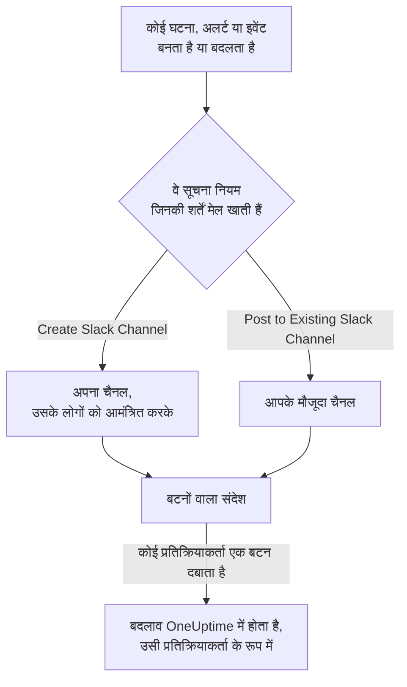

# Slack

OneUptime को Slack से कनेक्ट करें, ताकि घटनाएं, अलर्ट, एपिसोड, अनुसूचित रखरखाव, मॉनिटर और ऑन-कॉल अपडेट आपके चैनलों में पोस्ट हों, हर घटना को अपना चैनल मिले, और प्रतिक्रियाकर्ता Slack छोड़े बिना काम कर सकें: स्वीकार करना, सुलझाना, नोट जोड़ना, ऑन-कॉल को पेज करना और घटनाएं घोषित करना।

:::cards
- [Slack कनेक्ट करें](#slack-कनेक्ट-करें): अपने वर्कस्पेस में OneUptime इंस्टॉल करें, फिर अपना खाता लिंक करें।
- [सूचना नियम](#सूचना-नियम): तय करें कि कौन-से इवेंट कहाँ पोस्ट हों, और किन्हें अपना चैनल मिले।
- [Slack से घटनाएं और रखरखाव बनाना](#slack-से-घटनाएं-और-रखरखाव-बनाना): `/incident` और `/maintenance`, खुद आपके रूप में।
- [Slack से घटनाओं, अलर्ट और इवेंट पर कार्रवाई करना](#slack-से-घटनाओं-अलर्ट-और-इवेंट-पर-कार्रवाई-करना): OneUptime के संदेशों के बटन।
:::

## यह कैसे काम करता है

यह दो कनेक्शनों से काम करता है:

- **प्रोजेक्ट का कनेक्शन**, जो एक बार बनता है: आपके Slack वर्कस्पेस में इंस्टॉल किया गया OneUptime ऐप। यह संदेश पोस्ट करता है, चैनल बनाता है और लोगों को आमंत्रित करता है।
- **हर व्यक्ति का अपना कनेक्शन**: उस व्यक्ति का Slack खाता उसके OneUptime खाते से लिंक। बटन, कमांड और इमोजी प्रतिक्रियाएं उसी व्यक्ति के रूप में, प्रोजेक्ट में उसकी अनुमतियों के साथ काम करती हैं।

## शुरू करने से पहले

- **ऐसी भूमिका जो प्रोजेक्ट को कनेक्ट कर सके:** **Project Owner**, **Project Admin** या **Project Member**। ऐप अनइंस्टॉल करने के लिए **Project Owner** या **Project Admin** चाहिए।
- **एक Slack वर्कस्पेस**, जिसमें आप ऐप इंस्टॉल कर सकें।
- सूचना नियमों और सारांशों के लिए **OneUptime Cloud पर Growth प्लान**। [Growth प्लान से नीचे सूचना नियम](#growth-प्लान-से-नीचे-सूचना-नियम) देखें।
- **सेल्फ़-होस्टेड सर्वर पर,** पहले उसके लिए सेट किया गया Slack ऐप। [Slack एकीकरण](/docs/self-hosted/slack-integration) देखें।

## Slack कनेक्ट करें

:::steps
### अपने Slack वर्कस्पेस में OneUptime इंस्टॉल करें

**प्रोजेक्ट सेटिंग्स** > **वर्कस्पेस** > **Slack** पर जाएं और **Connect with Slack** पर क्लिक करें। वर्कस्पेस चुनें और OneUptime को अनुमति दें। Slack आपको उसी पेज पर वापस भेजता है, जो अब उस वर्कस्पेस का नाम दिखाता है जिससे प्रोजेक्ट कनेक्ट है। जब तक कोई वर्कस्पेस कनेक्ट नहीं होता, घटनाएं, अलर्ट, अनुसूचित रखरखाव, मॉनिटर और ऑन-कॉल मेन्यू के **वर्कस्पेस** सेक्शन में **Slack या Teams कनेक्ट करें** रहता है, जो भी यहीं ले आता है।

### अपना Slack खाता कनेक्ट करें

ऐप इंस्टॉल करने से इंस्टॉल करने वाले का खाता लिंक हो जाता है। बाकी सभी लोग **उपयोगकर्ता सेटिंग्स** > **वर्कस्पेस** > **Slack** में **Connect my account with Slack** से अपना Slack खाता लिंक करते हैं, ताकि वे खुद के रूप में घटनाओं पर कार्रवाई कर सकें और डायरेक्ट मैसेज पा सकें। प्रोजेक्ट के Slack से कनेक्ट होते ही यह सेक्शन दिखने लगता है।

### सूचना नियम जोड़ें

**घटनाएं** > **वर्कस्पेस** > **Slack** पर जाएं। **वर्कस्पेस** सेक्शन केवल वे चैट वर्कस्पेस दिखाता है जिन्हें आपके प्रोजेक्ट ने कनेक्ट किया है, इसलिए **Slack** कनेक्ट होने के बाद वहाँ दिखता है। एक नियम बनाएं, जैसे ऐसा नियम जो हर नई घटना के लिए एक Slack चैनल बनाए और घटना के मालिकों को आमंत्रित करे। [सूचना नियम](#सूचना-नियम) देखें।

### नियम का परीक्षण करें

नियम की पंक्ति में **परीक्षण नियम** पर क्लिक करें। नियम में बताए गए चैनलों में एक परीक्षण संदेश आता है। [किसी नियम का परीक्षण](#किसी-नियम-का-परीक्षण) देखें।
:::

## सूचना नियम

सूचना नियम बताता है कि कौन-से इवेंट Slack में पोस्ट हों, और कहाँ। हर प्रोडक्ट के अपने नियम होते हैं, उसके मेन्यू में **वर्कस्पेस** > **Slack** के नीचे:

| प्रोडक्ट | उसके **Slack** पेज के टैब |
| --- | --- |
| **घटनाएं** | **घटनाएं**, **घटना एपिसोड**, **Summary** |
| **अलर्ट** | **अलर्ट**, **अलर्ट एपिसोड**, **Summary** |
| **अनुसूचित रखरखाव** | नियमों की एक सूची |
| **मॉनिटर** | नियमों की एक सूची |
| **ऑन-कॉल ड्यूटी** | नियमों की एक सूची |

नियम बनाना चार चरणों में होता है:

| चरण | आप क्या सेट करते हैं |
| --- | --- |
| **बेसिक** | **नियम नाम** और **नियम विवरण**। |
| **शर्तें** | नियम किन इवेंट के लिए चलता है, जैसे गंभीरता, स्थिति, लेबल, मॉनिटर या शीर्षक के शब्दों के आधार पर। बिना शर्तों के यह हर इवेंट के लिए चलता है। दो या अधिक शर्तों पर **मिलान शर्त** बताता है कि सभी का मेल खाना ज़रूरी है या किसी एक का। |
| **गंतव्य** | यह कहाँ पोस्ट करता है: चैनल के नामों के साथ **Post to Existing Slack Channel**, नए चैनल के नाम और आमंत्रित लोगों के साथ **Create Slack Channel**, या दोनों। |
| **Video Call** | केवल घटनाएं और अलर्ट: हर एक के लिए एक कॉल शुरू करें। [वीडियो कॉल](/docs/workspace-connections/video-calls) देखें। |

नियम जो चैनल बनाता है, उसका नाम **New Slack Channel Name** के बाद रिकॉर्ड की संख्या जोड़कर रखा जाता है, जैसे `oneuptime-incident-42`, और केवल बनाया गया चैनल ही उन लोगों को पाता है जिन्हें नियम आमंत्रित करता है: रिकॉर्ड के मालिक, चुनी गई टीमें और उपयोगकर्ता, और घटनाओं व अलर्ट के लिए, पेज होते ही ऑन-कॉल लोग। निजी घटना, अलर्ट या एपिसोड को निजी चैनल मिलता है। रिकॉर्ड का हर बाद का अपडेट — स्थिति का बदलाव, नोट, नया मालिक — उसके चैनलों में और उसके नियमों में बताए गए मौजूदा चैनलों में पोस्ट होता है। जो घटना, अलर्ट या एपिसोड पहले से सुलझा हुआ बनाया गया हो, उसे अपना चैनल नहीं मिलता; उसका बनने का संदेश फिर भी आपके नियमों में बताए गए चैनलों में जाता है। [पहले से स्वीकार या सुलझी हुई घोषित](/docs/incidents/declaring-incidents#पहले-से-स्वीकार-या-सुलझी-हुई-घोषित) देखें।

**प्रोजेक्ट सेटिंग्स** > **वर्कस्पेस** > **Slack** उन चैनलों की सूची दिखाता है जिन्हें OneUptime देख सकता है, हर एक के बगल में **परीक्षण भेजें** के साथ। OneUptime किसी सार्वजनिक चैनल में पहली बार पोस्ट करते समय खुद ही उसमें शामिल हो जाता है। निजी चैनल तभी सूची में दिखता है, और उसमें पोस्ट किया जा सकता है, जब Slack में OneUptime ऐप को उसमें आमंत्रित किया गया हो।

## किसी नियम का परीक्षण

नियम की पंक्ति में **परीक्षण नियम** उस नियम का एक परीक्षण संदेश उसके बताए गए चैनलों में पोस्ट करता है, ताकि आप उसे आते देख सकें। अगर नियम हर इवेंट के लिए एक चैनल बनाता है, तो परीक्षण भी एक चैनल बनाता है और नियम के लोगों को उसमें आमंत्रित करता है।

**प्रोजेक्ट सेटिंग्स** > **वर्कस्पेस** > **Slack** में किसी चैनल के बगल वाले **परीक्षण भेजें** की तरह, इसके लिए सूचना नियम बनाने की अनुमति चाहिए: **Project Owner**, **Project Admin**, **Project Member**, **Settings Admin**, **Settings Member**, या किसी कस्टम भूमिका में **Create Workspace Notification Rule** और **Read Workspace Notification Rule**। जो केवल नियम देख सकता है, जैसे **Viewer**, उसके लिए **परीक्षण नियम** लॉक रहता है, और उसका टूलटिप बताता है कि क्या चाहिए; API उसके परीक्षण को "You do not have permission to send test notifications in this project." के साथ अस्वीकार करता है। OneUptime Cloud पर नियम का परीक्षण करने के लिए, नियम जोड़ने की तरह, **Growth** प्लान चाहिए।

OneUptime Cloud पर किसी चैनल के बगल वाले **परीक्षण भेजें** के लिए भी **Growth** प्लान चाहिए, क्योंकि चैनल में पोस्ट करना वही है जो नियम और सारांश करते हैं। किसी सारांश पर **अभी परीक्षण भेजें** के लिए सारांश बनाने की अनुमति (किसी कस्टम भूमिका में **Create Workspace Notification Summary** और **Read Workspace Notification Summary**) और OneUptime Cloud पर **Growth** प्लान चाहिए; बाकी सभी के लिए यह लॉक रहता है, और उसका टूलटिप बताता है कि क्या चाहिए। केवल-पढ़ने की पहुँच के साथ कनेक्ट किया गया MCP क्लाइंट कोई परीक्षण नहीं भेज सकता।

## सारांश

**घटनाएं** > **वर्कस्पेस** > **Slack** (और **अलर्ट**) का **Summary** टैब आपके बताए चैनलों में एक नियमित सारांश पोस्ट करता है: कितनी घटनाएं या अलर्ट हुए, उन्हें कितनी जल्दी स्वीकार किया गया और सुलझाया गया, और लिंक के साथ एक सूची। नया सारांश हर हफ़्ते जाता है और पिछले 7 दिनों को शामिल करता है। **पहली रिपोर्ट इस समय भेजें** खाली छोड़ दें, तो पहला सारांश अगले हफ़्ते, दिन या महीने की शुरुआत में 09:00 बजे जाता है; फ़ॉर्म बताता है कि कब।

सारांश अपने **टाइमज़ोन** की घड़ी के हिसाब से जाता है, जो शुरू में आपका टाइम ज़ोन होता है। यह वहाँ पूरे साल दिन का वही समय बनाए रखता है: बर्लिन में 09:00 पर सेट किया गया सारांश डेलाइट सेविंग टाइम के लिए घड़ियाँ बदलने के बाद भी बर्लिन में 09:00 पर ही जाता है, और उसके संदेश की तारीखें भी बर्लिन की होती हैं। API से `timezone` को IANA टाइम ज़ोन नाम के रूप में भेजें, जैसे `Europe/Berlin`। बिना टाइम ज़ोन के बनाया गया सारांश अपने बनाने वाले की प्रोफ़ाइल का टाइम ज़ोन लेता है, या जब कोई API कुंजी उसे बनाती है तो UTC।

सारांश के फ़ॉर्म में चार चरण हैं: **मूल जानकारी** (उसका नाम और चैनल), **अनुसूची**, **सामग्री** (**क्या शामिल करें**) और **फ़िल्टर** (वह किन घटनाओं या अलर्ट को गिनता है)।

## Growth प्लान से नीचे सूचना नियम

OneUptime Cloud पर सूचना नियम और सारांश **Growth** प्लान और उससे ऊपर में हैं। उससे नीचे का प्रोजेक्ट अपने मौजूदा नियम और सारांश रखता है, और वे Slack में पोस्ट करते रहते हैं। इसलिए हर प्रोडक्ट (घटनाएं, अलर्ट, अनुसूचित रखरखाव, ऑन-कॉल, मॉनिटर) का **Slack** पेज प्लान की सूचना और उसके नीचे उनकी सूची दिखाता है (**अभी भी सेट अप किए गए सूचना नियम**, **अभी भी सेट अप किए गए सारांश**): किसी नियम को हटाएं, या किसी सारांश को बंद करें या हटाएं। नियम और सारांश जोड़ने या बदलने के लिए **Growth** चाहिए।

## Slack में पेज होना

जब आप ऑन-कॉल हों तब डायरेक्ट मैसेज से पेज होने के लिए, Slack को अपनी सूचना विधियों में से एक के रूप में जोड़ें:

:::steps
1. अपना Slack खाता कनेक्ट करें ([Slack कनेक्ट करें](#slack-कनेक्ट-करें) देखें)।
2. **उपयोगकर्ता सेटिंग्स** > **सूचना विधियां** पर जाएं, **Workspace Apps** टैब खोलें और **Add Slack Account** पर क्लिक करें।
3. उसकी पंक्ति में **Send Test Message** पर क्लिक करें। संदेश आपके Slack डायरेक्ट मैसेज में आता है।
:::

जोड़ते ही यह आपके ऑन-कॉल नियमों में शामिल हो जाता है, इसलिए उसके बाद से पेज आप तक Slack में पहुँचते हैं। इसे कौन-से पेज मिलें, यह **उपयोगकर्ता सेटिंग्स** > **ऑन-कॉल नियम** में बदलें।

## संदेशों को नोट के रूप में सहेजना

किसी घटना, अलर्ट, एपिसोड या अनुसूचित रखरखाव इवेंट के चैनल में किसी संदेश पर प्रतिक्रिया दें, और OneUptime उसे उस रिकॉर्ड पर नोट के रूप में सहेजता है, फिर थ्रेड में जवाब देकर पुष्टि करता है:

| प्रतिक्रिया | किस रूप में सहेजा जाता है |
| --- | --- |
| 📌 पिन इमोजी, या Slack का अपना **Pin to channel** | एक निजी नोट, जिसे केवल आपकी टीम देखती है |
| 📢 मेगाफ़ोन या लाउडस्पीकर इमोजी | एक सार्वजनिक नोट, जो स्थिति पृष्ठ पर दिखता है। केवल घटनाएं और अनुसूचित रखरखाव इवेंट। |

नोट आपके रूप में, आपकी अनुमतियों के साथ सहेजा जाता है, इसलिए आपका अपना Slack खाता कनेक्ट होना चाहिए। कितने भी लोग प्रतिक्रिया दें, एक संदेश केवल एक बार सहेजा जाता है।

## Slack से OneUptime AI से पूछना

अपने लॉग, ट्रेस, मेट्रिक, घटनाओं और मॉनिटरों के बारे में सामान्य भाषा में पूछें। किसी चैनल में OneUptime को @मेंशन करें, या उसे डायरेक्ट मैसेज भेजें, और वह थ्रेड में जवाब देता है; और पूछने के लिए वहीं जवाब दें। `/oneuptime ask which monitors are down?` अपना जवाब चैनल में पोस्ट करता है। दोनों के लिए आपका अपना Slack खाता कनेक्ट होना और प्रोजेक्ट के लिए AI चालू होना चाहिए। Slack में जवाब केवल पढ़ते हैं: कुछ बदलने के लिए बटनों का उपयोग करें। [AI से पूछें](/docs/ai/ask-ai) देखें।

## Slack से घटनाएं और रखरखाव बनाना

`/incident` और `/maintenance` एक फ़ॉर्म खोलते हैं जिसे आप भरते हैं और खुद के रूप में सबमिट करते हैं: उस OneUptime खाते के रूप में जिससे आपका Slack खाता कनेक्ट है ([Slack कनेक्ट करें](#slack-कनेक्ट-करें) देखें), प्रोजेक्ट में उस खाते की अनुमतियों के साथ। अगर आपका Slack खाता कनेक्ट नहीं है, या आपका OneUptime खाता अब प्रोजेक्ट का सदस्य नहीं है, तो OneUptime डायरेक्ट मैसेज में बताता है कि क्या करना है, और कोई फ़ॉर्म नहीं खुलता। **Create New Incident** और **Create Scheduled Event** शॉर्टकट वही फ़ॉर्म खोलते हैं।

- **कौन इनका उपयोग कर सकता है।** वे लोग जो OneUptime में घटना घोषित कर सकते हैं या अनुसूचित रखरखाव इवेंट बना सकते हैं: घटना के लिए **Project Owner**, **Project Admin**, **Project Member**, **Incident Admin** और **Incident Member** (किसी कस्टम भूमिका में **Create Incident**), और इवेंट के लिए **Scheduled Maintenance Admin** और **Scheduled Maintenance Member** (**Create Scheduled Maintenance**)। बाकी सभी को डायरेक्ट मैसेज में यह बताया जाता है, और कोई फ़ॉर्म नहीं खुलता।
- **फ़ॉर्म क्या देता है।** हर सूची — गंभीरताएं, मॉनिटर, मॉनिटर स्थितियाँ, ऑन-कॉल नीतियां और लेबल — में वही होता है जो आप पढ़ सकते हैं, जैसे OneUptime में वही सूची: कुछ लेबल तक सीमित भूमिका के साथ, वे मॉनिटर और ऑन-कॉल नीतियां जिन पर वे लेबल हैं। जो सूची आप बिल्कुल नहीं पढ़ सकते, वह फ़ॉर्म से हटा दी जाती है। संग्रहीत ऑन-कॉल नीतियां कभी नहीं दी जातीं।
- **फ़ॉर्म किसे चुन सकता है।** घटना या इवेंट आपकी अपनी अनुमतियों के साथ बनता है और आपके नाम दर्ज होता है। ऐसा मॉनिटर, ऑन-कॉल नीति, लेबल, गंभीरता या स्थिति जिसे आप नहीं पढ़ सकते, या किसी दूसरे प्रोजेक्ट का, ऐसे अस्वीकार किया जाता है जैसे वह प्रोजेक्ट में हो ही नहीं, भले ही फ़ॉर्म आपकी पहुँच बदलने से पहले खोला गया हो, और कुछ नहीं बनता। OneUptime डायरेक्ट मैसेज में इसका कारण बताता है।

किसी घटना, अलर्ट या एपिसोड पर **Execute On-Call Policy** भी इसी तरह काम करता है: इसके लिए ऑन-कॉल नीति चलाने की अनुमति (**Project Owner**, **Project Admin**, **Project Member**, **On-Call Admin** और **On-Call Member**, या किसी कस्टम भूमिका में **Create On-Call Duty Policy Execution Log**) और उस घटना, अलर्ट या एपिसोड को पढ़ने की अनुमति चाहिए, और यह वे सक्रिय ऑन-कॉल नीतियां देता है जिन्हें आप पढ़ सकते हैं।

## Slack से घटनाओं, अलर्ट और इवेंट पर कार्रवाई करना

OneUptime के Slack संदेशों के बटन भी आपके रूप में काम करते हैं: उस OneUptime खाते के रूप में जिससे आपका Slack खाता कनेक्ट है, प्रोजेक्ट में उस खाते की अनुमतियों के साथ। किसी घटना, अलर्ट या एपिसोड पर **Acknowledge**, **Resolve**, **Change State**, **Add Note** और **Execute On-Call Policy**, और किसी अनुसूचित रखरखाव इवेंट पर **Mark as Ongoing**, **Mark as Complete**, **Change State** और **Add Note**, हर एक वही बदलाव करता है जो OneUptime में वही कार्रवाई करती है, और वह वहाँ आपके नाम दर्ज होता है: रिकॉर्ड की स्थिति टाइमलाइन और फ़ीड दिखाती हैं कि उसकी स्थिति आपने बदली, और नोट आपका होता है। इमोजी प्रतिक्रिया के साथ किसी संदेश से सहेजा गया नोट भी इसी तरह पोस्ट होता है।

- **कौन इनका उपयोग कर सकता है।** वे लोग जो OneUptime में वही बदलाव कर सकते हैं। किसी घटना को स्वीकार करने, सुलझाने या उसकी स्थिति बदलने के लिए उसकी स्थिति बदलने की अनुमति चाहिए: **Project Owner**, **Project Admin**, **Project Member**, **Incident Admin** और **Incident Member**, या किसी कस्टम भूमिका में **Create Incident State Timeline**। अलर्ट, एपिसोड या अनुसूचित रखरखाव इवेंट के लिए उसी के प्रकार की वैसी ही अनुमति चाहिए (उदाहरण के लिए **Create Alert State Timeline**), और नोट के लिए उस प्रकार का नोट पोस्ट करने की अनुमति चाहिए। बाकी सभी को डायरेक्ट मैसेज में यह बताया जाता है, और कुछ नहीं बदलता।
- **कौन-से रिकॉर्ड।** वे जिन्हें आप पढ़ सकते हैं, जैसे OneUptime में: कुछ लेबल तक सीमित भूमिका के साथ, वे घटनाएं, अलर्ट, एपिसोड और इवेंट जिन पर वे लेबल हैं। किसी दूसरे रिकॉर्ड पर, या किसी दूसरे प्रोजेक्ट के रिकॉर्ड पर बटन का जवाब यह मिलता है कि रिकॉर्ड "was not found in this project, or you do not have access to it.", और कुछ नहीं बदलता। OneUptime Cloud पर, ऐसा बदलाव जो प्रोजेक्ट के प्लान में शामिल नहीं है, ज़रूरी प्लान बताते हुए अस्वीकार किया जाता है।
- **Change State क्या देता है।** वे स्थितियाँ जिन्हें आप पढ़ सकते हैं और जिनमें रिकॉर्ड आगे जा सकता है, प्रोजेक्ट के क्रम में: उसकी मौजूदा स्थिति से पहले की कोई नहीं, एपिसोड के लिए भी वैसे ही जैसे घटना, अलर्ट या अनुसूचित रखरखाव इवेंट के लिए, क्योंकि स्थिति बदलने से रिकॉर्ड कभी अपनी सूची में ऊपर वापस नहीं जाता ([क्रम एक असली बाधा है, दिखावे की पसंद नहीं](/docs/incidents/states-and-severities#क्रम-एक-असली-बाधा-है-दिखावे-की-पसंद-नहीं) देखें)। जब आप एक भी नहीं पढ़ सकते, तो आपको "No incident states are available to you in this project. Ask a project admin for access to them." बताया जाता है; जब रिकॉर्ड उस आखिरी स्थिति में है जहाँ तक वह पहुँच सकता है, तो आपको "There is no later state to move this incident to." बताया जाता है। दोनों में से कोई भी खाली फ़ॉर्म नहीं खोलता।

## डिस्कनेक्ट करना

- **Disconnect** केवल आपका अपना Slack खाता अनलिंक करता है, और साथ में आपकी Slack सूचना विधि हटा देता है।
- **प्रोजेक्ट सेटिंग्स** > **वर्कस्पेस** > **Slack** पर **Uninstall OneUptime from Slack** प्रोजेक्ट को डिस्कनेक्ट करता है। OneUptime Slack में पोस्ट करना बंद कर देता है, और **वर्कस्पेस** मेन्यू उसे दिखाना बंद कर देते हैं। सूचना नियम और सारांश दोबारा कनेक्ट करने के लिए रखे जाते हैं।

> [!WARNING]
> अनइंस्टॉल करने से प्रोजेक्ट के हर सदस्य का अपना Slack खाता भी अनलिंक हो जाता है, और Slack सूचना विधियां और उनका उपयोग करने वाले ऑन-कॉल नियम हट जाते हैं। जिन्हें Slack में पेज किया जाता था, उन्हें Slack फिर से जोड़ने तक उनकी दूसरी सूचना विधियों पर पेज किया जाता है।

## समस्या निवारण

:::details कोई नियम कुछ पोस्ट नहीं करता
**परीक्षण नियम** से नियम की शर्तें जांचें: अगर परीक्षण आ जाता है, तो नियम की शर्तें उस इवेंट से मेल नहीं खाईं। अगर नहीं आता, तो Slack पेज कारण बताता है। निजी चैनल के लिए, पहले Slack में OneUptime ऐप को उसमें आमंत्रित करें। OneUptime का पोस्ट किया हर संदेश, और Slack का अस्वीकार किया हर संदेश, **प्रोजेक्ट सेटिंग्स** > **सूचनाएं** > **सूचना लॉग** में **वर्कस्पेस** टैब पर सूचीबद्ध होता है।
:::

:::details Slack कनेक्ट नहीं हुआ
जब Slack आपको बिना कनेक्शन के वापस भेजता है, तो जिस पेज से आपने शुरू किया था वह **Slack कनेक्ट नहीं हुआ** दिखाता है, और एक वाक्य कारण बताता है: आपके पास अनुमति नहीं है, लिंक पहले ही उपयोग हो चुका है या समाप्त हो गया है, आपने किसी दूसरे वर्कस्पेस में साइन इन किया, या सर्वर Slack के लिए सेट नहीं है। हर वाक्य और उसके लिए क्या करना है, इसके लिए [कनेक्ट करना पूरा नहीं हुआ](/docs/self-hosted/slack-integration#कनेक्ट-करना-पूरा-नहीं-हुआ) देखें।
:::

:::details कोई बटन या कमांड कहता है कि मेरा Slack खाता कनेक्ट नहीं है
इसे **उपयोगकर्ता सेटिंग्स** > **वर्कस्पेस** > **Slack** में **Connect my account with Slack** से लिंक करें। अगर आप अब प्रोजेक्ट के सदस्य नहीं हैं, तो OneUptime इसके बजाय यही बताता है, और आपके लिए कोई कार्रवाई नहीं करता।
:::

:::details सूचनाएं आती हैं, लेकिन बटन और कमांड कुछ नहीं करते
सेल्फ़-होस्टेड सर्वर पर, बटन, फ़ॉर्म और कमांड के लिए Slack का OneUptime तक पहुँच पाना ज़रूरी है; सूचनाओं को केवल बाहरी पहुँच चाहिए। [सेल्फ़-होस्टेड डिप्लॉयमेंट के लिए नेटवर्क एक्सेस](/docs/self-hosted/slack-integration#सेल्फ़-होस्टेड-डिप्लॉयमेंट-के-लिए-नेटवर्क-एक्सेस) देखें।
:::

## अगले कदम

:::cards
- [Microsoft Teams](/docs/workspace-connections/microsoft-teams): Microsoft Teams में वही सूचनाएं और कार्रवाइयाँ।
- [वीडियो कॉल](/docs/workspace-connections/video-calls): हर घटना को एक कॉल दें, जो उसके अपडेट के साथ पोस्ट हो।
- [Slack एकीकरण](/docs/self-hosted/slack-integration): सेल्फ़-होस्टेड सर्वर पर Slack ऐप सेट करें।
- [घटना घोषित करना](/docs/incidents/declaring-incidents): घटना शुरू होने के सभी तरीके, और उस समय क्या चलता है।
:::
