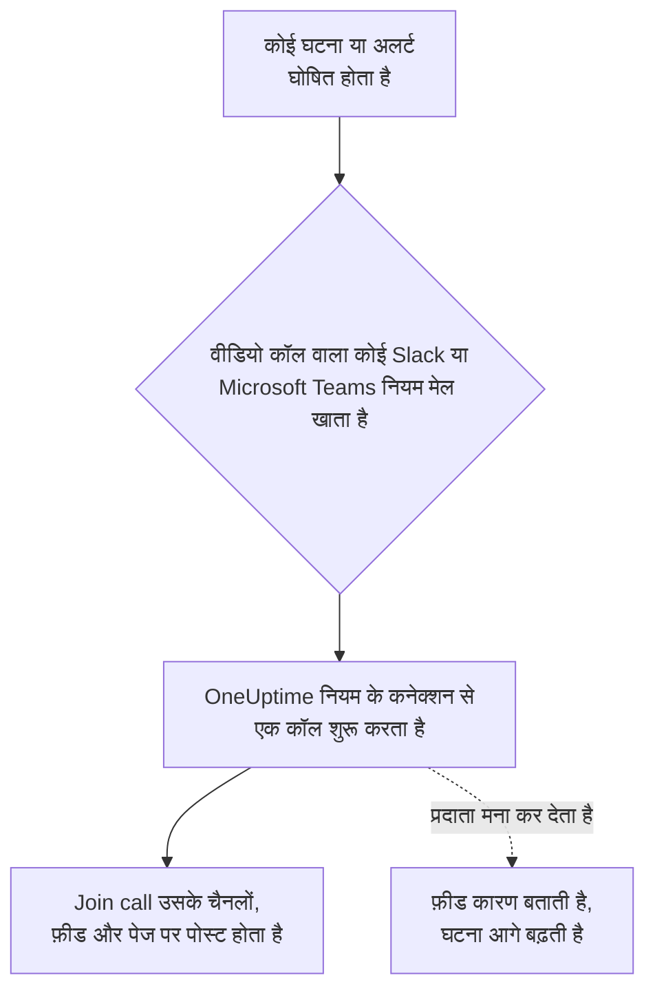

# वीडियो कॉल

हर घटना और अलर्ट को उसकी अपनी कॉल दें। जब कोई Slack या Microsoft Teams सूचना नियम किसी नई घटना या अलर्ट के लिए चलता है, तो OneUptime एक समर्पित मीटिंग शुरू करता है (Zoom मीटिंग, Google Meet, Microsoft Teams मीटिंग, या घटना के Slack चैनल का huddle) और जहाँ भी घटना के अपडेट जाते हैं, वहाँ एक **Join call** बटन पोस्ट करता है। प्रतिक्रियाकर्ता एक क्लिक में जुड़ जाते हैं, और किसी को रात 3 बजे मीटिंग बनाकर उसका लिंक इधर-उधर पेस्ट नहीं करना पड़ता।

:::cards
- [यह कैसे काम करता है](#यह-कैसे-काम-करता-है): नियम कॉल शुरू करता है, और प्रतिक्रियाकर्ता जहाँ भी हों, वहीं से जुड़ते हैं।
- [एक क्लिक में कनेक्ट करें](#एक-क्लिक-में-कनेक्ट-करें): Zoom, Google Meet या Microsoft Teams, बस साइन इन करके।
- [प्रदाता](#प्रदाता): आपके अपने ऐप की सर्विस पहचान, एक स्थायी मीटिंग लिंक, या Slack huddle।
- [हाथ से कॉल शुरू करना](#हाथ-से-कॉल-शुरू-करना): किसी घटना या अलर्ट के पेज से।
:::

## यह कैसे काम करता है



:::steps
### एक प्रदाता कनेक्ट करें

**प्रोजेक्ट सेटिंग्स** > **वर्कस्पेस** > **Video Calls** पर जाएं और Zoom, Google Meet या Microsoft Teams कनेक्ट करें, या एक स्थायी मीटिंग लिंक जोड़ें। OneUptime Cloud पर Zoom, Google Meet या Microsoft Teams कनेक्ट करना एक क्लिक का काम है: साइन इन करें और OneUptime को मीटिंग बनाने की अनुमति दें ([एक क्लिक में कनेक्ट करें](#एक-क्लिक-में-कनेक्ट-करें) देखें)। Slack huddle के लिए प्रोजेक्ट के Slack कनेक्शन के अलावा कुछ नहीं चाहिए।

### इसे किसी नियम में चालू करें

घटनाओं या अलर्ट के लिए कोई Slack या Microsoft Teams सूचना नियम खोलें (उदाहरण के लिए **घटनाएं** > **वर्कस्पेस** > **Slack**)। नियम के **Video Call** चरण में **Start a video call for the incident** चालू करें और चुनें कि कॉल कहाँ होगी।

### एक क्लिक में कॉल से जुड़ें

नियम चलने पर, OneUptime घटना के लिए एक कॉल शुरू करता है और उसे **Join call** बटन के साथ उन चैनलों में पोस्ट करता है जहाँ घटना के अपडेट जाते हैं, और घटना की फ़ीड में भी। घटना का पेज कॉल को अपने **Video Call** कार्ड में दिखाता है, और अपने हेडर में एक **Join call** बटन।
:::

नियम की शर्तें तय करती हैं कि किन घटनाओं को कॉल मिले। केवल Sev1 घटनाओं के लिए ब्रिज चाहिए, तो नियम को **गंभीरता** शर्त दें। कॉल उन घटनाओं और अलर्ट के लिए शुरू होती है जो चालू स्थिति में घोषित होते हैं। जो घटना पहले से सुलझी हुई बनाई गई हो, उसे कोई कॉल नहीं मिलती।

### हर घटना के लिए एक कॉल

कॉल हर घटना के लिए, हर उस जगह पर जहाँ कॉल होती है, एक बार शुरू होती है। एक ही कनेक्शन चुनने वाले नियम एक ही कॉल साझा करते हैं, और कोई नियम किसी ऐसी घटना के लिए दूसरी कॉल कभी शुरू नहीं करता जिसके पास उस कनेक्शन की कॉल पहले से है। अलग-अलग जगहें चुनने वाले नियम अपनी-अपनी कॉल शुरू करते हैं, जैसे प्रतिक्रियाकर्ताओं के लिए एक Zoom मीटिंग और घटना के Slack चैनल का huddle।

### जब कॉल शुरू नहीं हो पाती

घटना घोषित करना कभी किसी वीडियो कॉल प्रदाता का इंतज़ार नहीं करता। कॉल घटना बनने के बाद शुरू होती है, इसलिए धीमा या विफल होता प्रदाता घटना या उसकी ऑन-कॉल सूचनाओं में कभी देरी नहीं करता।

अगर प्रदाता मना कर देता है (समाप्त हो चुका सीक्रेट, कोई छूटी हुई अनुमति, हटाया गया होस्ट), तो घटना की फ़ीड प्रदाता के कारण के साथ बताती है कि नियम की कॉल शुरू नहीं हो सकी, ताकि प्रतिक्रियाकर्ता जानें कि उन्हें घटना के पेज से कॉल शुरू करनी है। नियम का चलना वर्कस्पेस सूचना लॉग में **वीडियो कॉल शुरू करें** के रूप में सूचीबद्ध होता है, और **प्रोजेक्ट सेटिंग्स** > **वर्कस्पेस** > **Video Calls** में कनेक्शन की पंक्ति तब तक त्रुटि दिखाती है जब तक कोई कॉल फिर से शुरू नहीं हो जाती।

### निजी घटनाएं

मीटिंग का नाम उस घटना पर, उसकी संख्या और शीर्षक के साथ, रखा जाता है जिसके लिए वह है, और उसका विवरण घटना से वापस लिंक करता है। निजी घटना के लिए शीर्षक छोड़ दिया जाता है, क्योंकि मीटिंग में आमंत्रित हर व्यक्ति उसका नाम पढ़ सकता है।

## एक क्लिक में कनेक्ट करें

OneUptime Cloud पर Zoom, Google Meet या Microsoft Teams कनेक्ट करने में एक क्लिक लगता है, और प्रदाता के पास कुछ सेट नहीं करना पड़ता:

:::steps
1. **प्रोजेक्ट सेटिंग्स** > **वर्कस्पेस** > **Video Calls** पर जाएं और Zoom, Google Meet या Microsoft Teams पर **कनेक्ट करें** पर क्लिक करें।
2. **Continue to Zoom** (या Google, या Microsoft) पर क्लिक करें, साइन इन करें, और OneUptime को मीटिंग बनाने की अनुमति दें।
3. कनेक्शन बन जाने के बाद आप वीडियो कॉल पेज पर लौटते हैं। **Start a test meeting** इसे शुरू से अंत तक जांचता है, फिर किसी Slack या Microsoft Teams सूचना नियम में कनेक्शन चुनें।
:::

हर मीटिंग उस खाते के रूप में बनती है जिससे आप साइन इन करते हैं, और वही उसे होस्ट करता है। अपने खाते के बजाय किसी साझा खाते से साइन इन करें, जैसे incidents@example.com, ताकि लोगों के जाने पर भी कॉल शुरू होती रहें। कनेक्शन की पंक्ति दिखाती है कि वह किसके रूप में साइन इन है।

| प्रदाता | किससे साइन इन करें | OneUptime क्या कर सकता है |
| --- | --- | --- |
| Zoom | एक Zoom उपयोगकर्ता। Basic (मुफ़्त) उपयोगकर्ता द्वारा होस्ट की गई मीटिंग 40 मिनट बाद खत्म हो जाती हैं। | उस उपयोगकर्ता के लिए मीटिंग बनाना (`meeting:write:meeting`) और यह पढ़ना कि वह कौन है (`user:read:user`)। |
| Google Meet | ऐसा Google खाता जो Google Meet का उपयोग कर सकता है। | उस खाते के रूप में Meet स्पेस बनाना (`meetings.space.created`) और उसका ईमेल पता पढ़ना। |
| Microsoft Teams | Microsoft Teams वाला कोई कार्य या स्कूल खाता। निजी Microsoft खाते Teams मीटिंग नहीं बना सकते। | उस खाते के रूप में ऑनलाइन मीटिंग बनाना (डेलिगेटेड अनुमति `OnlineMeetings.ReadWrite`) और साइन इन बने रहना (`offline_access`)। |

साइन इन करके बनाए गए कनेक्शन में भी वे सेटिंग्स रहती हैं जो तय करती हैं कि किसे इंतज़ार करना पड़ेगा: Google Meet के लिए **Who can join** और Microsoft Teams के लिए **Who skips the lobby**। इन्हें कनेक्शन की पंक्ति पर **संपादित करें** से बदलें।

### साइन इन बने रहना

OneUptime साइन-इन का रिफ़्रेश टोकन एन्क्रिप्ट करके रखता है और उसे हफ़्ते में कम से कम एक बार रिफ़्रेश करता है, ताकि वह उपयोग न होने की वजह से कभी समाप्त न हो, प्रोजेक्ट में कितने भी समय तक कोई घटना न हो। अगर साइन-इन काम करना बंद कर देता है (खाते ने OneUptime को हटा दिया, खाता हटाया या निलंबित किया गया, या आपके संगठन की नीति उसे फिर से साइन इन करने को कहती है), तो कनेक्शन की पंक्ति उसी दिन कारण के साथ **Not working** दिखाती है जिस दिन OneUptime को इसका पता चलता है, अगली घटना पर नहीं। पंक्ति पर **Reconnect** उसे फिर से साइन इन करता है।

एक ही खाते के रूप में साइन इन किए गए कनेक्शन, हर प्रोजेक्ट में, एक ही साइन-इन साझा करते हैं: Zoom हर खाते के लिए केवल एक साइन-इन रखता है, इसलिए उसी Zoom उपयोगकर्ता को फिर से कनेक्ट करने से वह उन सभी के लिए बदल जाता है।

### फिर से कनेक्ट करना और हटाना

किसी कनेक्शन की पंक्ति पर **Reconnect** उसे फिर से साइन इन करता है, उसी खाते के रूप में या किसी दूसरे के रूप में। इसका उपयोग तब करें जब खाते ने OneUptime को हटा दिया हो, या घटनाओं की मीटिंग किसी दूसरे खाते पर ले जाने के लिए।

कनेक्शन हटाने पर, जब कोई दूसरा कनेक्शन उस साइन-इन का उपयोग नहीं करता, Zoom और Google पर OneUptime की पहुँच वापस ले ली जाती है। Microsoft के लिए, खाते के **My Apps** (myapps.microsoft.com) में OneUptime को हटाएं। Zoom App Marketplace में अपने Zoom खाते से OneUptime को हटाने पर उसका साइन-इन उस खाते के रूप में साइन इन किए गए हर कनेक्शन से हट जाता है, और वे फिर से कनेक्ट होने तक **Not working** दिखाते हैं।

### अगर Microsoft किसी एडमिनिस्ट्रेटर को मांगता है

कुछ Microsoft 365 संगठन केवल एडमिनिस्ट्रेटर को ऐप स्वीकृत करने देते हैं। अगर Microsoft कहता है कि आपको एडमिन की स्वीकृति चाहिए, तो Microsoft 365 के किसी एडमिनिस्ट्रेटर से Microsoft Teams कनेक्ट करने को कहें, या [Microsoft Entra एडमिन सेंटर](https://entra.microsoft.com/) में **Enterprise applications** > **Admin consent requests** के अंदर OneUptime को स्वीकृत करने को कहें।

### इसके बजाय अपने ऐप का उपयोग करें

किसी व्यक्ति के साइन-इन के बजाय सर्विस पहचान से कनेक्ट करने के लिए — Zoom Server-to-Server OAuth ऐप, डोमेन-वाइड डेलिगेशन वाला Google सर्विस अकाउंट, या Microsoft Entra ऐप रजिस्ट्रेशन — कनेक्ट डायलॉग में **Use your own Zoom app** (या Google, या Microsoft) पर क्लिक करें। [प्रदाता](#प्रदाता) हर एक को समझाता है। ऐसे सेल्फ़-होस्टेड सर्वर पर जहाँ एक-क्लिक ऐप सेट नहीं हैं, **कनेक्ट करें** सीधे यही फ़ॉर्म खोलता है; उन्हें सेट करने के लिए [सेल्फ़-होस्टेड सर्वर पर एक क्लिक में कनेक्ट करना](#सेल्फ़-होस्टेड-सर्वर-पर-एक-क्लिक-में-कनेक्ट-करना) देखें।

## हाथ से कॉल शुरू करना

किसी घटना या अलर्ट के पेज पर **Video Call** कार्ड में **Start call** होता है (या एक कॉल होने के बाद **Start another**)। प्रोजेक्ट के कनेक्शनों में से एक चुनें, घटना के Slack चैनल का huddle चुनें, या अपना कोई मीटिंग लिंक पेस्ट करें। कॉल घटना के चैनलों और फ़ीड में वैसे ही पोस्ट होती है जैसे नियम से शुरू हुई कॉल।

कार्ड पर **हटाएं** किसी कॉल को घटना के पेज से हटा देता है। मीटिंग खुद नहीं हटती, और लिंक वाला कोई भी व्यक्ति अब भी उसमें जुड़ सकता है।

कॉल शुरू करने और हटाने के लिए घटनाओं (या अलर्ट) पर काम करने की अनुमति चाहिए: **Project Owner**, **Project Admin**, **Project Member**, **Incident Admin** या **Incident Member**, या किसी कस्टम भूमिका में **Create Incident Video Call** और **Delete Incident Video Call**। जो भी घटना पढ़ सकता है, वह उसकी कॉल देखता है।

## प्रदाता

यह सेक्शन किसी प्रदाता को आपके अपने ऐप की सर्विस पहचान से कनेक्ट करने के बारे में है: Zoom Server-to-Server OAuth ऐप, Google सर्विस अकाउंट, Microsoft Entra ऐप रजिस्ट्रेशन। सर्विस पहचान कभी किसी व्यक्ति पर निर्भर नहीं होती, इसलिए कोई भी चला जाए, वह काम करती रहती है। इसके बजाय साइन इन करके कनेक्ट करने के लिए, [एक क्लिक में कनेक्ट करें](#एक-क्लिक-में-कनेक्ट-करें) देखें।

क्रेडेंशियल स्टोर किए जाते समय एन्क्रिप्ट होते हैं और API उन्हें कभी नहीं लौटाता। कनेक्शन संपादित करते समय, खाली छोड़ा गया क्रेडेंशियल पहले से सहेजा हुआ मान बनाए रखता है।

कनेक्शन फ़ॉर्म में **Start test meeting**, और किसी कनेक्शन की पंक्ति पर **परीक्षण**, कनेक्शन की सेटिंग्स के साथ एक असली मीटिंग बनाते हैं और उसका लिंक दिखाते हैं। यही एक जांच है जो साबित करती है कि क्रेडेंशियल, प्रदाता की तरफ़ की अनुमति और होस्ट, सब एक साथ काम करते हैं। कहीं कुछ पोस्ट नहीं होता।

प्रदाता कनेक्ट करने के लिए **Project Owner**, **Project Admin** या **Settings Admin** चाहिए, या किसी कस्टम भूमिका में **Create Video Call Connection** और **Edit Video Call Connection**।

### Zoom

OneUptime हर घटना के लिए एक Zoom **Server-to-Server OAuth** ऐप के ज़रिए Zoom मीटिंग बनाता है, जिसे आपका चुना हुआ लाइसेंस वाला Zoom उपयोगकर्ता होस्ट करता है।

:::steps
1. [Zoom App Marketplace](https://marketplace.zoom.us/) में **Develop** > **Build App** चुनें और एक **Server-to-Server OAuth** ऐप बनाएं। इसे बनाने के लिए Zoom खाते का एडमिन, या ऐसी भूमिका चाहिए जो Server-to-Server OAuth ऐप की अनुमति देती हो।
2. ऐप के **Scopes** पेज पर **meeting:write:meeting:admin** (किसी उपयोगकर्ता के लिए मीटिंग बनाना) जोड़ें। ग्रैन्युलर स्कोप से पहले बना ऐप इसके बजाय **meeting:write:admin** का उपयोग कर सकता है।
3. ऐप को **Activate** करें, फिर उसके **App Credentials** पेज से **Account ID**, **Client ID** और **Client secret** कनेक्शन फ़ॉर्म में कॉपी करें।
4. **Meeting host** दर्ज करें: किसी लाइसेंस वाले Zoom उपयोगकर्ता का ईमेल, बेहतर हो कि incidents@example.com जैसा कोई सर्विस अकाउंट, ताकि लोगों के जाने पर भी मीटिंग काम करती रहें। Basic (मुफ़्त) उपयोगकर्ता द्वारा होस्ट की गई मीटिंग 40 मिनट बाद खत्म हो जाती हैं।
5. प्रतिक्रियाकर्ता होस्ट का इंतज़ार किए बिना जुड़ते हैं, क्योंकि होस्ट एक सर्विस अकाउंट है जो कभी नहीं जुड़ता। पक्का करें कि आपके Zoom खाते की **Waiting room** सेटिंग चालू स्थिति में लॉक न हो, वरना कोई अंदर नहीं आ सकता।
:::

| फ़ील्ड | यह कहाँ मिलता है |
| --- | --- |
| Account ID | ऐप का **App Credentials** पेज |
| Client ID | ऐप का **App Credentials** पेज |
| Client secret | ऐप का **App Credentials** पेज |
| Meeting host | उस लाइसेंस वाले Zoom उपयोगकर्ता का ईमेल जो हर मीटिंग होस्ट करता है |

### Google Meet

OneUptime हर घटना के लिए Google Meet REST API से एक Google Meet बनाता है, एक Google Cloud सर्विस अकाउंट के ज़रिए जो डोमेन-वाइड डेलिगेशन के साथ किसी Google Workspace उपयोगकर्ता के रूप में काम करता है।

:::steps
1. [Google Cloud कंसोल](https://console.cloud.google.com/) में कोई प्रोजेक्ट चुनें या बनाएं और उसके लिए **Google Meet REST API** चालू करें।
2. **IAM & Admin** > **Service accounts** में एक सर्विस अकाउंट बनाएं। उसे खोलें, **Keys** > **Add key** > **Create new key** पर जाएं, **JSON** चुनें, और डाउनलोड की गई फ़ाइल को कनेक्शन फ़ॉर्म में **Service account JSON key** के रूप में पेस्ट करें।
3. [Google Admin कंसोल](https://admin.google.com/) में **Security** > **Access and data control** > **API controls** > **Manage Domain Wide Delegation** खोलें और **Add new** पर क्लिक करें। सर्विस अकाउंट का संख्यात्मक **Client ID** और स्कोप `https://www.googleapis.com/auth/meetings.space.created` दर्ज करें।
4. **Create meetings as** में वह Google Workspace उपयोगकर्ता दर्ज करें जिसके रूप में सर्विस अकाउंट काम करता है: incidents@example.com जैसा कोई समर्पित खाता। हर मीटिंग का मालिक यही उपयोगकर्ता होता है।
:::

**Who can join** तय करता है कि कौन बिना पूछे जुड़ता है: **People in your organization join directly, others ask to join** (डिफ़ॉल्ट) के साथ, आपके Google Workspace के बाहर के लोग जुड़ने के लिए पूछते हैं और कॉल में मौजूद कोई उन्हें अंदर आने देता है। **Anyone with the link joins directly** के साथ, किसी को इंतज़ार नहीं करना पड़ता।

डोमेन-वाइड डेलिगेशन को काम करना शुरू करने में कुछ मिनट लग सकते हैं। अगर डेलिगेशन जोड़ने के ठीक बाद परीक्षण बताता है कि Google ने सर्विस अकाउंट को उपयोगकर्ता के रूप में काम नहीं करने दिया, तो कुछ मिनट रुकें और फिर से परीक्षण करें।

### Microsoft Teams

OneUptime हर घटना के लिए Microsoft Graph से एक Microsoft Teams मीटिंग बनाता है, एक Microsoft Entra ऐप रजिस्ट्रेशन के ज़रिए जो लाइसेंस वाले किसी Teams उपयोगकर्ता की ओर से मीटिंग आयोजित करता है।

:::steps
1. [Microsoft Entra एडमिन सेंटर](https://entra.microsoft.com/) में **App registrations** > **New registration** खोलें और एक सिंगल-टेनेंट ऐप रजिस्टर करें। उसका **Directory (tenant) ID** और **Application (client) ID** कॉपी करें।
2. **API permissions** में Microsoft Graph की **application** अनुमति **OnlineMeetings.ReadWrite.All** जोड़ें, फिर **Grant admin consent** पर क्लिक करें।
3. **Certificates & secrets** में एक क्लाइंट सीक्रेट बनाएं और उसका **Value**, न कि उसका Secret ID, कनेक्शन फ़ॉर्म में **Client secret** के रूप में पेस्ट करें।
4. आयोजक चुनें: लाइसेंस वाला कोई Teams उपयोगकर्ता, बेहतर हो कि कोई सर्विस अकाउंट। Entra एडमिन सेंटर के **Users** से उसका **Object ID** कॉपी करके **Organizer object ID** में डालें।
5. एक एप्लिकेशन एक्सेस पॉलिसी से ऐप को आयोजक के लिए मीटिंग बनाने की अनुमति दें। Teams PowerShell में, `Connect-MicrosoftTeams` के बाद, नीचे दिए दो कमांड चलाएं।
:::

```powershell
New-CsApplicationAccessPolicy -Identity OneUptime-Meetings -AppIds "<application-client-id>"
Grant-CsApplicationAccessPolicy -PolicyName OneUptime-Meetings -Identity "<organizer-object-id>"
```

पॉलिसी लागू होने में 30 मिनट तक लग सकते हैं। तब तक परीक्षण बताता है कि ऐप को आयोजक के लिए मीटिंग बनाने की अनुमति नहीं है।

**Who skips the lobby** तय करता है कि कौन बिना इंतज़ार किए जुड़ता है: **People in your organization skip the lobby** (डिफ़ॉल्ट) के साथ, बाकी सभी लॉबी में तब तक इंतज़ार करते हैं जब तक मीटिंग में मौजूद कोई उन्हें अंदर नहीं आने देता। **Everyone skips the lobby** के साथ, किसी को इंतज़ार नहीं करना पड़ता।

### मीटिंग लिंक

स्थायी मीटिंग लिंक हर घटना के लिए एक ही रूम होता है: Zoom Personal Meeting Room, दोहराई जाने वाली Microsoft Teams या Google Meet मीटिंग, Webex पर्सनल रूम या Jitsi रूम। हर घटना के लिए कुछ नहीं बनता, इसलिए कुछ अधिकृत नहीं करना पड़ता।

:::steps
1. जिस टूल का आपकी टीम पहले से उपयोग करती है, उसमें एक ऐसी मीटिंग बनाएं जो कभी समाप्त न हो।
2. उसका https जॉइन लिंक कनेक्शन फ़ॉर्म में **Meeting link** के रूप में पेस्ट करें।
:::

इस कनेक्शन से शुरू हुई हर घटना और अलर्ट यही रूम साझा करते हैं, इसलिए एक साथ चल रही दो घटनाएं भी इसे साझा करती हैं। पक्का करें कि मीटिंग लोगों को होस्ट के बिना जुड़ने देती है।

### Slack huddle

कोई Slack नियम इसके बजाय घटना के Slack चैनल का huddle शुरू कर सकता है। कुछ कनेक्ट नहीं करना पड़ता: नियम के **Video Call** चरण में **Slack huddle** चुनें।

huddle उस चैनल में होता है जो नियम घटना के लिए बनाता है, या, जब नियम इसके बजाय मौजूदा चैनलों में पोस्ट करता है, तो उनमें से पहले चैनल में। इसलिए नियम को या तो चैनल बनाना होगा या किसी मौजूदा चैनल में पोस्ट करना होगा। **Join huddle** बटन Slack में चैनल का huddle खोलता है। इसे खोलने वाला पहला प्रतिक्रियाकर्ता huddle शुरू करता है, और उसके बाद आने वाले सभी उसमें जुड़ते हैं। Slack में किसी ऐप के लिए huddle शुरू करने का कोई तरीका नहीं है, इसलिए जब तक कोई उसे खोलता नहीं, huddle में कोई नहीं होता।

Slack huddle केवल Slack नियमों के लिए है। Microsoft Teams नियम अपनी कॉल प्रोजेक्ट के वीडियो कॉल कनेक्शनों में से किसी एक से शुरू करता है।

## API का उपयोग

कॉल घटना (`IncidentVideoCall`) या अलर्ट (`AlertVideoCall`) पर एक रिकॉर्ड है। इसे घटना के `_id` और इनमें से किसी एक के साथ बनाएं:

- `videoCallConnectionId`: उस कनेक्शन से एक नई मीटिंग शुरू करें।
- `provider` को `SlackHuddle` पर सेट करें: घटना के Slack चैनल का huddle।
- `joinUrl` (और वैकल्पिक रूप से `title`): आपका अपना मीटिंग लिंक।

```json
{
  "data": {
    "projectId": "<project-id>",
    "incidentId": "<incident-id>",
    "videoCallConnectionId": "<connection-id>"
  }
}
```

`POST /api/video-call-connection/test` किसी सहेजे गए कनेक्शन (`{ "connectionId": "..." }`) से, या ऐसी सेटिंग्स से जो अभी सहेजी नहीं गईं (`{ "provider": "Zoom", "config": { ... }, "secrets": { ... } }`), एक परीक्षण मीटिंग शुरू करता है और उसका `joinUrl` लौटाता है।

किसी कनेक्शन का `authMethod` बताता है कि वह कैसे साइन इन करता है: साइन इन करके बने कनेक्शन के लिए `OAuth`, आपके अपने ऐप के क्रेडेंशियल वाले कनेक्शन के लिए `AppCredentials`, और मीटिंग लिंक के लिए कुछ नहीं। साइन इन करके बनने वाला कनेक्शन केवल डैशबोर्ड में साइन इन करके ही बनता है। API से आप उसका नाम और उसका `config` बदल सकते हैं, और उसका `connectedAccount` बताता है कि वह किसके रूप में साइन इन है।

## सेल्फ़-होस्टेड सर्वर पर एक क्लिक में कनेक्ट करना

OneUptime Cloud के पास एक क्लिक में कनेक्ट करने के लिए अपने Zoom, Google और Microsoft ऐप हैं। सेल्फ़-होस्टेड सर्वर यह सुविधा हर उस प्रदाता के लिए देता है जिसका ऐप आपने सेट किया है। ऐप के बिना, **कनेक्ट करें** आपके अपने ऐप का फ़ॉर्म खोलता है।

हर प्रदाता के लिए एक OAuth ऐप बनाएं और उस पर, अपने सर्वर के होस्ट के साथ, यह रीडायरेक्ट URI रजिस्टर करें:

| प्रदाता | रीडायरेक्ट URI | एनवायरनमेंट वेरिएबल | Helm वैल्यू |
| --- | --- | --- | --- |
| Zoom | `https://<host>/api/video-call-oauth/zoom/callback` | `ZOOM_APP_CLIENT_ID`, `ZOOM_APP_CLIENT_SECRET`, `ZOOM_APP_WEBHOOK_SECRET_TOKEN` | `zoomApp.clientId`, `zoomApp.clientSecret`, `zoomApp.webhookSecretToken` |
| Google Meet | `https://<host>/api/video-call-oauth/google-meet/callback` | `GOOGLE_MEET_APP_CLIENT_ID`, `GOOGLE_MEET_APP_CLIENT_SECRET` | `googleMeetApp.clientId`, `googleMeetApp.clientSecret` |
| Microsoft Teams | `https://<host>/api/video-call-oauth/microsoft-teams/callback` | `MICROSOFT_TEAMS_MEETINGS_APP_CLIENT_ID`, `MICROSOFT_TEAMS_MEETINGS_APP_CLIENT_SECRET` | `microsoftTeamsMeetingsApp.clientId`, `microsoftTeamsMeetingsApp.clientSecret` |

- **Zoom**: [Zoom App Marketplace](https://marketplace.zoom.us/) में **Develop** > **Build App** चुनें और उपयोगकर्ताओं द्वारा प्रबंधित एक **General App** बनाएं। **Basic Information** में, रीडायरेक्ट URI को **Development** और **Production** दोनों टैब पर OAuth Redirect URL के रूप में और OAuth अनुमति सूची में जोड़ें, और **Production** टैब पर **Deauthorization Notification** एंडपॉइंट URL को `https://<host>/api/video-call-oauth/zoom/events` पर सेट करें। **Scopes** में `meeting:write:meeting` और `user:read:user` जोड़ें। **Features** > **Access** में मौजूद **Secret Token** ही `ZOOM_APP_WEBHOOK_SECRET_TOKEN` है। **Development** क्रेडेंशियल केवल आपके अपने Zoom खाते के उपयोगकर्ताओं के लिए काम करते हैं; **Production** क्रेडेंशियल, Zoom के ऐप की समीक्षा करके उसे प्रकाशित करने के बाद, सभी के लिए काम करते हैं।
- **Google Meet**: [Google Cloud कंसोल](https://console.cloud.google.com/) में **Google Meet REST API** चालू करें, OAuth सहमति स्क्रीन (**Google Auth Platform**) को स्कोप `openid`, `email` और `https://www.googleapis.com/auth/meetings.space.created` के साथ कॉन्फ़िगर करें, और रीडायरेक्ट URI के साथ **Web application** प्रकार का एक OAuth क्लाइंट बनाएं। ऐप को प्रोडक्शन में प्रकाशित करें: टेस्टिंग में छोड़ा गया ऐप सात दिन बाद अपने साइन-इन खो देता है। Google उन ऐप की समीक्षा करता है जो Meet स्कोप मांगते हैं; समीक्षा पूरी होने तक, लोगों को साइन इन करने से पहले एक चेतावनी दिखती है।
- **Microsoft Teams**: [Microsoft Entra एडमिन सेंटर](https://entra.microsoft.com/) में **Accounts in any organizational directory** के लिए एक ऐप रजिस्टर करें, रीडायरेक्ट URI को **Web** रीडायरेक्ट URI के रूप में जोड़ें, Microsoft Graph की डेलिगेटेड अनुमतियां `openid`, `profile`, `email`, `offline_access` और `OnlineMeetings.ReadWrite` जोड़ें, और एक क्लाइंट सीक्रेट बनाएं। इसके लिए अलग रजिस्ट्रेशन का उपयोग करें, Microsoft Teams बॉट वाले (`MICROSOFT_TEAMS_APP_CLIENT_ID`) का नहीं। जब तक ऐप का कोई सत्यापित प्रकाशक नहीं होता, ज़्यादातर संगठनों को उसे सहमति देने के लिए एडमिनिस्ट्रेटर चाहिए।

क्लाइंट ID सार्वजनिक हैं: उन्हें डैशबोर्ड को भेजा जाता है ताकि उसे पता रहे कि कौन-से प्रदाता एक क्लिक में कनेक्ट होते हैं। सीक्रेट और webhook सीक्रेट टोकन को गुप्त रखें। worker हर दिन उन साइन-इन को रिफ़्रेश करता है जिनकी बारी आ गई है, इसलिए उसे भी ऐप जैसी ही वैल्यू चाहिए।

## समस्या निवारण

:::details किसी घटना के लिए कोई कॉल शुरू नहीं हुई
जांचें कि नियम घटना से मेल खाया (**परीक्षण नियम**), उसका **Video Call** चरण चालू है, और घटना चालू स्थिति में घोषित हुई थी: जो घटना पहले से सुलझी हुई बनाई गई हो, उसे कोई कॉल नहीं मिलती। जो नियम उस कनेक्शन से घटना के लिए पहले ही कॉल शुरू कर चुका है, वह दूसरी शुरू नहीं करता।
:::

:::details फ़ीड कहती है कि कॉल शुरू नहीं हो सकी
प्रदाता ने मना कर दिया, और फ़ीड उसका कारण बताती है। इस बीच घटना के पेज से कॉल शुरू करें। फिर कनेक्शन की पंक्ति पर **परीक्षण** चलाएं: जब तक आप प्रदाता के पास सेटअप ठीक करते हैं, जैसे समाप्त हो चुका क्लाइंट सीक्रेट या कोई छूटी हुई अनुमति, यह वही कारण दिखाता है।
:::

:::details कोई कनेक्शन Not working दिखाता है
उसका साइन-इन काम करना बंद कर चुका है: खाते ने OneUptime को हटा दिया, खाता हटाया या निलंबित किया गया, या उसे फिर से साइन इन करना होगा। उसकी पंक्ति पर **Reconnect** पर क्लिक करें। तब तक, जो कॉल उसे शुरू करनी चाहिए, वे शुरू नहीं हो सकतीं।
:::

:::details लोग लॉबी या वेटिंग रूम में इंतज़ार करते हैं
कनेक्शन की पंक्ति पर **संपादित करें** से **Who can join** (Google Meet) या **Who skips the lobby** (Microsoft Teams) बदलें। Zoom के लिए, पक्का करें कि खाते की **Waiting room** सेटिंग चालू स्थिति में लॉक न हो।
:::

## अगले कदम

:::cards
- [Slack](/docs/workspace-connections/slack): वे नियम जो कॉल शुरू करते हैं, और वे चैनल जिनमें वे पोस्ट करते हैं।
- [Microsoft Teams](/docs/workspace-connections/microsoft-teams): Microsoft Teams में वही नियम और कॉल।
- [Microsoft Teams एकीकरण](/docs/self-hosted/microsoft-teams-integration): सेल्फ़-होस्टेड सर्वर पर Teams बॉट सेट करें।
- [घटना घोषित करना](/docs/incidents/declaring-incidents): घटना शुरू होने पर क्या होता है।
:::
