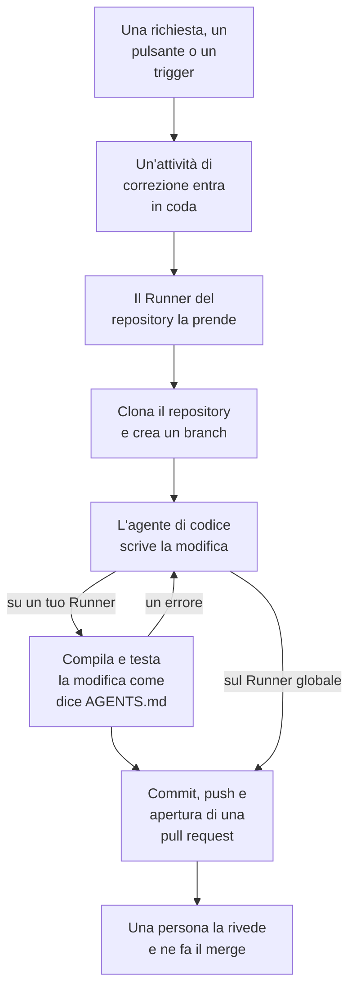

# Codice

Codice è il posto in cui chiedi a OneUptime AI di lavorare nei tuoi repository, come chiederesti a un agente di programmazione: correggere un bug, scrivere test, spiegare il codice, fare una modifica. Si apre sulla casella in cui chiedi, con il repository e il branch scelti al suo interno e tutte le attività sotto; la pagina di un'attività è una conversazione in cui puoi rispondere. OneUptime avvia anche attività da solo, a partire da eccezioni, tracce e indagini. Un [Runner](/docs/runbooks/agents) clona il repository, scrive la modifica su un nuovo branch, la compila e la testa, e apre una pull request. Una persona rivede e unisce ognuna: il Runner può fare il push di branch e aprire pull request, nient'altro.

:::cards
- [Chiedere all'IA in un repository](#chiedere-allia-in-un-repository): Una richiesta con parole tue, con il contesto che le serve.
- [La conversazione di un'attività](#la-conversazione-di-unattività): Cosa ha fatto l'IA, cosa ha modificato, e la tua risposta.
- [Come funziona un'esecuzione di correzione](#come-funziona-unesecuzione-di-correzione): Da un clic a una pull request, passo dopo passo.
- [Dove partono le attività di correzione](#dove-partono-le-attività-di-correzione): Le attività che OneUptime avvia, e cosa fa ogni pull request.
- [Telemetria di produzione in una correzione](#telemetria-di-produzione-in-una-correzione): Cosa legge una correzione dalla produzione mentre scrive la modifica.
- [Revisione di produzione delle pull request](#revisione-di-produzione-delle-pull-request): Cosa dice la produzione del codice che cambia ogni pull request.
- [Collegare un repository](#collegare-un-repository): GitHub, GitLab, Forgejo o Gitea, o qualsiasi server Git.
- [Prima di iniziare](#prima-di-iniziare): Un modello, un repository collegato e un Runner.
- [Quando una correzione non riesce](#quando-una-correzione-non-riesce): Cosa succede a un'esecuzione che va in errore, si blocca o resta in attesa.
:::

> [!TIP]
> Puoi avviarla anche da GitHub. Menziona la GitHub App di OneUptime in una issue o in una pull request e implementa, rivede o revisiona direttamente lì: vedi [GitHub App](/docs/ai/github-app). È lo stesso agente, lo stesso Runner e gli stessi budget; cambia solo il trigger.

## Chiedere all'IA in un repository

:::steps
### Apri Codice

Apri **Prodotti → Codice**. Si apre su **Cosa deve fare l'IA?**: la casella in cui chiedi, con tutte le attività sotto, le più recenti per prime. Se non c'è ancora nessun repository, offre invece **Connetti GitHub**, con sotto GitLab, Forgejo o Gitea e qualsiasi server Git (vedi [Collegare un repository](#collegare-un-repository)). **Repository**, nel suo menu laterale, elenca i repository in cui l'IA può lavorare, e raccoglie sotto **Non connesso** quelli che OneUptime non raggiunge più. La pagina di ogni repository ha la stessa casella per quel repository.

### Scegli il repository e il branch

La casella parte dal repository che hai scelto l'ultima volta. Scegline un altro nella sua riga in basso e, accanto, il branch da cui parte l'attività: il branch principale del repository, segnato come **Predefinito**, finché non ne scegli un altro. L'IA crea il suo branch da quello che scegli e apre la sua pull request verso di esso.

### Di' cosa vuoi

Scrivi la modifica, il bug o la domanda con parole tue. Finché non è stato chiesto nulla, Codice ne suggerisce alcune sotto **Prova a chiedere**.

### Aggiungi contesto

Fai clic su **Aggiungi contesto** per dare all'IA ciò che le serve: un file o una cartella del repository, una nota, un collegamento o un record del progetto. OneUptime legge ogni record quando invii la richiesta, con i tuoi permessi, e conserva ciò che l'IA ha ricevuto.

### Avvia l'attività

Fai clic su **Avvia attività**, oppure premi Invio. Si apre la pagina dell'attività, e il lavoro dell'IA vi compare man mano che avviene.
:::

| Contesto | Cosa riceve l'IA |
| --- | --- |
| **File o cartella** | Un percorso nel repository, che l'IA legge per primo. |
| **Nota** | Testo che incolli: un errore, una specifica, una riga di log. |
| **Collegamento** | Un indirizzo web, come riferimento. |
| **Incidente** o **Avviso** | Il suo stato, la descrizione e la causa principale, così come sono quando invii la richiesta. |
| **Eccezione** | Il suo messaggio e lo stack trace. |
| **Monitor** | Il suo tipo, lo stato e la descrizione. |
| **Traccia** | I suoi span: nomi, tempi ed errori. |
| **Registri** | Le ultime 20 righe di log che contengono la tua ricerca, dell'ultima ora, dell'ultimo giorno o dell'ultima settimana. |
| **Profilo di prestazioni** | Dove va il tempo di una funzione nei profili del suo servizio: chi la chiama, cosa chiama e le sue righe più calde. |

Una richiesta porta al massimo 10 elementi di contesto. Token, chiavi, password e indirizzi email in ciò che OneUptime legge vengono oscurati prima che l'IA li veda, come ovunque OneUptime AI legga i tuoi dati.

## La conversazione di un'attività

La pagina di un'attività è una conversazione: cosa è stato chiesto e il contesto aggiunto, poi il turno dell'IA – i passi che compie mentre li compie (i file che ha letto e modificato, cosa ha cercato, i comandi che ha eseguito), la sua risposta, i file che ha modificato con il loro diff, e la pull request. In cima alla pagina si vede dove lavora l'attività (il suo repository e il branch da cui è partita), quante righe ha modificato, con un pulsante per la sua pull request, e a che punto è l'attività:

| Stato | Cosa significa |
| --- | --- |
| **In coda** | Aspetta che un Runner la prenda. |
| **In corso…** | L'IA ci sta lavorando. **Ferma** la ferma; ciò che ha già inviato con il push resta sul branch. |
| **In attesa di te** | L'IA ha fatto una domanda. Rispondi nella casella qui sotto. |
| **Fatto** | L'IA ha finito: la sua risposta, e la pull request se ha modificato il codice. |
| **Non riuscito** | Il turno non è riuscito a finire, e dice perché. **Riprova** chiede di nuovo la stessa cosa. |
| **Arrestato** | Qualcuno l'ha fermata. **Riprova** chiede di nuovo la stessa cosa. |

Per continuare, scrivi nella casella in fondo, che resta visibile mentre la conversazione scorre: rispondi all'IA, aggiungi contesto o chiedi modifiche. Ogni risposta è il turno successivo della stessa attività: lavora sullo stesso branch e fa il push nella stessa pull request finché è aperta. Un'attività fa un turno alla volta, quindi la casella aspetta mentre l'IA lavora. Il **Registro** di ogni turno è la registrazione fedele di ciò che ha fatto. In un'attività con più di un turno, un selettore in cima alla pagina **Registro** passa da un turno all'altro.

Chi può leggere un repository ne legge le attività. Chiedere all'IA, rispondere e fermare un'attività richiedono il permesso di modificare il repository, e così vedere il diff di una modifica: tutti gli altri vedono quali file sono cambiati. Anche le attività che OneUptime avvia da solo (sotto) sono nel loro repository, come conversazioni in cui puoi rispondere.

## Come funziona un'esecuzione di correzione



1. Fai clic su **Avvia attività** in Codice, o su **Correggi con l'IA** su un'eccezione non risolta, oppure un altro pulsante o trigger avvia un'attività (vedi [Dove partono le attività di correzione](#dove-partono-le-attività-di-correzione)).
2. L'attività entra in coda sul suo repository, e il Runner su cui lavora il repository la prende: quello che sceglie, altrimenti il Runner predefinito del progetto, altrimenti un Runner globale (vedi [Scegli il Runner del repository](#scegli-il-runner-del-repository)).
3. Il Runner recupera il contesto dell'attività. Per una richiesta, sono le sue parole, il contesto aggiunto e la conversazione fin lì; per un'eccezione, il tipo, il messaggio e lo stack trace.
4. Clona il repository in un proprio spazio di lavoro e crea un branch. Una correzione di un'eccezione si chiama `oneuptime-fix-exception-` seguito dai primi caratteri dell'id dell'esecuzione. Una richiesta parte dal branch scelto quando è stata fatta, e la sua pull request si apre verso di esso. Una risposta lavora invece sul branch della pull request aperta dell'attività.
5. Un agente di codice, alimentato dal provider LLM del tuo progetto, legge il codice e scrive la modifica. Il server OneUptime effettua le chiamate al LLM, quindi il Runner non possiede mai la chiave API del tuo provider, e ogni chiamata viene misurata ed elencata nei log dell'IA. Una correzione di un'eccezione, di una traccia lenta o di un incidente legge anche i dati di produzione mentre lavora: le eccezioni, le tracce, i log e le metriche dei servizi del repository (vedi [Telemetria di produzione in una correzione](#telemetria-di-produzione-in-una-correzione)).
6. Su un Runner tuo, l'agente di codice compila e testa la sua modifica come dice l'`AGENTS.md` del repository prima che venga fatto qualsiasi commit, e ripara ciò che fallisce (vedi [Verifica prima della pull request](#verifica-prima-della-pull-request)).
7. Il Runner fa il commit, il push del branch, apre la pull request (per una richiesta, solo se ha modificato il codice) ed elimina lo spazio di lavoro.

La pagina da cui è stata avviata l'attività ne mostra lo stato in tempo reale. Ogni attività è elencata nel suo repository, in **Prodotti → Codice**: la sua pagina è la sua conversazione, e il **Registro** di ogni turno ha una riga per ogni file che il Runner ha letto o scritto e per ogni comando che ha eseguito.

Ogni esecuzione è soggetta a budget che il server impone: al massimo **40 chiamate al LLM** e **100.000 token di output**. Le query sulla telemetria di produzione di un'esecuzione rientrano nelle stesse 40 chiamate. Un'esecuzione che ne raggiunge uno termina con un riepilogo del lavoro svolto fin lì invece di girare a vuoto. Le esecuzioni di correzione contano anche per i limiti giornalieri di IA del progetto, quando il progetto li imposta.

## Dove partono le attività di correzione

| Dove | Clic | La pull request |
| --- | --- | --- |
| La pagina **AI Assistance** di un'eccezione | **Correggi con l'IA** | Corregge il bug dietro l'eccezione. |
| La pagina **AI Assistance** di un'eccezione | **Generate Regression Test** | Aggiunge un test che riproduce l'eccezione e fallisce finché il bug non è corretto. |
| La pagina **AI Assistance** di un'eccezione | **Migliora la gestione degli errori** | Per un errore previsto, come un input non valido: toglie i dati utente dal messaggio, convalida l'input prima e contrassegna l'errore come gestito, senza cambiare il comportamento. |
| La scheda **AI Investigation** di un incidente o di un avviso | **Open Fix PR from this analysis** | Corregge la causa principale pubblicata dall'indagine (vedi [Correzioni di codice automatiche dalle indagini](#correzioni-di-codice-automatiche-dalle-indagini)). |
| Una traccia che vale la pena correggere | **Velocizza con l'IA** | Corregge lo schema lento indicato dal pulsante, come una query N+1 o chiamate che potrebbero procedere in parallelo. |
| La pagina **Registri** di un servizio | **Migliora i log** | Rende i log del servizio strutturati, con la severità giusta e collegati alle sue tracce, senza cambiare il comportamento. |
| La pagina **Tracce** di un servizio | **Migliora il tracciamento** | Aggiunge span e attributi dove manca il tracing del servizio, senza cambiare il comportamento. |
| Una funzione in **Profili di prestazioni** | **Correggi con l'IA** | Fa svolgere alla funzione lo stesso lavoro con meno tempo o memoria, con il suo profilo come prova. |

Questi pulsanti compaiono solo dove possono avviare un'attività. Con l'IA disattivata per il progetto, non ne compare nessuno e il menu laterale di un'eccezione non ha **AI Assistance**. **Migliora i log** e **Migliora il tracciamento** compaiono appena è collegato un repository e niente impedisce all'IA di lavorarci (come il piano, i crediti IA esauriti o nessun Runner online), e **Velocizza con l'IA** solo su una traccia che vale la pena correggere (vedere [Esploratore tracce](/docs/telemetry/traces-explorer)). Il pulsante **Correggi con l'IA** di una funzione compare solo sul codice proprio dell'applicazione che occupa almeno il 5% del tempo o della memoria del profilo, o la cui quota è cresciuta di 3 punti o più rispetto alla finestra con cui è confrontata (vedete [Profilazione continua](/docs/telemetry/profiles)).

Per aprire la pagina **AI Assistance** di un'eccezione, apri l'eccezione in **Prodotti → Osservabilità → Eccezioni** e scegli **AI Assistance** nel suo menu laterale. Un'eccezione risolta o archiviata deve prima essere contrassegnata come non risolta.

OneUptime AI avvia anche attività di correzione da solo: da un'indagine che trova una modifica al codice, da una che termina senza conclusioni perché mancava telemetria, e dagli AI Insights su eccezioni e tracce lente. Ognuna ha il suo interruttore; vedi [Correzioni di codice automatiche](/docs/ai/ai-sre#correzioni-automatiche-del-codice).

## Telemetria di produzione in una correzione

OneUptime conserva ciò che il tuo codice fa in produzione, quindi una correzione non deve basarsi solo su uno stack trace. Mentre l'agente di codice lavora, può interrogare la telemetria di produzione dei servizi del repository:

| Cosa legge | A cosa serve |
| --- | --- |
| **Eccezioni** | I gruppi di eccezioni sollevate in determinati file o in una funzione: quanto spesso negli ultimi giorni, da quale versione, e la traccia di un'occorrenza recente. |
| **Tracce** | Il profilo di latenza e di errori di un endpoint o di un'operazione, e gli span di una traccia. |
| **Registri** | Le righe di log di un servizio, per periodo, severità, testo o traccia. |
| **Metriche** | Una metrica che un servizio invia, nel tempo; senza un nome, le metriche che invia. |
| **Incidenti** | Gli incidenti che hanno colpito i servizi, o per cui è stata aperta una correzione OneUptime in questo repository, con la loro causa principale e il loro post-mortem. |
| **Deploy** | I deploy recenti e le altre modifiche dei servizi, ognuno con il verdetto di OneUptime sul fatto che abbia danneggiato o meno il suo servizio. |

| Attività | Cosa controlla |
| --- | --- |
| **Correggi con l'IA** su un'eccezione | Quanto spesso viene sollevata ora e da quale versione, i log e la traccia di un'occorrenza. |
| **Velocizza con l'IA** | Quanto traffico riceve e quanto è lenta l'operazione su tutte le sue tracce, non solo su quella analizzata. Non cambia nulla quando l'operazione non è più lenta. |
| **Open Fix PR from this analysis**, e le correzioni aperte automaticamente dalle indagini | I deploy precedenti all'incidente, i suoi errori, i log e le operazioni lente, e se la causa si era già presentata in passato. |
| `@oneuptime review` da GitHub | Cosa dice la produzione sul codice modificato (vedi [Review con contesto di produzione](/docs/ai/github-app#review-con-contesto-di-produzione)). |

La descrizione della pull request dice cosa ha interrogato l'agente e cosa ne è emerso. Le altre attività, come i test di regressione e i miglioramenti dei log o del tracciamento, non interrogano la produzione.

Cosa può leggere l'agente lo decide il server OneUptime, in base all'attività stessa:

- **Sola lettura.** Le query vengono eseguite sul server OneUptime, mai sul Runner, che non possiede alcuna credenziale per leggere la telemetria. Niente di ciò che fanno può modificare il tuo progetto.
- **Questo progetto, e solo i servizi di questo repository.** Non sei tu ad associarli: sono i servizi per cui OneUptime trova questo repository, nello stesso modo in cui trova il repository di una correzione - gli stack trace delle loro eccezioni passano per i suoi file, hanno il suo stesso nome, oppure è l'unico repository del progetto. La telemetria di un altro servizio non si può leggere.
- **Nessun incidente privato**, e token, chiavi, password e indirizzi email vengono oscurati prima che l'agente veda un risultato, come ovunque OneUptime AI legga i tuoi dati.
- **Limitato.** Al massimo **12** query per esecuzione, ognuna conteggiata nelle 40 chiamate dell'esecuzione.

Quando nessun servizio corrisponde al repository, l'attività viene eseguita senza telemetria di produzione, come prima.

## Revisione di produzione delle pull request

OneUptime sa cosa fa il tuo codice in produzione, quindi può rivedere una pull request con ciò che nessuno vede leggendo il diff. Attiva **Rivedi le pull request rispetto alla produzione**, in **Altre impostazioni** nella pagina **Impostazioni** di un repository in Codice, e ogni pull request che qualcuno con accesso in scrittura apre o aggiorna riceve un commento che dice cosa mostra la produzione del codice che cambia. Il commento viene modificato sul posto a ogni push, e la pagina **Revisioni di produzione** del repository in Codice conserva ogni revisione, con **Rivedi di nuovo**.

| Cosa legge | Del codice che la pull request cambia |
| --- | --- |
| **Eccezioni** | Le eccezioni sollevate nelle righe, funzioni e file modificati negli ultimi 7 giorni, con quelle nuove e non gestite segnalate. |
| **Operazioni** | Le operazioni tracciate che eseguono il codice modificato nell'ultima ora: i loro span, i loro errori e il loro p95. |
| **Funzioni costose** | Le funzioni del codice modificato che occupano una quota dei profili dei servizi nell'ultima ora. |
| **Incidenti** | Gli incidenti dei servizi degli ultimi 30 giorni ancora aperti, o la cui causa principale o il cui post-mortem cita il codice modificato. Mai un incidente privato. |
| **Deploy** | I deploy dei servizi degli ultimi 7 giorni che OneUptime sospetta di una regressione. |

Quando la produzione dice qualcosa, OneUptime AI la legge accanto al diff e aggiunge **Cosa tenere d'occhio**: pochi punti brevi, ognuno basato sui fatti. Viene eseguita solo finché l'IA è attiva per il progetto, al massimo 10 volte al giorno per una pull request e 100 per un repository, ed è conteggiata come ogni chiamata di IA; i fatti vengono letti ogni volta senza di essa. Quando la produzione non mostra nulla della modifica, OneUptime non pubblica nulla.

- **Solo dati aggregati.** Il commento contiene conteggi, durate e nomi di codice: mai il messaggio di un'eccezione, una riga di log, il titolo di un incidente o dati personali.
- **I repository pubblici ricevono un link.** Chiunque può leggere le pull request di un repository pubblico, quindi lì il commento rimanda solo alla revisione in OneUptime, che solo i membri del progetto possono aprire. **Commento della revisione di produzione**, sotto **Altre impostazioni** nella pagina **Impostazioni** del repository, può pubblicare **Solo un link alla revisione** ovunque, oppure **La revisione, anche in un repository pubblico**.
- **I collaboratori esterni non possono avviarne una.** Una pull request viene rivista da sola solo quando il suo autore, e chiunque vi abbia fatto push, possono scrivere nel repository. Quella di chiunque altro - un collaboratore esterno, un fork, un bot - viene rivista quando qualcuno con accesso in scrittura vi commenta `@oneuptime production review`, o fa clic su **Rivedi di nuovo** in Codice.
- **Sola lettura.** Una revisione non clona nulla e non esegue nulla della pull request. Il suo diff e il suo titolo sono dati per OneUptime AI, mai istruzioni: l'IA non ha strumenti, e ciò che scrive viene inserito nel commento come testo.

L'interruttore è attivo per i repository che la GitHub App collega da ora in poi. Un repository collegato prima che esistesse lo mantiene disattivato finché non lo attivi.

## Verifica prima della pull request

Un repository dice come si compila e si testa in un `AGENTS.md` nella sua radice, il file che leggono gli agenti di codice. Prima di cambiare qualsiasi cosa, l'agente di codice legge l'`AGENTS.md` del repository (o il suo `CLAUDE.md`, quando non ha un `AGENTS.md`) dal branch da cui parte l'attività, e lavora come dice. Senza nessuno dei due, impara come fare dal `CONTRIBUTING.md` del repository, dal README, dagli script del pacchetto, dal `Makefile` o dai workflow di CI. Non c'è nulla da configurare in OneUptime.

| Dove lavora l'IA | Cosa fa con la build e i test del repository |
| --- | --- |
| Uno dei tuoi Runner | Compila e testa la sua modifica prima che si apra la pull request, corregge ciò che fallisce e verifica di nuovo, e dice nel suo riepilogo quali verifiche ha eseguito. Ogni comando che esegue ha 2 minuti, o fino a 10 per un'installazione, una build o una suite di test lenta, senza le credenziali proprie del Runner nel suo ambiente. |
| **Runner globale** | Non esegue alcun comando: scrive la modifica e apre la pull request, e la CI del tuo repository la controlla. |

Nulla di una pull request che viene da un fork viene mai letto come istruzioni del repository: una revisione rifiuta una pull request simile, e una review legge il branch di base.

### Comandi impostati su un repository

Codice non chiede più i comandi di setup, build e test, ma un repository che li ha, impostati prima o tramite l'API o Terraform, li mantiene. Compaiono in sola lettura nella scheda **Comandi di build e test**, in **Altre impostazioni** nella pagina **Impostazioni** del repository, e **Rimuovi comandi** li rimuove tutti e tre. Finché uno di essi è impostato, ogni esecuzione di correzione su un Runner tuo verifica anche la sua modifica con essi prima che si apra la pull request:

1. Quando l'agente di codice ha finito, i comandi vengono eseguiti in ordine nella radice del repository, sul Runner, nello spazio di lavoro clonato. Ognuno ha fino a 15 minuti e viene eseguito con `CI=true`, così niente resta in attesa di un input; il primo errore ferma il passaggio.
2. In caso di errore, la parte finale dell'output del comando fallito torna allo stesso agente di codice come attività di riparazione, con l'istruzione di correggere la propria modifica invece di indebolire o saltare i test, e i comandi vengono eseguiti di nuovo. Fa al massimo **2** tentativi di riparazione. Condividono il budget LLM dell'esecuzione, e le loro modifiche finiscono nello stesso commit della correzione.
3. L'esito, superato, fallito o saltato (nessun comando impostato, o un Runner globale), viene scritto in una sezione Verification della descrizione della pull request e registrato sulla pull request dell'attività.

Una modifica che continua a non superare la verifica non viene scartata: la pull request si apre comunque, con una sezione "Verification failed" ben evidenziata che nomina il comando fallito e termina con il suo output. Il lavoro resta, e chi rivede decide. Un repository senza comandi impostati viene segnalato come saltato, invece di far pensare a una build verde.

I comandi sono impostazioni del repository che scrive il tuo team, eseguite sul tuo Runner: lo stesso modello di fiducia dei passaggi Bash di un runbook. L'IA non li scrive né li modifica mai. Un Runner globale, che OneUptime esegue per ogni progetto, non li esegue mai: su un Runner globale la correzione viene scritta e aperta per la revisione, la verifica viene segnalata come saltata e la CI del tuo repository controlla la modifica. [Esegui un Runner tuo](#esegui-un-runner-tuo) per far compilare e testare le correzioni prima che si apra la pull request.

## Dopo l'unione di una correzione

Unire una correzione non corregge nulla finché non viene eseguita. Appena una pull request di correzione viene unita, OneUptime attende un deploy registrato che la contenga (vedi [Deploy e modifiche](/docs/telemetry/change-events)) e osserva in quel deploy ciò per cui serviva la correzione. La pull request dell'attività in Code dice com'è andata, e così la pagina **AI Assistance** dell'eccezione, i registri IA dell'incidente e l'insight IA da cui è nata la correzione:

| Una correzione di | Cosa viene osservato | Ha funzionato | Non ha funzionato |
| --- | --- | --- | --- |
| Un'eccezione | Se l'eccezione si ripresenta | **Corretto in produzione** | **Si verifica ancora dopo la correzione** |
| Una traccia lenta o un insight di latenza | Il p99 dell'operazione indicata dalla correzione | **Più veloce in produzione** | **Ancora lento dopo la correzione** |
| La causa principale di un incidente o di un avviso | Se il suo monitor ne genera un altro | **Corretto in produzione** | **Si è ripresentato dopo la correzione** |
| Telemetria, logging o tracing mancanti | Ciò che la correzione aggiunge, e il resto della telemetria del servizio | **Arriva in produzione** | **Telemetria interrotta dopo la correzione** |

Finché un deploy non la rilascia, la correzione indica **Unito, in attesa di un deploy**, poi **Distribuito, osservato in produzione** mentre viene osservata. Una che nessun deploy registrato contiene entro 14 giorni, o di cui la produzione non può dire nulla, indica **Non verificato in produzione**. [Correzioni automatiche del codice](/docs/ai/ai-sre#correzioni-automatiche-del-codice) riporta le regole. Un test di regressione, una migliore gestione degli errori, una revisione e una richiesta in Code non vengono osservati: la produzione non può mostrare cosa cambiano.

## Collegare un repository

Apri **Repository** nel menu laterale di Codice e fai clic su **Connetti repository**: Codice chiede dove si trova il tuo codice e collega ogni posto a modo suo. Cosa fa l'IA in un repository dipende da dove si trova:

| Dove si trova il codice | Come si collega | Cosa fa l'IA lì |
| --- | --- | --- |
| **GitHub** | La GitHub App di OneUptime, installata sui repository che sceglie. | Tutto quello che descrive questa pagina, con i comandi da GitHub (vedi [GitHub App](/docs/ai/github-app)) e le [revisioni di produzione](#revisione-di-produzione-delle-pull-request). |
| **GitLab**, su GitLab.com o sul tuo | Un token di accesso: un token personale, di gruppo o di progetto con gli scope `api` e `write_repository` e almeno il ruolo Developer. | Attività e correzioni, ogni modifica in una merge request; la scelta del branch; il codice che attraversa uno stack trace o un profilo; se una correzione è stata unita e cosa ha mostrato la produzione dopo il rilascio. |
| **Forgejo o Gitea**, su Codeberg o sul tuo | Un token di accesso con accesso in lettura e scrittura ai repository e in lettura all'utente. | Lo stesso che su GitLab, ogni modifica in una pull request. |
| **Qualsiasi server Git**, via HTTPS | L'indirizzo con cui cloni il repository, un nome utente e una password o un token di accesso che possa leggere il repository e inviarvi modifiche. | L'IA clona il repository e invia ogni modifica su un nuovo branch, che la sua risposta indica: la pull request la apri tu. Su Bitbucket e Azure DevOps rimanda a dove aprirla. |

I comandi dai commenti e le revisioni di produzione richiedono la GitHub App, quindi per ora funzionano solo nei repository GitHub, e le **Impostazioni** del repository lo dicono.

Per GitLab, Forgejo o Gitea, inserisci l'indirizzo del server (GitLab.com e Codeberg sono già compilati) e il token, poi scegli i repository da collegare: l'elenco offre solo quelli in cui il token può inviare modifiche, e collegarne altri in seguito può riutilizzare il token. OneUptime verifica ogni token con il suo server prima di conservarlo, lo conserva cifrato e non lo mostra mai più. Le **Impostazioni** del repository mostrano il server, l'account e gli ultimi caratteri del token, con **Sostituisci il token di accesso**. Quando il server rifiuta un token scaduto o revocato, i suoi repository mostrano **Token rifiutato** e l'IA smette di lavorarci, finché sostituire il token non ricollega ogni repository che lo usa. In un repository GitLab le impostazioni parlano di merge request, come GitLab: **Merge request**, **Merge request di correzione IA** e **Max merge request di correzione aperte**.

### Un server Git su una rete privata

OneUptime Cloud raggiunge solo server Git su Internet, mai un indirizzo privato, di loopback o link-local. Collega un server che raggiunge solo la tua rete come **Qualsiasi server Git**: Codice dice che non riesce a raggiungerlo, e **Connetti comunque** lo collega per uno dei tuoi Runner su quella rete. Scegli quel Runner sulla scheda **Runner** del repository (vedi [Scegli il Runner del repository](#scegli-il-runner-del-repository)). Un Runner globale non ci lavora mai, e OneUptime non ne legge nulla sul server, quindi la scelta del branch offre solo il suo branch principale. Un OneUptime self-hosted, e il suo Runner globale, raggiungono i server Git della propria rete.

## Prima di iniziare

Un'attività ha bisogno di tre cose. La casella delle richieste di Codice e la pagina **AI Assistance** dell'eccezione le controllano tutte e tre prima di offrire l'avvio, e dicono cosa manca.

| Cosa | OneUptime Cloud | Self-hosted |
| --- | --- | --- |
| Un provider LLM | Niente da configurare: un progetto senza un proprio provider usa il provider globale, pagato con i crediti IA del progetto. Un tuo provider, in **Impostazioni del progetto → IA → Provider LLM**, ha la precedenza. | Imposta una volta sul server le variabili d'ambiente `GLOBAL_LLM_PROVIDER_*`, oppure aggiungi un provider al progetto. |
| Un repository collegato tramite la GitHub App | **Prodotti → Codice**, poi **Connetti GitHub**. Se l'app è già installata sull'account GitHub, fai invece clic su **Collega un'installazione esistente**: installarla di nuovo non la collega. Richiede il piano Growth. | Lo stesso, una volta che la tua istanza ha una GitHub App (vedi [Integrazione con GitHub](/docs/self-hosted/github-integration)). |
| Oppure un repository su GitLab, Forgejo o Gitea, o su qualsiasi server Git | **Repository** in Codice, poi **Connetti repository** (vedi [Collegare un repository](#collegare-un-repository)). Richiede il piano Growth. | Lo stesso, senza GitHub App da configurare. |
| Un Runner che esegue le correzioni di codice AI | Niente da gestire: un repository che non ne sceglie nessuno lavora sul Runner predefinito del progetto o, se non c'è, sui Runner globali di OneUptime. | Il servizio `runner` di Docker Compose, o il Runner del chart Helm (`runner.enabled`, attivo per impostazione predefinita), si registra da solo ed esegue le correzioni di codice AI in ogni repository che lavora su un Runner globale. |

Su un'istanza self-hosted, il provider globale è un blocco di `config.env` (Docker Compose) o dei tuoi valori Helm. Per un Ollama self-hosted:

```bash
GLOBAL_LLM_PROVIDER_TYPE=Ollama
# An address the OneUptime server can reach, never localhost.
GLOBAL_LLM_PROVIDER_BASE_URL=http://ollama:11434
GLOBAL_LLM_PROVIDER_MODEL_NAME=llama3.1
# No GLOBAL_LLM_PROVIDER_API_KEY needed — Ollama is keyless.
```

Qualsiasi provider supportato funziona: vedi [Provider LLM](/docs/ai/llm-provider) per tutti i provider e ogni variabile d'ambiente.

Non associ i repository ai servizi. Quando un'attività parte, OneUptime trova il repository confrontando i percorsi dei file dello stack trace dell'eccezione con i tuoi repository collegati. Se nulla corrisponde, ripiega su un repository che si chiama come il servizio, e poi sull'unico repository del progetto quando ce n'è uno solo. La pagina **AI Assistance** mostra quale repository ha trovato.

### Scegli il Runner del repository

Ogni repository sceglie il Runner su cui l'IA ci lavora: nella sua pagina **Impostazioni** in Codice, apri **Altre impostazioni**, fai clic su **Modifica** nella scheda **Runner** e scegline uno. Un repository che non ne sceglie nessuno lavora sul [Runner predefinito](/docs/runbooks/agents#il-runner-predefinito-del-progetto) del progetto, la prima scelta, contrassegnata **Predefinito del progetto**, e lo segue quando un altro Runner diventa il predefinito. In un progetto senza Runner predefinito, lavora su **Runner globale**, che OneUptime esegue per ogni progetto. Per tenere un repository su **Runner globale** mentre il progetto ha un Runner predefinito, sceglilo.

| Runner | Cosa fa con un'attività |
| --- | --- |
| **Runner globale** | Scrive la modifica e apre la pull request senza compilarla né testarla: la CI del tuo repository controlla la modifica. |
| Uno dei tuoi Runner | Compila e testa anche la modifica come dice l'`AGENTS.md` del repository, su un host che controlli tu. |

Solo il Runner su cui lavora un repository riceve le sue attività e un token per esso. In un progetto che disattiva **Usa i Runner globali** in **Runbook → Agenti di runbook**, ogni repository ha bisogno di uno dei Runner del progetto: quello che sceglie, o il Runner predefinito del progetto. La pagina di un Runner elenca i repository che ci lavorano.

### Esegui un Runner tuo

Per eseguire un Runner altrove, ad esempio su una macchina vicina ai tuoi repository:

:::steps
### Crea il Runner

Crea un Runner in **Runbook → Agenti di runbook** e fai clic su **Mostra istruzioni di configurazione** nella sua riga. Il comando contiene la chiave segreta del Runner, che solo un Project Owner, Project Admin o Runbook Admin può leggere. Ha questo aspetto:

```bash
docker run --name oneuptime-runner --restart unless-stopped \
  -e ONEUPTIME_RUNNER_ID=<runner-id> \
  -e ONEUPTIME_RUNNER_KEY=<runner-key> \
  -e ONEUPTIME_URL=<your-oneuptime-url> \
  -d oneuptime/runner:release
```

### Sceglilo per il repository

Nella pagina **Impostazioni** del repository in Codice, apri **Altre impostazioni**, fai clic su **Modifica** nella scheda **Runner** e scegli il Runner. Il Runner recepisce la modifica al suo prossimo heartbeat, entro circa un minuto; non c'è nulla da riavviare.

### Verifica che si colleghi

Il Runner risulta collegato nella pagina **Runbook → Agenti di runbook** entro un paio di minuti. Se non succede, leggi il log del container (`docker logs oneuptime-runner`) per cercare un errore di credenziali o di rete.
:::

Qualsiasi modo di eseguire il container funziona (Docker Compose, Kubernetes e così via), purché abbia queste variabili e possa raggiungere la tua istanza OneUptime via HTTPS:

| Variabile | Cos'è |
| --- | --- |
| `ONEUPTIME_RUNNER_ID` | L'id del Runner, dalla dashboard. |
| `ONEUPTIME_RUNNER_KEY` | La chiave segreta del Runner. |
| `ONEUPTIME_URL` | L'indirizzo della tua istanza OneUptime (`https://oneuptime.com` su OneUptime Cloud). |

> [!NOTE]
> Prima di OneUptime 12, le correzioni di codice AI giravano su un componente AI Agent separato (l'immagine `oneuptime/ai-agent` con variabili `AI_AGENT_*`). È confluito nel Runner: se ne esegui ancora uno, la [guida all'aggiornamento da v11 a v12](/docs/installation/upgrading) spiega come sostituirlo.

## Correzioni di codice automatiche dalle indagini

Quando un'[indagine IA](/docs/ai/ai-sre) pubblica un'analisi della causa principale su un incidente o un avviso, e la sua attenta classificazione raccomanda una modifica al codice, la scheda dell'indagine offre **Open Fix PR from this analysis**: un'attività di correzione il cui intero contesto è l'analisi pubblicata. Il pulsante è nascosto quando il rimedio è operativo, solo infrastrutturale, esterno, un rifiuto previsto, un errore dell'utente o non conclusivo. Le correzioni idonee avvengono senza il clic finché **Correggi automaticamente i nuovi incidenti** è attivo in **Incidenti → IA → Impostazioni** (e **Correggi automaticamente i nuovi avvisi** in **Avvisi → IA → Impostazioni**). La correzione parte disattivata, anche per i nuovi progetti. Senza regole IA si apre ogni correzione idonea; con le regole, solo una per ciò che corrisponde a una regola, quando la regola ha **Pull request di correzione** attivo (una nuova regola lo ha), nei repository di codice che indica.

Finché la correzione è attiva, un'indagine che termina con una causa principale certa e documentata, che una modifica al codice può correggere, mette in coda la stessa attività di correzione che crea il pulsante. La decisione è una classificazione vincolata che il server controlla, mai uno schema cercato nel testo dell'analisi: solo un verdetto positivo di correzione del codice apre una pull request. Prove mancanti, un rimedio fuori dal codice e una classificazione fallita portano tutti a non fare nulla.

Tutto il resto è come il pulsante:

- La pull request si apre pronta per la revisione, scritta a partire dall'analisi pubblicata, e richiede un repository collegato, uno di quelli indicati dalle regole corrispondenti quando ne indicano, e un Runner online per lavorarci: quello scelto dal repository, o un Runner globale.
- Conta per il limite giornaliero di attività di correzione di quel segnale (**Daily Incident AI Fix Task Limit** o **Daily Alert AI Fix Task Limit**, in **Altre impostazioni** nella sua pagina delle impostazioni IA) e per il tetto di pull request aperte del repository, quando uno dei due è impostato. Se non sono impostati, nessuno dei due limita nulla.
- Ogni trigger cerca prima un'attività di correzione già in coda o in esecuzione per lo stesso incidente o avviso, così un trigger automatico e un clic diventano di solito un'unica attività, non due pull request. Il controllo è una lettura prima della scrittura, non un blocco, quindi due trigger nello stesso istante possono comunque passare entrambi.
- L'esecuzione è scritta dal sistema, non è attribuita a nessuno, e niente viene unito da solo.

## Quando una correzione non riesce

:::details L'esecuzione va in errore
La correzione non si è potuta applicare, il repository o il branch da cui partiva una richiesta non era raggiungibile, o la chiamata al LLM è fallita. La conversazione dell'attività, e la pagina da cui è stata avviata, mostrano il motivo e offrono di riprovare. Il **Registro** del turno contiene il log completo dell'esecuzione.
:::

:::details Il Runner si ferma a metà di un'esecuzione
Un'esecuzione il cui heartbeat tace da più di 12 minuti viene chiusa con un errore. Non viene mai rimessa in coda da sola, perché il Runner potrebbe aver già fatto il push di una parte di un branch di correzione; riavviala da dove l'avevi avviata. Un comando eseguito dall'agente di codice tiene vivo l'heartbeat mentre è in esecuzione, così una build o una suite di test lunga non viene scambiata per un Runner fermo.
:::

:::details Nessun Runner prende l'attività
Un'attività che aspetta più di 30 minuti mentre il Runner che deve prenderla non è collegato - quello scelto dal suo repository, il Runner predefinito del progetto per un repository che non ne sceglie nessuno, o un Runner globale - fallisce, con un messaggio che dice quale, così non risulta mai in corso per sempre. Quando un Runner è online ma occupato, le attività in coda aspettano il loro turno. Un Runner precedente a Codice non riceve mai una richiesta da Codice: aggiorna un Runner che esegui tu insieme al server.
:::

## Privacy

Il clone del tuo repository vive in uno spazio di lavoro dentro il container del Runner e viene eliminato al termine dell'esecuzione, che sia riuscita o no. Il Runner non possiede mai la chiave API del tuo provider LLM: il server OneUptime effettua le chiamate al LLM per lui, ed esegue anche le query sulla telemetria di produzione. OneUptime non conserva il tuo repository e non si addestra sul tuo codice. Il log dell'attività conserva i primi 300 caratteri dell'output di ogni passaggio, così puoi controllare cosa ha fatto il Runner, e questo può includere frammenti di codice. Esegui un Runner self-hosted con il tuo provider LLM (Ollama locale compreso) e il tuo codice non lascia mai la tua infrastruttura.

## Passi successivi

:::cards
- [GitHub App](/docs/ai/github-app): Chiedi una modifica, una revisione o una review direttamente da GitHub.
- [AI SRE](/docs/ai/ai-sre): Le indagini le cui analisi le attività di correzione possono trasformare in pull request.
- [Agenti di runbook](/docs/runbooks/agents): Il worker che svolge ogni esecuzione di correzione.
:::
