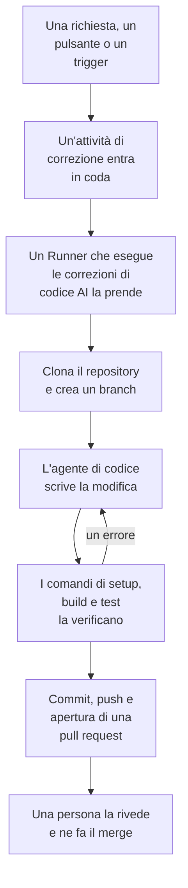

# Codice

Codice è il posto in cui chiedi a OneUptime AI di lavorare nei tuoi repository, come chiederesti a un agente di programmazione: correggere un bug, scrivere test, spiegare il codice, fare una modifica. Si apre sui tuoi repository collegati; la pagina di un repository contiene le sue attività e la casella in cui chiedi; la pagina di un'attività è una conversazione in cui puoi rispondere. OneUptime avvia anche attività da solo, a partire da eccezioni, tracce e indagini. Un [Runner](/docs/runbooks/agents) clona il repository, scrive la modifica su un nuovo branch, la compila e la testa, e apre una pull request. Una persona rivede e unisce ognuna: il Runner può fare il push di branch e aprire pull request, nient'altro.

:::cards
- [Chiedere all'IA in un repository](#chiedere-allia-in-un-repository): Una richiesta con parole tue, con il contesto che le serve.
- [La conversazione di un'attività](#la-conversazione-di-unattività): Cosa ha fatto l'IA, cosa ha modificato, e la tua risposta.
- [Come funziona un'esecuzione di correzione](#come-funziona-unesecuzione-di-correzione): Da un clic a una pull request, passo dopo passo.
- [Dove partono le attività di correzione](#dove-partono-le-attività-di-correzione): Le attività che OneUptime avvia, e cosa fa ogni pull request.
- [Prima di iniziare](#prima-di-iniziare): Un modello, un repository collegato e un Runner.
- [Quando una correzione non riesce](#quando-una-correzione-non-riesce): Cosa succede a un'esecuzione che va in errore, si blocca o resta in attesa.
:::

> [!TIP]
> Puoi avviarla anche da GitHub. Menziona la GitHub App di OneUptime in una issue o in una pull request e implementa, rivede o revisiona direttamente lì: vedi [GitHub App](/docs/ai/github-app). È lo stesso agente, lo stesso Runner e gli stessi budget; cambia solo il trigger.

## Chiedere all'IA in un repository

:::steps
### Apri un repository

Apri **Prodotti → Codice**. Elenca i repository del progetto, ognuno con le attività su cui l'IA sta lavorando, quelle che aspettano te e le sue pull request aperte. Se non ce n'è ancora nessuno, offre **Connetti GitHub** (vedi [Prima di iniziare](#prima-di-iniziare)).

### Di' cosa vuoi

Nella pagina del repository, scrivi la modifica, il bug o la domanda con parole tue. Un repository che non ha ancora attività ne suggerisce alcune sotto **Prova a chiedere**.

### Aggiungi contesto

Fai clic su **Aggiungi contesto** per dare all'IA ciò che le serve: un file o una cartella del repository, una nota, un collegamento o un record del progetto. OneUptime legge ogni record quando invii la richiesta, con i tuoi permessi, e conserva ciò che l'IA ha ricevuto.

### Avvia l'attività

Fai clic su **Avvia attività**, oppure premi Invio. Si apre la pagina dell'attività, e il lavoro dell'IA vi compare man mano che avviene.
:::

| Contesto | Cosa riceve l'IA |
| --- | --- |
| **File o cartella** | Un percorso nel repository, che l'IA legge per primo. |
| **Nota** | Testo che incolli: un errore, una specifica, una riga di log. |
| **Collegamento** | Un indirizzo web, come riferimento. |
| **Incidente** o **Avviso** | Il suo stato, la descrizione e la causa principale, così come sono quando invii la richiesta. |
| **Eccezione** | Il suo messaggio e lo stack trace. |
| **Monitor** | Il suo tipo, lo stato e la descrizione. |
| **Traccia** | I suoi span: nomi, tempi ed errori. |
| **Registri** | Le ultime 20 righe di log che contengono la tua ricerca, dell'ultima ora, dell'ultimo giorno o dell'ultima settimana. |
| **Profilo di prestazioni** | Dove va il tempo di una funzione nei profili del suo servizio: chi la chiama, cosa chiama e le sue righe più calde. |

Una richiesta porta al massimo 10 elementi di contesto. Token, chiavi, password e indirizzi email in ciò che OneUptime legge vengono oscurati prima che l'IA li veda, come ovunque OneUptime AI legga i tuoi dati.

## La conversazione di un'attività

La pagina di un'attività è una conversazione: cosa è stato chiesto e il contesto aggiunto, poi il turno dell'IA – i passi che compie mentre li compie (i file che ha letto e modificato, cosa ha cercato, i comandi che ha eseguito), la sua risposta, i file che ha modificato con il loro diff, e la pull request. In cima alla pagina si vede a che punto è l'attività:

| Stato | Cosa significa |
| --- | --- |
| **In coda** | Aspetta che un Runner la prenda. |
| **In corso…** | L'IA ci sta lavorando. **Ferma** la ferma; ciò che ha già inviato con il push resta sul branch. |
| **In attesa di te** | L'IA ha fatto una domanda. Rispondi nella casella qui sotto. |
| **Fatto** | L'IA ha finito: la sua risposta, e la pull request se ha modificato il codice. |
| **Non riuscito** | Il turno non è riuscito a finire, e dice perché. **Riprova** chiede di nuovo la stessa cosa. |
| **Arrestato** | Qualcuno l'ha fermata. **Riprova** chiede di nuovo la stessa cosa. |

Per continuare, scrivi nella casella in fondo: rispondi all'IA, aggiungi contesto o chiedi modifiche. Ogni risposta è il turno successivo della stessa attività: lavora sullo stesso branch e fa il push nella stessa pull request finché è aperta. Un'attività fa un turno alla volta, quindi la casella aspetta mentre l'IA lavora. Il **Registro** di ogni turno è la registrazione fedele di ciò che ha fatto.

Chi può leggere un repository ne legge le attività. Chiedere all'IA, rispondere e fermare un'attività richiedono il permesso di modificare il repository, e così vedere il diff di una modifica: tutti gli altri vedono quali file sono cambiati. Anche le attività che OneUptime avvia da solo (sotto) sono nel loro repository, come conversazioni in cui puoi rispondere.

## Come funziona un'esecuzione di correzione



1. Fai clic su **Avvia attività** in un repository, o su **Correggi con l'IA** su un'eccezione non risolta, oppure un altro pulsante o trigger avvia un'attività (vedi [Dove partono le attività di correzione](#dove-partono-le-attività-di-correzione)).
2. L'attività entra in coda sul suo repository, e il Runner scelto dal repository la prende: uno dei tuoi Runner, o un Runner globale quando non ne sceglie nessuno (vedi [Scegli il Runner del repository](#scegli-il-runner-del-repository)).
3. Il Runner recupera il contesto dell'attività. Per una richiesta, sono le sue parole, il contesto aggiunto e la conversazione fin lì; per un'eccezione, il tipo, il messaggio e lo stack trace.
4. Clona il repository in un proprio spazio di lavoro e crea un branch. Una correzione di un'eccezione si chiama `oneuptime-fix-exception-` seguito dai primi caratteri dell'id dell'esecuzione. Una risposta lavora invece sul branch della pull request aperta dell'attività.
5. Un agente di codice, alimentato dal provider LLM del tuo progetto, legge il codice e scrive la modifica. Il server OneUptime effettua le chiamate al LLM, quindi il Runner non possiede mai la chiave API del tuo provider, e ogni chiamata viene misurata ed elencata nei log dell'IA.
6. Se il repository ha comandi di verifica, un Runner tuo compila e testa la modifica prima di fare qualsiasi commit, e restituisce un errore all'agente di codice perché lo ripari (vedi [Verifica prima della pull request](#verifica-prima-della-pull-request)).
7. Il Runner fa il commit, il push del branch, apre la pull request (per una richiesta, solo se ha modificato il codice) ed elimina lo spazio di lavoro.

La pagina da cui è stata avviata l'attività ne mostra lo stato in tempo reale. Ogni attività è elencata nel suo repository, in **Prodotti → Codice**: la sua pagina è la sua conversazione, e il **Registro** di ogni turno ha una riga per ogni file che il Runner ha letto o scritto e per ogni comando che ha eseguito.

Ogni esecuzione è soggetta a budget che il server impone: al massimo **40 chiamate al LLM** e **100.000 token di output**. Un'esecuzione che ne raggiunge uno termina con un riepilogo del lavoro svolto fin lì invece di girare a vuoto. Le esecuzioni di correzione contano anche per i limiti giornalieri di IA del progetto, quando il progetto li imposta.

## Dove partono le attività di correzione

| Dove | Clic | La pull request |
| --- | --- | --- |
| La pagina **AI Assistance** di un'eccezione | **Correggi con l'IA** | Corregge il bug dietro l'eccezione. |
| La pagina **AI Assistance** di un'eccezione | **Generate Regression Test** | Aggiunge un test che riproduce l'eccezione e fallisce finché il bug non è corretto. |
| La pagina **AI Assistance** di un'eccezione | **Migliora la gestione degli errori** | Per un errore previsto, come un input non valido: toglie i dati utente dal messaggio, convalida l'input prima e contrassegna l'errore come gestito, senza cambiare il comportamento. |
| La scheda **AI Investigation** di un incidente o di un avviso | **Open Fix PR from this analysis** | Corregge la causa principale pubblicata dall'indagine (vedi [Correzioni di codice automatiche dalle indagini](#correzioni-di-codice-automatiche-dalle-indagini)). |
| Una traccia che vale la pena correggere | **Velocizza con l'IA** | Corregge lo schema lento indicato dal pulsante, come una query N+1 o chiamate che potrebbero procedere in parallelo. |
| La pagina **Registri** di un servizio | **Migliora i log** | Rende i log del servizio strutturati, con la severità giusta e collegati alle sue tracce, senza cambiare il comportamento. |
| La pagina **Tracce** di un servizio | **Migliora il tracciamento** | Aggiunge span e attributi dove manca il tracing del servizio, senza cambiare il comportamento. |
| Una funzione in **Profili di prestazioni** | **Correggi con l'IA** | Fa svolgere alla funzione lo stesso lavoro con meno tempo o memoria, con il suo profilo come prova. |

Questi pulsanti compaiono solo dove possono avviare un'attività. Con l'IA disattivata per il progetto, non ne compare nessuno e il menu laterale di un'eccezione non ha **AI Assistance**. **Migliora i log** e **Migliora il tracciamento** compaiono appena è collegato un repository, e **Velocizza con l'IA** solo su una traccia che vale la pena correggere (vedere [Esploratore tracce](/docs/telemetry/traces-explorer)). Il pulsante **Correggi con l'IA** di una funzione compare solo sul codice proprio dell'applicazione che occupa almeno il 5% del tempo o della memoria del profilo, o la cui quota è cresciuta di 3 punti o più rispetto alla finestra con cui è confrontata (vedete [Profilazione continua](/docs/telemetry/profiles)).

Per aprire la pagina **AI Assistance** di un'eccezione, apri l'eccezione in **Prodotti → Osservabilità → Eccezioni** e scegli **AI Assistance** nel suo menu laterale. Un'eccezione risolta o archiviata deve prima essere contrassegnata come non risolta.

OneUptime AI avvia anche attività di correzione da solo: da un'indagine che trova una modifica al codice, da una che termina senza conclusioni perché mancava telemetria, e dagli AI Insights su eccezioni e tracce lente. Ognuna ha il suo interruttore; vedi [Correzioni di codice automatiche](/docs/ai/ai-sre#correzioni-automatiche-del-codice).

## Verifica prima della pull request

Un repository può avere fino a tre comandi di verifica nella sua pagina **Impostazioni** in Codice:

| Comando | Esempio | Quando viene eseguito |
| --- | --- | --- |
| **Setup Command** | `npm ci` | Per primo, per installare le dipendenze. |
| **Build Command** | `npm run build` | Dopo il setup. |
| **Test Command** | `npm test` | Per ultimo. |

Quando uno di essi è impostato, ogni esecuzione di correzione verifica la sua modifica prima che si apra la pull request:

1. Quando l'agente di codice ha finito, i comandi vengono eseguiti in ordine nella radice del repository, sul Runner, nello spazio di lavoro clonato. Ognuno ha fino a 15 minuti e viene eseguito con `CI=true`, così niente resta in attesa di un input; il primo errore ferma il passaggio.
2. In caso di errore, la parte finale dell'output del comando fallito torna allo stesso agente di codice come attività di riparazione, con l'istruzione di correggere la propria modifica invece di indebolire o saltare i test, e i comandi vengono eseguiti di nuovo. Fa al massimo **2** tentativi di riparazione. Condividono il budget LLM dell'esecuzione, e le loro modifiche finiscono nello stesso commit della correzione.
3. L'esito, superato, fallito o saltato (nessun comando impostato, o un Runner globale), viene scritto in una sezione Verification della descrizione della pull request e registrato sulla pull request dell'attività.

Una modifica che continua a non superare la verifica non viene scartata: la pull request si apre comunque, con una sezione "Verification failed" ben evidenziata che nomina il comando fallito e termina con il suo output. Il lavoro resta, e chi rivede decide. Un repository senza comandi impostati viene segnalato come saltato, invece di far pensare a una build verde.

I comandi sono impostazioni del repository che scrive il tuo team, eseguite sul tuo Runner: lo stesso modello di fiducia dei passaggi Bash di un runbook. L'IA non li scrive né li modifica mai. Un Runner globale, che OneUptime esegue per ogni progetto, non li esegue mai: su un Runner globale la correzione viene scritta e aperta per la revisione, la verifica viene segnalata come saltata e la CI del tuo repository controlla la modifica. [Esegui un Runner tuo](#esegui-un-runner-tuo) per far compilare e testare le correzioni prima che si apra la pull request.

## Prima di iniziare

Un'attività ha bisogno di tre cose. La pagina di un repository in Codice e la pagina **AI Assistance** dell'eccezione le controllano tutte e tre prima di offrire l'avvio, e dicono cosa manca.

| Cosa | OneUptime Cloud | Self-hosted |
| --- | --- | --- |
| Un provider LLM | Niente da configurare: un progetto senza un proprio provider usa il provider globale, pagato con i crediti IA del progetto. Un tuo provider, in **Impostazioni del progetto → IA → Provider LLM**, ha la precedenza. | Imposta una volta sul server le variabili d'ambiente `GLOBAL_LLM_PROVIDER_*`, oppure aggiungi un provider al progetto. |
| Un repository collegato tramite la GitHub App | **Prodotti → Codice**, poi **Connetti GitHub**. Se l'app è già installata sull'account GitHub, fai invece clic su **Collega un'installazione esistente**: installarla di nuovo non la collega. Richiede il piano Growth. | Lo stesso, una volta che la tua istanza ha una GitHub App (vedi [Integrazione con GitHub](/docs/self-hosted/github-integration)). |
| Un Runner che esegue le correzioni di codice AI | Niente da gestire: un repository che non ne sceglie nessuno lavora sui Runner globali di OneUptime. | Il servizio `runner` di Docker Compose, o il Runner del chart Helm (`runner.enabled`, attivo per impostazione predefinita), si registra da solo ed esegue le correzioni di codice AI in ogni repository che non sceglie nessun Runner. |

Su un'istanza self-hosted, il provider globale è un blocco di `config.env` (Docker Compose) o dei tuoi valori Helm. Per un Ollama self-hosted:

```bash
GLOBAL_LLM_PROVIDER_TYPE=Ollama
# An address the OneUptime server can reach, never localhost.
GLOBAL_LLM_PROVIDER_BASE_URL=http://ollama:11434
GLOBAL_LLM_PROVIDER_MODEL_NAME=llama3.1
# No GLOBAL_LLM_PROVIDER_API_KEY needed — Ollama is keyless.
```

Qualsiasi provider supportato funziona: vedi [Provider LLM](/docs/ai/llm-provider) per tutti i provider e ogni variabile d'ambiente.

Non associ i repository ai servizi. Quando un'attività parte, OneUptime trova il repository confrontando i percorsi dei file dello stack trace dell'eccezione con i tuoi repository collegati. Se nulla corrisponde, ripiega su un repository che si chiama come il servizio, e poi sull'unico repository del progetto quando ce n'è uno solo. La pagina **AI Assistance** mostra quale repository ha trovato.

### Scegli il Runner del repository

Ogni repository sceglie il Runner su cui l'IA ci lavora: nella sua pagina **Impostazioni** in Codice, fai clic su **Modifica impostazioni** e scegline uno nel passaggio **Runner**. Un repository che non ne sceglie nessuno lavora su **Runner globale**, che OneUptime esegue per ogni progetto.

| Runner | Cosa fa con un'attività |
| --- | --- |
| **Runner globale** | Scrive la modifica e apre la pull request, senza i tuoi comandi di setup, build e test: la CI del tuo repository controlla la modifica. |
| Uno dei tuoi Runner | Esegue anche i tuoi comandi di setup, build e test, su un host che controlli tu. |

Solo il Runner scelto da un repository riceve le sue attività e un token per esso. In un progetto che disattiva **Usa i Runner globali** in **Runbook → Agenti di runbook**, ogni repository ha bisogno di uno dei Runner del progetto. La pagina di un Runner elenca i repository che lo scelgono.

### Esegui un Runner tuo

Per eseguire un Runner altrove, ad esempio su una macchina vicina ai tuoi repository:

:::steps
### Crea il Runner

Crea un Runner in **Runbook → Agenti di runbook** e fai clic su **Mostra istruzioni di configurazione** nella sua riga. Il comando contiene la chiave segreta del Runner, che solo un Project Owner, Project Admin o Runbook Admin può leggere. Ha questo aspetto:

```bash
docker run --name oneuptime-runner --restart unless-stopped \
  -e ONEUPTIME_RUNNER_ID=<runner-id> \
  -e ONEUPTIME_RUNNER_KEY=<runner-key> \
  -e ONEUPTIME_URL=<your-oneuptime-url> \
  -d oneuptime/runner:release
```

### Sceglilo per il repository

Nella pagina **Impostazioni** del repository in Codice, fai clic su **Modifica impostazioni** e scegli il Runner nel passaggio **Runner**. Il Runner recepisce la modifica al suo prossimo heartbeat, entro circa un minuto; non c'è nulla da riavviare.

### Verifica che si colleghi

Il Runner risulta collegato nella pagina **Runbook → Agenti di runbook** entro un paio di minuti. Se non succede, leggi il log del container (`docker logs oneuptime-runner`) per cercare un errore di credenziali o di rete.
:::

Qualsiasi modo di eseguire il container funziona (Docker Compose, Kubernetes e così via), purché abbia queste variabili e possa raggiungere la tua istanza OneUptime via HTTPS:

| Variabile | Cos'è |
| --- | --- |
| `ONEUPTIME_RUNNER_ID` | L'id del Runner, dalla dashboard. |
| `ONEUPTIME_RUNNER_KEY` | La chiave segreta del Runner. |
| `ONEUPTIME_URL` | L'indirizzo della tua istanza OneUptime (`https://oneuptime.com` su OneUptime Cloud). |

> [!NOTE]
> Prima di OneUptime 12, le correzioni di codice AI giravano su un componente AI Agent separato (l'immagine `oneuptime/ai-agent` con variabili `AI_AGENT_*`). È confluito nel Runner: se ne esegui ancora uno, la [guida all'aggiornamento da v11 a v12](/docs/installation/upgrading) spiega come sostituirlo.

## Correzioni di codice automatiche dalle indagini

Quando un'[indagine IA](/docs/ai/ai-sre) pubblica un'analisi della causa principale su un incidente o un avviso, e la sua attenta classificazione raccomanda una modifica al codice, la scheda dell'indagine offre **Open Fix PR from this analysis**: un'attività di correzione il cui intero contesto è l'analisi pubblicata. Il pulsante è nascosto quando il rimedio è operativo, solo infrastrutturale, esterno, un rifiuto previsto, un errore dell'utente o non conclusivo. Le correzioni idonee avvengono senza il clic finché l'interruttore **Apri una pull request di correzione quando un'indagine trova una modifica al codice** è attivo. Fa parte della correzione: si trova sotto **Correggi automaticamente i nuovi incidenti** in **Incidenti → IA → Impostazioni** (e sotto **Correggi automaticamente i nuovi avvisi** in **Avvisi → IA → Impostazioni**), si attiva quando si attiva la correzione e apre pull request solo finché la correzione è attiva. Entrambi partono disattivati, anche per i nuovi progetti.

Finché è attivo, un'indagine che termina con una causa principale certa e documentata, che una modifica al codice può correggere, mette in coda la stessa attività di correzione che crea il pulsante. La decisione è una classificazione vincolata che il server controlla, mai uno schema cercato nel testo dell'analisi: solo un verdetto positivo di correzione del codice apre una pull request. Prove mancanti, un rimedio fuori dal codice e una classificazione fallita portano tutti a non fare nulla.

Tutto il resto è come il pulsante:

- La pull request si apre pronta per la revisione, scritta a partire dall'analisi pubblicata, e richiede un repository collegato tramite la GitHub App e un Runner online per lavorarci: quello scelto dal repository, o un Runner globale.
- Conta per il limite giornaliero di attività di correzione di quel segnale (**Daily Incident AI Fix Task Limit** o **Daily Alert AI Fix Task Limit**, in **Altre impostazioni** nella sua pagina delle impostazioni IA) e per il tetto di pull request aperte del repository, quando uno dei due è impostato. Se non sono impostati, nessuno dei due limita nulla.
- Ogni trigger cerca prima un'attività di correzione già in coda o in esecuzione per lo stesso incidente o avviso, così un trigger automatico e un clic diventano di solito un'unica attività, non due pull request. Il controllo è una lettura prima della scrittura, non un blocco, quindi due trigger nello stesso istante possono comunque passare entrambi.
- L'esecuzione è scritta dal sistema, non è attribuita a nessuno, e niente viene unito da solo.

## Quando una correzione non riesce

:::details L'esecuzione va in errore
La correzione non si è potuta applicare, il repository non era raggiungibile o la chiamata al LLM è fallita. La conversazione dell'attività, e la pagina da cui è stata avviata, mostrano il motivo e offrono di riprovare. Il **Registro** del turno contiene il log completo dell'esecuzione.
:::

:::details Il Runner si ferma a metà di un'esecuzione
Un'esecuzione il cui heartbeat tace da più di 12 minuti viene chiusa con un errore. Non viene mai rimessa in coda da sola, perché il Runner potrebbe aver già fatto il push di una parte di un branch di correzione; riavviala da dove l'avevi avviata.
:::

:::details Nessun Runner prende l'attività
Un'attività che aspetta più di 30 minuti mentre il Runner che deve prenderla non è collegato - quello scelto dal suo repository, o un Runner globale per un repository che non ne sceglie nessuno - fallisce, con un messaggio che dice quale, così non risulta mai in corso per sempre. Quando un Runner è online ma occupato, le attività in coda aspettano il loro turno. Un Runner precedente a Codice non riceve mai una richiesta da Codice: aggiorna un Runner che esegui tu insieme al server.
:::

## Privacy

Il clone del tuo repository vive in uno spazio di lavoro dentro il container del Runner e viene eliminato al termine dell'esecuzione, che sia riuscita o no. Il Runner non possiede mai la chiave API del tuo provider LLM: il server OneUptime effettua le chiamate al LLM per lui. OneUptime non conserva il tuo repository e non si addestra sul tuo codice. Il log dell'attività conserva i primi 300 caratteri dell'output di ogni passaggio, così puoi controllare cosa ha fatto il Runner, e questo può includere frammenti di codice. Esegui un Runner self-hosted con il tuo provider LLM (Ollama locale compreso) e il tuo codice non lascia mai la tua infrastruttura.

## In programma

Previsto, e **non ancora disponibile**:

- **Supporto per GitLab.** I repository si collegano solo tramite la GitHub App.
- **Più telemetria in una correzione.** Portare nella correzione le tracce, i log e le metriche attorno a un'eccezione, oltre lo stack trace.

## Passi successivi

:::cards
- [GitHub App](/docs/ai/github-app): Chiedi una modifica, una revisione o una review direttamente da GitHub.
- [AI SRE](/docs/ai/ai-sre): Le indagini le cui analisi le attività di correzione possono trasformare in pull request.
- [Agenti di runbook](/docs/runbooks/agents): Il worker che svolge ogni esecuzione di correzione.
:::
