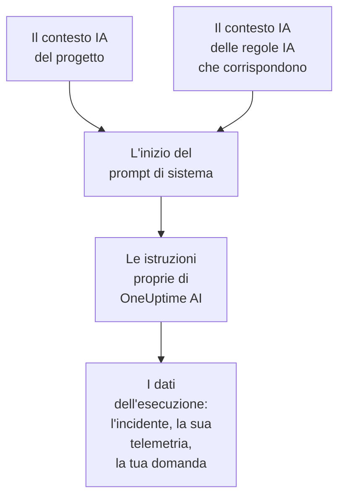

# Contesto IA

Il contesto IA è ciò che il tuo team scrive per OneUptime AI sui vostri sistemi: come si collegano tra loro, a chi spetta ogni sintomo, dove sono i log e le parole che usa il tuo team. OneUptime AI lo legge per primo in ogni indagine, ogni correzione, ogni bozza di post-mortem e ogni conversazione di Chiedi all'IA, così parte da ciò che il tuo team sa già.

:::cards
- [Scrivere il contesto IA](#scrivere-il-contesto-ia): Una scheda nelle impostazioni IA del progetto.
- [Le note proprie di una regola IA](#le-note-proprie-di-una-regola-ia): Note su ciò a cui corrisponde una regola.
- [Cosa lo legge](#cosa-lo-legge): Le funzioni che lo leggono, e quelle che non lo leggono.
- [Cosa ha letto un'esecuzione](#cosa-ha-letto-unesecuzione): Ogni esecuzione mostra le note che ha ricevuto.
:::

## Come funziona

OneUptime AI mette il contesto IA proprio all'inizio del suo prompt di sistema, prima delle proprie istruzioni e dei dati dell'esecuzione: prima le note del progetto, poi quelle delle regole IA che corrispondono. Le legge come conoscenze di fondo del tuo team. Non sono una prova di ciò che sta succedendo ora, e non cambiano mai le regole proprie di OneUptime AI.

Poiché le note vengono per prime e restano uguali da un'esecuzione all'altra, fanno parte dell'inizio del prompt che i provider mettono in cache. Con Anthropic, OneUptime contrassegna il prompt di sistema per la cache; OpenAI, Azure OpenAI e gli altri provider che mettono in cache l'inizio ripetuto di un prompt lo fanno da soli. Le note che non sono cambiate costano meno da rileggere.

## Scrivere il contesto IA

:::steps
### Aprire AI Features
Apri **Impostazioni del progetto → IA → AI Features**. La scheda **Contesto IA** si trova sotto **Abilita IA**.

### Scrivere le note
Fai clic su **Aggiungi contesto IA**, oppure su **Modifica** quando le note ci sono già. Scrivi in Markdown, oppure fai clic su **Parti da uno schema** per avere un titolo per ogni tipo di nota.

### Salvarle
Fai clic su **Salva modifiche**. La scheda mostra le note, quanto sono lunghe e all'incirca quanti token legge un modello per esse.
:::

Scrivi quello che racconteresti a chi è appena entrato nel team:

| Tipo di nota | Per esempio |
| --- | --- |
| Come si collegano i tuoi sistemi | `checkout-api` serve la pagina di pagamento e dipende da `payments-db`. |
| A chi spetta ogni sintomo | Un 502 sulla pagina di pagamento spetta al team Pagamenti: controlla prima `payments-db`. |
| Dove sono i log | I log del pagamento sono in Loki sotto `app=checkout`. |
| Le parole del tuo team | PSP è il nostro fornitore di servizi di pagamento. |

> [!WARNING]
> Non inserire segreti: chiunque possa vedere cosa ha fatto un'esecuzione IA può leggere le note che ha ricevuto.

## Le note proprie di una regola IA

Una regola IA può avere note proprie sugli incidenti o sugli avvisi a cui corrisponde: i servizi di un prodotto, chi ne è responsabile, dove sono i loro log. Scrivile nel campo **Contesto IA** della regola, in **Altri campi**, dopo **Provider LLM**. Una regola che esegue soltanto i suoi runbook ogni volta non chiede nulla a OneUptime AI, quindi non ha un contesto IA da scrivere.

- Un'indagine legge le note del progetto, poi quelle di ogni regola IA attiva che indaga e corrisponde all'incidente o all'avviso, nell'ordine dei nomi delle regole.
- Una correzione legge le note del progetto, poi quelle della propria regola.
- La conversazione su un incidente o un avviso legge le stesse note della sua indagine.

## Cosa lo legge

| Funzione | Cosa legge |
| --- | --- |
| Le indagini di AI SRE, e i loro nuovi controlli quando si apre un nuovo avviso | Le note del progetto, e quelle delle regole IA che corrispondono |
| Le correzioni che una regola IA avvia: i loro piani, comandi e server MCP | Le note del progetto, e quelle della regola |
| Chiedi all'IA, e la conversazione su un incidente o un avviso | Le note del progetto; su un incidente o un avviso, anche quelle delle regole IA che corrispondono |
| Le risposte in Slack e Microsoft Teams | Le note del progetto |
| Le bozze di post-mortem, per incidenti ed episodi | Le note del progetto |
| La classificazione in AI Insights e quella dei casi di sicurezza | Le note del progetto |

Le chiamate che si limitano a riformulare o giudicare ciò che ricevono non lo leggono: le bozze di note e di note pubbliche, i riepiloghi delle chiamate, il riepilogo, la fiducia e il voto di un'indagine, e il titolo di una conversazione. Nemmeno i prompt che le persone scrivono da sé, nel passaggio IA di un workflow.

## Limiti

| Cosa | Al massimo |
| --- | --- |
| Il contesto IA del progetto | 20.000 caratteri |
| Il contesto IA di una regola IA | 5.000 caratteri |
| Tutto il contesto IA che legge un'esecuzione | 30.000 caratteri |

Il modulo conta i caratteri mentre scrivi e rifiuta un salvataggio oltre il limite, e così fa l'API. Un'esecuzione legge prima le note del progetto, poi quelle di ogni regola che corrisponde, nell'ordine dei loro nomi. Una regola le cui note porterebbero l'esecuzione oltre 30.000 caratteri viene lasciata fuori per intero, e l'attività dell'esecuzione lo dice.

Il numero di token è una stima: la dimensione delle note in byte UTF-8 divisa per 4, arrotondata per eccesso. Ogni modello conta i token a modo suo, quindi il conteggio di un provider può essere diverso, soprattutto per un testo che non è in inglese.

## Cosa ha letto un'esecuzione

Ogni esecuzione registra parola per parola le note che ha letto. La sua attività dice **Letto il contesto IA del progetto**, oppure di quante regole IA ha letto anche le note, con all'incirca quanti token erano. **Visualizza** apre le note così come le ha lette l'esecuzione: prima quelle del progetto, poi quelle di ogni regola sotto il suo nome, anche dopo che sono state modificate. Quando le note di una regola sono state lasciate fuori per il limite dell'esecuzione, un messaggio di avvertimento lo dice.

## Chi può modificarlo

- **Project Owner** e **Project Admin** possono modificare il contesto IA del progetto. **Project Member**, **Viewer** e **Read Project** possono leggerlo.
- Le note di una regola IA fanno parte della regola: chi può modificare la regola può modificarle.
- Le note vengono lette solo per il loro progetto: nessuna esecuzione legge il contesto IA di un altro progetto.

Tramite l'API o Terraform, le note del progetto sono il campo `aiContext` del progetto, e quelle di una regola IA il campo `aiContext` della regola stessa.

## Prossimi passi

:::cards
- [AI SRE](/docs/ai/ai-sre): Lascia che OneUptime AI indaghi su ogni nuovo incidente e avviso.
- [Chiedi all'IA](/docs/ai/ask-ai): Fai domande sui dati del tuo progetto in una conversazione.
- [Provider LLM](/docs/ai/llm-provider): Scegli il modello che legge le note.
:::
